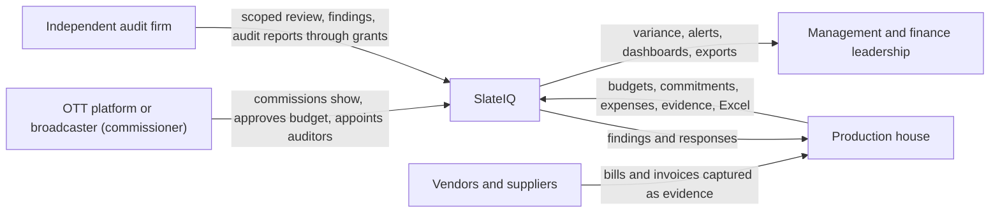
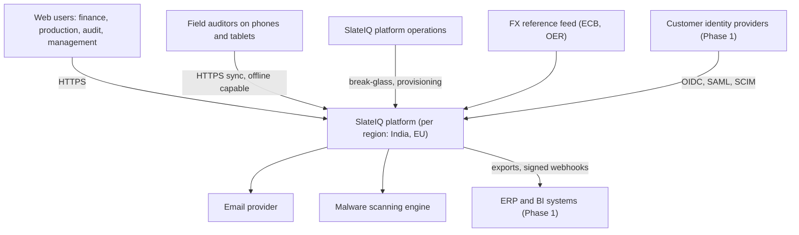
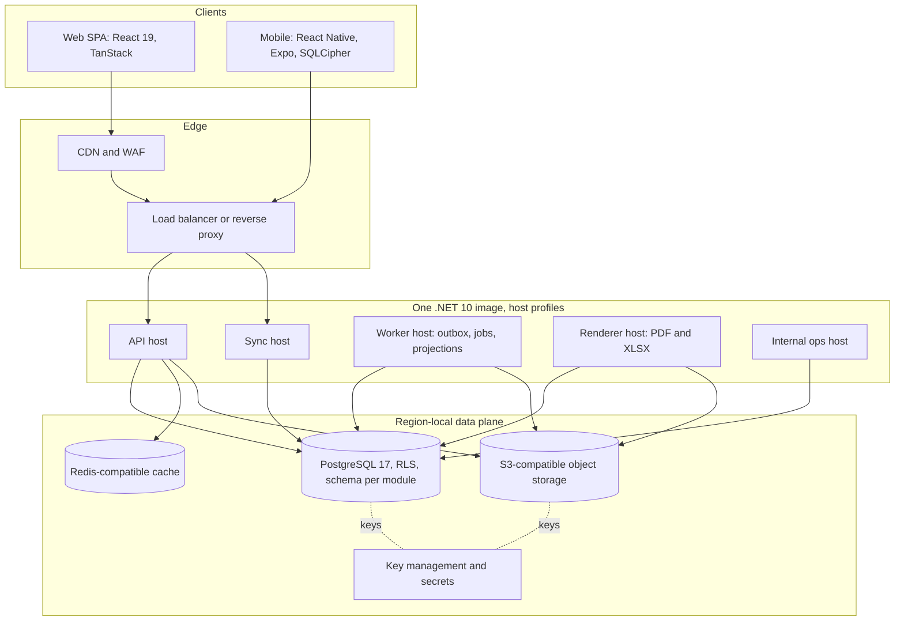
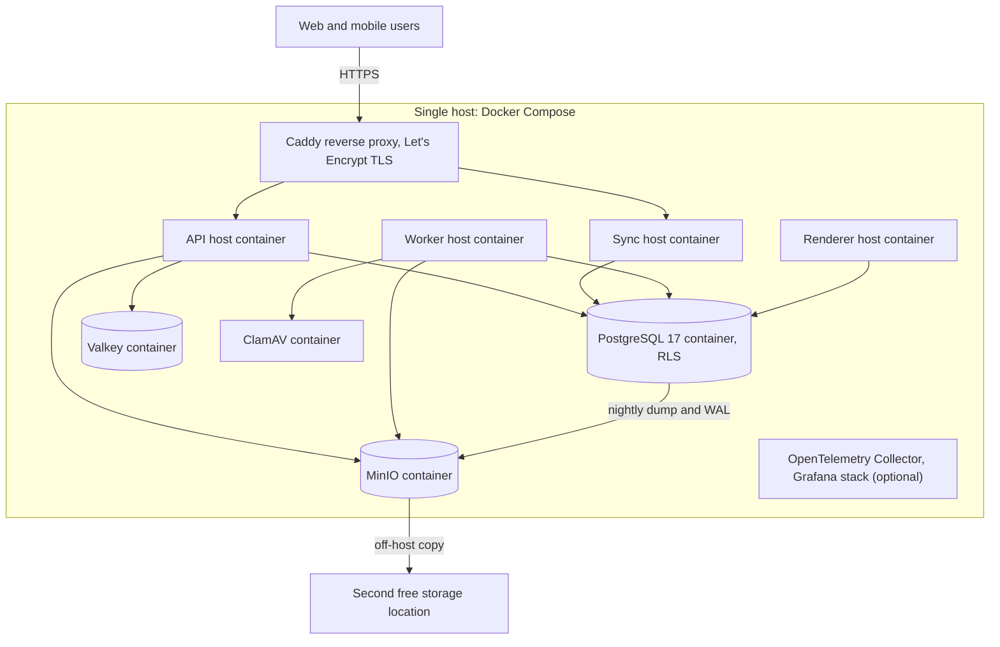

# Document 0: Foundation Index, Reconciliation Register & Quality Gate

**Product:** SlateIQ — Production Cost Intelligence & Audit Monitoring Platform
**Document ID:** SLQ-ARCH-000
**Version:** 1.1.0
**Supersedes:** 1.0.0, archived at `_archive/00-foundation-index.v1.0.0-unverified.md` (it declared the set approved and the quality gate passed while five documents were unfinished)
**Classification:** Internal — Architecture Foundation
**Status:** Draft — For Review
**Date:** 2026-11-12
**Authors:** Principal Enterprise Solution Architect

---

## 1. How to Use This Set

The set answers the governing brief (`_reference/governing-architecture-brief.md`) with its eighteen deliverables. Start here, then read in this order for each audience.

| Reader | Path |
|--------|------|
| Executive sponsor, product owner | 1 → 2 §2 → 18 → 17 §4 → §8 below |
| Backend engineer | 2 → 3 §5–§7 → 4 → 5 → 7 → 8 → 9 |
| Web engineer | 2 → 3 §5.13 → 7 (client structure) → 9 → 13 (dashboards) |
| Mobile engineer | 2 → 3 §4 → 11 → 9 (sync) |
| Data and BI engineer | 2 → 8 → 13 → 12 |
| Security, compliance, audit | 3 → 10 → 14 → 5 |
| SRE and DevOps | 6 → 15 → §8 below → 14 → 16 |
| QA | 4 → 5 → 16 |

## 2. The Document Set

### 2.1 Current Set (decision D-023)

| No | File | Document | ID | Lines | Status |
|----|------|----------|----|-------|--------|
| 0 | `00-foundation-index.md` | Foundation index, reconciliation register, quality gate | SLQ-ARCH-000 | — | Draft |
| 1 | `01-product-vision-business-requirements.md` | Product Vision & Business Requirements (v1.1.1) | SLQ-ARCH-001 | 2,909 | Draft — for review |
| 2 | `02-domain-model-business-capabilities.md` | Domain Model & Business Capability Map (v2.0.0) | SLQ-ARCH-002 | 604 | Draft — for review |
| 3 | `03-actor-permission-architecture.md` | Actor, Permission, Tenancy & Identity Architecture | SLQ-ARCH-003 | 5,416 | Draft — for review |
| 4 | `04-workflows-state-machines.md` | Core Business Workflows & State Machines | SLQ-ARCH-004 | 1,609 | Draft — for review |
| 5 | `05-business-rules-invariants.md` | Business Rules & Invariants Catalogue | SLQ-ARCH-005 | 729 | Draft — for review |
| 6 | `06-high-level-solution-architecture.md` | High-Level Solution Architecture (published 2026-11-05 as Document 3) | SLQ-ARCH-006 | 3,493 | Draft — for review |
| 7 | `07-module-dependency-architecture.md` | Module & Dependency Architecture | SLQ-ARCH-007 | 1,247 | Draft — for review |
| 8 | `08-database-conceptual-model-erd.md` | Database Conceptual Model & ERD | SLQ-ARCH-008 | 1,416 | Draft — for review |
| 9 | `09-api-architecture-endpoint-catalogue.md` | API Architecture & Endpoint Catalogue | SLQ-ARCH-009 | 1,546 | Draft — for review |
| 10 | `10-security-architecture.md` | Security Architecture | SLQ-ARCH-010 | 993 | Draft — for review |
| 11 | `11-mobile-offline-architecture.md` | Mobile & Offline Architecture | SLQ-ARCH-011 | 1,031 | Draft — for review |
| 12 | `12-excel-integration-architecture.md` | Excel Integration Architecture | SLQ-ARCH-012 | 1,057 | Draft — for review |
| 13 | `13-analytics-cost-calculation.md` | Analytics & Cost Calculation Architecture | SLQ-ARCH-013 | 795 | Draft — for review |
| 14 | `14-audit-observability-architecture.md` | Audit & Observability Architecture | SLQ-ARCH-014 | 900 | Draft — for review |
| 15 | `15-infrastructure-deployment-architecture.md` | Infrastructure & Deployment Architecture | SLQ-ARCH-015 | 1,623 | Draft — for review |
| 16 | `16-testing-strategy.md` | Testing Strategy | SLQ-ARCH-016 | 714 | Draft — for review |
| 17 | `17-risk-register-adrs.md` | Risk Register & Architecture Decision Records (generated registers) | SLQ-ARCH-017 | 401 | Draft — for review |
| 18 | `18-phased-implementation-roadmap.md` | Phased Implementation Roadmap | SLQ-ARCH-018 | 236 | Draft — for review |

Supporting folders: `_reference/` (governing brief), `_archive/` (every superseded file; the folder is the rollback path), `_build/` (assembly segments of Document 3 and the authoring brief used for Documents 4–16), `mermaid-diagrams/` (version 1.0.0 diagrams of the first draft; superseded by the diagrams embedded in the documents).

### 2.2 Superseded Numbering

Documents 1, 3 and 6 were written when an earlier document list (Document 1 Appendix D) was in force. Text inside them may use the old numbers. Read them with this map.

| Old number and title | Current document |
|----------------------|------------------|
| 3 System Architecture & Technology Stack | 6 |
| 4 Multi-Tenancy & Identity Architecture | 3 |
| 5 Data Architecture & Database Design | 8 |
| 6 API & Integration Architecture | 9 |
| 7 Security & Compliance Architecture | 10 |
| 8 Production & Budget Domain Design | 4 (with 5 and 13) |
| 9 Expense Capture & Offline Sync Design | 11 (with 4) |
| 10 Cost Intelligence & Analytics Design | 13 |
| 11 Document & Evidence Management Design | 10 (storage, scanning) and 4 (lifecycle) |
| 12 Excel Import/Export Design | 12 |
| 13 Notification & Alerting Design | 7 (asynchronous catalogue) and 4 (SM-18) |
| 14 Audit Trail, Retention & Legal Hold | 14 |
| 15 Mobile Application Architecture | 11 |
| 16 Frontend & UX Architecture | 7 (client structure) |
| 17 Deployment, Operations & Observability | 15 and 14 |
| 18 Implementation Roadmap | 18 |

### 2.3 Required Diagrams

| Brief diagram | Location |
|---------------|----------|
| 1 Business context | §3.1 below; Document 1 §4.4 stakeholder map |
| 2 System context | §3.2 below |
| 3 High-level solution architecture | §3.3 below; Document 6 §3 (text diagrams) |
| 4 Module dependency | Document 7; Document 2 §3 context map |
| 5 Entity relationship | Document 8 (eight schema ERDs); Document 2 §8 conceptual ERD |
| 6 Tenant isolation model | Document 8; Document 10 |
| 7 Expense submission workflow | Document 4 |
| 8 Audit approval workflow | Document 4 |
| 9 Cost-overrun detection | Document 4; Document 13 projection pipeline |
| 10 Mobile offline synchronisation | Document 11 |
| 11 Excel import workflow | Document 12 |
| 12 Deployment architecture | Document 15; zero-cost profile in §8.4 below |

All 59 Mermaid diagrams in Documents 0 to 18 parse without error with Mermaid 11.4.1 (checked 2026-11-12).

## 3. Context and Solution Diagrams

### 3.1 Business Context

### 3.2 System Context

### 3.3 High-Level Solution Architecture

## 4. Reconciliation Register

Conflicts found between documents and how they are resolved. Unresolved notes are proposals awaiting the owning document's review.

### 4.1 Resolved Across the Set

| ID | Conflict | Resolution | Applied in |
|----|----------|------------|------------|
| RC-01 | Rounding half-even (Document 6 §8.3) versus half-up (BR-FIN-002) | Half-up at the defined rounding points; storage scale 4 | Documents 2, 5, 13 |
| RC-02 | Cross-schema foreign keys (Document 3 §9.9) versus none (Document 6 §5.4) | Composite keys within a schema; no cross-schema keys; contract validation and nightly reconciliation | Documents 3 G-04, 8 ADR-035 |
| RC-03 | Forecast owned by Intelligence (Document 6) or Budget (Document 3) | `budget.forecast`; Intelligence computes EFC | Documents 2 D2-19, 13 |
| RC-04 | Delegation in Budget (Document 6) or Tenancy (Document 3) | `tenancy.delegation` | Documents 2, 3 |
| RC-05 | Single `GrantCreated` event (Document 6 Appendix B) | Grant lifecycle events (Document 3 §12.8) | Document 3 D4-06 |
| RC-7-04 / RC-08-01 | Approval instances per module or central | Non-expense approvals in `budget.approval_*`; expense approvals in `expense.approval_*` | Documents 3 Appendix D, 7, 8 |
| RC-08-02 | Queue tables Family F versus A | Family A, written by `slateiq_app`; claimed by `slateiq_dispatch` | Documents 3 Appendix D, 8 |
| G-05 | Cost Controller missing as a role | `COST_CONTROLLER` added (eighteen roles) | Document 3 |
| — | Permission keys requested by Documents 9 and 10 | `notification.webhook.*` (Phase 1), `vendor.payment_term.administer` added to the catalogue | Document 3 Appendix A |

### 4.2 Open Change Requests Against Published Documents

| ID | Target | Change |
|----|--------|--------|
| D4-01 to D4-05 | Document 6, Document 1 | Session idle default, password wording, refresh lifetimes, region at MVP, seventh scope type (Document 3 Appendix G) |
| D4-06 | Document 6 Appendix B | Grant lifecycle events |
| D2-16 to D2-19 | Document 6 §5.1 | Audit reports and findings, cost posting ledger, show closure, forecast ownership |
| CR-C01 | Documents 6 §6, 15, 18 | Zero-cost build and deployment profile (§8; ADR-068) |

### 4.3 Reconciliation Notes Raised by Documents 4 to 15

Each document lists its own notes with a proposed resolution: Document 4 (11), 5 (6), 7 (9), 8 (7), 9 (9), 10 (6), 11 (10), 12 (12), 13 (8), 14 (7), 15 (8). They are proposals; each is accepted or rejected at that document's review. None changes a binding ADR.

## 5. Architecture Quality Gate (governing brief §26)

| Check | Result | Evidence |
|-------|--------|----------|
| Business requirements understood | Pass | Document 1 (216 FR, 90 NFR, 83 BR) |
| Domain entities identified | Pass | Document 2 §6 |
| Entity relationships defined | Pass | Document 2 §8, Document 8 |
| Actors and permissions defined | Pass | Document 3 §5, Appendix A (18 roles, 7 scopes) |
| Tenant isolation designed | Pass | Document 3 §7, Document 8, Document 10 |
| Business invariants documented | Pass | Document 5 (INV-001 to INV-035, 83 BR) |
| Lifecycle state machines defined | Pass | Document 4 (SM-01 to SM-19) |
| Core workflows documented | Pass | Document 4 (WF-01 to WF-21) |
| Transaction boundaries defined | Pass | Documents 4, 6 §4.4, 8 |
| Concurrency strategy defined | Pass | Document 8 (ADR-038), Document 9 (ETag) |
| Idempotency strategy defined | Pass | Documents 9, 11, 12 |
| Failure and recovery scenarios defined | Pass | Documents 4, 11, 15 |
| Database strategy established | Pass | Document 8 |
| API standards established | Pass | Document 9 |
| Security architecture established | Pass | Documents 3, 10 |
| Mobile offline strategy established | Pass | Document 11 |
| Excel integration strategy established | Pass | Document 12 |
| Financial calculations defined | Pass, pending validation | Document 13; tax and statutory items OQ-5-01, A2-04 await advisor review |
| Audit history defined | Pass | Document 14 |
| Observability defined | Pass | Document 14 |
| Testing strategy defined | Pass | Document 16 (TS-01 to TS-42) |
| Deployment architecture defined | Pass, with open constraint | Document 15 (paid managed cloud); zero-cost profile C-01 in §8 not yet reflected in Document 15 |
| No critical architectural gaps remain | **Conditional** | See §6 |

**Verdict.** The foundation is complete enough to start Phase 0 (Document 18 §5.1). It is **not** production-ready, and no document is yet approved: every document is a draft awaiting its named reviewers.

## 6. Conditions Before Production Readiness

1. Close the blocking decisions in Document 17 §4: G-01, G-02, OD-01, OQ-4-05, OQ-5-01, A2-04, OQ-13-01, G-03, G-04, G-06, the CERT-In applicability question, and the zero-cost constraint C-01 (ADR-068).
2. Review and accept or reject the reconciliation notes of §4.3 and the change requests of §4.2.
3. Obtain sign-off of every document from the reviewers named in its header.
4. Pass the Document 16 pre-production scenarios and the Document 1 §17 pilot entry gate.

## 7. Verification Performed (2026-11-12)

| Check | Result |
|-------|--------|
| Mermaid syntax, all diagrams in Documents 0 to 18 | 59 of 59 parse (Mermaid 11.4.1) |
| ADR coverage | ADR-001 to ADR-067 each defined exactly once in its owning document; ADR-068 defined in §8.5 |
| Permission keys cited by Documents 4 to 16 | All present in Document 3 Appendix A after the two catalogue additions in §4.1; remaining checker hits are column, metric or event names, not permissions |
| Table names cited | Present in Document 3 Appendix D after the additions of Document 8 RC-08-01; remaining hits are audit event names and configuration keys |
| Superseded document titles in current text | None found in Documents 2, 4, 5, 7 to 18 |

## 8. Constraint C-01: Zero-Cost Build and Deployment

### 8.1 Statement

Recorded 2026-11-12 from the business owner: the complete application must be buildable and deployable free of charge. Interpreted as: no paid software licences, no paid build service and a hosting option with no recurring charge, using the same code and container images as the paid production profile.

### 8.2 Impact Analysis

| Area | Current decision | Cost | Zero-cost equivalent | Change needed |
|------|------------------|------|----------------------|---------------|
| Backend, web, mobile code | .NET 10, React 19, React Native + Expo, PostgreSQL 17 (ADR-001, ADR-013) | Free, open source | Same | None |
| Libraries | ExcelDataReader, OpenXML SDK, Playwright, Polly, Serilog, OpenTelemetry, xUnit, Testcontainers, k6 | Free, open source | Same | None |
| Cache | Redis 7.4 managed | Paid hosting | Valkey (open-source Redis fork) in a container | Document 15 profile |
| Object storage | Managed S3 with Object Lock | Paid | MinIO (S3 API, object locking) in a container | Document 15 profile |
| Malware scanning | ClamAV | Free | Same | None |
| Compute | ECS Fargate (ADR-015) | Paid | Docker Compose on one host: an always-free cloud VM tier or a customer-owned server | ADR-068 |
| Database hosting | Managed PostgreSQL Multi-AZ | Paid | PostgreSQL 17 container with WAL archiving to MinIO and nightly `pg_dump` | Document 8 backup section for this profile |
| Edge | CloudFront, WAF, ALB | Paid | Caddy reverse proxy with automatic Let's Encrypt TLS; application rate limiting (Document 10) remains | Document 15 profile |
| Secrets and keys | Cloud KMS and secrets manager | Paid | Docker secrets plus envelope keys held in a file protected by host disk encryption | Document 10 note: weaker than KMS |
| Email | SES | Paid at volume | SMTP adapter to any provider's free tier; Mailpit locally | Configuration only |
| Telemetry | OpenTelemetry to managed backends | Paid | OpenTelemetry Collector with Prometheus, Loki, Tempo and Grafana containers, or logs only | Document 14 profile |
| CI/CD | GitHub Actions (ADR-015) | Free for public repositories; limited free minutes for private | Same, within free minutes; self-hosted runner if exceeded | None |
| Android distribution | Play Store | One-time developer fee | Direct APK or MDM side-loading | Document 11 note |
| iOS distribution | App Store or TestFlight | Annual developer fee | **No free path to install on iPhones beyond a developer's own devices** | Business owner decision |

### 8.3 What Zero Cost Cannot Provide

These are not achievable without paid services and are disclosed rather than designed away:

1. iOS distribution to field auditors (Apple developer programme fee).
2. The availability, RTO and RPO targets of Document 1 NFR-AVL (99.5 percent, 4-hour RTO, 15-minute RPO) on a single free host; the zero-cost profile targets best-effort availability and a 24-hour RPO.
3. Multi-AZ resilience, managed key custody and the Object Lock compliance mode used as audit evidence for SOC 2.
4. Data residency guarantees beyond the region of the chosen free host.

### 8.4 Zero-Cost Deployment Profile (Proposed)

### 8.5 ADR-068 — Zero-Cost Deployment Profile Alongside the Managed Profile (Provisional)

| Field | Content |
|-------|---------|
| **Status** | Provisional — confirm with the business owner (gate C-01) |
| **Context** | The business owner requires that the complete application can be built and deployed free of charge. The baseline (ADR-015) uses paid managed AWS services. |
| **Decision** | Keep one codebase and one set of container images. Add a second deployment profile, "zero-cost", run by Docker Compose on a single host with open-source substitutes (Valkey, MinIO, Caddy, self-hosted PostgreSQL and telemetry). Every infrastructure dependency is reached through its standard protocol (PostgreSQL wire, Redis protocol, S3 API, SMTP, OTLP), so the application does not change between profiles. The managed profile (ADR-015) stays the recommended profile for paying production tenants. |
| **Alternatives rejected** | Replace the managed profile entirely (loses the availability, residency and SOC 2 evidence commitments of Document 1); use proprietary free tiers with lock-in (they expire or change terms). |
| **Consequences** | Document 15 gains a zero-cost profile section and a `docker-compose.zero-cost.yml`; Documents 8, 10 and 14 add profile notes for backups, key custody and telemetry; Document 16 runs the full suite against both profiles; iOS distribution and the NFR-AVL targets remain unavailable at zero cost (§8.3). |

### 8.6 Open Items

| ID | Question | Owner |
|----|----------|-------|
| OQ-0-01 | Does "free" apply to production hosting, or to build and evaluation only? | Business owner |
| OQ-0-02 | Is Android-only field capture acceptable if iOS distribution must be free? | Business owner |
| OQ-0-03 | Which free host is acceptable for India-resident data? | Business owner, Legal |

---

*End of Document 0*
