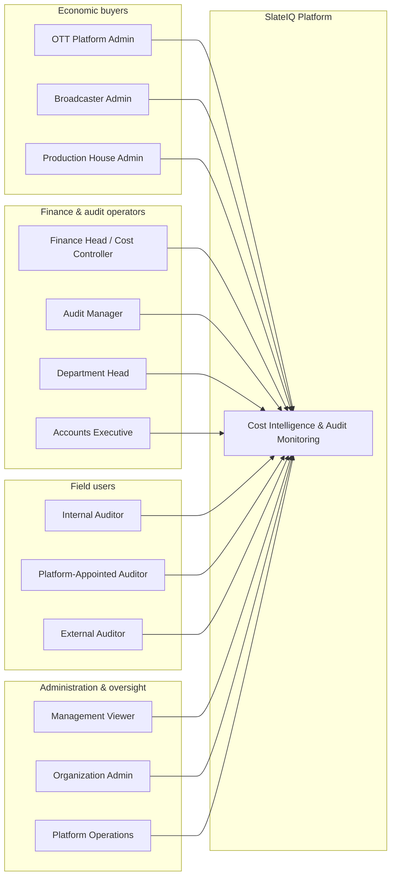

# Document 1: Product Vision & Business Requirements

**Product:** SlateIQ — Production Cost Intelligence & Audit Monitoring Platform
**Document ID:** SLQ-ARCH-001
**Version:** 1.1.1 (Comprehensive Business Requirements)
**Supersedes:** 1.0.0 (Architecture Foundation)
**Classification:** Internal — Architecture Foundation
**Status:** Draft — For Review
**Date:** 2026-11-05
**Authors:** Principal Enterprise Solution Architect, Domain Architect, Technical Product Strategist, Business Analyst
**Reviewers:** Product Owner (TBD), Finance SME (TBD), Audit SME (TBD), Security & Compliance (TBD), Legal (TBD)

---

## Document Control

### Approval Matrix

| Role | Name | Responsibility | Approval Required |
|------|------|----------------|-------------------|
| Product Owner | TBD | Business scope, priorities, release boundary | Yes |
| Finance SME | TBD | Budget, variance, FX, financial controls | Yes |
| Audit SME | TBD | Audit workflow, evidence, auditor access | Yes |
| Security & Compliance | TBD | Tenant isolation, privacy, regulatory controls | Yes |
| Legal | TBD | Data processing, retention, cross-border access | Yes |
| Principal Architect | TBD | Cross-document consistency and traceability | Yes |

### Revision History

| Version | Date | Author | Change |
|---------|------|--------|--------|
| 1.0.0 | 2026-11-05 | Architecture Team | Initial foundation draft |
| 1.1.0 | 2026-11-05 | Architecture & Business Analysis | Expanded into comprehensive BRD: personas, journeys, functional and non-functional requirements, business rules, reporting, integrations, release scope, decision register, risk register, acceptance gates, traceability, and Doc 2 impact log |
| 1.1.1 | 2026-11-06 | Principal Architect | Decision D-023 recorded: document set re-baselined to the governing brief; Appendix D marked superseded in part. No requirement changed |

### Review & Sign-off Status

Draft for review. No section is approved until the approval matrix is complete. Items marked **[DECISION REQUIRED]** must be resolved before Phase 1 design freeze.

### Reading Guide

| Reader | Start here |
|--------|------------|
| Executive sponsor | §1, §7, §13, §17 |
| Product owner | §2–§8, §13–§14 |
| Architect | §8–§12, Appendix B–E |
| Finance SME | §5, §8.4, §8.7, §10, §11 |
| Audit SME | §5, §6, §8.6–§8.7, §10 |
| Security & compliance | §9, §10.9, §12, §14–§16 |
| Delivery lead | §13, §15–§17, Appendix D |

### Conventions

| Convention | Definition |
|------------|------------|
| Requirement ID | `FR-<DOMAIN>-###` functional, `NFR-<CATEGORY>-###` non-functional, `BR-<DOMAIN>-###` business rule |
| Priority | MoSCoW: **Must** (MVP), **Should** (Phase 1), **Could** (Phase 2), **Won't** (explicitly excluded) |
| Release labels | **MVP** = pilot-ready foundation; **Phase 1** = general availability; **Phase 2** = expansion; **Later** = not scheduled |
| "Shall" | Mandatory requirement; "should" is recommended; "may" is optional |
| Currency | Amounts are stored and calculated in the organization's base currency unless explicitly stated |
| Cross-references | `CAP-###` refers to Document 2 capability map; `D2-###` refers to Appendix E; `D-###` refers to §14 decision register |
| Traceability | Every functional requirement maps to at least one objective (§7) and one capability (`CAP-###`) |

---

## 1. Executive Summary

### 1.1 The Problem

Film, television, and OTT production finance still runs on spreadsheets, email, and periodic auditor reports. Each production, auditor, and commissioning organization applies its own template, category scheme, and reporting cadence. The result is a 2–4 week visibility lag, manual consolidation errors, weak vendor spend control, delayed overrun detection, and incomplete audit evidence. Management learns about cost problems after the money is committed.

### 1.2 The Product

SlateIQ is a multi-tenant **Production Cost Intelligence & Audit Monitoring Platform**. It standardizes audit data capture across in-house, external, platform-appointed, and broadcaster-appointed auditors; provides near-real-time budget, actual, committed, and forecast visibility; detects cost anomalies early; and preserves an immutable audit trail linked to supporting evidence.

SlateIQ does **not** replace auditors, finance teams, production managers, or ERP systems. It is the system of record for production cost intelligence and audit operations, feeding existing financial systems.

### 1.3 Who It Serves

| Group | Primary users |
|-------|---------------|
| OTT platforms | Content operations, finance, audit managers, platform-appointed auditors |
| Television broadcasters | Controllers, commissioning editors, audit teams |
| Production houses | Production finance, line producers, cost controllers, internal auditors |
| Media conglomerates | CFO, heads of production, portfolio management |
| Independent audit firms | Audit partners, managers, field auditors (cross-org scoped access) |
| Production finance teams | Cost accountants, accounts executives |

### 1.4 What Makes It Different

1. **Audit-first standardization** — one data model across every auditor type, not one more spreadsheet template.
2. **Offline-first mobile capture** — on-set expense entry in under 30 seconds, with or without connectivity.
3. **Evidence-linked financials** — every material expense traceable to a document, photo, or approval.
4. **Excel is a first-class interface** — imports and exports preserve existing workflows with full validation.
5. **Early warning, not month-end autopsy** — threshold and anomaly alerts while commitments can still be changed.
6. **Absolute tenant isolation** — organization data is isolated at database, API, and application layers, including external auditor access.
7. **Built for production reality** — multi-party shows, multi-currency vendors, season/episode hierarchies, and auditor turnover.

### 1.5 Scope of This Release

This document defines the business requirements for the **MVP pilot** and the **Phase 1 general availability** release. The MVP focuses on the minimum coherent operating loop:

> **Create show → budget → capture expense with evidence → approve → see variance → import/export → audit trail → daily report.**

Purchase orders, forecasting, benchmarking, SSO, advanced escalation, and retention automation are Phase 1. Predictive analytics, vendor self-service, payroll integration, tax filing, contract management, and payment execution are out of scope (see §13).

### 1.6 What Success Looks Like

| Outcome | Measure | Target |
|---------|---------|--------|
| Standardized capture | Share of audit submissions captured in SlateIQ | 100% within 6 months of pilot |
| Speed | Median expense entry time on mobile | ≤30 seconds |
| Freshness | Submission to dashboard visibility | ≤60 seconds |
| Control | Budget vs actual vs committed available per show/department/category | 100% of active shows |
| Early warning | Critical threshold alert latency | ≤5 minutes |
| Evidence | Material expenses linked to evidence | 100% |
| Trust | Cross-tenant data exposure incidents | 0 |
| Adoption | Weekly active auditors during pilot | ≥80% of assigned auditors |

### 1.7 Decisions Required Before Design Freeze

| # | Decision | Owner | Reference |
|---|----------|-------|-----------|
| 1 | Confirm pilot customer(s) and segment priority | Product Owner | D-001 |
| 2 | Validate pricing and packaging model | Product Owner / Finance | D-002 |
| 3 | Confirm cross-org auditor access model | Security / Audit SME | D-003 |
| 4 | Confirm compliance scope and data residency | Legal / Security | D-012, D-013 |
| 5 | Confirm MVP boundary and pilot exit gates | Product Owner | §13, §17 |

---

## 2. Business Context & Problem Definition

### 2.1 Industry Context

Production finance is a multi-party, high-velocity, evidence-heavy discipline. A single season can involve hundreds of vendors, thousands of expense transactions, multiple production entities, and several auditor teams with different mandates. Budgets are approved centrally, but spending happens on location, often with limited connectivity. Financial control depends on timely, standardized data — yet the data is usually assembled manually after the fact.

Three structural forces make the status quo increasingly untenable:

1. **Content spend is under margin pressure.** OTT and broadcaster budgets are scrutinized more closely; cost overruns are no longer absorbed silently.
2. **Audit expectations have risen.** Commissioning organizations require evidence, traceability, and independence across appointed auditors.
3. **Regulatory obligations have expanded.** GDPR, India's Digital Personal Data Protection (DPDP) Act, and SOX-supporting controls require demonstrable data governance, retention, and access control.

### 2.2 The Production Finance & Audit Ecosystem

```
┌─────────────────────────────────────────────────────────────────┐
│                    PRODUCTION ECOSYSTEM                         │
├─────────────────────────────────────────────────────────────────┤
│  OTT Platform          Broadcaster        Production House      │
│  ─────────────         ───────────        ─────────────────      │
│  • Appoints auditors   • Appoints auditors  • Finance team       │
│  • Owns budget         • Owns budget        • Accounts execs     │
│  • Receives reports    • Receives reports  • Dept heads         │
└──────────────┬─────────────────────┬────────────────────────────┘
               │                     │
        ┌──────┴──────┐       ┌──────┴──────┐
        ▼             ▼       ▼             ▼
   ┌─────────┐   ┌─────────┐ ┌─────────┐ ┌─────────┐
   │In-house │   │External │ │Platform-│ │Internal │
   │Auditor  │   │Auditor  │ │Appointed│ │Auditor  │
   └────┬────┘   └────┬────┘ └────┬────┘ └────┬────┘
        │             │           │           │
        └─────────────┼───────────┼───────────┘
                      ▼
            ┌─────────────────┐
            │   SLATEIQ       │
            │  (Standardized  │
            │   Data Capture, │
            │   Intelligence, │
            │   Audit Trail)  │
            └─────────────────┘
```

### 2.3 Current-State Workflow

| Stage | How it works today | Failure mode |
|-------|--------------------|--------------|
| 1. Budget approval | Excel workbook circulated by email; versions tracked by filename | Version confusion; approvals untraceable |
| 2. Expense capture | Paper vouchers, photos, WhatsApp, or Excel; later keyed by accounts | Lost evidence; duplicate entry; 3–5 minutes per entry |
| 3. Audit review | Auditor-specific Excel templates | Inconsistent categories; no cross-show comparison |
| 4. Consolidation | Finance analyst manually merges files | 5–10 days per cycle; single-person dependency |
| 5. Reporting | Fortnightly/monthly packs | 2–4 week lag; stale decisions |
| 6. Overrun detection | Variance noticed at month-end | Corrective action too late |
| 7. Evidence retrieval | Files on shared drives or inboxes | Incomplete audit trail; compliance exposure |

### 2.4 Pain Points, Impact, and Target State

| # | Pain point | Business impact | Current baseline (to validate) | Target state |
|---|------------|-----------------|-------------------------------|--------------|
| 1 | Fragmented audit methodologies | Inconsistent data; no comparability | 4–6 template variants per organization | One canonical model + configurable templates |
| 2 | Delayed reporting cycles | 2–4 week visibility lag | Fortnightly/monthly packs | Dashboards ≤60 s; daily report by 07:00 |
| 3 | No standardized categorization | Cannot aggregate across shows | Show-specific category lists | Org taxonomy + controlled show extensions |
| 4 | Limited vendor visibility | Missed negotiation leverage; duplicate vendors | Vendor spend assembled manually | Vendor 360° spend view; duplicate detection |
| 5 | No approved vs unapproved tracking | Unauthorized spend undetected | Discovered at month-end | Approval workflow + real-time exception |
| 6 | Manual Excel consolidation | Error-prone; key-person risk | 5–10 days per cycle | <1 day; validated import |
| 7 | Delayed overrun identification | Money committed before warning | Month-end | Alert ≤15 min (critical ≤5 min) |
| 8 | Missed cost-saving opportunities | No benchmarking | None | Cross-show benchmarks (Phase 1) |
| 9 | Audit trail gaps | Weak compliance posture | Partial, file-based | 100% immutable action log |
| 10 | External auditor friction | Slow onboarding; over-broad access | 1–2 weeks; shared drives | Scoped, time-bound grant <1 day |
| 11 | On-set capture gaps | Late or lost expenses | Paper/WhatsApp | Offline mobile capture ≤30 s/entry |
| 12 | Regulatory exposure | GDPR/DPDP/SOX findings | Ad hoc | Compliance-by-design controls |

> **Note:** Baselines are planning assumptions drawn from discovery interviews and must be validated during the pilot (see §14.4).

### 2.5 Cost of the Status Quo (Illustrative)

For a mid-size organization with 10 active shows and 2,000 expenses per show per year:

| Cost driver | Illustrative annual impact |
|-------------|----------------------------|
| Manual consolidation (2 FTE × 40% × 5 days/month) | ~48 person-days |
| Late overrun detection (1% of a $50M portfolio) | ~$500K avoidable spend |
| Duplicate/unauthorized payments (0.5–1.5% of spend) | $250K–$750K |
| Audit evidence rework | ~20 person-days per audit cycle |
| External auditor onboarding and access administration | ~10 person-days per engagement |

These figures are illustrative and must be replaced with pilot-customer data.

### 2.6 Opportunity & Why Now

- **Standardize once, benefit everywhere** — a canonical expense and budget model unlocks cross-show analytics that no spreadsheet can provide.
- **Mobile maturity** — smartphones and tablets are already on set; offline-first capture is finally practical.
- **Cloud economics** — multi-tenant SaaS makes enterprise-grade controls affordable for production houses, not just conglomerates.
- **Regulatory pressure** — privacy and audit obligations reward organizations that can prove control.
- **AI-ready foundation** — clean, event-based cost data is the prerequisite for forecasting and benchmarking in Phase 2.

---

## 3. Vision, Mission & Product Principles

### 3.1 Vision Statement

> **Build a centralized, intelligent production cost monitoring and audit management ecosystem that enables OTT platforms, television broadcasters, production houses, and management teams to monitor production expenses, standardize audit operations, identify cost overruns early, and make informed financial decisions.**

### 3.2 Mission Statement

> **Give every production stakeholder the same trusted cost picture — captured at the point of spend, verified by evidence, and available before the money is committed.**

### 3.3 Tagline

> **Intelligence Behind Every Production.**

### 3.4 Product Category & Positioning

**Category:** Production Cost Intelligence & Audit Monitoring Platform — enterprise SaaS, multi-tenant with a dedicated deployment option.

SlateIQ is **not** a replacement for auditors, finance teams, production managers, or ERP systems. It is an **automation, standardization, monitoring, and intelligence layer** that:

- Eliminates manual Excel consolidation.
- Standardizes audit data collection across shows and auditor types.
- Provides near-real-time visibility into production costs.
- Detects cost overruns and anomalies early.
- Preserves Excel-based reporting workflows through validated import/export.
- Maintains complete, evidence-linked audit trails for compliance.

### 3.5 Product Principles

| # | Principle | Implication |
|---|-----------|-------------|
| PP-01 | **Standardize without dictating** | One canonical model, but configurable categories, templates, and approval chains per organization. |
| PP-02 | **Evidence before assertion** | Material expenses require supporting evidence; evidence is versioned and access-logged. |
| PP-03 | **Money is exact** | Decimal arithmetic, explicit rounding, locked FX rates, no floating-point currency math. |
| PP-04 | **Isolation is absolute** | No cross-tenant access by default; external access only through explicit, time-bound grants. |
| PP-05 | **Offline is a first-class mode** | Capture must work on set with no connectivity and reconcile deterministically. |
| PP-06 | **Excel is a supported interface** | Import/export is validated, auditable, and round-trip faithful — not a second-class workaround. |
| PP-07 | **Configure, don't customize** | Customer variation is handled by configuration and templates, not forks. |
| PP-08 | **Audit everything that matters** | Every material action is attributable, timestamped, and immutable. |
| PP-09 | **Insight at the point of decision** | Variance and exceptions surface in the approval flow, not only in reports. |
| PP-10 | **Secure and compliant by default** | Least privilege, encryption, retention, and privacy controls are defaults, not add-ons. |

### 3.6 Competitive Alternatives & Differentiation

| Alternative | Strength | Gap SlateIQ fills |
|-------------|----------|-------------------|
| Excel + email | Flexible, familiar, zero training | No standardization, traceability, real-time control, or mobile capture |
| ERP/accounting modules | Strong financial ledger | Not built for production audit workflows, evidence, or on-set capture |
| Generic audit management tools | Strong checklist/workflow | Not financial; no budget/variance/vendor cost model |
| BI dashboards | Strong visualization | No capture, validation, approval, or audit trail |
| Point mobile expense apps | Fast entry | No production hierarchy, auditor scoping, budget control, or Excel fidelity |
| Production accounting software | Deep production finance | Often single-tenant/on-prem, limited auditor collaboration |

**Differentiators:** audit-type standardization, evidence-linked financials, offline capture, Excel fidelity, absolute tenant isolation, and early-warning intelligence in one platform.

### 3.7 Explicit Non-Goals

- Replacing ERP or accounting systems (SlateIQ feeds them).
- General ledger or double-entry bookkeeping.
- Payroll processing or crew payment execution.
- Legal contract lifecycle management.
- Creative review or approval (scripts, dailies, cuts).
- Tax filing or statutory reporting.
- Vendor payment execution or banking integration (Phase 2+ only).
- Being a generic project management or document management system.

### 3.8 Value Proposition by Stakeholder Group

| Stakeholder | Value |
|-------------|-------|
| OTT/broadcaster leadership | Portfolio visibility, early overrun warning, audit assurance |
| Finance head / cost controller | Budget control, variance, approvals, reliable close |
| Audit manager | Standardized capture, scoped access, coverage visibility |
| Field auditor | Fast offline entry, clear assignment, fewer reworks |
| Department head | Department budget vs actual, approval queue |
| Accounts executive | Vendor spend, reconciliation, Excel continuity |
| External auditor | Fast, scoped, time-bound access without shared drives |
| Compliance/security | Immutable audit trail, retention, access evidence |

---

## 4. Market, Customers & Stakeholders

### 4.1 Market Segments

| Segment | Description | Key decision makers | Segment priority |
|---------|-------------|---------------------|------------------|
| **OTT Platforms** | Netflix, Prime Video, Disney+, regional streamers | VP Content Operations, Finance Director | Primary |
| **Television Broadcasters** | National and regional TV networks | Controller, Commissioning Editors | Primary |
| **Production Houses** | Independent production companies | Production Finance Head, Line Producers | Secondary |
| **Media & Entertainment Companies** | Diversified media conglomerates | CFO, Head of Production | Secondary |
| **Film/TV Production Organizations** | Studios and episodic producers | Production Accountants, Cost Controllers | Secondary |
| **Independent Audit Firms** | Specialized media audit practices | Audit Partners, Senior Managers | Tertiary (channel partner) |
| **Production Finance/Cost-Control Departments** | Internal finance teams | Finance Controllers, Cost Accountants | Tertiary |

### 4.2 Ideal Customer Profile (ICP)

An organization is a strong fit when it meets at least four of the following:

- Produces **5 or more shows/seasons per year**, or manages a portfolio of **$10M+ annual production spend**.
- Uses **two or more auditor types** (in-house, external, platform-appointed, broadcaster-appointed).
- Runs budget and expense tracking in **Excel or email-based workflows**.
- Has **50+ active vendors** and multi-currency spend.
- Employs **100+ production finance and audit users** across shows.
- Has an **internal audit or compliance function** with retention and access-control obligations.
- Operates in **India, the EU, or the UK** with GDPR/DPDP exposure.

**Anti-ICP:** single-film productions with fewer than 10 vendors, organizations already fully served by a production accounting ERP with audit workflow, and buyers seeking payment execution or payroll.

### 4.3 Buyer, User & Influencer Map

| Role in buying decision | Typical title | What they care about | Influence |
|-------------------------|---------------|----------------------|-----------|
| **Economic buyer** | CFO, VP Content Operations, Head of Production | Portfolio cost control, audit assurance, ROI | High |
| **Champion** | Finance Controller, Audit Manager | Daily workflow pain, control gaps | High |
| **Technical evaluator** | IT/Security Lead, Enterprise Architect | Isolation, SSO, integration, compliance | Medium |
| **End users** | Auditors, accounts executives, department heads | Speed, offline reliability, clarity | Medium |
| **Compliance/legal** | Legal, DPO, Internal Audit | Retention, cross-border access, audit trail | Veto power |
| **Procurement** | Sourcing/Vendor Management | Pricing, contract terms, SLA | Gatekeeper |

### 4.4 Stakeholder Map



### 4.5 Customer Journey

| Stage | Customer goal | SlateIQ touchpoint | Success signal |
|-------|---------------|--------------------|----------------|
| **Awareness** | Understand whether production cost visibility can improve | Website, discovery workshop, ROI model | Qualified discovery call |
| **Evaluation** | Validate fit against workflows and compliance | Demo with sample show, security questionnaire, pilot proposal | Pilot agreed |
| **Pilot** | Prove value on one or two live shows | Onboarding, import of one show, auditor training | Pilot exit gates met (§17) |
| **Adoption** | Make SlateIQ the standard capture path | Rollout by show, Excel migration, auditor certification | 100% submissions in SlateIQ |
| **Expansion** | Extend to portfolio, vendors, forecasting | Cross-show dashboards, Phase 1 features | Multi-show contract expansion |

### 4.6 Buying Criteria & Common Objections

| Criterion | What buyers ask | SlateIQ response |
|-----------|-----------------|------------------|
| Time to value | "How long before we see a show in the system?" | One show onboarded in ≤10 business days with Excel import |
| Auditor adoption | "Will our auditors actually use it?" | ≤30-second entry; offline mode; Excel fallback |
| Data isolation | "Can our auditors see another client's data?" | Absolute tenant isolation + scoped cross-org grants |
| Excel continuity | "We still need board packs in Excel." | Round-trip import/export with >99% fidelity |
| Compliance | "Where is data stored? How long is it retained?" | Configurable residency; 7-year default retention; audit trail |
| Integration | "Will it feed our ERP?" | Phase 1 ERP export/integration; CSV/Excel in MVP |
| Pricing | "Per show, per user, or per organization?" | Per-organization + per-active-show + per-auditor-seat (to validate) |

---

## 5. Personas & Roles

### 5.1 Persona Catalog

| ID | Persona | Organization | Primary mandate | Release focus |
|----|---------|--------------|-----------------|---------------|
| **P-01** | OTT Platform Admin | OTT platform | Portfolio cost control, auditor appointment | MVP |
| **P-02** | Broadcaster Admin | TV network | Commissioning cost control, audit assurance | MVP |
| **P-03** | Production House Admin | Production company | Production finance, vendor control | MVP |
| **P-04** | Finance Head / Cost Controller | Any | Budget approval, variance control, close | MVP |
| **P-05** | Audit Manager | Any | Audit assignments, coverage, review | MVP |
| **P-06** | Internal Auditor | Production house / broadcaster | On-ground capture, evidence | MVP |
| **P-07** | External Auditor | Independent audit firm | Independent review, scoped access | MVP |
| **P-08** | Platform-Appointed Auditor | Appointed by OTT/broadcaster | Appointing-party assurance | MVP |
| **P-09** | Department Head | Production | Department budget ownership, approvals | MVP |
| **P-10** | Accounts Executive | Production house | Vendor records, reconciliation, imports | MVP |
| **P-11** | Management Viewer | CXO/VP | Portfolio oversight, alerts | MVP |
| **P-12** | Organization Administrator | Any | Users, roles, configuration, audit log | MVP |
| **P-13** | Platform Operations | SlateIQ (internal) | Tenant provisioning, support, health | MVP |

### 5.2 Detailed Personas

#### P-01 — OTT Platform Admin

| Attribute | Detail |
|-----------|--------|
| **Profile** | Head of content operations or finance operations at an OTT platform; owns the production budget portfolio and appoints auditors. |
| **Goals** | Portfolio-level cost control; consistent audit across productions; early warning before commitments; defensible audit evidence. |
| **Pains** | Inconsistent reports from different producers; 2–4 week lag; no cross-show comparison; weak visibility into external auditor work. |
| **Primary tasks** | Create shows, approve budgets, appoint platform auditors, review portfolio dashboards, escalate overruns, export board reports. |
| **Success measures** | All active shows visible; overruns flagged before commitment; 100% audit coverage; zero cross-tenant exposure. |
| **Access scope** | Organization-wide read; budget approval; assignment management; portfolio dashboards. |
| **Key requirements** | FR-PRD-001, FR-BUD-006, FR-AUD-002, FR-CIN-011, FR-NTF-005 |

#### P-02 — Broadcaster Admin

| Attribute | Detail |
|-----------|--------|
| **Profile** | Controller or commissioning editor at a national/regional broadcaster; commissions productions and appoints auditors. |
| **Goals** | Per-commission cost control; audit independence; timely reporting to finance leadership. |
| **Pains** | Production houses report in different formats; audit findings arrive late; limited leverage on vendor spend. |
| **Primary tasks** | Commission shows, set budget envelopes, assign broadcaster auditors, review variance, approve cost revisions. |
| **Success measures** | Budget vs actual available weekly; audit findings tracked to closure; commissioning margin protected. |
| **Access scope** | Organization-wide read; budget approval; auditor assignment; portfolio dashboards. |
| **Key requirements** | FR-PRD-001, FR-BUD-008, FR-AUD-002, FR-CIN-012, FR-RPT-14 |

#### P-03 — Production House Admin

| Attribute | Detail |
|-----------|--------|
| **Profile** | Production finance head or line producer at a production company; manages vendor payments and internal audit teams. |
| **Goals** | Control production spend; pay vendors accurately; avoid disallowed costs; satisfy commissioning audit. |
| **Pains** | Paper vouchers; vendor duplication; delayed cost reports; rework at audit. |
| **Primary tasks** | Create shows and seasons, manage vendors, approve department expenses, reconcile POs, export cost reports. |
| **Success measures** | Expense entry ≤30 s; vendor duplicates <1%; audit rework reduced by 50%. |
| **Access scope** | Production-company organization; vendor write; expense approval; show-level reporting. |
| **Key requirements** | FR-VND-001, FR-EXP-001, FR-EXP-015, FR-XLS-012, FR-RPT-03 |

#### P-04 — Finance Head / Cost Controller

| Attribute | Detail |
|-----------|--------|
| **Profile** | Senior finance owner accountable for budget approval, variance control, and financial close. |
| **Goals** | Accurate budget vs actual vs committed; controlled approvals; clean period close; FX consistency. |
| **Pains** | Late data; manual consolidation; unclear committed costs; inconsistent FX treatment. |
| **Primary tasks** | Approve budgets and revisions, review variance, manage period close, approve high-value expenses, export finance packs. |
| **Success measures** | Close completed by working day 3; variance explanations complete; zero unapproved material spend. |
| **Access scope** | Organization-wide read; budget approval; expense approval above threshold; period close. |
| **Key requirements** | FR-BUD-005, FR-BUD-010, FR-CIN-001, FR-EXP-016, BR-FIN-003 |

#### P-05 — Audit Manager

| Attribute | Detail |
|-----------|--------|
| **Profile** | Leads the audit function or an audit engagement; manages auditors and reviews submissions. |
| **Goals** | Complete audit coverage; consistent submissions; fast onboarding of external auditors; evidence quality. |
| **Pains** | Chasing auditors for reports; inconsistent templates; uncontrolled shared-drive access; missing evidence. |
| **Primary tasks** | Create assignments, define scope, onboard external auditors, review submissions, resolve exceptions, report coverage. |
| **Success measures** | 100% assigned scope covered; submission timeliness ≥95%; evidence completeness ≥98%. |
| **Access scope** | Assigned shows/departments; assignment management; evidence review; audit reports. |
| **Key requirements** | FR-AUD-001, FR-AUD-004, FR-AUD-007, FR-DOC-007, FR-RPT-12 |

#### P-06 — Internal Auditor

| Attribute | Detail |
|-----------|--------|
| **Profile** | On-ground auditor employed by the production house or broadcaster; captures expenses at the point of spend. |
| **Goals** | Fast entry; no lost receipts; work offline; clear assignment and feedback. |
| **Pains** | Paper forms; re-keying; connectivity gaps; late rejection of submissions. |
| **Primary tasks** | Capture expenses, attach photos/evidence, submit for approval, respond to information requests, sync when online. |
| **Success measures** | ≤30 s per entry; ≥95% first-pass acceptance; zero unsynced records at day end. |
| **Access scope** | Assigned shows/departments/categories; own drafts and submissions. |
| **Key requirements** | FR-EXP-001, FR-EXP-003, FR-EXP-010, FR-EXP-012, NFR-MOB-001 |

#### P-07 — External Auditor

| Attribute | Detail |
|-----------|--------|
| **Profile** | Independent auditor from an external firm; serves multiple client organizations under separate engagements. |
| **Goals** | Fast, scoped access; clear evidence; independent review without operational interference. |
| **Pains** | Shared drives with over-broad access; manual evidence requests; slow onboarding; unclear scope boundaries. |
| **Primary tasks** | Accept engagement grant, review assigned expenses and evidence, verify or dispute, submit findings. |
| **Success measures** | Access granted in <1 day; zero out-of-scope visibility; evidence retrieval <5 minutes. |
| **Access scope** | Only the granted client organization, shows, departments, and categories; time-bound. |
| **Key requirements** | FR-AUD-007, FR-AUD-008, FR-TNT-015, FR-DOC-005, FR-CMP-002 |

#### P-08 — Platform-Appointed Auditor

| Attribute | Detail |
|-----------|--------|
| **Profile** | Auditor appointed by the OTT platform or broadcaster to represent the appointing party's interest on a production. |
| **Goals** | Verify that production spend complies with the commissioning agreement; report independently to the appointing party. |
| **Pains** | Conflicting instructions; limited access; delayed production data; pressure from producers. |
| **Primary tasks** | Review assigned show costs, validate evidence, flag disallowed costs, submit findings to the appointing party. |
| **Success measures** | Findings submitted on schedule; disallowed costs identified before payment; audit independence preserved. |
| **Access scope** | Appointed show/department scope; read + review; no organization-wide access. |
| **Key requirements** | FR-AUD-002, FR-AUD-004, FR-EXP-014, FR-DOC-007, FR-RPT-09 |

#### P-09 — Department Head

| Attribute | Detail |
|-----------|--------|
| **Profile** | Head of a production department (camera, art, VFX, post-production); owns the department budget. |
| **Goals** | Stay within department budget; approve legitimate expenses quickly; understand variance. |
| **Pains** | No real-time view of department spend; approval requests by email; surprise overruns. |
| **Primary tasks** | Review department budget, approve/reject expenses, request information, monitor variance. |
| **Success measures** | Department variance visible daily; approval turnaround <24 h; no unapproved commitments. |
| **Access scope** | Own department(s) within assigned shows; expense approval; department dashboards. |
| **Key requirements** | FR-EXP-014, FR-EXP-015, FR-CIN-004, FR-CIN-013, FR-NTF-004 |

#### P-10 — Accounts Executive

| Attribute | Detail |
|-----------|--------|
| **Profile** | Production accounts team member responsible for vendor records, PO reconciliation, and expense processing. |
| **Goals** | Accurate vendor master; clean reconciliation; fast month-end; Excel compatibility. |
| **Pains** | Duplicate vendors; mismatched POs; manual imports; rework from rejected rows. |
| **Primary tasks** | Maintain vendors, enter commitments/POs, import Excel batches, reconcile expenses, export reports. |
| **Success measures** | Duplicate vendor rate <1%; import validation <10 s/1,000 rows; reconciliation variance <0.5%. |
| **Access scope** | Organization vendor master; assigned shows; import/export; no budget approval. |
| **Key requirements** | FR-VND-001, FR-VND-009, FR-XLS-005, FR-XLS-012, FR-RPT-05 |

#### P-11 — Management Viewer

| Attribute | Detail |
|-----------|--------|
| **Profile** | CXO, VP, or board observer who needs portfolio-level cost intelligence without operational editing. |
| **Goals** | See portfolio health; identify overruns; compare shows; receive alerts. |
| **Pains** | Stale reports; inconsistent formats; no drill-down; too much detail. |
| **Primary tasks** | View dashboards, drill into a show, acknowledge alerts, export board packs. |
| **Success measures** | Dashboard load ≤2 s; portfolio view current within 5 minutes; alerts actionable. |
| **Access scope** | Organization-wide read; no write; export permitted. |
| **Key requirements** | FR-CIN-011, FR-CIN-015, FR-CIN-021, FR-NTF-005, FR-RPT-14 |

#### P-12 — Organization Administrator

| Attribute | Detail |
|-----------|--------|
| **Profile** | IT/business administrator accountable for users, roles, configuration, and access governance. |
| **Goals** | Correct access; fast onboarding/offboarding; auditable changes; secure configuration. |
| **Pains** | Manual user administration; orphaned accounts; unclear role boundaries; audit findings. |
| **Primary tasks** | Invite/deactivate users, manage roles, configure org settings, review access, export audit logs. |
| **Success measures** | Offboarding ≤1 hour; quarterly access review complete; zero orphaned accounts. |
| **Access scope** | Organization administration; no financial approval by default. |
| **Key requirements** | FR-TNT-004, FR-TNT-010, FR-TNT-013, FR-CMP-012, FR-CMP-004 |

#### P-13 — Platform Operations / Tenant Success

| Attribute | Detail |
|-----------|--------|
| **Profile** | SlateIQ internal operations role responsible for tenant provisioning, support, and platform health. |
| **Goals** | Fast, safe tenant onboarding; reliable service; controlled support access. |
| **Pains** | Manual provisioning; unclear tenant health; risky impersonation; support delays. |
| **Primary tasks** | Provision organizations, configure plans, monitor health, assist with imports, respond to incidents. |
| **Success measures** | Tenant provisioned <1 day; support access fully audited; SLA met. |
| **Access scope** | Platform administration; no default access to tenant financial data; break-glass access requires approval and is logged. |
| **Key requirements** | FR-TNT-001, FR-TNT-003, FR-CMP-001, NFR-OBS-002 |

### 5.3 Role-to-Capability Matrix (Business Level)

Legend: **A** = administer/approve, **W** = create/update, **R** = read, **—** = no access.

| Role | Tenant | Production | Budget | Vendor | Audit | Expense | Cost Intel | Documents | Excel | Notifications | Compliance |
|------|--------|------------|--------|--------|-------|---------|------------|-----------|-------|---------------|------------|
| OTT/Broadcaster Admin | R | W | A | R | A | R | R | R | R | W | R |
| Production House Admin | R | W | A | W | A | R | R | R | W | W | R |
| Finance Head / Cost Controller | R | R | A | R | R | A | R | R | R | W | R |
| Audit Manager | R | R | R | R | A | R | R | R | R | W | R |
| Internal Auditor | — | R | — | R | R | W | — | W | — | R | — |
| External Auditor | — | R* | R* | R* | R* | R* | R* | R* | — | R | — |
| Platform-Appointed Auditor | — | R* | R* | R* | R* | R* | R* | R* | — | R | — |
| Department Head | — | R | R | R | — | A | R | R | — | W | — |
| Accounts Executive | — | R | R | W | — | W | R | W | W | R | — |
| Management Viewer | — | R | R | R | R | R | R | R | R | R | — |
| Organization Admin | A | R | R | R | R | R | R | R | R | R | A |

\* Restricted to explicitly granted show/department/category scope.

### 5.4 External Auditor Access Model

External audit firms serve multiple client organizations. SlateIQ supports this without compromising tenant isolation through a **Cross-Organization Access Grant**:

| Aspect | Rule |
|--------|------|
| **Home organization** | Every user belongs to a home organization (their audit firm or their employer). |
| **Grant initiation** | The client organization's administrator or audit manager initiates the grant. |
| **Grant scope** | One client organization; specific shows, departments, and optionally categories; permission level (read, review, write). |
| **Grant duration** | Mandatory start and end dates; default 90 days; maximum 12 months without re-approval. |
| **Acceptance** | Auditor must authenticate with MFA, acknowledge the client's NDA/engagement terms, and declare conflicts of interest. |
| **Visibility** | Auditor sees only granted scope; no organization-wide search, user directory, or vendor master outside scope. |
| **Revocation** | Client can revoke immediately; expiry is automatic; revocation invalidates sessions within 5 minutes. |
| **Audit** | Every grant, access, and revocation is logged in the security audit trail. |
| **Review** | Grants are reviewed at least quarterly and before each renewal. |

**Phase 1:** individual cross-org grants. **Phase 2:** audit-firm organization with delegated grant administration. Detailed authorization design is owned by Document 4 (Multi-Tenancy & Identity Architecture).

---

## 6. User Journeys & Use Cases

### 6.1 Journey Catalog

| ID | Journey | Primary actors | Release | Related requirements |
|----|---------|----------------|---------|----------------------|
| **UC-01** | Organization onboarding and first show setup | Platform Ops, Org Admin, Finance Head | MVP | FR-TNT-001, FR-PRD-001, FR-BUD-001 |
| **UC-02** | Budget creation and approval | Finance Head, Cost Controller, Dept Head | MVP | FR-BUD-001–FR-BUD-006 |
| **UC-03** | Mid-season budget revision | Cost Controller, Finance Head | MVP | FR-BUD-007–FR-BUD-009 |
| **UC-04** | Daily offline expense capture | Internal/External Auditor | MVP | FR-EXP-001–FR-EXP-012 |
| **UC-05** | Offline sync and conflict resolution | Auditor, Audit Manager | MVP | FR-EXP-003, FR-EXP-004 |
| **UC-06** | Multi-tier expense approval | Dept Head, Cost Controller, Finance Head | MVP | FR-EXP-014–FR-EXP-017 |
| **UC-07** | Evidence dispute and resolution | Auditor, Reviewer | MVP | FR-DOC-006–FR-DOC-008 |
| **UC-08** | Month-end Excel import and reconciliation | Accounts Executive, Cost Controller | MVP | FR-XLS-001–FR-XLS-011 |
| **UC-09** | Cost overrun alert and escalation | Cost Controller, Management Viewer | MVP / Phase 1 | FR-CIN-007–FR-CIN-010 |
| **UC-10** | External auditor engagement and scoped review | Audit Manager, External Auditor | MVP | FR-AUD-007–FR-AUD-009, FR-TNT-015 |
| **UC-11** | Period close and lock | Cost Controller, Finance Head | MVP | FR-BUD-010, BR-PRD-001 |
| **UC-12** | Executive portfolio review | Management Viewer, OTT/Broadcaster Admin | MVP | FR-CIN-011–FR-CIN-015 |

### 6.2 Detailed Use Cases

#### UC-01 — Organization Onboarding and First Show Setup

| Field | Detail |
|-------|--------|
| **Actors** | Platform Operations, Organization Administrator, Finance Head |
| **Trigger** | Contract signed and tenant provisioning requested |
| **Preconditions** | Signed order form; data processing agreement executed; named administrator identified |
| **Release** | MVP |

**Main flow**

1. Platform Operations provisions the organization with name, slug, base currency, timezone, data region, and plan entitlements.
2. System creates the tenant boundary and sends an invitation to the Organization Administrator.
3. Administrator sets credentials, enrolls MFA, and completes the organization profile.
4. Administrator configures departments and expense categories from a standard template or imports them.
5. Finance Head creates the first show, season, and production parties (production house, broadcaster, OTT).
6. Administrator invites users, assigns roles, and scopes access to shows/departments.
7. Finance Head creates the first draft budget and submits it for approval.
8. System activates the organization and records all onboarding events in the audit trail.

**Alternate / exception flows**

- **Slug already exists:** System proposes alternatives; provisioning pauses.
- **Invitation expires:** Administrator can resend; expired tokens are invalidated.
- **Category import fails validation:** Rows are rejected with reasons; no partial commit without explicit confirmation.
- **Administrator cannot enroll MFA:** Access is blocked until MFA is completed.

**Postconditions**

- Organization is active and isolated.
- At least one show exists with a draft or approved budget.
- Users have role-scoped access.
- Onboarding audit trail is complete.

**Requirements:** FR-TNT-001–FR-TNT-006, FR-PRD-001–FR-PRD-008, FR-BUD-001, FR-CMP-001.

---

#### UC-02 — Budget Creation and Approval

| Field | Detail |
|-------|--------|
| **Actors** | Finance Head, Cost Controller, Department Head, OTT/Broadcaster Admin |
| **Trigger** | New show/season approved for production |
| **Preconditions** | Show and season exist; departments and categories configured; approval workflow active |
| **Release** | MVP |

**Main flow**

1. Finance Head creates a budget for a show or season, selects the financial period, and confirms currency (organization base currency).
2. Finance Head adds budget lines by department and category, including a contingency line.
3. System validates line uniqueness, positive amounts, total consistency, and category/department validity.
4. Finance Head submits the budget; the system resolves the approval chain by amount and organization configuration.
5. Department Head reviews departmental lines and approves or rejects.
6. Cost Controller reviews the consolidated budget and approves or rejects.
7. Finance Head gives final approval; the budget becomes active, locked, and versioned.
8. System notifies stakeholders and updates dashboards with the approved baseline.

**Alternate / exception flows**

- **Rejection:** Budget returns to draft with mandatory comments; submitter is notified.
- **Approver unavailable:** Configured delegate may act; delegation is time-bound and audited.
- **Threshold breach:** Budget above the organization threshold adds the OTT/Broadcaster Admin as final approver.
- **Concurrent edit:** Optimistic locking prevents silent overwrite; conflicting user must refresh.

**Postconditions**

- Budget version 1 is approved and immutable.
- Budget lines are available for variance calculation.
- Approval history and audit events are recorded.

**Requirements:** FR-BUD-001–FR-BUD-006, FR-BUD-018, BR-BUD-001–BR-BUD-003, BR-EXP-008.

---

#### UC-03 — Mid-Season Budget Revision

| Field | Detail |
|-------|--------|
| **Actors** | Cost Controller, Finance Head, OTT/Broadcaster Admin |
| **Trigger** | Scope change, cost pressure, or reallocation need |
| **Preconditions** | An approved budget exists; requester has budget revision permission |
| **Release** | MVP |

**Main flow**

1. Cost Controller initiates a revision with a mandatory change reason and effective date.
2. System copies the active budget into a new draft version; the approved version remains immutable.
3. Cost Controller adjusts lines; system shows delta versus the active version by department and category.
4. System validates that the revised total is internally consistent and that episode allocations do not exceed the season budget.
5. Revision follows the configured approval chain; increases above threshold require Finance Head and, where configured, OTT/Broadcaster Admin approval.
6. On approval, the new version becomes active and supersedes the prior version; the prior version remains available for history.
7. Dashboards recalculate variance against the new baseline; stakeholders are notified.

**Alternate / exception flows**

- **Period locked:** Revision cannot affect a locked period; a reopen request is required.
- **Revision withdrawn:** Draft is discarded; active version unchanged.
- **Approval timeout:** Request escalates per workflow configuration.

**Postconditions**

- New budget version active; prior version retained immutably.
- Revision reason and approvals auditable.
- Variance history preserved for reporting.

**Requirements:** FR-BUD-007–FR-BUD-009, FR-BUD-012, BR-BUD-003–BR-BUD-008.

---

#### UC-04 — Daily Offline Expense Capture

| Field | Detail |
|-------|--------|
| **Actors** | Internal Auditor, External Auditor, Platform-Appointed Auditor |
| **Trigger** | Expense incurred on set or during production activity |
| **Preconditions** | Auditor has an active assignment; mobile app installed; device passcode/biometric enabled |
| **Release** | MVP |

**Main flow**

1. Auditor opens the mobile app; cached authentication is valid for up to 7 days offline.
2. Auditor selects the assigned show, department, and expense context.
3. Auditor creates an expense header (date, vendor, description) and one or more lines (category, quantity, unit price, tax).
4. Auditor captures a receipt photo or attaches a file; the app compresses and encrypts it locally.
5. Auditor saves a draft or submits; if offline, the submission is queued with a client-generated idempotency key.
6. When connectivity returns, the app syncs queued records in the background.
7. Server validates each record, applies business rules, and returns accepted, rejected, or conflict status.
8. Auditor sees per-record status and can correct rejected items.

**Alternate / exception flows**

- **Session expired:** App requires online re-authentication; queued drafts remain encrypted locally.
- **Duplicate detected:** Server flags the record; auditor can link to the existing expense or cancel.
- **Evidence missing:** Submission is blocked when the category requires evidence.
- **Storage limit reached:** App warns at 80% and blocks new photos at 100%; existing drafts remain.

**Postconditions**

- Expense is submitted or safely queued.
- Evidence is encrypted at rest on device and in transit.
- Sync status is visible to the auditor.

**Requirements:** FR-EXP-001–FR-EXP-012, NFR-MOB-001–NFR-MOB-006, NFR-SEC-011.

---

#### UC-05 — Offline Sync and Conflict Resolution

| Field | Detail |
|-------|--------|
| **Actors** | Auditor, Audit Manager |
| **Trigger** | Queued offline record reaches the server and conflicts with a newer server version |
| **Preconditions** | Record was edited on another device or by another authorized user while offline |
| **Release** | MVP |

**Main flow**

1. App syncs the queued record; server detects a version conflict using the record version and last-modified timestamp.
2. Server returns both versions and a field-level difference.
3. App presents a side-by-side comparison with recommended resolution.
4. Auditor chooses field values or accepts the server version.
5. Auditor resubmits; server records the resolution, actor, timestamp, and both versions in the audit trail.
6. Record proceeds through normal validation and approval.

**Alternate / exception flows**

- **Server record already approved/locked:** App allows comments only; changes require a formal amendment.
- **Duplicate submission:** Idempotency key returns the original result; no duplicate is created.
- **Device clock skew:** Server timestamps govern; client time is stored as metadata only.
- **Conflict unresolved for 7 days:** Record is flagged to the Audit Manager for manual resolution.

**Postconditions**

- One canonical record exists.
- Conflict resolution is fully auditable.
- No silent data loss.

**Requirements:** FR-EXP-003, FR-EXP-004, FR-EXP-018, BR-EXP-011, NFR-MOB-002.

---

#### UC-06 — Multi-Tier Expense Approval

| Field | Detail |
|-------|--------|
| **Actors** | Auditor (submitter), Department Head, Cost Controller, Finance Head |
| **Trigger** | Expense submitted online or via sync |
| **Preconditions** | Expense passes validation; approval workflow configured; submitter is not the sole approver |
| **Release** | MVP |

**Main flow**

1. Auditor submits the expense; system validates mandatory fields, vendor status, evidence, duplicates, and period lock.
2. System resolves the approval chain based on amount, department, category, and organization policy.
3. Department Head receives an in-app and email notification, reviews evidence, and approves or rejects.
4. Cost Controller reviews the expense and supporting evidence; may approve, reject, or request information.
5. Finance Head approves expenses above the configured threshold.
6. On final approval, the expense becomes an actual cost; commitments and variance recalculate.
7. Auditor is notified; the approval history is recorded.

**Alternate / exception flows**

- **Segregation of duties:** Submitter cannot approve their own expense; system blocks and logs the attempt.
- **Request for information:** Expense moves to `REQUIRES_INFO`; approval SLA pauses; auditor responds and resubmits.
- **Rejection:** Expense moves to `REJECTED`; auditor may revise and resubmit as a new version.
- **Approver delegation:** Active delegate may approve; delegation is time-bound and audited.
- **Threshold breach:** System inserts the required additional approver automatically.

**Postconditions**

- Expense status is final or returned with a clear reason.
- Variance and dashboards reflect the approved amount.
- Full approval trail is available.

**Requirements:** FR-EXP-012–FR-EXP-023, BR-EXP-007–BR-EXP-015.

---

#### UC-07 — Evidence Dispute and Resolution

| Field | Detail |
|-------|--------|
| **Actors** | Auditor, Reviewer (Audit Manager/Cost Controller) |
| **Trigger** | Reviewer finds evidence illegible, mismatched, or insufficient |
| **Preconditions** | Evidence is attached to an expense or line |
| **Release** | MVP |

**Main flow**

1. Reviewer opens the evidence and marks it disputed with a mandatory reason.
2. System notifies the auditor and moves the evidence to `DISPUTED`; the expense is blocked from final approval.
3. Auditor uploads a replacement or additional evidence; system creates a new document version.
4. System scans the new file and marks it `PENDING` until clean.
5. Reviewer verifies the replacement and marks the evidence `VERIFIED`.
6. Expense resumes approval; all versions and decisions remain in the audit trail.

**Alternate / exception flows**

- **Repeated dispute:** After two disputes, the case is escalated to the Audit Manager.
- **Malware detected:** File is quarantined; uploader and security team are notified.
- **Original evidence deleted:** Soft-delete only; legal hold or retention prevents permanent removal.

**Postconditions**

- Evidence status is explicit.
- Version history is intact.
- Expense approval reflects verified evidence.

**Requirements:** FR-DOC-006–FR-DOC-008, FR-DOC-011, BR-DOC-001–BR-DOC-005.

---

#### UC-08 — Month-End Excel Import and Reconciliation

| Field | Detail |
|-------|--------|
| **Actors** | Accounts Executive, Cost Controller |
| **Trigger** | Month-end or auditor submits an Excel workbook |
| **Preconditions** | Import template active; user has import permission for the target show; period is open |
| **Release** | MVP |

**Main flow**

1. Accounts Executive downloads the current import template for the target entity.
2. User completes rows offline and uploads the workbook.
3. System validates template version, column mapping, mandatory fields, data types, vendor/category existence, duplicates, and period lock.
4. System presents a preview with valid, warning, and error rows; user downloads the error report.
5. User corrects errors and re-uploads, or commits valid rows if partial commit is permitted.
6. System creates records with source `EXCEL_IMPORT`, records the import batch, and writes audit events.
7. System produces a reconciliation report comparing imported totals to the workbook control totals.

**Alternate / exception flows**

- **Template version mismatch:** Import is blocked; user must download the current template.
- **Error rate above threshold:** Commit is blocked until errors are reduced below the configured threshold.
- **Duplicate batch:** Hash of the file is compared to prior batches; user must confirm re-import.
- **Authorization mismatch:** Import cannot exceed the user's UI permissions; rows outside scope are rejected.

**Postconditions**

- Imported records are traceable to a batch and row.
- No record bypasses validation or authorization.
- Reconciliation report is available.

**Requirements:** FR-XLS-001–FR-XLS-011, BR-XLS-001–BR-XLS-004.

---

#### UC-09 — Cost Overrun Alert and Escalation

| Field | Detail |
|-------|--------|
| **Actors** | Cost Controller, Department Head, Management Viewer, Finance Head |
| **Trigger** | Approved expense, commitment change, or budget revision crosses a configured threshold |
| **Preconditions** | Active alert rule; variance calculation current; notification channel configured |
| **Release** | MVP (alerts); Phase 1 (multi-level escalation) |

**Main flow**

1. System recalculates variance after a financial event.
2. Rule evaluates threshold and severity; a breach creates an alert with context (show, department, category, amounts, variance %).
3. Notification is sent to the configured recipients within the latency target.
4. Recipient opens the alert, reviews drill-down, and acknowledges.
5. Recipient assigns a follow-up action, resolves the alert, or marks it false positive with a reason.
6. If unacknowledged beyond the escalation window, the alert escalates to the next recipient (Phase 1).

**Alternate / exception flows**

- **Duplicate alert:** Cooldown window suppresses duplicates for the same rule/scope.
- **Rule disabled:** No alert generated; event remains in audit log.
- **Notification failure:** System retries with backoff; failure is visible in delivery tracking.

**Postconditions**

- Alert lifecycle is recorded.
- Recipients are accountable.
- Overrun is visible before further commitment where possible.

**Requirements:** FR-CIN-007–FR-CIN-010, FR-NTF-005, FR-NTF-012.

---

#### UC-10 — External Auditor Engagement and Scoped Review

| Field | Detail |
|-------|--------|
| **Actors** | Audit Manager, External Auditor, Organization Administrator |
| **Trigger** | Client engages an external audit firm for a show or period |
| **Preconditions** | Client organization active; external auditor identity verified; NDA template configured |
| **Release** | MVP |

**Main flow**

1. Audit Manager creates a Cross-Organization Access Grant: client organization, shows, departments, categories, permission level, start/end dates.
2. System sends an invitation to the auditor's email with a single-use acceptance link.
3. Auditor authenticates, enrolls MFA, accepts the NDA/engagement terms, and declares conflicts of interest.
4. Client reviews the declaration; on approval, the grant activates.
5. Auditor sees only the granted scope, reviews expenses and evidence, verifies or disputes evidence, and records findings.
6. Grant expires or is revoked; active sessions are invalidated; an access report is generated.

**Alternate / exception flows**

- **Conflict declared:** Client may reject or narrow the grant.
- **Auditor already has a SlateIQ account:** Grant is linked to the existing identity; no duplicate account.
- **Grant expired during review:** Auditor is prompted to request renewal; read-only access ends.
- **Emergency revocation:** Administrator revokes immediately; session invalidation ≤5 minutes.

**Postconditions**

- Auditor access is explicit, minimal, time-bound, and auditable.
- Client data remains isolated from the auditor's other clients.
- Access report is available for compliance.

**Requirements:** FR-AUD-007–FR-AUD-009, FR-TNT-015–FR-TNT-017, BR-AUD-003, BR-ACC-002.

---

#### UC-11 — Period Close and Lock

| Field | Detail |
|-------|--------|
| **Actors** | Cost Controller, Finance Head |
| **Trigger** | Financial period end |
| **Preconditions** | Period exists; user has close permission |
| **Release** | MVP |

**Main flow**

1. Cost Controller initiates close for a financial period and scope (organization or show).
2. System runs a close checklist: pending approvals, uncommitted imports, missing evidence, open exceptions, unreconciled commitments.
3. User resolves blockers or records a waiver with reason and approver.
4. Cost Controller locks the period; transactions dated within the period are blocked from creation or modification.
5. System generates a period snapshot and close report; audit events are written.
6. Reopening requires Finance Head approval with a mandatory reason; all reopen actions are audited.

**Alternate / exception flows**

- **Blocking items remain:** Close is prevented unless a waiver is approved.
- **Concurrent close:** Optimistic lock prevents two users closing the same scope.
- **Reopen:** Period returns to open; prior snapshot is retained.

**Postconditions**

- Period is locked and auditable.
- Reports reflect a stable snapshot.
- Reopen history is preserved.

**Requirements:** FR-BUD-010, BR-PRD-001–BR-PRD-002, FR-CMP-001.

---

#### UC-12 — Executive Portfolio Review

| Field | Detail |
|-------|--------|
| **Actors** | Management Viewer, OTT/Broadcaster Admin |
| **Trigger** | Weekly portfolio review, board preparation, or alert |
| **Preconditions** | User has portfolio read access; shows have budgets and actuals |
| **Release** | MVP |

**Main flow**

1. Management Viewer opens the portfolio dashboard.
2. Filters by organization, period, show type, and status.
3. Reviews budget, actual, committed, forecast, variance %, and open alerts across shows.
4. Drills into a show, then department, category, and expense detail.
5. Exports a board pack or schedules delivery.
6. Acknowledges alerts and assigns follow-up to the responsible owner.

**Alternate / exception flows**

- **Data freshness warning:** Dashboard shows last-refresh timestamp and stale-data badge.
- **No budget:** Show appears with a data-quality warning; variance is unavailable.
- **Export too large:** Asynchronous export job with notification when ready.

**Postconditions**

- Review decisions and alert acknowledgments are recorded.
- Export is traceable and permission-controlled.

**Requirements:** FR-CIN-011–FR-CIN-015, FR-CIN-021–FR-CIN-023, FR-RPT-14.

---

## 7. Business Objectives & KPIs

### 7.1 Objective Hierarchy

| ID | Objective | Priority | Primary capabilities | Release |
|----|-----------|----------|----------------------|---------|
| **O1** | Trusted, isolated, compliant multi-tenant platform | P0 | CAP-001, CAP-002, CAP-003, CAP-022, CAP-023 | MVP |
| **O2** | Standardized audit data capture across all auditor types | P0 | CAP-011, CAP-012, CAP-013 | MVP |
| **O3** | Near-real-time cost visibility | P0 | CAP-015, CAP-019 | MVP |
| **O4** | Budget control and variance management | P0 | CAP-006, CAP-007, CAP-015 | MVP |
| **O5** | Early cost-overrun and anomaly detection | P1 | CAP-016 | MVP / Phase 1 |
| **O6** | Evidence integrity and immutable audit trail | P1 | CAP-014, CAP-022, CAP-023 | MVP |
| **O7** | Reporting continuity and Excel interoperability | P1 | CAP-020, CAP-021 | MVP |
| **O8** | Cross-show portfolio intelligence and benchmarking | P2 | CAP-018, CAP-019 | Phase 1 / Phase 2 |
| **O9** | Predictive analytics foundation | P2 | CAP-017 | Phase 2 |

### 7.2 Objectives and Key Results

#### O1 — Trusted, Isolated, Compliant Platform

| Key result | Baseline | Target | Timeframe | Source |
|------------|----------|--------|-----------|--------|
| KR1.1 Cross-tenant data exposure incidents | 0 (new) | 0 | Continuous | Security audit log, pen tests |
| KR1.2 Privileged actions requiring MFA | 0% | 100% | MVP | Security audit log |
| KR1.3 Material business actions captured in audit trail | 0% | 100% | MVP | Audit completeness test |
| KR1.4 SOC 2 Type II readiness | Not started | Audit-ready | 12 months post-GA | Compliance assessment |
| KR1.5 Critical vulnerabilities remediated within SLA | — | 100% | Continuous | Vulnerability management |

#### O2 — Standardized Audit Capture

| Key result | Baseline | Target | Timeframe | Source |
|------------|----------|--------|-----------|--------|
| KR2.1 Audit submissions captured in SlateIQ | Fragmented | 100% | 6 months post-pilot | Submission volume vs. assignment |
| KR2.2 Median mobile expense entry time | 3–5 min | ≤30 s | Pilot month 2 | Mobile telemetry |
| KR2.3 First-pass approval rate | Unknown | ≥95% | Pilot month 3 | Approval records |
| KR2.4 Assigned auditors active weekly | Unknown | ≥80% | Pilot month 2 | Activity logs |

#### O3 — Near-Real-Time Cost Visibility

| Key result | Baseline | Target | Timeframe | Source |
|------------|----------|--------|-----------|--------|
| KR3.1 Submission-to-dashboard visibility | 2–4 weeks | ≤60 s | MVP | Pipeline telemetry |
| KR3.2 Cross-show aggregate freshness | Not available | ≤5 min | Phase 1 | Pipeline telemetry |
| KR3.3 Dashboard load time (P95) | — | ≤2 s | MVP | APM |
| KR3.4 Daily report delivered by 07:00 local | Manual | 99% of days | MVP | Delivery log |

#### O4 — Budget Control and Variance

| Key result | Baseline | Target | Timeframe | Source |
|------------|----------|--------|-----------|--------|
| KR4.1 Active shows with approved budget in system | 0% | 100% | Pilot month 2 | Budget records |
| KR4.2 Variance available by show/department/category | Manual | 100% | MVP | Dashboard coverage |
| KR4.3 Unapproved material spend | Unknown | 0 | Continuous | Exception register |
| KR4.4 Financial close completed by working day 3 | 5–10 days | WD3 | Phase 1 | Close logs |

#### O5 — Early Overrun Detection

| Key result | Baseline | Target | Timeframe | Source |
|------------|----------|--------|-----------|--------|
| KR5.1 Critical alert latency | Month-end | ≤5 min | MVP | Alert timestamps |
| KR5.2 Standard alert latency | Month-end | ≤15 min | MVP | Alert timestamps |
| KR5.3 Alerts acknowledged within 1 business day | — | ≥80% | Phase 1 | Alert lifecycle |
| KR5.4 Overruns detected before further commitment | <20% | ≥50% | Phase 1 | Alert vs. commitment timeline |

#### O6 — Evidence Integrity and Audit Trail

| Key result | Baseline | Target | Timeframe | Source |
|------------|----------|--------|-----------|--------|
| KR6.1 Material expenses with linked evidence | ~60% | 100% | MVP | Evidence completeness report |
| KR6.2 Immutable audit events for material actions | Partial | 100% | MVP | Audit completeness test |
| KR6.3 Evidence retrieval time | Hours/days | ≤5 min | MVP | User testing |
| KR6.4 Audit findings for missing evidence | Unknown | 0 | Post-pilot audit | Audit report |

#### O7 — Reporting Continuity and Excel Interoperability

| Key result | Baseline | Target | Timeframe | Source |
|------------|----------|--------|-----------|--------|
| KR7.1 Excel round-trip fidelity | — | >99% | MVP | Reconciliation tests |
| KR7.2 Import validation time per 1,000 rows | Manual | ≤10 s | MVP | Import telemetry |
| KR7.3 Standard reports exportable to Excel/PDF | Ad hoc | 100% | MVP | Report catalog |
| KR7.4 Report generation time (100k rows) | — | ≤30 s async | Phase 1 | Job telemetry |

#### O8 — Portfolio Intelligence and Benchmarking

| Key result | Baseline | Target | Timeframe | Source |
|------------|----------|--------|-----------|--------|
| KR8.1 Management viewers using portfolio dashboard weekly | 0% | ≥70% | Phase 1 | Activity logs |
| KR8.2 Categories with benchmark coverage | 0% | ≥80% | Phase 2 | Benchmark catalog |
| KR8.3 Shows compared per portfolio review | 0 | ≥3 | Phase 1 | Dashboard telemetry |

#### O9 — Predictive Analytics Foundation

| Key result | Baseline | Target | Timeframe | Source |
|------------|----------|--------|-----------|--------|
| KR9.1 Financial events in clean event stream | 0% | 100% | Phase 1 | Event pipeline |
| KR9.2 EFC forecast accuracy | — | ±10% | Phase 2 pilot | Forecast vs. actual |
| KR9.3 Feature store readiness for ML | Not started | Ready | Phase 2 | Data platform review |

### 7.3 KPI Definitions

| KPI | Definition / formula | Source | Frequency | Owner |
|-----|----------------------|--------|-----------|-------|
| KPI-01 Audit submission coverage | Submitted expenses ÷ expected expenses per assignment | Expense and assignment records | Weekly | Audit Manager |
| KPI-02 Median expense entry time | Median time from expense start to submit | Mobile telemetry | Weekly | Product |
| KPI-03 Submission-to-visibility latency | P95 time from submission to dashboard availability | Pipeline telemetry | Daily | Platform |
| KPI-04 Dashboard load time | P95 server + render time | APM | Daily | Platform |
| KPI-05 First-pass approval rate | Approved without request-info ÷ total submitted | Approval records | Weekly | Audit Manager |
| KPI-06 Evidence completeness | Material expenses with verified evidence ÷ total material expenses | Evidence report | Weekly | Compliance |
| KPI-07 Budget variance accuracy | Variance explained ÷ total variance | Finance review | Monthly | Cost Controller |
| KPI-08 Committed cost coverage | Shows with current commitments ÷ active shows | Commitment records | Weekly | Finance |
| KPI-09 Alert latency | Time from trigger event to notification | Alert timestamps | Daily | Platform |
| KPI-10 Alert acknowledgment rate | Acknowledged within 1 business day ÷ alerts raised | Alert lifecycle | Weekly | Cost Controller |
| KPI-11 Overrun detection lead time | Time between alert and next commitment | Alert vs. commitment | Monthly | Finance |
| KPI-12 Excel import success rate | Committed rows ÷ uploaded rows | Import batches | Per import | Accounts |
| KPI-13 Excel round-trip fidelity | Fields preserved on export→import ÷ total fields | Reconciliation tests | Per release | QA |
| KPI-14 Report generation time | P95 time to generate standard report | Job telemetry | Weekly | Platform |
| KPI-15 Weekly active auditors | Auditors with ≥1 submission ÷ assigned auditors | Activity logs | Weekly | Customer Success |
| KPI-16 Cross-tenant exposure incidents | Confirmed unauthorized cross-tenant access events | Security audit log | Continuous | Security |
| KPI-17 Privileged MFA coverage | Privileged users with MFA ÷ all privileged users | Identity records | Daily | Security |
| KPI-18 Audit log completeness | Material actions with audit event ÷ total material actions | Audit completeness test | Monthly | Compliance |
| KPI-19 Close cycle time | Working days from period end to lock | Close logs | Monthly | Finance |
| KPI-20 Vendor duplicate rate | Duplicate vendors detected ÷ total vendors | Vendor master | Monthly | Accounts |
| KPI-21 External auditor onboarding time | Grant request to first access | Grant records | Per engagement | Audit Manager |
| KPI-22 Retention compliance | Records retained per policy ÷ records due | Retention jobs | Quarterly | Compliance |

### 7.4 Guardrail Metrics

| Guardrail | Threshold | Action if breached |
|-----------|-----------|--------------------|
| Data loss | 0 records | Incident review; release rollback if systemic |
| Cross-tenant exposure | 0 incidents | Sev-1 incident; customer notification; audit |
| Critical vulnerability remediation | ≤7 days | Escalation to CTO/CISO |
| High vulnerability remediation | ≤30 days | Tracked risk acceptance |
| Availability (MVP) | ≥99.5% monthly | Service credit review; root cause analysis |
| Availability (Phase 1) | ≥99.9% monthly | Service credit review; root cause analysis |
| Support P1 response | ≤1 hour | Escalation |
| Audit log write failure | 0 | Block affected transaction; alert |

### 7.5 Measurement Cadence

| Review | Frequency | Audience | Output |
|--------|-----------|----------|--------|
| Product health review | Weekly | Product, engineering | KPI dashboard, blockers |
| Pilot steering review | Bi-weekly | Sponsor, pilot customer | Adoption, issues, exit-gate progress |
| Financial control review | Monthly | Finance, audit | Variance, exceptions, close status |
| Compliance review | Quarterly | Security, legal | Access review, retention, incidents |
| Business value review | Quarterly | Executive sponsor | ROI, expansion decision |

---

## 8. Functional Requirements

### 8.1 Requirement Conventions

| Aspect | Rule |
|--------|------|
| **Format** | Each requirement is a single testable statement using "shall". |
| **Priority** | **Must** = MVP; **Should** = Phase 1; **Could** = Phase 2; **Won't** = explicitly excluded. |
| **Acceptance criteria** | Minimum conditions that must be demonstrably true for acceptance. Detailed test cases belong to the delivery backlog. |
| **Actor naming** | Requirements name the business role responsible; detailed permission codes belong to Document 4. |
| **Cross-references** | Each requirement traces to a capability (`CAP-###`) and an objective (§7). |
| **Change control** | Any change to a Must requirement after design freeze requires change-board approval (§18.2). |

### 8.2 Domain Summary

| Domain | Prefix | Requirements | Primary capabilities |
|--------|--------|--------------|----------------------|
| Tenant & Identity | FR-TNT | 24 | CAP-001, CAP-002, CAP-003 |
| Production Management | FR-PRD | 18 | CAP-004, CAP-005 |
| Budget Management | FR-BUD | 20 | CAP-006, CAP-007 |
| Vendor & Procurement | FR-VND | 20 | CAP-008, CAP-009, CAP-010 |
| Audit Management | FR-AUD | 16 | CAP-011 |
| Expense & Cost Capture | FR-EXP | 30 | CAP-012, CAP-013 |
| Cost Intelligence | FR-CIN | 24 | CAP-015, CAP-016, CAP-017, CAP-018, CAP-019 |
| Document & Evidence | FR-DOC | 17 | CAP-014, CAP-024 |
| Excel Integration | FR-XLS | 17 | CAP-020, CAP-021 |
| Notification & Alerting | FR-NTF | 15 | CAP-025 |
| Audit Trail & Compliance | FR-CMP | 15 | CAP-022, CAP-023, CAP-024 |

### 8.3 Tenant & Identity (FR-TNT)

| ID | Requirement | Priority | Release | Acceptance criteria |
|----|-------------|----------|---------|---------------------|
| FR-TNT-001 | Platform Operations shall provision an organization with a unique slug, base currency, timezone, data region, and plan entitlement. | Must | MVP | Organization exists in isolation; duplicate slug is rejected; provisioning is audited. |
| FR-TNT-002 | Organization Administrators shall maintain the organization profile, branding, locale, and fiscal calendar. | Must | MVP | Changes persist; base currency cannot change after the first approved financial transaction; changes are audited. |
| FR-TNT-003 | Platform Operations shall suspend or archive an organization without deleting its data. | Must | MVP | Suspended users cannot authenticate; data remains retained; reactivation restores access. |
| FR-TNT-004 | Organization Administrators shall invite users by email with a role and scope; invitations expire after 72 hours. | Must | MVP | Invitation is delivered; expired or reused tokens are rejected; invitation is audited. |
| FR-TNT-005 | Users shall maintain their profile, phone, timezone, language, and notification preferences. | Must | MVP | Self-service changes persist and are audited. |
| FR-TNT-006 | Organization Administrators shall deactivate users and revoke active sessions within 5 minutes. | Must | MVP | Deactivated user is blocked immediately; sessions are invalidated; pending approvals are reassigned or flagged. |
| FR-TNT-007 | The system shall authenticate users with email/password and enforce MFA for privileged roles. | Must | MVP | MFA challenge is required for privileged roles; failed attempts lock the account for 15 minutes after 5 failures. |
| FR-TNT-008 | The system shall enforce a password policy, secure reset, and breach-resistant credential storage. | Must | MVP | Minimum 12 characters with complexity; reset token expires in 30 minutes; passwords are never logged. |
| FR-TNT-009 | The system should support SAML 2.0/OIDC single sign-on with just-in-time provisioning and role mapping. | Should | Phase 1 | IdP metadata configures successfully; JIT user is created with mapped role; SSO login is audited. |
| FR-TNT-010 | Organization Administrators shall create, edit, and retire custom roles; system roles remain immutable. | Must | MVP | Custom role changes apply to new sessions within 1 minute; system roles cannot be edited; changes are audited. |
| FR-TNT-011 | The system shall maintain a unique permission catalog grouped by resource and action. | Must | MVP | Permission codes are unique; catalog is searchable; unknown permission is rejected. |
| FR-TNT-012 | Organization Administrators shall assign permissions to roles with least-privilege defaults. | Must | MVP | Effective permissions are recomputed on change; changes are audited. |
| FR-TNT-013 | Organization Administrators shall assign roles to users with optional organization, show, department, or assignment scope. | Must | MVP | Scope is enforced on every request; unassigned scope returns 403; assignments are audited. |
| FR-TNT-014 | The system shall enforce resource-scoped authorization for every API and UI action. | Must | MVP | Automated authorization tests cover every endpoint; denied actions are logged. |
| FR-TNT-015 | Client Administrators or Audit Managers shall create a Cross-Organization Access Grant with mandatory scope, permission level, and start/end dates. | Must | MVP | Grant cannot be created without dates and scope; client data remains isolated; grant creation is audited. |
| FR-TNT-016 | External auditors shall accept a grant after MFA enrollment, NDA acknowledgment, and conflict-of-interest declaration; clients may revoke at any time. | Must | MVP | Grant activates only after all steps; revocation invalidates sessions within 5 minutes; all steps are audited. |
| FR-TNT-017 | The system shall report active cross-organization grants and notify owners 14 days before expiry. | Must | MVP | Report lists grant, scope, owner, and expiry; notifications are delivered; expired grants stop access automatically. |
| FR-TNT-018 | The system shall propagate tenant context on every request and prohibit client-supplied tenant override. | Must | MVP | Requests without valid tenant context are rejected; RLS is verified by automated tests. |
| FR-TNT-019 | The system should enforce subscription plan entitlements and usage limits; MVP may use manual provisioning. | Should | Phase 1 | Plan limits are enforced; overage is visible to Platform Operations; changes are audited. |
| FR-TNT-020 | Users shall delegate approval authority for a defined period with full attribution. | Must | MVP | Delegate acts only within dates; actions record both delegator and delegate; delegation is audited. |
| FR-TNT-021 | Organization Administrators shall run quarterly access reviews and certify or revoke access. | Must | MVP | Review campaign covers all users; reviewer sign-off is recorded; orphaned accounts are flagged. |
| FR-TNT-022 | The system shall enforce session idle timeout, concurrent-session limits, and secure logout. | Must | MVP | Idle timeout defaults to 30 minutes; configurable limit is enforced; logout revokes the session. |
| FR-TNT-023 | The system should assign each organization to a data region and store data in that region. | Should | Phase 1 | Region is set at provisioning; cross-region storage is blocked; region is visible in organization settings. |
| FR-TNT-024 | Organization Administrators should bulk-invite users from a validated CSV file. | Should | Phase 1 | File is validated; invalid rows are reported; valid rows are invited; batch is audited. |

### 8.4 Production Management (FR-PRD)

| ID | Requirement | Priority | Release | Acceptance criteria |
|----|-------------|----------|---------|---------------------|
| FR-PRD-001 | Authorized users shall create a show with title, type, status, dates, and production parties. | Must | MVP | Show is created with unique slug per organization; mandatory fields are enforced; creation is audited. |
| FR-PRD-002 | Authorized users shall edit show details while preserving a change history. | Must | MVP | Material changes create audit events; prior values are retrievable. |
| FR-PRD-003 | Authorized users shall manage show lifecycle states: planning, active, completed, archived. | Must | MVP | Invalid transitions are rejected; transition actor and reason are recorded. |
| FR-PRD-004 | Finance Heads shall associate a show with production house, broadcaster, and OTT party records; parties are vendor-type records, and organization linkage requires an explicit sharing agreement. | Must | MVP | Parties appear on the show profile; no cross-tenant reference exists without an agreement; changes are audited. |
| FR-PRD-005 | Authorized users shall create and manage seasons within a series, including planned episode counts. | Must | MVP | Season number is unique per show; dates and status are validated; changes are audited. |
| FR-PRD-006 | Authorized users shall create and manage episodes, including shoot dates and planned allocation. | Must | MVP | Episode number is unique per season; allocation cannot exceed season budget; changes are audited. |
| FR-PRD-007 | Organization Administrators shall maintain a hierarchical department structure with at most three levels. | Must | MVP | Circular hierarchy is rejected; depth limit is enforced; deactivation preserves history. |
| FR-PRD-008 | Organization Administrators shall maintain an organization-wide expense category taxonomy. | Must | MVP | Category code is unique per organization; mandatory tax treatment is captured; taxonomy is versioned. |
| FR-PRD-009 | Organization Administrators shall map each expense category to one or more departments. | Must | MVP | Mapping is unique per department/category; unmapped category cannot be used in expense entry. |
| FR-PRD-010 | Organization Administrators shall activate, deactivate, or rename categories without altering historical records. | Must | MVP | Historical expenses retain the original category label; deactivated category cannot be selected. |
| FR-PRD-011 | Organization Administrators should create a show from a template, copying departments, categories, and budget structure. | Should | Phase 1 | Template applies without duplicating records; deviations are reported. |
| FR-PRD-012 | Authorized users should maintain a production calendar with shoot and delivery milestones. | Should | Phase 1 | Dates appear on show dashboard; calendar export is available. |
| FR-PRD-013 | Authorized users shall archive or close a show, preventing new transactions while retaining history. | Must | MVP | New expense is blocked after closure; reports remain available; closure is audited. |
| FR-PRD-014 | Organization Administrators should bulk-import departments, categories, and shows from a validated template. | Should | Phase 1 | Import follows FR-XLS validation; partial commit requires confirmation; batch is audited. |
| FR-PRD-015 | The system shall restrict show visibility to users with organization, show, department, or assignment scope. | Must | MVP | Out-of-scope access returns 403; denial is logged; scope changes apply within 1 minute. |
| FR-PRD-016 | Finance Heads shall configure show-level financial settings, including contingency policy and approval thresholds within organization limits. | Must | MVP | Settings cannot exceed organization limits; changes are audited; active budgets are unaffected until revision. |
| FR-PRD-017 | The system shall provide a show dashboard entry point from the show record. | Must | MVP | Authorized users can open the show dashboard; unauthorized users see no link. |
| FR-PRD-018 | Authorized users could duplicate a show structure for a new season or spin-off. | Could | Phase 2 | Duplicate copies structure only, never transactions; user confirms before creation. |

### 8.5 Budget Management (FR-BUD)

| ID | Requirement | Priority | Release | Acceptance criteria |
|----|-------------|----------|---------|---------------------|
| FR-BUD-001 | Finance Heads shall create a budget draft for a show or season with period, currency, and notes. | Must | MVP | Only one draft per show/season at a time; currency equals organization base currency; creation is audited. |
| FR-BUD-002 | Finance Heads shall add budget lines by department and category with approved amounts and contingency. | Must | MVP | Line uniqueness is enforced per department/category; negative amounts are rejected; line total equals header total. |
| FR-BUD-003 | The system shall validate budget completeness, totals, and category/department validity before submission. | Must | MVP | Invalid budget cannot be submitted; each validation error is explained. |
| FR-BUD-004 | Finance Heads shall submit a budget for approval with an optional cover note. | Must | MVP | Submission locks draft editing; approvers are resolved; submission is audited. |
| FR-BUD-005 | The system shall resolve the approval chain from amount, department, category, and organization configuration. | Must | MVP | Chain matches the configured matrix; missing approver falls back to an active delegate; resolution is logged. |
| FR-BUD-006 | Approvers shall approve, reject, or request changes with mandatory comments on rejection. | Must | MVP | Final approval activates the budget; rejection returns it to draft; every decision is audited. |
| FR-BUD-007 | The system shall version every budget change and retain all prior versions immutably. | Must | MVP | Version numbers are sequential; prior versions are read-only; version history is exportable. |
| FR-BUD-008 | Cost Controllers shall initiate a budget revision with a mandatory reason and effective date. | Must | MVP | Revision creates a new draft from the active version; active version remains unchanged until approval. |
| FR-BUD-009 | On approval, a revision shall supersede the prior version while preserving history and variance baselines. | Must | MVP | New version becomes active; prior version remains queryable; dashboards recalculate. |
| FR-BUD-010 | Cost Controllers shall lock a financial period and block transactions dated within it; reopening requires Finance Head approval. | Must | MVP | Locked-period create/edit is rejected; reopen requires reason and approval; both are audited. |
| FR-BUD-011 | The system shall show budget vs actual vs committed at line, department, category, and show level. | Must | MVP | Variance matches calculation rules; drill-down reaches expense detail within permissions. |
| FR-BUD-012 | Cost Controllers shall reallocate amounts between budget lines within configured thresholds. | Must | MVP | Reallocation preserves total; above-threshold reallocation requires approval; history is retained. |
| FR-BUD-013 | Finance Heads shall allocate season budget to episodes; total allocations shall not exceed the season budget. | Must | MVP | Over-allocation is blocked; allocation report is available; changes are audited. |
| FR-BUD-014 | Finance Heads shall designate a contingency line with defined usage rules. | Must | MVP | Contingency is excluded from normal line spend; usage requires approval; balance is visible. |
| FR-BUD-015 | Budget collaborators shall add comments and annotations without changing financial values. | Must | MVP | Comments are threaded and audited; they do not alter totals. |
| FR-BUD-016 | Authorized users shall export a budget and its versions to Excel and PDF. | Must | MVP | Export matches on-screen values; version and timestamp are included. |
| FR-BUD-017 | The system shall record every budget action in the business audit trail. | Must | MVP | Create, edit, submit, approve, reject, revise, lock, and reopen are all logged with actor and timestamp. |
| FR-BUD-018 | Organization Administrators shall configure approval thresholds and approver roles per entity type. | Must | MVP | Threshold changes apply to new submissions only; changes are audited. |
| FR-BUD-019 | Approvers shall delegate budget approval authority for a defined period. | Must | MVP | Delegation is time-bound; actions are attributed to both parties; delegation is audited. |
| FR-BUD-020 | The system shall notify approvers and submitters at each budget state transition. | Must | MVP | Notifications are delivered in-app and by email; failures are retried and tracked. |

### 8.6 Vendor & Procurement (FR-VND)

| ID | Requirement | Priority | Release | Acceptance criteria |
|----|-------------|----------|---------|---------------------|
| FR-VND-001 | Accounts Executives shall register vendors with legal name, trade name, tax identifiers, and status. | Must | MVP | Duplicate tax identifier is blocked or flagged; mandatory fields are enforced; creation is audited. |
| FR-VND-002 | Accounts Executives shall record GST, PAN, VAT, and other tax details per vendor. | Must | MVP | Tax identifiers are validated for format; changes are audited; sensitive values are masked in reports. |
| FR-VND-003 | Accounts Executives shall maintain vendor contact, address, and payment terms. | Must | MVP | Changes persist; address is structured; changes are audited. |
| FR-VND-004 | Authorized users shall set vendor status to active, inactive, or blocked with a reason. | Must | MVP | Blocked vendor cannot be selected for new expenses; reason is mandatory; status change is audited. |
| FR-VND-005 | Finance Heads shall assign and review vendor risk ratings. | Must | MVP | Rating scale is configurable; review date is tracked; overdue review is flagged. |
| FR-VND-006 | The system shall detect potential duplicate vendors by tax identifier, legal name, and bank details. | Must | MVP | Potential duplicates are flagged before save; merge workflow is available; false positives can be dismissed with reason. |
| FR-VND-007 | Authorized users shall search and filter vendors by name, code, tax identifier, status, and risk rating. | Must | MVP | Search returns results within 1 second; filters combine correctly. |
| FR-VND-008 | Authorized users shall view a vendor 360° profile with spend by show, department, category, and period. | Must | MVP | Totals match expense and commitment records; drill-down respects permissions. |
| FR-VND-009 | Accounts Executives shall record manual commitments with vendor, show, department, category, amount, and validity. | Must | MVP | Commitment is included in committed cost; amendment and cancellation are audited. |
| FR-VND-010 | Accounts Executives shall amend or cancel a commitment with a reason and approval where configured. | Must | MVP | Prior value is retained; variance recalculates; change is audited. |
| FR-VND-011 | Accounts Executives should create purchase orders with vendor, show, lines, currency, and expected date. | Should | Phase 1 | PO number is unique per organization; totals are validated; creation is audited. |
| FR-VND-012 | Approvers should approve or reject purchase orders through the configured workflow. | Should | Phase 1 | Approval activates the PO; rejection requires comments; decisions are audited. |
| FR-VND-013 | Accounts Executives should send a PO to a vendor and record acknowledgment. | Should | Phase 1 | Send event is logged; acknowledgment status is visible; resend is supported. |
| FR-VND-014 | Accounts Executives should manage PO lines by department, category, quantity, price, and tax. | Should | Phase 1 | Line totals equal PO total; tax is calculated per BR-FIN-007. |
| FR-VND-015 | Accounts Executives should record partial or full receipt and close a PO. | Should | Phase 1 | Received quantity cannot exceed ordered quantity; closure updates commitments; history is retained. |
| FR-VND-016 | Accounts Executives shall record vendor payment references and reconciliation status without executing payments. | Must | MVP | Reference is linked to expense/PO; mismatch is flagged; no banking credentials are stored. |
| FR-VND-017 | The system shall prevent selection of blocked vendors in new expenses unless a Finance Head override is recorded. | Must | MVP | Blocked vendor is hidden by default; override requires reason and is audited. |
| FR-VND-018 | Authorized users shall export the vendor master and spend summary. | Must | MVP | Export respects permissions; sensitive tax fields are masked per role. |
| FR-VND-019 | Accounts Executives should merge duplicate vendor records while preserving transaction history. | Should | Phase 1 | Merge reassigns transactions; source record is retired, not deleted; merge is audited. |
| FR-VND-020 | Accounts Executives should attach vendor contracts and tax documents to the vendor record. | Should | Phase 1 | Documents follow FR-DOC controls; expiry is tracked; access is logged. |

### 8.7 Audit Management (FR-AUD)

| ID | Requirement | Priority | Release | Acceptance criteria |
|----|-------------|----------|---------|---------------------|
| FR-AUD-001 | Audit Managers shall create audit teams with a lead auditor and members. | Must | MVP | Team membership is scoped to an organization; changes are audited. |
| FR-AUD-002 | Audit Managers shall assign auditors to shows and departments with a defined period and status. | Must | MVP | Assignment requires start/end dates; overlapping assignments trigger a warning; assignment is audited. |
| FR-AUD-003 | Audit Managers shall activate, suspend, complete, or revoke an assignment. | Must | MVP | Revocation removes access within 5 minutes; status history is retained. |
| FR-AUD-004 | Audit Managers shall define audit scope by show, department, category, and permission level. | Must | MVP | Access is limited to scope; out-of-scope requests return 403; scope changes are audited. |
| FR-AUD-005 | Auditors shall maintain a professional profile with employee ID, qualification, specialization, and preferences. | Must | MVP | Profile is visible to authorized managers only; changes are audited. |
| FR-AUD-006 | The system shall warn when auditor assignments overlap or conflict. | Must | MVP | Warning identifies the conflicting assignment; manager may proceed with a recorded reason. |
| FR-AUD-007 | Audit Managers shall invite an external auditor through a Cross-Organization Access Grant. | Must | MVP | Invitation includes client org, scope, permissions, and dates; invitation is audited. |
| FR-AUD-008 | External auditors shall accept the grant after MFA, NDA acknowledgment, and conflict declaration. | Must | MVP | Grant is inactive until all steps complete; client can reject; decisions are audited. |
| FR-AUD-009 | The system shall revoke or expire cross-organization access automatically and invalidate sessions. | Must | MVP | Access ends at expiry; revocation takes effect within 5 minutes; access report is generated. |
| FR-AUD-010 | Audit Managers shall view an audit operations dashboard with coverage, timeliness, and open exceptions. | Must | MVP | Dashboard is scoped to manager authority; data freshness is displayed. |
| FR-AUD-011 | Audit Managers shall reassign or hand over an assignment with full context. | Must | MVP | New auditor receives open items; prior auditor access ends; handover is audited. |
| FR-AUD-012 | Audit Managers shall view auditor workload and assignment capacity. | Must | MVP | Workload counts are accurate; filters by show/department/period work. |
| FR-AUD-013 | The system shall track submission timeliness and coverage per assignment. | Must | MVP | Overdue assignments are flagged; coverage report is exportable. |
| FR-AUD-014 | The system shall notify auditors of new, changed, expiring, and revoked assignments. | Must | MVP | Notifications are delivered in-app and email; failures are retried. |
| FR-AUD-015 | Audit Managers shall export audit coverage and assignment reports. | Must | MVP | Export matches dashboard values; permissions are respected. |
| FR-AUD-016 | Audit Managers could save assignment templates for recurring engagements. | Could | Phase 2 | Template applies scope and roles without granting access until activated. |

### 8.8 Expense & Cost Capture (FR-EXP)

| ID | Requirement | Priority | Release | Acceptance criteria |
|----|-------------|----------|---------|---------------------|
| FR-EXP-001 | Auditors shall create an expense with show, department, vendor, date, description, and one or more lines. | Must | MVP | Mandatory fields are enforced; show/department must be in scope; creation is audited. |
| FR-EXP-002 | The system shall autosave drafts locally and on the server without creating duplicate records. | Must | MVP | Draft survives app restart; autosave interval is configurable; duplicate draft is prevented. |
| FR-EXP-003 | Auditors shall capture expenses offline with encrypted local storage and queued submission. | Must | MVP | Airplane-mode test succeeds; queue syncs on reconnect; no plaintext financial data is stored locally. |
| FR-EXP-004 | The system shall sync queued records idempotently and resolve conflicts deterministically. | Must | MVP | Retry does not duplicate; conflict shows field-level differences; resolution is audited. |
| FR-EXP-005 | Auditors shall add multiple lines with category, description, quantity, unit price, tax, and amount. | Must | MVP | Line total equals quantity × unit price ± tax per BR-FIN rules; at least one line is required. |
| FR-EXP-006 | Auditors shall select an active vendor or record a one-time payee where policy permits. | Must | MVP | Blocked vendor is blocked; one-time payee requires justification and creates a vendor candidate. |
| FR-EXP-007 | Auditors shall select a category mapped to the selected department. | Must | MVP | Unmapped category is unavailable; category tax treatment is applied. |
| FR-EXP-008 | The system shall calculate tax from the configured rate and inclusive/exclusive flag. | Must | MVP | Calculation matches fixtures; rounding follows BR-FIN-002; tax amount is stored separately. |
| FR-EXP-009 | Auditors shall capture expense currency, FX rate source, and effective date; the system converts to base currency. | Must | MVP | Rate is locked at submission; conversion matches BR-FIN-003; source and date are stored. |
| FR-EXP-010 | Auditors shall attach photo, PDF, or file evidence at header or line level. | Must | MVP | Upload supports camera and gallery; file type and size limits are enforced; evidence is linked. |
| FR-EXP-011 | The system shall enforce evidence requirements by category, amount threshold, or organization policy. | Must | MVP | Missing required evidence blocks submission with a clear reason. |
| FR-EXP-012 | Auditors shall submit an expense for approval when validation passes. | Must | MVP | Submission creates approval tasks; status changes to submitted; event is audited. |
| FR-EXP-013 | The system shall validate mandatory fields, vendor status, evidence, duplicates, period lock, and amount limits. | Must | MVP | Every rule has an automated test; violations block submission with actionable messages. |
| FR-EXP-014 | Approvers shall access a prioritized approval queue filtered by scope, show, department, and age. | Must | MVP | Queue shows only authorized items; sorting and filters work; age is calculated. |
| FR-EXP-015 | Approvers shall approve, reject, or request information with mandatory comments for rejection and request-info. | Must | MVP | Status transitions are correct; comments are mandatory; actions are audited. |
| FR-EXP-016 | The system shall route expenses through the configured multi-level approval chain. | Must | MVP | Chain matches policy; no level can be skipped except by delegation; escalation rules apply. |
| FR-EXP-017 | Approvers shall delegate approval authority for a defined period. | Must | MVP | Delegation is time-bound; actions are attributed to both parties; delegation is audited. |
| FR-EXP-018 | Authorized users shall amend a submitted expense with a reason, preserving the prior version. | Must | MVP | Prior version is retrievable; amendment resets approval to the appropriate step; event is audited. |
| FR-EXP-019 | Authorized users shall cancel or void an expense before or after approval with a reason. | Must | MVP | Approved cancellation reverses actual cost; audit trail retains the original. |
| FR-EXP-020 | Users shall search and filter expenses by show, department, vendor, category, status, date, and amount. | Must | MVP | Results return within 1 second; filters combine; permissions are enforced. |
| FR-EXP-021 | Users shall view expense detail, evidence, approval history, and linked exceptions. | Must | MVP | Detail matches records; history is chronological; evidence access is logged. |
| FR-EXP-022 | Approvers shall bulk-approve eligible expenses with per-item confirmation. | Must | MVP | Ineligible items are excluded with reasons; bulk action is audited per item. |
| FR-EXP-023 | The system shall automatically create exceptions for over-budget, duplicate, policy violation, unauthorized vendor, and unusual amount conditions. | Must | MVP | Exception links to the expense; rule and severity are recorded; exception appears in register. |
| FR-EXP-024 | Authorized users shall export expense registers and detail to Excel and PDF. | Must | MVP | Export matches filters; permissions are respected; export is audited. |
| FR-EXP-025 | Auditors shall save expense templates or favorites for recurring entries. | Should | Phase 1 | Template pre-fills fields without amounts; use is audited. |
| FR-EXP-026 | Auditors shall split an expense across departments or categories with allocation percentages. | Must | MVP | Allocations sum to 100%; totals match header; split is visible in variance. |
| FR-EXP-027 | Collaborators shall comment on an expense without changing financial values. | Must | MVP | Comments are threaded; notifications are sent; comments are audited. |
| FR-EXP-028 | The system shall notify submitters and approvers on every status change. | Must | MVP | Notifications are delivered in-app and email; failures are retried. |
| FR-EXP-029 | The system shall reject new or amended expenses dated within a locked period unless the period is reopened. | Must | MVP | Locked-period transaction is blocked; override requires reopen approval; attempt is logged. |
| FR-EXP-030 | The system shall expire cached mobile sessions after 7 days and require online re-authentication. | Must | MVP | Offline access stops at 7 days; queued data remains encrypted; re-authentication is audited. |

---

### 8.9 Cost Intelligence (FR-CIN)

| ID | Requirement | Priority | Release | Acceptance criteria |
|----|-------------|----------|---------|---------------------|
| FR-CIN-001 | The system shall calculate actual cost from approved expenses, net of cancellations and credits. | Must | MVP | Actual equals the sum of approved lines in base currency; recalculation completes within 60 seconds. |
| FR-CIN-002 | The system shall calculate committed cost from open purchase orders and manual commitments, net of closures and cancellations. | Must | MVP | Committed equals open commitments; closure removes the amount; recalculation is traceable. |
| FR-CIN-003 | The system should calculate Estimated Final Cost using linear and manual methods with confidence and assumptions. | Should | Phase 1 | EFC is reproducible from inputs; method and assumptions are stored; manual override requires reason. |
| FR-CIN-004 | The system shall calculate variance by show, season, episode, department, category, and period. | Must | MVP | Variance equals approved budget minus actual minus committed minus forecast as configured; drill-down reconciles to source. |
| FR-CIN-005 | The system shall provide period variance and cumulative variance to date. | Must | MVP | Period and cumulative values reconcile; period boundaries follow the fiscal calendar. |
| FR-CIN-006 | The system shall calculate variance percentage and classify it against configured thresholds. | Must | MVP | Percentage uses the approved budget denominator; zero-budget cases are handled explicitly. |
| FR-CIN-007 | Finance Heads shall configure alert rules by scope, metric, condition, threshold, severity, and cooldown. | Must | MVP | Rules validate on save; overlapping rules are allowed with a warning; changes are audited. |
| FR-CIN-008 | The system shall evaluate alert rules on financial events and on a scheduled sweep. | Must | MVP | Critical alerts trigger within 5 minutes; standard alerts within 15 minutes; evaluation is idempotent. |
| FR-CIN-009 | Users shall acknowledge, resolve, or mark alerts as false positive with a reason. | Must | MVP | Every transition is recorded; false positives require a reason; alert history is exportable. |
| FR-CIN-010 | The system should escalate unacknowledged alerts through a configurable multi-level policy. | Should | Phase 1 | Escalation timing and recipients match policy; escalation is logged. |
| FR-CIN-011 | Management Viewers shall access an executive portfolio dashboard across shows and periods. | Must | MVP | Dashboard shows budget, actual, committed, forecast, variance, and open alerts; data freshness is visible. |
| FR-CIN-012 | Authorized users shall access a show cost dashboard with budget, actual, committed, forecast, and variance. | Must | MVP | Values reconcile to budget and expense records; filters by season and period work. |
| FR-CIN-013 | Department Heads shall access a department dashboard with line-level variance and approval queue. | Must | MVP | Only scoped departments are visible; drill-down reaches expense detail. |
| FR-CIN-014 | Audit Managers shall access an audit operations dashboard with coverage, timeliness, evidence status, and exceptions. | Must | MVP | Metrics match assignment and evidence records; export is available. |
| FR-CIN-015 | Users shall drill from any dashboard aggregate to the underlying expenses within their permissions. | Must | MVP | Drill-down returns within 2 seconds; out-of-scope records are excluded. |
| FR-CIN-016 | The system should calculate anonymized benchmarks by category and show type with a minimum sample threshold. | Should | Phase 1 | Benchmarks require at least 5 contributing organizations; no organization-identifiable data is exposed. |
| FR-CIN-017 | Authorized users should view benchmark comparisons for their own shows. | Should | Phase 1 | Comparison shows percentile bands and sample size; suppressed cells are marked. |
| FR-CIN-018 | The system shall provide cost trend analysis by period, department, category, and vendor. | Must | MVP | Trends use consistent period boundaries; seasonality is visible. |
| FR-CIN-019 | The system shall identify top vendors and categories by spend and variance. | Must | MVP | Ranking matches source data; filters apply; export is available. |
| FR-CIN-020 | The system shall display data freshness and last successful refresh on every dashboard. | Must | MVP | Timestamp is accurate; stale data is visibly flagged. |
| FR-CIN-021 | Authorized users shall export dashboards and underlying data to Excel and PDF. | Must | MVP | Export matches on-screen filters; permissions are respected; export is audited. |
| FR-CIN-022 | Authorized users should schedule recurring report delivery by email and in-app. | Should | Phase 1 | Schedule supports daily, weekly, and monthly; failures are retried and visible. |
| FR-CIN-023 | Users shall create custom date ranges, filters, and saved views. | Must | MVP | Saved views persist per user; shared views respect permissions. |
| FR-CIN-024 | The system could track forecast accuracy against actuals and surface variance reasons. | Could | Phase 2 | Accuracy is calculated per forecast; reasons are captured; trend is visible. |

### 8.10 Document & Evidence (FR-DOC)

| ID | Requirement | Priority | Release | Acceptance criteria |
|----|-------------|----------|---------|---------------------|
| FR-DOC-001 | Authorized users shall upload documents and evidence with type, description, and linkage to an expense or entity. | Must | MVP | Upload supports common image and PDF types; linkage is mandatory for evidence; upload is audited. |
| FR-DOC-002 | The system shall capture metadata including filename, MIME type, size, checksum, uploader, and timestamp. | Must | MVP | Metadata is immutable after upload; checksum is verified on download. |
| FR-DOC-003 | The system shall version documents when replaced and retain prior versions. | Must | MVP | Version numbers increment; prior versions remain retrievable; version change is audited. |
| FR-DOC-004 | Authorized users shall download documents through short-lived signed URLs. | Must | MVP | URL expires within 15 minutes; access is logged; expired URL is rejected. |
| FR-DOC-005 | The system shall enforce document access by tenant, show, department, assignment, and grant scope. | Must | MVP | Out-of-scope access returns 403; denial is logged; external auditor sees only granted evidence. |
| FR-DOC-006 | The system shall scan uploaded files for malware and quarantine infected files. | Must | MVP | Scan status is visible; infected file is inaccessible; security team is notified. |
| FR-DOC-007 | Reviewers shall verify or dispute evidence with a mandatory reason. | Must | MVP | Status changes are recorded; dispute blocks final approval; notification is sent. |
| FR-DOC-008 | Users shall search documents by metadata, linked entity, status, and date. | Must | MVP | Results return within 1 second; permissions filter results. |
| FR-DOC-009 | The system shall preview images and PDFs without downloading. | Must | MVP | Preview renders correctly; preview access is logged. |
| FR-DOC-010 | Authorized users shall soft-delete documents with a reason; permanent deletion follows retention policy. | Must | MVP | Soft-deleted file is hidden but recoverable by compliance; permanent deletion requires policy eligibility. |
| FR-DOC-011 | Compliance users shall assign retention policies by entity type and jurisdiction. | Must | MVP | Policy assignment is audited; retention date is calculated and visible. |
| FR-DOC-012 | Compliance users shall place legal hold on documents or entities, blocking deletion. | Must | MVP | Legal hold overrides retention; hold release requires approval; both are audited. |
| FR-DOC-013 | The system shall log every document view, download, upload, and deletion. | Must | MVP | Access log includes actor, action, IP, user agent, and timestamp; log is immutable. |
| FR-DOC-014 | Users shall bulk-upload evidence with per-file validation and result reporting. | Must | MVP | Partial success is reported; failed files are listed with reasons; batch is audited. |
| FR-DOC-015 | Compliance users shall generate an evidence completeness report by show, department, and category. | Must | MVP | Report identifies missing or disputed evidence; export is available. |
| FR-DOC-016 | Authorized users shall replace a document while preserving the previous version and links. | Must | MVP | Links point to the current version; history is intact; replacement is audited. |
| FR-DOC-017 | The system shall enforce per-organization storage quotas and file-size limits. | Must | MVP | Upload is blocked at quota; warning is shown at 80%; quota changes are audited. |

### 8.11 Excel Integration (FR-XLS)

| ID | Requirement | Priority | Release | Acceptance criteria |
|----|-------------|----------|---------|---------------------|
| FR-XLS-001 | Organization Administrators shall create and version import/export templates with column mappings. | Must | MVP | Template version is unique; mapping validates; activation is audited. |
| FR-XLS-002 | The system shall map spreadsheet columns to canonical fields with required/optional rules and transformations. | Must | MVP | Mapping handles dates, decimals, currencies, and tax codes; invalid mapping is rejected. |
| FR-XLS-003 | Users shall download the current template with instructions and validation rules. | Must | MVP | Template matches the active version; instructions are included; download is logged. |
| FR-XLS-004 | Users shall upload an Excel file for import with file-type, size, and virus checks. | Must | MVP | Unsupported file is rejected; infected file is quarantined; upload is audited. |
| FR-XLS-005 | The system shall validate every row for required fields, data types, reference existence, duplicates, and period lock. | Must | MVP | Validation completes within 10 seconds per 1,000 rows; each error has a row and column reference. |
| FR-XLS-006 | Users shall preview valid, warning, and error rows before commit. | Must | MVP | Preview counts reconcile to the file; error report is downloadable. |
| FR-XLS-007 | Authorized users shall commit validated rows, with partial commit only when explicitly permitted. | Must | MVP | Commit is atomic per batch unless partial is chosen; committed rows are traceable. |
| FR-XLS-008 | Users shall reject or roll back an uncommitted batch; committed batches require a reversal workflow. | Must | MVP | Uncommitted batch is discarded; committed reversal creates compensating records and audit events. |
| FR-XLS-009 | The system shall generate a row-level error and warning report. | Must | MVP | Report includes row number, field, value, and reason; format is Excel and CSV. |
| FR-XLS-010 | The system shall detect duplicate files and duplicate business records using hashes and business keys. | Must | MVP | Duplicate file requires confirmation; duplicate record is flagged or skipped per policy. |
| FR-XLS-011 | The system shall record every import/export batch with actor, template, counts, and audit events. | Must | MVP | Batch history is searchable; counts reconcile; export is available. |
| FR-XLS-012 | Users shall generate exports from standard templates with filters and column selection. | Must | MVP | Export matches filters; file opens without errors; export is audited. |
| FR-XLS-013 | Organization Administrators shall configure export templates for reports and data extracts. | Must | MVP | Template changes are versioned; active template is used; changes are audited. |
| FR-XLS-014 | Authorized users should schedule recurring exports and deliver them by email or secure link. | Should | Phase 1 | Schedule runs reliably; failure is retried; delivery is logged. |
| FR-XLS-015 | The system shall preserve values and formats on export/import round trips for supported fields. | Must | MVP | Fidelity test exceeds 99%; unsupported fields are documented. |
| FR-XLS-016 | Import shall enforce the same authorization and validation rules as the corresponding UI action. | Must | MVP | Rows outside user scope are rejected; no validation bypass exists; tests prove parity. |
| FR-XLS-017 | The system should process large files asynchronously with progress and completion notification. | Should | Phase 1 | Files above the synchronous threshold are queued; progress is visible; result is downloadable. |

### 8.12 Notification & Alerting (FR-NTF)

| ID | Requirement | Priority | Release | Acceptance criteria |
|----|-------------|----------|---------|---------------------|
| FR-NTF-001 | The system shall deliver in-app notifications for approvals, assignments, alerts, and status changes. | Must | MVP | Notification appears within 60 seconds; unread count is accurate; read state persists. |
| FR-NTF-002 | The system shall deliver email notifications for critical events and daily digests. | Must | MVP | Email is delivered within 5 minutes; bounce and failure are tracked. |
| FR-NTF-003 | Users shall configure notification preferences by event type and channel within policy limits. | Must | MVP | Mandatory security notifications cannot be disabled; preferences persist. |
| FR-NTF-004 | The system shall notify approvers when an item enters their queue and remind them before SLA breach. | Must | MVP | Notification includes deep link; reminder timing follows configuration. |
| FR-NTF-005 | The system shall notify alert recipients with severity, scope, and drill-down link. | Must | MVP | Critical alerts deliver within 5 minutes; message includes amounts and threshold. |
| FR-NTF-006 | The system shall send a daily digest of pending approvals, open alerts, and overdue items. | Must | MVP | Digest is delivered by 07:00 local; content is role-scoped. |
| FR-NTF-007 | The system should escalate unacknowledged critical notifications per policy. | Should | Phase 1 | Escalation recipients and timing match policy; escalation is logged. |
| FR-NTF-008 | The system should deliver mobile push notifications for assignments and approvals. | Should | Phase 1 | Push is delivered when permission granted; fallback to in-app/email. |
| FR-NTF-009 | The system could deliver SMS for critical alerts in configured regions. | Could | Phase 2 | SMS is opt-in; delivery status is tracked; cost is metered. |
| FR-NTF-010 | The system should support signed webhooks for organization-configured endpoints. | Should | Phase 1 | Payload is signed; retries use backoff; failures are visible. |
| FR-NTF-011 | Organization Administrators shall manage notification templates with variable substitution. | Must | MVP | Templates validate variables; changes are versioned and audited. |
| FR-NTF-012 | The system shall track delivery status and retry transient failures. | Must | MVP | Retries use exponential backoff; permanent failure is visible; delivery log is retained. |
| FR-NTF-013 | Organization Administrators shall send broadcast announcements to selected roles or shows. | Should | Phase 1 | Audience is previewed; delivery is tracked; broadcast is audited. |
| FR-NTF-014 | Users shall configure quiet hours for non-critical notifications. | Should | Phase 1 | Critical alerts bypass quiet hours; preferences persist. |
| FR-NTF-015 | The system shall retain a notification audit log for compliance. | Must | MVP | Log includes recipient, channel, template, status, and timestamps; export is available. |

### 8.13 Audit Trail & Compliance (FR-CMP)

| ID | Requirement | Priority | Release | Acceptance criteria |
|----|-------------|----------|---------|---------------------|
| FR-CMP-001 | The system shall record immutable business audit events for create, update, delete, approve, reject, import, export, and access-grant actions. | Must | MVP | Event includes actor, role, tenant, entity, before/after state, correlation ID, and timestamp. |
| FR-CMP-002 | The system shall record security audit events for authentication, MFA, authorization denial, role change, and session revocation. | Must | MVP | Events include IP, user agent, success/failure, and reason; events are immutable. |
| FR-CMP-003 | The system shall store audit events in an append-only, tamper-evident log. | Must | MVP | Updates and deletes are prohibited; hash chaining detects tampering; verification job passes. |
| FR-CMP-004 | Compliance users shall search audit events by actor, action, entity, date, and correlation ID. | Must | MVP | Search returns within 5 seconds for a 90-day window; results are exportable. |
| FR-CMP-005 | Compliance users shall export audit evidence for external audits and regulators. | Must | MVP | Export is signed or hash-verified; permissions are enforced; export is audited. |
| FR-CMP-006 | The system shall propagate a correlation ID across related business and security events. | Must | MVP | End-to-end trace is retrievable; missing correlation is flagged. |
| FR-CMP-007 | Compliance users shall maintain compliance records with regulation, requirement, evidence, status, and review date. | Must | MVP | Records are searchable; evidence links work; overdue reviews are flagged. |
| FR-CMP-008 | The system shall support data subject access and export requests within statutory timelines. | Must | MVP | Request is logged; data package is produced within 30 days; identity is verified. |
| FR-CMP-009 | The system shall support erasure requests except where legal hold or retention obligations apply. | Must | MVP | Erasure is executed or refused with a lawful reason; decision is audited. |
| FR-CMP-010 | The system shall enforce retention policies and archive or delete records when eligible. | Must | MVP | Retention job runs daily; exceptions are reported; deletion is audited. |
| FR-CMP-011 | Compliance users shall apply and release legal holds with approval. | Must | MVP | Hold blocks deletion; release requires second approver; both are audited. |
| FR-CMP-012 | The system shall produce access-review evidence for quarterly recertification. | Must | MVP | Report lists users, roles, scopes, and last access; reviewer decisions are stored. |
| FR-CMP-013 | Compliance users shall view a compliance dashboard with open requests, holds, retention exceptions, and incidents. | Must | MVP | Metrics are current; drill-down is available; export is permitted. |
| FR-CMP-014 | Compliance users shall maintain records of processing activities (ROPA) for personal data. | Must | MVP | ROPA covers purpose, categories, recipients, retention, and transfers; review date is tracked. |
| FR-CMP-015 | The system shall support breach notification workflows with affected-tenant scoping and evidence. | Must | MVP | Incident record includes timeline, affected data, and notifications; regulatory deadline is tracked. |

---

## 9. Non-Functional Requirements

### 9.1 NFR Conventions

- Targets are **production acceptance targets**, not aspirations. Each is verified by test, monitoring, or audit evidence.
- Percentile targets use **P95** unless stated otherwise.
- Availability is measured monthly, excluding announced maintenance.
- Security and privacy requirements are **Must** regardless of release unless marked otherwise.
- Detailed test procedures and infrastructure design belong to Documents 7 (Security), 17 (Operations), and 18 (Roadmap).

### 9.2 Performance (NFR-PERF)

| ID | Requirement | Target / metric | Verification |
|----|-------------|-----------------|--------------|
| NFR-PERF-001 | Dashboard initial load shall meet the target for 95% of requests. | P95 ≤2 seconds | APM + load test |
| NFR-PERF-002 | Dashboard drill-down shall return within target. | P95 ≤2 seconds | Load test |
| NFR-PERF-003 | Online expense submission shall complete within target. | P95 ≤1 second | Load test |
| NFR-PERF-004 | Submitted expense shall be visible on dashboards within target. | P95 ≤60 seconds | Pipeline telemetry |
| NFR-PERF-005 | Cross-show aggregate metrics shall refresh within target. | ≤5 minutes | Pipeline telemetry |
| NFR-PERF-006 | Excel validation shall process rows within target. | ≤10 seconds per 1,000 rows | Import benchmark |
| NFR-PERF-007 | Standard reports shall generate within target asynchronously. | ≤30 seconds for 100,000 rows | Job telemetry |
| NFR-PERF-008 | Search shall return results within target. | P95 ≤1 second | Load test |
| NFR-PERF-009 | Mobile app shall launch to usable state within target on a mid-range device. | ≤3 seconds | Device test |
| NFR-PERF-010 | Alert evaluation shall meet severity-specific latency targets. | Critical ≤5 minutes; standard ≤15 minutes | Alert telemetry |
| NFR-PERF-011 | Evidence upload shall meet throughput target on a 4G connection. | ≥1 MB/s; 10 MB ≤15 seconds | Network test |
| NFR-PERF-012 | Standard CRUD APIs shall respond within target. | P95 ≤500 milliseconds | Load test |

### 9.3 Availability & Resilience (NFR-AVL)

| ID | Requirement | Target / metric | Verification |
|----|-------------|-----------------|--------------|
| NFR-AVL-001 | MVP platform availability shall meet target. | ≥99.5% monthly | Monitoring |
| NFR-AVL-002 | Phase 1 platform availability shall meet target. | ≥99.9% monthly | Monitoring |
| NFR-AVL-003 | Planned maintenance shall not exceed target and shall be announced. | ≤4 hours/month; 72-hour notice | Maintenance log |
| NFR-AVL-004 | The system shall degrade gracefully during dependency failure. | Read-only mode or queued writes; no data loss | Chaos test |
| NFR-AVL-005 | Mobile capture shall remain available without connectivity. | Full capture for 7 days offline | Device test |
| NFR-AVL-006 | Recovery time objective shall meet target. | RTO ≤4 hours | DR exercise |
| NFR-AVL-007 | Recovery point objective shall meet target. | RPO ≤15 minutes | Backup/PITR test |

### 9.4 Scalability & Capacity (NFR-SCL)

| ID | Requirement | Target / metric | Verification |
|----|-------------|-----------------|--------------|
| NFR-SCL-001 | The platform shall support the target tenant and transaction volume. | 500 organizations, 50,000 users, 5M expenses/year | Load and capacity test |
| NFR-SCL-002 | The platform shall support concurrent usage target. | 10,000 concurrent users | Load test |
| NFR-SCL-003 | Document storage shall support target evidence volume. | 100,000 files/organization/year; 5 TB total | Capacity model |
| NFR-SCL-004 | Application and data tiers shall scale horizontally without redesign. | Linear scale to 3x baseline | Scale test |
| NFR-SCL-005 | The platform shall absorb seasonal peaks. | 3x baseline for 30 days | Load test |
| NFR-SCL-006 | Performance shall remain stable as data grows. | 10-year retention with archival; no degradation beyond targets | Capacity review |

### 9.5 Security (NFR-SEC)

| ID | Requirement | Target / metric | Verification |
|----|-------------|-----------------|--------------|
| NFR-SEC-001 | All network communication shall use modern TLS. | TLS 1.2+; TLS 1.3 preferred | Configuration scan |
| NFR-SEC-002 | All data at rest shall be encrypted. | AES-256 or equivalent | Configuration audit |
| NFR-SEC-003 | Privileged roles and external auditors shall require MFA. | 100% coverage | Identity audit |
| NFR-SEC-004 | Authorization shall combine RBAC, row-level security, and request tenant context. | 100% of endpoints enforced | Automated authorization tests |
| NFR-SEC-005 | Tenant isolation shall be continuously tested. | Automated tests per release + annual penetration test | Test evidence |
| NFR-SEC-006 | Secrets shall be stored in a managed secret store and rotated. | No secrets in code or logs; 90-day rotation | Code scan + audit |
| NFR-SEC-007 | Uploaded files shall be malware-scanned before availability. | 100% scanned; infected quarantined | Scan telemetry |
| NFR-SEC-008 | Signed document URLs shall be short-lived. | ≤15 minutes | Configuration test |
| NFR-SEC-009 | The application shall meet OWASP ASVS Level 2. | Level 2 compliance | Security assessment |
| NFR-SEC-010 | Vulnerabilities shall be remediated within severity SLAs. | Critical ≤7 days; high ≤30 days | Vulnerability tracker |
| NFR-SEC-011 | Mobile data shall be encrypted and remotely wipeable. | No plaintext financial data; wipe on deactivation | Mobile security test |
| NFR-SEC-012 | Audit logs shall be tamper-evident. | Hash-chained; verification job passes | Audit verification |
| NFR-SEC-013 | Public endpoints shall be rate-limited and protected against abuse. | Configurable limits; anomaly alerts | Load/security test |
| NFR-SEC-014 | Data shall be classified and handled by sensitivity. | Public/internal/confidential/restricted | Data inventory review |

### 9.6 Privacy & Compliance (NFR-PRV)

| ID | Requirement | Target / metric | Verification |
|----|-------------|-----------------|--------------|
| NFR-PRV-001 | The platform shall comply with GDPR for EU personal data. | Lawful basis, DSR, breach, retention | DPO review |
| NFR-PRV-002 | The platform shall comply with India's DPDP Act. | Consent, notice, DSR, breach | Legal review |
| NFR-PRV-003 | The platform shall provide SOX-supporting controls. | Access, change, audit, segregation of duties | Controls testing |
| NFR-PRV-004 | SOC 2 Type II shall be achieved within target. | 12 months post-GA | Audit report |
| NFR-PRV-005 | Personal data collection shall be minimized. | Only data required for stated purpose | Data inventory |
| NFR-PRV-006 | Data subject requests shall be fulfilled within target. | ≤30 days | DSR log |
| NFR-PRV-007 | Breach notification shall meet regulatory deadlines. | ≤72 hours where required | Incident test |
| NFR-PRV-008 | Financial records shall be retained for the default period. | 7 years; legal hold overrides | Retention audit |
| NFR-PRV-009 | Data residency shall be configurable by organization. | India and EU at launch; no cross-region storage | Infrastructure audit |
| NFR-PRV-010 | Subprocessors shall be registered with DPAs. | 100% of subprocessors | Vendor register |

### 9.7 Auditability (NFR-AUD)

| ID | Requirement | Target / metric | Verification |
|----|-------------|-----------------|--------------|
| NFR-AUD-001 | Material business actions shall produce audit events. | 100% coverage | Audit completeness test |
| NFR-AUD-002 | Audit storage shall be append-only and tamper-evident. | No update/delete; hash chain | Storage configuration |
| NFR-AUD-003 | Audit events shall be retained for the compliance period. | 7 years minimum | Retention audit |
| NFR-AUD-004 | Related events shall share a correlation ID. | 100% of material flows | Trace test |
| NFR-AUD-005 | Audit search shall meet query target. | ≤5 seconds for 90-day window | Performance test |

### 9.8 Usability & Accessibility (NFR-UX)

| ID | Requirement | Target / metric | Verification |
|----|-------------|-----------------|--------------|
| NFR-UX-001 | A trained auditor shall complete a standard expense entry within target. | ≤30 seconds median | Usability test |
| NFR-UX-002 | Web interfaces shall meet accessibility standard. | WCAG 2.1 AA | Accessibility audit |
| NFR-UX-003 | Mobile interfaces shall support platform screen readers. | VoiceOver and TalkBack pass | Device test |
| NFR-UX-004 | Web app shall support current browser versions. | Last 2 major versions of Chrome, Edge, Safari, Firefox | Browser matrix |
| NFR-UX-005 | Mobile app shall support current OS versions. | iOS 16+; Android 10+ | Device matrix |
| NFR-UX-006 | Interfaces shall be responsive on phone and tablet. | 360 px to 1366 px width | Responsive test |
| NFR-UX-007 | New auditors shall complete onboarding within target. | ≤30 minutes to first submission | Pilot measurement |
| NFR-UX-008 | Error messages shall state the problem and next action. | 100% of validation errors | UX review |

### 9.9 Mobile & Offline (NFR-MOB)

| ID | Requirement | Target / metric | Verification |
|----|-------------|-----------------|--------------|
| NFR-MOB-001 | Offline capture shall support the defined working window and volume. | 7 days, 500 expenses, 500 MB evidence | Device test |
| NFR-MOB-002 | Sync conflicts shall be resolved deterministically. | Field-level diff; server-authoritative; audited | Conflict test |
| NFR-MOB-003 | Sync shall run in the background without blocking capture. | ≥95% of queued records sync within 5 minutes of connectivity | Sync telemetry |
| NFR-MOB-004 | Offline authentication shall be bounded and device-protected. | ≤7 days; biometric/passcode required | Security test |
| NFR-MOB-005 | Photo capture shall be compressed without losing legibility. | ≤2 MB per image; text legible | Image review |
| NFR-MOB-006 | Sync shall tolerate low-bandwidth networks. | Functional at 128 kbps with incremental retry | Network test |

### 9.10 Localization (NFR-L10N)

| ID | Requirement | Target / metric | Verification |
|----|-------------|-----------------|--------------|
| NFR-L10N-001 | The platform shall launch in English and be internationalization-ready. | No hard-coded user-facing strings; locale files | Code review |
| NFR-L10N-002 | Dates, times, and timezones shall respect organization and user settings. | Correct rendering across locales | Locale test |
| NFR-L10N-003 | Currency amounts shall be formatted per locale while stored canonically. | Display formatting only; storage unchanged | Locale test |
| NFR-L10N-004 | RTL layout shall be supported when an RTL locale is added. | Phase 2; mirrored layout | Design review |

### 9.11 Observability (NFR-OBS)

| ID | Requirement | Target / metric | Verification |
|----|-------------|-----------------|--------------|
| NFR-OBS-001 | The platform shall emit structured logs, metrics, and traces. | 100% of services | Observability audit |
| NFR-OBS-002 | SLO breaches shall alert operations within 5 minutes. | 100% of defined SLOs | Alert test |
| NFR-OBS-003 | Services shall expose health and readiness endpoints. | All services | Deployment check |
| NFR-OBS-004 | Monitoring shall be tenant-aware without exposing tenant data. | Aggregates and IDs only | Privacy review |
| NFR-OBS-005 | Support and administrative access shall be fully audited. | 100% of sessions | Audit review |

### 9.12 Maintainability (NFR-MNT)

| ID | Requirement | Target / metric | Verification |
|----|-------------|-----------------|--------------|
| NFR-MNT-001 | Public APIs shall be versioned with a documented deprecation policy. | ≥6 months notice | API review |
| NFR-MNT-002 | Architecture, APIs, and runbooks shall be documented. | Current within one release | Documentation audit |
| NFR-MNT-003 | Critical paths shall have automated test coverage. | ≥80% coverage | CI report |
| NFR-MNT-004 | Customer variation shall be handled by configuration, not code forks. | Single codebase for all tenants | Architecture review |

### 9.13 Integration (NFR-INTG)

| ID | Requirement | Target / metric | Verification |
|----|-------------|-----------------|--------------|
| NFR-INTG-001 | Integrations shall be idempotent. | Duplicate delivery produces one effect | Integration test |
| NFR-INTG-002 | Failed integrations shall retry with backoff and dead-letter handling. | Retry schedule documented; DLQ monitored | Failure test |
| NFR-INTG-003 | Outbound webhooks shall be signed and verifiable. | HMAC signature on every payload | Security test |
| NFR-INTG-004 | Integration health shall be observable. | Lag, failure rate, and retries visible | Monitoring review |

### 9.14 Data Management (NFR-DAT)

| ID | Requirement | Target / metric | Verification |
|----|-------------|-----------------|--------------|
| NFR-DAT-001 | The platform shall back up data and support point-in-time recovery. | Daily full + 15-minute PITR | Restore test |
| NFR-DAT-002 | Restores shall be tested regularly. | Quarterly | DR report |
| NFR-DAT-003 | Financial data shall enforce referential and numeric integrity. | No orphaned financial records; decimal constraints | Data audit |
| NFR-DAT-004 | Data quality checks shall run on financial pipelines. | Daily checks; failures alerted | Pipeline telemetry |
| NFR-DAT-005 | Large tables shall be partitioned and archived per retention. | Query targets maintained at 10-year volume | Capacity test |

---

## 10. Business Rules

### 10.1 Rule Conventions

Business rules are invariants that hold regardless of which screen, API, or import path is used. They are enforced **server-side**; client-side enforcement is a usability aid only. Where a rule references configuration, the organization-level setting is bounded by platform-level limits.

| Aspect | Convention |
|--------|------------|
| **ID** | `BR-<DOMAIN>-###` |
| **Precedence** | Regulatory obligation > financial integrity > tenant policy > workflow convenience (see §10.2) |
| **Enforcement** | API validation + database constraint + audit event; no rule relies on UI behaviour alone |
| **Testing** | Every rule has at least one positive and one negative automated test |
| **Exception handling** | Overrides are permitted only where stated, require a reason, and are audited |

### 10.2 Rule Precedence

When two rules appear to conflict, the following order decides:

1. **Legal and regulatory** obligations (retention, legal hold, privacy, statutory reporting).
2. **Financial integrity** (immutability of approved records, arithmetic correctness, segregation of duties).
3. **Tenant configuration** (approval thresholds, category policy, notification preferences).
4. **Workflow convenience** (defaults, pre-fill, bulk actions).

A lower-precedence rule can never relax a higher-precedence rule. Configuration screens shall prevent saving a setting that would violate a higher-precedence rule.

### 10.3 Financial Rules (BR-FIN)

| ID | Rule | Rationale | Enforcement | Related |
|----|------|-----------|-------------|---------|
| BR-FIN-001 | Monetary amounts shall be stored as fixed-precision decimals with scale 4 and displayed with currency-specific scale (typically 2). Floating-point types shall never be used for money. | Prevents rounding drift and reconciliation failures. | Schema constraint + code review + arithmetic tests | NFR-DAT-003 |
| BR-FIN-002 | Rounding shall occur only at defined points: line amount, tax amount, converted amount, and report total. Rounding mode is half-up unless a jurisdiction requires otherwise. | Ensures reproducible totals across UI, export, and reports. | Shared calculation library; golden-file tests | FR-EXP-008 |
| BR-FIN-003 | Foreign-currency amounts shall be converted using the rate effective on the expense date from the organization rate table, or the latest published rate if no rate exists for that date; the rate is locked at submission. | Guarantees deterministic, auditable conversion. | Rate resolution service; rate snapshot stored on record | FR-EXP-009 |
| BR-FIN-004 | The organization base currency shall not change after the first approved financial transaction; a new organization or a formal migration project is required. | Avoids re-basing historical financial records. | Configuration guard + migration procedure | FR-TNT-002 |
| BR-FIN-005 | **Actual cost** equals the sum of approved expense lines in base currency, plus approved amendments, minus cancelled or voided amounts and credits. Pending and rejected expenses are excluded. | Single definition prevents conflicting dashboards. | Materialized calculation with source trace | FR-CIN-001 |
| BR-FIN-006 | **Committed cost** equals open purchase orders plus open manual commitments, net of partial receipts, closures, and cancellations. Approved expenses do not double-count commitments for the same obligation. | Avoids double counting and understating exposure. | Commitment lifecycle state machine | FR-CIN-002, FR-VND-009 |
| BR-FIN-007 | Tax shall be calculated as `taxable amount × rate`, respecting inclusive or exclusive configuration and jurisdiction rounding; tax is stored separately from the net amount. | Supports input-credit claims and audit. | Tax calculator + fixtures | FR-EXP-008 |
| BR-FIN-008 | Negative amounts shall be permitted only for credit notes, reversals, and corrections, and shall always reference the original record. | Prevents disguised reductions of spend. | Validation rule + audit | FR-EXP-019 |
| BR-FIN-009 | An approved, posted financial record shall be immutable; corrections occur through amendment, reversal, or credit, each retaining a link to the original. | Audit integrity and SOX-supporting control. | Append-only versioning + DB trigger | FR-EXP-018, FR-CMP-001 |
| BR-FIN-010 | Financial period boundaries shall follow the organization fiscal calendar; a transaction belongs to the period containing its expense date, not its submission date. | Consistent period reporting. | Period resolver | BR-BUD-009 |
| BR-FIN-011 | Consolidated totals shall always equal the sum of their components; any variance greater than 0.01 in base currency shall block publication of the report. | Protects report credibility. | Reconciliation job | FR-CIN-004 |
| BR-FIN-012 | Currency conversion for reporting shall use the rate locked on each source record, not a current rate; revaluation is out of scope for MVP. | Traceability from report to record. | Report query design | D-008 |

### 10.4 Budget Rules (BR-BUD)

| ID | Rule | Rationale | Enforcement | Related |
|----|------|-----------|-------------|---------|
| BR-BUD-001 | Exactly one budget version per show/season may be in `ACTIVE` state; all others are `DRAFT`, `SUPERSEDED`, or `REJECTED`. | Removes ambiguity in variance baseline. | Partial unique index | FR-BUD-007 |
| BR-BUD-002 | A budget line is unique per department + category + cost type within a version; duplicate lines shall be rejected. | Prevents double-budgeting. | Unique constraint | FR-BUD-002 |
| BR-BUD-003 | Budget totals shall equal the sum of lines including contingency; a mismatch blocks submission. | Arithmetic integrity. | Validation on submit | FR-BUD-003 |
| BR-BUD-004 | Contingency shall not be spent directly; usage requires a reallocation into an operational line with approval. | Keeps contingency visible and controlled. | Allocation workflow | FR-BUD-014 |
| BR-BUD-005 | Every revision shall carry a mandatory reason and effective date; the effective date cannot precede the last locked period. | Audit defensibility. | Form + API validation | FR-BUD-008 |
| BR-BUD-006 | Reallocation between lines is permitted without approval up to the configured percentage of the show budget; above that threshold it follows the revision workflow. | Balances agility and control. | Threshold evaluation | FR-BUD-012 |
| BR-BUD-007 | The sum of episode allocations shall never exceed the season budget; over-allocation is blocked at save. | Prevents structural overspend. | Aggregate check in transaction | FR-BUD-013 |
| BR-BUD-008 | All budget amounts shall be expressed in the organization base currency; foreign-currency budget lines are converted at the budget effective date and the rate is stored. | Consistent baseline. | Conversion at save | BR-FIN-003 |
| BR-BUD-009 | Transactions dated within a `LOCKED` period shall be rejected for create, amendment, approval, and import until the period is reopened with Finance Head approval. | Period integrity and close discipline. | Period guard on all write paths | FR-BUD-010 |
| BR-BUD-010 | Budgets above the organization approval threshold shall require the OTT/Broadcaster Admin as final approver where that party is configured on the show. | Aligns with commissioning governance. | Approval chain resolver | FR-BUD-005 |
| BR-BUD-011 | Approval thresholds are evaluated against the **total budget value**, not the delta, except for revisions where both total and delta thresholds apply. | Prevents threshold gaming via small revisions. | Threshold evaluation | FR-BUD-018 |
| BR-BUD-012 | A budget cannot be approved by its sole author; at least one independent approver is required. | Segregation of duties. | Approval validation | BR-EXP-005 |

### 10.5 Expense Rules (BR-EXP)

| ID | Rule | Rationale | Enforcement | Related |
|----|------|-----------|-------------|---------|
| BR-EXP-001 | Evidence is mandatory when the category requires it, when the amount exceeds the configured threshold, or when organization policy mandates it for the auditor type. | Substantiation of spend. | Validation at submit | FR-EXP-011 |
| BR-EXP-002 | Expense date cannot be in the future by more than the configured tolerance (default 2 days) and cannot precede the show start date by more than the configured grace period. | Data quality. | Date validation | FR-EXP-013 |
| BR-EXP-003 | Expense date must fall within an open or reopened financial period; locked periods reject the transaction. | Close integrity. | Period guard | BR-BUD-009 |
| BR-EXP-004 | A user may create an expense only for shows, departments, and categories within their effective scope at the time of submission; scope is re-evaluated at approval. | Prevents privilege drift. | Authorization check | FR-TNT-014 |
| BR-EXP-005 | A submitter shall never approve their own expense, at any level, including via delegation. | Segregation of duties. | Approval resolver + hard block | FR-EXP-016 |
| BR-EXP-006 | The system shall flag a potential duplicate when vendor, amount (within 1%), and date (within 7 days) match an existing non-cancelled expense in the same show; the user must link, justify, or cancel before submission. | Reduces duplicate payment risk. | Duplicate detection service | FR-EXP-023 |
| BR-EXP-007 | Approval chains are resolved at submission from the active configuration; a later configuration change does not retroactively alter an in-flight approval. | Predictability and auditability. | Chain snapshot on submission | FR-EXP-016 |
| BR-EXP-008 | Amount thresholds are evaluated on the base-currency equivalent at the locked rate, not on the transaction currency. | Consistent control across currencies. | Threshold evaluation | BR-FIN-003 |
| BR-EXP-009 | An amendment to a submitted or approved expense shall state a reason, create a new version, and reset approval to the first required level unless the change is non-financial (description, note, evidence addition). | Control over changes. | Versioning + approval reset | FR-EXP-018 |
| BR-EXP-010 | Cancelling an approved expense reverses its actual cost in the period of cancellation and retains the original record; deletion is prohibited. | Audit trail and correct period effect. | Reversal record | FR-EXP-019 |
| BR-EXP-011 | For offline-created records, the server timestamp governs audit time; the device timestamp is stored as metadata and conflicts are resolved server-authoritatively. | Prevents clock manipulation. | Sync protocol | FR-EXP-004 |
| BR-EXP-012 | Split allocations across departments or categories must sum to exactly 100% and to the expense total; rounding differences are assigned to the largest line. | Arithmetic integrity. | Validation + rounding rule | FR-EXP-026 |
| BR-EXP-013 | A blocked or inactive vendor cannot be selected; override requires Finance Head approval with a recorded reason and generates an exception. | Vendor risk control. | Vendor status check | FR-VND-017 |
| BR-EXP-014 | Per-transaction and per-day submission limits apply by auditor type and configuration; exceeding a limit routes the expense to additional approval rather than blocking capture. | Fraud control without blocking field work. | Limit evaluation | FR-EXP-016, FR-EXP-023 |
| BR-EXP-015 | An expense cannot reference a category that is inactive at submission time or unmapped to the selected department. | Taxonomy integrity. | Category check | FR-PRD-009 |
| BR-EXP-016 | Expenses imported via Excel are subject to every validation and authorization rule that applies to UI entry; no import-only bypass exists. | Prevents control circumvention. | Shared validation service | FR-XLS-016 |
| BR-EXP-017 | Approved expenses that later become disputed evidence shall be flagged in reports but are not automatically reversed; reversal requires an explicit correction. | Avoids silent financial changes. | Exception register | FR-DOC-007 |

### 10.6 Vendor & Commitment Rules (BR-VND)

| ID | Rule | Rationale | Enforcement | Related |
|----|------|-----------|-------------|---------|
| BR-VND-001 | A vendor is unique per organization by normalized legal name + tax identifier; a match blocks creation unless an authorized user confirms a distinct entity with a reason. | Prevents duplicate vendor records. | Duplicate check + override | FR-VND-006 |
| BR-VND-002 | Vendors shall never be hard-deleted; they are deactivated or merged, preserving transaction history. | Financial record integrity. | Soft-delete only | FR-VND-004 |
| BR-VND-003 | A commitment is `OPEN` until fully received, cancelled, or expired; only `OPEN` commitments count toward committed cost. | Correct commitment accounting. | State machine | FR-CIN-002 |
| BR-VND-004 | Commitment amendments require a reason; reductions beyond the configured percentage require approval. | Control over obligation changes. | Amendment workflow | FR-VND-010 |
| BR-VND-005 | Received quantity on a purchase order shall not exceed ordered quantity by more than the configured tolerance (default 0%); excess requires a new PO or an approved amendment. | Prevents uncontrolled over-receipt. | Receipt validation | FR-VND-015 |
| BR-VND-006 | Merging vendors reassigns all transactions to the surviving record, retires the source, and records a merge audit event; merge is irreversible without a restore procedure. | Traceability. | Merge workflow | FR-VND-019 |
| BR-VND-007 | Vendor bank and tax identifiers shall be masked in exports and visible only to roles with explicit permission; changes to bank details require a second approver in Phase 1. | Fraud prevention. | Field-level permission | FR-VND-002, FR-VND-018 |

### 10.7 Audit & Access Rules (BR-AUD)

| ID | Rule | Rationale | Enforcement | Related |
|----|------|-----------|-------------|---------|
| BR-AUD-001 | Every auditor assignment shall have a start date, end date, and defined scope; open-ended assignments are prohibited. | Time-bound least privilege. | Schema + validation | FR-AUD-002 |
| BR-AUD-002 | A cross-organization grant shall name exactly one client organization, an explicit scope, a permission level, and an expiry no more than 12 months after activation. | Isolation and minimal access. | Grant validation | FR-TNT-015 |
| BR-AUD-003 | Grant expiry and revocation take effect within 5 minutes, invalidating active sessions and refresh tokens. | Timely access removal. | Session registry + revocation | FR-TNT-016, FR-AUD-009 |
| BR-AUD-004 | An external auditor shall not be activated until MFA, NDA acknowledgment, and conflict declaration are complete and the client has approved. | Independence and confidentiality. | Activation gate | FR-AUD-008 |
| BR-AUD-005 | An auditor with a declared conflict for a show shall be blocked from that show's scope until the client explicitly resolves the conflict in writing. | Audit independence. | Conflict register | BR-AUD-004 |
| BR-AUD-006 | Platform-appointed auditors report to the appointing party; production-side users cannot revoke their assignment, only the appointing party can. | Preserves independence. | Permission model | FR-AUD-003 |
| BR-AUD-007 | Assignment handover transfers open items and ends the prior auditor's access at the handover timestamp; both events are audited. | Continuity without residual access. | Handover transaction | FR-AUD-011 |
| BR-AUD-008 | Auditor workload limits, where configured, produce a warning rather than a hard block; the manager may proceed with a recorded reason. | Practicality in peak periods. | Soft validation | FR-AUD-012 |

### 10.8 Document & Retention Rules (BR-DOC)

| ID | Rule | Rationale | Enforcement | Related |
|----|------|-----------|-------------|---------|
| BR-DOC-001 | Verified evidence is immutable; changes require a new version, and prior versions remain retrievable for the retention period. | Evidence integrity. | Versioned storage | FR-DOC-003 |
| BR-DOC-002 | Document deletion is soft by default; permanent deletion is allowed only when retention has expired and no legal hold applies. | Compliance with retention. | Retention service | FR-DOC-010 |
| BR-DOC-003 | A legal hold overrides retention and blocks deletion of all linked documents until formally released by a second approver. | Litigation readiness. | Hold service | FR-DOC-012, FR-CMP-011 |
| BR-DOC-004 | Retention period is computed from the later of record creation, financial period lock, or hold release, using the longest applicable jurisdiction policy. | Defensible retention. | Retention calculator | NFR-PRV-008 |
| BR-DOC-005 | Files failing malware scanning are quarantined and never served to users; the uploader is notified and the event is audited. | Security. | Scan gate | FR-DOC-006 |
| BR-DOC-006 | Document access is checked against tenant, show, department, assignment, and grant scope on every request, including preview and signed-URL issuance. | Prevents leakage via indirect paths. | Authorization middleware | FR-DOC-005 |
| BR-DOC-007 | An evidence file linked to an approved expense cannot be replaced without creating a new expense version or an evidence amendment record. | Traceability between money and evidence. | Link integrity rule | BR-FIN-009 |

### 10.9 Production & Taxonomy Rules (BR-PRD)

| ID | Rule | Rationale | Enforcement | Related |
|----|------|-----------|-------------|---------|
| BR-PRD-001 | A show cannot be closed while it has open approvals, open commitments, or unresolved critical exceptions; closure requires resolution or an approved waiver. | Clean financial close. | Close checklist | FR-PRD-013 |
| BR-PRD-002 | A show closure blocks new expenses but preserves read access and reporting for the retention period. | Historical integrity. | Status guard | FR-PRD-013 |
| BR-PRD-003 | Categories and departments are never hard-deleted; deactivation prevents new use while historical records retain their original labels. | Report continuity. | Soft-delete + label snapshot | FR-PRD-010 |
| BR-PRD-004 | Production parties (production house, broadcaster, OTT) are vendor-type records attached to the show; linking them to a SlateIQ organization requires an explicit sharing agreement accepted by both organizations. | Prevents implicit cross-tenant linkage. | Agreement record | FR-PRD-004 |
| BR-PRD-005 | Episode allocations are derived from the season budget; an episode is never a separately approved budget in MVP. | Avoids conflicting budget authorities. | Allocation validation | FR-BUD-013 |
| BR-PRD-006 | Department hierarchy depth is limited to three levels and shall be acyclic. | Predictable roll-ups. | Constraint + cycle check | FR-PRD-007 |

### 10.10 Excel Rules (BR-XLS)

| ID | Rule | Rationale | Enforcement | Related |
|----|------|-----------|-------------|---------|
| BR-XLS-001 | An import shall be rejected when the workbook template version differs from the active version, unless the mapping is explicitly compatible. | Prevents silent data corruption. | Version header check | FR-XLS-001 |
| BR-XLS-002 | Import validation and authorization shall use the same service as UI entry. | No bypass. | Shared service | FR-XLS-016 |
| BR-XLS-003 | A file whose hash matches a previously committed batch requires explicit confirmation before re-import. | Prevents accidental duplication. | Hash registry | FR-XLS-010 |
| BR-XLS-004 | Partial commit is permitted only when the organization enables it and the error rate is below the configured threshold; otherwise the batch is all-or-nothing. | Balances throughput and integrity. | Batch policy | FR-XLS-007 |
| BR-XLS-005 | Every import and export batch records actor, template version, filters, row counts, and outcome, and is retained per audit policy. | Traceability. | Batch journal | FR-XLS-011 |
| BR-XLS-006 | Committed import batches cannot be deleted; reversal creates compensating records linked to the original batch. | Financial integrity. | Reversal workflow | FR-XLS-008 |

### 10.11 Access & Identity Rules (BR-ACC)

| ID | Rule | Rationale | Enforcement | Related |
|----|------|-----------|-------------|---------|
| BR-ACC-001 | MFA is mandatory for organization administrators, finance approvers, audit managers, external auditors, and platform operations. | Protects high-privilege access. | Policy enforcement | FR-TNT-007 |
| BR-ACC-002 | Access is deny-by-default; a permission must be explicitly granted through a role and, where applicable, a scope. | Least privilege. | Authorization model | FR-TNT-012 |
| BR-ACC-003 | Effective permissions are the intersection of role permissions and scope; the union of multiple roles never exceeds configured platform limits. | Prevents privilege accumulation. | Permission resolver | FR-TNT-013 |
| BR-ACC-004 | Deactivated users lose access immediately and their open approvals are reassigned or flagged within one business day. | Operational continuity and security. | Deactivation workflow | FR-TNT-006 |
| BR-ACC-005 | Access reviews occur at least quarterly and before any grant renewal; non-certified access is revoked. | SOX-supporting control. | Review campaign | FR-TNT-021 |
| BR-ACC-006 | Delegation is time-bound, cannot exceed 90 days, cannot be chained, and cannot be used to bypass segregation of duties. | Controlled continuity. | Delegation service | FR-TNT-020 |
| BR-ACC-007 | Session invalidation (logout, deactivation, revocation, password reset) takes effect within 5 minutes across all devices. | Limits exposure window. | Session registry | NFR-SEC-004 |
| BR-ACC-008 | Platform support access to tenant data requires a documented break-glass approval, is time-boxed to 8 hours, and is fully recorded; customer notification is required for financial-data access. | Protects against insider risk. | Break-glass workflow | FR-CMP-002 |

### 10.12 Rule Governance

| Control | Detail |
|---------|--------|
| **Ownership** | Each domain has a named business owner accountable for rule changes (Finance, Audit, Compliance, Product). |
| **Change process** | Rule changes require impact analysis, regression tests, and approval by the domain owner; financial rules also require Finance SME sign-off. |
| **Versioning** | Rules are versioned with effective dates; historical transactions are evaluated under the rule version in force at the time. |
| **Exception register** | Every override is recorded with rule ID, actor, reason, approver, and expiry, and is reviewed monthly. |
| **Reporting** | Exception volume and override frequency are reported to the financial control review (§7.5). |

---

## 11. Reporting & Analytics

### 11.1 Reporting Principles

| # | Principle | Implication |
|---|-----------|-------------|
| RP-01 | **One number, one definition** | Every reported metric resolves to a documented calculation (§10) and a single source of truth. |
| RP-02 | **Freshness is visible** | Every report shows its data-as-of timestamp and a stale indicator when the refresh target is missed. |
| RP-03 | **Drill to evidence** | Every aggregate can be traced to the underlying transactions and documents within the viewer's permissions. |
| RP-04 | **Permission-consistent** | Reports never expose data the viewer could not see in the operational UI, including via export. |
| RP-05 | **Export is a first-class output** | Every standard report supports Excel and PDF export with filters preserved. |
| RP-06 | **Periods are explicit** | Reports state the financial period basis (expense date), currency, and FX policy used. |

### 11.2 Report Catalog

| ID | Report | Purpose | Primary audience | Granularity | Formats | Refresh | Release |
|----|--------|---------|------------------|-------------|---------|---------|---------|
| **RPT-01** | Budget vs Actual vs Committed | Core cost control view | Finance Head, Cost Controller, Dept Head | Show / season / department / category | Screen, Excel, PDF | ≤60 s | MVP |
| **RPT-02** | Variance Analysis with Commentary | Explain significant variances | Finance Head, Management Viewer | Show / department / category | Screen, Excel, PDF | ≤60 s | MVP |
| **RPT-03** | Expense Register | Full transaction listing for review and audit | Accounts, Auditors, Finance | Expense line | Screen, Excel | ≤60 s | MVP |
| **RPT-04** | Expense Detail and Evidence Pack | Expense with linked evidence and approval history | Auditors, Compliance | Expense | PDF, ZIP bundle | On demand | MVP |
| **RPT-05** | Vendor Spend Summary | Spend concentration and vendor exposure | Accounts, Finance Head | Vendor / show / category | Screen, Excel | ≤5 min | MVP |
| **RPT-06** | Vendor 360° Profile | Single-vendor exposure and trend | Accounts, Finance Head | Vendor | Screen, PDF | ≤5 min | MVP |
| **RPT-07** | Commitment / Open Obligations | Outstanding commitments and ageing | Finance Head, Cost Controller | Show / vendor / category | Screen, Excel | ≤60 s | MVP |
| **RPT-08** | Approval Ageing and SLA | Bottlenecks in the approval pipeline | Cost Controller, Audit Manager | Approver / show / age bucket | Screen, Excel | ≤60 s | MVP |
| **RPT-09** | Audit Coverage and Timeliness | Assignment completion and submission punctuality | Audit Manager, OTT/Broadcaster Admin | Assignment / auditor / show | Screen, Excel, PDF | ≤5 min | MVP |
| **RPT-10** | Evidence Completeness | Material expenses lacking verified evidence | Compliance, Audit Manager | Show / department / category | Screen, Excel | ≤5 min | MVP |
| **RPT-11** | Exception and Anomaly Register | Open exceptions by type, severity, owner | Cost Controller, Compliance | Exception | Screen, Excel | ≤60 s | MVP |
| **RPT-12** | Audit Trail Extract | Evidence for auditors and regulators | Compliance, External Auditor | Event | CSV, JSON, PDF | On demand | MVP |
| **RPT-13** | Access and Grant Report | Who has access to what, and until when | Org Admin, Compliance, Audit Manager | User / grant | Screen, Excel | ≤5 min | MVP |
| **RPT-14** | Portfolio Summary (Board Pack) | Multi-show financial position | Management Viewer, OTT/Broadcaster Admin | Portfolio / show | Screen, PDF, Excel | ≤5 min | MVP |
| **RPT-15** | FX Rate Usage and Exposure | Conversion transparency by currency | Finance Head, Accounts | Currency / period | Screen, Excel | ≤5 min | MVP |
| **RPT-16** | Episode Cost Allocation | Cost vs allocation by episode | Finance Head, Line Producer | Season / episode | Screen, Excel | ≤5 min | Phase 1 |
| **RPT-17** | Benchmark Comparison | Category cost comparison against anonymized peers | Finance Head, Management Viewer | Category / show type | Screen, PDF | Daily | Phase 1 |
| **RPT-18** | Forecast Accuracy and EFC | Forecast vs actual trend | Finance Head, Management Viewer | Show / period | Screen, Excel | Daily | Phase 2 |

### 11.3 Dashboard Catalog

| ID | Dashboard | Audience | Key widgets | Refresh target | Release |
|----|-----------|----------|-------------|----------------|---------|
| **DSH-01** | Portfolio Dashboard | Management Viewer, OTT/Broadcaster Admin | Portfolio budget/actual/committed/forecast, variance heat map, open critical alerts, top overruns, freshness badge | ≤5 min aggregates; ≤60 s show-level | MVP |
| **DSH-02** | Show Cost Dashboard | Finance Head, Cost Controller, Production Admin | Budget vs actual vs committed, variance by department/category, trend, top vendors, exceptions | ≤60 s | MVP |
| **DSH-03** | Department Dashboard | Department Head | Department budget, approvals queue, line-level variance, recent expenses | ≤60 s | MVP |
| **DSH-04** | Audit Operations Dashboard | Audit Manager, OTT/Broadcaster Admin | Coverage %, overdue assignments, submission timeliness, evidence disputes, auditor workload | ≤5 min | MVP |
| **DSH-05** | Compliance Dashboard | Compliance, Org Admin | Open DSRs, legal holds, retention exceptions, access reviews due, audit events volume, incidents | ≤5 min | MVP |
| **DSH-06** | Vendor Dashboard | Accounts, Finance Head | Vendor concentration, duplicate candidates, blocked vendors, payment reference mismatches | ≤5 min | MVP |
| **DSH-07** | Platform Operations Dashboard | Platform Operations (internal) | Tenant health, ingestion lag, error rates, alert delivery, storage quota, SLO status | ≤1 min | MVP |

### 11.4 Report Specification Standard

Every report in the catalog shall document:

| Element | Requirement |
|---------|-------------|
| Purpose and decisions supported | One paragraph; what action the report enables |
| Audience and permissions | Roles that can view; scope rules applied |
| Metric definitions | Formula and source for each numeric column |
| Filters | Available filters and defaults; saved views supported |
| Period basis | Expense date vs approval date vs payment date |
| Currency treatment | Base currency with locked rates; display currency optional |
| Freshness | Data-as-of timestamp and refresh target |
| Export formats | Excel, PDF, CSV as applicable |
| Row limits | Synchronous threshold and asynchronous fallback |
| Audit | Export events recorded with filters and actor |

### 11.5 Scheduled and Event-Driven Reporting

| Trigger | Report | Delivery | Release |
|---------|--------|----------|---------|
| Daily at 07:00 local | Daily digest: approvals pending, alerts open, overdue items, yesterday's submissions | Email + in-app | MVP |
| Weekly (configurable day) | Portfolio and show cost summary | Email + in-app | Phase 1 |
| Month-end close | Period close pack with variance commentary and evidence status | Email, PDF | Phase 1 |
| Threshold breach | Alert notification with drill-down link | In-app, email; push/SMS later | MVP |
| Grant expiry −14 days | Access expiry notice to grant owner | Email + in-app | MVP |
| Quarterly | Access review campaign and compliance pack | In-app | MVP |
| On-demand | Any catalog report within permissions | Screen, Excel, PDF | MVP |

### 11.6 Analytics Data Model (Business View)

| Layer | Content | Consumers |
|-------|---------|-----------|
| **Transactional** | Expenses, budgets, commitments, vendors, evidence metadata | Operational UI, audit |
| **Derived facts** | Cost fact by show/season/episode/department/category/period/currency | Dashboards, variance |
| **Aggregates** | Show, department, portfolio, vendor roll-ups | Dashboards, board packs |
| **Benchmarks** | Anonymized category cost distributions (Phase 1) | Benchmark reports |
| **Event stream** | Financial and workflow events for Phase 2 analytics | Forecasting, anomaly models |

Detailed schema and pipeline design belong to Documents 5 (Data Architecture) and 10 (Cost Intelligence & Analytics).

### 11.7 Reporting Acceptance Criteria

| ID | Criterion |
|----|-----------|
| RAC-01 | Every report reconciles to source records within 0.01 base-currency units. |
| RAC-02 | Reports respect permissions; a viewer without scope cannot see the record in screen, export, or drill-down. |
| RAC-03 | Every report displays data-as-of time and flags staleness beyond its target. |
| RAC-04 | Every export is recorded in the audit trail with actor, filters, and row count. |
| RAC-05 | Excel exports open without repair prompts and preserve numeric precision and date formats. |
| RAC-06 | Report generation beyond the synchronous threshold runs asynchronously with notification. |

---

## 12. Integrations

### 12.1 Integration Principles

| # | Principle | Implication |
|---|-----------|-------------|
| IP-01 | **SlateIQ owns cost intelligence, not the ledger** | ERP remains the accounting system of record; SlateIQ exports or posts summarized journals where integrated. |
| IP-02 | **Idempotent by design** | Every inbound and outbound message carries an idempotency key; retries never duplicate effects. |
| IP-03 | **Explicit contracts** | Every integration has a versioned contract, owner, SLA, and failure plan. |
| IP-04 | **Least data** | Integrations exchange only the fields required for the purpose. |
| IP-05 | **Observable** | Lag, error rate, and retry counts are monitored and alerted. |
| IP-06 | **Tenant-aware** | Integration credentials and mappings are scoped per organization. |

### 12.2 Integration Catalog

| ID | Integration | Direction | Purpose | Pattern | Release | Owner |
|----|-------------|-----------|---------|---------|---------|-------|
| **INTG-01** | Excel import/export | Bidirectional (file) | Preserve existing reporting workflows; bulk load | Validated file exchange | MVP | Product |
| **INTG-02** | Transactional email | Outbound | Invitations, approvals, alerts, digests | Provider API with retry | MVP | Platform |
| **INTG-03** | Object storage | Internal | Evidence and document persistence | Signed URL, server-side encryption | MVP | Platform |
| **INTG-04** | Malware scanning | Internal | File safety | Asynchronous scan with quarantine | MVP | Security |
| **INTG-05** | FX rate source | Inbound | Daily reference rates (ECB/OER) plus manual override | Scheduled pull with fallback | MVP | Finance |
| **INTG-06** | Identity provider (SAML/OIDC + SCIM) | Inbound | SSO, JIT provisioning, deprovisioning | Standards-based federation | Phase 1 | Security |
| **INTG-07** | ERP / accounting system | Outbound | Post approved cost journals or export batches | Batch file or API | Phase 1 | Finance |
| **INTG-08** | Webhooks | Outbound | Notify customer systems of events | Signed HTTP callbacks with retry | Phase 1 | Platform |
| **INTG-09** | BI / data warehouse | Outbound | Enterprise analytics and long-term reporting | Scheduled extract or CDC | Phase 1 | Data |
| **INTG-10** | Push notification service | Outbound | Mobile alerts | Provider API | Phase 1 | Platform |
| **INTG-11** | SMS gateway | Outbound | Critical alerts in configured regions | Provider API | Phase 2 | Platform |
| **INTG-12** | HRIS / payroll | Inbound | Crew and approver master data | API or file | Phase 2 | People Ops |

### 12.3 System of Record

| Data domain | System of record | SlateIQ role | Synchronization |
|-------------|------------------|--------------|-----------------|
| Users and roles (enterprise) | Customer IdP / HRIS | Consumes via SSO/SCIM; stores SlateIQ-specific scope | Phase 1 |
| Chart of accounts | ERP | Maps SlateIQ categories to ERP accounts | Phase 1 export mapping |
| Vendors (finance master) | ERP or SlateIQ vendor registry | SlateIQ maintains production vendor registry; optional sync | Phase 1 |
| Budgets | SlateIQ | Authoritative for production budget and revisions | Export to ERP |
| Expenses and evidence | SlateIQ | Authoritative for captured production cost and evidence | Export/post to ERP |
| Commitments (POs) | SlateIQ (MVP manual) / ERP (Phase 2) | Tracks commitments for variance | Phase 2 alignment |
| Payments | ERP / bank | Not in scope; SlateIQ records references only | None |
| Audit trail | SlateIQ | Authoritative for platform and business events | Export to SIEM (Phase 1) |
| Documents | SlateIQ object storage | Authoritative for evidence | Export bundles |

### 12.4 Integration Patterns

| Pattern | Use | Rules |
|---------|-----|-------|
| **Synchronous API** | User-initiated lookups (FX rate, validation) | Timeout ≤5 s; circuit breaker; cached fallback where safe |
| **Asynchronous job** | Large imports, report generation, ERP posting | Queue with visibility timeout; retry with exponential backoff; DLQ |
| **Scheduled pull** | FX rates, reference data | Idempotent by date + source; manual override preserved |
| **Webhook (outbound)** | Customer event notifications | Signed payload, timestamp, retry up to 24 h, replay endpoint |
| **File exchange** | Excel, ERP batch | Versioned template, hash, validation report, audit record |

### 12.5 Integration Failure Handling

| Failure | Behaviour | User-visible outcome |
|---------|-----------|----------------------|
| Email provider outage | Queue and retry with backoff; fall back to secondary provider if configured | Delivery status shows `RETRYING`; critical alerts escalate in-app |
| FX source unavailable | Use latest published rate and mark rate `FALLBACK` | Expense shows rate source and warning |
| Object storage unavailable | Block upload with retry guidance; drafts preserved locally | Clear error with retry action |
| Malware scanner unavailable | Hold file in `PENDING_SCAN`; do not serve | Uploader sees pending status |
| ERP posting failure | Keep batch in `FAILED`; no partial posting; alert finance ops | Batch report with failure reasons |
| Webhook endpoint failing | Retry with backoff; disable after threshold; notify org admin | Delivery log and endpoint health view |
| SCIM provisioning failure | Retain manual user management; alert admin | Sync error report |

### 12.6 Integration Acceptance Criteria

| ID | Criterion |
|----|-----------|
| IAC-01 | Replaying any inbound message or file produces no duplicate business effect. |
| IAC-02 | Every integration failure is visible to an operator within 5 minutes. |
| IAC-03 | Integration credentials are stored encrypted, scoped per tenant, and rotatable without downtime. |
| IAC-04 | Outbound payloads contain no fields outside the documented contract. |
| IAC-05 | Integration logs retain correlation IDs linking to business audit events. |

---

## 13. Scope by Release

### 13.1 Release Strategy

| Release | Goal | Audience | Exit criterion |
|---------|------|----------|----------------|
| **MVP (Pilot)** | Prove the core operating loop on live shows with real auditors | 1–3 pilot customers | Pilot exit gates met (§17.3) |
| **Phase 1 (GA)** | General availability with enterprise integration and scale | All segments | GA readiness checklist (§17.4) |
| **Phase 2 (Expansion)** | Intelligence, automation, and ecosystem depth | Existing customers expanding | Business case per capability |
| **Later** | Deferred capabilities with unresolved value or dependencies | — | Re-evaluated annually |

### 13.2 MVP Scope (Focused Pilot)

**In scope**

| Area | Included capability | Key requirements |
|------|---------------------|------------------|
| Tenancy & identity | Organization provisioning, roles, scoped RBAC, MFA, cross-organization grants, delegation, access review | FR-TNT-001–008, 010–018, 020–022 |
| Production hierarchy | Shows, seasons, episodes, departments, category taxonomy, party records | FR-PRD-001–010, 013, 015–017 |
| Budget | Draft, approval, versioning, revision, period lock, contingency, episode allocation, variance | FR-BUD-001–019 |
| Vendor | Registry, tax details, duplicates, blocking, 360° view, manual commitments, payment references | FR-VND-001–010, 016–018 |
| Audit | Teams, assignments, scoping, external auditor grants, coverage tracking | FR-AUD-001–015 |
| Expense | Offline capture, evidence, multi-line, splits, FX, validation, approval, amendment, cancellation, exceptions | FR-EXP-001–024, 026–030 |
| Cost intelligence | Actual, committed, variance, alerts, dashboards, drill-down, trends, saved views | FR-CIN-001–002, 004–009, 011–015, 018–021, 023 |
| Documents | Upload, versioning, signed URLs, scanning, verify/dispute, retention, legal hold, completeness | FR-DOC-001–017 |
| Excel | Templates, import validation, preview, commit, error reports, exports, fidelity | FR-XLS-001–013, 015–016 |
| Notifications | In-app, email, preferences, approval and alert notices, daily digest, templates, delivery tracking | FR-NTF-001–006, 011–012, 015 |
| Compliance | Business and security audit trail, tamper evidence, DSR, erasure, retention, holds, access review, ROPA, breach workflow | FR-CMP-001–015 |
| Reporting | RPT-01–15, DSH-01–07 | §11 |

**Explicitly deferred from MVP**

| Deferred | Why | Target |
|----------|-----|--------|
| Purchase orders and automated commitments | Manual commitments cover the control need in pilot | Phase 1 |
| Estimated Final Cost (EFC) | Requires commitment maturity and pilot data | Phase 1 |
| Benchmarking | Needs a minimum cross-customer sample | Phase 1 |
| SSO/SCIM | Pilot customers can use local accounts with MFA | Phase 1 |
| Multi-level alert escalation | Single-level alerts sufficient for pilot | Phase 1 |
| Push, SMS, webhooks | Email and in-app cover pilot needs | Phase 1/2 |
| Retention automation beyond scheduled review | Manual process with audit evidence in pilot | Phase 1 |
| Billing and entitlement automation | Manual provisioning during pilot | Phase 1 |
| ERP integration | Excel export bridges the gap | Phase 1 |
| Predictive forecasting and ML | Needs ≥12 months of clean history | Phase 2 |

### 13.3 Phase 1 Scope (General Availability)

| Area | Added capability | Key requirements |
|------|------------------|------------------|
| Identity | SSO (SAML/OIDC), SCIM provisioning, data-region assignment, bulk invite | FR-TNT-009, 019, 023, 024 |
| Production | Templates, production calendar, bulk setup | FR-PRD-011, 012, 014 |
| Vendor | Purchase orders, receiving, closure, merging, contract attachments | FR-VND-011–015, 019–020 |
| Cost intelligence | EFC, escalation, benchmarking, scheduled reports | FR-CIN-003, 010, 016, 017, 022 |
| Expense | Recurring templates | FR-EXP-025 |
| Excel | Scheduled recurring exports, asynchronous large files | FR-XLS-014, 017 |
| Notifications | Push, webhooks, broadcast, quiet hours | FR-NTF-007, 008, 010, 013, 014 |
| Integrations | ERP posting, BI extract, SIEM export, entitlement enforcement | INTG-06–10 |
| Compliance | Automated retention execution, breach automation, SOC 2 evidence automation | NFR-PRV-004 |

### 13.4 Phase 2 Scope (Expansion)

| Capability | Description |
|------------|-------------|
| Predictive cost forecasting | ML-based EFC and anomaly detection using historical patterns |
| Vendor self-service portal | Vendors submit invoices and confirmations; scoped external access |
| Contract and rate-card management | Contract repository, rate cards, milestone billing |
| Resource and crew scheduling | Above/below-the-line planning integrated with cost |
| Payroll and crew payments | Integration with payroll providers (no payment execution) |
| Tax automation | GST/TDS/VAT computation and statutory export |
| Payment execution | Not planned; ERP/bank remains responsible for disbursement |
| SMS alerting | Regional critical alert delivery |
| RTL and additional locales | Localization expansion |
| Audit-firm delegated administration | Firm-level grant administration for external auditors |

### 13.5 Explicitly Out of Scope (All Releases)

| Excluded | Reason |
|----------|--------|
| General ledger and double-entry accounting | ERP responsibility |
| Bank connectivity and payment execution | Security, regulatory, and liability boundary |
| Creative review and approval | Different domain |
| Contract lifecycle management (legal) | Adjacent domain, not core |
| Statutory tax filing | Jurisdiction-specific; ERP/advisor responsibility |
| Payroll calculation | HR/payroll systems |
| Generic project management | Not a differentiator |
| Document management for non-production content | Scope discipline |

### 13.6 Deferred Requirement Register

| Requirement | Reason for deferral | Re-evaluation trigger |
|-------------|---------------------|-----------------------|
| FR-CIN-003 EFC | Needs commitment data maturity | ≥3 shows with 3 months of open commitments |
| FR-CIN-016/017 Benchmarks | Needs ≥5 contributing organizations | Sample threshold reached |
| FR-VND-011–015 Purchase orders | Manual commitments sufficient for pilot | Pilot shows >20 open commitments per week |
| FR-TNT-009 SSO | Pilot scale manageable with local accounts | Customer security review requires SSO |
| FR-NTF-007/008 Escalation/push | Single-channel sufficient for pilot | Acknowledgment SLA missed twice in a month |
| FR-NTF-010 Webhooks | No pilot demand | Customer integration request |
| FR-XLS-014/017 Scheduled/large exports | Manual exports sufficient | Export volume >50 per week |

### 13.7 Release Dependency Map

| Capability | Depends on | Risk if dependency slips |
|------------|-----------|--------------------------|
| Cross-org grants | Tenant isolation, MFA, audit trail | Cannot admit external auditors to pilot |
| Variance dashboards | Approved budgets, expense approval, commitments | Pilot value proposition weakens |
| Daily digest | Notification service, role scoping | Adoption and SLA tracking degrade |
| Excel import | Validation service, taxonomy, period lock | Month-end migration blocked |
| EFC (Phase 1) | Commitments, ≥3 months of actuals | Forecast accuracy unproven |
| Benchmarks (Phase 1) | ≥5 organizations with normalized categories | No benchmark report at GA |
| ERP posting (Phase 1) | Category-to-account mapping agreement | Manual export persists |

### 13.8 Pilot Profile

| Attribute | Target |
|-----------|--------|
| Pilot customers | 1–3 organizations across at least two segments |
| Shows in pilot | 2–4 live shows per customer |
| Users per customer | 25–75 including at least 2 external auditors |
| Duration | 12–16 weeks |
| Data volume | ≥2,000 expenses and ≥1,500 evidence files per customer |
| Success gates | §17.3 |
| Rollback plan | Excel export of all data + read-only archive |

---

## 14. Decision Register, Assumptions & Open Questions

### 14.1 Decision Conventions

| Aspect | Convention |
|--------|------------|
| **ID** | `D-###`, sequential and never reused |
| **Status** | `Decided`, `Provisional`, `Open`, `Superseded` |
| **Owner** | Single accountable role, not a committee |
| **Reversal cost** | Low / Medium / High — informs how much validation is required before freeze |
| **Traceability** | Decisions are referenced from requirements they constrain |

Decisions marked **Provisional** are working assumptions valid for MVP planning and must be reconfirmed before Phase 1 design freeze. Decisions marked **Open** block the dependent requirement.

### 14.2 Decision Log

| ID | Decision | Rationale | Alternatives rejected | Owner | Status | Reversal cost |
|----|----------|-----------|------------------------|-------|--------|---------------|
| **D-001** | Pilot with 1–3 customers across at least two segments, prioritizing OTT/broadcaster buyers with production-house users. | Validates the multi-party audit model where it matters most without diluting delivery focus. | Broad beta across all segments; single-segment pilot | Product Owner | Provisional | Medium |
| **D-002** | Pricing model combines an organization platform fee, a per-active-show fee, and per-auditor-seat pricing, with external auditor seats billed to the client organization. | Reflects value drivers (portfolio size, audit participation) and keeps external collaboration friction low. | Per-user only; per-expense transaction fee; flat enterprise licence | Product Owner / Finance | Provisional | High |
| **D-003** | External auditors access client data only through client-initiated Cross-Organization Access Grants scoped by show/department and time-bound; MVP supports individual grants, Phase 2 adds audit-firm delegated administration. | Preserves tenant isolation while supporting auditors who serve multiple clients. | Shared tenant; per-client duplicate accounts; open invitation links | Security / Audit SME | Decided | High |
| **D-004** | Production house, broadcaster, and OTT are modeled as vendor-type **party records** on a show; linking a party to a SlateIQ organization requires an explicit sharing agreement accepted by both sides. | Most production parties are not SlateIQ tenants; implicit linkage would create cross-tenant leakage. | Mandatory organization linkage; free-text party names | Domain Architect | Decided | Medium |
| **D-005** | Episode budgets are **allocations within the authoritative season/show budget**, not separately approved budgets. | Preserves a single budget authority and avoids conflicting approvals. | Independent episode budgets; no episode dimension | Finance SME | Decided | Medium |
| **D-006** | MVP period close covers SlateIQ financial records (expenses, commitments, budget effect), not a full accounting close. | Keeps scope inside the platform boundary; ERP remains the ledger. | Full close with journal entries | Finance SME | Decided | High |
| **D-007** | FX rates come from an organization rate table populated by daily ECB/OER reference rates or manual entry; the rate is locked at expense submission with the latest published rate as fallback. | Deterministic, auditable conversion without requiring a market-data contract. | Live market feed per transaction; single platform-wide rate | Finance SME | Decided | Medium |
| **D-008** | No FX revaluation in MVP or Phase 1; reports use the rate locked on each record. | Avoids restatement complexity and keeps report-to-record traceability absolute. | Monthly revaluation; current-rate reporting | Finance SME | Decided | High |
| **D-009** | MVP tracks commitments manually; purchase-order creation, approval, and receiving are Phase 1. | Manual commitments deliver the control benefit with far less workflow complexity. | PO module in MVP; no commitments in MVP | Product Owner | Decided | Medium |
| **D-010** | Freshness targets: show-level dashboards ≤60 s, cross-show aggregates ≤5 min, critical alerts ≤5 min, standard alerts ≤15 min, daily digest by 07:00 local. | Balances user expectation against pipeline cost; matches pilot operating rhythm. | Real-time everywhere; nightly-only reporting | Platform Architect | Decided | Medium |
| **D-011** | MVP is a focused pilot covering tenancy, show hierarchy, vendors, budget and approval, offline expense capture with evidence, approval, variance with manual commitments, Excel, audit trail, daily report, email/in-app alerts, and MFA. | A coherent operating loop beats a broad but shallow feature set. | Full original scope; capture-only MVP | Product Owner | Decided | High |
| **D-012** | Compliance baseline is GDPR and India DPDP as mandatory, SOX-supporting controls for financial processes, and SOC 2 Type II readiness within 12 months of GA. | Matches target markets and enterprise buyer expectations. | GDPR only; SOC 2 at launch; ISO 27001 first | Security & Compliance / Legal | Decided | High |
| **D-013** | Data residency is selectable per organization with India and EU regions at launch; a tenant's data, evidence, and backups remain in the selected region. | Required by customer procurement and DPDP expectations. | Single global region; US-only | Security & Compliance | Provisional | High |
| **D-014** | Default retention for financial records and linked evidence is 7 years, overridden by longer jurisdictional requirements or legal hold. | Supports audit and statutory expectations without per-customer engineering. | 3 years; indefinite retention | Legal / Compliance | Decided | Medium |
| **D-015** | Offline capability supports 7 days, 500 expenses, and 500 MB of evidence per device, with mandatory online re-authentication after 7 days. | Covers realistic shoot blocks while bounding device risk. | 24-hour offline limit; unlimited offline | Mobile Architect | Decided | Low |
| **D-016** | MVP notification channels are in-app and email; push, SMS, and webhooks are Phase 1/2. | Two channels cover pilot workflows; more channels add operational surface. | All channels at MVP | Product Owner | Decided | Low |
| **D-017** | Excel import/export is a first-class, validated interface with versioned templates and parity with UI validation. | Customers will not abandon Excel on day one; parity prevents control bypass. | Import as unsupported utility; API-only | Product Owner | Decided | Medium |
| **D-018** | Tenant isolation uses shared application infrastructure with per-request tenant context and database-enforced row-level security; dedicated deployment remains an enterprise option. | Delivers SaaS economics while meeting isolation requirements. | Database-per-tenant; schema-per-tenant | Platform Architect | Provisional | High |
| **D-019** | Billing and revenue recognition are platform-internal and out of product scope; MVP uses manual entitlement provisioning, Phase 1 adds entitlement enforcement. | Avoids building a billing system before pricing is validated. | Billing at MVP; usage metering at MVP | Product Owner / Finance | Decided | Medium |
| **D-020** | Audit events are append-only and hash-chained, retained 7 years, and exportable for regulators. | Provides tamper evidence and defensible retention. | Mutable audit table; 1-year retention | Security & Compliance | Decided | High |
| **D-021** | Approval delegation is limited to 90 days, cannot be chained, and cannot bypass segregation of duties. | Prevents standing privilege and rubber-stamping. | Unlimited delegation; no delegation | Finance SME | Decided | Low |
| **D-022** | The architecture documentation set comprises 18 documents with this BRD as Document 1 and the authoritative source for business scope. | Creates a clear ownership chain and prevents scope drift across documents. | Single monolithic architecture document; wiki-only | Principal Architect | Decided | Low |
| **D-023** | The architecture documentation set is re-baselined to the eighteen deliverables of the governing architecture brief. Document 1 remains Document 1 and the authoritative source for business scope; existing documents are renumbered without content change and keep their identifiers. | Aligns the set with the brief issued by the business owner and removes numbering drift between drafts. | Keep the Appendix D numbering; maintain two parallel sets | Principal Architect | Decided | Low |

### 14.3 Assumptions

Assumptions are beliefs treated as true for planning. Each has a validation method and a consequence if invalid.

| ID | Assumption | Validation method | Impact if invalid |
|----|------------|-------------------|-------------------|
| **A-01** | Pilot customers can provide a clean budget and vendor extract for the first show within 10 business days. | Onboarding dry run with pilot customer | Pilot timeline slips; import tooling needs enrichment |
| **A-02** | Field auditors will use mobile devices with cameras and at least intermittent connectivity. | Device survey during onboarding | Offline-first value proposition weakens; web capture becomes primary |
| **A-03** | Median expense entry can reach ≤30 seconds with pre-filled context and defaults. | Usability test in pilot month 1 | KPI-02 missed; workflow redesign required |
| **A-04** | Customers accept manual commitments as sufficient control for the pilot. | Pilot scope sign-off | PO module pulled into MVP; timeline extends |
| **A-05** | External audit firms will accept client-initiated, time-bound grants rather than firm-wide access. | Contract and auditor onboarding | Access model redesign; isolation risk increases |
| **A-06** | Daily ECB/OER rates are an acceptable basis for production cost conversion. | Finance SME review with pilot customer | Requires paid FX feed; cost and integration change |
| **A-07** | Production parties (broadcaster, OTT, production house) usually are not SlateIQ tenants at pilot time. | Customer discovery | Party model simplification possible |
| **A-08** | 7-year retention satisfies pilot customers' statutory obligations in target jurisdictions. | Legal review per customer | Per-customer retention configuration and storage cost |
| **A-09** | Cross-show benchmarking can reach a viable sample within 12 months of GA. | Pipeline and customer count tracking | Benchmark feature deferred indefinitely |
| **A-10** | A shared-database, RLS-based isolation model will pass customer security review. | Security questionnaire and pen test | Dedicated deployment becomes mandatory; unit economics change |
| **A-11** | Category taxonomy can be standardized enough for cross-customer benchmarks while allowing show-level extensions. | Taxonomy workshop with 3 customers | Benchmarks limited to within-customer comparisons |
| **A-12** | Customers will migrate month-end processes to SlateIQ rather than running parallel Excel forever. | Adoption tracking in pilot | Value realization delayed; dual-running cost persists |

### 14.4 Open Questions

| ID | Question | Why it matters | Owner | Needed by | Blocks |
|----|----------|----------------|-------|-----------|--------|
| **OQ-01** | Which pilot customers are contracted, and what are their data residency choices? | Determines infrastructure region and onboarding plan | Product Owner | Before MVP build start | D-001, D-013 |
| **OQ-02** | Is per-auditor-seat pricing acceptable to buyers who employ many seasonal auditors? | Pricing model viability | Product Owner / Finance | Before GA pricing page | D-002 |
| **OQ-03** | Do pilot customers require auditor-firm-level (not individual) grants in MVP? | Could pull Phase 2 access model forward | Audit SME | Before MVP design freeze | D-003 |
| **OQ-04** | Which ERP systems must be supported at Phase 1, and in which formats? | Integration design and effort | Finance SME | Phase 1 planning | INTG-07 |
| **OQ-05** | Should evidence files be stored with customer-managed encryption keys? | Enterprise procurement requirement | Security | Before GA | NFR-SEC-002 |
| **OQ-06** | What is the maximum acceptable evidence file size per expense? | Storage cost and mobile capture design | Product / Platform | Before MVP build start | FR-DOC-017 |
| **OQ-07** | Are there jurisdiction-specific tax rules beyond GST/VAT that must be modelled in MVP? | Expense calculation correctness | Finance SME | Before MVP build start | BR-FIN-007 |
| **OQ-08** | Does any pilot customer require offline capture for more than 7 days? | Offline design and security exposure | Mobile Architect | Before MVP build start | D-015 |
| **OQ-09** | Who is the accountable Data Protection Officer, and in which jurisdiction? | Privacy governance and DSR workflow | Legal | Before pilot go-live | FR-CMP-008, FR-CMP-014 |
| **OQ-10** | Will the platform act as data processor or joint controller for customer auditor data? | Contractual and privacy obligations | Legal | Before pilot go-live | NFR-PRV-001 |
| **OQ-11** | What is the approved retention for security logs versus financial records? | Storage design and compliance evidence | Security / Legal | Before GA | BR-DOC-004 |
| **OQ-12** | Is a mobile web app acceptable to customers who decline to install a native app? | Adoption and offline capability | Product Owner | Before MVP design freeze | NFR-MOB-001 |
| **OQ-13** | Which languages are required at GA beyond English? | Localization effort | Product Owner | Phase 1 planning | NFR-L10N-001 |
| **OQ-14** | What SLA and service credits will be offered at GA? | Contractual commitments and ops design | Product Owner / Legal | Before GA contracts | NFR-AVL-002 |
| **OQ-15** | Who approves benchmark participation, and is opt-in required? | Privacy and competitive sensitivity | Legal / Product | Phase 1 planning | FR-CIN-016 |

### 14.5 Decision-to-Requirement Impact Map

| Decision | Requirements most affected |
|----------|----------------------------|
| D-003 | FR-TNT-015–017, FR-AUD-007–009, FR-DOC-005 |
| D-004 | FR-PRD-004, FR-VND-001, BR-PRD-004 |
| D-005 | FR-BUD-013, FR-PRD-006, RPT-16 |
| D-007, D-008 | FR-EXP-009, BR-FIN-003, BR-FIN-012, RPT-15 |
| D-009 | FR-VND-009–010, FR-CIN-002, FR-VND-011–015 (deferred) |
| D-010 | FR-CIN-008, FR-NTF-005, NFR-PERF-004, NFR-PERF-010 |
| D-011 | §13.2 scope table |
| D-012, D-013, D-014 | §9.6, FR-CMP-007–015, BR-DOC-004 |
| D-015 | FR-EXP-003, FR-EXP-030, NFR-MOB-001, NFR-MOB-004 |
| D-017 | FR-XLS-001–017, BR-XLS-001–006 |
| D-018 | NFR-SEC-004, NFR-SEC-005, FR-TNT-018 |
| D-020 | FR-CMP-001–006, NFR-AUD-001–005 |

---

## 15. Constraints, Dependencies & Interfaces

### 15.1 Business Constraints

| ID | Constraint | Implication |
|----|------------|-------------|
| BC-01 | Pilot customers will not accept a parallel Excel process being removed before SlateIQ proves parity. | Excel import/export must be strong at MVP; dual-running must be supported. |
| BC-02 | Production schedules are fixed; onboarding cannot interrupt an active shoot. | Onboarding must be asynchronous and tolerant of partial data. |
| BC-03 | Finance teams are small and cannot absorb a long training program. | Onboarding to first submission ≤30 minutes (§9.8). |
| BC-04 | Audit firms bill by engagement; slow onboarding is a direct cost. | Grant activation target <1 business day. |
| BC-05 | Customers will compare SlateIQ to their ERP's cost module. | Clear system-of-record boundaries and positioning are required. |
| BC-06 | Pilot pricing must be low-friction and not require procurement of a new billing integration. | Manual entitlement and invoicing during pilot. |

### 15.2 Technical Constraints

| ID | Constraint | Implication |
|----|------------|-------------|
| TC-01 | Mobile capture must work with intermittent 2G/3G connectivity on location. | Offline-first architecture, compressed evidence, resumable sync. |
| TC-02 | Financial arithmetic must be decimal-exact across services and exports. | Shared money library; no floating point; formatted only at the edge. |
| TC-03 | Tenant isolation must be enforced at the data layer, not only the application layer. | Row-level security and per-request tenant context (D-018). |
| TC-04 | Evidence storage must support 100,000 files per organization per year. | Object storage with lifecycle tiers; quota enforcement. |
| TC-05 | Excel files up to 50,000 rows must be processed without blocking the UI. | Asynchronous job pipeline for large files. |
| TC-06 | Audit events must be append-only and verifiable. | Hash-chained store; no update/delete permissions in application role. |
| TC-07 | External auditor sessions must be revocable within 5 minutes. | Central session registry with push invalidation. |
| TC-08 | Data residency must be enforceable per tenant, including backups. | Region-scoped infrastructure and storage policies. |

### 15.3 Regulatory & Contractual Constraints

| ID | Constraint | Implication |
|----|------------|-------------|
| RC-01 | GDPR applies to EU personal data of customer users and any EU-based crew data. | Lawful basis, DSR, retention, processor obligations, transfer safeguards. |
| RC-02 | India DPDP Act applies to personal data processed in India. | Notice, consent where required, DSR, breach reporting, data principal rights. |
| RC-03 | SOX-supporting controls apply where customers are listed or SOX-scoped. | Access control, change management, segregation of duties, audit trail, evidence retention. |
| RC-04 | SOC 2 Type II requires an observation window and evidence of operating effectiveness. | Controls must be instrumented from MVP, not retrofitted. |
| RC-05 | Customer contracts may impose audit rights and subprocessor notification. | Subprocessor register and notice process required. |
| RC-06 | Cross-border access by external auditors may require transfer mechanisms. | Access-location logging and regional processing options. |

### 15.4 Dependencies

| ID | Dependency | Type | Owner | Risk level | Mitigation |
|----|------------|------|-------|------------|------------|
| DEP-01 | Pilot customer commitment and data access | Business | Product Owner | High | Contract before build start; fallback customer identified |
| DEP-02 | Finance SME availability for rule validation | Business | Product Owner | Medium | Scheduled review cadence; written sign-off |
| DEP-03 | Audit SME availability for workflow validation | Business | Audit lead | Medium | Workshop series in discovery |
| DEP-04 | Legal review of DPAs, NDA templates, and retention | Legal | Legal | High | Start before pilot contracting |
| DEP-05 | Cloud region availability for India and EU | Infrastructure | Platform | Medium | Confirm provider regions and services |
| DEP-06 | Email and object storage providers | Vendor | Platform | Low | Standard SaaS providers with DPAs |
| DEP-07 | Malware scanning capability | Vendor | Security | Low | Managed scanning service |
| DEP-08 | Mobile build and distribution accounts | Platform | Mobile lead | Low | Set up early; enterprise distribution plan |
| DEP-09 | Document 2–18 completion for design freeze | Documentation | Principal Architect | High | Sequence per Appendix D |
| DEP-10 | Penetration test before pilot go-live | Security | Security | Medium | Book external tester 6 weeks ahead |
| DEP-11 | SOC 2 auditor engagement | Compliance | Compliance lead | Medium | Engage before GA |
| DEP-12 | FX rate source terms of use | Legal / Vendor | Finance | Low | Confirm ECB/OER usage rights |

### 15.5 External Interfaces (Business View)

| Interface | Counterparty | Data exchanged | Direction | Contract owner |
|-----------|--------------|----------------|-----------|----------------|
| Identity federation | Customer IdP | Identity assertions, role attributes | Inbound | Security |
| ERP posting | Customer ERP | Cost journals, vendor master, chart mapping | Outbound | Finance |
| Email delivery | Email provider | Notification content, recipient | Outbound | Platform |
| Object storage | Cloud provider | Encrypted evidence files | Internal | Platform |
| FX rates | ECB/OER or manual | Currency rates by date | Inbound | Finance |
| Webhooks | Customer systems | Event payloads | Outbound | Platform |
| BI extract | Customer warehouse | Cost facts and dimensions | Outbound | Data |
| Malware scanning | Security service | File hashes and scan verdicts | Internal | Security |

### 15.6 Constraints on the Documentation Set

| Constraint | Detail |
|------------|--------|
| Single source of business scope | This document is authoritative; downstream documents may not add business scope without a change request. |
| Traceability requirement | Every downstream design element must reference a requirement ID from this document or Document 2. |
| No silent deviation | Where a downstream document cannot satisfy a Must requirement, it must record a deviation with rationale and approval. |
| Change propagation | Changes to this document trigger an impact review of Documents 2–18 within 5 business days. |

---

## 16. Risk Register

### 16.1 Risk Scoring

| Score | Likelihood | Impact |
|-------|------------|--------|
| 1 | Rare | Negligible |
| 2 | Unlikely | Minor |
| 3 | Possible | Moderate |
| 4 | Likely | Major |
| 5 | Almost certain | Severe |

Exposure = likelihood × impact. **Critical** ≥20, **High** 12–19, **Medium** 6–11, **Low** ≤5.

### 16.2 Risks

| ID | Risk | Category | L | I | Exposure | Mitigation | Owner | Early warning |
|----|------|----------|:-:|:-:|----------|------------|-------|---------------|
| **RSK-001** | Pilot customers do not provide clean budget/vendor data, delaying first value. | Adoption | 4 | 4 | 16 High | Guided extraction templates; data-cleanup service; phased import | Product Owner | Import error rate >10% in onboarding |
| **RSK-002** | Auditors reject mobile capture as slower than paper. | Adoption | 3 | 5 | 15 High | Usability testing in month 1; ≤30 s design target; offline reliability | Product | KPI-02 missed two weeks running |
| **RSK-003** | Cross-organization grants leak data through an indirect path (search, export, document URL). | Security | 2 | 5 | 10 Medium | Authorization tests per endpoint; pen test; deny-by-default; scope-aware search | Security | Any 403 bypass in testing; anomalous access pattern |
| **RSK-004** | Offline sync conflicts cause duplicate or lost expenses. | Delivery | 3 | 4 | 12 High | Idempotency keys; field-level conflict UI; server-authoritative timestamps; sync telemetry | Mobile lead | Conflict rate >2%; duplicate flags rising |
| **RSK-005** | Excel import silently bypasses a validation rule. | Compliance | 3 | 5 | 15 High | Shared validation service; parity tests; import audit; reconciliation totals | Engineering | Any divergence between UI and import results |
| **RSK-006** | FX rate source unavailable or disputed, producing incorrect conversions. | Financial | 2 | 4 | 8 Medium | Rate table with fallback; rate source recorded; manual override with approval | Finance | Fallback rate usage >5% of transactions |
| **RSK-007** | Budget and actual definitions diverge across reports. | Financial | 3 | 4 | 12 High | Single calculation service; reconciliation checks; metric definitions in §11.4 | Finance / Data | Report reconciliation variance >0.01 |
| **RSK-008** | Scope creep pulls Phase 1 features into MVP and delays pilot. | Delivery | 4 | 4 | 16 High | Frozen MVP boundary (§13.2); change board; deferral register | Product Owner | More than 2 approved scope additions |
| **RSK-009** | Tenant isolation model fails customer security review. | Commercial | 3 | 5 | 15 High | Early security questionnaire; pen test report; dedicated deployment option | Security | Security review rejection |
| **RSK-010** | Retention and legal hold requirements differ per customer, causing rework. | Compliance | 3 | 3 | 9 Medium | Configurable retention; legal review per contract; hold workflow in MVP | Legal | New customer requires non-standard retention |
| **RSK-011** | SOC 2 evidence is not captured early enough, delaying certification. | Compliance | 3 | 4 | 12 High | Instrument controls from MVP; control owner assigned; quarterly readiness review | Compliance | Missing evidence for >5% of controls |
| **RSK-012** | Alert noise causes users to ignore critical overruns. | Product | 4 | 3 | 12 High | Cooldowns, severity tiers, threshold tuning, acknowledgment tracking | Product | Acknowledgment rate <60% |
| **RSK-013** | External auditor onboarding is slower than promised due to identity verification. | Operational | 3 | 3 | 9 Medium | Pre-verification checklist; single-use links; MFA guidance; support SLA | Audit lead | Onboarding >2 business days |
| **RSK-014** | Evidence storage costs exceed model as photo volume grows. | Cost | 3 | 3 | 9 Medium | Compression, lifecycle tiers, quotas, retention automation | Platform | Cost per show >20% above model |
| **RSK-015** | Category taxonomy inconsistency undermines benchmarking. | Data | 4 | 3 | 12 High | Controlled core taxonomy; mapped extensions; validation on import | Domain Architect | <70% of expenses map to core categories |
| **RSK-016** | Key-person dependency in finance or audit SME availability. | Organizational | 3 | 4 | 12 High | Documented rules; secondary reviewer; early sign-off | Product Owner | Two consecutive missed reviews |
| **RSK-017** | Mobile app distribution blocked by customer IT policy. | Adoption | 2 | 4 | 8 Medium | Mobile web fallback; enterprise distribution guidance | Mobile lead | Customer declines app installation |
| **RSK-018** | Payment/reference data misinterpreted as payment execution capability. | Legal / Commercial | 2 | 4 | 8 Medium | Clear scope language; UI disclaimers; contract terms | Legal | Customer requests bank integration |
| **RSK-019** | Regulatory change (DPDP rules, GDPR interpretation) alters requirements mid-build. | Regulatory | 3 | 4 | 12 High | Configurable privacy controls; legal monitoring; quarterly review | Legal | New guidance published |
| **RSK-020** | Downstream documents diverge from this BRD, producing inconsistent design. | Documentation | 4 | 3 | 12 High | Traceability matrix; cross-document review; change propagation rule (§15.6) | Principal Architect | Traceability gaps in review |

### 16.3 Risk Response Summary

| Exposure | Count | Response posture |
|----------|-------|------------------|
| Critical | 0 | — |
| High | 12 | Active mitigation plan and named owner; reviewed bi-weekly |
| Medium | 8 | Monitored monthly; mitigation where cost-effective |
| Low | 0 | — |

### 16.4 Top Risks Requiring Sponsor Attention

| Risk | Why the sponsor must care | Ask |
|------|---------------------------|-----|
| RSK-008 Scope creep | Directly threatens the pilot date and the value proposition | Enforce the frozen MVP boundary; require written trade-off for additions |
| RSK-001 Data readiness | Pilot value depends on clean opening data | Assign a customer-side data owner and budget for cleanup |
| RSK-003 Cross-org leakage | Existential trust event | Fund independent pen test before go-live |
| RSK-009 Isolation review | Blocks enterprise sales | Approve dedicated-deployment fallback if required |
| RSK-011 SOC 2 readiness | GA credibility with enterprise buyers | Fund compliance tooling and auditor engagement now |

---

## 17. Business Acceptance & Pilot Gates

### 17.1 Acceptance Approach

| Layer | What is verified | Who verifies | Evidence |
|-------|------------------|--------------|----------|
| **Requirement acceptance** | Each Must requirement demonstrably satisfies its criteria | Product Owner + business SME | Signed acceptance record per domain |
| **Process acceptance** | End-to-end journeys (UC-01–UC-12) work with real roles | Business users in UAT | UAT script results |
| **Data acceptance** | Imported and captured data reconciles to source | Finance + Accounts | Reconciliation report |
| **Control acceptance** | Segregation of duties, approvals, audit trail, retention behave as specified | Audit + Compliance | Control test evidence |
| **Operational acceptance** | Backup, restore, monitoring, incident response work | Platform + Security | DR and incident exercise report |

### 17.2 Business Acceptance Criteria

| ID | Criterion | Domain | Verification | Release |
|----|-----------|--------|--------------|---------|
| **BAC-001** | Organization provisioning, role assignment, and scoped access work end-to-end, including MFA for privileged roles. | Tenancy | UAT script + security test | MVP |
| **BAC-002** | A show with seasons, episodes, departments, categories, and parties can be created and used without engineering assistance. | Production | UAT script | MVP |
| **BAC-003** | A budget can be drafted, approved through the configured chain, revised, and locked, with full version history. | Budget | UAT script + audit review | MVP |
| **BAC-004** | An auditor can capture an expense offline with evidence and have it sync correctly on reconnect. | Expense | Field test on location | MVP |
| **BAC-005** | Expense approval enforces segregation of duties and thresholds, including delegation. | Expense | Control test | MVP |
| **BAC-006** | Variance by show, department, and category reconciles to approved budget, actual, and committed within 0.01. | Cost intelligence | Reconciliation report | MVP |
| **BAC-007** | A critical overrun alert reaches the configured recipient within 5 minutes with a working drill-down link. | Cost intelligence | Timed test | MVP |
| **BAC-008** | An external auditor can be granted scoped access, complete a review, and be revoked, with access evidence retained. | Audit | UAT + access report | MVP |
| **BAC-009** | Excel import validates, previews, commits, and reconciles a month-end file with row-level error reporting. | Excel | Reconciliation + parity test | MVP |
| **BAC-010** | Every material action produces an immutable, searchable audit event with actor, timestamp, and before/after state. | Compliance | Audit completeness test | MVP |
| **BAC-011** | A legal hold blocks deletion and retention respects the configured policy. | Compliance | Control test | MVP |
| **BAC-012** | The daily digest is delivered by 07:00 local with role-scoped content. | Notification | Delivery log review | MVP |
| **BAC-013** | Dashboards meet the freshness and load-time targets under pilot data volume. | Performance | APM evidence | MVP |
| **BAC-014** | Data export produces a complete, restorable extract for pilot exit or migration. | Portability | Export + restore test | MVP |
| **BAC-015** | No cross-tenant data is observable in any tested screen, export, search, or document path. | Security | Pen test + authorization suite | MVP |

### 17.3 Pilot Exit Gates

The pilot is successful only when **all** gates are met. Partial success does not authorize GA.

| Gate | Threshold | Measurement window | Owner |
|------|-----------|--------------------|-------|
| G1 Adoption | ≥80% of assigned auditors active weekly | Last 4 weeks of pilot | Customer Success |
| G2 Capture coverage | ≥95% of in-scope expenses captured in SlateIQ | Last full month | Audit Manager |
| G3 Entry speed | Median ≤30 seconds per expense | Last 4 weeks | Product |
| G4 Approval discipline | ≥95% first-pass approval; zero self-approvals | Whole pilot | Finance |
| G5 Data quality | Import error rate ≤5%; duplicate rate ≤1% | Whole pilot | Accounts |
| G6 Control evidence | 100% of material actions audited; zero unresolved control exceptions | Whole pilot | Compliance |
| G7 Alerting | Critical alert latency ≤5 min; ≥80% acknowledged within 1 business day | Last 4 weeks | Product |
| G8 Evidence | ≥98% of material expenses have verified evidence | Last full month | Compliance |
| G9 Isolation | Zero confirmed cross-tenant exposures; pen test criticals closed | Before exit | Security |
| G10 Satisfaction | ≥4/5 average user satisfaction across auditor, finance, and management personas | Exit survey | Product |
| G11 Value | Customer confirms at least one avoided or corrected overrun attributable to SlateIQ | Exit review | Sponsor |
| G12 Commercial | At least one pilot customer signs a paid continuation | Exit review | Product Owner |

### 17.4 GA Readiness Checklist

| Area | Requirement | Evidence |
|------|-------------|----------|
| Functional | All Phase 1 Must requirements accepted | Acceptance register |
| Performance | Targets met at 3x pilot volume | Load test report |
| Availability | 99.9% architecture validated; DR exercise passed | DR report |
| Security | Pen test complete; criticals and highs closed | Pen test report |
| Privacy | DPIA complete; DSR workflow tested | DPIA + DSR log |
| Compliance | SOC 2 control set instrumented; auditor engaged | Readiness assessment |
| Documentation | Documents 1–18 approved for GA scope | Approval register |
| Support | Runbooks, escalation, on-call rota in place | Operations review |
| Commercial | Pricing, contracts, DPA, SLA approved | Legal sign-off |
| Data | Retention automation and legal hold tested | Control test |

### 17.5 UAT Script Coverage

| Journey | UAT scripts | Roles exercised |
|---------|-------------|-----------------|
| UC-01 Onboarding | 6 | Platform Ops, Org Admin, Finance Head |
| UC-02 Budget approval | 8 | Finance Head, Dept Head, Cost Controller |
| UC-03 Budget revision | 5 | Cost Controller, Finance Head |
| UC-04 Offline capture | 10 | Internal/External Auditor |
| UC-05 Sync conflict | 6 | Auditor, Audit Manager |
| UC-06 Approval | 9 | Dept Head, Cost Controller, Finance Head |
| UC-07 Evidence dispute | 5 | Auditor, Reviewer |
| UC-08 Excel import | 8 | Accounts, Cost Controller |
| UC-09 Alert escalation | 6 | Cost Controller, Management Viewer |
| UC-10 External auditor | 7 | Audit Manager, External Auditor |
| UC-11 Period close | 5 | Cost Controller, Finance Head |
| UC-12 Portfolio review | 6 | Management Viewer, OTT Admin |

### 17.6 Acceptance Sign-off

| Domain | Sign-off role | Acceptance record |
|--------|---------------|-------------------|
| Tenancy & security | Security & Compliance | BAC-001, BAC-015 |
| Production & taxonomy | Product Owner | BAC-002 |
| Budget & finance | Finance SME | BAC-003, BAC-006 |
| Expense & mobile | Product Owner + Audit SME | BAC-004, BAC-005 |
| Cost intelligence | Finance SME + Management sponsor | BAC-006, BAC-007, BAC-013 |
| Audit & evidence | Audit SME | BAC-008, BAC-011 |
| Excel | Finance SME + Accounts | BAC-009 |
| Compliance | Compliance lead | BAC-010, BAC-011 |
| Notification | Product Owner | BAC-012 |
| Portability | Platform Architect | BAC-014 |

---

## 18. Governance

### 18.1 Document Ownership

| Role | Responsibility |
|------|----------------|
| **Document owner** | Principal Architect — maintains consistency, versioning, and traceability |
| **Business owner** | Product Owner — accountable for scope and priority |
| **Domain reviewers** | Finance SME, Audit SME, Security & Compliance, Legal |
| **Change board** | Product Owner, Principal Architect, Finance SME, Security; meets weekly during build |
| **Approver** | Executive sponsor for release boundary changes |

### 18.2 Change Control

| Change type | Approval required | Lead time | Artefacts |
|-------------|-------------------|-----------|-----------|
| Editorial (typos, formatting) | Document owner | Same day | Revision note |
| Clarification (no scope change) | Document owner + domain reviewer | 2 business days | Revision note + traceability update |
| Requirement addition or removal (Must) | Change board + executive sponsor | 5 business days | Impact assessment, revised plan |
| Priority change (Must ↔ Should) | Change board | 3 business days | Impact assessment |
| Release boundary change | Executive sponsor | 10 business days | Business case, risk review |
| Compliance or retention change | Legal + Security + change board | 10 business days | Legal memo, control update |

**Change request minimum content:** problem statement, affected requirement IDs, proposed change, impact on scope/schedule/cost, risk, alternatives, recommendation.

### 18.3 Requirement Lifecycle

| State | Meaning | Transition |
|-------|---------|------------|
| `Draft` | Written, not reviewed | → `In Review` |
| `In Review` | Domain review underway | → `Approved` or `Rejected` |
| `Approved` | Accepted for the stated release | → `In Design` |
| `In Design` | Downstream design in progress | → `In Build` |
| `In Build` | Implementation underway | → `Verified` |
| `Verified` | Acceptance evidence exists | → `Released` |
| `Released` | In production | → `Superseded` or `Retired` |
| `Deferred` | Moved out of current release | → `Approved` when scheduled |

### 18.4 Traceability Governance

| Rule | Detail |
|------|--------|
| Forward traceability | Every objective traces to requirements; every requirement traces to a journey or business rule |
| Backward traceability | Every downstream design element references a requirement ID |
| Orphan detection | Quarterly report of requirements without design and design without requirement |
| Test coverage | Every Must requirement has at least one acceptance test linked |
| Audit sampling | Change board samples 10% of requirements each quarter for evidence completeness |

### 18.5 Review Cadence

| Review | Frequency | Participants | Output |
|--------|-----------|--------------|--------|
| Document review | Per revision | Document owner + domain reviewers | Approved revision |
| Requirements health | Monthly | Product, architecture | Orphan and coverage report |
| Risk review | Bi-weekly during build, monthly after | Risk owners | Updated register |
| Compliance review | Quarterly | Security, legal, compliance | Control evidence, findings |
| Pilot steering | Bi-weekly | Sponsor, customer, product | Gate progress, decisions |
| Architecture consistency | Per downstream document | Principal Architect | Cross-document findings |

### 18.6 Escalation Path

| Level | Trigger | Owner | Response target |
|-------|---------|-------|-----------------|
| 1 | Requirement ambiguity or conflict | Document owner | 2 business days |
| 2 | Cross-domain disagreement | Change board | 5 business days |
| 3 | Scope or release impact | Executive sponsor | 10 business days |
| 4 | Compliance or legal exposure | Legal + executive sponsor | Immediate |

### 18.7 Documentation Roadmap

| Doc | Title | Depends on | Status |
|-----|-------|------------|--------|
| 1 | Product Vision & Business Requirements | — | This document |
| 2 | Domain Model & Business Capabilities | Doc 1 | Draft complete; impact log in Appendix E |
| 3 | System Architecture & Technology Stack | Docs 1–2 | Not started |
| 4 | Multi-Tenancy & Identity Architecture | Docs 1–3 | Not started |
| 5 | Data Architecture & Database Design | Docs 2–4 | Not started |
| 6 | API & Integration Architecture | Docs 3–5 | Not started |
| 7 | Security & Compliance Architecture | Docs 1, 3–6 | Not started |
| 8 | Production & Budget Domain Design | Docs 2, 5 | Not started |
| 9 | Expense Capture & Offline Sync Design | Docs 2, 5, 15 | Not started |
| 10 | Cost Intelligence & Analytics Design | Docs 2, 5 | Not started |
| 11 | Document & Evidence Management Design | Docs 5, 7 | Not started |
| 12 | Excel Import/Export Design | Docs 5, 6 | Not started |
| 13 | Notification & Alerting Design | Docs 3, 6 | Not started |
| 14 | Audit Trail, Retention & Legal Hold | Docs 7, 11 | Not started |
| 15 | Mobile Application Architecture | Docs 3, 9 | Not started |
| 16 | Frontend & UX Architecture | Docs 3, 8–13 | Not started |
| 17 | Deployment, Operations & Observability | Docs 3, 7 | Not started |
| 18 | Implementation Roadmap & Delivery Plan | All | Not started |

---

## Appendix A — Glossary

| Term | Definition |
|------|------------|
| **Actual cost** | Sum of approved expense lines in base currency, net of cancellations and credits (BR-FIN-005). |
| **Allocation (episode)** | A portion of the season/show budget assigned to an episode for planning and reporting; not a separate approved budget (D-005). |
| **Audit assignment** | A time-bound grant of scope to an auditor for specific shows/departments (FR-AUD-002). |
| **Audit trail** | Append-only, tamper-evident record of business and security events (FR-CMP-001–006). |
| **Base currency** | The single currency in which an organization's budgets, actuals, and reports are consolidated (BR-FIN-004). |
| **Benchmark** | Anonymized comparison of category cost across organizations meeting a minimum sample threshold (FR-CIN-016). |
| **Budget baseline** | The currently active, approved budget version against which variance is measured (BR-BUD-001). |
| **Budget line** | A unique department + category + cost type amount within a budget version (BR-BUD-002). |
| **Commitment** | A known future obligation from a purchase order or manual commitment that has not yet become actual cost (BR-FIN-006). |
| **Committed cost** | Sum of open commitments net of receipts, closures, and cancellations (BR-FIN-006). |
| **Contingency** | A budget reserve that cannot be spent directly and requires reallocation (BR-BUD-004). |
| **Cross-Organization Access Grant** | A client-initiated, scoped, time-bound permission for an external auditor to access specific client data (FR-TNT-015). |
| **Department** | A production cost centre within a show, organized hierarchically up to three levels (FR-PRD-007). |
| **Evidence** | A document, photo, or file substantiating an expense or commitment (FR-DOC-001). |
| **Exception** | A flagged condition requiring attention, such as over-budget, duplicate, or policy violation (FR-EXP-023). |
| **Expense** | A captured cost event with one or more lines, evidence, and an approval lifecycle (FR-EXP-001). |
| **External auditor** | An auditor employed by an independent firm, accessing client data only through a grant (P-07). |
| **FX rate lock** | The conversion rate recorded on a transaction at submission and used thereafter (BR-FIN-003). |
| **Home organization** | The organization a user belongs to by employment or engagement, independent of granted access (D-003). |
| **Legal hold** | A directive blocking deletion of records relevant to litigation or investigation (FR-DOC-012). |
| **Material expense** | An expense above the configured materiality threshold or in a category requiring evidence (BR-EXP-001). |
| **Party (production)** | A vendor-type record representing a production house, broadcaster, or OTT platform on a show (D-004). |
| **Period lock** | A state preventing new or amended transactions dated within a closed financial period (BR-BUD-009). |
| **Platform-appointed auditor** | An auditor appointed by the OTT/broadcaster to represent the appointing party's interest (P-08). |
| **Retention policy** | Rules determining how long records are kept and when deletion is permitted (BR-DOC-004). |
| **RPO / RTO** | Recovery point objective (max data loss) and recovery time objective (max downtime) — 15 minutes / 4 hours (NFR-AVL-006/007). |
| **Season** | A production cycle within a series, containing episodes and its own budget (FR-PRD-005). |
| **Segregation of duties** | The control that no single person can both initiate and approve a financial action (BR-EXP-005). |
| **Show** | The top-level production entity that owns seasons, budgets, departments, and parties (FR-PRD-001). |
| **Tenant** | An isolated organization on the platform, with its own data, users, and configuration (FR-TNT-001). |
| **Variance** | The difference between approved budget and actual plus committed (plus forecast where enabled) (FR-CIN-004). |
| **Vendor** | A supplier of goods or services to a production, maintained in the organization vendor registry (FR-VND-001). |

---

## Appendix B — Traceability Matrix

### B.1 Objective → Capability → Requirements → Journeys → KPIs

| Objective | Capabilities (Doc 2) | Requirement domains | Journeys | KPIs | Release |
|-----------|----------------------|--------------------|----------|------|---------|
| **O1** Trusted, isolated, compliant platform | CAP-001, CAP-002, CAP-003, CAP-022, CAP-023 | FR-TNT, FR-CMP, NFR-SEC, NFR-PRV | UC-01, UC-10 | KPI-16, KPI-17, KPI-18, KPI-22 | MVP |
| **O2** Standardized audit capture | CAP-011, CAP-012, CAP-013 | FR-AUD, FR-EXP, NFR-MOB | UC-04, UC-05, UC-10 | KPI-01, KPI-02, KPI-05, KPI-15 | MVP |
| **O3** Near-real-time visibility | CAP-015, CAP-019 | FR-CIN, NFR-PERF | UC-09, UC-12 | KPI-03, KPI-04 | MVP |
| **O4** Budget control and variance | CAP-006, CAP-007, CAP-015 | FR-BUD, FR-CIN, FR-VND | UC-02, UC-03, UC-11 | KPI-07, KPI-08, KPI-19 | MVP |
| **O5** Early overrun detection | CAP-016 | FR-CIN, FR-NTF | UC-09 | KPI-09, KPI-10, KPI-11 | MVP / Phase 1 |
| **O6** Evidence integrity and audit trail | CAP-014, CAP-022, CAP-023 | FR-DOC, FR-CMP | UC-07, UC-10 | KPI-06, KPI-18 | MVP |
| **O7** Reporting and Excel continuity | CAP-020, CAP-021 | FR-XLS, RPT | UC-08, UC-12 | KPI-12, KPI-13, KPI-14 | MVP |
| **O8** Portfolio intelligence and benchmarking | CAP-018, CAP-019 | FR-CIN, RPT-17 | UC-12 | KPI-04, KPI-14 | Phase 1 / Phase 2 |
| **O9** Predictive analytics foundation | CAP-017 | FR-CIN, INTG-09 | — | — | Phase 2 |

### B.2 Requirement Domain Coverage

| Domain | Requirements | Must | Should | Could | Journeys covered | Capabilities |
|--------|--------------|------|--------|-------|------------------|--------------|
| FR-TNT | 24 | 20 | 4 | 0 | UC-01, UC-10 | CAP-001–003 |
| FR-PRD | 18 | 14 | 3 | 1 | UC-01, UC-02 | CAP-004–005 |
| FR-BUD | 20 | 20 | 0 | 0 | UC-02, UC-03, UC-11 | CAP-006–007 |
| FR-VND | 20 | 13 | 7 | 0 | UC-08 | CAP-008–010 |
| FR-AUD | 16 | 15 | 0 | 1 | UC-10 | CAP-011 |
| FR-EXP | 30 | 29 | 1 | 0 | UC-04, UC-05, UC-06 | CAP-012–013 |
| FR-CIN | 24 | 18 | 5 | 1 | UC-09, UC-12 | CAP-015–019 |
| FR-DOC | 17 | 17 | 0 | 0 | UC-07, UC-10 | CAP-014, CAP-024 |
| FR-XLS | 17 | 15 | 2 | 0 | UC-08 | CAP-020–021 |
| FR-NTF | 15 | 9 | 5 | 1 | UC-06, UC-09 | CAP-025 |
| FR-CMP | 15 | 15 | 0 | 0 | UC-07, UC-11 | CAP-022–024 |
| **Total** | **216** | **185** | **27** | **4** | **12** | **25** |

### B.3 Persona → Journey → Requirement Coverage

| Persona | Primary journeys | Key requirement groups |
|---------|------------------|------------------------|
| P-01 OTT Platform Admin | UC-01, UC-02, UC-09, UC-12 | FR-PRD, FR-BUD, FR-AUD, FR-CIN |
| P-02 Broadcaster Admin | UC-02, UC-03, UC-09, UC-12 | FR-BUD, FR-AUD, FR-CIN, FR-RPT |
| P-03 Production House Admin | UC-01, UC-08 | FR-VND, FR-EXP, FR-XLS |
| P-04 Finance Head | UC-02, UC-03, UC-06, UC-11 | FR-BUD, FR-EXP, FR-CIN |
| P-05 Audit Manager | UC-07, UC-10 | FR-AUD, FR-DOC, FR-RPT |
| P-06 Internal Auditor | UC-04, UC-05, UC-06 | FR-EXP, NFR-MOB, FR-DOC |
| P-07 External Auditor | UC-10 | FR-TNT, FR-AUD, FR-DOC |
| P-08 Platform-Appointed Auditor | UC-09, UC-10 | FR-AUD, FR-EXP, FR-DOC |
| P-09 Department Head | UC-06, UC-09 | FR-EXP, FR-CIN, FR-NTF |
| P-10 Accounts Executive | UC-08 | FR-VND, FR-XLS, FR-EXP |
| P-11 Management Viewer | UC-09, UC-12 | FR-CIN, FR-RPT, FR-NTF |
| P-12 Organization Admin | UC-01, UC-11 | FR-TNT, FR-CMP |
| P-13 Platform Operations | UC-01 | FR-TNT, FR-CMP, NFR-OBS |

### B.4 Business Rule → Requirement Coverage

| Rule group | Rules | Enforced primarily by |
|------------|-------|-----------------------|
| BR-FIN | 12 | FR-EXP-005/008/009, FR-CIN-001/002/004, FR-BUD-008 |
| BR-BUD | 12 | FR-BUD-001–018 |
| BR-EXP | 17 | FR-EXP-001–029 |
| BR-VND | 7 | FR-VND-001–019 |
| BR-AUD | 8 | FR-AUD-001–012, FR-TNT-015–017 |
| BR-DOC | 7 | FR-DOC-001–016, FR-CMP-010–011 |
| BR-PRD | 6 | FR-PRD-004–013 |
| BR-XLS | 6 | FR-XLS-001–011 |
| BR-ACC | 8 | FR-TNT-006–022, FR-CMP-002 |
| **Total** | **83** | — |

---

## Appendix C — Architecture Quality Gate

This gate applies to every downstream architecture document (Documents 3–18). A document may not be approved while any **blocking** criterion is unmet.

### C.1 Review Criteria

| ID | Criterion | Blocking | Evidence required |
|----|-----------|:--------:|-------------------|
| **AQG-01** | Every design element traces to a requirement ID from Document 1 or 2. | Yes | Traceability table |
| **AQG-02** | Every Must requirement in scope is addressed or has an approved deviation. | Yes | Coverage matrix |
| **AQG-03** | Tenant isolation is designed at data, API, and application layers. | Yes | Isolation design section + tests |
| **AQG-04** | Authorization model supports scope-based access and cross-org grants. | Yes | Permission model |
| **AQG-05** | Financial arithmetic uses decimal types with documented rounding. | Yes | Data types + calculation spec |
| **AQG-06** | Offline capture and sync semantics are explicit, including conflicts. | Yes (Docs 9, 15) | Sync protocol |
| **AQG-07** | Audit events are append-only, tamper-evident, and cover material actions. | Yes | Audit design |
| **AQG-08** | Retention, legal hold, and deletion are implementable as specified. | Yes (Docs 11, 14) | Retention design |
| **AQG-09** | Performance targets are addressed with a capacity model and test plan. | Yes | Capacity + test plan |
| **AQG-10** | Availability, RTO, and RPO targets are addressed with a DR design. | Yes | DR design |
| **AQG-11** | Security controls map to OWASP ASVS Level 2 and the compliance baseline. | Yes | Control mapping |
| **AQG-12** | Privacy controls map to GDPR and DPDP obligations. | Yes | Privacy mapping |
| **AQG-13** | Integration contracts are versioned, idempotent, and observable. | Yes (Doc 6) | Contract + failure design |
| **AQG-14** | Excel import/export preserves validation parity and fidelity. | Yes (Doc 12) | Parity test plan |
| **AQG-15** | Operational runbooks, monitoring, and alerting are defined. | Yes (Doc 17) | Ops design |
| **AQG-16** | Deployment architecture supports data residency. | Conditional (regional launch) | Region design |
| **AQG-17** | Failure modes are documented with user-visible behaviour. | Yes | Failure matrix |
| **AQG-18** | No undocumented deviation from a Must requirement. | Yes | Deviation register |
| **AQG-19** | Terminology matches Appendix A and Document 2. | No | Glossary check |
| **AQG-20** | Open questions and assumptions affecting the document are listed. | No | Open items table |

### C.2 Gate Outcomes

| Outcome | Meaning | Next step |
|---------|---------|-----------|
| **Pass** | All blocking criteria met | Approve and baseline |
| **Pass with conditions** | Non-blocking gaps with owners and dates | Approve; track conditions |
| **Rework** | One or more blocking criteria unmet | Revise and re-review within 5 business days |
| **Reject** | Fundamental scope or approach conflict | Escalate to change board |

### C.3 Cross-Document Consistency Checks

| Check | Frequency | Owner |
|-------|-----------|-------|
| Requirement ID references resolve | Per document | Document owner |
| Entity names match Document 2 | Per document | Domain Architect |
| Non-functional targets consistent | Per document | Platform Architect |
| Security controls consistent with Document 7 | Per document | Security |
| Retention rules consistent with Document 14 | Per document | Compliance |
| Roadmap sequencing consistent with Document 18 | Per release | Delivery lead |

---

## Appendix D — Document Set Scope & Ownership

> **Superseded in part (2026-11-06, D-023).** The document list below is replaced by the governing brief's eighteen deliverables. The document rules at the end of this appendix still apply. `00-foundation-index.md` section 2 lists the current set and maps every number used here to its current document.

| Doc | Title | Purpose | Key contents | Owner | Primary inputs |
|-----|-------|---------|--------------|-------|----------------|
| **1** | Product Vision & Business Requirements | Define business scope, requirements, rules, and acceptance | Personas, journeys, 216 FRs, 90+ NFRs, 83 BRs, reporting, scope, decisions, risks, gates | Principal Architect | Discovery, Doc 2 |
| **2** | Domain Model & Business Capabilities | Define entities, value objects, and capabilities | 25 capabilities, aggregates, relationships, lifecycle states | Domain Architect | Doc 1 |
| **3** | System Architecture & Technology Stack | Define system decomposition and technology choices | Services, modules, stack decisions, ADRs | Platform Architect | Docs 1–2 |
| **4** | Multi-Tenancy & Identity Architecture | Define isolation, authentication, authorization | Tenant model, RLS, roles, SSO, grants, sessions | Security Architect | Docs 1–3 |
| **5** | Data Architecture & Database Design | Define schemas, indexes, partitioning, retention | ER model, DDL standards, migration strategy | Data Architect | Docs 2–4 |
| **6** | API & Integration Architecture | Define API contracts and integration patterns | REST/GraphQL conventions, events, webhooks, ERP, idempotency | Integration Architect | Docs 3–5 |
| **7** | Security & Compliance Architecture | Define controls and compliance mapping | Threat model, ASVS mapping, encryption, privacy, SOC 2 controls | Security Architect | Docs 1, 3–6 |
| **8** | Production & Budget Domain Design | Detail show, budget, vendor, commitment behaviour | State machines, workflows, calculations | Domain Architect | Docs 2, 5 |
| **9** | Expense Capture & Offline Sync Design | Detail capture, evidence, sync, conflicts | Mobile data model, queue, conflict resolution, encryption | Mobile Architect | Docs 2, 5, 15 |
| **10** | Cost Intelligence & Analytics Design | Detail metrics, variance, alerts, benchmarks | Metric definitions, pipelines, aggregation, anomaly rules | Data Architect | Docs 2, 5 |
| **11** | Document & Evidence Management Design | Detail storage, scanning, versioning, retention | Object model, signed URLs, virus scanning, legal hold | Platform Architect | Docs 5, 7 |
| **12** | Excel Import/Export Design | Detail templates, validation, batching, fidelity | Template schema, validation engine, error reporting, round-trip tests | Integration Architect | Docs 5, 6 |
| **13** | Notification & Alerting Design | Detail channels, templates, delivery, escalation | Event catalog, routing, retries, preferences, digests | Platform Architect | Docs 3, 6 |
| **14** | Audit Trail, Retention & Legal Hold | Detail audit storage and lifecycle | Event schema, hash chain, retention engine, hold workflow, export | Compliance Architect | Docs 7, 11 |
| **15** | Mobile Application Architecture | Detail mobile app structure and offline behaviour | App modules, local DB, encryption, sync, device management | Mobile Architect | Docs 3, 9 |
| **16** | Frontend & UX Architecture | Detail web application structure and design system | Routes, state, components, accessibility, performance | Frontend Architect | Docs 3, 8–13 |
| **17** | Deployment, Operations & Observability | Detail environments, CI/CD, monitoring, DR | Topology, pipelines, SLOs, runbooks, backup/restore | Platform Architect | Docs 3, 7 |
| **18** | Implementation Roadmap & Delivery Plan | Sequence delivery against scope | Milestones, dependencies, staffing, release plan | Delivery lead | All |

**Document rules**

1. Document 1 is authoritative for business scope; Documents 2–18 may not add scope without a change request.
2. Each document must pass the Appendix C quality gate before approval.
3. Cross-document references use requirement IDs, capability IDs (`CAP-###`), and decision IDs (`D-###`).

---

## Appendix E — Document 2 Impact Log

Document 2 (`02-domain-model-business-capabilities.md`) was written before this BRD was expanded. The following changes are required to keep the domain model consistent with the business requirements. **Document 2 has not been edited**; this log is the change request.

| ID | Area | Current Document 2 state | Required change | Reason / requirement | Priority | Breaking |
|----|------|--------------------------|-----------------|----------------------|----------|:--------:|
| **D2-01** | Tenancy | No entity representing an external auditor's scoped access to another organization | Add `CrossOrganizationAccessGrant` aggregate with client organization, grantee identity, scope (shows, departments, categories), permission level, start/end dates, status, NDA/conflict acknowledgments, revocation metadata | FR-TNT-015–017, FR-AUD-007–009, D-003 | Must | Yes |
| **D2-02** | Production | Show parties modelled as direct organization references | Remodel production house/broadcaster/OTT as **party records** (vendor-type) with optional `OrganizationLink` created only by an accepted sharing agreement | FR-PRD-004, BR-PRD-004, D-004 | Must | Yes |
| **D2-03** | Budget | Episode budget implied as an independent budget | Model `EpisodeAllocation` as a child of the season budget with a ceiling rule; remove any separate episode budget approval | FR-BUD-013, FR-PRD-006, BR-PRD-005, D-005 | Must | Yes |
| **D2-04** | Finance | FX rate referenced but no source, table, or lock semantics | Add `FxRateTable` (organization-scoped, dated, source-tagged) and `FxRateSnapshot` on expense/budget records; document fallback and lock rules | FR-EXP-009, BR-FIN-003, D-007 | Must | Yes |
| **D2-05** | Identity | User-organization relationship assumed one-to-one | Model `UserOrganizationMembership` with home organization plus granted organizations; separate membership from grant scope | FR-TNT-013, D-003 | Must | Yes |
| **D2-06** | Commitments | Only purchase-order commitments modelled | Add `ManualCommitment` entity with lifecycle, amendment, cancellation, and linkage to vendor/show/department/category | FR-VND-009–010, FR-CIN-002, D-009 | Must | Yes |
| **D2-07** | Notifications | Single generic notification concept | Add channel, template, preference, delivery attempt, and escalation entities; MVP channels are in-app and email | FR-NTF-001–015, D-016 | Should | No |
| **D2-08** | Compliance | Retention mentioned; legal hold absent | Add `LegalHold`, `RetentionPolicy`, and `RetentionSchedule` entities with precedence rules and release approval | FR-DOC-011–012, FR-CMP-010–011, BR-DOC-003/004 | Must | Yes |
| **D2-09** | Subscription | Plan/entitlement not modelled | Add `Subscription`, `Plan`, `Entitlement`, and `UsageCounter` entities; MVP may use manual values | FR-TNT-019, D-019 | Should | No |
| **D2-10** | Terminology | Mixed terms: "production", "project", "show" | Standardize on **show → season → episode** and align all entity names with Appendix A | Consistency; AQG-19 | Must | No |
| **D2-11** | Analytics | Dashboard metrics referenced loosely | Add metric definitions for actual, committed, variance, variance %, freshness, aligned with §10 and §11 | FR-CIN-001–006, BR-FIN-005/006 | Must | No |
| **D2-12** | Organization types | Organization types limited to platform customer categories | Add `AuditFirm` organization type or explicit external-auditor-firm classification; define its relationship to grants | FR-TNT-015, FR-AUD-007, P-07 | Must | Yes |
| **D2-13** | Financial period | Period referenced without entity or lifecycle | Add `FinancialPeriod` entity with fiscal calendar, state (`OPEN`, `LOCKED`, `REOPENED`), and scope (organization/show) | FR-BUD-010, BR-BUD-009, BR-FIN-010 | Must | Yes |
| **D2-14** | Approvals | Delegation not modelled | Add `ApprovalDelegation` entity with delegator, delegate, scope, dates, non-chaining rule, and audit linkage | FR-TNT-020, FR-BUD-019, FR-EXP-017, BR-ACC-006 | Must | No |
| **D2-15** | Data residency | No region attribute | Add `DataRegion` to organization/tenant and to evidence storage metadata; document region-scoped relationships | FR-TNT-023, NFR-PRV-009, D-013 | Should | Yes |

### E.1 Doc 2 Change Sequencing

| Order | Changes | Reason |
|-------|---------|--------|
| 1 | D2-10 terminology, D2-13 financial period, D2-04 FX | Foundational vocabulary and time model |
| 2 | D2-01 grants, D2-05 membership, D2-12 AuditFirm | Identity and access model |
| 3 | D2-02 parties, D2-03 episode allocation | Production and budget structure |
| 4 | D2-06 manual commitments, D2-08 legal hold/retention | Financial and compliance behaviour |
| 5 | D2-07 notifications, D2-09 subscription, D2-11 metrics, D2-14 delegation, D2-15 residency | Supporting domains |

### E.2 Doc 2 Consistency Risks

| Risk | Impact | Mitigation |
|------|--------|------------|
| Grants modelled as a role rather than an entity | Isolation gaps; revocation cannot be scoped | Enforce D2-01 as an aggregate with lifecycle |
| Episode allocation modelled as budget | Conflicting approvals; variance ambiguity | Enforce D2-03 ceiling rule |
| Party records collapsed into organizations | Cross-tenant leakage through party linkage | Enforce D2-02 agreement gate |
| Retention without legal hold | Unlawful deletion during litigation | Enforce D2-08 precedence |

---

## Appendix F — References

### F.1 Internal Documents

| Ref | Document | Relationship |
|-----|----------|--------------|
| DOC-1 | `architecture/01-product-vision-business-requirements.md` | This document |
| DOC-1-ARCHIVE | `architecture/_archive/01-product-vision-business-requirements.v1.0.0.md` | Superseded 1.0.0 draft |
| DOC-2 | `architecture/02-domain-model-business-capabilities.md` | Domain model and capabilities (impact log in Appendix E) |
| DIAG-1 | `architecture/mermaid-diagrams/business-context.mmd` | Business context and actors |
| DIAG-2 | `architecture/mermaid-diagrams/domain-model.mmd` | Domain entity relationships |

### F.2 External Standards and Regulations

| Ref | Standard / regulation | Relevance |
|-----|----------------------|-----------|
| EXT-1 | EU General Data Protection Regulation (GDPR) 2016/679 | Lawful basis, DSR, retention, breach notification, processor obligations |
| EXT-2 | India Digital Personal Data Protection Act, 2023 and rules | Notice, consent, data principal rights, breach reporting |
| EXT-3 | Sarbanes-Oxley Act (SOX) Sections 302/404 | Financial controls, access control, change management, segregation of duties |
| EXT-4 | AICPA SOC 2 Trust Services Criteria | Security, availability, confidentiality, processing integrity, privacy |
| EXT-5 | ISO/IEC 27001:2022 | Information security management reference |
| EXT-6 | OWASP Application Security Verification Standard (ASVS) 4.x, Level 2 | Application security baseline |
| EXT-7 | OWASP Top 10 | Threat awareness |
| EXT-8 | WCAG 2.1 Level AA | Accessibility baseline |
| EXT-9 | ISO 8601 | Date and time representation |
| EXT-10 | ISO 4217 | Currency codes |
| EXT-11 | PCI DSS (reference only) | Not applicable — no card data processed |
| EXT-12 | NIST SP 800-63B | Authentication and credential guidance |

### F.3 Planning Sources

| Ref | Source | Use |
|-----|--------|-----|
| SRC-1 | Discovery interviews with production finance and audit stakeholders | Pain points, baselines (§2.4) — to be validated |
| SRC-2 | Original v1.0.0 vision memo | Vision, positioning, non-goals preserved |
| SRC-3 | Competitive and market scan | Alternatives and differentiation (§3.6) — indicative, not cited |
| SRC-4 | Industry benchmarks for production audit cycles | Illustrative cost of status quo (§2.5) — to be replaced with pilot data |

### F.4 Reference Notes

- Baselines in §2.4 and §2.5 are planning assumptions, not measured facts. They must be replaced with pilot data before being used in a business case.
- Competitive comparisons in §3.6 are directional and must not be used in customer-facing material without verification.
- Regulatory references are summaries for requirements purposes; legal interpretation is owned by counsel (see OQ-09, OQ-10).

---

## Document Approval

| Role | Name | Signature | Date |
|------|------|-----------|------|
| Executive Sponsor | | | |
| Product Owner | | | |
| Finance SME | | | |
| Audit SME | | | |
| Security & Compliance | | | |
| Legal | | | |
| Principal Architect | | | |

**Approval condition:** All Must requirements accepted or formally deferred; Appendix E change request acknowledged by the Document 2 owner; open questions OQ-01, OQ-03, and OQ-09 resolved or risk-accepted.

---

*End of Document 1*


