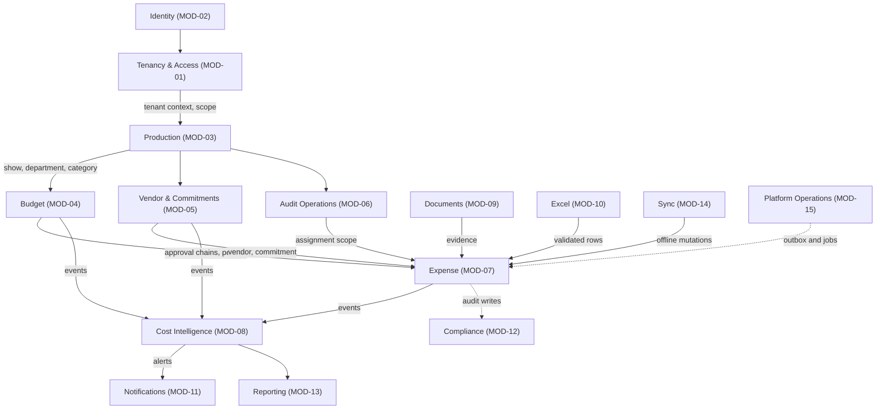
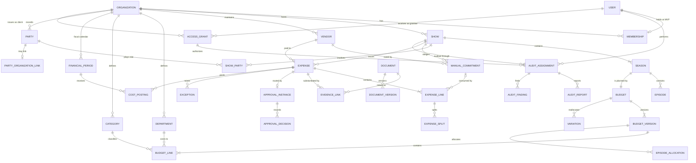
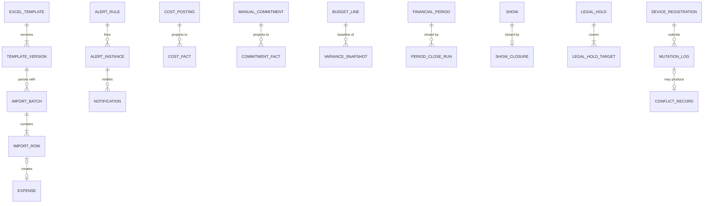

# Document 2: Domain Model & Business Capability Map

**Product:** SlateIQ — Production Cost Intelligence & Audit Monitoring Platform
**Document ID:** SLQ-ARCH-002
**Version:** 2.0.0 (Domain Baseline)
**Supersedes:** 1.0.0, archived at `_archive/02-domain-model-business-capabilities.v1.0.0.md`
**Classification:** Internal — Architecture Foundation
**Status:** Draft — For Review
**Date:** 2026-11-06
**Authors:** Principal Enterprise Solution Architect, Domain Architect, Data Architect
**Reviewers:** Product Owner (TBD), Finance SME (TBD), Audit SME (TBD), Principal Architect (TBD)

---

## Document Control

### Revision History

| Version | Date | Author | Change |
|---------|------|--------|--------|
| 1.0.0 | 2026-11-05 | Architecture Team | Initial bounded contexts, entity list and capability map |
| 2.0.0 | 2026-11-06 | Architecture Team | Applies change requests D2-01 to D2-15 from Document 1 Appendix E; aligns contexts with the fifteen modules of Document 6; adds D2-16 to D2-19; defines every entity with purpose, identity, relationships, ownership, lifecycle, rules, access, validation, audit and retention; adds the show hosting topology (ADR-025) |

### Related Documents

| Document | Relationship |
|----------|--------------|
| Document 1 — Product Vision & Business Requirements | Authoritative scope: FR, NFR, BR, D and persona identifiers used here |
| Document 3 — Actor, Permission, Tenancy & Identity Architecture | Authoritative for identity, membership, assignment, grant, permission keys and RLS families |
| Document 4 — Core Business Workflows & State Machines | Authoritative for every state and transition named here |
| Document 5 — Business Rules & Invariants Catalogue | Authoritative for invariant enforcement |
| Document 6 — High-Level Solution Architecture | Binding module decomposition (§5), data architecture (§8), ADR-001 to ADR-015 |
| Document 8 — Database Conceptual Model & ERD | Physical realisation of every entity defined here |
| Document 13 — Analytics & Cost Calculation Architecture | Formal definitions of every financial measure named here |

### Conventions

| Convention | Meaning |
|------------|---------|
| `CAP-###` | Business capability. CAP-001 to CAP-025 are unchanged from version 1.0.0; CAP-026 is added |
| `D2-##` | Change request against this document. D2-01 to D2-15 originate in Document 1 Appendix E; D2-16 onward originate here |
| `MOD-##` | Module from Document 6 §5.1 |
| `SM-##` | State machine in Document 4 |
| Entity names | PascalCase in prose, snake_case table names in Document 8 |
| "Tenant" | An organization and its isolation boundary, keyed by `org_id` (Document 6 conventions) |
| Permission keys | `domain.resource.action` from Document 3 Appendix A |

---

## 1. Purpose and Scope

This document defines the business domain that every SlateIQ component implements: the parties, the things they manage, the rules that bind those things, and the capabilities the product offers. Engineering teams use it as the single vocabulary. A table, an API resource, a screen or an event that names a business concept must use the name defined here.

Version 2.0.0 does three things:

1. Applies the fifteen change requests that Document 1 raised against version 1.0.0 (section 10).
2. Aligns bounded contexts one-to-one with the fifteen modules of Document 6, so a domain concept has exactly one owning module and one owning schema.
3. Specifies every entity with the attributes the governing brief requires: purpose, primary key, relationships, ownership, lifecycle, business rules, access permissions, validation, audit and retention.

It does not define columns and types (Document 8), states and transitions in full (Document 4), or calculation formulas (Document 13).

---

## 2. The Business Domain

### 2.1 How Production Cost Control Works

A **commissioner** (an OTT platform or a broadcaster) contracts a **production house** to make a **show**: a series, a film, a reality format or a live event. The commissioner funds the production, either as a fixed fee or, commonly for premium content, on a cost-plus basis where actual spend is reimbursed against an approved budget. In both models the commissioner needs assurance that money is spent as agreed.

The production house prepares a **budget** for each **season** (a film has one implied season), broken down by **department** (camera, art, costume, transport, catering, post-production) and **expense category** (equipment rental, set construction materials, crew per diem). The commissioner approves it. The approved budget becomes the baseline against which every rupee, dollar or euro is measured. During production the budget is **revised** when scope changes; every revision is approved and retained.

Spending happens on location, every day. Crew buy materials, hire vehicles, pay per diems and settle vendor bills, often in cash and often where connectivity is poor. Larger obligations are agreed in advance as **commitments**: deal memos, rental agreements and purchase orders. A commitment is money already promised but not yet spent.

**Auditors** sit alongside this activity. Some are employed by the production house (internal auditors), some are appointed by the commissioner to represent its interest (platform-appointed auditors), and some come from independent firms (external auditors). Today each keeps its own spreadsheets in its own format and reports fortnightly or monthly. Management sees cost overruns weeks after they happen.

SlateIQ standardises this loop. Auditors and accounts staff capture each **expense** with its **evidence** at the point of spend, online or offline. Expenses flow through an **approval** chain. Approved expenses become **actual cost**; open commitments are **committed cost**; both are compared with the budget to give **variance**. Rules raise **exceptions** and **alerts** when spend deviates. Finance closes **financial periods**, management reads dashboards, auditors record **findings** and **audit reports**, and Excel remains a first-class import and export path.

### 2.2 Parties and Their Interests

| Party | Organization type | Interest | Typical personas |
|-------|-------------------|----------|------------------|
| OTT platform | `OTT_PLATFORM` | Portfolio cost control, audit assurance across many productions | P-01, P-04, P-05, P-11 |
| Broadcaster | `BROADCASTER` | Commissioning cost control, independent audit | P-02, P-04, P-05, P-11 |
| Production house | `PRODUCTION_HOUSE` | Deliver within budget, pay vendors correctly, pass audit without rework | P-03, P-06, P-09, P-10 |
| Audit firm | `AUDIT_FIRM` | Scoped, time-bound access to client data; independence | P-07, P-08 |
| SlateIQ operations | `PLATFORM_INTERNAL` | Provision, operate and support without reading tenant financial data | P-13 |
| Vendor or supplier | Not a tenant | Paid correctly; represented as a vendor record | — |

### 2.3 Show Hosting Topology (ADR-025, Provisional)

Every show belongs to exactly one organization: the **hosting tenant** (Document 6 §5.3). The governing brief and Document 1 describe two real operating patterns, and the architecture supports both without code branches.

| Pattern | Hosting tenant | Production-house staff | Commissioner visibility | Platform-appointed auditors |
|---------|----------------|------------------------|-------------------------|-----------------------------|
| **H1 Commissioner-hosted** | The OTT platform or broadcaster that commissioned the show | Members of the commissioner tenant for that engagement, holding production-side roles at `SHOW` or narrower scope (Document 3 §5.5 note) | Native: the show is in the commissioner's portfolio | `INTERNAL_AUDITOR` of the commissioner, or external grantees |
| **H2 Producer-hosted** | The production house | Members of their own tenant | Through a party link (`PartyOrganizationLink`) and grants issued to named commissioner users | Grants created by the appointing party under Document 3 §8.13 |

**Rules.**

1. The hosting tenant is fixed at show creation and never changes. Moving a show between tenants is a data migration project, not a feature.
2. Pattern H1 is the default for commissioned productions under platform audit, because it gives the buyer persona (D-001) a native portfolio, keeps the audit trail in the funding party's tenant and matches A-07 (production parties are usually not tenants at pilot).
3. Pattern H2 is the default when a production house subscribes for its own productions.
4. A production house that works for two commissioners under H1 has staff in two tenants. At MVP each person holds one membership (Document 3 §3.2), so a person serving two commissioners needs Phase 1 multi-membership (OQ-4-01). This is accepted for the pilot and tracked as risk R2-01.
5. Cross-tenant portfolio aggregation over H2 shows (a commissioner dashboard spanning several producer tenants) is out of MVP scope; it requires a federated read model and is evaluated for Phase 2 (OD-01).

ADR-025 is provisional until the business owner confirms the pilot customers' topology (Document 17 open decision OD-01).

### 2.4 Ubiquitous Language

Document 1 Appendix A is the glossary. This document adds or sharpens the following terms.

| Term | Definition |
|------|------------|
| **Hosting tenant** | The single organization whose tenant holds a show and all its financial records |
| **Cost basis amount** | The part of an expense line that counts as production cost: net amount plus non-recoverable tax, in base currency (Document 13) |
| **Cost posting** | An append-only record that adds or removes actual cost in a financial period. Approval posts; cancellation and amendment reverse (D2-17) |
| **Revision** | A new immutable version of an expense or commitment created by amendment; the previous revision is retained and linked |
| **Audit report** | An auditor-prepared report for an assignment and a reporting date or period, summarising work done, totals reviewed and findings (D2-16) |
| **Finding** | An auditor's qualitative observation that requires a response, distinct from a rule-raised exception |
| **Exception** | A condition raised by a rule or a reviewer on a financial record, requiring acknowledgement and resolution (FR-EXP-023) |
| **Alert** | A notification-bearing instance of an alert rule firing on a measure such as variance or consumption (FR-CIN-007) |
| **Appointing party** | The commissioner that appoints a platform auditor and alone may revoke that appointment (BR-AUD-006) |

---

## 3. Bounded Contexts and Context Map

Each bounded context is one module of Document 6 with one PostgreSQL schema. Ownership is exclusive: a module is the only writer of its schema.

| Context | Module | Schema | Core responsibility | Upstream of |
|---------|--------|--------|---------------------|-------------|
| Tenancy & Access | MOD-01 | `tenancy` | Organizations, memberships, roles, assignments, grants, delegation, SoD, access review | All |
| Identity | MOD-02 | `identity` | People, credentials, MFA, sessions, devices | All |
| Production | MOD-03 | `prod` | Shows, seasons, episodes, departments, categories, parties, show closure | Budget, Vendor, Audit Ops, Expense, Intelligence |
| Budget | MOD-04 | `budget` | Budgets, versions, lines, contingency, variations, episode allocation, approval workflows, financial periods, forecasts | Expense, Intelligence |
| Vendor & Commitments | MOD-05 | `vendor` | Vendor master, manual commitments, purchase orders, payment references | Expense, Intelligence |
| Audit Operations | MOD-06 | `auditops` | Teams, assignments, scope, coverage, audit reports, findings | Expense (scope), Intelligence |
| Expense | MOD-07 | `expense` | Expenses, lines, splits, FX snapshot, evidence links, approvals, amendments, exceptions, cost postings | Intelligence, Reporting |
| Cost Intelligence | MOD-08 | `intel` | Cost and commitment facts, variance, alert rules and instances, dashboards, benchmarks | Notifications, Reporting |
| Documents | MOD-09 | `docs` | Files, versions, scanning, links, access log, retention policy | Expense, Vendor, Audit Ops |
| Excel | MOD-10 | `xls` | Templates, value mappings, import batches, export jobs | Uses Expense, Budget, Vendor contracts |
| Notifications | MOD-11 | `notify` | Templates, notifications, preferences, delivery, digests | — |
| Compliance | MOD-12 | `compliance` | Business and security audit trail, legal hold, DSR, ROPA, breach | — (downstream of all) |
| Reporting | MOD-13 | `report` | Report definitions, runs, outputs | — |
| Sync | MOD-14 | `sync` | Device sync state, cursors, mutation log, conflicts | Uses Expense, Documents contracts |
| Platform Operations | MOD-15 | `ops` | Outbox, jobs, idempotency, flags, regions, provisioning, support access | Infrastructure for all |

**Integration patterns.** Upstream contexts publish contracts and events; downstream contexts never read an upstream schema (Document 6 §4.3, rule R4). Excel and Sync are anti-corruption layers: they translate external shapes into commands on the owning module and reuse its validation (BR-EXP-016, ADR-011). Compliance is a conformist cross-cutting context: every module calls its in-transaction audit writer (ADR-012).

---

## 4. Business Capability Map

| ID | Capability | Context | Release | Description |
|----|------------|---------|---------|-------------|
| CAP-001 | Multi-tenant organization management | Tenancy | MVP | Provision, configure, suspend, archive and purge organizations |
| CAP-002 | Authentication and session management | Identity | MVP | Login, MFA, sessions, devices, revocation |
| CAP-003 | Role-based and scoped access control | Tenancy | MVP | Roles, permissions, scopes, grants, SoD, delegation, access review |
| CAP-004 | Show, season and episode lifecycle | Production | MVP | Production hierarchy, parties, closure |
| CAP-005 | Department and category management | Production | MVP | Department hierarchy, category taxonomy and mapping |
| CAP-006 | Budget creation and versioning | Budget | MVP | Draft, revise, version, contingency, episode allocation, periods |
| CAP-007 | Budget approval workflows | Budget | MVP | Approval chains, thresholds, delegation |
| CAP-008 | Vendor registry and risk profiling | Vendor | MVP | Vendor master, tax identifiers, duplicates, blocking, risk |
| CAP-009 | Purchase order management | Vendor | Phase 1 | PO lifecycle, receipts, closure |
| CAP-010 | Commitment tracking | Vendor | MVP | Manual commitments, amendments, consumption |
| CAP-011 | Auditor assignment and scoping | Audit Ops | MVP | Teams, assignments, scope, coverage, handover |
| CAP-012 | Mobile offline expense capture | Expense, Sync | MVP | Fast capture, evidence, drafts, sync, conflicts |
| CAP-013 | Expense validation and approval | Expense | MVP | Validation, multi-level approval, amendment, cancellation, exceptions |
| CAP-014 | Evidence management | Documents | MVP | Upload, scan, version, verify, dispute |
| CAP-015 | Cost variance calculation | Intelligence | MVP | Budget versus actual and committed, by every dimension |
| CAP-016 | Cost overrun detection and alerting | Intelligence | MVP | Alert rules, evaluation, acknowledgement |
| CAP-017 | Estimated final cost forecasting | Intelligence, Budget | Phase 1 | EFC with linear and manual methods |
| CAP-018 | Cross-show benchmarking | Intelligence | Phase 1 | Within-tenant comparison; anonymised cross-tenant with consent |
| CAP-019 | Management dashboards | Intelligence, Reporting | MVP | Portfolio, show, department, audit, compliance dashboards |
| CAP-020 | Excel import with validation | Excel | MVP | Templates, mapping, validation, preview, commit, reversal |
| CAP-021 | Excel and report export | Excel, Reporting | MVP | Standard reports and extracts |
| CAP-022 | Business audit trail | Compliance | MVP | Append-only, hash-chained business history |
| CAP-023 | Security audit trail | Compliance | MVP | Authentication, authorization and privileged-access events |
| CAP-024 | Retention, archival and legal hold | Documents, Compliance | MVP (manual execution), Phase 1 (automated) | Retention policies, holds, purge |
| CAP-025 | Multi-channel notifications | Notifications | MVP (in-app, email), Phase 1 (push, webhook) | Templates, preferences, digests, delivery tracking |
| **CAP-026** | **Audit reporting and findings** | **Audit Ops** | **MVP** | **Daily and periodic audit reports, findings, responses and closure (D2-16)** |

---

## 5. Mapping of the Governing Brief's Domain Areas

The governing brief (section 6) lists twenty domain areas. Each is realised by the entities below.

| Brief area | Realised by | Context |
|------------|-------------|---------|
| A. Organizations and tenants | Organization, OrganizationSetting, Entitlement, TenantRegion | Tenancy, Platform Ops |
| B. OTT platforms and broadcasters | Organization (`OTT_PLATFORM`, `BROADCASTER`); Party with role `COMMISSIONER` | Tenancy, Production |
| C. Production houses | Organization (`PRODUCTION_HOUSE`); Party with role `PRODUCTION_HOUSE`; PartyOrganizationLink | Tenancy, Production |
| D. Shows, seasons and episodes | Show, Season, Episode | Production |
| E. Production budgets | Budget, BudgetVersion, BudgetLine, Variation, EpisodeAllocation | Budget |
| F. Departments and expense categories | Department, Category, CategoryDepartment | Production |
| G. Vendors and suppliers | Vendor, VendorTaxRegistration, VendorContact, VendorBankReference | Vendor |
| H. Purchase orders and commitments | ManualCommitment, CommitmentAmendment, PurchaseOrder (Phase 1) | Vendor |
| I. Expenses and transactions | Expense, ExpenseLine, ExpenseSplit, FxSnapshot, CostPosting | Expense |
| J. Audit assignments | AuditAssignment, AuditScope, CoverageRequirement | Audit Ops |
| K. Auditors and audit teams | User, AuditorProfile, AuditorWorkProfile, AuditTeam, CrossOrganizationAccessGrant | Identity, Tenancy, Audit Ops |
| L. Daily audit reports | AuditReport | Audit Ops |
| M. Supporting documents and evidence | Document, DocumentVersion, EvidenceLink, DocumentLink | Documents, Expense |
| N. Expense approvals and exceptions | ApprovalWorkflow, ApprovalInstance, ApprovalDecision, Exception | Budget, Expense |
| O. Cost variances | VarianceSnapshot, CostFact, CommitmentFact | Intelligence |
| P. Management dashboards | DashboardDefinition, SavedView, read models | Intelligence, Reporting |
| Q. Excel imports and exports | ExcelTemplate, TemplateVersion, ValueMapping, ImportBatch, ImportRow, ExportJob | Excel |
| R. Notifications and alerts | AlertRule, AlertInstance, Notification, NotificationPreference | Intelligence, Notifications |
| S. Audit history and business activity logs | AuditEvent, SecurityEvent, AuditChainHead | Compliance |
| T. Financial periods and reporting cycles | FinancialPeriod, PeriodCloseRun, fiscal calendar on OrganizationSetting | Budget, Tenancy |

---

## 6. Entity Catalogue

### 6.1 Specification Conventions

Every entity below is tenant-owned unless marked **Global**: it carries `org_id`, is protected by RLS (Document 3 Appendix D) and is never visible outside its tenant except through a grant. Identifiers are UUIDv7 unless stated. Every state change writes a business audit event in the same transaction (ADR-012). "Retention" is measured from the later of record closure, period lock or hold release (BR-DOC-004); the default for financial records is 7 years (D-014).

Common validation applies to all entities and is not repeated: identifiers are server-validated UUIDs; references must resolve within the same tenant; free text is length-bounded and stored as plain text; money is `numeric(19,4)` with an ISO 4217 code (BR-FIN-001); dates are business dates in the organization timezone; timestamps are UTC.

### 6.2 Tenancy & Access (MOD-01) and Identity (MOD-02)

Document 3 is authoritative for these entities; the summary keeps the domain model complete.

| Entity | Purpose | Identity and key attributes | Relationships | Lifecycle | Rules and validation | Access | Audit and retention |
|--------|---------|-----------------------------|---------------|-----------|----------------------|--------|---------------------|
| Organization | The tenant and its legal identity | `org_id`; slug, legal name, type, base currency, timezone, fiscal calendar, data region | Owns every tenant record; has many memberships | 8 states (Document 3 §2.5; SM-01) | Slug unique and immutable after activation; base currency immutable after first approved financial record (BR-FIN-004); region immutable at MVP | `tenancy.organization.*`; `ops.tenant.*` for lifecycle | Every change audited; tombstone retained after purge |
| OrganizationSetting | Typed configuration: thresholds, policies, fiscal calendar | `(org_id, key)`; value, effective date | Belongs to Organization | Effective-dated rows | Value validated against the setting's schema; cannot relax a higher-precedence rule (Document 1 §10.2) | `tenancy.organization.update`, `tenancy.organization.administer` | All versions retained |
| Entitlement (D2-09) | Plan limits and module switches | `(org_id, entitlement_key)`; limit, source, expiry | Belongs to Organization; references Plan (Global) | Manual at MVP | Cannot reduce below usage without grace | `tenancy.entitlement.read`, `ops.entitlement.update` | Audited |
| User (D2-05) | One human identity, independent of tenant access | `user_id`; `home_org_id`, status; personal data in UserPii | One home Organization; one Membership at MVP; many grants as grantee | 7 states (Document 3 §3.4) | Email globally unique among non-erased identities; no self-registration | `identity.user.*` | Pseudonym retained after erasure (ADR-022) |
| Membership (D2-05) | Makes a user a member of an organization | `membership_id`; user, organization, status | User to Organization; has Assignments | Invited, active, suspended, revoked | One active membership per user at MVP | `tenancy.membership.*` | 7 years |
| Role, RoleVersion | Named permission bundles; immutable snapshots | `role_id`; key, is_system | Has Permissions; referenced by Assignments | Active, retired | System roles immutable; custom roles within ceiling | `tenancy.role.*` | All versions retained |
| Assignment | A role held over a scope | `assignment_id`; role, scope type, scope identifiers, validity | Membership to Role to scope objects | Active, expired, revoked | SoD evaluated at creation (Document 3 §5.8) | `tenancy.assignment.*` | 7 years |
| CrossOrganizationAccessGrant (D2-01) | The only cross-tenant access path | `grant_id`; client org, grantee, profile, scope, start, end | Client Organization; grantee User; AuditAssignment | 8 states (Document 3 §8.2) | One client, one grantee; maximum 12 months (BR-AUD-002) | `audit.access_grant.*` | 7 years |
| Delegation (D2-14) | Time-bound transfer of approval authority | `delegation_id`; delegator, delegate, scope, amount, window | Two Memberships | Active, revoked, expired | Maximum 90 days, no chaining, no SoD bypass (BR-ACC-006) | `tenancy.delegation.*` | 7 years |
| ApprovalLimit | Amount ceilings per role or user | `limit_id`; role or user, scope, amount, currency | Role or Membership | Effective-dated | User limit cannot exceed role limit | `tenancy.approval_limit.*` | All versions retained |
| AuditorProfile | Auditor standing, firm attestation, independence | `user_id`; firm, attested by, independence declared at | User | Attested, lapsed | Grantees must be attested | `tenancy.auditor_profile.*` | 7 years |
| AccessReviewCampaign | Quarterly certification | `campaign_id`; period, items, decisions | Memberships, Assignments, Grants | Open, closed | Self-certification prohibited | `tenancy.access_review.*` | 7 years |
| DeviceRegistration | A device bound to a user | `device_id`; user, platform, key, status | User | Active, revoked, wiped | Device is never a principal (ADR-023) | `identity.device.*` | 13 months after revocation |

### 6.3 Production (MOD-03)

| Entity | Purpose | Identity and key attributes | Relationships | Lifecycle | Rules and validation | Access | Audit and retention |
|--------|---------|-----------------------------|---------------|-----------|----------------------|--------|---------------------|
| Show | The production being costed and audited | `show_id`; code (unique per tenant, used in human references), title, type (`SERIES`, `FILM`, `REALITY`, `LIVE_EVENT`, `DOCUMENTARY`, `OTHER`), format, genre, language, planned start and end, planned shoot days, hosting pattern (H1, H2) | Has Seasons, ShowParties, Budgets, Expenses, Assignments | `PLANNING`, `ACTIVE`, `COMPLETED`, `CLOSING`, `CLOSED`, `ARCHIVED`, `CANCELLED` (SM-02) | Title 1 to 200 characters; end date not before start; a film has exactly one season; a show cannot close with open approvals, open commitments or unresolved critical exceptions (BR-PRD-001) | `production.show.*` | Change history (FR-PRD-002); retained 7 years after `CLOSED` |
| Season | A production cycle with its own budget | `season_id`; number, title, planned episodes, dates, status | Belongs to Show; has Episodes, one Budget | `PLANNED`, `ACTIVE`, `COMPLETED` | Number unique within show | `production.season.*` | With show |
| Episode | An episode or segment for allocation and reporting | `episode_id`; number, title, shoot dates, status | Belongs to Season; has EpisodeAllocation; referenced by expense lines | `PLANNED`, `IN_PRODUCTION`, `SHOT`, `DELIVERED`, `DROPPED` | Number unique within season | `production.episode.*` | With show |
| Department | A cost centre, organization-wide or show-specific | `department_id`; code, name, parent, optional `show_id`, active flag | Parent Department (depth at most 3, BR-PRD-006); Categories via mapping | Active, inactive | Acyclic; never hard-deleted (BR-PRD-003) | `production.department.*` | Indefinite (reference data) |
| Category | What money was spent on: the organization taxonomy | `category_id`; code, name, parent, cost type (`ABOVE_THE_LINE`, `BELOW_THE_LINE`, `POST_PRODUCTION`, `OTHER`), input-tax recoverability default, evidence policy, active flag | Mapped to one or more Departments (CategoryDepartment) | Active, inactive | Code unique per tenant; only leaf categories are postable; deactivation never alters history (FR-PRD-010) | `production.category.*` | Indefinite |
| Party (D2-02) | A commissioner, production house or co-producer as a vendor-type record | `party_id`; legal name, type, tax identifiers, optional vendor reference | ShowParty links it to shows; optional PartyOrganizationLink | Active, inactive | Same uniqueness rule as vendors (BR-VND-001) | `production.party.*` | 7 years |
| ShowParty | The role a party plays on a show | `(show_id, party_id, role)`; role `COMMISSIONER`, `PRODUCTION_HOUSE`, `CO_PRODUCER`, `APPOINTING_PARTY` | Show to Party | Effective-dated | One primary production house per show | `production.party.update` | With show |
| PartyOrganizationLink (D2-02) | Confirms a party is a specific SlateIQ organization | `link_id`; party, linked org, agreement terms, accepted by both | Party to another Organization | `PROPOSED`, `ACTIVE`, `TERMINATED` | Requires acceptance by both organizations (BR-PRD-004); confers no data access by itself | `production.party_link.*` | 7 years |
| ShowClosure (D2-18) | The close checklist, waiver and sign-off for a show | `closure_id`; show, requested by, checklist result, waivers, approver | Show | SM-14 | Blocking items: open approvals, open commitments, unresolved critical exceptions, draft expenses, active assignments, unlocked final period | `production.show.submit`, `production.show.approve` | 7 years |

### 6.4 Budget (MOD-04)

| Entity | Purpose | Identity and key attributes | Relationships | Lifecycle | Rules and validation | Access | Audit and retention |
|--------|---------|-----------------------------|---------------|-----------|----------------------|--------|---------------------|
| Budget | The authoritative budget container for a show or season | `budget_id`; show, season, status, current version | Has BudgetVersions | `NOT_BASELINED`, `BASELINED`, `REVISION_IN_PROGRESS`, `FROZEN` (SM-03) | One budget per season; frozen when the show closes | `budget.budget.*` | Forever (Document 6 §8.4) |
| BudgetVersion | An immutable approved plan or a draft of one | `budget_version_id`; version number, type (`ORIGINAL`, `REVISION`), reason, effective date, total, status | Belongs to Budget; has BudgetLines; supersedes previous | `DRAFT`, `SUBMITTED`, `CHANGES_REQUESTED`, `ACTIVE`, `SUPERSEDED`, `REJECTED`, `WITHDRAWN` (SM-04) | Exactly one `ACTIVE` version per budget (BR-BUD-001); total equals sum of lines including contingency (BR-BUD-003); revision reason and effective date mandatory, effective date not before last locked period (BR-BUD-005); approver is not sole author (BR-BUD-012) | `budget.budget_version.*` | Forever |
| BudgetLine | Planned amount for department, category and cost type | `budget_line_id`; department, category, cost type, line type (`OPERATIONAL`, `CONTINGENCY`), amount, optional quantity, unit and rate | Belongs to BudgetVersion | Immutable once the version leaves `DRAFT` | Unique per version by department + category + cost type (BR-BUD-002); amount at least 0; base currency only (BR-BUD-008) | via `budget.budget_version.update` | Forever |
| Variation | A reallocation between lines of the active version | `variation_id`; from line, to line, amount, reason | Belongs to Budget | `REQUESTED`, `APPROVED`, `REJECTED`, `APPLIED` | Within the configured threshold it applies directly; above it follows the revision workflow (BR-BUD-006); contingency can only move out through a variation (BR-BUD-004) | `budget.variation.*` | Forever |
| EpisodeAllocation (D2-03) | Planned share of a season budget for an episode | `(budget_version_id, episode_id)`; amount | BudgetVersion to Episode | Follows its version | Sum of allocations never exceeds the season total (BR-BUD-007); never a separate approved budget (BR-PRD-005) | `budget.episode_allocation.*` | Forever |
| ApprovalWorkflow | Configured approval chain for a subject type | `workflow_id`; subject type (`BUDGET_VERSION`, `VARIATION`, `EXPENSE`, `COMMITMENT`, `PERIOD_REOPEN`, `IMPORT_COMMIT`, `SHOW_CLOSURE`, `EXCEPTION_WAIVER`), steps, thresholds | Has ordered steps; resolved into ApprovalInstances by owning modules | Draft, active, retired; versioned | Chains resolved at submission and never altered retroactively (BR-EXP-007); budget above threshold requires commissioner final approval where configured (BR-BUD-010) | `budget.approval_workflow.*` | All versions retained |
| FinancialPeriod (D2-13) | A reporting period of the fiscal calendar | `period_id`; scope (organization or show), start, end, status | Belongs to Organization or Show; has PeriodCloseRuns | `OPEN`, `CLOSING`, `LOCKED`, `REOPENED` (SM-05) | Periods never overlap or leave gaps; transactions dated in a `LOCKED` period are rejected (BR-BUD-009) | `budget.financial_period.*` | Forever |
| PeriodCloseRun | One execution of the close checklist with its snapshot | `run_id`; period, checklist results, waivers, snapshot reference | Belongs to FinancialPeriod | Running, blocked, completed | Concurrent close prevented by optimistic lock (UC-11) | `budget.financial_period.update` | 7 years |
| Forecast (D2-19) | Estimate to complete per line (Phase 1) | `forecast_id`; line key, period, amount, method, assumptions | Budget line key | Effective-dated | Manual or linear method (FR-CIN-003) | `budget.forecast.*` | 7 years |
| FxRate (D2-04) | Organization rate table entry | `(org_id, from_currency, to_currency, rate_date, source)`; rate | Organization | Effective-dated; overrides audited | Rate greater than 0; daily ECB or OER feed plus manual override (D-007) | `budget.financial_period.update` for overrides | 7 years |

### 6.5 Vendor & Commitments (MOD-05)

| Entity | Purpose | Identity and key attributes | Relationships | Lifecycle | Rules and validation | Access | Audit and retention |
|--------|---------|-----------------------------|---------------|-----------|----------------------|--------|---------------------|
| Vendor | A supplier of goods or services | `vendor_id`; code, legal name, trade name, type, status, risk rating | Has tax registrations, contacts, bank references; referenced by expenses and commitments | `CANDIDATE`, `ACTIVE`, `INACTIVE`, `BLOCKED`, `REJECTED`, `MERGED` (SM-06) | Unique by normalised legal name + tax identifier (BR-VND-001); never hard-deleted (BR-VND-002); a one-time payee creates a `CANDIDATE` (FR-EXP-006) | `vendor.vendor.*` | 7 years after last transaction |
| VendorTaxRegistration | GST, PAN, VAT or other identifiers | `(vendor_id, scheme, identifier)` | Belongs to Vendor | Active, inactive | Format validation per scheme (for example GSTIN 15 characters with checksum; PAN 10 characters) | `vendor.vendor.update` | With vendor |
| VendorBankReference | Bank details for reconciliation, never for payment | `reference_id`; masked identifier, encrypted value | Belongs to Vendor | Active, superseded | Restricted class; masked in exports (BR-VND-007); change requires a second approver at Phase 1 | `vendor.payment_term.*` | Life of vendor + 30 days |
| ManualCommitment (D2-06) | A known obligation not yet spent | `commitment_id`; number, show, vendor, department, category, type (`DEAL_MEMO`, `RENTAL`, `CONTRACT`, `OTHER`), currency, amount, FX snapshot, validity, status | Show, Vendor; consumed by expense lines | `DRAFT`, `PENDING_APPROVAL`, `OPEN`, `CLOSED`, `CANCELLED`, `EXPIRED` (SM-07) | Only `OPEN` counts as committed cost (BR-VND-003); one owner, one currency | `vendor.commitment.*` | 7 years |
| CommitmentAmendment | A reasoned change to an open commitment | `amendment_id`; before and after amounts, reason | Belongs to ManualCommitment | `DRAFT`, `PENDING_APPROVAL`, `APPROVED`, `REJECTED` | Reason mandatory; reductions beyond threshold need approval (BR-VND-004) | `vendor.commitment.update`, `vendor.commitment.approve` | 7 years |
| PurchaseOrder, PurchaseOrderLine, PoReceipt | Phase 1 PO lifecycle | `po_id`; number, lines, receipts | Show, Vendor | Phase 1 (Document 4 §5) | Over-receipt tolerance (BR-VND-005) | `vendor.purchase_order.*` | 7 years |
| PaymentReference | Records that a payment happened elsewhere | `payment_reference_id`; vendor, external reference, amount, date, reconciliation status | Vendor; optionally expenses | Recorded, reconciled, mismatched | No payment execution in any release (Document 1 §13.5) | `vendor.payment_reference.*` | 7 years |

### 6.6 Audit Operations (MOD-06)

| Entity | Purpose | Identity and key attributes | Relationships | Lifecycle | Rules and validation | Access | Audit and retention |
|--------|---------|-----------------------------|---------------|-----------|----------------------|--------|---------------------|
| AuditTeam | Auditors working together under a lead | `team_id`; name, lead, members | Has members; owns Assignments | Active, disbanded | Exactly one lead | `audit.audit_team.*` | 7 years |
| AuditAssignment | An auditor's time-bound mandate on a show | `assignment_id`; auditor, team, show, type (`INTERNAL`, `PLATFORM_APPOINTED`, `EXTERNAL`), appointing party, start, end, permission level, predecessor | Show; auditor User; AuditScope; grant for external auditors | `PLANNED`, `ACTIVE`, `SUSPENDED`, `COMPLETED`, `REVOKED`, `HANDED_OVER` (SM-08) | Start and end mandatory (BR-AUD-001); cannot exceed its authorizing grant; overlap warning (FR-AUD-006); only the appointing party revokes a platform appointment (BR-AUD-006); handover ends the predecessor's access at the handover time (BR-AUD-007) | `audit.audit_assignment.*` | 7 years |
| AuditScope | What the assignment covers | `(assignment_id, element)`; departments, categories, seasons | Belongs to AuditAssignment | Follows assignment | Must be inside the show; narrowing is immediate, widening needs approval | via assignment | 7 years |
| AuditorWorkProfile | Professional profile and capacity | `user_id`; employee ID, qualification, specialization, capacity | User | Active | Workload limits warn, never block (BR-AUD-008) | `audit.auditor_work_profile.*` | 7 years |
| CoverageRequirement | Required audit coverage for a show | `requirement_id`; show, departments, frequency | Show | Active, retired | Drives coverage metrics (FR-AUD-013) | `audit.audit_plan.*` | 7 years |
| AuditReport (D2-16) | Auditor's daily or periodic report for an assignment | `audit_report_id`; assignment, report type (`DAILY`, `WEEKLY`, `FORTNIGHTLY`, `MONTHLY`, `CLOSING`), report date or period, version, summary, totals snapshot, petty-cash check | Assignment; Findings | `DRAFT`, `SUBMITTED`, `RETURNED`, `ACCEPTED`, `SUPERSEDED` (SM-10) | One accepted version per assignment, type and date; accepted reports are immutable and amended by a new version | `audit.audit_report.*` | 7 years |
| AuditFinding (D2-16) | An auditor's observation requiring a response | `finding_id`; assignment, severity, category, description, linked records, visibility (`APPOINTING_PARTY_ONLY`, `SHARED_WITH_PRODUCTION`), due date | Assignment; optional expense, vendor or commitment; responses | `DRAFT`, `OPEN`, `RESPONDED`, `CLOSED`, `ESCALATED`, `WITHDRAWN` (SM-11) | Visibility protects independence (BR-AUD-006); closure needs a reason | `audit.audit_finding.*`, `audit.finding_response.*` | 7 years |

### 6.7 Expense (MOD-07)

| Entity | Purpose | Identity and key attributes | Relationships | Lifecycle | Rules and validation | Access | Audit and retention |
|--------|---------|-----------------------------|---------------|-----------|----------------------|--------|---------------------|
| Expense | A captured cost event; one row per revision | `expense_id` (revision, device-generated for offline capture); `root_expense_id` (stable across revisions); expense number (assigned at first submission, `{SHOW_CODE}-{YY}-{seq}`); show, season, department, vendor or one-time payee, expense date, document type (`TAX_INVOICE`, `BILL`, `RECEIPT`, `PETTY_CASH_VOUCHER`, `CREDIT_NOTE`, `OTHER`), document number, payment mode, source (`MOBILE`, `WEB`, `EXCEL_IMPORT`, `API`), assignment, device timestamp, server timestamp, revision number, supersedes, totals, status | Lines, splits, evidence links, approval instance, exceptions, comments, cost postings | `DRAFT`, `SUBMITTED`, `REQUIRES_INFO`, `APPROVED`, `REJECTED`, `CANCELLED`, `SUPERSEDED` (SM-09) | Mandatory fields, vendor status, evidence, duplicates, period lock and limits validated at submission (FR-EXP-013); header total equals sum of rounded lines (BR-FIN-011); future date tolerance 2 days (BR-EXP-002); scope re-evaluated at approval (BR-EXP-004); approved revisions immutable (BR-FIN-009) | `expense.expense.*` | 7 years; partitioned monthly |
| ExpenseLine | One costed item | `expense_line_id`; category, cost type, episode, description, quantity, unit price, tax rate and inclusive flag, net, tax, gross, recoverable tax, cost basis, optional commitment | Belongs to Expense; may consume a commitment | Follows expense | Category active and mapped to the department (BR-EXP-015); tax stored separately (BR-FIN-007); negative only for credit notes referencing the original (BR-FIN-008) | via expense | With expense |
| ExpenseSplit | Allocation of a line across departments or categories | `(expense_line_id, seq)`; department, category, percentage, amount | Belongs to ExpenseLine | Follows expense | Percentages sum to exactly 100 and amounts to the line total; rounding remainder to the largest split (BR-EXP-012) | via expense | With expense |
| FxSnapshot (D2-04) | The locked conversion for a foreign-currency record | Embedded: original amount, original currency, rate, rate date, rate source, override reference, base amount | Belongs to Expense or ManualCommitment | Locked at submission | Rate effective on the expense date from the organization table, else latest published rate (BR-FIN-003); never revalued (D-008) | via owner | With owner |
| EvidenceLink | Ties a document to an expense or line with a verification state | `evidence_link_id`; document, expense or line, evidence type, verification status (`UNVERIFIED`, `VERIFIED`, `DISPUTED`) | Expense or line to Document | SM-12 (evidence part) | Required by category, amount threshold or policy (BR-EXP-001); a disputed link blocks final approval (UC-07); verified evidence immutable (BR-DOC-001) | `document.evidence.*` | With expense |
| ApprovalInstance, ApprovalDecision | The resolved chain for one submission and each decision on it | `approval_instance_id`; subject, workflow version, steps; decision: step, actor, on-behalf-of, limit applied, decision, comment, time | Expense revision; Delegation | SM-13 | Submitter never approves (BR-EXP-005); thresholds on base amount at locked rate (BR-EXP-008); comments mandatory on rejection and information request (FR-EXP-015) | `expense.expense.approve`, `expense.expense.reject` | Forever (Document 6 §8.4) |
| ExpenseAmendment | The reasoned request that creates a new revision | `amendment_id`; original revision, new revision, reason, financial flag | Two Expense revisions | Follows new revision | Financial change resets approval to the first level; non-financial change (note, evidence addition) does not (BR-EXP-009); rejected when the expense date's period is locked (BR-BUD-009) | `expense.expense.update` | 7 years |
| Exception | A flagged condition on a financial record | `exception_id`; type (`OVER_BUDGET`, `UNBUDGETED_SPEND`, `DUPLICATE_SUSPECTED`, `POLICY_VIOLATION`, `UNAUTHORIZED_VENDOR`, `UNUSUAL_AMOUNT`, `MISSING_EVIDENCE`, `CASH_LIMIT`, `COMMITMENT_EXCEEDED`, `LATE_SUBMISSION`, `FX_FALLBACK`), severity, rule code, dedup key, owner, status | Expense, line, vendor or budget line key | `OPEN`, `ACKNOWLEDGED`, `RESOLVED`, `FALSE_POSITIVE`, `WAIVED` (SM-15) | At most one open exception per rule and dedup key; waiver needs approval and a reason | `expense.exception.*` | 7 years |
| CostPosting (D2-17) | Append-only record of actual cost entering or leaving a period | `cost_posting_id`; expense revision, posting type (`APPROVAL`, `REVERSAL`), base amount (signed), period, posting date, line dimensions | Expense revision; FinancialPeriod | Append-only | Every approved revision has exactly one approval posting per line split; cancellation or supersession adds exactly one reversal per posting in the period of the event (BR-EXP-010); never updated or deleted | Read through `intel.cost_fact.read` | 7 years |

### 6.8 Cost Intelligence (MOD-08)

| Entity | Purpose | Identity and key attributes | Relationships | Lifecycle | Rules and validation | Access | Audit and retention |
|--------|---------|-----------------------------|---------------|-----------|----------------------|--------|---------------------|
| CostFact | Projected actual and pending cost per dimension | Composite dimension key; amounts, source posting, checkpoint | Derived from CostPosting and expense events | Rebuildable | Every fact traces to a source record (Document 6 §5.3) | `intel.cost_fact.read` | 36 months hot; aggregates retained |
| CommitmentFact | Projected open commitment per dimension | Dimension key; open amount | Derived from commitment events | Rebuildable | Only `OPEN` commitments, net of consumption (BR-FIN-006) | `intel.variance.read` | As CostFact |
| VarianceSnapshot | Budget, actual, committed, variance per line key and period | Dimension key, as-of | Derived | Rebuildable; period-close snapshots frozen | Variance equals budget minus actual minus committed (Document 13) | `intel.variance.*` | Period snapshots 7 years |
| AlertRule | A configured condition on a measure | `alert_rule_id`; scope, metric, condition, threshold, severity, cooldown | Show or organization | Active, disabled; versioned | Threshold validation per metric (FR-CIN-007) | `intel.alert_rule.*` | All versions retained |
| AlertInstance | One firing of a rule | `alert_id`; rule version, measured value, threshold, severity, status | AlertRule; scope objects | `TRIGGERED`, `ACKNOWLEDGED`, `RESOLVED`, `FALSE_POSITIVE`, `ESCALATED` (Phase 1) (SM-16) | Idempotent per rule, scope and period; cooldown respected | `intel.alert.*` | 7 years |
| DashboardDefinition, SavedView | Dashboard layout and user filters | `view_id`; owner, filters | Owner Membership | Active, deleted | Saved views are SELF-scoped | `report.dashboard.read`, `report.saved_view.*` | 2 years |
| BenchmarkAggregate | Anonymised distributions (Phase 1) | Category, show type, statistic | Global, from consenting tenants | Rebuildable | Minimum sample of 5 organizations (FR-CIN-016) | `intel.benchmark.read` | Indefinite (no tenant data) |

### 6.9 Documents (MOD-09)

| Entity | Purpose | Identity and key attributes | Relationships | Lifecycle | Rules and validation | Access | Audit and retention |
|--------|---------|-----------------------------|---------------|-----------|----------------------|--------|---------------------|
| Document | A stored file and its metadata | `document_id` (device-generated for offline capture); object key, original name, declared and detected type, size, SHA-256, uploader, status, legal-hold flag | Has versions; linked through EvidenceLink or DocumentLink | `UPLOAD_PENDING`, `PENDING_SCAN`, `AVAILABLE`, `QUARANTINED`, `SCAN_FAILED`, `SOFT_DELETED`, `PURGED` (SM-12) | Never served before a clean scan (BR-DOC-005); allowed types and size limits (FR-DOC-017); access checked on every request including signed-URL issue (BR-DOC-006) | `document.document.*` | Linked record's retention; legal hold overrides (BR-DOC-003) |
| DocumentVersion | A replaced file retained | `(document_id, version)`; object key, hash, reason | Belongs to Document | Immutable | Prior versions retrievable for the retention period (BR-DOC-001) | `document.version.*` | As document |
| DocumentLink | Attaches a document to a non-expense entity | `document_link_id`; document, owner type, owner id | Vendor, commitment, audit report, finding, budget version | Active, detached | Exactly one owner; detaching evidence of an approved record is prohibited (BR-DOC-007) | `document.document.update` | As owner |
| DocumentAccessLog | Every view, download, upload and delete | `log_id`; actor, action, time | Document | Append-only | — | `compliance.audit_event.read` | 7 years |
| RetentionPolicy | Retention rules by entity type and jurisdiction | `policy_id`; entity type, jurisdiction, period, version | Organization | Versioned; changes approved | Cannot fall below regulatory minimum | `compliance.retention_policy.*` | Forever |

### 6.10 Excel, Notifications, Compliance, Reporting, Sync and Platform Operations (MOD-10 to MOD-15)

| Entity | Purpose | Identity and key attributes | Relationships | Lifecycle | Rules and validation | Access | Audit and retention |
|--------|---------|-----------------------------|---------------|-----------|----------------------|--------|---------------------|
| ExcelTemplate, TemplateVersion | Import or export layout and column mapping | `template_id`, version; target (`EXPENSE`, `BUDGET_LINES`, `VENDOR`, `COMMITMENT`, `DEPARTMENT_CATEGORY`), mappings, transforms | Organization; optional owning party (an audit firm's legacy format) | Draft, active, retired | Import rejected when the workbook version differs from the active version unless compatible (BR-XLS-001) | `excel.template.*` | All versions retained |
| ValueMapping | Maps legacy labels to canonical identifiers | `(template_id, kind, source_value)`; target | Template | Active | Normalised comparison | `excel.template.update` | With template |
| ImportBatch | One uploaded workbook from validation to commit or reversal | `import_batch_id`; template version, file hash, source document, show, counts, commit mode (`ALL_OR_NOTHING`, `PARTIAL`), status | ImportRows; created records | SM-17 | Same validation and authorization as UI entry (BR-XLS-002); duplicate file hash needs confirmation (BR-XLS-003); partial commit only when enabled and below error threshold (BR-XLS-004); committed batches reversed, never deleted (BR-XLS-006) | `excel.import_job.*` | 7 years (batch journal, BR-XLS-005) |
| ImportRow | One worksheet row and its outcome | `(import_batch_id, row_number)`; raw values, mapped values, messages, outcome, created record | ImportBatch | Follows batch | Row-level errors with cell references | `excel.validation_error.read` | With batch |
| ExportJob | One requested export | `export_job_id`; type, filters, scope snapshot, output document, expiry | Requester | `QUEUED`, `RUNNING`, `COMPLETED`, `FAILED`, `EXPIRED` | Rows limited to requester scope at generation; output link at most 15 minutes | `excel.export_job.*` | Job record 7 years; file 7 days |
| NotificationTemplate, Notification, NotificationPreference, DeliveryAttempt, DigestRun | Message definition, instance, preference, attempt and digest | `notification_id`; recipient, channel, template, payload reference, status | Recipient Membership; source event | SM-18 | Preferences evaluated before send; every attempt recorded; no amounts or document content in email and push bodies | `notification.*` | 13 months (Document 6 §8.7) |
| AuditEvent, SecurityEvent, AuditChainHead | Business and security history | `event_id` (ULID); chain sequence, hash | All entities by reference | Append-only | Written in the business transaction; hash-chained per tenant (ADR-012) | `compliance.audit_event.*`, `compliance.security_event.*` | 7 years (D-020) |
| LegalHold, LegalHoldTarget (D2-08) | Blocks deletion of matter-relevant records | `hold_id`; matter reference, scope, applied by, released by | Any record or document | Active, release requested, released | Release needs a second approver (BR-DOC-003) | `compliance.legal_hold.*` | Forever |
| DsrRequest, RopaEntry, BreachIncident, ControlEvidence | Privacy and compliance records | Per entity | Organization | Per Document 14 | Statutory timelines (FR-CMP-008, FR-CMP-015) | `compliance.*` | 7 years |
| ReportDefinition, ReportRun, ReportOutput | Reproducible report execution | `run_id`; parameters, data watermark, template version, output hash | Organization | Queued, running, completed, failed | A run is reproducible from its parameters (Document 6 §5.3) | `report.*` | Runs 7 years; outputs per policy |
| DeviceSyncState, SyncCursor, MutationLog, ConflictRecord | Offline synchronisation state | `device_id`, cursor, mutation id (client command id) | Device; target records | Conflict: open, resolved | Server authoritative; client retries idempotent (ADR-004) | `sync.*` | Mutation log 30 days; conflicts 7 years |
| OutboxEvent, InboxDedup, Job, IdempotencyKey, FeatureFlag, TenantRegion (D2-15), ProvisioningRun, SupportAccess | Platform mechanics | Per Document 6 §6.7 and Document 3 §9.8 | — | SM-19 (job) | Every job and event has an idempotency key and a terminal state | `ops.*` (platform roles) | Outbox 3 months hot, 13 months archive |

---

## 7. Value Objects

| Value object | Definition | Invariants |
|--------------|------------|------------|
| Money | `(amount numeric(19,4), currency ISO 4217)` | Arithmetic only between equal currencies; rounding half-up at defined points only (BR-FIN-002, Document 13 §3) |
| FxSnapshot | `(original_amount, original_currency, rate numeric(19,6), rate_date, rate_source, override_id, base_amount)` | Immutable after submission; `base_amount = round_half_up(original_amount × rate, 4)`; display rounds to base minor units |
| Percentage | `numeric(9,4)` | Variance percentages may be negative; division by zero yields "not applicable", never zero |
| DateRange | `(start, end)` inclusive | `start <= end` |
| EntityRef | `(entity_id, org_id)` | Cross-module references always carry the tenant (Document 3 §9.9) |
| BudgetLineKey | `(season_id, department_id, category_id, cost_type)` | The join key between budget lines, cost facts and commitment facts |
| RequestContext | Principal, home organization, tenant organization, authority source, scope version, correlation ID | Built server-side only (FR-TNT-018); replaces version 1.0.0's client-visible `TenantContext` |

---

## 8. Conceptual Entity-Relationship Model

The diagrams show entities and cardinality only. Attributes and keys are in Document 8.

---

## 9. Cross-Cutting Domain Rules

| Rule | Statement | Enforced in |
|------|-----------|-------------|
| One home for every fact | Each business fact has one owning entity and module; everything else is a projection or a reference | Document 6 §5.4 |
| Immutability of approved financial records | Approved budget versions, approved expense revisions, cost postings, accepted audit reports and verified evidence are never updated; corrections create new records linked to the original | Document 5 |
| Revision, not overwrite | Amendments create revisions with `supersedes_id`; the full chain is queryable | Document 4 SM-09 |
| Base currency consolidation | Budgets, actuals, commitments and variance consolidate in the organization base currency at locked rates | BR-FIN-003, BR-BUD-008, BR-FIN-012 |
| Period by expense date | A transaction belongs to the period of its expense date; reversals post to the period of the reversing event | BR-FIN-010, BR-EXP-010 |
| Scope at every access | A record is visible only inside the actor's effective scope at the time of access | Document 3 §6 |
| No silent loss | Captured offline data is never discarded without an explicit, audited user or administrator action | Document 11 |
| Server time is audit time | Device timestamps are metadata | BR-EXP-011 |

---

## 10. Change Request Resolution

### 10.1 Change Requests from Document 1 Appendix E

| ID | Resolution in version 2.0.0 | Section |
|----|------------------------------|---------|
| D2-01 | CrossOrganizationAccessGrant added as an aggregate; lifecycle owned by Document 3 §8 | 6.2 |
| D2-02 | Party, ShowParty and PartyOrganizationLink replace direct organization references on Show | 6.3 |
| D2-03 | EpisodeAllocation is a child of BudgetVersion with the ceiling rule; no episode budget approval | 6.4 |
| D2-04 | Organization FX rate table (FxRate) and immutable FxSnapshot on expenses and commitments | 6.4, 6.7, 7 |
| D2-05 | Global User with home organization; Membership separated from Assignment and Grant | 6.2 |
| D2-06 | ManualCommitment with amendment, cancellation and consumption by expense lines | 6.5 |
| D2-07 | Notification template, preference, delivery attempt, digest and escalation entities | 6.10 |
| D2-08 | LegalHold, LegalHoldTarget and RetentionPolicy with precedence (BR-DOC-003, BR-DOC-004) | 6.9, 6.10 |
| D2-09 | Plan and Entitlement entities; manual values at MVP | 6.2 |
| D2-10 | Terminology standardised on show, season, episode | Throughout |
| D2-11 | Measures are named here and defined formally in Document 13 | 6.8 |
| D2-12 | Organization type `AUDIT_FIRM`; grants as the relationship to clients | 2.2, 6.2 |
| D2-13 | FinancialPeriod with `OPEN`, `CLOSING`, `LOCKED`, `REOPENED` and organization or show scope | 6.4 |
| D2-14 | Delegation entity under Tenancy (Document 3 §5.9) | 6.2 |
| D2-15 | Data region on Organization and TenantRegion; region-bound storage | 6.2, 6.10 |

### 10.2 Change Requests Originating Here

| ID | Change | Reason |
|----|--------|--------|
| D2-16 | AuditReport and AuditFinding added to Audit Operations; CAP-026 added | The governing brief requires daily audit reports and an audit report lifecycle; Document 3 already defines `audit.audit_report` and `audit.audit_finding` permissions |
| D2-17 | CostPosting added as the append-only source of actual cost | Makes BR-EXP-010 (reversal in the period of cancellation) and BR-FIN-009 (immutability) explicit in source data rather than only in a rebuildable projection; `intel.cost_fact` is projected from it |
| D2-18 | ShowClosure added as the aggregate for the close checklist, waiver and sign-off | BR-PRD-001 requires waivers and approval; the governing brief requires a show-closure state machine |
| D2-19 | Forecast is owned by Budget (`budget.forecast`), not by Cost Intelligence; Intelligence computes EFC from it | Forecast entries are financial plan data entered by Cost Controllers; Document 3 places `forecast` in the `budget` permission domain. Recorded against Document 6 §5.1 as RC-03 in `00-foundation-index.md` |

---

## 11. Assumptions and Open Decisions

| ID | Assumption or decision | Impact if wrong | Validate with | Status |
|----|------------------------|-----------------|---------------|--------|
| A2-01 | Category carries one cost type, so the budget line key department + category + cost type is effectively department + category | Expense lines would need an explicit cost type field | Finance SME | Open |
| A2-02 | Cost type values are `ABOVE_THE_LINE`, `BELOW_THE_LINE`, `POST_PRODUCTION`, `OTHER` | Reporting groups change; no structural impact | Finance SME | Open |
| A2-03 | Auditors submit one daily audit report per active assignment per working day; periodic reports are optional per engagement | AuditReport cadence and coverage metrics change | Audit SME | Open |
| A2-04 | Input-tax recoverability defaults by category and may be overridden per line with a reason | Cost basis definition in Document 13 changes | Finance SME, tax advisor | Open |
| A2-05 | The show code is short (3 to 12 characters) and unique per tenant | Human expense numbers change format | Product Owner | Open |
| OD-01 | Pilot hosting topology: H1 commissioner-hosted versus H2 producer-hosted (ADR-025) | Onboarding, role seeding and portfolio scope differ | Business owner | **Open — needed before pilot onboarding** |
| R2-01 | Production-house staff serving two H1 commissioners need two memberships, unavailable until Phase 1 | Workaround or earlier multi-membership | Product Owner | Risk, tracked in Document 17 |

---

## 12. Traceability

| Capability | Module | Requirements | Entities |
|------------|--------|--------------|----------|
| CAP-001 | MOD-01 | FR-TNT-001 to 003, 019, 023 | Organization, OrganizationSetting, Entitlement |
| CAP-002 | MOD-02 | FR-TNT-004 to 009, 022 | User, DeviceRegistration |
| CAP-003 | MOD-01 | FR-TNT-010 to 018, 020, 021 | Role, Assignment, Grant, Delegation, ApprovalLimit |
| CAP-004 | MOD-03 | FR-PRD-001 to 006, 013, 015 to 017 | Show, Season, Episode, Party, ShowParty, ShowClosure |
| CAP-005 | MOD-03 | FR-PRD-007 to 010 | Department, Category |
| CAP-006, CAP-007 | MOD-04 | FR-BUD-001 to 020 | Budget, BudgetVersion, BudgetLine, Variation, EpisodeAllocation, ApprovalWorkflow, FinancialPeriod |
| CAP-008 to CAP-010 | MOD-05 | FR-VND-001 to 020 | Vendor, ManualCommitment, PurchaseOrder, PaymentReference |
| CAP-011, CAP-026 | MOD-06 | FR-AUD-001 to 016 | AuditTeam, AuditAssignment, AuditScope, AuditReport, AuditFinding |
| CAP-012, CAP-013 | MOD-07, MOD-14 | FR-EXP-001 to 030 | Expense, ExpenseLine, ExpenseSplit, EvidenceLink, ApprovalInstance, Exception, CostPosting |
| CAP-014, CAP-024 | MOD-09, MOD-12 | FR-DOC-001 to 017, FR-CMP-009 to 011 | Document, DocumentVersion, RetentionPolicy, LegalHold |
| CAP-015 to CAP-019 | MOD-08, MOD-13 | FR-CIN-001 to 024 | CostFact, CommitmentFact, VarianceSnapshot, AlertRule, AlertInstance |
| CAP-020, CAP-021 | MOD-10, MOD-13 | FR-XLS-001 to 017 | ExcelTemplate, ImportBatch, ImportRow, ExportJob |
| CAP-022, CAP-023 | MOD-12 | FR-CMP-001 to 006 | AuditEvent, SecurityEvent |
| CAP-025 | MOD-11 | FR-NTF-001 to 015 | Notification and related entities |

---

## Document Approval

| Role | Name | Signature | Date |
|------|------|-----------|------|
| Domain Architect | | | |
| Finance SME | | | |
| Audit SME | | | |
| Product Owner | | | |
| Principal Architect | | | |

*End of Document 2*
