# Document 4: Core Business Workflows & State Machines

**Product:** SlateIQ — Production Cost Intelligence & Audit Monitoring Platform
**Document ID:** SLQ-ARCH-004
**Version:** 1.0.0
**Supersedes:** A one-line placeholder (no content); nothing archived
**Classification:** Internal — Architecture Foundation
**Status:** Draft — For Review
**Date:** 2026-11-06
**Authors:** Principal Software Architect, Domain Architect
**Reviewers:** Product Owner (TBD), Finance SME (TBD), Audit SME (TBD), Security Architect (TBD), Principal Architect (TBD)

---

## Document Control

### Revision History

| Version | Date | Author | Change |
|---------|------|--------|--------|
| 1.0.0 | 2026-11-06 | Architecture Team | First release: twenty-one business workflows (WF-01 to WF-21), nineteen state machines (SM-01 to SM-19), three required workflow diagrams, ADR-026 to ADR-029 |

### Related Documents

| Document | Relationship |
|----------|--------------|
| Document 1 — Product Vision & Business Requirements | Authoritative for UC, FR, NFR, BR, D identifiers cited here |
| Document 2 — Domain Model & Capability Map | Entity names, state names, SM numbering, CAP identifiers, hosting topology H1/H2 (§2.3, ADR-025) |
| Document 3 — Actor, Permission, Tenancy & Identity | Permission keys (Appendix A), SoD (§5.8), approval limits and delegation (§5.9), grant lifecycle (§8), identity lifecycle (§3.4), tenant lifecycle (§2.5), events (§12), error model (§11.4), table inventory (Appendix D) |
| Document 5 — Business Rules & Invariants | Consumes the guards defined here as invariants and configurable policies |
| Document 6 — High-Level Solution Architecture | Transaction model (§4.4), outbox and retry (§7.5), evidence pipeline (§7.7), notifications (§7.9), sync (§9), API surface (Appendix A), events (Appendix B) |
| Document 7 — Notifications | Templates and routing for every notification named here |
| Document 9 — API Architecture | Endpoints, error codes and idempotency for every transition named here (section 5) |
| Document 11 — Mobile & Offline | Device-side half of WF-08 |
| Document 12 — Excel | Template and validation detail behind WF-17 and WF-18 |
| Document 13 — Analytics & Cost Calculation | Formal measure definitions used by WF-14 and WF-15 |

### Conventions

| Convention | Meaning |
|------------|---------|
| `WF-nn` | Business workflow in Part A. WF-01 to WF-20 follow governing brief §8 in order; WF-21 is added for period close |
| `SM-nn` | State machine in Part B, numbered as fixed in the authoring brief |
| `C-nn` | Common mechanic in section 2.2, cited by workflows instead of being repeated |
| Permission keys | Exactly as in Document 3 Appendix A; a key is necessary, never sufficient (Document 3 A.7 note 2) |
| `PascalCase` event | Outbox integration event (Document 6 Appendix B, Document 3 §12). Names marked † are requested additions (section 5.2) |
| `dotted.audit` event | Business audit event type written in-transaction to `compliance.audit_event` (Document 6 §8.5) |
| `CODE` in an HTTP outcome | RFC 9457 `code`; codes marked † are requested from Document 9 (section 5.3) |
| "System" actor | A worker or projector running under the platform service identity with tenant context set per row (Document 3 Appendix D, `ops` family) |

---

## 1. Purpose and Scope

This document defines how SlateIQ's business processes run end to end and which states every stateful entity may occupy. Part A specifies twenty-one workflows with the fourteen attributes the governing brief requires. Part B specifies nineteen state machines with diagrams, transition tables, unauthorized-transition behaviour, transaction boundaries and recovery. Every transition names its permission key and SoD rule, which discharges Document 3 Appendix G.3.

The document does not define columns (Document 8), API payloads (Document 9), measure formulas (Document 13) or invariant enforcement detail (Document 5). It cites them.

**Hosting topology.** Workflows are written once for both show hosting patterns of Document 2 §2.3. Where H1 (commissioner-hosted) and H2 (producer-hosted) differ, the row says so.

---

## 2. Workflow Conventions

### 2.1 Attribute Template

Each workflow has a binding line (use case, requirements, rules, capability, events) and a table with the fourteen attributes of governing brief §8: initiating actor, preconditions, validation, authorization, state transitions, transaction boundary, concurrency, duplicate-submission handling, success response, failure scenarios, retry, audit events, notifications, recovery.

### 2.2 Common Mechanics

| ID | Mechanic | Rule |
|----|----------|------|
| C-01 | Request pipeline | Authenticate; build `RequestContext` server-side (FR-TNT-018); `SET LOCAL app.org_id`; apply Document 3 §6.8 vetoes in order (tenant, principal, session, authority source, permission and scope, SoD, self-approval, approval limit, entitlement, step-up) |
| C-02 | Idempotency | `Idempotency-Key` is required on every state-changing `POST` that creates money, evidence, imports, grants or a decision (submit, approve, reject, request information, cancel, close, reopen). Stored in `ops.idempotency_key` for 7 days. Same key and same body returns the stored response with `Idempotent-Replay: true`; same key and different body returns `409 IDEMPOTENCY_KEY_REUSED`. Offline mutations use `mutation_id` (Document 6 §9.3) |
| C-03 | Optimistic concurrency | Mutable aggregates return `ETag`; updates require `If-Match` (`428 PRECONDITION_REQUIRED` if absent, `409 CONCURRENCY_STALE` if stale). Every state transition also re-reads the aggregate row `FOR UPDATE` and re-checks the from-state, so two racing transitions yield one success and one `409 INVALID_STATE_TRANSITION`† |
| C-04 | Transaction | One module transaction holds the aggregate rows, the in-transaction audit write (ADR-012) and the outbox row (ADR-003). Cross-schema references are validated through the owning module's contract inside the same transaction (RC-02); cross-module consequences happen in outbox consumers. No event leaves before commit |
| C-05 | Audit | Each transition writes one `dotted.audit` event with actor, `actor_org_id`, authority source and ID, before and after state, reason and correlation ID. Every denial writes a security event (Document 3 §5.11). One correlation ID spans a workflow instance (NFR-AUD-004) |
| C-06 | Notification | Raised only from outbox consumers in MOD-11; preferences, quiet hours and suppression apply (SM-18); email and push bodies carry no amounts or document content (Document 2 §6.10) |
| C-07 | Retry | Clients retry with the same idempotency key. Consumers and jobs follow Document 6 §7.5 (1 s to 6 h, eight attempts, then dead letter; SM-19). Projections replay from checkpoint |
| C-08 | Period guard | The period is resolved from the transaction's business date (BR-FIN-010). A date inside a `LOCKED` period rejects create, amend, approve and import with `422 PERIOD_LOCKED`† (BR-BUD-009, BR-EXP-003, FR-EXP-029) |
| C-09 | Show guard | New expenses and commitments are accepted only while the show is `PLANNING`, `ACTIVE` or `COMPLETED`; otherwise `409 SHOW_NOT_ACCEPTING_TRANSACTIONS`† (BR-PRD-002) |
| C-10 | Shared validation | UI, API, sync and Excel use one domain validator per aggregate (ADR-011, BR-EXP-016, BR-XLS-002); there is no channel-specific bypass |

### 2.3 Workflow Catalogue

| ID | Workflow | Use cases | Capability | State machines | Owning module |
|----|----------|-----------|------------|----------------|---------------|
| WF-01 | Organization onboarding | UC-01 | CAP-001, CAP-003 | SM-01, Document 3 §3.4 | MOD-15, MOD-01 |
| WF-02 | Show creation | UC-01 | CAP-004, CAP-005 | SM-02, SM-03 | MOD-03 |
| WF-03 | Production-house onboarding (H1 members, H2 party link) | UC-01, UC-10 | CAP-003, CAP-004 | Document 3 §3.4, §8.2; party link (§4.21) | MOD-01, MOD-03 |
| WF-04 | Budget creation, approval and revision | UC-02, UC-03 | CAP-006, CAP-007 | SM-03, SM-04, SM-13 | MOD-04 |
| WF-05 | Vendor registration | UC-04 | CAP-008 | SM-06 | MOD-05 |
| WF-06 | Audit assignment, including external grants | UC-10 | CAP-011 | SM-08, Document 3 §8.2 | MOD-06, MOD-01 |
| WF-07 | Auditor onboarding, including grant acceptance gates | UC-10 | CAP-003, CAP-011 | Document 3 §3.4, §8.2 | MOD-01, MOD-02, MOD-06 |
| WF-08 | Daily expense capture, online and offline | UC-04, UC-05 | CAP-012 | SM-09, SM-12 | MOD-07, MOD-14 |
| WF-09 | Supporting-document upload and scan | UC-04, UC-07 | CAP-014 | SM-12 | MOD-09 |
| WF-10 | Expense validation | UC-04, UC-06 | CAP-013 | SM-09, SM-15 | MOD-07 |
| WF-11 | Audit review: evidence verification, dispute and findings | UC-07, UC-10 | CAP-014, CAP-026 | SM-12, SM-11 | MOD-09, MOD-06 |
| WF-12 | Exception identification | UC-06, UC-09 | CAP-013 | SM-15 | MOD-07, MOD-08 |
| WF-13 | Expense approval or rejection | UC-06 | CAP-013 | SM-09, SM-13 | MOD-07, MOD-04 |
| WF-14 | Cost variance calculation | UC-09, UC-12 | CAP-015 | — (projection) | MOD-08 |
| WF-15 | Cost-overrun alerts | UC-09 | CAP-016 | SM-16, SM-15 | MOD-08 |
| WF-16 | Daily audit reporting | UC-10 | CAP-026 | SM-10 | MOD-06 |
| WF-17 | Excel import | UC-08 | CAP-020 | SM-17 | MOD-10 |
| WF-18 | Excel export | UC-12 | CAP-021 | ExportJob (§4.21), SM-19 | MOD-10, MOD-13 |
| WF-19 | Management dashboard updates | UC-12 | CAP-019 | SM-19 | MOD-08 |
| WF-20 | Show closure and archival | UC-11 | CAP-004 | SM-14, SM-02, SM-03 | MOD-03 |
| WF-21 | Financial period close and reopen | UC-11 | CAP-006 | SM-05, SM-13 | MOD-04 |

---

## 3. Part A — Core Business Workflows

### 3.1 WF-01 Organization Onboarding

**Binds:** UC-01; FR-TNT-001 to FR-TNT-004, FR-TNT-007, FR-TNT-023, FR-PRD-007 to FR-PRD-009, FR-CMP-001; BR-FIN-004, BR-ACC-001; CAP-001, CAP-003; events `OrganizationProvisioningStarted`, `OrganizationProvisioned`, `OrganizationActivated`, `UserInvited`, `InvitationAccepted`, `UserActivated`, `MfaEnrolled`, `RoleAssignmentCreated`, `TenantProvisioned`.

| Attribute | Specification |
|-----------|---------------|
| Initiating actor | `PLATFORM_OPERATIONS` (provisioning); then the named first `ORG_ADMIN` (bootstrap, configuration, invitations) |
| Preconditions | Signed order form and DPA; named administrator who is not the provisioning operator (Document 3 §2.9.1); region `IN` or `EU`; plan exists |
| Validation | Slug unique and well-formed; type in the organization-type list; base currency ISO 4217; IANA timezone; fiscal calendar gap-free and non-overlapping; department hierarchy depth ≤3 and acyclic (BR-PRD-006); category codes unique, leaf-only postable; category-department mapping non-empty for active categories |
| Authorization | `ops.tenant.create`, `ops.provisioning_run.create` (platform only); `tenancy.organization.update` (profile, fiscal calendar, base currency until BR-FIN-004 locks it); `tenancy.organization.administer` with step-up (security policy); `tenancy.invitation.create`; `tenancy.assignment.create` with step-up (SoD evaluated at assignment, Document 3 §5.8); `production.department.create`, `production.category.create`. Platform roles never receive tenant financial read |
| State transitions | SM-01 `PROVISIONING` → `ACTIVE` (or `PROVISIONING_FAILED` → `PROVISIONING` on resume); first administrator identity `INVITED` → `ACTIVE` (Document 3 §3.4); departments and categories created active |
| Transaction boundary | Each provisioning step of Document 3 §2.9.1 is its own transaction with a compensating action, recorded in `ops.provisioning_run`; activation (step 10) is one transaction: organization state, first invitation, audit, outbox. Each configuration command is one MOD-01 or MOD-03 transaction (C-04) |
| Concurrency | `provisioning_run_id` serialises a run; a second run for the same slug waits on the run lock and returns the first result. Settings use C-03 |
| Duplicate submission | `POST /admin/tenants` and invitations are idempotent for 7 days (C-02, Document 3 §11.14); a resumed run restarts at the last committed step and never duplicates roles or reference data |
| Success response | `202 Accepted` with the provisioning-run resource; `GET /jobs/{id}` reports step progress; on activation the administrator receives the invitation. Configuration commands return `201` or `200` with `ETag` |
| Failure scenarios | Slug taken: `409` with alternatives, run paused (UC-01). Isolation probe fails: `503 ISOLATION_PROBE_FAILED`, tenant stays `PROVISIONING_FAILED`, critical alert. Invitation expired: `410 INVITATION_INVALID`, resend. MFA not enrolled: access blocked (BR-ACC-001). Category import errors: no partial commit without confirmation (WF-17) |
| Retry | Provisioning steps retried individually (Document 3 §2.9.1 targets); a failed step compensates, then the operator resumes; invitation resend revokes the prior token |
| Audit events | `tenant.provisioning_started`, `tenant.provisioning_step_completed`, `tenant.activated`, `organization.settings_changed`, `user.invited`, `organization.admin_bootstrapped`, `assignment.created`, `department.created`, `category.created` |
| Notifications | First-administrator invitation (email); Platform Operations alert on `ProvisioningStepFailed`; organization administrators on activation |
| Recovery | Resume the provisioning run from `ops.provisioning_run`; `PROVISIONING_FAILED` beyond 7 days goes to `PURGING` with two approvers (SM-01); a tenant with no accepted administrator invitation is reachable only through break-glass (Document 3 §2.9.1) |

### 3.2 WF-02 Show Creation

**Binds:** UC-01; FR-PRD-001 to FR-PRD-006, FR-PRD-011, FR-PRD-015, FR-PRD-016; BR-PRD-004, BR-PRD-005; CAP-004, CAP-005; events `ShowCreated`, `ShowStatusChanged`, `PartyLinked`.

| Attribute | Specification |
|-----------|---------------|
| Initiating actor | `COMMISSIONING_ADMIN` (H1) or `PRODUCTION_ADMIN` (H2); `PRODUCTION_COORDINATOR` adds seasons and episodes |
| Preconditions | Organization `ACTIVE`; departments and categories configured; for H1, a production-house `Party` record exists or is created in the same flow |
| Validation | Code 3 to 12 characters unique per tenant (A2-05) and immutable once an expense number has used it; title 1 to 200 characters; type in the Document 2 list; planned end not before start; hosting pattern H1 or H2 fixed at creation (Document 2 §2.3 rule 1); a `FILM` has exactly one season; season number unique per show; episode number unique per season; exactly one primary `PRODUCTION_HOUSE` show party |
| Authorization | `production.show.create` at `ORG`; `production.season.create`, `production.episode.create` at `SHOW` or `SEASON`; `production.party.create`, `production.party.update` (show-party roles); `budget.budget.create` for the season budget container (WF-04). FR-PRD-001 names the Finance Head; the catalogue does not grant `FINANCE_HEAD` show creation, so the catalogue governs (RC-4-04) |
| State transitions | SM-02 created in `PLANNING`; SM-03 budget container created in `NOT_BASELINED` per season; activation `PLANNING` → `ACTIVE` is a separate command (`production.show.update`) |
| Transaction boundary | One MOD-03 transaction: show, seasons, show parties, audit, `ShowCreated` outbox. The budget container is a separate MOD-04 command in its own transaction (no cross-schema foreign key, RC-02) |
| Concurrency | Unique `(org_id, code)` constraint decides racing creations; edits use C-03 |
| Duplicate submission | `Idempotency-Key` on `POST /shows`; a replay returns the first show |
| Success response | `201 Created` with the show, `ETag` and `Location`; `ShowCreated` seeds reporting dimensions in MOD-08 |
| Failure scenarios | Code taken: `409 RESOURCE_CONFLICT`†. Second primary production house: `422 VALIDATION_FAILED`. Template copy (FR-PRD-011) references an inactive category: the category is skipped and listed in the response warnings |
| Retry | Safe with the same key; `ShowCreated` consumers retry per C-07 |
| Audit events | `show.created`, `season.created`, `episode.created`, `show_party.added`, `show.status_changed` |
| Notifications | None at creation; assigned production staff receive an in-app notice when their assignment is created (WF-03) |
| Recovery | A show created in error is cancelled (`PLANNING` → `CANCELLED`, `production.show.delete`) while it has no financial records; afterwards it can only be closed (WF-20) |

### 3.3 WF-03 Production-House Onboarding

**Binds:** UC-01, UC-10; FR-TNT-004, FR-TNT-013, FR-PRD-004, FR-TNT-015; BR-PRD-004, BR-AUD-006, BR-ACC-002; CAP-003, CAP-004; ADR-025; events `UserInvited`, `InvitationAccepted`, `RoleAssignmentCreated`, `PartyLinkProposed`†, `PartyLinkAccepted`†, `PartyLinkTerminated`†, Document 3 §12.8 grant events.

The workflow has two variants. **H1 member onboarding** brings production-house staff into the commissioner's tenant. **H2 party link** connects a producer-hosted show to its commissioner, which then sees the show through grants.

| Attribute | Specification |
|-----------|---------------|
| Initiating actor | H1: commissioner `ORG_ADMIN` invites and assigns; `COMMISSIONING_ADMIN` records the production-house party. H2: either organization's `COMMISSIONING_ADMIN` or `PRODUCTION_ADMIN` proposes the link; the producer's `PRODUCTION_ADMIN` or `AUDIT_MANAGER` and a second human approve grants to commissioner users |
| Preconditions | H1: show exists in the commissioner tenant; invitee has no active membership elsewhere (MVP, Document 3 §3.2). H2: both organizations `ACTIVE`; the commissioner is a `Party` on the show with role `COMMISSIONER` or `APPOINTING_PARTY` |
| Validation | H1: production-side roles (`PRODUCTION_ADMIN`, `PRODUCTION_COORDINATOR`, `DEPARTMENT_HEAD`, `ACCOUNTS_EXECUTIVE`, `VENDOR_COORDINATOR`) only at `SHOW`, `SEASON`, `EPISODE` or `DEPARTMENT` scope, never `ORG` (Document 3 §5.5 note); scope identifiers belong to the show; one scope type per assignment. H2: link names one party and one organization; agreement terms present; grants to commissioner users follow Document 3 §8.3 (profile `AUDIT_READ` or `AUDIT_FINANCE`, `SHOW` scope, ≤12 months) |
| Authorization | H1: `tenancy.invitation.create`; `tenancy.assignment.create` with step-up; SoD evaluated at assignment (SOD-01 to SOD-05). H2: `production.party_link.create` (propose), `production.party_link.approve` with step-up in each organization (accept), `production.party_link.delete` (terminate); grants `audit.access_grant.create` and `audit.access_grant.approve` by two humans (SOD-07) |
| State transitions | H1: identity `INVITED` → `ACTIVE`; membership and assignments active. H2: link `PROPOSED` → `ACTIVE` → `TERMINATED` (§4.21); each grant follows Document 3 §8.2 |
| Transaction boundary | Invitation, acceptance and each assignment are separate MOD-01 transactions. A link acceptance is one MOD-03 transaction in the accepting tenant writing `prod.party_organization_link` (published to both organizations, Document 3 Appendix D), audit and outbox. Grant transactions per Document 6 §4.4 |
| Concurrency | Link acceptance re-reads the link `FOR UPDATE`; the second acceptance activates it. Grant uniqueness per client and grantee (`grant_one_active`) |
| Duplicate submission | Invitations and grants idempotent for 7 days; a repeated link proposal for the same party and organization returns the open proposal |
| Success response | Invitation `201`; acceptance returns the session bootstrap; link proposal `201` in `PROPOSED`; final acceptance `200` in `ACTIVE` |
| Failure scenarios | Invitee already a member elsewhere: `409 MULTI_ORG_NOT_SUPPORTED` (R2-01, OQ-4-01). Role at `ORG` in an H1 tenant for a production-side role: `422 VALIDATION_FAILED`. SoD conflict: `403 SOD_CONFLICT`. Link proposed to an organization that is not `ACTIVE`: `409`. A link confers no data access by itself (BR-PRD-004) |
| Retry | Expired invitation resent (new token); expired proposal (30 days, A4-03) re-proposed |
| Audit events | `user.invited`, `membership.created`, `assignment.created`, `party_link.proposed`, `party_link.accepted`, `party_link.terminated`, grant audit per Document 3 §8.15 |
| Notifications | Invitee email; both organizations' administrators on link proposal, acceptance and termination; grant notifications per Document 3 §8.5 |
| Recovery | Wrong assignment: remove it (`tenancy.assignment.delete`, effective within 60 s). Termination of a link suspends nothing automatically; the hosting tenant revokes the dependent grants explicitly, and a termination opens an access-review item for each such grant |

### 3.4 WF-04 Budget Creation, Approval and Revision

**Binds:** UC-02, UC-03; FR-BUD-001 to FR-BUD-009, FR-BUD-012 to FR-BUD-014, FR-BUD-017 to FR-BUD-020; BR-BUD-001 to BR-BUD-012, BR-EXP-007; CAP-006, CAP-007; events `BudgetSubmitted`, `BudgetApproved`, `BudgetRevised`, `BudgetChangesRequested`†, `BudgetRejected`†, `BudgetWithdrawn`†, `ApprovalStepActivated`†, `ApprovalDecisionRecorded`†, `VariationApplied`†.

| Attribute | Specification |
|-----------|---------------|
| Initiating actor | Original: `PRODUCTION_ADMIN` or `FINANCE_HEAD` prepares. Revision: `COST_CONTROLLER` (UC-03). Approvers: `FINANCE_HEAD`; `COMMISSIONING_ADMIN` as final approver above threshold where the commissioner is configured on the show (BR-BUD-010) |
| Preconditions | Show and season exist; departments and categories active; an active `BUDGET_VERSION` approval workflow; for a revision, the budget is `BASELINED` and no other revision is in progress |
| Validation | Lines unique per department + category + cost type (BR-BUD-002); amounts ≥0; total equals sum of lines including contingency (BR-BUD-003); base currency, foreign lines converted at the effective date with the rate stored (BR-BUD-008); episode allocations ≤ season total (BR-BUD-007); revision reason and effective date mandatory, effective date not before the last locked period (BR-BUD-005); thresholds on total, and on total and delta for revisions (BR-BUD-011) |
| Authorization | `budget.budget.create`; `budget.budget_version.create`, `.update` (draft lines), `.submit`; `.approve` and `.reject` with step-up, amount-bounded (Document 3 §5.9); `budget.episode_allocation.update`; `budget.variation.create`, `.approve`, `.reject`. SOD-03 blocks an approver who created the version in the same show; BR-BUD-012 requires one independent approver. `DEPARTMENT_HEAD` and `COST_CONTROLLER` hold no `budget_version.approve`, so their UC-02 review steps are `REVIEW` steps that endorse or comment through `budget.comment.create` (RC-4-11) |
| State transitions | SM-04 `DRAFT` → `SUBMITTED` → `ACTIVE`, or `CHANGES_REQUESTED`, `REJECTED`, `WITHDRAWN`; prior `ACTIVE` → `SUPERSEDED` on revision approval; SM-03 `NOT_BASELINED` → `BASELINED` ↔ `REVISION_IN_PROGRESS`; SM-13 instance per submission |
| Transaction boundary | Submit: version, chain snapshot (`budget.approval_instance`, ADR-026), audit, `BudgetSubmitted`. Each decision: instance, decision row, version state, audit, outbox. Final approval: version `ACTIVE`, prior version `SUPERSEDED`, budget container state, audit, `BudgetApproved` (and `BudgetRevised` for revisions) in one transaction (Document 6 §4.4 "Budget approval") |
| Concurrency | Lines on a draft use C-03 per version (UC-02 concurrent edit). A partial unique index allows one `ACTIVE` version per budget (BR-BUD-001) and one in-progress revision; racing approvals serialise on the instance row |
| Duplicate submission | Submit and every decision are idempotent (C-02); a second submit of a `SUBMITTED` version returns the current state without a new instance |
| Success response | Submit `200` with version and instance; approve `200` with the next active step or the final state; variation within threshold `201` in `APPLIED` |
| Failure scenarios | Total mismatch: `422 BUDGET_TOTAL_MISMATCH`†. Over-allocation: `422`. Effective date in a locked period: `422 PERIOD_LOCKED`†. Self or creator approval: `403 SELF_APPROVAL_PROHIBITED` or `403 SOD_CONFLICT`. Above limit: `403 APPROVAL_LIMIT_EXCEEDED`, the step stays active for higher authorities. Contingency moved by direct edit instead of a variation: `422` (BR-BUD-004) |
| Retry | Client retry with the same key. Approval timeout reminders and Phase 1 escalation by job (SM-19) |
| Audit events | `budget.created`, `budget_version.created`, `budget_version.line_changed`, `budget_version.submitted`, `approval.step_decided`, `budget_version.changes_requested`, `budget_version.approved`, `budget_version.rejected`, `budget_version.withdrawn`, `budget_version.superseded`, `variation.applied` |
| Notifications | Step approvers when a step activates and before SLA breach (FR-NTF-004); submitter on each transition (FR-BUD-020); stakeholders and dashboards on approval |
| Recovery | A rejected version is never edited; the author copies it into a new draft. A wrongly approved version is corrected by a revision, never by edit (BR-FIN-009). Variance recalculates from `BudgetApproved` (WF-14) |

**Variations.** A reallocation within the configured percentage (BR-BUD-006) and not drawing on contingency applies directly (`REQUESTED` → `APPLIED`, `budget.variation.create`). Above the threshold, or out of contingency (BR-BUD-004), it requires `budget.variation.approve` by a different human and, above the revision threshold, follows the revision path.

### 3.5 WF-05 Vendor Registration

**Binds:** UC-04; FR-VND-001 to FR-VND-007, FR-VND-017, FR-EXP-006; BR-VND-001, BR-VND-002, BR-VND-007, BR-EXP-013; CAP-008; events `VendorRegistered`†, `VendorActivated`†, `VendorRejected`†, `VendorBlocked`, `VendorUnblocked`†.

| Attribute | Specification |
|-----------|---------------|
| Initiating actor | Regular vendor: `ACCOUNTS_EXECUTIVE`, `VENDOR_COORDINATOR` or `PRODUCTION_ADMIN`. One-time payee: `INTERNAL_AUDITOR` or `ACCOUNTS_EXECUTIVE` during expense capture (WF-08), online or offline. Activation: `FINANCE_HEAD` |
| Preconditions | Organization `ACTIVE`. One-time payees only where the organization policy permits them for the auditor type (FR-EXP-006) |
| Validation | Legal name required; tax identifier format per scheme (GSTIN 15 characters with checksum, PAN 10 characters); duplicate check on normalised legal name + tax identifier (BR-VND-001) and on bank reference (FR-VND-006); bank reference encrypted and masked (BR-VND-007) |
| Authorization | `vendor.vendor.create`; `vendor.vendor.update`; `vendor.payment_term.update` with step-up for bank references; `vendor.vendor.approve` with step-up to activate, reject a candidate, block or unblock. SOD-04 (create and approve, same organization) is conditional: the activator must differ from the creator unless a `tenancy.sod_exception` is active. SOD-05 keeps bank-detail editors away from expense approval |
| State transitions | SM-06 `CANDIDATE` → `ACTIVE` or `REJECTED`; `ACTIVE` ↔ `INACTIVE`; `ACTIVE` or `INACTIVE` → `BLOCKED` → `ACTIVE`; `MERGED` at Phase 1 |
| Transaction boundary | One MOD-05 transaction per command: vendor, tax registrations, contacts, bank reference, audit, outbox |
| Concurrency | Unique partial index on `(org_id, normalised_name, tax_identifier)` for non-merged vendors decides races; C-03 on updates |
| Duplicate submission | `Idempotency-Key` online; offline candidates carry a device-generated `vendor_id`, so a replay collapses onto the same row. A server-side duplicate match on an offline candidate links the expense to the existing vendor and records the substitution (sync result `APPLIED` with a notice) |
| Success response | `201` with the vendor in `CANDIDATE`, plus duplicate candidates as warnings when the override path was used |
| Failure scenarios | Duplicate match without override: `409 VENDOR_DUPLICATE`† with the matching vendor reference. Invalid tax identifier: `422`. Blocked vendor selected on an expense: `422 VENDOR_NOT_SELECTABLE`† unless a Finance Head override is recorded, which raises an `UNAUTHORIZED_VENDOR` exception (BR-EXP-013) |
| Retry | Safe with the same key or `vendor_id` |
| Audit events | `vendor.registered`, `vendor.duplicate_overridden`, `vendor.activated`, `vendor.rejected`, `vendor.deactivated`, `vendor.blocked`, `vendor.unblocked`, `vendor.bank_reference_changed` |
| Notifications | Finance Head queue on new candidates; creator on activation or rejection; expense submitters whose open expenses reference a vendor that becomes `BLOCKED` or `REJECTED` |
| Recovery | A wrongly activated vendor is blocked, never deleted (BR-VND-002). Rejecting a one-time payee moves each dependent `SUBMITTED` expense to `REQUIRES_INFO` (WF-13) |

### 3.6 WF-06 Audit Assignment, Including External Grants

**Binds:** UC-10; FR-AUD-001 to FR-AUD-004, FR-AUD-006, FR-AUD-007, FR-AUD-009, FR-AUD-011, FR-AUD-012, FR-AUD-014, FR-TNT-015; BR-AUD-001, BR-AUD-002, BR-AUD-005 to BR-AUD-008; CAP-011; events `AuditorAssigned`, `AssignmentActivated`†, `AssignmentSuspended`†, `AssignmentCompleted`†, `AssignmentHandedOver`†, `AssignmentRevoked`, Document 3 §12.8 grant events.

| Attribute | Specification |
|-----------|---------------|
| Initiating actor | `AUDIT_MANAGER` (all assignments; creates and revokes external grants); `COMMISSIONING_ADMIN` (platform appointments, grant approval); `PRODUCTION_ADMIN` (grant approval in H2 producer tenants) |
| Preconditions | Show `PLANNING`, `ACTIVE` or `COMPLETED`; internal auditor is an active member holding `INTERNAL_AUDITOR` at `SHOW` or `ASSIGNMENT`; external auditor is an attested, MFA-enrolled member of an `AUDIT_FIRM` tenant |
| Validation | Start and end mandatory (BR-AUD-001); scope (departments, categories, seasons) inside the show; assignment window inside its authorizing grant window; overlap with another assignment of the same auditor and show warns (FR-AUD-006); workload above capacity warns and needs a recorded reason (BR-AUD-008); declared, unresolved conflict blocks (BR-AUD-005); type `PLATFORM_APPOINTED` names the appointing party |
| Authorization | `audit.audit_assignment.create`; `.approve` with step-up (activate); `.update` (suspend, complete, hand over); `.delete` with step-up (revoke). A `PLATFORM_APPOINTED` assignment is revocable only by an actor of the appointing party (BR-AUD-006), else `403 APPOINTING_PARTY_ONLY`†. Grants: `audit.access_grant.create` and `.approve` by different humans (SOD-07), `FINANCE_HEAD` co-approval for `AUDIT_FINANCE` |
| State transitions | SM-08 `PLANNED` → `ACTIVE` → `COMPLETED`, `SUSPENDED`, `REVOKED`, `HANDED_OVER`; grant per Document 3 §8.2. An assignment never creates or widens a grant (RC-4-02) |
| Transaction boundary | One MOD-06 transaction per command (assignment, scope rows, audit, outbox). Handover is one transaction: predecessor `HANDED_OVER`, successor `ACTIVE` (or `PLANNED`), open-item transfer, audit, outbox. Grant commands are MOD-01 transactions (Document 6 §4.4) |
| Concurrency | C-03 on the assignment; activation re-reads the authorizing grant `FOR SHARE` through the MOD-01 contract so a concurrent revocation wins |
| Duplicate submission | `Idempotency-Key` on create, activate, revoke and handover |
| Success response | `201` in `PLANNED` with warnings (overlap, workload); activation `200` in `ACTIVE`, or `202` with a scheduled activation when the start date is in the future |
| Failure scenarios | Grant not `ACTIVE` or window too short: `409 GRANT_INACTIVE` or `422 ASSIGNMENT_OUTSIDE_GRANT`†. Unresolved conflict: `409 CONFLICT_OF_INTEREST_UNRESOLVED`†. Production-side revocation of a platform appointment: `403 APPOINTING_PARTY_ONLY`†, audited |
| Retry | Scheduled activation and end-date completion are idempotent jobs keyed by `(assignment_id, transition)` |
| Audit events | `assignment.created`, `assignment.warning_accepted`, `assignment.activated`, `assignment.suspended`, `assignment.completed`, `assignment.revoked`, `assignment.handed_over` |
| Notifications | Auditor on new, changed, expiring (7 days, A4-04) and revoked assignments (FR-AUD-014); appointing party on platform-appointed changes; predecessor and successor on handover |
| Recovery | Grant suspended, revoked or expired cascades through `GrantSuspended`, `GrantRevoked`, `GrantExpired` consumers: assignment `SUSPENDED`, `REVOKED` or `COMPLETED`. Assignment end narrows an `ASSIGNMENT`-scoped grant silently (a reduction, Document 3 §8.6) or revokes it when no scope remains |

**H2 appointing-party grants.** Document 3 §8.13 has the appointing commissioner create the grant, while grants are client-owned rows in the hosting tenant. Until OQ-4-06 is decided, the H2 pilot path is: the commissioner requests the appointment through the active party link; the producer's `AUDIT_MANAGER` creates the grant with `appointing_org_id` set and the commissioner's reference; a second producer human approves it; revocation stays restricted to the appointing party and Platform Security.

### 3.7 WF-07 Auditor Onboarding, Including Grant Acceptance Gates

**Binds:** UC-10; FR-AUD-005, FR-AUD-007, FR-AUD-008, FR-TNT-004, FR-TNT-007, FR-TNT-016, FR-EXP-030; BR-AUD-004, BR-AUD-005, BR-ACC-001; CAP-003, CAP-011; events `UserInvited`, `UserActivated`, `MfaEnrolled`, `DeviceRegistered`, `GrantAccepted`, `GrantActivated`, `GrantCrossRegionAcknowledged`.

| Attribute | Specification |
|-----------|---------------|
| Initiating actor | Internal: `ORG_ADMIN` invites; `AUDIT_MANAGER` completes the work profile. External: `AUDIT_FIRM_ADMIN` invites and attests within the firm tenant; the grantee accepts the client grant |
| Preconditions | Internal: organization `ACTIVE`. External: firm tenant `ACTIVE`; grant in `PENDING_ACCEPTANCE` (Document 3 §8.2) |
| Validation | Email unique among non-erased identities; MFA mandatory for auditors (BR-ACC-001); work profile fields (FR-AUD-005); external gates in Document 3 §8.4: identity attested, MFA confirmed, current NDA accepted, conflict declaration answered, client approval present, cross-region acknowledgment where regions differ; start date not more than 24 hours in the past |
| Authorization | `tenancy.invitation.create`; `tenancy.assignment.create` (internal role); `tenancy.auditor_profile.approve` with step-up (firm attestation, `AUDIT_FIRM_ADMIN`); `audit.auditor_work_profile.update` at `SELF`; grantee acceptance is self-service on own grant (no key; authority is the grant itself); conflict resolution by the client's `AUDIT_MANAGER` and `ORG_ADMIN` |
| State transitions | Identity `INVITED` → `ACTIVE`; grant `PENDING_ACCEPTANCE` → `ACTIVE`, or `DECLINED` (conflict declined, window lapsed); a conflict declared after activation moves the grant to `SUSPENDED` |
| Transaction boundary | Each gate record (acknowledgment, declaration) is its own MOD-01 transaction; activation is the single transaction of Document 3 §8.5 steps 1 to 9 |
| Concurrency | Activation re-reads the grant `FOR UPDATE`; a concurrent cancellation wins (Document 3 §8.5 step 1) |
| Duplicate submission | Acceptance is per grant and idempotent; a second acceptance of an `ACTIVE` grant returns the grant |
| Success response | Acceptance `200` with the grant in `ACTIVE` or, for a future start, in `PENDING_ACCEPTANCE` with `accepted_at` set |
| Failure scenarios | MFA missing: stays `PENDING_ACCEPTANCE`, routed to enrollment. Superseded NDA: re-acceptance required. Conflict declared: `409 CONFLICT_OF_INTEREST_UNRESOLVED`†, client decision required within 14 days. Window expired: `410`, grant `DECLINED` with `ACCEPTANCE_WINDOW_EXPIRED` |
| Retry | The grantee may re-open the acceptance page any time inside the window; each gate is resumable |
| Audit events | `user.invited`, `user.activated`, `mfa.enrolled`, `auditor_profile.attested`, `grant.acknowledged`, `coi.declared`, `coi.resolved`, `grant.accepted`, `grant.activated` |
| Notifications | Invitation; client owner and firm administrator on acceptance and activation; client Audit Manager on a declared conflict; Platform Security on day 7 of an undecided conflict |
| Recovery | A grantee who loses MFA follows Document 3 §4.10 recovery; the grant stays valid but unusable until MFA is restored. Mobile device registration (`DeviceRegistered`) precedes offline capture; a 7-day offline session expires per FR-EXP-030 |

### 3.8 WF-08 Daily Expense Capture, Online and Offline

**Binds:** UC-04, UC-05; FR-EXP-001 to FR-EXP-013, FR-EXP-026, FR-EXP-030; BR-EXP-001 to BR-EXP-006, BR-EXP-011, BR-EXP-012, BR-EXP-015, BR-FIN-002, BR-FIN-003; NFR-PERF-003, NFR-MOB-001 to NFR-MOB-006, NFR-AVL-005; CAP-012; D-015; events `ExpenseSubmitted`, `SyncConflictDetected`, `DocumentUploaded`, `ExceptionRaised`.

| Attribute | Specification |
|-----------|---------------|
| Initiating actor | `INTERNAL_AUDITOR`, `ACCOUNTS_EXECUTIVE`, `DEPARTMENT_HEAD`; external and platform-appointed grantees once their profile includes capture keys (RC-4-10, OQ-4-05) |
| Preconditions | Active assignment or `SHOW`/`DEPARTMENT` role covering the show (BR-EXP-004); show accepts transactions (C-09); offline: device registered, offline session ≤7 days old, local limits 500 expenses and 500 MB (D-015) |
| Validation | WF-10 runs in full at server receipt of the submit; the device runs the same rule set as a usability aid against cached reference data |
| Authorization | `expense.expense.create`, `.update` (own drafts), `.submit`; `sync.sync_batch.create` for push; `document.document.create` for evidence. Scope evaluated at server receipt, not at device capture time (BR-EXP-004) |
| State transitions | SM-09 `DRAFT` → `SUBMITTED` (and SM-13 instance created); evidence SM-12 `UPLOAD_PENDING` → `PENDING_SCAN` → `AVAILABLE`; conflicts per Document 6 §9.4 |
| Transaction boundary | Online submit: expense, lines, splits, FX snapshot, evidence links, synchronous exceptions, approval instance, audit, `ExpenseSubmitted` in one MOD-07 transaction (Document 6 §4.4). Sync push: one transaction per mutation (Document 6 §9.3 rule 5); evidence bytes travel outside the transaction (presigned PUT) |
| Concurrency | Server `version` vs device `base_version`; financial-field collisions become manual conflicts (C4), descriptive fields last-writer-wins (C2), approve, cancel and amend are online only (C5) |
| Duplicate submission | Device-generated `expense_id` (UUIDv7) and `mutation_id`; repeated mutations return the original result; a repeated submit of a `SUBMITTED` revision is a no-op (C1) |
| Success response | Online: `200` from `POST /expenses/{id}/submit` with expense number, state, approval summary and warnings (p95 ≤1 s, NFR-PERF-003). Sync: per-item `APPLIED`, `CONFLICT`, `REJECTED` or `RETRY` with stable reason codes |
| Failure scenarios | Validation failure: `422` with field errors, or `REJECTED` in sync with the same codes. Duplicate suspected: `409 DUPLICATE_SUSPECTED`† until the user links, justifies or cancels (BR-EXP-006). Period locked: `PERIOD_LOCKED`†; the user must move the date. Offline session expired: online re-authentication; queue preserved encrypted. Storage 80 percent: warning; 100 percent: new photos blocked, drafts kept |
| Retry | Device schedule 5 s to 6 h (Document 6 §9.5); `RETRY` stops the batch to keep order; `REJECTED` items go to the "needs attention" list |
| Audit events | `expense.draft_saved` (server drafts only), `expense.submitted`, `sync.mutation_applied`, `sync.conflict_detected`, `sync.conflict_resolved`, `exception.raised` |
| Notifications | First approval step on submission (FR-NTF-004); submitter on `REJECTED` sync items; Audit Manager when a conflict stays unresolved for 7 days (UC-05) |
| Recovery | Unresolved conflict after 7 days: `sync.sync_conflict.approve` by `AUDIT_MANAGER` resolves it. Wiped or lost device: queued data is lost only through the explicit, audited wipe (Document 2 §9 "no silent loss"). `CURSOR_EXPIRED` forces a full resync of open records |

**Expense submission workflow (required diagram 7).**

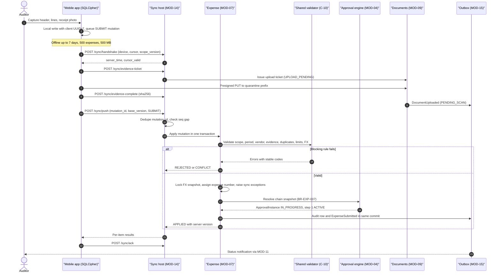

### 3.9 WF-09 Supporting-Document Upload and Scan

**Binds:** UC-04, UC-07; FR-DOC-001 to FR-DOC-006, FR-DOC-013, FR-DOC-014, FR-DOC-016, FR-DOC-017, FR-EXP-010; BR-DOC-001, BR-DOC-005, BR-DOC-006, BR-DOC-007; NFR-SEC-007, NFR-SEC-008, NFR-PERF-011; CAP-014; ADR-006; events `DocumentUploaded`, `DocumentScanned`, `DocumentQuarantined`.

| Attribute | Specification |
|-----------|---------------|
| Initiating actor | Any capture actor (WF-08); vendor, commitment, audit report and finding owners for non-expense documents; the system scanner |
| Preconditions | The owning record exists and is in the actor's scope; tenant storage quota not exhausted (FR-DOC-017) |
| Validation | Type allow-list (JPEG, PNG, HEIC, PDF, XLSX, DOCX); size ≤25 MB (OQ-06 of Document 6); declared and sniffed MIME agree; client and server SHA-256 match; content-length bound in the presigned URL |
| Authorization | `document.document.create` (ticket and complete); `document.version.create` (replacement); `document.document.read` checked on every preview and signed-URL issue (BR-DOC-006). Linking evidence to an approved expense requires a new revision or an evidence amendment record (BR-DOC-007) |
| State transitions | SM-12 `UPLOAD_PENDING` → `PENDING_SCAN` → `AVAILABLE`, `QUARANTINED` or `SCAN_FAILED`; evidence link created `UNVERIFIED` |
| Transaction boundary | Ticket: `docs.upload_ticket` and `docs.document` in `UPLOAD_PENDING`. Complete: hash check, state `PENDING_SCAN`, audit, `DocumentUploaded`. Scan result: `docs.scan_result`, state, `docs.document_version` on clean, audit, `DocumentScanned` or `DocumentQuarantined`. Object moves happen before the state commit and are idempotent |
| Concurrency | One scan job per `(document_id, version)`; the state update checks the from-state `PENDING_SCAN` |
| Duplicate submission | Device-generated `document_id`; completing an already-complete upload returns the current state; identical SHA-256 on the same owner is linked, not stored twice |
| Success response | Ticket `201` with presigned PUT (≤15 minutes); complete `202` with `PENDING_SCAN`; clients poll or receive a stream event on `AVAILABLE` |
| Failure scenarios | Hash mismatch: `422 HASH_MISMATCH`†, object deleted. Quota exceeded: `409 ENTITLEMENT_EXCEEDED`. Infected: `QUARANTINED`, never served (BR-DOC-005). Scanner unavailable: stays `PENDING_SCAN`, retried; after the retry budget `SCAN_FAILED` |
| Retry | Uploads resumable from the device; scan jobs per C-07; `SCAN_FAILED` re-queued by operator (`ops.job.update`) |
| Audit events | `document.ticket_issued`, `document.uploaded`, `document.scanned`, `document.quarantined`, `document.version_created`, `document.accessed` (access log, FR-DOC-013) |
| Notifications | Uploader and security contact on quarantine (UC-07); uploader on `SCAN_FAILED` after retries |
| Recovery | Orphan `UPLOAD_PENDING` rows older than 24 hours are soft-deleted by a sweep and their objects removed; a nightly reconciliation compares object storage with `docs.document` (Document 6 §8.10) |

### 3.10 WF-10 Expense Validation

**Binds:** UC-04, UC-06, UC-08; FR-EXP-007 to FR-EXP-009, FR-EXP-011, FR-EXP-013, FR-EXP-023, FR-EXP-029, FR-XLS-016; BR-EXP-001 to BR-EXP-006, BR-EXP-008, BR-EXP-012 to BR-EXP-016, BR-FIN-001 to BR-FIN-003, BR-FIN-007, BR-FIN-008, BR-FIN-011, BR-BUD-009; CAP-013; events `ExceptionRaised`.

Validation runs at three points with one rule set (C-10): **submission** (online, sync, import), **each approval decision** (re-evaluation), and **amendment**.

| Rule group | Rule | At submit | At approval | Outcome on failure |
|------------|------|-----------|-------------|--------------------|
| Structure | Mandatory header and line fields; at least one line; quantity × unit price, tax and gross arithmetic; header = sum of rounded lines (BR-FIN-011, BR-FIN-002 half-up, RC-01) | Yes | — | Block `422` |
| Scope | Show, department and category inside the actor's effective scope (BR-EXP-004) | Yes | Re-check approver and submitter scope | Block `403 SCOPE_DENIED`; at approval, submitter scope loss raises `POLICY_VIOLATION` |
| Taxonomy | Category active, leaf, mapped to the department (BR-EXP-015) | Yes | — | Block `422` |
| Splits | Sum to 100 percent and to the line; remainder to the largest split (BR-EXP-012) | Yes | — | Block `422` |
| Dates | Not more than 2 days in the future; not earlier than show start minus grace (BR-EXP-002) | Yes | — | Block `422` |
| Period | Expense date period not `LOCKED` (C-08) | Yes | Yes | Block `422 PERIOD_LOCKED`† |
| Vendor | Vendor `ACTIVE`, or one-time `CANDIDATE` where policy permits; `BLOCKED` or `INACTIVE` needs Finance Head override (BR-EXP-013) | Yes | Final step requires `ACTIVE` or approved one-time payee | Block, or exception `UNAUTHORIZED_VENDOR` |
| Evidence | Required by category, amount threshold or policy (BR-EXP-001); none `DISPUTED` | Presence | Final step: no `DISPUTED` link, none `QUARANTINED` | Block `422 EVIDENCE_REQUIRED`† or `409 EVIDENCE_DISPUTED`† |
| Duplicates | Vendor, amount within 1 percent, date within 7 days, non-cancelled, same show (BR-EXP-006) | Yes | — | `409 DUPLICATE_SUSPECTED`† until linked, justified or cancelled; justification raises `DUPLICATE_SUSPECTED` exception |
| FX | Rate for the expense date from the organization table, else latest published, locked (BR-FIN-003) | Yes | Uses locked rate | Fallback raises `FX_FALLBACK`; no rate: `503 FX_RATE_UNAVAILABLE` |
| Tax | Taxable × rate, inclusive or exclusive, stored separately (BR-FIN-007) | Yes | — | Block `422` |
| Sign | Negative only on a credit note referencing the original (BR-FIN-008) | Yes | — | Block `422` |
| Limits | Per-transaction and per-day limits by auditor type (BR-EXP-014), base amount at locked rate (BR-EXP-008) | Yes | — | Extra approval step inserted and `CASH_LIMIT` or `POLICY_VIOLATION` exception; never blocks capture |
| Lateness | Submission later than the configured window after expense date | Yes | — | `LATE_SUBMISSION` exception |
| Budget | Unbudgeted line key or availability below amount (read from MOD-08 variance read model) | Advisory | Final step: freshness-checked re-read (R4-12) | `UNBUDGETED_SPEND` or `OVER_BUDGET` exception (WF-12) |

| Attribute | Specification |
|-----------|---------------|
| Initiating actor | The submitting actor, the approving actor, the sync host or the import committer; validation never runs on behalf of nobody |
| Preconditions | Reference data cached at version ≥ the device's `scope_version` for client-side checks; server checks always use current data |
| Validation | The rule table above; each rule has a stable code, a business-language message and the next action (NFR-UX-008) |
| Authorization | Inherited from the calling command (`expense.expense.submit`, `.approve`, `.update`, `excel.import_job.update`) |
| State transitions | None by itself; a blocking failure prevents the SM-09 transition; a warning raises SM-15 exceptions in the same transaction |
| Transaction boundary | Inside the calling command's transaction; synchronous exceptions commit with the expense (C-04) |
| Concurrency | Duplicate detection takes an advisory lock on `(org_id, show_id, vendor_id, date bucket)` so two simultaneous duplicates cannot both pass |
| Duplicate submission | Not applicable; inherited from the caller |
| Success response | Warnings and raised exception IDs are returned in the caller's response |
| Failure scenarios | Errors returned as `errors[]` with field paths (row and cell references for imports) |
| Retry | Deterministic: the same input and reference versions give the same result; transient dependency failures return `503` and are retried by the caller |
| Audit events | Blocking failures write no business audit event (no state change) but a metric; overrides write `expense.rule_overridden` with rule ID, actor, reason (Document 1 §10.12 exception register) |
| Notifications | None directly; exceptions route per WF-12 |
| Recovery | Rule versions are effective-dated; a historical expense is never re-validated under a newer rule version (Document 1 §10.12) |

### 3.11 WF-11 Audit Review: Evidence Verification, Dispute and Findings

**Binds:** UC-07, UC-10; FR-DOC-003, FR-DOC-007, FR-DOC-016, FR-AUD-010, FR-AUD-013; BR-DOC-001, BR-DOC-007, BR-EXP-017, BR-AUD-006; CAP-014, CAP-026; events `EvidenceVerified`†, `EvidenceDisputed`†, `FindingRaised`†, `FindingResponded`†, `FindingClosed`†, `FindingEscalated`†.

| Attribute | Specification |
|-----------|---------------|
| Initiating actor | Evidence: reviewer holding `document.evidence.approve`/`.reject` (`COST_CONTROLLER`, `DEPARTMENT_HEAD`, `AUDIT_MANAGER`; grantees once RC-4-10 is applied). Findings: `INTERNAL_AUDITOR` or grantee with `AUDIT_EVIDENCE` raises; production side responds; `AUDIT_MANAGER` closes |
| Preconditions | Evidence link exists on an expense or line and its document is `AVAILABLE`; finding linked to an assignment in `ACTIVE` or `COMPLETED` state |
| Validation | Dispute reason mandatory (FR-DOC-007), minimum 20 characters; verifier is neither the uploader nor the expense submitter (self-approval predicate, Document 3 §5.8); finding severity, category, description, due date and visibility (`APPOINTING_PARTY_ONLY`, `SHARED_WITH_PRODUCTION`); closure reason mandatory |
| Authorization | `document.evidence.approve` (verify), `document.evidence.reject` (dispute); `document.version.create` (replacement); `audit.audit_finding.create`, `.update`, `.submit` (raise), `.approve` (close), `.reject` (return a response); `audit.finding_response.create` (production response, shared findings only) |
| State transitions | SM-12 evidence `UNVERIFIED` → `VERIFIED` or `DISPUTED`; `DISPUTED` → `UNVERIFIED` on clean replacement; `VERIFIED` → `DISPUTED` after approval (BR-EXP-017). SM-11 `DRAFT` → `OPEN` → `RESPONDED` → `CLOSED`, with `ESCALATED` and `WITHDRAWN` |
| Transaction boundary | Evidence decision: evidence link, a `DISPUTED` flag on the expense's open approval instance (blocks the final step), exception `MISSING_EVIDENCE` where applicable, audit, outbox, in one MOD-07 transaction (evidence links are `expense` schema). Findings: one MOD-06 transaction per transition |
| Concurrency | C-03 on the evidence link and the finding; a verification racing a replacement loses (`409 CONCURRENCY_STALE`) because the replacement bumps the link version |
| Duplicate submission | Decisions idempotent (C-02); a second dispute on a `DISPUTED` link returns the current state |
| Success response | `200` with the link or finding state; for disputes the response lists the blocked approval instance |
| Failure scenarios | Verifying a document not `AVAILABLE`: `409 INVALID_STATE_TRANSITION`†. Self-verification: `403 SELF_APPROVAL_PROHIBITED`. Response to an `APPOINTING_PARTY_ONLY` finding by production users: `404` (not visible). Replacing verified evidence on an approved expense without a revision or evidence amendment: `409` (BR-DOC-007) |
| Retry | Client retry with key; consumer retries per C-07 |
| Audit events | `evidence.verified`, `evidence.disputed`, `evidence.replaced`, `finding.raised`, `finding.responded`, `finding.returned`, `finding.escalated`, `finding.closed`, `finding.withdrawn` |
| Notifications | Submitter and uploader on dispute; `AUDIT_MANAGER` on the second dispute of the same link (UC-07 escalation); production owner on a shared finding; appointing party on every finding of a platform-appointed assignment; owner before and after the finding due date |
| Recovery | A dispute after approval never reverses cost (BR-EXP-017); it flags the expense in RPT-10 and RPT-11 and, where the reviewer concludes the spend is invalid, the correction is a cancellation or amendment (WF-13) |

### 3.12 WF-12 Exception Identification

**Binds:** UC-06, UC-09; FR-EXP-023, FR-CIN-004; BR-EXP-006, BR-EXP-013, BR-EXP-014, BR-EXP-017, BR-FIN-006; CAP-013; RPT-11; events `ExceptionRaised`, `ExceptionStatusChanged`†.

| Attribute | Specification |
|-----------|---------------|
| Initiating actor | System rules (synchronous in MOD-07; asynchronous from MOD-08 projections); manual raise by `AUDIT_MANAGER` or `INTERNAL_AUDITOR` |
| Preconditions | The subject record exists; the rule version is active for the tenant |
| Validation | Exception type in the Document 2 list; severity; dedup key `(rule_code, subject_id, budget_line_key, period)`; at most one open exception per rule and dedup key |
| Authorization | Raise: system, or `expense.exception.create`. Work: `expense.exception.update` (acknowledge, resolve, false positive). Waive: `expense.exception.approve` with step-up by a human other than the requester (self-approval predicate); the waiver follows the `EXCEPTION_WAIVER` workflow |
| State transitions | SM-15 `OPEN` → `ACKNOWLEDGED` → `RESOLVED`, `FALSE_POSITIVE` or `WAIVED`; reopen returns to `OPEN` |
| Transaction boundary | Synchronous rules (`DUPLICATE_SUSPECTED`, `MISSING_EVIDENCE`, `POLICY_VIOLATION`, `UNAUTHORIZED_VENDOR`, `CASH_LIMIT`, `LATE_SUBMISSION`, `FX_FALLBACK`, `UNUSUAL_AMOUNT`) commit with the expense. Budget rules (`OVER_BUDGET`, `UNBUDGETED_SPEND`, `COMMITMENT_EXCEEDED`) are evaluated by MOD-08 after projection and raised through the MOD-07 `RaiseException` contract in the consumer's transaction (ADR-029) |
| Concurrency | Unique partial index on the dedup key where status is `OPEN` or `ACKNOWLEDGED`; a racing raise becomes a no-op |
| Duplicate submission | Idempotent by dedup key and by `event_id` in the consumer inbox |
| Success response | Raised exceptions appear in the caller's response (synchronous) or in the exception queue (asynchronous) |
| Failure scenarios | Rule evaluation error: exception not raised, consumer retries; after dead letter the reconciliation job raises a `RULE_EVALUATION_FAILED` operational alert. Waiver by requester: `403 SELF_APPROVAL_PROHIBITED` |
| Retry | Consumer retries per C-07; replay is safe because of the dedup key |
| Audit events | `exception.raised`, `exception.acknowledged`, `exception.resolved`, `exception.false_positive`, `exception.waiver_requested`, `exception.waived`, `exception.reopened` |
| Notifications | Owner (resolved from rule configuration: department head, cost controller) on raise; critical exceptions also to the Finance Head; digest of open exceptions (FR-NTF-006) |
| Recovery | Conditions that clear (evidence verified, vendor activated) auto-resolve the exception with actor `SYSTEM`; a recurrence within the same dedup key reopens it. Unresolved critical exceptions block show closure and period close (WF-20, WF-21) |

### 3.13 WF-13 Expense Approval or Rejection

**Binds:** UC-06, UC-07; FR-EXP-014 to FR-EXP-019, FR-EXP-022, FR-EXP-028, FR-TNT-020; BR-EXP-005, BR-EXP-007 to BR-EXP-010, BR-EXP-014, BR-EXP-017, BR-FIN-005, BR-FIN-009, BR-ACC-006; CAP-013; events `ExpenseApproved`, `ExpenseRejected`, `ExpenseInfoRequested`†, `ExpenseAmended`, `ExpenseCancelled`, `ExpenseSuperseded`†, `ApprovalStepActivated`†, `ApprovalDecisionRecorded`†.

| Attribute | Specification |
|-----------|---------------|
| Initiating actor | Approvers occupying the active step: `DEPARTMENT_HEAD`, `COST_CONTROLLER`, `FINANCE_HEAD`, or an active delegate (Document 3 §5.9) |
| Preconditions | Expense revision `SUBMITTED`; approval instance `IN_PROGRESS` with an `ACTIVE` step; actor in the step's candidate set |
| Validation | WF-10 re-evaluation at each decision; at the final step: no `DISPUTED` or `QUARANTINED` evidence, period of the expense date not `LOCKED`, vendor `ACTIVE` or approved one-time payee; request amount equals the persisted base amount (Document 3 §6.7); comment mandatory on reject and request information (FR-EXP-015) |
| Authorization | `expense.expense.approve` or `.reject` with step-up; request information uses `.reject` with decision `REQUEST_INFO`; vetoes SOD-01, SOD-02, SOD-05 and self-approval (BR-EXP-005, also through delegation); effective limit `min(role, personal, delegated, org ceiling)` in base currency at the locked rate (BR-EXP-008); delegation ≤90 days, no chaining (BR-ACC-006) |
| State transitions | SM-13 step `ACTIVE` → `APPROVED`, next step `WAITING` → `ACTIVE`; on the last step instance → `APPROVED` and SM-09 → `APPROVED`; reject: instance and expense `REJECTED`; request information: instance `INFO_REQUESTED`, expense `REQUIRES_INFO`; amendment approval: prior revision `APPROVED` → `SUPERSEDED` |
| Transaction boundary | One MOD-07 transaction: decision row, step and instance state, expense state, cost postings (one `APPROVAL` posting per line split in the period of the expense date; `REVERSAL` postings for a superseded revision in the current period, BR-EXP-010), audit, outbox |
| Concurrency | The instance row is locked `FOR UPDATE`; two approvers on the same step produce one decision and one `409 INVALID_STATE_TRANSITION`†. Bulk approval (FR-EXP-022) processes each item in its own transaction and returns per-item results |
| Duplicate submission | Decision endpoints idempotent (C-02) |
| Success response | `200` with expense state, instance state, next step and approvers; final approval includes the posting summary |
| Failure scenarios | `403 SOD_CONFLICT`, `403 SELF_APPROVAL_PROHIBITED` (logged as `SodBlocked`), `403 APPROVAL_LIMIT_EXCEEDED` (step stays active for higher authorities), `403 DELEGATION_EXPIRED`, `409 EVIDENCE_DISPUTED`†, `422 PERIOD_LOCKED`†, `503 FX_RATE_UNAVAILABLE` |
| Retry | Client retry with the same key; SLA reminder job; Phase 1 escalation |
| Audit events | `approval.step_activated`, `approval.step_decided`, `expense.info_requested`, `expense.info_provided`, `expense.approved`, `expense.rejected`, `expense.cancelled`, `expense.superseded`, `cost_posting.created` |
| Notifications | Next step's approvers; submitter on every status change (FR-EXP-028); delegator when a delegate acts; reminder before SLA breach (FR-NTF-004) |
| Recovery | An approval cannot be undone; correction is cancellation (reversal postings) or amendment (new revision). A deactivated approver's open steps are reassigned or flagged within one business day (BR-ACC-004) |

**Audit approval workflow (required diagram 8).** The diagram covers multi-level approval, evidence dispute, information request and the SoD veto.

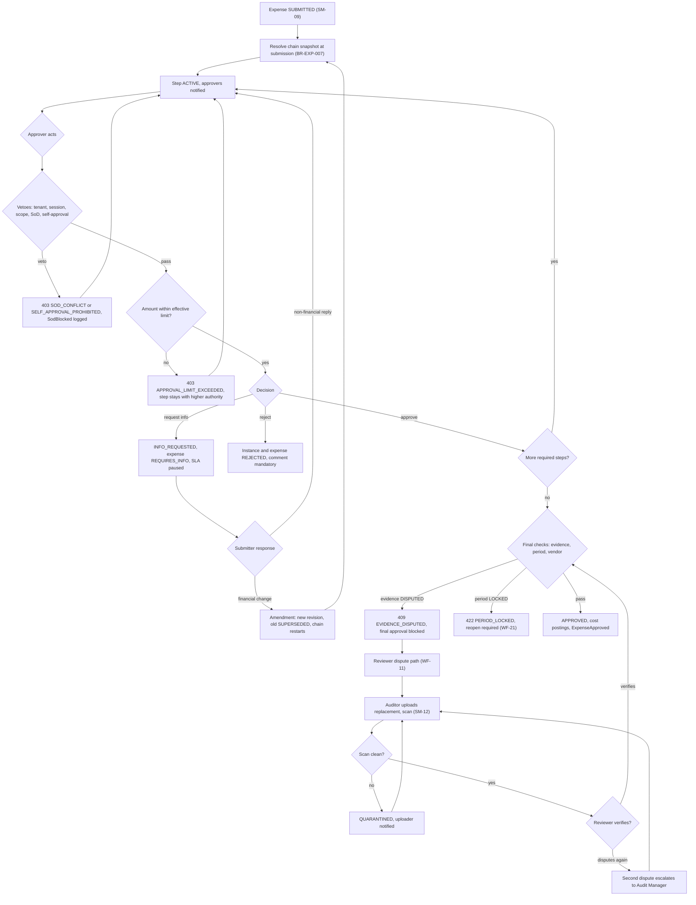

### 3.14 WF-14 Cost Variance Calculation

**Binds:** UC-09, UC-12; FR-BUD-011, FR-CIN-001, FR-CIN-002, FR-CIN-004 to FR-CIN-006, FR-CIN-020; BR-FIN-002, BR-FIN-005, BR-FIN-006, BR-FIN-011, BR-FIN-012; NFR-PERF-004, NFR-PERF-005; CAP-015; ADR-010; events consumed `BudgetApproved`, `BudgetRevised`, `ExpenseApproved`, `ExpenseCancelled`, `ExpenseAmended`, `ExpenseSuperseded`†, `CommitmentCreated`, `CommitmentAmended`, `CommitmentClosed`, `PeriodLocked`; emitted `ProjectionCheckpoint`, `VarianceBreached`.

| Attribute | Specification |
|-----------|---------------|
| Initiating actor | System projectors in the Worker host |
| Preconditions | Source event committed; projector checkpoint behind the event's sequence |
| Validation | Measures per Document 13: actual = sum of `expense.cost_posting` base amounts (BR-FIN-005); committed = open commitments net of consumption by non-rejected, non-cancelled expense lines (BR-FIN-006); variance = current budget − actual − committed; variance percent = variance ÷ current budget, "not applicable" when the budget is zero; locked rates only (BR-FIN-012); half-up at report totals (RC-01); classification against configured thresholds (FR-CIN-006) |
| Authorization | Projectors run as the system identity with tenant context per row. Reads: `intel.variance.read`, `intel.cost_fact.read`, `intel.portfolio_view.read` |
| State transitions | None on business aggregates; projector checkpoint advances; period-close snapshots are frozen on `PeriodLocked` |
| Transaction boundary | Per event: checkpoint and aggregate upserts in one `intel` transaction (Document 6 §4.4 "Dashboard projection") |
| Concurrency | One projector instance per tenant partition holds a lease; per-aggregate ordering from the outbox; upserts keyed by dimension key are commutative for postings |
| Duplicate submission | Inbox dedup on `event_id`; each fact row records its source posting, so a replay cannot double count |
| Success response | Not request-driven; reads return `as_of` and `freshness_tier` (show ≤60 s, portfolio ≤5 min) |
| Failure scenarios | Variance identity mismatch: recompute, alert if still mismatched (Document 6 §8.10); a fact without a source is quarantined; consolidated totals off by more than 0.01 block report publication (BR-FIN-011) |
| Retry | Consumer retry per C-07; poison events dead-lettered and replayed after fix |
| Audit events | None per projection (derived data); `variance_snapshot.frozen` on period lock; rebuilds write `projection.rebuilt` |
| Notifications | Indirect through WF-15 |
| Recovery | Full rebuild into a shadow schema from `expense.cost_posting`, commitment and budget sources, verified against reconciliation totals, then swapped (Document 6 §8.6) |

### 3.15 WF-15 Cost-Overrun Alerts

**Binds:** UC-09; FR-CIN-007 to FR-CIN-010, FR-NTF-005, FR-NTF-007, FR-NTF-012; NFR-PERF-010; D-010; CAP-016; ADR-029; events `AlertTriggered`, `VarianceBreached`, `AlertAcknowledged`†, `AlertResolved`†, `AlertEscalated`† (Phase 1), `ExceptionRaised`.

| Attribute | Specification |
|-----------|---------------|
| Initiating actor | Configuration: `FINANCE_HEAD` or `COST_CONTROLLER`. Evaluation: system (event-triggered and scheduled sweep, FR-CIN-008). Handling: `COST_CONTROLLER`, `FINANCE_HEAD`, `COMMISSIONING_ADMIN` (MANAGEMENT_VIEWER reads only, Document 3 A.7 note 1) |
| Preconditions | Active alert rule version; variance read model current within freshness tier |
| Validation | Rule: scope (organization, show, department, category), metric (variance percent, consumption percent, absolute overrun, commitment exposure), condition, threshold, severity, cooldown (FR-CIN-007); thresholds validated per metric |
| Authorization | `intel.alert_rule.create`, `.update`, `.delete`; `intel.alert.update` (acknowledge, resolve, false positive with reason); `intel.alert.read` |
| State transitions | SM-16 `TRIGGERED` → `ACKNOWLEDGED` → `RESOLVED` or `FALSE_POSITIVE`; `ESCALATED` at Phase 1; budget-line breaches also raise SM-15 `OVER_BUDGET` exceptions |
| Transaction boundary | Per evaluation: alert instance, audit, `AlertTriggered` in one `intel` transaction; the exception is raised through the MOD-07 contract in a separate consumer transaction (ADR-029) |
| Concurrency | Unique key `(rule_version_id, scope_key, period_id)` among non-terminal instances; cooldown checked in the same statement |
| Duplicate submission | Event path and sweep path compute the same idempotency key, so both firing for one breach yields one instance |
| Success response | Not request-driven; `GET /alerts` lists instances; acknowledgement `200` |
| Failure scenarios | Evaluation lag beyond the severity target (critical ≤5 min, standard ≤15 min, NFR-PERF-010): operational alert; notification failure: retried and visible in delivery tracking (UC-09) |
| Retry | Evaluator consumer per C-07; the sweep re-evaluates every active rule every 5 minutes for critical rules and 15 minutes for standard rules, catching missed events |
| Audit events | `alert_rule.created`, `alert_rule.changed`, `alert.triggered`, `alert.acknowledged`, `alert.resolved`, `alert.false_positive`, `alert.escalated` |
| Notifications | Configured recipients with severity, scope and drill-down link (FR-NTF-005); MVP re-notifies critical unacknowledged alerts after 15 minutes without a state change; multi-level escalation is Phase 1 (RC-4-09) |
| Recovery | Missed events are caught by the sweep; a rule disabled mid-cycle generates nothing further and its open instances stay for handling |

**Cost-overrun detection workflow (required diagram 9).**

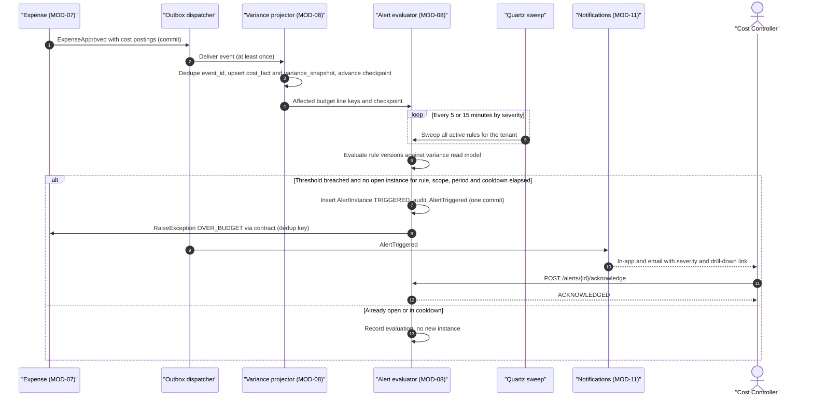

### 3.16 WF-16 Daily Audit Reporting

**Binds:** UC-10; FR-AUD-010, FR-AUD-013, FR-AUD-015, FR-CIN-014; BR-AUD-006; RPT-09, DSH-04; A2-03; CAP-026; events `AuditReportSubmitted`†, `AuditReportAccepted`†, `AuditReportReturned`†, `CoverageUpdated`.

| Attribute | Specification |
|-----------|---------------|
| Initiating actor | Author: auditor on an `ACTIVE` assignment (`INTERNAL_AUDITOR`; grantee once RC-4-10 is applied). Reviewer: `AUDIT_MANAGER` of the appointing or hosting organization |
| Preconditions | Assignment `ACTIVE` (or `COMPLETED` for a `CLOSING` report); report date inside the assignment window |
| Validation | One accepted version per assignment, type and date; totals snapshot pre-filled from expenses captured under the assignment that day (count, base total, by department) and frozen at submission; petty-cash check fields balanced; findings referenced belong to the assignment; summary mandatory |
| Authorization | `audit.audit_report.create`, `.update`, `.submit`; `.approve` (accept) and `.reject` (return) by a human other than the author; `.export` for RPT-09 |
| State transitions | SM-10 `DRAFT` → `SUBMITTED` → `ACCEPTED` or `RETURNED`; `RETURNED` → `SUBMITTED`; prior `ACCEPTED` → `SUPERSEDED` when an amended version is accepted |
| Transaction boundary | One MOD-06 transaction per transition: report, totals snapshot, audit, outbox |
| Concurrency | C-03; a unique partial index allows one non-superseded `ACCEPTED` report per assignment, type and date |
| Duplicate submission | Submit and decisions idempotent (C-02); creating a second draft for the same key returns the existing draft |
| Success response | `200` with state; coverage recalculated asynchronously (`CoverageUpdated`) |
| Failure scenarios | Report for a date outside the assignment: `422`. Self-acceptance: `403 SELF_APPROVAL_PROHIBITED`. Edit of an accepted report: `409 INVALID_STATE_TRANSITION`†; amendment creates a new version |
| Retry | Client retry with key |
| Audit events | `audit_report.created`, `audit_report.submitted`, `audit_report.returned`, `audit_report.accepted`, `audit_report.superseded` |
| Notifications | Reminder to the auditor at the configured cut-off (default 18:00 local) when no report exists for a working day; reviewer on submission; appointing party on acceptance of platform-appointed reports; missing reports in the Audit Manager digest |
| Recovery | A missed day stays visible in coverage (FR-AUD-013) and can be reported late; the late flag is derived from `submitted_at` versus the cut-off (A4-05) |

### 3.17 WF-17 Excel Import

**Binds:** UC-08; FR-XLS-001 to FR-XLS-011, FR-XLS-016, FR-XLS-017; BR-XLS-001 to BR-XLS-006, BR-EXP-016; NFR-PERF-006; CAP-020; ADR-011, ADR-028; events `ImportUploaded`†, `ImportValidated`†, `ImportCommitRequested`†, `ImportCommitted`, `ImportRejected`, `ImportReversed`†.

| Attribute | Specification |
|-----------|---------------|
| Initiating actor | `ACCOUNTS_EXECUTIVE`, `PRODUCTION_ADMIN`, `COST_CONTROLLER`; second-person approver `FINANCE_HEAD` or `COST_CONTROLLER` where policy requires |
| Preconditions | Active template version for the target (`EXPENSE`, `BUDGET_LINES`, `VENDOR`, `COMMITMENT`, `DEPARTMENT_CATEGORY`); target show accepts transactions (C-09); for budget lines, a `DRAFT` budget version |
| Validation | File type, size and scan (WF-09); template version header (BR-XLS-001); column mapping and value mappings; every row through the target's shared validator (C-10) with the importer's own scope (BR-EXP-016); file hash against committed batches (BR-XLS-003); error rate versus threshold and commit mode (BR-XLS-004); workbook control totals |
| Authorization | `excel.import_job.create` (upload), `.update` (validate, commit), `.delete` (reject an uncommitted batch, request reversal), `.approve` with step-up (second-person commit and reversal approval, approver ≠ requester); commit also needs the target key (`expense.expense.create` and `.submit`, `budget.budget_version.update`, `vendor.vendor.create`, `vendor.commitment.create`, `production.category.create`); reversal of approved expenses needs `expense.expense.delete` and `.approve` |
| State transitions | SM-17 `UPLOADED` → `SCANNING` → `PARSING` → `VALIDATING` → `VALIDATED` → (`AWAITING_COMMIT_APPROVAL`) → `COMMITTING` → `COMMITTED` or `PARTIALLY_COMMITTED`; `REJECTED`, `FAILED`, `EXPIRED`; `REVERSAL_PENDING` → `REVERSED`. Created expenses enter SM-09 `DRAFT` or `SUBMITTED`, never `APPROVED` |
| Transaction boundary | Staging (`xls.import_batch`, `xls.import_row`) per phase; commit in 1,000-row chunks, each chunk one transaction with its target records, row outcomes, audit and outbox (Document 6 §4.4); batch completion one transaction emitting `ImportCommitted` |
| Concurrency | One active commit per batch (tenant lock key); each chunk re-validates rows because state may have changed since validation (period lock, vendor block) |
| Duplicate submission | Upload idempotent by key; same file hash as a committed batch needs explicit confirmation (`409 IMPORT_DUPLICATE_FILE`†); chunk commit idempotent by `(import_batch_id, row_number)` so a resumed commit never creates a second record |
| Success response | Upload `202` with batch; preview with valid, warning and error rows and a downloadable error report (FR-XLS-009); commit `202`, completion notification with reconciliation against control totals |
| Failure scenarios | Template mismatch: `REJECTED` with `TEMPLATE_VERSION_MISMATCH`†. Error rate above threshold in partial mode or any error in all-or-nothing mode: commit blocked `422 IMPORT_ERROR_THRESHOLD`†. Row fails at commit re-validation: partial mode skips it; all-or-nothing mode stops, compensates committed chunks and ends `FAILED` (ADR-028) |
| Retry | Validation re-run after correction (`POST /excel/imports/{id}/validate`); interrupted commit resumes from the last committed chunk |
| Audit events | `import.uploaded`, `import.validated`, `import.commit_requested`, `import.commit_approved`, `import.chunk_committed`, `import.committed`, `import.rejected`, `import.failed`, `import.reversal_requested`, `import.reversed`; each created record's own audit event carries `source=EXCEL_IMPORT` and the batch and row |
| Notifications | Uploader on validation complete and commit complete (FR-XLS-017); approver on commit request; uploader on expiry |
| Recovery | Committed batches are reversed, never deleted (BR-XLS-006): reversal cancels each created record (reversal postings for approved expenses, in the current period); a record changed after import by someone else blocks reversal of that row until resolved. Uncommitted batches expire after 7 days |

### 3.18 WF-18 Excel Export

**Binds:** UC-12; FR-XLS-012 to FR-XLS-015, FR-BUD-016, FR-EXP-024, FR-CIN-021, FR-VND-018; BR-XLS-005, BR-VND-007; NFR-PERF-007, NFR-SEC-008; CAP-021; events `ExportRequested`†, `ExportCompleted`, `ExportFailed`†, `GrantExportCompleted`.

| Attribute | Specification |
|-----------|---------------|
| Initiating actor | Any role holding the domain export key; grantees with `report.report_run.export` in `AUDIT_FINANCE` |
| Preconditions | Template or report definition active; requester session valid; for grantees, grant `ACTIVE` |
| Validation | Filters whitelisted; column selection inside the template; row estimate; restricted fields (bank and tax identifiers) masked unless the requester holds `vendor.payment_term.update` (BR-VND-007) |
| Authorization | `excel.export_job.create` plus the domain key (`expense.expense.export`, `budget.budget_version.export`, `vendor.vendor.export`, `intel.variance.export`, `intel.portfolio_view.export`); `report.report_run.create` for reports; rows limited to the requester's effective scope at generation time |
| State transitions | ExportJob `QUEUED` → `RUNNING` → `COMPLETED` → `EXPIRED`, or `FAILED` (§4.21); the backing job follows SM-19 |
| Transaction boundary | Request: job row, scope snapshot, audit, outbox. Generation: object write, then job completion in one transaction (Document 6 §4.4 "Report generation") |
| Concurrency | Per-tenant concurrency limit (`reports.concurrent` entitlement); excess jobs stay `QUEUED` |
| Duplicate submission | `Idempotency-Key`; identical parameters within 60 s return the existing job |
| Success response | `≤1,000` rows may stream synchronously; above that `202` with job; completion carries a signed URL valid ≤15 minutes; file retained 7 days |
| Failure scenarios | Scope change during generation: the scope snapshot governs, and a grant revoked mid-run cancels the job (Document 3 §8.8); generation error: `FAILED` with a retryable or terminal code |
| Retry | Retryable failures re-queued per SM-19; terminal failures need a new request |
| Audit events | `export.requested`, `export.completed` (row count, watermark ID), `export.failed`, `export.downloaded` |
| Notifications | Requester on completion or failure (in-app and email without content) |
| Recovery | Expired files are deleted; the job record remains 7 years (BR-XLS-005); regeneration is a new request with the requester's current scope |

### 3.19 WF-19 Management Dashboard Updates

**Binds:** UC-12; FR-CIN-011 to FR-CIN-015, FR-CIN-018 to FR-CIN-020, FR-CIN-023; NFR-PERF-001, NFR-PERF-002, NFR-PERF-004, NFR-PERF-005; D-010; DSH-01 to DSH-04, DSH-06; CAP-019; ADR-010; events consumed per WF-14 plus `CoverageUpdated`, `AlertTriggered`, `ExceptionRaised`; emitted `ProjectionCheckpoint`.

| Attribute | Specification |
|-----------|---------------|
| Initiating actor | System projectors (update path); dashboard readers (read path) |
| Preconditions | Source events committed; reader has dashboard scope |
| Validation | Every aggregate traces to a source record; consolidated totals equal sum of components within 0.01 (BR-FIN-011) |
| Authorization | Update: system. Read: `report.dashboard.read` plus `intel.portfolio_view.read` (DSH-01), `intel.variance.read`, `intel.cost_fact.read` (drill-down, FR-CIN-015); drill-down re-applies row scope; H2 cross-tenant portfolio is out of MVP scope (Document 2 §2.3 rule 5) |
| State transitions | Projector checkpoint only |
| Transaction boundary | Checkpoint and aggregate upsert per event (Document 6 §4.4) |
| Concurrency | Show-level projector partitions by show; portfolio aggregates are recomputed on a 5-minute cadence from show aggregates, never from raw expense rows |
| Duplicate submission | Inbox dedup on `event_id` |
| Success response | Dashboard payload with `as_of`, `freshness_tier` and stale badge when lag exceeds the tier (FR-CIN-020) |
| Failure scenarios | Projector lag above tier: stale badge plus operational alert; reconciliation mismatch: affected dashboard frozen with a data-quality banner (Document 6 §8.10); show without budget: variance "not applicable" with a warning (UC-12) |
| Retry | Consumer retries per C-07 |
| Audit events | Reads of restricted aggregates are recorded as access events; `projection.rebuilt` on rebuild |
| Notifications | None for updates; scheduled digests read from the same aggregates (Document 6 §3.4.6) |
| Recovery | Shadow rebuild and swap (WF-14); replay from checkpoint after a dead-letter fix |

### 3.20 WF-20 Show Closure and Archival

**Binds:** UC-11; FR-PRD-003, FR-PRD-013; BR-PRD-001, BR-PRD-002, BR-BUD-009, BR-DOC-004; CAP-004, CAP-024; events `ShowClosureRequested`†, `ShowClosureDecided`†, `ShowStatusChanged`.

| Attribute | Specification |
|-----------|---------------|
| Initiating actor | Request: `PRODUCTION_ADMIN` or `COMMISSIONING_ADMIN`. Approval and archive: `FINANCE_HEAD` or `COMMISSIONING_ADMIN` other than the requester |
| Preconditions | Show `COMPLETED` |
| Validation | Checklist (Document 2 ShowClosure): no open approvals (expense, budget version, commitment, import commit); no `OPEN` or `PENDING_APPROVAL` commitments; no unresolved critical exceptions; no draft expenses; no `ACTIVE` or `SUSPENDED` assignments; final period `LOCKED`. Each blocking item is resolved or waived with reason (BR-PRD-001) |
| Authorization | `production.show.submit` (request); `production.show.approve` with step-up (waive closure items, approve, reject, archive), approver ≠ requester; exception-level waivers use `expense.exception.approve`; period lock uses WF-21 |
| State transitions | SM-02 `COMPLETED` → `CLOSING` → `CLOSED` → `ARCHIVED` (or back to `COMPLETED`); SM-14 `REQUESTED` → `BLOCKED` or `READY` → `APPROVED` or `REJECTED`, `WITHDRAWN`; SM-03 → `FROZEN` on `CLOSED` |
| Transaction boundary | Request: closure record, checklist run, show `CLOSING`, audit, outbox. Approval: closure `APPROVED`, show `CLOSED`, audit, `ShowStatusChanged`; the budget freeze is a MOD-04 consumer transaction |
| Concurrency | Closure row locked `FOR UPDATE`; one open closure per show (unique partial index); while `CLOSING`, C-09 blocks new expenses and commitments |
| Duplicate submission | Request and decision idempotent (C-02); a second request returns the open closure |
| Success response | `201` closure with checklist results; approval `200` with show `CLOSED` |
| Failure scenarios | Blocking items without waiver: closure `BLOCKED`, approval returns `409 CLOSURE_BLOCKED`† with item list. Self-approval: `403 SELF_APPROVAL_PROHIBITED`. Archive with live grants or assignments on the show: `409` |
| Retry | Checklist re-run on demand and on relevant events (`ExpenseApproved`, `CommitmentClosed`, `PeriodLocked`) |
| Audit events | `show_closure.requested`, `show_closure.checklist_run`, `show_closure.item_waived`, `show_closure.approved`, `show_closure.rejected`, `show_closure.withdrawn`, `show.status_changed`, `budget.frozen`, `show.archived` |
| Notifications | Approvers on `READY`; requester on decisions; production owners on blocking items |
| Recovery | A wrongly closed show is not reopened; corrections post as reversals or credits on a reopened period (WF-21) against the closed show by Finance Head exception, recorded as a waiver (A4-06). Archived shows remain readable and reportable for the retention period (BR-PRD-002) |

### 3.21 WF-21 Financial Period Close and Reopen

**Binds:** UC-11; FR-BUD-010, FR-CMP-001; BR-BUD-009, BR-FIN-010, BR-EXP-003, BR-EXP-010; D-006; CAP-006; events `PeriodCloseStarted`†, `PeriodCloseBlocked`†, `PeriodLocked`, `PeriodReopenRequested`†, `PeriodReopened`.

| Attribute | Specification |
|-----------|---------------|
| Initiating actor | Close and lock: `COST_CONTROLLER` or `FINANCE_HEAD`. Waivers and reopen approval: `FINANCE_HEAD` other than the requester |
| Preconditions | Period `OPEN` or `REOPENED`; period end date passed (early close only with Finance Head waiver) |
| Validation | Checklist (UC-11): pending approvals for transactions dated in the period; uncommitted imports targeting it; missing or disputed required evidence; open critical exceptions; open commitments past validity. Reopen reason mandatory |
| Authorization | `budget.financial_period.update` with step-up (start close, lock, abort, request reopen); `budget.financial_period.approve` with step-up (waivers, reopen approval), approver ≠ requester |
| State transitions | SM-05 `OPEN` → `CLOSING` → `LOCKED`; `CLOSING` → `OPEN` (abort); `LOCKED` → `REOPENED` → `CLOSING`; reopen request is an SM-13 `PERIOD_REOPEN` instance |
| Transaction boundary | Start: period `CLOSING`, `budget.period_close_run`, audit, outbox. Lock: checklist re-verified, period `LOCKED`, audit, `PeriodLocked` in one transaction; variance snapshot and close report are consumer and job work |
| Concurrency | Period row `FOR UPDATE`; a second close of the same scope returns `409 INVALID_STATE_TRANSITION`† (UC-11 concurrent close). Expense approvals check the period inside their own transaction, so an approval committing before the lock is counted and one after it is rejected |
| Duplicate submission | Commands idempotent (C-02) |
| Success response | `200` with period state and the close-run checklist |
| Failure scenarios | Blocking items without waiver: `409 CLOSE_BLOCKED`†. Reopen self-approval: `403 SELF_APPROVAL_PROHIBITED`. Revision effective before last locked period: rejected (BR-BUD-005) |
| Retry | Checklist re-run; snapshot job retried per SM-19 |
| Audit events | `period.close_started`, `period.close_item_waived`, `period.close_aborted`, `period.locked`, `period.reopen_requested`, `period.reopened`, `variance_snapshot.frozen` |
| Notifications | Owners of blocking items; Finance Head on waiver and reopen requests; all finance roles of the scope on lock and reopen |
| Recovery | Reopen keeps the prior snapshot; re-lock creates a new snapshot version, so reports show both |

---

## 4. Part B — State Machines

### 4.1 Common Transition Rules

**Enforcement (ADR-027).** Each machine is a declarative transition table in its owning module. A command names a transition, never a target state. The handler re-reads the aggregate `FOR UPDATE`, checks the from-state, runs C-01 vetoes and the guards, applies side effects, and writes audit and outbox in the same transaction (C-04). A `BEFORE UPDATE` trigger on each status column rejects any pair not in the table, so a direct update cannot skip a gate (the pattern of Document 3 §8.14 `grant_state_trigger`). Terminal states accept no transition.

**Unauthorized transitions and HTTP outcomes.**

| Situation | HTTP outcome |
|-----------|--------------|
| Transition not defined from the current state, or a racing transition already moved the aggregate | `409 INVALID_STATE_TRANSITION`† with `currentState` and `allowedTransitions` for the caller |
| Permission key absent | `403 PERMISSION_DENIED`; out of scope `403 SCOPE_DENIED`; object in another tenant `404 RESOURCE_NOT_FOUND` |
| SoD or self-approval | `403 SOD_CONFLICT` or `403 SELF_APPROVAL_PROHIBITED`; `SodBlocked` security event |
| Amount above effective limit | `403 APPROVAL_LIMIT_EXCEEDED`; the step remains for a higher authority |
| Step-up missing | `403 STEP_UP_REQUIRED` |
| Guard (business rule) fails | `422` with the rule code (`PERIOD_LOCKED`†, `EVIDENCE_REQUIRED`†, `VALIDATION_FAILED`) or `409` where the guard is a state of another aggregate (`EVIDENCE_DISPUTED`†, `CLOSURE_BLOCKED`†, `GRANT_INACTIVE`) |
| Stale `If-Match` | `409 CONCURRENCY_STALE` |
| System-only transition requested by a user | No endpoint exists; a trigger-level violation from any path returns `500` to the caller and raises a critical `StateTriggerViolation` alert |

**Default transaction boundary.** Aggregate row, dependent rows of the same module, audit event, outbox event. Exceptions are stated per machine.

**Default retry and recovery.** User commands are retried with the same idempotency key (C-02). System transitions are idempotent jobs keyed by `(aggregate_id, transition, as_of)` (SM-19). A failed transaction leaves the aggregate in its from-state; there is no half-transitioned state.

### 4.2 SM-01 Organization (Tenant)

Document 3 §2.5 defines states, meaning and invariants; this section adds keys and boundaries.

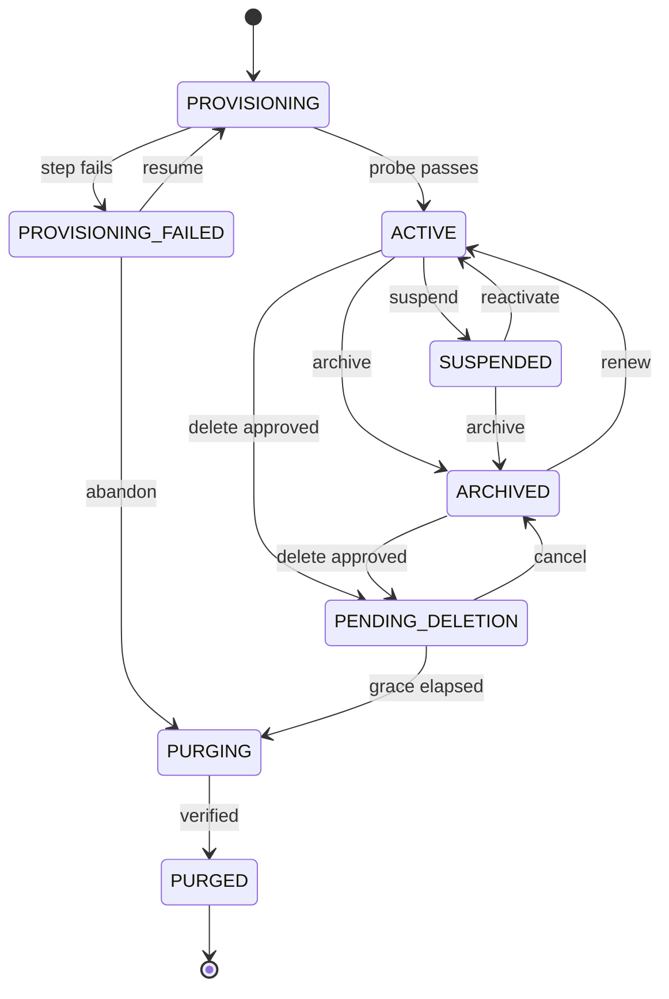

| From | To | Trigger | Permission key | Guards | Side effects and events | Audit event |
|------|----|---------|----------------|--------|-------------------------|-------------|
| — | `PROVISIONING` | Provision | `ops.tenant.create`, `ops.provisioning_run.create` | Slug free, region and plan valid | `OrganizationProvisioningStarted` | `tenant.provisioning_started` |
| `PROVISIONING` | `ACTIVE` | Run completes | System | Isolation probe passed | First admin invitation; `OrganizationActivated`, `TenantProvisioned` | `tenant.activated` |
| `PROVISIONING` | `PROVISIONING_FAILED` | Step fails | System | — | Compensation; `ProvisioningStepFailed` | `tenant.provisioning_failed` |
| `PROVISIONING_FAILED` | `PROVISIONING` | Resume | `ops.tenant.update` | Cause fixed | Resume at last committed step | `tenant.provisioning_resumed` |
| `PROVISIONING_FAILED` | `PURGING` | Abandon | `ops.tenant.administer` (two approvers, one Security) | No financial data exists | Purge workflow | `tenant.purge_started` |
| `ACTIVE` | `SUSPENDED` | Suspend with reason code | `ops.tenant.update`; second approver for `SECURITY_INCIDENT`, `LEGAL_ORDER` | Reason code | Revoke sessions; pause jobs; `OrganizationSuspended` | `tenant.suspended` |
| `SUSPENDED` | `ACTIVE` | Reactivate | `ops.tenant.update` | Cause resolved | Sessions not restored; `OrganizationReactivated` | `tenant.reactivated` |
| `ACTIVE`, `SUSPENDED` | `ARCHIVED` | Contract end | `ops.tenant.update` plus customer acknowledgement | — | Writes disabled; `OrganizationArchived` | `tenant.archived` |
| `ARCHIVED` | `ACTIVE` | Renewal | `ops.tenant.update` | Within retention | Entitlements restored | `tenant.reactivated` |
| `ACTIVE`, `ARCHIVED` | `PENDING_DELETION` | Deletion approved | `ops.tenant.administer` (two approvers) | No legal hold; DSR obligations checked | 30-day grace; `OrganizationPurgeRequested` | `tenant.deletion_scheduled` |
| `PENDING_DELETION` | `ARCHIVED` | Cancel within grace | `ops.tenant.update` | Grace not elapsed | — | `tenant.deletion_cancelled` |
| `PENDING_DELETION` | `PURGING` | Grace elapsed | `ops.tenant.administer` (two approvers, one Security) | No legal hold (hard gate) | Key destruction last | `tenant.purge_started` |
| `PURGING` | `PURGED` | Verified | System | Post-purge probe zero rows and objects | Tombstone; `OrganizationPurged` | `tenant.purged` |

| Rule | Specification |
|------|---------------|
| Unauthorized transitions | Any pair not listed, and any transition out of `PURGED`: `409 INVALID_STATE_TRANSITION`†. A tenant not `ACTIVE` blocks member authentication (`403 TENANT_SUSPENDED` or `TENANT_ARCHIVED`) |
| Transaction boundary | Per provisioning step and per transition; purge is a long-running workflow with its own run log |
| Retry and recovery | Provisioning resumes from the run record; purge steps are idempotent and resume; `PURGED` has no recovery by design |

### 4.3 SM-02 Show

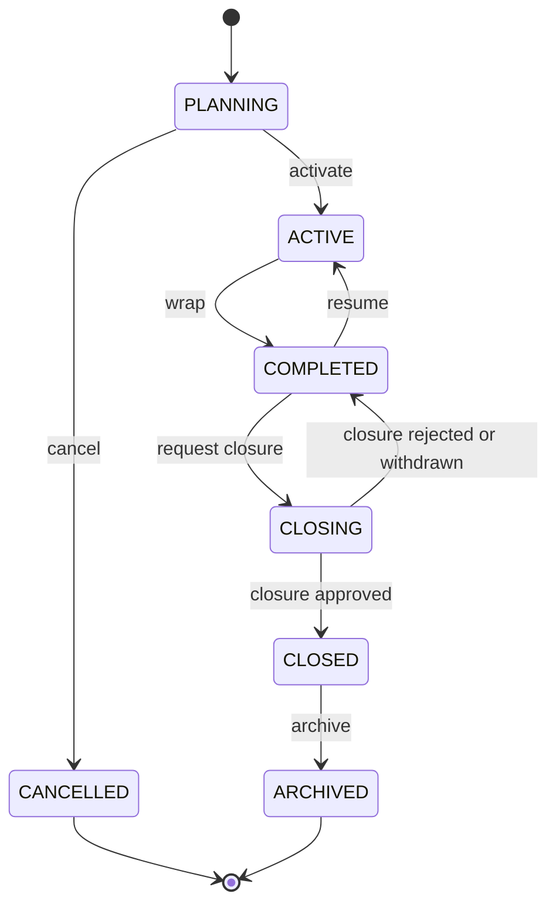

| From | To | Trigger | Permission key | Guards | Side effects and events | Audit event |
|------|----|---------|----------------|--------|-------------------------|-------------|
| `PLANNING` | `ACTIVE` | Activate | `production.show.update` | At least one season; production-house party present | `ShowStatusChanged` | `show.status_changed` |
| `PLANNING` | `CANCELLED` | Cancel | `production.show.delete` | No submitted expense, commitment or `ACTIVE` budget version | Budgets `FROZEN`; `ShowStatusChanged` | `show.cancelled` |
| `ACTIVE` | `COMPLETED` | Wrap | `production.show.update` | — | Capture continues for wrap costs | `show.status_changed` |
| `COMPLETED` | `ACTIVE` | Resume (reshoot) | `production.show.update` | Reason | — | `show.status_changed` |
| `COMPLETED` | `CLOSING` | Request closure | `production.show.submit` | No open closure | SM-14 `REQUESTED`; new transactions blocked (C-09); `ShowClosureRequested`† | `show_closure.requested` |
| `CLOSING` | `CLOSED` | Closure approved | System on SM-14 `APPROVED` | — | Budget `FROZEN`; `ShowStatusChanged` | `show.closed` |
| `CLOSING` | `COMPLETED` | Closure rejected or withdrawn | System on SM-14 | — | Transactions accepted again | `show.status_changed` |
| `CLOSED` | `ARCHIVED` | Archive | `production.show.approve` (step-up) | No `ACTIVE`/`SUSPENDED` grant or assignment on the show | Removed from active lists; read-only | `show.archived` |

| Rule | Specification |
|------|---------------|
| Unauthorized transitions | Direct `ACTIVE` → `CLOSED`, any exit from `CANCELLED` or `ARCHIVED`, or `CLOSING` → `CLOSED` by a user: `409 INVALID_STATE_TRANSITION`† |
| Transaction boundary | MOD-03 transaction; `CLOSING` is set in the same transaction as the ShowClosure row |
| Retry and recovery | Consumers of `ShowStatusChanged` (MOD-04 freeze, MOD-06, MOD-08) are idempotent; a closed show is never reopened (WF-20 recovery) |

### 4.4 SM-03 Budget (Container)

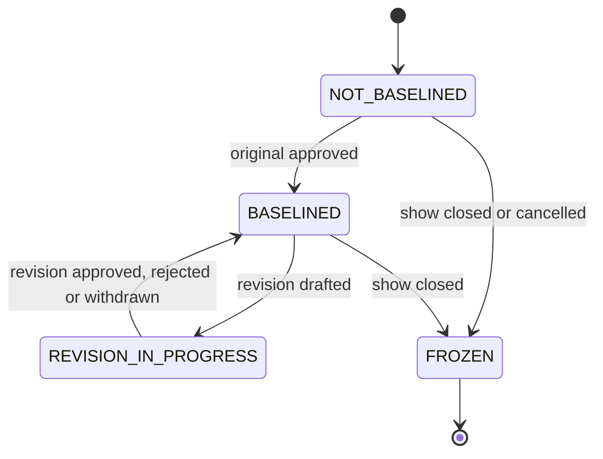

| From | To | Trigger | Permission key | Guards | Side effects and events | Audit event |
|------|----|---------|----------------|--------|-------------------------|-------------|
| — | `NOT_BASELINED` | Create | `budget.budget.create` | One budget per season | — | `budget.created` |
| `NOT_BASELINED` | `BASELINED` | Original version `ACTIVE` | System (SM-04) | — | `current_version_id` set | `budget.baselined` |
| `BASELINED` | `REVISION_IN_PROGRESS` | Revision draft created | `budget.budget_version.create` | No revision in progress; show not `CLOSING` | — | `budget.revision_started` |
| `REVISION_IN_PROGRESS` | `BASELINED` | Revision reaches `ACTIVE`, `REJECTED` or `WITHDRAWN` | System (SM-04) | — | `current_version_id` updated on approval | `budget.revision_ended` |
| `NOT_BASELINED`, `BASELINED` | `FROZEN` | Show `CLOSED` or `CANCELLED` | System (`ShowStatusChanged` consumer) | No version in `SUBMITTED` (closure checklist) | Any `DRAFT` version `WITHDRAWN` | `budget.frozen` |

| Rule | Specification |
|------|---------------|
| Unauthorized transitions | All state changes are system-derived from SM-04 and SM-02; there is no user endpoint. Creating a second revision draft returns `409 INVALID_STATE_TRANSITION`† |
| Transaction boundary | Same transaction as the SM-04 transition that causes it; freeze in the MOD-04 consumer transaction |
| Retry and recovery | Freeze consumer idempotent; state is recomputable from versions |

### 4.5 SM-04 BudgetVersion (Original and Revision)

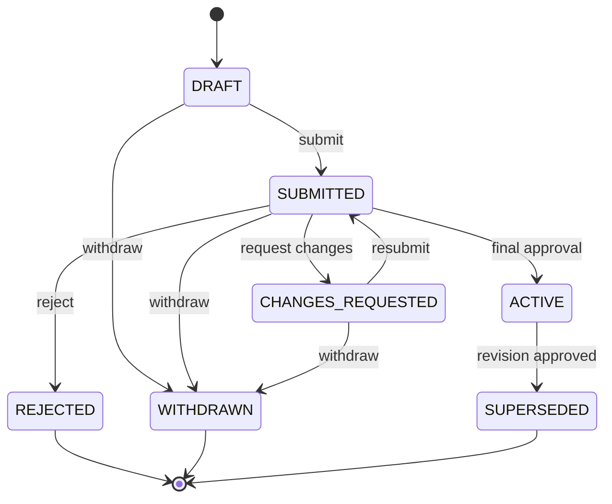

| From | To | Trigger | Permission key | Guards | Side effects and events | Audit event |
|------|----|---------|----------------|--------|-------------------------|-------------|
| — | `DRAFT` | Create or copy | `budget.budget_version.create` | Container not `FROZEN`; revision: reason and effective date (BR-BUD-005) | SM-03 may move to `REVISION_IN_PROGRESS` | `budget_version.created` |
| `DRAFT`, `CHANGES_REQUESTED` | same | Edit lines | `budget.budget_version.update` | C-03; BR-BUD-002, BR-BUD-007 | — | `budget_version.line_changed` |
| `DRAFT` | `SUBMITTED` | Submit | `budget.budget_version.submit` | BR-BUD-003 totals; workflow active | Chain snapshot (SM-13); `BudgetSubmitted` | `budget_version.submitted` |
| `SUBMITTED` | `ACTIVE` | Last step approved | `budget.budget_version.approve` (step-up, limit) | SOD-03; BR-BUD-012; commissioner final step above threshold (BR-BUD-010, BR-BUD-011) | Prior version `SUPERSEDED`; SM-03 update; `BudgetApproved`, `BudgetRevised` | `budget_version.approved` |
| `SUBMITTED` | `CHANGES_REQUESTED` | Request changes | `budget.budget_version.reject` (decision `REQUEST_CHANGES`) | Comment mandatory | Instance `INFO_REQUESTED`; `BudgetChangesRequested`† | `budget_version.changes_requested` |
| `CHANGES_REQUESTED` | `SUBMITTED` | Resubmit | `budget.budget_version.submit` | Totals valid | Instance resumes at the requesting step if lines unchanged, else restarts at step 1 | `budget_version.resubmitted` |
| `SUBMITTED` | `REJECTED` | Reject | `budget.budget_version.reject` (step-up) | Comment mandatory (FR-BUD-006) | Instance `REJECTED`; `BudgetRejected`† | `budget_version.rejected` |
| `DRAFT`, `SUBMITTED`, `CHANGES_REQUESTED` | `WITHDRAWN` | Withdraw | `budget.budget_version.update` (author) | — | Instance `CANCELLED`; `BudgetWithdrawn`† | `budget_version.withdrawn` |
| `ACTIVE` | `SUPERSEDED` | Revision approved | System | Same transaction as the new `ACTIVE` | Variance rebaselined (WF-14) | `budget_version.superseded` |

| Rule | Specification |
|------|---------------|
| Unauthorized transitions | Line edits outside `DRAFT`/`CHANGES_REQUESTED`, any exit from terminal states, or a second `ACTIVE`: `409 INVALID_STATE_TRANSITION`†; BR-BUD-001 partial unique index is the database backstop |
| Transaction boundary | Final approval: new `ACTIVE`, old `SUPERSEDED`, container, instance, audit, outbox in one transaction (Document 6 §4.4) |
| Retry and recovery | Decisions idempotent; a rejected version is copied, never reopened (RC-4-03) |

### 4.6 SM-05 FinancialPeriod

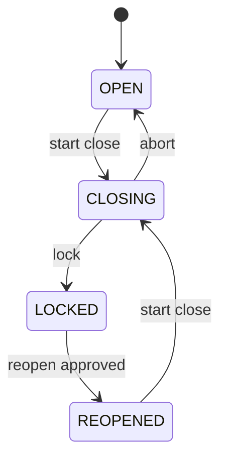

| From | To | Trigger | Permission key | Guards | Side effects and events | Audit event |
|------|----|---------|----------------|--------|-------------------------|-------------|
| — | `OPEN` | Calendar generation | System from fiscal calendar | No gap or overlap | — | `period.created` |
| `OPEN`, `REOPENED` | `CLOSING` | Start close | `budget.financial_period.update` (step-up) | No other close run on the scope | Close run with checklist; `PeriodCloseStarted`† | `period.close_started` |
| `CLOSING` | `OPEN` | Abort | `budget.financial_period.update` | — | Close run closed `ABORTED` | `period.close_aborted` |
| `CLOSING` | `LOCKED` | Lock | `budget.financial_period.update` (step-up) | Checklist clear or every item waived by `budget.financial_period.approve` (≠ closer) | Writes dated in period rejected (C-08); `PeriodLocked`; snapshot and close report | `period.locked` |
| `LOCKED` | `REOPENED` | Reopen approved | Request `budget.financial_period.update`; approve `budget.financial_period.approve` (step-up, ≠ requester) | Reason mandatory | SM-13 `PERIOD_REOPEN` instance; prior snapshot kept; `PeriodReopened` | `period.reopened` |

| Rule | Specification |
|------|---------------|
| Unauthorized transitions | `LOCKED` → `OPEN`, lock without `CLOSING`, or reopen without approval: `409 INVALID_STATE_TRANSITION`†; self-approved reopen `403 SELF_APPROVAL_PROHIBITED` |
| Transaction boundary | Period, close run, audit, outbox; snapshot generation is a consumer job |
| Retry and recovery | Snapshot and report jobs idempotent by `(period_id, close_run_id)`; a crashed close leaves `CLOSING` for abort or resume |

### 4.7 SM-06 Vendor

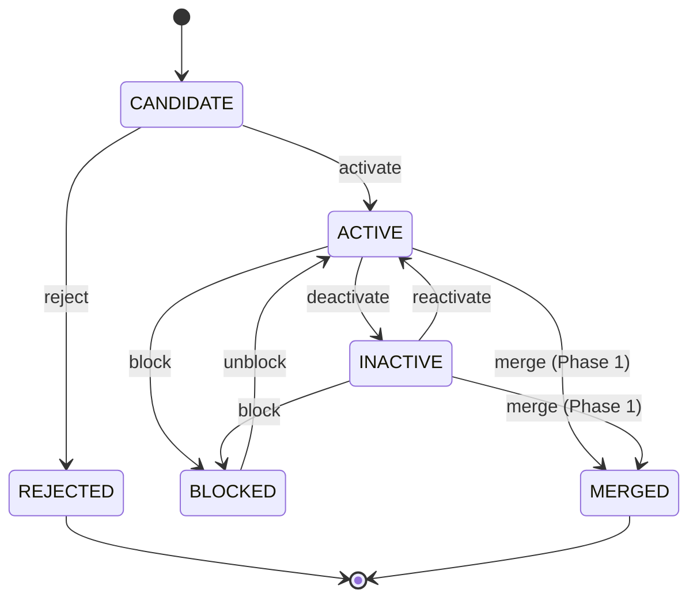

| From | To | Trigger | Permission key | Guards | Side effects and events | Audit event |
|------|----|---------|----------------|--------|-------------------------|-------------|
| — | `CANDIDATE` | Register | `vendor.vendor.create` | BR-VND-001 or recorded override | `VendorRegistered`† | `vendor.registered` |
| `CANDIDATE` | `ACTIVE` | Activate | `vendor.vendor.approve` (step-up) | SOD-04 conditional; tax identifiers valid | Dependent expenses re-checked; `VendorActivated`† | `vendor.activated` |
| `CANDIDATE` | `REJECTED` | Reject | `vendor.vendor.approve` | Reason | Dependent `SUBMITTED` expenses to `REQUIRES_INFO`; `VendorRejected`† | `vendor.rejected` |
| `ACTIVE` | `INACTIVE` | Deactivate | `vendor.vendor.update` | Reason (FR-VND-004) | Not selectable on new records | `vendor.deactivated` |
| `INACTIVE` | `ACTIVE` | Reactivate | `vendor.vendor.update` | — | — | `vendor.reactivated` |
| `ACTIVE`, `INACTIVE` | `BLOCKED` | Block | `vendor.vendor.approve` (step-up) | Reason and effective date | `VendorBlocked`; open expenses flagged | `vendor.blocked` |
| `BLOCKED` | `ACTIVE` | Unblock | `vendor.vendor.approve` (step-up) | Reason | `VendorUnblocked`† | `vendor.unblocked` |
| `ACTIVE`, `INACTIVE` | `MERGED` | Merge (Phase 1) | `vendor.vendor.update` plus `vendor.vendor.approve` by another human | Survivor `ACTIVE` | Transactions reassigned (BR-VND-006) | `vendor.merged` |

| Rule | Specification |
|------|---------------|
| Unauthorized transitions | Delete in any state, exits from `REJECTED` or `MERGED`: `409 INVALID_STATE_TRANSITION`†; physical delete has no endpoint (BR-VND-002) |
| Transaction boundary | MOD-05 transaction; re-checks of dependent expenses are MOD-07 consumers |
| Retry and recovery | Idempotent commands; a wrongly rejected candidate is re-registered as a new candidate referencing the old one |

### 4.8 SM-07 ManualCommitment

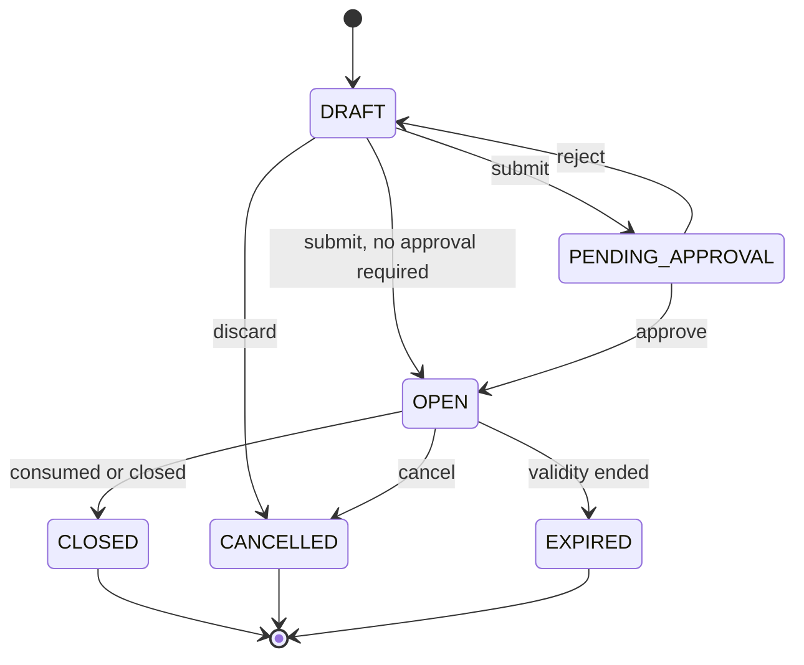

| From | To | Trigger | Permission key | Guards | Side effects and events | Audit event |
|------|----|---------|----------------|--------|-------------------------|-------------|
| — | `DRAFT` | Create | `vendor.commitment.create` | C-09; vendor `ACTIVE` | — | `commitment.created` |
| `DRAFT` | `PENDING_APPROVAL` or `OPEN` | Submit | `vendor.commitment.submit` | Amount, currency, validity; FX snapshot locked | Chain resolved; empty chain opens directly; `CommitmentSubmitted`† or `CommitmentCreated` | `commitment.submitted` |
| `DRAFT` | `CANCELLED` | Discard | `vendor.commitment.update` | Author | — | `commitment.discarded` |
| `PENDING_APPROVAL` | `OPEN` | Approve | `vendor.commitment.approve` (step-up, limit) | Approver ≠ creator | Counts as committed cost (BR-VND-003); `CommitmentCreated` | `commitment.approved` |
| `PENDING_APPROVAL` | `DRAFT` | Reject | `vendor.commitment.reject` | Comment | — | `commitment.returned` |
| `OPEN` | `OPEN` | Amend | `vendor.commitment.update`; reductions beyond threshold `vendor.commitment.approve` | Reason (BR-VND-004) | CommitmentAmendment; `CommitmentAmended` | `commitment.amended` |
| `OPEN` | `CLOSED` | Fully consumed (system) or manual close | System or `vendor.commitment.update` | Reason on manual close | `CommitmentClosed` | `commitment.closed` |
| `OPEN` | `CANCELLED` | Cancel | `vendor.commitment.update`; approval where configured (FR-VND-010) | Reason | `CommitmentCancelled`† | `commitment.cancelled` |
| `OPEN` | `EXPIRED` | Validity end | System job | `valid_to < today` | `CommitmentExpired`† | `commitment.expired` |

| Rule | Specification |
|------|---------------|
| Unauthorized transitions | Edits outside `DRAFT`, exits from terminal states: `409 INVALID_STATE_TRANSITION`† |
| Transaction boundary | MOD-05 transaction; consumption from `ExpenseApproved` and `ExpenseCancelled` is a MOD-05 consumer transaction keyed by expense line |
| Retry and recovery | Expiry job idempotent; a commitment closed in error is replaced by a new commitment referencing it |

### 4.9 SM-08 AuditAssignment

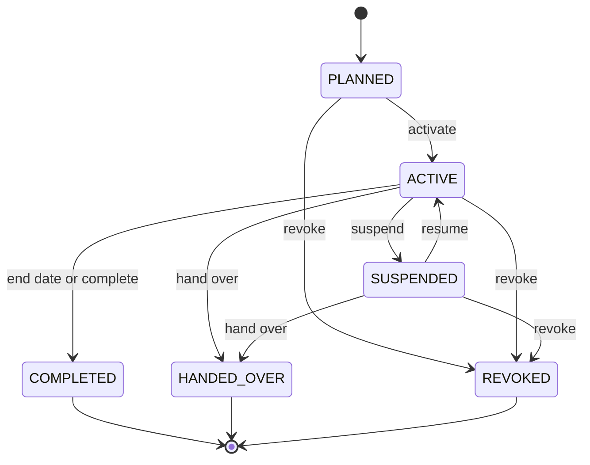

| From | To | Trigger | Permission key | Guards | Side effects and events | Audit event |
|------|----|---------|----------------|--------|-------------------------|-------------|
| — | `PLANNED` | Create | `audit.audit_assignment.create` | WF-06 validation | Warnings recorded; `AuditorAssigned` | `assignment.created` |
| `PLANNED` | `ACTIVE` | Activate (or job at start date after approval) | `audit.audit_assignment.approve` (step-up) | Start ≤ now; grant `ACTIVE` and covering (external); no unresolved conflict (BR-AUD-005) | Scope available on device; `AssignmentActivated`† | `assignment.activated` |
| `ACTIVE` | `SUSPENDED` | Suspend, or grant/identity suspension | `audit.audit_assignment.update` or system | Reason | Capture under assignment blocked; `AssignmentSuspended`† | `assignment.suspended` |
| `SUSPENDED` | `ACTIVE` | Resume | `audit.audit_assignment.approve` | Cause cleared; grant `ACTIVE` | — | `assignment.resumed` |
| `ACTIVE` | `COMPLETED` | End date (job) or early completion | System or `audit.audit_assignment.update` | — | ASSIGNMENT-scoped grant narrowed or revoked; `AssignmentCompleted`† | `assignment.completed` |
| `ACTIVE`, `SUSPENDED` | `HANDED_OVER` | Hand over | `audit.audit_assignment.update` plus `.create` for successor | Successor valid | Open items transferred; predecessor access ends at handover timestamp (BR-AUD-007); `AssignmentHandedOver`† | `assignment.handed_over` |
| `PLANNED`, `ACTIVE`, `SUSPENDED` | `REVOKED` | Revoke, or grant revoked | `audit.audit_assignment.delete` (step-up) or system | Reason; appointing party only for `PLATFORM_APPOINTED` (BR-AUD-006) | `AssignmentRevoked` | `assignment.revoked` |

| Rule | Specification |
|------|---------------|
| Unauthorized transitions | Exits from terminal states: `409 INVALID_STATE_TRANSITION`†; production-side revocation of a platform appointment: `403 APPOINTING_PARTY_ONLY`†, audited |
| Transaction boundary | MOD-06 transaction; handover writes both assignments in one transaction; grant effects are MOD-01 consumers |
| Retry and recovery | Start and end jobs idempotent; a wrongly revoked assignment is replaced by a new one (history retained) |

### 4.10 SM-09 Expense (Per Revision)

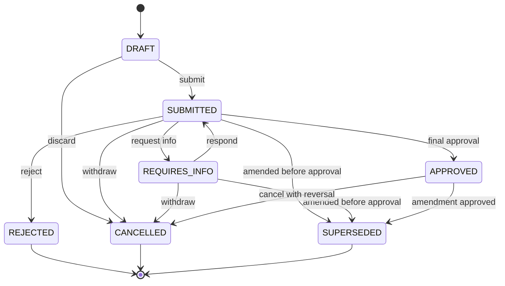

| From | To | Trigger | Permission key | Guards | Side effects and events | Audit event |
|------|----|---------|----------------|--------|-------------------------|-------------|
| — | `DRAFT` | Create (device or server) | `expense.expense.create` | C-09; scope | — | `expense.draft_saved` |
| `DRAFT` | `SUBMITTED` | Submit | `expense.expense.submit` | WF-10 passes at server receipt | Number assigned; FX locked; SM-13 instance; synchronous exceptions; `ExpenseSubmitted` | `expense.submitted` |
| `DRAFT` | `CANCELLED` | Discard | `expense.expense.delete` | Own draft or scope | No number consumed | `expense.draft_discarded` |
| `SUBMITTED` | `REQUIRES_INFO` | Request information | `expense.expense.reject` (decision `REQUEST_INFO`) | Active-step approver; comment | Instance `INFO_REQUESTED`; SLA paused; `ExpenseInfoRequested`† | `expense.info_requested` |
| `REQUIRES_INFO` | `SUBMITTED` | Respond | `expense.expense.submit` (submitter) | Non-financial changes only | Instance `IN_PROGRESS` at same step | `expense.info_provided` |
| `SUBMITTED` | `APPROVED` | Last step approved | `expense.expense.approve` (step-up, limit) | SOD-01, SOD-02, SOD-05, self-approval; WF-10 final checks | `APPROVAL` cost postings in expense-date period; `ExpenseApproved` | `expense.approved` |
| `SUBMITTED` | `REJECTED` | Reject | `expense.expense.reject` (step-up) | Reason code and comment | Instance `REJECTED`; `ExpenseRejected` | `expense.rejected` |
| `SUBMITTED`, `REQUIRES_INFO` | `CANCELLED` | Withdraw | `expense.expense.delete` | Submitter or scope holder; reason | Instance `CANCELLED`; `ExpenseCancelled` | `expense.withdrawn` |
| `SUBMITTED`, `REQUIRES_INFO` | `SUPERSEDED` | Financial amendment | `expense.expense.update` | Reason; new revision passes WF-10; period not locked | New revision `SUBMITTED` with fresh chain at step 1 (BR-EXP-009); old instance `CANCELLED`; `ExpenseAmended` | `expense.amended` |
| `APPROVED` | `CANCELLED` | Cancel | `expense.expense.delete` and `expense.expense.approve` (step-up, limit ≥ amount) | Actor not submitter; current period open; online only | `REVERSAL` postings in the current period (BR-EXP-010); commitment consumption released; `ExpenseCancelled` | `expense.cancelled` |
| `APPROVED` | `SUPERSEDED` | Amendment revision approved | System, same transaction as new `APPROVED` | — | `REVERSAL` postings for old, `APPROVAL` for new; `ExpenseSuperseded`† | `expense.superseded` |

**Revision rules.** A rejected revision stays `REJECTED`; resubmission creates a new `DRAFT` revision with the same `root_expense_id` and `supersedes_id` (UC-06). An amendment of an `APPROVED` revision leaves it `APPROVED` (and its cost posted) until the new revision is approved; if the new revision is rejected or withdrawn, the old one stays authoritative. Non-financial additions to an approved revision (comments, additional evidence links flagged `REVIEW_REQUIRED`) are annotations, never edits (A4-01).

| Rule | Specification |
|------|---------------|
| Unauthorized transitions | Any update of an `APPROVED` revision's financial fields, approval offline, or exits from terminal states: `409 INVALID_STATE_TRANSITION`†; a database trigger forbids `UPDATE` of financial columns once the revision leaves `DRAFT` (BR-FIN-009) |
| Transaction boundary | Expense, lines, splits, evidence links, instance, postings, exceptions, audit, outbox in one MOD-07 transaction (Document 6 §4.4) |
| Retry and recovery | Online by idempotency key, offline by `mutation_id`; corrections only by cancellation or amendment; posting ledger reconciled nightly against approved revisions (Document 6 §8.10) |

### 4.11 SM-10 AuditReport

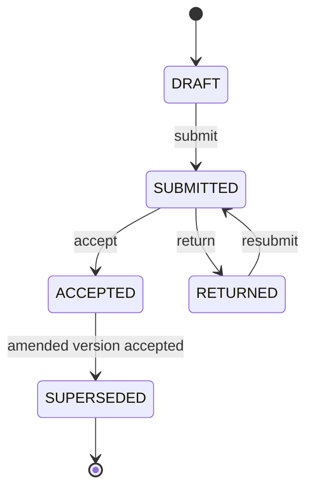

| From | To | Trigger | Permission key | Guards | Side effects and events | Audit event |
|------|----|---------|----------------|--------|-------------------------|-------------|
| — | `DRAFT` | Create or amend | `audit.audit_report.create` | Assignment `ACTIVE`/`COMPLETED`; amendment references the accepted version | Totals pre-filled | `audit_report.created` |
| `DRAFT`, `RETURNED` | same | Edit | `audit.audit_report.update` (author) | C-03 | — | `audit_report.updated` |
| `DRAFT` | `SUBMITTED` | Submit | `audit.audit_report.submit` | Summary present; petty-cash check balanced | Totals frozen; `AuditReportSubmitted`† | `audit_report.submitted` |
| `SUBMITTED` | `ACCEPTED` | Accept | `audit.audit_report.approve` | Reviewer ≠ author | Coverage updated; prior accepted version `SUPERSEDED`; `AuditReportAccepted`† | `audit_report.accepted` |
| `SUBMITTED` | `RETURNED` | Return | `audit.audit_report.reject` | Comment | `AuditReportReturned`† | `audit_report.returned` |
| `RETURNED` | `SUBMITTED` | Resubmit | `audit.audit_report.submit` | — | Totals re-frozen | `audit_report.resubmitted` |
| `ACCEPTED` | `SUPERSEDED` | Amended version accepted | System | Same transaction | — | `audit_report.superseded` |

| Rule | Specification |
|------|---------------|
| Unauthorized transitions | Edit of `SUBMITTED` or `ACCEPTED`, self-acceptance: `409 INVALID_STATE_TRANSITION`† or `403 SELF_APPROVAL_PROHIBITED` |
| Transaction boundary | MOD-06 transaction; coverage projection asynchronous |
| Retry and recovery | Idempotent decisions; accepted reports are immutable and corrected only by a new version |

### 4.12 SM-11 AuditFinding

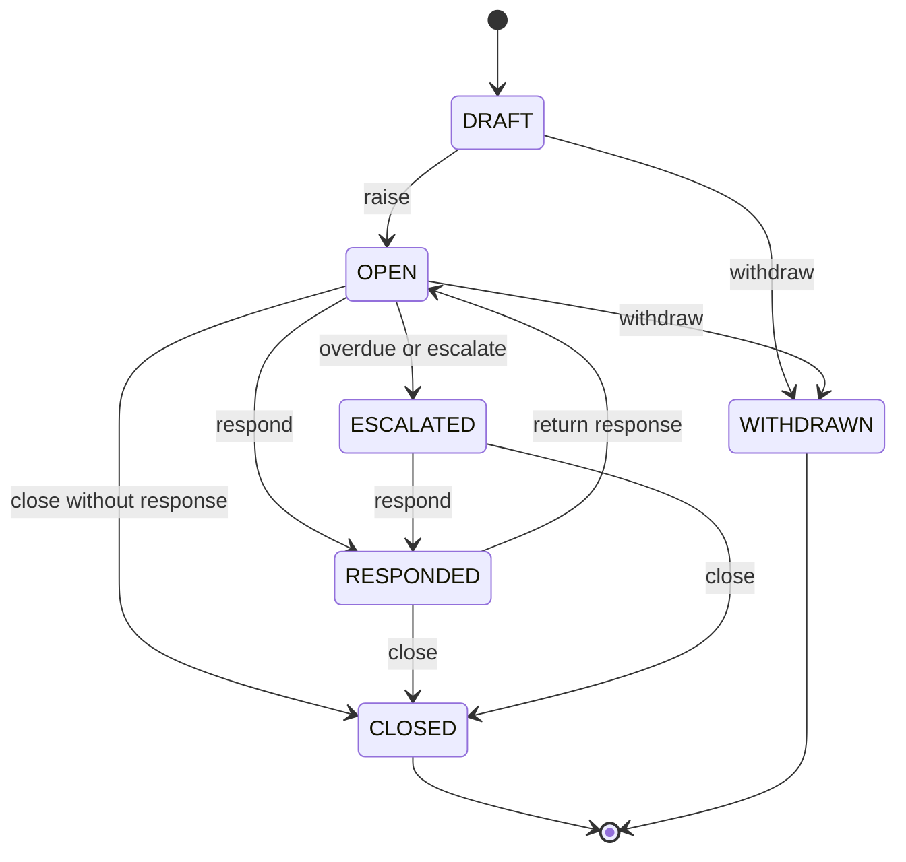

| From | To | Trigger | Permission key | Guards | Side effects and events | Audit event |
|------|----|---------|----------------|--------|-------------------------|-------------|
| — | `DRAFT` | Create | `audit.audit_finding.create` | Assignment in scope | — | `finding.created` |
| `DRAFT` | `OPEN` | Raise | `audit.audit_finding.submit` | Severity, visibility, due date | `FindingRaised`† | `finding.raised` |
| `OPEN`, `ESCALATED` | `RESPONDED` | Respond | `audit.finding_response.create` (shared findings) or appointing party for `APPOINTING_PARTY_ONLY` | Response text | `FindingResponded`† | `finding.responded` |
| `RESPONDED` | `OPEN` | Return response | `audit.audit_finding.reject` | Comment | — | `finding.returned` |
| `OPEN` | `ESCALATED` | Due date passed (job) or manual | System or `audit.audit_finding.update` | — | `FindingEscalated`†; Audit Manager and appointing party notified | `finding.escalated` |
| `OPEN`, `RESPONDED`, `ESCALATED` | `CLOSED` | Close | `audit.audit_finding.approve` | Closure reason; closer ≠ author | `FindingClosed`† | `finding.closed` |
| `DRAFT`, `OPEN` | `WITHDRAWN` | Withdraw | `audit.audit_finding.update` (author) | No response yet; reason | — | `finding.withdrawn` |

| Rule | Specification |
|------|---------------|
| Unauthorized transitions | Response by a party without visibility: `404`; exits from terminal states: `409 INVALID_STATE_TRANSITION`† |
| Transaction boundary | MOD-06 transaction per transition |
| Retry and recovery | Escalation job idempotent per `(finding_id, due_date)`; a closed finding is followed up by a new finding referencing it |

### 4.13 SM-12 Document and EvidenceLink Verification

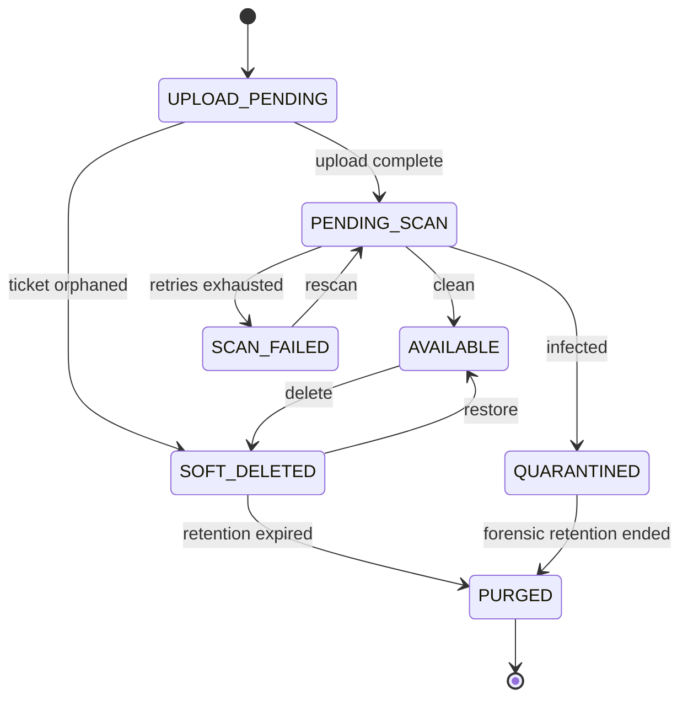

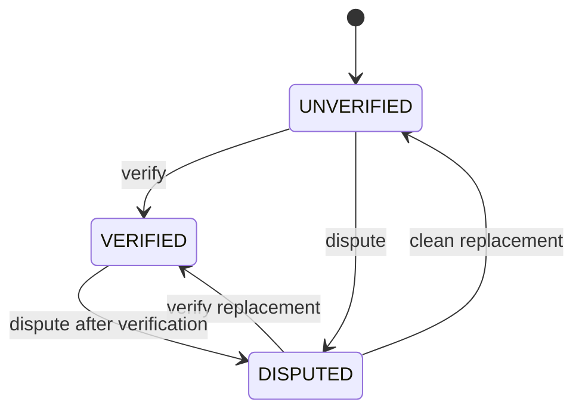

| From | To | Trigger | Permission key | Guards | Side effects and events | Audit event |
|------|----|---------|----------------|--------|-------------------------|-------------|
| — | `UPLOAD_PENDING` | Ticket | `document.document.create` | Type, size, quota | Presigned PUT ≤15 min | `document.ticket_issued` |
| `UPLOAD_PENDING` | `PENDING_SCAN` | Complete | `document.document.create` | SHA-256 matches | `DocumentUploaded` | `document.uploaded` |
| `UPLOAD_PENDING` | `SOFT_DELETED` | Orphan sweep after 24 h | System | Never completed | Object removed | `document.orphan_removed` |
| `PENDING_SCAN` | `AVAILABLE` | Clean | System | Scanner verdict `CLEAN` | Version row; object promoted; `DocumentScanned` | `document.scanned` |
| `PENDING_SCAN` | `QUARANTINED` | Infected | System | — | Never served (BR-DOC-005); `DocumentQuarantined` | `document.quarantined` |
| `PENDING_SCAN` | `SCAN_FAILED` | Retries exhausted | System | — | Uploader notified | `document.scan_failed` |
| `SCAN_FAILED` | `PENDING_SCAN` | Rescan | `ops.job.update` (platform) or system retry | — | — | `document.rescan_requested` |
| `AVAILABLE` | `SOFT_DELETED` | Delete | `document.document.delete` | Reason; not linked to an approved expense (BR-DOC-007); not `VERIFIED` evidence | `DocumentSoftDeleted`† | `document.soft_deleted` |
| `SOFT_DELETED` | `AVAILABLE` | Restore | `document.document.update` | Within retention | — | `document.restored` |
| `SOFT_DELETED` | `PURGED` | Retention expired | System retention job | No legal hold (BR-DOC-002, BR-DOC-003) | Object versions deleted; `DocumentPurged`† | `document.purged` |
| `QUARANTINED` | `PURGED` | Forensic retention (90 days, A4-07) ended | System | No hold; security review closed | — | `document.purged` |
| `UNVERIFIED` | `VERIFIED` | Verify | `document.evidence.approve` | Document `AVAILABLE`; verifier ≠ uploader or submitter | `EvidenceVerified`†; dependent exceptions auto-resolve | `evidence.verified` |
| `UNVERIFIED`, `VERIFIED` | `DISPUTED` | Dispute | `document.evidence.reject` | Reason ≥20 characters | Final approval blocked; second dispute escalates; `EvidenceDisputed`† | `evidence.disputed` |
| `DISPUTED` | `UNVERIFIED` | Replacement `AVAILABLE` | System | New document version linked | — | `evidence.replaced` |
| `DISPUTED` | `VERIFIED` | Verify replacement | `document.evidence.approve` | Replacement `AVAILABLE` | Approval unblocked | `evidence.verified` |

| Rule | Specification |
|------|---------------|
| Unauthorized transitions | Serving or verifying a non-`AVAILABLE` document, purging under hold (`409 LEGAL_HOLD_ACTIVE`), editing `VERIFIED` evidence (BR-DOC-001): `409 INVALID_STATE_TRANSITION`† |
| Transaction boundary | Document states in MOD-09; evidence states in MOD-07 (`expense.evidence_link`); scan result and state in one transaction after the idempotent object move |
| Retry and recovery | Scan jobs per SM-19; nightly object-versus-row reconciliation; quarantined files released only by re-upload (OQ-4-10) |

### 4.14 SM-13 ApprovalInstance

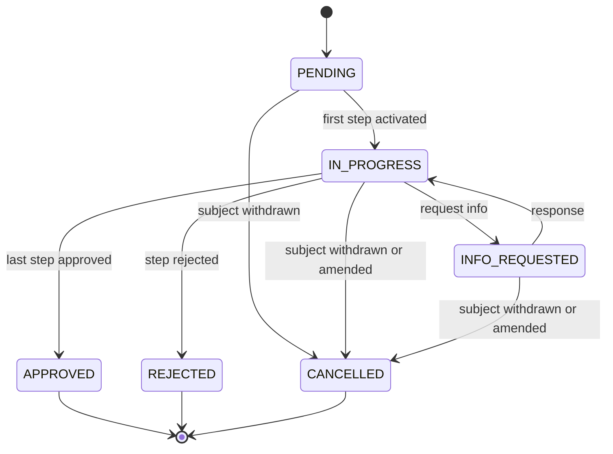

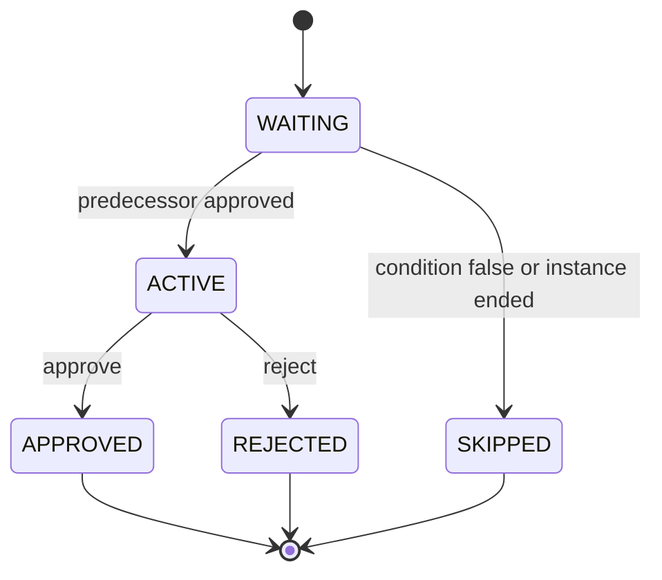

Subjects: `EXPENSE` (stored in `expense.approval_instance`), `BUDGET_VERSION`, `VARIATION`, `COMMITMENT`, `PERIOD_REOPEN`, `IMPORT_COMMIT`, `SHOW_CLOSURE`, `EXCEPTION_WAIVER` (stored in `budget.approval_instance`, ADR-026). The step list, conditions, candidate authorities and limits are snapshotted at submission (BR-EXP-007).

| From | To | Trigger | Permission key | Guards | Side effects and events | Audit event |
|------|----|---------|----------------|--------|-------------------------|-------------|
| — | `PENDING` | Subject submitted | Subject's `submit` key | Active workflow version | Steps resolved; threshold and limit steps inserted (BR-BUD-010, BR-EXP-014) | `approval.instance_created` |
| `PENDING` | `IN_PROGRESS` | First required step activated | System (same transaction) | — | Step `ACTIVE`; `ApprovalStepActivated`† | `approval.step_activated` |
| `IN_PROGRESS` | `INFO_REQUESTED` | Request info or changes | Subject's `reject` key | Comment | Subject to `REQUIRES_INFO`/`CHANGES_REQUESTED`; SLA paused | `approval.info_requested` |
| `INFO_REQUESTED` | `IN_PROGRESS` | Response | Subject's `submit` key | — | Same step re-activated | `approval.info_provided` |
| `IN_PROGRESS` | `IN_PROGRESS` | Intermediate step approved | Subject's `approve` key | Vetoes, limit | Next step `ACTIVE`; `ApprovalDecisionRecorded`† | `approval.step_decided` |
| `IN_PROGRESS` | `APPROVED` | Last required step approved | Subject's `approve` key | Vetoes, limit, subject final guards | Subject final transition | `approval.completed` |
| `IN_PROGRESS` | `REJECTED` | Any step rejected | Subject's `reject` key | Comment | Remaining steps `SKIPPED` | `approval.rejected` |
| `PENDING`, `IN_PROGRESS`, `INFO_REQUESTED` | `CANCELLED` | Subject withdrawn, amended or cancelled | System | — | Remaining steps `SKIPPED` | `approval.cancelled` |

**Step rules.** `SKIPPED` never removes a control: it applies only when the step's snapshotted condition evaluates false at resolution or when the instance ends. An actor may decide at most one step of an instance. A delegate acts with both identities recorded. `REVIEW` steps (RC-4-11) record endorse or comment and cannot reject.

| Rule | Specification |
|------|---------------|
| Unauthorized transitions | Deciding a non-`ACTIVE` step, a second decision by the same actor, or any change after a terminal state: `409 INVALID_STATE_TRANSITION`†; vetoes per §4.1 |
| Transaction boundary | Instance, step and decision rows commit with the subject's state change in the subject module's transaction |
| Retry and recovery | Decisions idempotent; SLA reminder and Phase 1 escalation jobs; reassignment of a deactivated approver's steps within one business day (BR-ACC-004) |

### 4.15 SM-14 ShowClosure

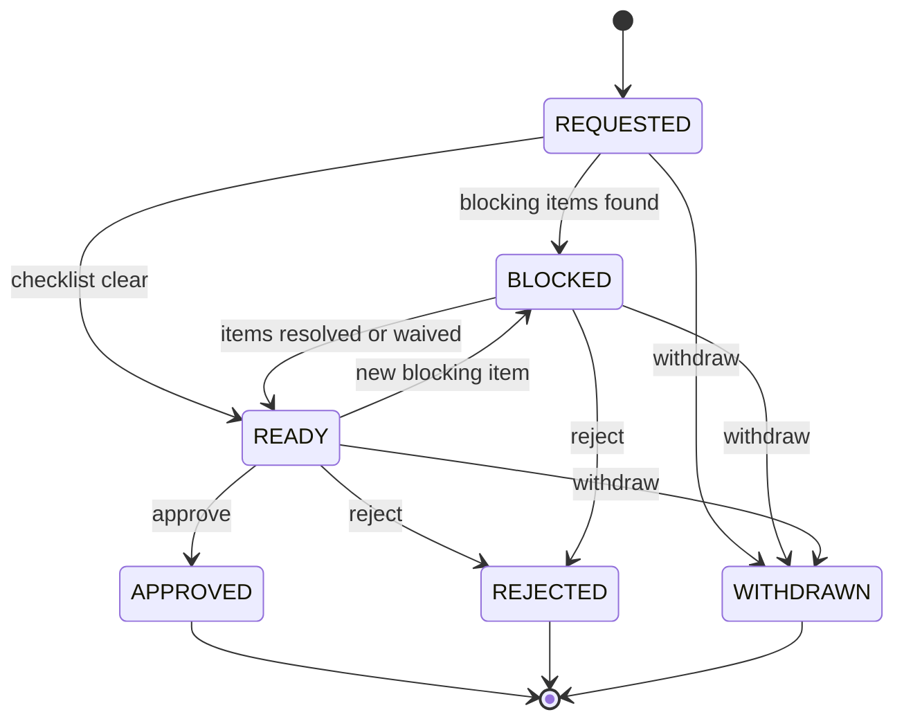

| From | To | Trigger | Permission key | Guards | Side effects and events | Audit event |
|------|----|---------|----------------|--------|-------------------------|-------------|
| — | `REQUESTED` | Request | `production.show.submit` | Show `COMPLETED` | Show `CLOSING`; checklist run queued | `show_closure.requested` |
| `REQUESTED`, `READY` | `BLOCKED` | Checklist finds items | System | — | Item owners notified | `show_closure.checklist_run` |
| `REQUESTED`, `BLOCKED` | `READY` | Checklist clear or all items waived | System; waiver `production.show.approve` (≠ requester) | Waiver reason per item | Approvers notified | `show_closure.item_waived`, `show_closure.ready` |
| `READY` | `APPROVED` | Approve | `production.show.approve` (step-up) | Approver ≠ requester; checklist re-run clean at decision | Show `CLOSED`; `ShowClosureDecided`† | `show_closure.approved` |
| `READY`, `BLOCKED` | `REJECTED` | Reject | `production.show.approve` | Comment | Show `COMPLETED` | `show_closure.rejected` |
| `REQUESTED`, `BLOCKED`, `READY` | `WITHDRAWN` | Withdraw | `production.show.submit` (requester) | — | Show `COMPLETED` | `show_closure.withdrawn` |

| Rule | Specification |
|------|---------------|
| Unauthorized transitions | Approve from `BLOCKED`: `409 CLOSURE_BLOCKED`†; self-approval `403 SELF_APPROVAL_PROHIBITED`; exits from terminal states `409 INVALID_STATE_TRANSITION`† |
| Transaction boundary | Closure and show status in one MOD-03 transaction; checklist reads other modules through their contracts |
| Retry and recovery | Checklist re-run idempotent; a rejected or withdrawn closure is followed by a new request |

### 4.16 SM-15 Exception

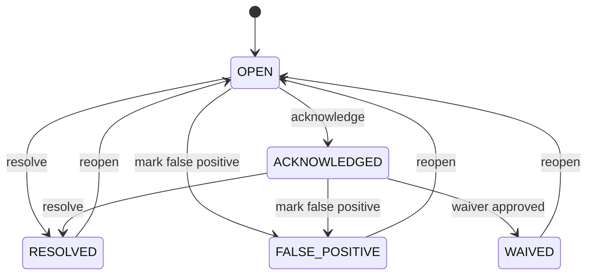

| From | To | Trigger | Permission key | Guards | Side effects and events | Audit event |
|------|----|---------|----------------|--------|-------------------------|-------------|
| — | `OPEN` | Raise | System or `expense.exception.create` | Dedup key unique among open | `ExceptionRaised` | `exception.raised` |
| `OPEN` | `ACKNOWLEDGED` | Acknowledge | `expense.exception.update` | — | Owner set | `exception.acknowledged` |
| `OPEN`, `ACKNOWLEDGED` | `RESOLVED` | Resolve, or condition cleared | `expense.exception.update` or system | Resolution text (human) | `ExceptionStatusChanged`† | `exception.resolved` |
| `OPEN`, `ACKNOWLEDGED` | `FALSE_POSITIVE` | Mark | `expense.exception.update` | Reason | Rule-tuning metric | `exception.false_positive` |
| `ACKNOWLEDGED` | `WAIVED` | Waiver approved | `expense.exception.approve` (step-up, ≠ requester) | Reason and expiry (Document 1 §10.12) | `EXCEPTION_WAIVER` instance | `exception.waived` |
| `RESOLVED`, `FALSE_POSITIVE`, `WAIVED` | `OPEN` | Reopen: condition recurs, waiver expires, or reviewer reopens | System or `expense.exception.update` | Reason | `ExceptionStatusChanged`† | `exception.reopened` |

| Rule | Specification |
|------|---------------|
| Unauthorized transitions | Waiver without approval or by the requester: `403 SELF_APPROVAL_PROHIBITED`; `OPEN` → `WAIVED` directly: `409 INVALID_STATE_TRANSITION`† |
| Transaction boundary | Synchronous exceptions with the expense; asynchronous ones in the raising consumer's transaction (ADR-029) |
| Retry and recovery | Raise idempotent by dedup key; waiver expiry job reopens |

### 4.17 SM-16 AlertInstance

```mermaid
stateDiagram-v2
    [*] --> TRIGGERED
    TRIGGERED --> ACKNOWLEDGED: acknowledge
    TRIGGERED --> RESOLVED: resolve or metric recovered
    ACKNOWLEDGED --> RESOLVED: resolve or metric recovered
    TRIGGERED --> FALSE_POSITIVE: mark false positive
    ACKNOWLEDGED --> FALSE_POSITIVE: mark false positive
    TRIGGERED --> ESCALATED: window elapsed (Phase 1)
    ESCALATED --> ACKNOWLEDGED: acknowledge
    ESCALATED --> RESOLVED: resolve
    RESOLVED --> [*]
    FALSE_POSITIVE --> [*]
```

| From | To | Trigger | Permission key | Guards | Side effects and events | Audit event |
|------|----|---------|----------------|--------|-------------------------|-------------|
| — | `TRIGGERED` | Rule breach | System | No open instance for key; cooldown elapsed | `AlertTriggered`, `VarianceBreached` | `alert.triggered` |
| `TRIGGERED`, `ESCALATED` | `ACKNOWLEDGED` | Acknowledge | `intel.alert.update` | — | Follow-up owner recorded; `AlertAcknowledged`† | `alert.acknowledged` |
| `TRIGGERED`, `ACKNOWLEDGED`, `ESCALATED` | `RESOLVED` | Resolve, or metric below threshold for a full evaluation | `intel.alert.update` or system | Resolution note (human) | `AlertResolved`† | `alert.resolved` |
| `TRIGGERED`, `ACKNOWLEDGED` | `FALSE_POSITIVE` | Mark | `intel.alert.update` | Reason | — | `alert.false_positive` |
| `TRIGGERED` | `ESCALATED` | Escalation window elapsed (Phase 1) | System | Escalation policy configured | `AlertEscalated`† | `alert.escalated` |

| Rule | Specification |
|------|---------------|
| Unauthorized transitions | Changes by `MANAGEMENT_VIEWER` (no `intel.alert.update`): `403 PERMISSION_DENIED`; exits from terminal states: `409 INVALID_STATE_TRANSITION`† |
| Transaction boundary | `intel` transaction per transition |
| Retry and recovery | Evaluation idempotent by `(rule_version_id, scope_key, period_id)`; the sweep repairs missed triggers and auto-resolves recovered metrics |

### 4.18 SM-17 ImportBatch

```mermaid
stateDiagram-v2
    [*] --> UPLOADED
    UPLOADED --> SCANNING: scan
    SCANNING --> PARSING: clean
    SCANNING --> REJECTED: infected or invalid
    PARSING --> VALIDATING: parsed
    PARSING --> REJECTED: template mismatch
    VALIDATING --> VALIDATED: validation done
    VALIDATED --> VALIDATING: revalidate
    VALIDATED --> AWAITING_COMMIT_APPROVAL: commit requested
    VALIDATED --> COMMITTING: commit
    AWAITING_COMMIT_APPROVAL --> COMMITTING: approved
    AWAITING_COMMIT_APPROVAL --> VALIDATED: approval declined
    VALIDATED --> REJECTED: reject
    AWAITING_COMMIT_APPROVAL --> REJECTED: reject
    VALIDATED --> EXPIRED: 7 days idle
    AWAITING_COMMIT_APPROVAL --> EXPIRED: 7 days idle
    COMMITTING --> COMMITTED: all rows
    COMMITTING --> PARTIALLY_COMMITTED: partial mode
    COMMITTING --> FAILED: unrecoverable
    FAILED --> COMMITTING: resume
    COMMITTED --> REVERSAL_PENDING: reversal approved
    PARTIALLY_COMMITTED --> REVERSAL_PENDING: reversal approved
    REVERSAL_PENDING --> REVERSED: compensations done
    REJECTED --> [*]
    EXPIRED --> [*]
    REVERSED --> [*]
```

| From | To | Trigger | Permission key | Guards | Side effects and events | Audit event |
|------|----|---------|----------------|--------|-------------------------|-------------|
| — | `UPLOADED` | Upload | `excel.import_job.create` | Type, size | `ImportUploaded`† | `import.uploaded` |
| `UPLOADED` → `SCANNING` → `PARSING` → `VALIDATING` | next | Pipeline | System | Clean scan; template version (BR-XLS-001) | Rows staged | `import.stage_completed` |
| `SCANNING`, `PARSING` | `REJECTED` | Infected, unreadable or mismatch | System | — | `ImportRejected` | `import.rejected` |
| `VALIDATING` | `VALIDATED` | All rows evaluated | System | — | Error report; `ImportValidated`† | `import.validated` |
| `VALIDATED` | `VALIDATING` | Revalidate | `excel.import_job.update` | — | — | `import.revalidated` |
| `VALIDATED` | `AWAITING_COMMIT_APPROVAL` | Commit requested | `excel.import_job.update` plus target `create` | Error threshold (BR-XLS-004); duplicate file confirmed (BR-XLS-003); policy requires approval | `ImportCommitRequested`† | `import.commit_requested` |
| `AWAITING_COMMIT_APPROVAL` | `COMMITTING` | Approve | `excel.import_job.approve` (step-up, ≠ requester) | — | — | `import.commit_approved` |
| `AWAITING_COMMIT_APPROVAL` | `VALIDATED` | Decline | `excel.import_job.approve` | Comment | — | `import.commit_declined` |
| `VALIDATED` | `COMMITTING` | Commit (no approval policy) | `excel.import_job.update` plus target `create` | Same as above | — | `import.commit_started` |
| `VALIDATED`, `AWAITING_COMMIT_APPROVAL` | `REJECTED` | Reject | `excel.import_job.delete` | — | `ImportRejected` | `import.rejected` |
| `VALIDATED`, `AWAITING_COMMIT_APPROVAL` | `EXPIRED` | 7 days idle | System | — | Staging purged after 30 days | `import.expired` |
| `COMMITTING` | `COMMITTED`, `PARTIALLY_COMMITTED` | Last chunk | System | Control totals reconciled | `ImportCommitted` | `import.committed` |
| `COMMITTING` | `FAILED` | Unrecoverable chunk failure | System | All-or-nothing: committed chunks compensated first (ADR-028) | Uploader notified | `import.failed` |
| `FAILED` | `COMMITTING` | Resume (partial mode, transient cause) | `excel.import_job.update` | Cause cleared | — | `import.resumed` |
| `COMMITTED`, `PARTIALLY_COMMITTED` | `REVERSAL_PENDING` | Reversal requested and approved | `excel.import_job.delete` then `excel.import_job.approve` (≠ requester) | Reason | Compensation job | `import.reversal_requested` |
| `REVERSAL_PENDING` | `REVERSED` | All created records compensated | System | No blocked rows | `ImportReversed`† | `import.reversed` |

| Rule | Specification |
|------|---------------|
| Unauthorized transitions | Deleting a committed batch, committing from `FAILED` in all-or-nothing mode, or commit without target-domain keys: `409 INVALID_STATE_TRANSITION`† or `403 PERMISSION_DENIED` |
| Transaction boundary | Per stage; commit per 1,000-row chunk (Document 6 §4.4) |
| Retry and recovery | Stage jobs per SM-19; chunk idempotency by `(import_batch_id, row_number)`; reversal resumable row by row |

### 4.19 SM-18 Notification

```mermaid
stateDiagram-v2
    [*] --> QUEUED
    QUEUED --> SUPPRESSED: preference, quiet hours, dedup
    QUEUED --> SENDING: dispatch
    QUEUED --> DELIVERED: in-app write
    SENDING --> SENT: provider accepted
    SENDING --> FAILED: transient error
    FAILED --> SENDING: retry
    FAILED --> DEAD: attempts exhausted
    SENT --> DELIVERED: delivery receipt
    SENT --> BOUNCED: hard bounce
    DELIVERED --> READ: read
    SUPPRESSED --> [*]
    DEAD --> [*]
    BOUNCED --> [*]
    READ --> [*]
```

| From | To | Trigger | Permission key | Guards | Side effects and events | Audit event |
|------|----|---------|----------------|--------|-------------------------|-------------|
| — | `QUEUED` | Routing rule matched | System | Recipient in scope | — | `notification.queued` |
| `QUEUED` | `SUPPRESSED` | Preference, quiet hours, 10-minute dedup, tenant suspended | System | Mandatory security notices never suppressed | — | `notification.suppressed` |
| `QUEUED` | `SENDING`, `DELIVERED` | Dispatch (email) or inbox write (in-app) | System | — | SSE push for in-app | `notification.dispatched` |
| `SENDING` | `SENT`, `FAILED` | Provider response | System | — | Delivery attempt row | `notification.attempted` |
| `FAILED` | `SENDING`, `DEAD` | Retry schedule | System | Attempts < limit | `NotificationFailed`; fallback channel on `DEAD` | `notification.dead` |
| `SENT` | `DELIVERED`, `BOUNCED` | Receipt or bounce webhook | System | — | `NotificationDelivered`; bounce suppresses address | `notification.delivered` |
| `DELIVERED` | `READ` | Mark read | `notification.notification.update` (SELF) | Own notification | — | `notification.read` |

| Rule | Specification |
|------|---------------|
| Unauthorized transitions | Marking another user's notification: `404`; other pairs `409 INVALID_STATE_TRANSITION`† |
| Transaction boundary | Notification row and delivery attempt (Document 6 §4.4) |
| Retry and recovery | At-least-once; duplicate delivery acceptable, loss is not; `DEAD` reviewed in delivery tracking (FR-NTF-012) |

### 4.20 SM-19 Job and Outbox Event

```mermaid
stateDiagram-v2
    [*] --> PENDING
    PENDING --> PROCESSING: claimed
    PROCESSING --> SUCCEEDED: done
    PROCESSING --> FAILED: error
    PROCESSING --> PENDING: lease expired
    FAILED --> PROCESSING: backoff elapsed
    FAILED --> DEAD: attempts exhausted
    DEAD --> PENDING: replay
    PENDING --> CANCELLED: cancel
    FAILED --> CANCELLED: cancel
    SUCCEEDED --> [*]
    CANCELLED --> [*]
```

| From | To | Trigger | Permission key | Guards | Side effects and events | Audit event |
|------|----|---------|----------------|--------|-------------------------|-------------|
| — | `PENDING` | Enqueue (same transaction as cause) | System | Idempotency key unique | — | None (operational) |
| `PENDING`, `FAILED` | `PROCESSING` | Claim `FOR UPDATE SKIP LOCKED` | System | `available_at ≤ now`; per-aggregate order | Lease set | None |
| `PROCESSING` | `SUCCEEDED` | Handler completes | System | — | Outbox `DISPATCHED` when all consumers succeed | None |
| `PROCESSING` | `FAILED` | Handler error | System | — | `available_at` per Document 6 §7.5 backoff | None |
| `PROCESSING` | `PENDING` | Lease expired | System | — | Reclaimed by another worker | None |
| `FAILED` | `DEAD` | 8 attempts, or 3 identical deterministic failures (RC-4-01) | System | — | `JobFailed`; operator alert | `ops.job_dead_lettered` |
| `DEAD` | `PENDING` | Replay | `ops.job.update` (platform) | Cause fixed | Attempt counter reset; original payload retained | `ops.job_replayed` |
| `PENDING`, `FAILED` | `CANCELLED` | Owner cancellation (grant revoked, tenant purged, export superseded) | System or `ops.job.update` | — | — | `ops.job_cancelled` |

| Rule | Specification |
|------|---------------|
| Unauthorized transitions | Tenant roles have no `ops.*` keys: `403 PERMISSION_DENIED`; replay of `SUCCEEDED`: `409 INVALID_STATE_TRANSITION`† |
| Transaction boundary | Enqueue in the cause's transaction; each attempt in its own transaction with the handler's writes and inbox dedup row |
| Retry and recovery | Schedule 1 s, 5 s, 30 s, 2 min, 10 min, 30 min, 2 h, 6 h with ±20 percent jitter; replay is audited and privileged |

### 4.21 Lifecycles by Reference and Minor Lifecycles

| Entity | States and rules | Authority |
|--------|------------------|-----------|
| CrossOrganizationAccessGrant | `DRAFT`, `PENDING_APPROVAL`, `PENDING_ACCEPTANCE`, `ACTIVE`, `SUSPENDED`, `REVOKED`, `EXPIRED`, `DECLINED`; keys `audit.access_grant.create`, `.approve`, `.delete`; SOD-07 | Document 3 §8.2 to §8.8 |
| User identity | `INVITED`, `ACTIVE`, `LOCKED`, `SUSPENDED`, `DEPROVISIONED`, `ERASURE_PENDING`, `ERASED` | Document 3 §3.4 |
| ExportJob | `QUEUED` → `RUNNING` → `COMPLETED` → `EXPIRED` (file deleted after 7 days); `RUNNING` → `FAILED`; `QUEUED`/`RUNNING` → `FAILED` with `CANCELLED_BY_REVOCATION` when the requester's grant or session authority ends. Key `excel.export_job.create`; backed by SM-19 | This document, WF-18 |
| PartyOrganizationLink | `PROPOSED` → `ACTIVE` (both organizations accept, `production.party_link.approve`), `PROPOSED` → `TERMINATED` (expiry after 30 days or decline), `ACTIVE` → `TERMINATED` (`production.party_link.delete`, either party) | WF-03 |
| Variation | `REQUESTED` → `APPLIED` (within threshold) or `APPROVED` → `APPLIED`; `REQUESTED` → `REJECTED`; keys `budget.variation.create`, `.approve`, `.reject` | WF-04 |
| CommitmentAmendment | `DRAFT` → `PENDING_APPROVAL` → `APPROVED` or `REJECTED`; `DRAFT` → `APPROVED` when below threshold | SM-07 |
| PeriodCloseRun | `RUNNING` → `BLOCKED` ↔ `RUNNING` → `COMPLETED` or `ABORTED` | SM-05 |
| Season, Episode | Season `PLANNED`, `ACTIVE`, `COMPLETED`; episode `PLANNED`, `IN_PRODUCTION`, `SHOT`, `DELIVERED`, `DROPPED`; `production.season.update`, `production.episode.update`; descriptive only, no financial guard | Document 2 §6.3 |
| ConflictRecord (sync) | `OPEN` → `RESOLVED` (`sync.sync_conflict.update` by device owner, or `.approve` by `AUDIT_MANAGER` after 7 days) | Document 6 §9.4 |
| Delegation, LegalHold, Membership, AccessReviewCampaign | As defined | Document 3 §5.9, Document 2 §6.10, Document 3 §5.10 |
| PurchaseOrder (Phase 1) | `DRAFT`, `PENDING_APPROVAL`, `APPROVED`, `SENT`, `PARTIALLY_RECEIVED`, `RECEIVED`, `CLOSED`, `CANCELLED`; keys `vendor.purchase_order.*`; BR-VND-005 | Specified in the Phase 1 revision of this document |

### 4.22 Cross-Machine Coupling

| Cause | Effect | Mechanism |
|-------|--------|-----------|
| SM-09 `APPROVED`, `CANCELLED`, `SUPERSEDED` | Cost postings; SM-07 consumption; variance (WF-14); alerts (SM-16) | Same transaction for postings; outbox for the rest |
| SM-12 evidence `DISPUTED` | SM-13 final step blocked; SM-15 `MISSING_EVIDENCE` | Same MOD-07 transaction |
| SM-06 `REJECTED`, `BLOCKED` | SM-09 `SUBMITTED` → `REQUIRES_INFO`; `UNAUTHORIZED_VENDOR` | Outbox consumer in MOD-07 |
| SM-05 `LOCKED` | SM-09 create, amend, approve rejected for dates in period; SM-17 rows fail | Period guard read in each transaction |
| SM-02 `CLOSING` | SM-09 and SM-07 creation blocked | Show guard (C-09) |
| SM-02 `CLOSED`, `CANCELLED` | SM-03 `FROZEN` | Outbox consumer in MOD-04 |
| Grant `SUSPENDED`, `REVOKED`, `EXPIRED` | SM-08 `SUSPENDED`, `REVOKED`, `COMPLETED`; SM-19 export jobs `CANCELLED` | Outbox consumers (Document 3 §8.8) |
| SM-08 `COMPLETED`, `REVOKED`, `HANDED_OVER` | ASSIGNMENT-scoped grant narrowed or revoked | MOD-01 consumer (RC-4-02) |

---

## 5. Catalogue, Event, Error and Table Requests

### 5.1 Catalogue Additions Requested (Document 3 Appendix A)

No new permission keys are needed. Grant-profile expansions are needed for UC-04 and UC-10:

| Request | Change | Reason |
|---------|--------|--------|
| CAT-4-01 | Add to `AUDIT_EVIDENCE` at `ASSIGNMENT` scope: `expense.expense.create`, `expense.expense.update`, `expense.expense.submit`; `sync.sync_batch.read`, `sync.sync_batch.create`, `sync.sync_conflict.read`, `sync.sync_conflict.update`, `sync.checkpoint.read` | UC-04 names external and platform-appointed auditors as capture actors; the profile has no capture or sync keys |
| CAT-4-02 | Add to `AUDIT_EVIDENCE`: `document.evidence.approve`, `document.evidence.reject` | UC-10 step 5: the external auditor verifies or disputes evidence |
| CAT-4-03 | Add to `AUDIT_EVIDENCE`: `audit.audit_report.create`, `.update`, `.submit` | WF-16 daily reports by external and platform-appointed auditors |

SoD effect: grantees never hold `expense.expense.approve`, so SOD-01 and SOD-02 remain satisfied.

### 5.2 Event Additions Requested (Document 6 Appendix B, Document 14)

`PartyLinkProposed`, `PartyLinkAccepted`, `PartyLinkTerminated`, `ShowClosureRequested`, `ShowClosureDecided` (MOD-03); `BudgetChangesRequested`, `BudgetRejected`, `BudgetWithdrawn`, `VariationApplied`, `ApprovalStepActivated`, `ApprovalDecisionRecorded`, `PeriodCloseStarted`, `PeriodCloseBlocked`, `PeriodReopenRequested` (MOD-04); `VendorRegistered`, `VendorActivated`, `VendorRejected`, `VendorUnblocked`, `CommitmentSubmitted`, `CommitmentCancelled`, `CommitmentExpired` (MOD-05); `AssignmentActivated`, `AssignmentSuspended`, `AssignmentCompleted`, `AssignmentHandedOver`, `AuditReportSubmitted`, `AuditReportAccepted`, `AuditReportReturned`, `FindingRaised`, `FindingResponded`, `FindingClosed`, `FindingEscalated` (MOD-06); `ExpenseInfoRequested`, `ExpenseSuperseded`, `ExceptionStatusChanged`, `EvidenceVerified`, `EvidenceDisputed` (MOD-07); `AlertAcknowledged`, `AlertResolved`, `AlertEscalated` (MOD-08); `DocumentSoftDeleted`, `DocumentPurged` (MOD-09); `ImportUploaded`, `ImportValidated`, `ImportCommitRequested`, `ImportReversed`, `ExportRequested`, `ExportFailed` (MOD-10). Delegation uses Document 3's `DelegationCreated` and `DelegationRevoked` from MOD-01 (RC-4-08).

### 5.3 Error Codes Requested (Document 9)

`INVALID_STATE_TRANSITION`, `PERIOD_LOCKED`, `SHOW_NOT_ACCEPTING_TRANSACTIONS`, `RESOURCE_CONFLICT`, `BUDGET_TOTAL_MISMATCH`, `VENDOR_DUPLICATE`, `VENDOR_NOT_SELECTABLE`, `APPOINTING_PARTY_ONLY`, `ASSIGNMENT_OUTSIDE_GRANT`, `CONFLICT_OF_INTEREST_UNRESOLVED`, `DUPLICATE_SUSPECTED`, `EVIDENCE_REQUIRED`, `EVIDENCE_DISPUTED`, `HASH_MISMATCH`, `TEMPLATE_VERSION_MISMATCH`, `IMPORT_DUPLICATE_FILE`, `IMPORT_ERROR_THRESHOLD`, `CLOSURE_BLOCKED`, `CLOSE_BLOCKED`. Document 3 §11.4 codes are reused as is.

### 5.4 Table and API Additions Requested

| Request | Target | Detail |
|---------|--------|--------|
| TBL-4-01 | Document 8, Document 3 Appendix D | `budget.approval_instance`, `budget.approval_decision` (family B) for non-expense subjects (ADR-026); steps stored as an ordered snapshot on the instance |
| API-4-01 | Document 9 | `POST /expenses/{id}/request-info`, `/evidence/{id}/verify`, `/evidence/{id}/dispute`; `/audit-reports` and `/audit-findings` resources with transition endpoints; `/shows/{id}/closure` with waive, approve, reject, withdraw; `/financial-periods/{id}/reopen-requests`; `/excel/imports/{id}/reject`, `/reverse`; `/vendors/{id}/activate`, `/unblock`; `/party-links`; `/alerts/{id}/resolve`, `/false-positive`; `/audit-assignments/{id}/activate`, `/suspend`, `/handover` |
| API-4-02 | Document 9 | Remove `POST /budget-versions/{id}/lock` (RC-4-05); retain `DELETE /audit-assignments/{id}` as revoke (state change, not deletion) |

---

## 6. Reconciliation Notes

| ID | Conflict | Proposed resolution |
|----|----------|---------------------|
| RC-4-01 | Document 6 §7.5 dead-letters after eight attempts; Document 3 §12.3 after three failed deliveries | Eight-attempt schedule is the default; three identical deterministic failures (same error code) dead-letter early as poison messages (SM-19) |
| RC-4-02 | Document 6 Appendix B: `AuditorAssigned` "creates or extends a grant"; Document 3 §8.2 invariant 2: a grant never widens without approval | An assignment never creates or widens a grant. External assignments require an existing `ACTIVE` grant; assignment end narrows or revokes an `ASSIGNMENT`-scoped grant |
| RC-4-03 | UC-02: rejected budget "returns to draft"; SM-04 has `REJECTED` | `CHANGES_REQUESTED` is the return-to-editable path; `REJECTED` is terminal and the author copies the version into a new draft |
| RC-4-04 | UC-01 and FR-PRD-001 have the Finance Head create shows; Document 3 Appendix A grants `production.show.create` only to `COMMISSIONING_ADMIN` and `PRODUCTION_ADMIN` | Catalogue governs; Document 1 wording to be aligned at its next revision |
| RC-4-05 | Document 6 Appendix A `POST /budget-versions/{id}/lock` has no meaning in SM-04 | Versions become immutable on leaving `DRAFT`; endpoint removed |
| RC-4-06 | UC-07 step 4 names state `PENDING`; Document 2 uses `PENDING_SCAN` | `PENDING_SCAN` |
| RC-4-07 | Document 3 §5.11 codes (`FORBIDDEN`, `OUT_OF_SCOPE`, `SEGREGATION_OF_DUTIES`) differ from §11.4 (`PERMISSION_DENIED`, `SCOPE_DENIED`, `SOD_CONFLICT`) | §11.4 is the API error model and is used here |
| RC-4-08 | Document 6 Appendix B publishes `DelegationChanged` from MOD-04 | Delegation lives in `tenancy.delegation` (RC-04); events `DelegationCreated`, `DelegationRevoked` from MOD-01 |
| RC-4-09 | Document 6 §7.9: critical alerts escalate after 15 minutes at MVP; UC-09 and SM-16: escalation is Phase 1 | MVP re-notifies unacknowledged critical alerts after 15 minutes without changing state; `ESCALATED` and multi-level policy are Phase 1 |
| RC-4-10 | UC-04 and UC-10 give external auditors capture, verification and reporting; grant profiles lack the keys | Section 5.1 CAT-4-01 to CAT-4-03 |
| RC-4-11 | UC-02 has Department Head and Cost Controller approve budgets; Document 3 gives neither `budget.budget_version.approve` | Their steps are `REVIEW` steps (endorse or comment); binding approval rests with `FINANCE_HEAD` and, above threshold, `COMMISSIONING_ADMIN` |

---

## 7. Traceability

| Item | Covered by |
|------|------------|
| UC-01 to UC-12 | UC-01: WF-01, WF-02, WF-03; UC-02, UC-03: WF-04; UC-04: WF-05, WF-08, WF-09, WF-10; UC-05: WF-08; UC-06: WF-10, WF-12, WF-13; UC-07: WF-11, WF-13; UC-08: WF-17; UC-09: WF-14, WF-15; UC-10: WF-03, WF-06, WF-07, WF-11, WF-16; UC-11: WF-20, WF-21; UC-12: WF-18, WF-19 |
| FR domains | FR-TNT: WF-01, WF-03, WF-07; FR-PRD: WF-02, WF-20; FR-BUD: WF-04, WF-21; FR-VND: WF-05, SM-07; FR-AUD: WF-06, WF-07, WF-16; FR-EXP: WF-08, WF-10, WF-12, WF-13; FR-CIN: WF-14, WF-15, WF-19; FR-DOC: WF-09, WF-11; FR-XLS: WF-17, WF-18; FR-NTF: SM-18, C-06; FR-CMP: C-05 |
| NFR | NFR-PERF-003, 004, 005, 006, 007, 010, 011; NFR-MOB-001 to 006; NFR-AVL-005; NFR-SEC-007, 008; NFR-AUD-001, 004 (C-05); NFR-INTG-001, 002 (C-02, SM-19); NFR-UX-008 (WF-10) |
| BR | BR-FIN-001 to 012; BR-BUD-001 to 012; BR-EXP-001 to 017; BR-VND-001 to 007; BR-AUD-001 to 008; BR-DOC-001 to 007; BR-PRD-001 to 006; BR-XLS-001 to 006; BR-ACC-001, 002, 004, 006 |
| CAP | CAP-001 to CAP-016, CAP-019 to CAP-022, CAP-024 to CAP-026 (CAP-009, CAP-017, CAP-018 are Phase 1 and referenced only) |
| ADR consumed | ADR-001 to ADR-007, ADR-010 to ADR-013, ADR-025 |
| ADR raised | ADR-026 to ADR-029 (section 10) |
| Downstream obligations | Document 3 G.3 row 4: every transition names its permission key and SoD rule (Part B) |

---

## 8. Assumptions and Open Questions

| ID | Assumption or question | Current position | Owner | Needed by |
|----|------------------------|------------------|-------|-----------|
| A4-01 | Non-financial changes to an approved expense are annotations, not revisions | As stated in SM-09; BR-EXP-009's "non-financial" path applies to unapproved revisions | Finance SME | Design freeze |
| A4-02 | Expense capture is allowed while a show is `PLANNING` (pre-production spend) | Allowed (C-09) | Product Owner | Design freeze |
| A4-03 | Party-link proposals expire after 30 days | Default, configurable | Product Owner | Pilot |
| A4-04 | Assignment expiry notice 7 days before end | Default, configurable | Audit SME | Pilot |
| A4-05 | Daily audit report cut-off 18:00 local on the report date | Default, configurable per engagement | Audit SME | Pilot |
| A4-06 | Post-closure corrections are posted through a reopened period with a Finance Head waiver, not by reopening the show | As stated in WF-20 | Finance SME | Design freeze |
| A4-07 | Quarantined files retained 90 days for forensics | Default | Security Architect | Pilot |
| OQ-4-05 | Should external grantees capture expenses and submit audit reports (CAT-4-01 to 03), or capture only working papers? | Extend `AUDIT_EVIDENCE` | Business owner, Audit SME | Before pilot onboarding |
| OQ-4-06 | How does an H2 appointing commissioner create a grant in the producer's tenant? | Interim path in WF-06; Document 3 §8.13 to specify | Security Architect | Before H2 pilot |
| OQ-4-07 | Must every new vendor be activated by a `vendor.vendor.approve` holder, or may clean registrations auto-activate? | Approval required | Finance SME | Design freeze |
| OQ-4-08 | Is cancelling an approved expense by one human holding both `delete` and `approve` sufficient, or is a second approver required? | One human, not the submitter, with step-up | Finance SME | Design freeze |
| OQ-4-09 | Must the final approval step block on an `OVER_BUDGET` exception or only warn? | Warn; Finance Head configurable block | Finance SME | Design freeze |
| OQ-4-10 | May a quarantined file be released after a confirmed false positive? | No at MVP; re-upload | Security Architect | Phase 1 |

OQ-4-01 to OQ-4-04 are held by Document 3 and unchanged.

---

## 9. Risks Raised

| ID | Risk | Likelihood | Impact | Mitigation |
|----|------|------------|--------|------------|
| R4-11 | The shared approval engine (ADR-026) becomes a coupling hotspot across five modules | Medium | Medium | Narrow contract (resolve, decide, cancel); subject-specific guards stay in owning modules; architecture tests on dependencies |
| R4-12 | Budget-based exceptions and alerts arrive up to 60 s after approval, so an over-budget expense may be approved first | High | Medium | Freshness-checked budget read at the final step (WF-10); OQ-4-09 blocking option |
| R4-13 | Grant profiles block external capture and reporting at pilot | High | High | CAT-4-01 to CAT-4-03 decided before pilot onboarding (OQ-4-05) |
| R4-14 | Import reversal stalls when created records were amended by others | Medium | Medium | Row-level blockers listed; resumable reversal; reversal rights limited to approvers |
| R4-15 | H2 appointing-party grant path is undefined, weakening BR-AUD-006 in producer-hosted shows | Medium | High | Interim WF-06 path; OQ-4-06 resolved in Document 3 |
| R4-16 | Open approvals and `REQUIRES_INFO` items accumulate and block period close and show closure | Medium | Medium | SLA reminders, digest, RPT-08 ageing, waivers with approver |

---

## 10. Architecture Decision Records

### ADR-026 — One Approval Engine with Snapshot Chains

**Status:** Proposed.
**Context:** Eight subject types need multi-step approval with SoD, limits and delegation. Document 2 places `ApprovalWorkflow` in MOD-04 and `ApprovalInstance` with expenses; Document 3 Appendix D lists approval tables only in `expense`.
**Decision:** MOD-04 owns workflow definitions and an approval engine contract (resolve chain, record decision, cancel). Chains are snapshotted at submission (BR-EXP-007). Expense instances live in `expense.approval_instance` and `approval_decision`; all other subjects in `budget.approval_instance` and `budget.approval_decision` (TBL-4-01). Every subject uses SM-13. Subject guards stay in the owning module, which calls the engine inside its own transaction.
**Alternatives rejected:** Per-module approval code (eight implementations of SoD and limits); one global table in `budget` for expenses (moves the highest-volume financial control out of MOD-07's partitioned schema).
**Consequences:** One veto implementation; consistent audit; MOD-04 becomes upstream of five modules (R4-11).

### ADR-027 — Declarative Transition Tables with Database Guards

**Status:** Proposed.
**Context:** The governing brief forbids a status field without a lifecycle; direct updates and racing commands must not skip gates.
**Decision:** Each machine is a transition table in its module; commands name transitions; handlers lock the row and check the from-state; a status trigger rejects undeclared pairs; outcomes follow §4.1 (`409 INVALID_STATE_TRANSITION` for state, `403` for authority, `422` for rule guards).
**Alternatives rejected:** Free status setters validated only in services (bypassable by migrations and scripts); a workflow engine product (operational weight disproportionate for the pilot).
**Consequences:** Transition tables are testable and generate documentation; schema migrations must update triggers with the table.

### ADR-028 — Excel All-or-Nothing Through a Validation Gate and Compensation

**Status:** Proposed.
**Context:** BR-XLS-004 requires all-or-nothing batches by default; Document 6 §4.4 commits 50,000-row batches in chunks because one transaction is not viable.
**Decision:** All-or-nothing is guaranteed by (1) a commit gate requiring zero row errors, (2) per-chunk re-validation, and (3) compensation of committed chunks when a chunk fails, ending in `FAILED`. Chunks are idempotent by row.
**Alternatives rejected:** One transaction per batch (lock duration, WAL pressure); silently converting to partial commit (violates BR-XLS-004).
**Consequences:** A short window exists in which a batch is partly visible; created records carry the batch reference so dashboards can exclude `COMMITTING` batches.

### ADR-029 — Dual-Trigger Rule Evaluation for Alerts and Budget Exceptions

**Status:** Proposed.
**Context:** FR-CIN-008 requires evaluation on events and on a sweep; budget-based exceptions need projected variance that MOD-07 does not own.
**Decision:** MOD-08 evaluates after each projection checkpoint and on a severity-based sweep (5 and 15 minutes). Both paths compute the key `(rule_version_id, scope_key, period_id)`; cooldown is checked in the insert. Budget-based exceptions are raised through MOD-07's `RaiseException` contract with a dedup key.
**Alternatives rejected:** Event-only (missed events never alert); sweep-only (latency above NFR-PERF-010 for critical alerts); evaluating budget rules synchronously in MOD-07 (cross-module read of `intel` inside the capture transaction).
**Consequences:** At-least-once evaluation with exactly-one instance per key; up to one sweep interval of extra latency on recovery paths (R4-12).

---

## Document Approval

| Role | Name | Signature | Date |
|------|------|-----------|------|
| Principal Architect | | | |
| Domain Architect | | | |
| Finance SME | | | |
| Audit SME | | | |
| Security Architect | | | |
| Product Owner | | | |

*End of Document 4*

