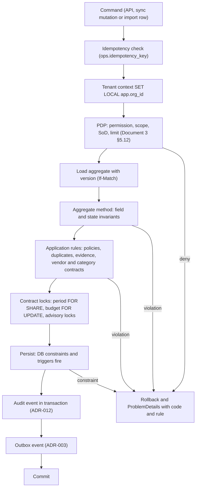

# Document 5: Business Rules & Invariants Catalogue

**Product:** SlateIQ — Production Cost Intelligence & Audit Monitoring Platform
**Document ID:** SLQ-ARCH-005
**Version:** 1.0.0
**Classification:** Internal — Architecture Foundation
**Status:** Draft — For Review
**Date:** 2026-11-06
**Authors:** Principal Enterprise Solution Architect, Domain Architect, Finance Architect, Data Architect
**Reviewers:** Product Owner (TBD), Finance SME (TBD), Audit SME (TBD), Tax Advisor (TBD), Security Architect (TBD), Principal Architect (TBD)

---

## Document Control

### Revision History

| Version | Date | Author | Change |
|---------|------|--------|--------|
| 1.0.0 | 2026-11-06 | Architecture Team | First issue: enforcement mapping for all 83 business rules of Document 1 §10, invariants INV-001 to INV-035, configurable policies POL-001 to POL-042, precedence, versioning, override register, ADR-030 and ADR-031 |

### Related Documents

| Document | Relationship |
|----------|--------------|
| Document 1 — Product Vision & Business Requirements | Authoritative source of BR-, FR-, NFR-, D-, UC- identifiers; §10.2 precedence and §10.12 governance are realised here |
| Document 2 — Domain Model & Capability Map | Entity, aggregate and state names; §9 cross-cutting rules become invariants here |
| Document 3 — Actor, Permission, Tenancy & Identity | Permission keys (Appendix A), SoD rules SOD-01 to SOD-10 (§5.8), approval limits and delegation (§5.9), denial codes (§5.11), RLS families (§7, Appendix D) |
| Document 4 — Core Business Workflows & State Machines | Transitions, transaction boundaries and guards that invoke the rules catalogued here |
| Document 6 — High-Level Solution Architecture | Module invariants (§5.3), data ownership (§5.4), money and FX (§8.3), data quality controls (§8.10) |
| Document 8 — Database Conceptual Model & ERD | Physical constraint names and trigger definitions that realise the database column of this catalogue |
| Document 9 — API Architecture & Endpoint Catalogue | Registers the error codes listed here in its ERR catalogue and RFC 9457 problem types |
| Document 13 — Analytics & Cost Calculation Architecture | Measure formulas, rounding and tax semantics, reconciliation checks RCN-01 to RCN-12 referenced here |
| Document 16 — Testing Strategy | Test pyramid and critical scenarios (TS-nn) that consume the test column of this catalogue |
| Document 17 — Risk Register & ADRs | Consolidates ADR-030, ADR-031 and risks R5-01 to R5-06 |

---

## 1. Purpose and Scope

Document 1 §10 states 83 business rules; Document 2 §9 and Document 6 §5.3 state domain and module invariants; the governing brief §9 requires every invariant to be enforced through application logic, database constraints and transaction management, never through the frontend alone. This document is the single place where an engineer, tester or auditor can answer four questions for any rule:

1. **Where is it enforced?** Domain aggregate, application service, database constraint or trigger, row-level security, transaction or lock.
2. **What does a caller see on violation?** A stable machine-readable error code and HTTP status.
3. **How is it proven?** The automated tests that must exist, positive and negative (Document 1 §10.1).
4. **How is it detected if a defect lets it slip?** The nightly reconciliation or integrity check.

It also defines the **configurable policies** that parameterise rules (thresholds, windows, limits), the **precedence** that prevents tenant configuration from relaxing a higher-order rule, **versioning** so historical transactions are judged by the rule in force at the time, and the **override and exception register** required by Document 1 §10.12.

Out of scope: state machines (Document 4), measure formulas (Document 13), column definitions (Document 8), endpoint shapes (Document 9).

---

## 2. Conventions

### 2.1 Enforcement Layers

| Layer | Code | Meaning | Failure behaviour |
|-------|------|---------|-------------------|
| Domain aggregate | **AGG** | Invariant checked inside the aggregate method that changes state (for example `Expense.Submit()`); no state change is possible without passing it | Domain exception mapped to an error code; transaction rolled back |
| Application service | **APP** | Check that needs data outside the aggregate: other modules' contracts, configuration, duplicates, period status | Same as AGG |
| Database | **DB** | `CHECK`, `UNIQUE` (including partial), `EXCLUDE`, composite foreign key inside a schema (RC-02), append-only or immutability trigger, column grant | SQLSTATE mapped by the persistence layer to the rule's error code; never surfaced raw |
| Row-level security | **RLS** | Tenant and scope predicate of the table's family (Document 3 §7.4, Appendix D) | Row invisible (reads) or `new row violates row-level security policy` mapped to `NOT_FOUND` |
| Transaction and lock | **TXN** | Isolation level, row lock, advisory lock or optimistic version (`ETag`/`If-Match`, ADR-007) that makes the check race-free | Serialization failure retried up to 3 times, then `CONCURRENT_MODIFICATION` (409) |
| Detection | **DET** | Nightly reconciliation (Document 13 §11, RCN-nn) or integrity job (Document 6 §8.10) that reports a breach that escaped prevention | Alert to finance operations; no silent repair |

**Rules of the catalogue.**

1. Every rule that a caller can violate has at least AGG or APP plus one of DB, RLS or TXN. A rule enforced only in application code is acceptable only when the database cannot express it without crossing a schema boundary (RC-02); such rules carry a DET check.
2. The client never enforces a rule authoritatively. Mobile and web perform the same checks as a usability aid using the shared rule metadata published in `contracts/` (Document 6 §6.11).
3. Excel import (MOD-10) and sync (MOD-14) call the owning module's commands; they never re-implement a rule (BR-EXP-016, BR-XLS-002, ADR-011).
4. Cross-schema references are validated by the owning module's contract in the same database transaction (RC-02); the database column shows "contract" in that case.

### 2.2 Error Codes

Error codes are `UPPER_SNAKE_CASE` values of the `code` member of the RFC 9457 problem body (ADR-007), following the style of Document 3 §5.11. Document 9 registers each code with its problem `type` URI. Codes listed here are **requested additions** to the Document 9 ERR catalogue (section 12). Codes already defined by Document 3 (`FORBIDDEN`, `OUT_OF_SCOPE`, `NOT_FOUND`, `UNAUTHENTICATED`, `STEP_UP_REQUIRED`, `SEGREGATION_OF_DUTIES`, `GRANT_INACTIVE`, `TENANT_SUSPENDED`, `VALIDATION_FAILED`, `IDEMPOTENCY_KEY_REUSED`) are reused unchanged.

| HTTP | Used for |
|------|----------|
| 403 | Authorization, scope, SoD, MFA |
| 404 | Cross-tenant object (never 403, Document 3 §5.11) |
| 409 | State conflict: record immutable, period locked, duplicate, concurrent modification |
| 412 | `If-Match` mismatch (`PRECONDITION_FAILED`) |
| 422 | Field or business validation of the submitted content |

A response may carry several violations. The body lists them in `errors[]`, each with `code`, `rule` (the BR or INV identifier), `pointer` (JSON Pointer or Excel cell reference) and a human message (NFR-UX-008). The top-level `code` is the first blocking violation.

"—" in the error column means the rule cannot be violated by a caller: it is a system behaviour (a derivation, a routing decision or a projection) and its breach is a defect caught by tests and detection.

### 2.3 Test Notation

| Code | Test type (Document 16) |
|------|-------------------------|
| U | Domain unit test on the aggregate or value object |
| A | Application service test with in-memory or containerised dependencies |
| D | Database integration test against PostgreSQL 17 with the production migration set, RLS forced |
| API | HTTP contract test asserting status and `code` |
| P | Property-based test (FsCheck) over generated inputs |
| G | Golden-file test against Document 13 §14 fixtures |
| C | Concurrency test: two or more transactions racing on the same invariant |
| I | Tenant isolation test (Document 3 §7.8) |
| X | Excel parity test: the same input through API and import yields the same outcome |

Every rule has at least one positive (`P`-suffix) and one negative (`N`-suffix) test named `T-<rule>-P` and `T-<rule>-N` (for example `T-BR-EXP-006-N`). The rule registry (ADR-030) fails the build when a rule lacks either.

---

## 3. Enforcement Architecture

### 3.1 The Write Path

Every state-changing command follows the same sequence inside one database transaction. The order matters: cheap and authorization checks first, contract calls that take locks last, so locks are held for the shortest time.



### 3.2 Rule Registry

The backend holds one registry of rules (ADR-030), generated into `contracts/rules.json` for web and mobile.

| Field | Content |
|-------|---------|
| `rule_id` | `BR-EXP-006`, `INV-014`, `POL-012` |
| `rule_version` | Integer; incremented when the rule's semantics change (section 8) |
| `precedence` | L1 to L4 (section 7) |
| `error_codes` | Codes the rule may produce |
| `policy_keys` | Policies that parameterise it |
| `evaluation_point` | `CREATE`, `SUBMIT`, `APPROVE`, `IMPORT_VALIDATE`, `IMPORT_COMMIT`, `PERIOD_CLOSE`, `ALWAYS` |
| `overridable` | `false`, or the override type and approver permission (section 9) |
| `tests` | Test identifiers; the build fails when the positive or negative test is missing |
| `owner` | Business owner per Document 1 §10.12 |

### 3.3 Locking Conventions

| Situation | Lock | Rationale |
|-----------|------|-----------|
| Write dated in a period | `SELECT … FOR SHARE` on the `budget.financial_period` row through the Budget contract | A concurrent lock run takes `FOR UPDATE` on the same row, so a write and a lock serialise; no write slips into a period after its lock commits |
| Budget activation, variation, episode allocation | `SELECT … FOR UPDATE` on `budget.budget` | One writer per budget at a time; makes BR-BUD-001, BR-BUD-006 and BR-BUD-007 race-free |
| Duplicate detection | `pg_advisory_xact_lock(hashtextextended(org_id ‖ show_id ‖ vendor_key, 0))` | Two concurrent submissions of the same bill cannot both pass BR-EXP-006 |
| Cash limit per payee per day | Advisory lock on `(org_id, payee_key, payment_date)` | POL-014 aggregate is evaluated serially |
| Approval decision | `SELECT … FOR UPDATE` on `expense.approval_instance` | Two approvers acting on the same step: one wins, the other receives `CONCURRENT_MODIFICATION` |
| Aggregate edits | Optimistic version (`xmin` exposed as `ETag`) | Lost update prevented without long locks |
| Audit append | `FOR UPDATE` on `compliance.audit_chain_head` (Document 6 §8.5) | Hash chain sequence is strict |

Default isolation is `READ COMMITTED`; the locks above provide the serialisation each invariant needs. `SERIALIZABLE` is used only by the period-close run and the import commit of an all-or-nothing batch.

---

## 4. Business Rule Enforcement Catalogue

Each row maps one rule of Document 1 §10 to its enforcement. Rule text is not repeated; read it in Document 1. Error codes show the HTTP status in parentheses.

### 4.1 Financial Rules (BR-FIN, owner Finance)

| Rule | AGG | APP | DB | RLS | TXN | Test | Error |
|------|-----|-----|----|-----|-----|------|-------|
| BR-FIN-001 | `Money` value object rejects scale above 4 and values beyond `numeric(19,4)` | Shared finance library `SlateIQ.Finance` is the only arithmetic path; JSON money parsed from decimal strings only | Every money column `numeric(19,4)`, rates `numeric(19,6)`; CI schema lint fails on `real`, `double precision`, `money` or unbounded `numeric` | — | — | U, P, D (lint) | `AMOUNT_PRECISION_INVALID` (422) |
| BR-FIN-002 | `Rounding.HalfUp(4)` (`MidpointRounding.AwayFromZero`, RC-01) applied only at line amount, tax amount, converted amount and report total | Server recomputes every derived amount; client-supplied totals are advisory and ignored on API, compared on import | `ck_expense_line_gross` (`gross = net + tax`), `ck_expense_line_cost_basis` (`cost_basis = net + non_recoverable_tax`) | — | — | U, P, G | — (import row: `AMOUNT_MISMATCH` (422)) |
| BR-FIN-003 | `FxSnapshot` immutable once the owner leaves `DRAFT` | `FxRateResolver`: rate for the expense date, else latest rate dated on or before it, else latest published; raises `FX_FALLBACK` exception when older than POL-022 | `ck_fx_rate_positive`; `ck_expense_fx_required` (snapshot columns not null when currency differs from base); immutability trigger on snapshot columns | — | Rate read and snapshot written in the submission transaction | U, A, D, G | `FX_RATE_UNAVAILABLE` (422) |
| BR-FIN-004 | `Organization.ChangeBaseCurrency()` refuses when `base_currency_locked_at` is set | First `ExpenseApproved` or `BudgetApproved` sets the lock through the Tenancy contract | Trigger on `tenancy.organization` blocks update of `base_currency` when locked | Family A | — | U, D, API | `BASE_CURRENCY_LOCKED` (409) |
| BR-FIN-005 | Only `Expense.Approve()`, `Cancel()` and supersession create `CostPosting` rows | `CostPostingService` posts in the decision transaction | `expense.cost_posting` append-only trigger; `uq_cost_posting_source (org_id, expense_id, expense_line_id, split_seq, posting_type)` | Family B | Posting in the same transaction as the status change | U, D, G; DET RCN-01, RCN-02 | — |
| BR-FIN-006 | `ManualCommitment` counts only in `OPEN` | `CommitmentConsumptionService` (Document 13 M-07) | `ck_commitment_amount_positive`; consumption references a commitment through composite key inside `vendor` only for amendments; expense lines reference by `(commitment_id, org_id)` validated by contract | Family B | Consumption validated in the expense transaction | U, A, G; DET RCN-05 | `COMMITMENT_NOT_OPEN` (409) |
| BR-FIN-007 | `TaxCalculator` (inclusive and exclusive, Document 13 §4) inside `ExpenseLine` | Tax rate resolved from `ref.tax_jurisdiction` and category recoverability default (A2-04) | Tax columns separate from net; `expense.expense_tax` holds components (CGST, SGST, IGST, VAT); `ck_tax_amount_sign` matches line sign | — | — | U, P, G | `TAX_RATE_INVALID` (422) |
| BR-FIN-008 | `ExpenseLine` refuses negative values unless the document type is `CREDIT_NOTE` | Credit note validated against the referenced original (same vendor, same show, amount not exceeding the original's remaining cost basis) | `ck_line_sign` (`net >= 0 OR document_type = 'CREDIT_NOTE'`); `ck_credit_note_reference` (reference not null for credit notes); `ck_posting_sign` (approval sign equals line sign, reversal opposite) | — | — | U, D | `NEGATIVE_AMOUNT_NOT_ALLOWED` (422), `CREDIT_NOTE_REFERENCE_REQUIRED` (422) |
| BR-FIN-009 | Aggregates expose no mutator after approval; correction methods return a new revision | `ExpenseAmendmentService`, reversal and credit flows retain `supersedes_id` | Immutability triggers on `expense.expense`, `expense_line`, `expense_split`, `budget.budget_line`, `budget.budget_version` (non-`DRAFT`); application role has no `DELETE` grant on financial tables | Family B | — | U, D | `RECORD_IMMUTABLE` (409) |
| BR-FIN-010 | — | `PeriodResolver` maps the expense date (organization timezone) to the period of the fiscal calendar | `EXCLUDE USING gist (org_id WITH =, scope_key WITH =, daterange(start_date, end_date, '[]') WITH &&)` on `budget.financial_period`; gap check at calendar generation | Family B | — | U, D | `PERIOD_NOT_FOUND` (422) |
| BR-FIN-011 | — | `ReconciliationService` runs before a report run is published and nightly | Report run status cannot become `COMPLETED` while its reconciliation result is `FAILED` (`ck_report_run_reconciled`) | — | — | A, G; DET RCN-01 to RCN-12 | `RECONCILIATION_FAILED` (409) |
| BR-FIN-012 | — | Report queries read stored base amounts; a static analysis rule forbids joins to rate tables in `report` and `intel` queries | No rate column in `intel` facts other than the copied snapshot | — | — | G | — |

### 4.2 Budget Rules (BR-BUD, owner Finance)

| Rule | AGG | APP | DB | RLS | TXN | Test | Error |
|------|-----|-----|----|-----|-----|------|-------|
| BR-BUD-001 | `Budget.Activate(version)` supersedes the previous active version | `BudgetApprovalService` | `uq_budget_version_active` partial unique index `(org_id, budget_id) WHERE status = 'ACTIVE'` | Family B | `FOR UPDATE` on `budget.budget` | U, D, C | `BUDGET_ACTIVE_VERSION_CONFLICT` (409) |
| BR-BUD-002 | `BudgetVersion.AddLine()` refuses a duplicate key | — | `uq_budget_line_key (org_id, budget_version_id, department_id, category_id, cost_type)` | Family B | — | U, D | `BUDGET_LINE_DUPLICATE` (409) |
| BR-BUD-003 | `BudgetVersion.Submit()` compares total with the sum of lines including contingency | — | Deferred constraint trigger on submit: `total = Σ line amounts` | Family B | Checked at commit | U, D | `BUDGET_TOTAL_MISMATCH` (422) |
| BR-BUD-004 | Contingency lines (`line_type = 'CONTINGENCY'`) cannot be a posting target | Expense validation rejects a line key resolving only to a contingency line; variations are the only outflow | `ck_variation_contingency_direction` (contingency may be a source, never a destination of an expense posting) | Family B | — | U, A | `CONTINGENCY_DIRECT_SPEND` (422) |
| BR-BUD-005 | `BudgetVersion.CreateRevision(reason, effectiveDate)` | Last locked period from the Budget period contract | `ck_revision_reason` (reason and effective date not null when `version_type = 'REVISION'`) | Family B | Period row `FOR SHARE` | U, D | `REVISION_REASON_REQUIRED` (422), `REVISION_EFFECTIVE_DATE_INVALID` (422) |
| BR-BUD-006 | `Variation` preserves total (from minus equals to plus) | `VariationService` evaluates POL-005 (single) and POL-006 (cumulative since version activation) against the current show budget; above either, routes to the revision workflow | `ck_variation_lines_differ`, `ck_variation_amount_positive` | Family B | `FOR UPDATE` on `budget.budget` | U, A, C | `VARIATION_REQUIRES_APPROVAL` (409) when a direct apply is attempted above threshold |
| BR-BUD-007 | `BudgetVersion.Allocate(episode, amount)` | — | `ck_episode_allocation_nonneg`; aggregate check trigger `Σ allocations ≤ season total` | Family B | `FOR UPDATE` on `budget.budget` | U, D, C | `EPISODE_ALLOCATION_EXCEEDS_BUDGET` (422) |
| BR-BUD-008 | `BudgetLine` currency equals organization base currency | Foreign-currency entry converted at the budget effective date through `FxRateResolver`; rate stored on the line | `ck_budget_line_currency` against the version's stored base currency | Family B | — | U, G | `BUDGET_CURRENCY_INVALID` (422) |
| BR-BUD-009 | — | `PeriodGuard.AssertWritable(org, date)` on create, amend, approve and import commit of every dated financial record (expense, commitment, budget revision effective date) | No cross-schema trigger (RC-02) | Family B | Period row `FOR SHARE` held to commit; lock run holds `FOR UPDATE` | A, D, C; DET RCN-07 | `PERIOD_LOCKED` (409) |
| BR-BUD-010 | — | `ApprovalChainResolver` appends the commissioner step (`COMMISSIONING_ADMIN`) when the show has a `COMMISSIONER` party and the total exceeds POL-003 | Steps stored on the instance; immutable after submission | Family B | — | A | `APPROVAL_STEP_OUT_OF_ORDER` (409) |
| BR-BUD-011 | — | `ThresholdEvaluator` tests total against POL-003 and, for revisions, the delta against POL-004; the stricter chain wins | — | — | — | A, G | — |
| BR-BUD-012 | `BudgetVersion.Approve(actor)` refuses when the actor is the only author (every edit event recorded one user) | PDP SoD rule SOD-03 at decision time | `ck_approval_decision_not_submitter` on the decision row | Family B | — | U, A, API | `SEGREGATION_OF_DUTIES` (403) |

### 4.3 Expense Rules (BR-EXP, owner Finance and Audit)

| Rule | AGG | APP | DB | RLS | TXN | Test | Error |
|------|-----|-----|----|-----|-----|------|-------|
| BR-EXP-001 | `Expense.Submit()` requires evidence when the evidence policy says so | `EvidencePolicyEvaluator`: category policy (POL-012), amount threshold on base amount (POL-011), auditor-type policy (POL-013); evidence must be `AVAILABLE` | — | Family B | — | U, A, X | `EVIDENCE_REQUIRED` (422) |
| BR-EXP-002 | `Expense` date checks against tolerance | POL-017 (future) and POL-018 (before show start) | `ck_expense_date_not_null` | — | — | U, X | `EXPENSE_DATE_OUT_OF_RANGE` (422) |
| BR-EXP-003 | — | `PeriodGuard` (as BR-BUD-009) | — | Family B | Period row `FOR SHARE` | A, C | `PERIOD_LOCKED` (409) |
| BR-EXP-004 | — | PDP evaluates show, department and category scope at create and submit, and again for the approver at approval | — | Family B with C allowlist for grantees | — | A, API, I | `OUT_OF_SCOPE` (403) |
| BR-EXP-005 | `ApprovalInstance.Decide(actor)` refuses submitter, creator and beneficiary, directly or as `on_behalf_of` | PDP SOD-01 and SOD-02 | `ck_approval_decision_not_submitter` (`actor_user_id <> submitter_user_id AND coalesce(on_behalf_of_user_id, actor_user_id) <> submitter_user_id`) with submitter denormalised on the decision row | Family B | `FOR UPDATE` on the instance | U, D, API | `SEGREGATION_OF_DUTIES` (403) |
| BR-EXP-006 | Submission requires a resolution (`LINK`, `JUSTIFY`, `CANCEL`) for each open duplicate candidate | `DuplicateDetector`: same show, same vendor key, base amount within POL-016, expense date within POL-015 of a non-cancelled revision; raises `DUPLICATE_SUSPECTED` exception on `JUSTIFY` | `ix_expense_duplicate_probe (org_id, show_id, vendor_key, expense_date)` | Family B | Advisory lock on `(org, show, vendor_key)` | A, C, X | `DUPLICATE_SUSPECTED` (409) |
| BR-EXP-007 | `ApprovalInstance` created with the workflow version; steps immutable | `ApprovalChainResolver` at submission | `approval_instance.workflow_version_id not null`; trigger blocks step changes after creation | Family B | — | A, D | — |
| BR-EXP-008 | — | `ThresholdEvaluator` uses `base_amount` of the locked snapshot | — | — | — | A, G | — |
| BR-EXP-009 | `Expense.Amend(reason, changes)` creates a revision; financial change resets to step 1, non-financial keeps progress | `ExpenseAmendmentService` classifies fields (Document 4) | `uq_expense_open_revision (org_id, root_expense_id) WHERE status IN ('DRAFT','SUBMITTED','REQUIRES_INFO')`; `ck_amendment_reason` | Family B | `If-Match` on the current revision | U, D, C | `AMENDMENT_REASON_REQUIRED` (422), `AMENDMENT_IN_PROGRESS` (409) |
| BR-EXP-010 | `Expense.Cancel(reason)`; no delete method exists | Reversal postings in the period of the event (Document 13 §5) | No `DELETE` grant; append-only `cost_posting` | Family B | Posting in the cancellation transaction | U, D, G | `DELETE_PROHIBITED` (409) |
| BR-EXP-011 | `Expense` stores `device_created_at` as metadata; `server_received_at` drives audit | Sync mutation handler (Document 11) | `server_received_at default now()`, not writable by the application role | — | — | A | — |
| BR-EXP-012 | `ExpenseLine.Split()` percentages sum to 100.0000, amounts to the line cost basis; remainder to the largest split (Document 13 §3.3) | — | Deferred constraint trigger on `expense_split`; `ck_split_percentage` (0 < p ≤ 100) | Family B | Checked at commit | U, P, G | `SPLIT_ALLOCATION_INVALID` (422) |
| BR-EXP-013 | — | Vendor contract returns status; `BLOCKED`, `INACTIVE`, `REJECTED`, `MERGED` refused unless an approved override exists (section 9) | — | Family A (vendor) | — | A, X | `VENDOR_NOT_SELECTABLE` (422) |
| BR-EXP-014 | — | `SubmissionLimitEvaluator` (POL-020, POL-021, POL-014) adds approval steps; never blocks capture | — | — | Advisory lock per user-day for POL-021 | A, C | — |
| BR-EXP-015 | — | Production contract confirms category active, leaf, mapped to the department at submission time | — | Family B | — | A, X | `CATEGORY_NOT_ALLOWED` (422) |
| BR-EXP-016 | — | Import row handler calls `ExpenseCommandService` with the importer's principal | — | Same as UI | Same as UI | X (parity suite over every BR-EXP rule) | Codes of the underlying rule, per row |
| BR-EXP-017 | Approved expense unchanged when evidence becomes `DISPUTED` | Evidence dispute raises `MISSING_EVIDENCE` or `POLICY_VIOLATION` exception and report flag | — | Family B | — | A | — |

### 4.4 Vendor and Commitment Rules (BR-VND, owner Finance)

| Rule | AGG | APP | DB | RLS | TXN | Test | Error |
|------|-----|-----|----|-----|-----|------|-------|
| BR-VND-001 | `Vendor.Create()` | `VendorDuplicateService` normalises legal name and tax identifier; override records a distinct-entity confirmation | `uq_vendor_identity (org_id, normalized_legal_name, tax_identifier, disambiguator)`; `disambiguator` is 0 unless set by an approved override | Family A | Advisory lock on the normalised key | U, D, C | `VENDOR_DUPLICATE` (409) |
| BR-VND-002 | No delete method | Deactivate or merge only | No `DELETE` grant on `vendor.vendor` | Family A | — | D | `DELETE_PROHIBITED` (409) |
| BR-VND-003 | `ManualCommitment` state machine SM-07 | Expiry job moves past-validity commitments to `EXPIRED` | `ck_commitment_status` | Family B | — | U, A | `COMMITMENT_NOT_OPEN` (409) |
| BR-VND-004 | `CommitmentAmendment` requires reason | Reduction above POL-007 routes to approval | `ck_commitment_amendment_reason` | Family B | `If-Match` on commitment | U, A | `AMENDMENT_REASON_REQUIRED` (422) |
| BR-VND-005 | `PurchaseOrder.Receive()` (Phase 1) | Tolerance POL-008 | `ck_po_receipt_qty_nonneg` | Family B | `FOR UPDATE` on the PO line | U, C | `RECEIPT_EXCEEDS_TOLERANCE` (422) |
| BR-VND-006 | `Vendor.MergeInto(survivor)` | Reassigns references through each owning module's contract in one transaction; records `VendorMerged` | `ck_vendor_not_merged_into_self` | Family A | `SERIALIZABLE`; both vendors `FOR UPDATE` | A, D | `VENDOR_MERGE_INVALID` (409) |
| BR-VND-007 | — | Field-level projection masks bank and tax identifiers without `vendor.payment_term.update`; export masks always; Phase 1 second approver (SOD-05) | `vendor_bank_reference` encrypted column; read through a masking view | Family A | — | A, API | `FORBIDDEN` (403) |

### 4.5 Audit and Access Rules (BR-AUD, owner Audit)

| Rule | AGG | APP | DB | RLS | TXN | Test | Error |
|------|-----|-----|----|-----|-----|------|-------|
| BR-AUD-001 | `AuditAssignment.Activate()` requires start, end and at least one scope element | — | `ck_assignment_dates` (`start_date` and `end_date` not null, end ≥ start) | Family B | — | U, D | `ASSIGNMENT_INVALID` (422) |
| BR-AUD-002 | `AccessGrant` validation (Document 3 §8) | — | `ck_grant_expiry` (`expires_at ≤ activated_at + interval '12 months'`), one client organization | Family A plus grantee self-read | — | U, D | `GRANT_INVALID` (422) |
| BR-AUD-003 | — | Revocation writes the Redis denylist and bumps `scope_version` (Document 3 §5.12) | — | — | Revocation event delivered within 60 s; token check on every request | A, C | `GRANT_INACTIVE` (403) |
| BR-AUD-004 | `AccessGrant.Activate()` checks MFA, NDA, conflict declaration and client approval | — | `ck_grant_activation_prerequisites` | Family A | — | U, API | `GRANT_ACTIVATION_INCOMPLETE` (409) |
| BR-AUD-005 | — | Conflict register lookup in PDP scope resolution | — | Family A | — | A, I | `CONFLICT_OF_INTEREST_UNRESOLVED` (403) |
| BR-AUD-006 | `AuditAssignment.Revoke(actor)` checks the actor belongs to the appointing party | PDP | — | Family B | — | A, API | `FORBIDDEN` (403) |
| BR-AUD-007 | `AuditAssignment.HandOver(successor, at)` ends the predecessor at `at` and moves open items | — | `ck_handover_predecessor` | Family B | Both assignments `FOR UPDATE` in one transaction | U, C | `ASSIGNMENT_HANDOVER_INVALID` (409) |
| BR-AUD-008 | — | Workload check POL-041 returns a warning; proceeding needs a reason | — | — | — | A | `WORKLOAD_OVERRIDE_REASON_REQUIRED` (422) |

### 4.6 Document and Retention Rules (BR-DOC, owner Compliance)

| Rule | AGG | APP | DB | RLS | TXN | Test | Error |
|------|-----|-----|----|-----|-----|------|-------|
| BR-DOC-001 | `EvidenceLink` in `VERIFIED` cannot change its document; replacement creates a `DocumentVersion` | — | Immutability trigger on verified links and on `document_version` | Family B | — | U, D | `RECORD_IMMUTABLE` (409) |
| BR-DOC-002 | `Document.Delete()` is a soft delete | `RetentionService` permits purge only after expiry and with no hold | No `DELETE` grant to the application role; purge runs under the retention service role | Family B | — | A, D | `RETENTION_ACTIVE` (409) |
| BR-DOC-003 | `LegalHold.Release()` needs a second approver distinct from the requester | Hold check before any purge or erasure | `ck_legal_hold_release_approver` | Family A | — | U, A | `LEGAL_HOLD_ACTIVE` (409), `SEGREGATION_OF_DUTIES` (403) |
| BR-DOC-004 | — | `RetentionCalculator`: later of creation, period lock and hold release; longest jurisdiction policy | — | — | — | U, G | — |
| BR-DOC-005 | `Document` serves only in `AVAILABLE` | Scan gate (ADR-006) | `ck_document_object_key_clean` (served key set only when status `AVAILABLE`) | Family B | — | A, D | `DOCUMENT_NOT_AVAILABLE` (409) |
| BR-DOC-006 | — | Authorization on every read, preview and signed-URL issue; URL TTL ≤ 15 minutes | — | Family B with C allowlist | — | API, I | `OUT_OF_SCOPE` (403), `NOT_FOUND` (404) |
| BR-DOC-007 | Evidence link of an approved expense cannot be detached | Replacement requires an amendment revision or evidence amendment record | Trigger blocks delete or document change on links of approved revisions | Family B | — | U, D | `EVIDENCE_LOCKED` (409) |

### 4.7 Production and Taxonomy Rules (BR-PRD, owner Product and Finance)

| Rule | AGG | APP | DB | RLS | TXN | Test | Error |
|------|-----|-----|----|-----|-----|------|-------|
| BR-PRD-001 | `ShowClosure.Evaluate()` produces blocking items; `Approve()` requires all resolved or waived | Contracts of Budget, Vendor, Expense and Audit Ops report open items | — | Family B | Checklist and transition in one transaction; show row `FOR UPDATE` | A, C | `SHOW_CLOSURE_BLOCKED` (409) |
| BR-PRD-002 | `Show` in `CLOSING`, `CLOSED`, `ARCHIVED` or `CANCELLED` refuses new expenses | Production contract status check | — | Family B | — | A, X | `SHOW_NOT_ACTIVE` (409) |
| BR-PRD-003 | No delete method; deactivation only | Label snapshot copied onto expense lines at submission | No `DELETE` grant | Family B | — | D | `DELETE_PROHIBITED` (409) |
| BR-PRD-004 | `PartyOrganizationLink.Accept()` by both organizations | — | `ck_party_link_active_requires_both` | Family B plus published view | — | U, I | `PARTY_LINK_NOT_ACCEPTED` (409) |
| BR-PRD-005 | Episode has no budget aggregate; allocation lives on `BudgetVersion` | — | No budget table keyed by episode | — | — | U | `EPISODE_BUDGET_NOT_SUPPORTED` (422) |
| BR-PRD-006 | `Department.SetParent()` checks depth ≤ 3 and acyclicity | — | `ck_department_depth`; trigger with recursive cycle check | Family B | `FOR UPDATE` on the subtree root | U, D | `DEPARTMENT_HIERARCHY_INVALID` (422) |

### 4.8 Excel Rules (BR-XLS, owner Product)

| Rule | AGG | APP | DB | RLS | TXN | Test | Error |
|------|-----|-----|----|-----|-----|------|-------|
| BR-XLS-001 | `ImportBatch` checks the workbook version header against the active template version or a declared compatible version | — | — | Family A | — | A | `TEMPLATE_VERSION_MISMATCH` (422) |
| BR-XLS-002 | — | Row handler calls the owning module's command service | — | Same as target | Same as target | X | Codes of the underlying rule, per row |
| BR-XLS-003 | `ImportBatch` requires `confirm_duplicate_file = true` when the SHA-256 matches a committed batch | — | `ix_import_batch_hash (org_id, file_sha256)` | Family B | — | A | `IMPORT_FILE_DUPLICATE` (409) |
| BR-XLS-004 | `ImportBatch.Commit(mode)` | POL-025 and POL-026 | `ck_import_commit_mode` | Family B | All-or-nothing commit runs `SERIALIZABLE` in one transaction; partial commit runs per row with the batch row `FOR UPDATE` | A, C | `IMPORT_ERROR_THRESHOLD_EXCEEDED` (422) |
| BR-XLS-005 | Batch journal fields mandatory | — | `ck_import_batch_journal` (actor, template version, counts, outcome not null at terminal state) | Family B | — | D | — |
| BR-XLS-006 | `ImportBatch.Reverse()` creates compensating records | — | No `DELETE` grant | Family B | Reversal in one transaction per batch | A, D | `DELETE_PROHIBITED` (409) |

### 4.9 Access and Identity Rules (BR-ACC, owner Security)

| Rule | AGG | APP | DB | RLS | TXN | Test | Error |
|------|-----|-----|----|-----|-----|------|-------|
| BR-ACC-001 | — | PDP obligation `MFA` for listed roles and grantees; step-up for marked keys | — | — | — | API | `STEP_UP_REQUIRED` (403) |
| BR-ACC-002 | — | PDP deny-by-default | RLS forced on every tenant table; application role without `BYPASSRLS` | All families | — | API, I | `FORBIDDEN` (403) |
| BR-ACC-003 | — | Permission resolver intersects role and scope; platform ceiling | — | — | — | A, P | `FORBIDDEN` (403) |
| BR-ACC-004 | `Membership.Deactivate()` | Session revocation; open approvals reassigned or flagged within one business day by a job | — | — | — | A | `UNAUTHENTICATED` (401) |
| BR-ACC-005 | `AccessReviewCampaign` closes with revocation of uncertified items | — | — | Family A | — | A | — |
| BR-ACC-006 | `Delegation` validates window ≤ POL-040, no chaining, no self, no SoD conflict | — | `ck_delegation_window` (`end_at ≤ start_at + interval '90 days'`); `ck_delegation_not_self` | Family A | — | U, D | `DELEGATION_INVALID` (422) |
| BR-ACC-007 | — | Session registry and denylist; `scope_version` | — | — | Propagation ≤ 60 s, target ≤ 5 minutes | C | `UNAUTHENTICATED` (401) |
| BR-ACC-008 | `SupportAccess` with approver ≠ requester, window ≤ 8 hours | Customer notification for financial-data access | `ck_support_access_window` | Family F | — | A | `BREAK_GLASS_REQUIRED` (403) |

**Coverage check.** 12 BR-FIN + 12 BR-BUD + 17 BR-EXP + 7 BR-VND + 8 BR-AUD + 7 BR-DOC + 6 BR-PRD + 6 BR-XLS + 8 BR-ACC = 83 rules.

---
## 5. Invariants

An invariant is a statement that holds for every committed database state, not only after a particular command. Business rules are mostly command preconditions; invariants are the state properties those preconditions protect. Sources: governing brief §9 (GB), Document 2 §9 (D2), Document 6 §5.3 (D6), and the cost posting model of Document 2 §6.7 (D2-17).

Columns: **Application** (AGG or APP), **Database** (constraint, trigger, grant), **Transaction** (lock or boundary), **Detection** (nightly check; RCN identifiers are defined in Document 13 §11, INT identifiers in section 10.2), **Test**.

### 5.1 Tenancy, Identity and Access

| ID | Statement | Source | Application | Database | Transaction | Detection | Test |
|----|-----------|--------|-------------|----------|-------------|-----------|------|
| INV-001 | Every show belongs to exactly one organization, its hosting tenant, which never changes | GB, D6 Production, ADR-025 | `Show` has no method to change `org_id` | `org_id not null`; trigger blocks update of `org_id` on every tenant table | — | INT-01 orphan scan | U, D, I |
| INV-002 | Every request runs in exactly one tenant context; no query returns rows of another tenant except through a grant within its named scope | GB, D6 Tenancy | Request context built server-side (Document 2 §7 `RequestContext`); PDP authority source singular | RLS `ENABLE` and `FORCE` on every tenant table; `SET LOCAL app.org_id` per transaction; empty context returns no rows | Context set per transaction, cleared on connection return | INT-02 RLS inventory test in CI; `CrossTenantAccessAttempt` monitoring | I (Document 3 §7.8) |
| INV-003 | A record is visible only inside the actor's effective scope at the time of access | D2 | PDP scope check on every read and write | RLS family B and C predicates | `scope_version` bump invalidates cached decisions within 60 s | Access review campaigns (BR-ACC-005) | A, I |
| INV-004 | Refresh tokens rotate on every use; reuse revokes the whole session family | D6 Identity | Identity token service | `uq_refresh_session_token_hash`; family revocation flag | Rotation and family revoke in one transaction | Security event monitoring | A, C |
| INV-005 | Historical audit, approval and assignment records never disappear when a user, membership, assignment or grant is deactivated, revoked or erased | GB | Deactivation and erasure workflows change status or pseudonymise (ADR-022), never delete | No `DELETE` grant on `compliance.*`, `expense.approval_decision`, `auditops.audit_assignment`, `tenancy.access_grant`; foreign keys to users are `ON DELETE RESTRICT` | — | INT-03 reference integrity scan | D |
| INV-006 | Every approval decision identifies the responsible actor and, when delegated, the delegator, the limit applied and the role version | GB | `ApprovalInstance.Decide()` requires all attribution fields | `actor_user_id`, `limit_applied`, `role_version_id` not null; `on_behalf_of_user_id` not null when `delegation_id` is set | Decision in the approval transaction | INT-04 | U, D |
| INV-007 | No actor approves a record they created, submitted or benefit from, at any level, including through delegation | GB, BR-EXP-005, BR-BUD-012 | PDP SoD predicate | `ck_approval_decision_not_submitter` | Instance `FOR UPDATE` | INT-05 nightly self-approval scan | U, D, API |

### 5.2 Production, Budget and Period

| ID | Statement | Source | Application | Database | Transaction | Detection | Test |
|----|-----------|--------|-------------|----------|-------------|-----------|------|
| INV-008 | Approved budgets retain all historical versions; exactly one version per budget is `ACTIVE` once baselined | GB, D6 Budget | `Budget.Activate()` | `uq_budget_version_active`; no `DELETE` grant; non-`DRAFT` versions immutable | `FOR UPDATE` on `budget.budget` | INT-06 (every `BASELINED` budget has one active version) | U, D, C |
| INV-009 | Every budget change is traceable: a revision carries reason, effective date, author and approver; a variation carries from, to, amount, reason and approver or threshold evidence | GB | Revision and variation aggregates | `ck_revision_reason`; variation columns not null | Change and audit event in one transaction | NFR-AUD-001 completeness test | U, D |
| INV-010 | The sum of episode allocations of a version never exceeds the season total | D6 Budget | `BudgetVersion.Allocate()` | Aggregate check trigger | `FOR UPDATE` on `budget.budget` | INT-07 | U, C |
| INV-011 | Financial periods of one scope never overlap and leave no gap across the fiscal year | BR-FIN-010 | Calendar generator | `EXCLUDE USING gist` on `budget.financial_period` | Calendar generation in one transaction | INT-08 gap scan | D |
| INV-012 | No cost posting, approval or expense revision dated in a `LOCKED` period is created after the period's lock time | BR-BUD-009 | `PeriodGuard` | — (cross-schema, RC-02) | Period `FOR SHARE` versus lock run `FOR UPDATE` | RCN-07 | A, C |

### 5.3 Expense, Commitment and Cost

| ID | Statement | Source | Application | Database | Transaction | Detection | Test |
|----|-----------|--------|-------------|----------|-------------|-----------|------|
| INV-013 | Every expense revision references a valid show, season, department, category and vendor (or one-time payee) of its own tenant, and has an authorized creator or a recorded source (`MOBILE`, `WEB`, `EXCEL_IMPORT`, `API`) | GB | Contracts of Production and Vendor validated in the submission transaction | Composite keys within `expense`; `created_by` and `source` not null; `ck_expense_source` | Contract checks in the same transaction | INT-03 cross-module orphan scan | A, D, I |
| INV-014 | For every `root_expense_id` there is at most one revision in `DRAFT`, `SUBMITTED` or `REQUIRES_INFO`, at most one in `APPROVED`, and the `supersedes_id` chain is linear and complete | D2 (revision, not overwrite) | `ExpenseAmendmentService` | `uq_expense_open_revision`; `uq_expense_approved_revision (org_id, root_expense_id) WHERE status = 'APPROVED'`; `supersedes_id` composite key | Supersession and new approval in one transaction | INT-09 chain scan | U, D, C |
| INV-015 | An approved, superseded or cancelled revision is never modified; rejected revisions keep their decision history | GB, BR-FIN-009 | No mutators after approval | Immutability triggers; decisions append-only | — | INT-10 hash of approved revisions compared with the audit event `after_state` | D |
| INV-016 | Expense header totals equal the sum of rounded lines; line cost basis equals the sum of its splits; the FX snapshot is immutable after submission | D6 Expense, BR-FIN-011 | `Expense` recomputes totals | Deferred constraint triggers; snapshot immutability trigger | Checked at commit | Document 6 §8.10 header check; RCN-03 | U, P, D |
| INV-017 | Cost postings are complete and balanced: each approved revision has exactly one `APPROVAL` posting per line split, equal to the split's base cost basis; each cancelled or superseded revision that was approved has exactly one `REVERSAL` per approval posting with the opposite amount; the net of a revision's postings is its cost basis or zero | D2-17, BR-EXP-010 | `CostPostingService` | Append-only trigger; `uq_cost_posting_source`; `ck_posting_sign` | Postings in the status-change transaction | RCN-02 | U, D, G |
| INV-018 | A transaction belongs to the period of its expense date; a reversal belongs to the period of the reversing event | D2 | `PeriodResolver` | `period_id not null` on postings | — | RCN-07 | U, G |
| INV-019 | Only `OPEN` commitments contribute to committed cost; a commitment has one owner, one currency and cannot reach `CLOSED` without closure approval | D6 Vendor, BR-VND-003 | SM-07 guards | `ck_commitment_status`; currency immutable after `DRAFT` | — | RCN-05 | U, A |
| INV-020 | Cost calculations use the organization base currency at the rate locked on each record and round only at the defined points, half-up to scale 4 | GB, D2, RC-01 | `SlateIQ.Finance` | Money and rate column types | — | RCN-01, RCN-03 | P, G |
| INV-021 | The organization base currency never changes after the first approved financial record | BR-FIN-004 | `Organization` | Lock trigger | — | — | D |

### 5.4 Evidence, Audit, Data Movement and Platform

| ID | Statement | Source | Application | Database | Transaction | Detection | Test |
|----|-----------|--------|-------------|----------|-------------|-----------|------|
| INV-022 | Evidence is associated only with records of the same tenant, is never served before a clean scan, and is served only through signed URLs valid for at most 15 minutes | GB, D6 Documents | Scan gate; URL issuer | `evidence_link` stores `(document_id, org_id)` validated by the Documents contract; `ck_document_object_key_clean` | Link and validation in one transaction | INT-03; scan backlog monitor | A, I |
| INV-023 | The business audit trail is append-only and hash-chained per tenant; a business change and its audit event commit together | D6 Compliance, ADR-012 | `IAuditWriter` | Append-only trigger; `audit_chain_head` | Chain head `FOR UPDATE`; failed audit write fails the transaction | Daily chain verification (NFR-SEC-012) | D, C |
| INV-024 | A legal hold overrides retention: no held record or object is purged | D6 Compliance, BR-DOC-003 | `RetentionService` checks holds | Purge function refuses held targets | — | INT-11 purge log versus holds | A |
| INV-025 | Every `intel` fact traces to a source record and a projector checkpoint, and is rebuildable | D6 Cost Intelligence | Projectors | `source_type`, `source_id`, `checkpoint_seq` not null | Projection and checkpoint in one transaction | RCN-04 | A, G |
| INV-026 | Excel import commits through the same domain validation as the API; imported records keep their batch and row reference | D6 Excel, BR-EXP-016 | Shared command services | `import_batch_id`, `import_row_number` on created records | — | X parity suite in CI | X |
| INV-027 | Every notification delivery attempt is recorded and preferences are evaluated before send | D6 Notifications | Dispatcher | `delivery_attempt` append-only | — | Delivery reconciliation | A |
| INV-028 | A report run is reproducible from its parameters, template version and data watermark | D6 Reporting | Report runner stores parameters and watermark | `report_run` parameters and `output_sha256` not null at completion | — | Weekly sample re-run | G |
| INV-029 | Captured offline data is never discarded without an explicit audited action; server timestamps and versions are authoritative; client retries are idempotent | D2, D6 Sync, BR-EXP-011 | Sync handler; conflict records | `uq_mutation_log (org_id, device_id, client_mutation_id)` | Mutation and effect in one transaction | Sync telemetry: queued items older than 7 days | A, C |
| INV-030 | Every job and outbox event has an idempotency key and reaches a terminal state | D6 Platform Ops | Outbox relay, Quartz jobs | `uq_outbox_event_id`; `ops.inbox_dedup` | Event written in the business transaction | Dead-letter monitor | A, C |
| INV-031 | Cross-module references always carry the tenant and resolve within it | D2 §7 `EntityRef`, RC-02 | Owning module contract on write | Composite keys within a schema | Same transaction | INT-03 | D, I |
| INV-032 | One home for every fact: each business fact is written by one module; everything else is a projection or a reference | D2 | Module boundaries (Document 6 §4.3) | Schema write grants per module role | — | Architecture test: no module writes another schema | A |
| INV-033 | Server time is audit time; device timestamps are metadata | D2, BR-EXP-011 | Sync handler | `occurred_at` set by the server | — | — | A |
| INV-034 | An audit assignment always names an auditor, a scope, a start and an end, and never extends beyond the grant that authorizes it | GB, D6 Audit Ops | `AuditAssignment` | `ck_assignment_dates`; grant reference validated by Tenancy contract | Assignment and grant check in one transaction | INT-12 assignment-beyond-grant scan | U, A |
| INV-035 | Consolidated totals equal the sum of their components within 0.01 base-currency units | BR-FIN-011 | `ReconciliationService` | `ck_report_run_reconciled` | — | RCN-01 to RCN-12 | G |

---

## 6. Configurable Policy Catalogue

### 6.1 Storage and Shape

Policies are typed, effective-dated settings in `tenancy.organization_setting` (Document 2 §6.2; RC-05-02 for the scope and effective-dating columns). Each policy has a platform-defined schema with bounds; a tenant value outside the bounds is refused at save (`POLICY_OUT_OF_BOUNDS`, 422), and a value that would relax a higher-precedence rule is refused (`POLICY_PRECEDENCE_VIOLATION`, 422).

| Field | Meaning |
|-------|---------|
| Key | Stable dotted key |
| Default | Value seeded at provisioning; currency amounts are seeded in the organization base currency (INR shown; EUR equivalent in brackets) |
| Bounds | Platform limits that no tenant value may cross |
| Levels | Where the value may be set: `PLATFORM`, `ORG`, `SHOW`, `USER` |
| Precedence | L1 regulatory, L2 financial integrity, L3 tenant policy, L4 workflow convenience (section 7) |
| Owner | Business role accountable for the value; edits need `tenancy.organization.update` (L3, L4) or `tenancy.organization.administer` (L1, L2 within bounds); approval chains need `budget.approval_workflow.administer` |
| Effective dating | When a new value starts to apply (section 8) |

**Effective-dating classes.** **S** applies to records whose evaluation point (section 8.2) is on or after `effective_from`; in-flight records keep the snapshot taken at their evaluation point. **I** applies immediately to all subsequent evaluations, including in-flight records (used only for tightening security or detection settings). **F** is platform-fixed and changes only by release.

### 6.2 Approval Thresholds

| ID | Key | Default | Bounds | Levels | Prec. | Owner | Eff. |
|----|-----|---------|--------|--------|-------|-------|------|
| POL-001 | `expense.approval.level_thresholds` | Up to INR 50,000 (EUR 500): `DEPARTMENT_HEAD`; up to INR 5,00,000 (EUR 5,000): plus `COST_CONTROLLER`; above: plus `FINANCE_HEAD` | Each step > 0, ascending, ≤ POL-002 | ORG, SHOW (tighten only) | L3 | Finance Head | S (BR-EXP-007) |
| POL-002 | `approval.organization_ceiling` | INR 5,00,00,000 (EUR 5,00,000) per single approval | ≤ platform ceiling INR 500,00,00,000 | ORG | L2 | Finance Head | S |
| POL-003 | `budget.approval.commissioner_threshold` | INR 10,00,00,000 (EUR 10,00,000) total budget | ≥ 0 | ORG, SHOW (tighten only) | L3 | Finance Head with Commissioning Admin | S (BR-BUD-010, BR-BUD-011) |
| POL-004 | `budget.revision.delta_threshold` | 5% of current total or INR 50,00,000, whichever is lower | 0–25% | ORG, SHOW (tighten only) | L3 | Finance Head | S (BR-BUD-011) |
| POL-005 | `budget.variation.single_threshold_pct` | 2% of current show budget per variation | 0–10% | ORG, SHOW (tighten only) | L3 | Finance Head | S (BR-BUD-006) |
| POL-006 | `budget.variation.cumulative_threshold_pct` | 5% of current show budget, cumulative since the active version's activation | 0–20%; ≥ POL-005 | ORG, SHOW (tighten only) | L3 | Finance Head | S |
| POL-007 | `commitment.reduction_approval_pct` | Reductions above 10% of the open amount need approval | 0–100% | ORG | L3 | Finance Head | S (BR-VND-004) |
| POL-008 | `po.receipt_tolerance_pct` (Phase 1) | 0% | 0–10% | ORG | L2 | Finance Head | S (BR-VND-005) |
| POL-009 | `period.reopen.approver_role` | `FINANCE_HEAD`, approver ≠ requester | Fixed floor: one independent approver | ORG | L2 | Finance Head | I (BR-BUD-009) |
| POL-010 | `import.commit_second_approval` | Required when a batch has more than 500 rows or total above INR 10,00,000 (EUR 10,000) | Thresholds ≥ 0 | ORG | L3 | Finance Head | S (`excel.import_job.approve`) |

### 6.3 Evidence, Duplicates and Submission Controls

| ID | Key | Default | Bounds | Levels | Prec. | Owner | Eff. |
|----|-----|---------|--------|--------|-------|-------|------|
| POL-011 | `evidence.amount_threshold` | Evidence required at or above INR 2,000 (EUR 25) base amount | 0 to INR 10,000 equivalent | ORG, SHOW (tighten only) | L3 | Audit Manager | S (BR-EXP-001) |
| POL-012 | `evidence.category_policy` | Per category: `REQUIRED`, `THRESHOLD` (default) or `OPTIONAL`; `TAX_INVOICE` and `CREDIT_NOTE` document types always `REQUIRED` | `OPTIONAL` not allowed for categories flagged statutory | ORG | L3 | Audit Manager | S |
| POL-013 | `evidence.auditor_type_policy` | `PLATFORM_APPOINTED` and `EXTERNAL` assignments: evidence always required | Tighten only | ORG | L3 | Audit Manager | S |
| POL-014 | `expense.cash_payment_limit_per_payee_per_day` | INR 10,000 aggregate cash payments to one payee on one day (Income Tax Act 1961 s.40A(3); INR 35,000 for plying, hiring or leasing goods carriages). **Marked for tax-advisor validation**, including the corresponding provision of the Income-tax Act 2025 effective 1 April 2026 and Rule 6DD exceptions | Tenant may lower, never raise above the statutory value (L1) | ORG | L1 | Finance Head, Tax Advisor | S; statutory changes I | 
| POL-015 | `duplicate.date_window_days` | 7 days | 3–30 (a lower value relaxes the control) | ORG | L3 | Audit Manager | S (BR-EXP-006) |
| POL-016 | `duplicate.amount_tolerance_pct` | 1% of base amount | 0.5–5% | ORG | L3 | Audit Manager | S |
| POL-017 | `expense.future_date_tolerance_days` | 2 days | 0–7 | ORG | L3 | Finance Head | S (BR-EXP-002) |
| POL-018 | `expense.show_start_grace_days` | 30 days before planned show start | 0–180 | ORG, SHOW | L3 | Finance Head | S |
| POL-019 | `expense.late_submission_tolerance_days` | 30 days from expense date to first submission; beyond raises `LATE_SUBMISSION` exception (warning, not block) | 1–90 | ORG, SHOW (tighten only) | L3 | Audit Manager | S |
| POL-020 | `expense.per_transaction_limit` | By assignment type: `INTERNAL` INR 1,00,000; `PLATFORM_APPOINTED` INR 2,50,000; `EXTERNAL` INR 2,50,000; production roles INR 5,00,000; above routes to an additional `FINANCE_HEAD` step | > 0 | ORG, USER (tighten only) | L3 | Finance Head | S (BR-EXP-014) |
| POL-021 | `expense.per_day_limit` | INR 2,00,000 per submitter per expense date | > 0 | ORG, USER (tighten only) | L3 | Finance Head | S |
| POL-022 | `fx.fallback_max_age_days` | 5 days between rate date and expense date before `FX_FALLBACK` is raised | 0–30 | ORG | L3 | Finance Head | S (BR-FIN-003) |
| POL-023 | `vendor.one_time_payee_allowed` | Allowed with justification, up to INR 25,000 per expense; creates a `CANDIDATE` vendor | Amount ≥ 0; may be disabled | ORG, SHOW | L3 | Finance Head | S (FR-EXP-006) |
| POL-024 | `exception.unusual_amount_multiplier` | Line base amount above 3 × the trailing-90-day median for the category in the organization, minimum sample 20 lines | Multiplier 2–10; sample ≥ 10 | ORG | L4 | Cost Controller | I |

### 6.4 Budget Allocation, Import and Period

| ID | Key | Default | Bounds | Levels | Prec. | Owner | Eff. |
|----|-----|---------|--------|--------|-------|-------|------|
| POL-025 | `import.partial_commit_enabled` | `false` (all-or-nothing) | — | ORG | L3 | Finance Head | S (BR-XLS-004) |
| POL-026 | `import.partial_error_threshold_pct` | 5% of rows in error | 0–20% | ORG | L3 | Finance Head | S |
| POL-027 | `import.duplicate_file_confirmation` | Required | Cannot be disabled | PLATFORM | L2 | — | F (BR-XLS-003) |
| POL-028 | `budget.contingency_policy` | Contingency line optional; when present, outflow only by variation | Direct spend never allowed | ORG, SHOW | L2 | Finance Head | S (BR-BUD-004, FR-PRD-016) |
| POL-029 | `period.calendar` | Fiscal year April to March (India) or January to December (EU), monthly periods | 12 or 13 periods; fixed once the first period locks | ORG | L2 | Finance Head | S |
| POL-030 | `tax.rounding_scale` | 4 (RC-01); a jurisdiction profile in `ref.tax_jurisdiction` may require 2 at line level | 2 or 4 | PLATFORM (by jurisdiction) | L1 | Tax Advisor | S |

### 6.5 Alert Defaults

Alert rules are tenant data (`intel.alert_rule`, Document 13 §12); these policies seed default rules and bound tenant rules.

| ID | Key | Default | Bounds | Levels | Prec. | Owner | Eff. |
|----|-----|---------|--------|--------|-------|-------|------|
| POL-031 | `alert.default.consumption` | `WARNING` at consumption (M-11) ≥ 80%, `CRITICAL` at ≥ 100% per show and per budget line key | 50–150% | ORG, SHOW | L4 | Finance Head | I |
| POL-032 | `alert.default.variance_pct` | `WARNING` when variance % (M-14) ≤ 5%, `CRITICAL` when < 0% | −50% to +50% | ORG, SHOW | L4 | Finance Head | I |
| POL-033 | `alert.default.cooldown_hours` | 24 hours | 1–168 | ORG, rule | L4 | Finance Head | I |
| POL-034 | `alert.hysteresis_pct_points` | 2 percentage points for auto-resolve and re-trigger | 0–10 | ORG | L4 | Finance Head | I |
| POL-035 | `alert.evaluation_latency` | Critical ≤ 5 minutes, standard ≤ 15 minutes (NFR-PERF-010) | Fixed | PLATFORM | L2 | — | F |
| POL-036 | `alert.min_budget_floor` | Line keys with current budget below INR 50,000 (EUR 500) evaluated on amount rules only, not percentage rules | ≥ 0 | ORG | L4 | Finance Head | I |

### 6.6 Access, Offline and Platform Limits

| ID | Key | Default | Bounds | Levels | Prec. | Owner | Eff. |
|----|-----|---------|--------|--------|-------|-------|------|
| POL-037 | `offline.max_days` | 7 | 1–7; platform maximum (D-015, NFR-MOB-001) | PLATFORM, ORG (lower only) | L2 | Security | I |
| POL-038 | `offline.max_expenses` | 500 per device | 50–500 | PLATFORM, ORG (lower only) | L2 | Security | I |
| POL-039 | `offline.max_evidence_mb` | 500 MB per device | 100–500 | PLATFORM, ORG (lower only) | L2 | Security | I |
| POL-040 | `delegation.max_days` | 90 | 1–90 (BR-ACC-006) | PLATFORM, ORG (lower only) | L2 | Security | I |
| POL-041 | `audit.workload_max_active_assignments` | 5 per auditor; warning only (BR-AUD-008) | 1–50 | ORG | L4 | Audit Manager | I |
| POL-042 | `reconciliation.tolerance` | 0.01 base-currency units (BR-FIN-011) | Fixed | PLATFORM | L2 | — | F |

Platform-fixed values that are rules rather than policies (grant maximum 12 months, revocation ≤ 5 minutes, signed URL ≤ 15 minutes, break-glass ≤ 8 hours, benchmark minimum 5 organizations) are not configurable and are not listed as policies.

---

## 7. Rule Precedence and Configuration Resolution

### 7.1 Precedence Levels

Document 1 §10.2 defines four levels; every rule and policy carries one in the registry.

| Level | Content | Examples | May be relaxed by |
|-------|---------|----------|-------------------|
| L1 Legal and regulatory | Retention, legal hold, privacy, statutory tax limits | BR-DOC-002 to BR-DOC-004, POL-014, POL-030, DSR timelines | Nothing in the product; only a change of law, reflected by release |
| L2 Financial integrity | Immutability, arithmetic, SoD, period lock, reconciliation | BR-FIN-*, BR-BUD-001 to BR-BUD-003, BR-BUD-009, BR-BUD-012, BR-EXP-005, BR-EXP-010, BR-EXP-012; POL-002, POL-008, POL-009, POL-027 to POL-029, POL-035, POL-037 to POL-040, POL-042 | Nothing; overrides prohibited (section 9.3) |
| L3 Tenant policy | Approval thresholds, evidence, duplicate window, limits, import policy | POL-001, POL-003 to POL-007, POL-010 to POL-013, POL-015 to POL-023, POL-025, POL-026 | A higher-level tenant value (organization over show over user) within platform bounds |
| L4 Workflow convenience | Defaults, alert seeds, pre-fill, bulk actions | POL-024, POL-031 to POL-034, POL-036, POL-041 | Any authorized user within bounds |

### 7.2 Resolution Algorithm

For a policy key evaluated for a record in show S by user U at evaluation instant t:

```
candidates = [PLATFORM default and bounds,
              ORG value effective at t,
              SHOW S value effective at t   (only if the key allows SHOW),
              USER U value effective at t   (only if the key allows USER)]
value = PLATFORM default
for level in [ORG, SHOW, USER]:
    v = candidates[level]
    if v is absent: continue
    if key is "tighten only" and v is looser than value: reject at save time, never reached here
    value = v
assert PLATFORM.min <= value <= PLATFORM.max
return (value, policy_version_ids)
```

"Looser" is defined per key in the policy schema (for example a higher threshold, a shorter duplicate window or a longer offline window is looser). The save-time validator applies the same comparison, so an invalid combination can never be stored (Document 1 §10.2 last paragraph).

### 7.3 Conflict Examples

| Conflict | Outcome |
|----------|---------|
| Show sets evidence threshold INR 5,000 while organization has INR 2,000 | Refused at save (`POLICY_PRECEDENCE_VIOLATION`); show may only lower |
| Legal hold on a record whose retention expired | Hold wins (L1 over L1, explicit hold rule BR-DOC-003) |
| Tenant wants partial import above 20% error rate | Refused (`POLICY_OUT_OF_BOUNDS`) |
| Finance Head override of a blocked vendor (BR-EXP-013) while the expense also breaches POL-014 cash limit | Both apply: override registered, `CASH_LIMIT` exception raised, extra approval step added; the override never suppresses the statutory exception |
| Delegate has a higher personal limit than the delegator's delegation amount | Effective limit is the minimum (Document 3 §5.9) |

---

## 8. Rule and Policy Versioning

### 8.1 Principles (Document 1 §10.12)

1. Rules are versioned in the registry; policies are versioned as effective-dated rows. Neither is edited in place.
2. A historical transaction is judged under the rule and policy versions in force at its evaluation point, never under today's.
3. A transaction records what it was judged by: `policy_snapshot_id` on the expense revision, budget version, commitment and import batch, referencing an immutable set of `(policy_key, policy_version)` pairs, and the `rule_set_version` of the release.
4. An amendment is a new evaluation; it is judged under the versions in force at the amendment's evaluation point.
5. Detection jobs (section 10) re-check records under their recorded snapshot, so a later policy change never creates false breaches.

### 8.2 Evaluation Points

| Rule family | Evaluation point | Snapshot captured |
|-------------|------------------|-------------------|
| Evidence, duplicate, date, limits, category, vendor (BR-EXP-001, 002, 006, 013 to 015) | Submission | Yes, on the revision |
| Approval chain and thresholds (BR-EXP-007, 008, BR-BUD-010, 011) | Submission | Workflow version on the approval instance |
| Scope (BR-EXP-004) | Submission and each approval decision | Decision row |
| Period lock (BR-BUD-009, BR-EXP-003) | Every write | Not snapshotted; always current state |
| FX (BR-FIN-003) | Submission | FX snapshot |
| Import (BR-XLS-*) | Validation and again at commit | On the batch |
| Alert rules | Each evaluation | Rule version on the alert instance |
| Retention (BR-DOC-004) | At purge decision | Retention policy version on the action report |

### 8.3 Change Process

| Step | Rule change (release) | Policy change (tenant) |
|------|-----------------------|------------------------|
| Proposal | Change request with impact analysis | Edit in settings |
| Validation | Regression suite, golden files, Finance SME sign-off for BR-FIN and BR-BUD | Bounds and precedence validator |
| Approval | Domain owner (Document 1 §10.12) | Owner role; L2 values need a second Finance Head or Organization Administrator approval |
| Activation | `rule_version` increment with `effective_from` (release date or later) | `effective_from` ≥ now; back-dating prohibited |
| Audit | Release notes and registry diff | `organization_setting` version row and audit event |

---

## 9. Override and Exception Register

### 9.1 Purpose

Document 1 §10.12 requires every override to be recorded with rule ID, actor, reason, approver and expiry, and reviewed monthly. The **override register** is that record. It is distinct from the `Exception` entity of Document 2 §6.7 (a condition raised on a financial record): an override is a decision to proceed despite a rule; it usually also raises an exception so the condition stays visible in RPT-11.

### 9.2 Permitted Overrides

| Override type | Rule | Who requests | Who approves | Reason | Expiry | Side effect |
|---------------|------|--------------|--------------|--------|--------|-------------|
| `VENDOR_DISTINCT_ENTITY` | BR-VND-001 | `VENDOR_COORDINATOR`, `ACCOUNTS_EXECUTIVE` | Holder of `vendor.vendor.approve`, not the requester | ≥ 20 characters | None (permanent fact) | Sets `disambiguator` |
| `BLOCKED_VENDOR_USE` | BR-EXP-013 | Submitter | `FINANCE_HEAD` | ≥ 20 characters | Single expense | `UNAUTHORIZED_VENDOR` exception |
| `DUPLICATE_JUSTIFIED` | BR-EXP-006 | Submitter | None at submission; reviewed by approver | ≥ 20 characters | Single expense | `DUPLICATE_SUSPECTED` exception |
| `WORKLOAD_EXCEEDED` | BR-AUD-008 | `AUDIT_MANAGER` | None (warning rule) | Mandatory | Assignment duration | — |
| `CONFLICT_RESOLVED` | BR-AUD-005 | Auditor | Client `AUDIT_MANAGER` in writing | Mandatory, with document | Assignment duration | Conflict register entry |
| `SHOW_CLOSURE_WAIVER` | BR-PRD-001 | `PRODUCTION_ADMIN` | Holder of `production.show.approve` | Per blocking item | Closure | Waiver on `prod.show_closure` |
| `EXCEPTION_WAIVER` | Exception of any type | Exception owner | Holder of `expense.exception.approve`, not the owner | Mandatory | Record life | Exception `WAIVED` |
| `PERIOD_CLOSE_WAIVER` | Period close checklist | `COST_CONTROLLER` | Holder of `budget.financial_period.approve` | Per item | Period | On `budget.period_close_run` |
| `IMPORT_DUPLICATE_FILE` | BR-XLS-003 | Importer | None (confirmation) | Mandatory | Batch | — |
| `SOD_EXCEPTION` | SOD-04, SOD-10 only | Organization Administrator | Document 3 §5.8 approvers | ≥ 50 characters | ≤ 90 days | `tenancy.sod_exception` |
| `BREAK_GLASS` | BR-ACC-008 | `SUPPORT_ENGINEER` | `PLATFORM_SECURITY` | Mandatory | ≤ 8 hours | Customer notification |
| `PERIOD_REOPEN` | BR-BUD-009 | `COST_CONTROLLER` | POL-009 approver | Mandatory | Until relock | Period `REOPENED` |

### 9.3 Non-Overridable Rules

No override type exists for: every BR-FIN rule; BR-BUD-001 to BR-BUD-005, BR-BUD-007, BR-BUD-008, BR-BUD-012; BR-EXP-005, BR-EXP-010, BR-EXP-011, BR-EXP-012, BR-EXP-016; BR-VND-002, BR-VND-006; BR-AUD-001 to BR-AUD-004, BR-AUD-006, BR-AUD-007; BR-DOC-001 to BR-DOC-007; BR-PRD-002 to BR-PRD-006; BR-XLS-001, BR-XLS-002, BR-XLS-004 to BR-XLS-006; BR-ACC-001 to BR-ACC-007; POL-014 (statutory). A request to override any of them returns `RULE_NOT_OVERRIDABLE` (409). BR-BUD-009 is never overridden for a single transaction; the only path is a period reopen.

### 9.4 Register Record and Review

| Field | Content |
|-------|---------|
| `override_id` | UUIDv7 |
| `org_id`, `show_id` | Tenant and show |
| `rule_id`, `rule_version`, `override_type` | From the registry |
| `subject` | `(entity_type, entity_id)` |
| `requested_by`, `approved_by`, `on_behalf_of` | Actors; approver ≠ requester where approval is required |
| `reason`, `compensating_control` | Text |
| `effective_from`, `expires_at` | Window |
| `linked_exception_id` | Optional |
| `review_status` | `PENDING_REVIEW`, `REVIEWED_OK`, `REVIEWED_ISSUE` |

The register is stored as `compliance.rule_override` (catalogue addition requested, section 12), written in the same transaction as the overridden action through a Compliance contract. Overrides recorded natively in other tables (`tenancy.sod_exception`, `ops.support_access`, exception waivers) are mirrored into it so the register is complete. Read access: `compliance.control.read`; monthly review sign-off: `compliance.control.update` by the `COMPLIANCE_OFFICER` or Audit Manager. The monthly review lists every override of the month, any override without an approver where one is required (a defect), and expired overrides still referenced by open records. Volumes feed the financial control review (Document 1 §7.5).

---

## 10. Verification and Detection

### 10.1 Test Obligations

| Obligation | Gate |
|------------|------|
| Every BR and INV has `T-<id>-P` and `T-<id>-N` | Registry build check in CI |
| Every DB constraint named in this catalogue has a D test that provokes it and asserts the mapped error code | CI |
| Every error code is asserted by at least one API test | CI |
| Every BR-EXP rule has an X parity case | CI |
| Every overridable rule has a test that the override writes `compliance.rule_override` | CI |
| Concurrency tests for each TXN lock in section 3.3 | Nightly CI |
| Golden fixtures of Document 13 §14 pass byte-for-byte | CI |

### 10.2 Nightly Integrity Checks (INT)

Financial reconciliation checks RCN-01 to RCN-12 are defined in Document 13 §11. The integrity checks below complement them; all run per tenant under the tenant context, report to the `DSH-07` operations view and the tenant's Compliance dashboard (DSH-05), and never repair silently (Document 6 §8.10).

| ID | Check | Invariants |
|----|-------|-----------|
| INT-01 | Every tenant row's `org_id` resolves to an active or archived organization | INV-001 |
| INT-02 | RLS inventory: every table enabled, forced and covered (Document 3 Appendix D) | INV-002 |
| INT-03 | Every cross-module `EntityRef` resolves in the owning module within the same tenant | INV-005, INV-013, INV-022, INV-031 |
| INT-04 | Every approval decision has complete attribution | INV-006 |
| INT-05 | No decision where actor or on-behalf-of equals the submitter | INV-007 |
| INT-06 | Every baselined budget has exactly one active version | INV-008 |
| INT-07 | Episode allocations within the season total | INV-010 |
| INT-08 | Period calendar has no gaps or overlaps | INV-011 |
| INT-09 | Revision chains linear; one open and one approved revision at most | INV-014 |
| INT-10 | Approved revisions unchanged since approval (hash against audit `after_state`) | INV-015 |
| INT-11 | No purge of a held target | INV-024 |
| INT-12 | No active assignment outlives its authorizing grant | INV-034 |

---

## 11. Reconciliation Notes

| ID | Conflict | Proposed resolution |
|----|----------|---------------------|
| RC-05-01 | Document 2 §6.4 defines the FxRate entity in Budget; Document 3 Appendix D lists no `budget.fx_rate` table | Add `budget.fx_rate` (family A, tenant rate table) to Document 3 Appendix D and Document 8 |
| RC-05-02 | Document 2 §6.2 keys OrganizationSetting by `(org_id, key)`; show and user levels (FR-PRD-016, POL levels) and effective dating need more | `tenancy.organization_setting` carries `scope_type` (`ORG`, `SHOW`, `USER`), `scope_id`, `effective_from`, `version`, `approved_by`; unique `(org_id, key, scope_type, scope_id, effective_from)` |
| RC-05-03 | BR-BUD-009 lists create, amend, approve and import, not cancellation; BR-EXP-010 requires cancellation to reverse in the period of the event | Cancellation of an approved expense dated in a locked period is allowed; its reversal posts in the current open period (Document 13 §5) and never touches the locked period |
| RC-05-04 | Document 3 §5.8 says self-approval prohibition implements BR-ACC-004 (deactivation) | The prohibition implements BR-EXP-005 and BR-BUD-012; Document 3 to correct the reference |
| RC-05-05 | Document 6 Appendix B `PeriodReopened` says "requires dual approval"; BR-BUD-009 says Finance Head approval | Requester plus an independent Finance Head approver (POL-009), which is two people; no third approver |
| RC-05-06 | Document 1 BR-FIN-002 allows jurisdiction rounding; RC-01 fixes half-up at scale 4 | POL-030 allows a jurisdiction profile to round tax at line level to scale 2 (still half-up); stored scale stays 4 |

## 12. Catalogue Additions Requested

| Target | Addition |
|--------|----------|
| Document 3 Appendix D, Document 8 | `compliance.rule_override` (family A, append-only except `review_status`); `budget.fx_rate` (RC-05-01) |
| Document 9 ERR catalogue | `AMOUNT_PRECISION_INVALID`, `AMOUNT_MISMATCH`, `FX_RATE_UNAVAILABLE`, `BASE_CURRENCY_LOCKED`, `COMMITMENT_NOT_OPEN`, `TAX_RATE_INVALID`, `NEGATIVE_AMOUNT_NOT_ALLOWED`, `CREDIT_NOTE_REFERENCE_REQUIRED`, `RECORD_IMMUTABLE`, `PERIOD_NOT_FOUND`, `RECONCILIATION_FAILED`, `BUDGET_ACTIVE_VERSION_CONFLICT`, `BUDGET_LINE_DUPLICATE`, `BUDGET_TOTAL_MISMATCH`, `CONTINGENCY_DIRECT_SPEND`, `REVISION_REASON_REQUIRED`, `REVISION_EFFECTIVE_DATE_INVALID`, `VARIATION_REQUIRES_APPROVAL`, `EPISODE_ALLOCATION_EXCEEDS_BUDGET`, `BUDGET_CURRENCY_INVALID`, `PERIOD_LOCKED`, `APPROVAL_STEP_OUT_OF_ORDER`, `EVIDENCE_REQUIRED`, `EXPENSE_DATE_OUT_OF_RANGE`, `DUPLICATE_SUSPECTED`, `AMENDMENT_REASON_REQUIRED`, `AMENDMENT_IN_PROGRESS`, `DELETE_PROHIBITED`, `SPLIT_ALLOCATION_INVALID`, `VENDOR_NOT_SELECTABLE`, `CATEGORY_NOT_ALLOWED`, `VENDOR_DUPLICATE`, `RECEIPT_EXCEEDS_TOLERANCE`, `VENDOR_MERGE_INVALID`, `ASSIGNMENT_INVALID`, `GRANT_INVALID`, `GRANT_ACTIVATION_INCOMPLETE`, `CONFLICT_OF_INTEREST_UNRESOLVED`, `ASSIGNMENT_HANDOVER_INVALID`, `WORKLOAD_OVERRIDE_REASON_REQUIRED`, `RETENTION_ACTIVE`, `LEGAL_HOLD_ACTIVE`, `DOCUMENT_NOT_AVAILABLE`, `EVIDENCE_LOCKED`, `SHOW_CLOSURE_BLOCKED`, `SHOW_NOT_ACTIVE`, `PARTY_LINK_NOT_ACCEPTED`, `EPISODE_BUDGET_NOT_SUPPORTED`, `DEPARTMENT_HIERARCHY_INVALID`, `TEMPLATE_VERSION_MISMATCH`, `IMPORT_FILE_DUPLICATE`, `IMPORT_ERROR_THRESHOLD_EXCEEDED`, `DELEGATION_INVALID`, `BREAK_GLASS_REQUIRED`, `CONCURRENT_MODIFICATION`, `POLICY_OUT_OF_BOUNDS`, `POLICY_PRECEDENCE_VIOLATION`, `RULE_NOT_OVERRIDABLE` |
| Document 3 Appendix A | None. Every key used here exists |

---

## 13. Traceability

| Item | Satisfied by |
|------|--------------|
| Governing brief §9 | Sections 4 and 5; INV-001 to INV-035 |
| BR-FIN-001 to BR-ACC-008 (83 rules) | Section 4 |
| Document 1 §10.1 (every rule has positive and negative tests) | Sections 2.3, 10.1, ADR-030 |
| Document 1 §10.2 precedence | Section 7 |
| Document 1 §10.12 governance, versioning, exception register | Sections 8, 9 |
| FR-EXP-013, FR-EXP-023, FR-EXP-029 | Section 4.3 |
| FR-BUD-012, FR-BUD-018, FR-PRD-016 | Sections 4.2, 6.2, 7.2 |
| FR-XLS-007, FR-XLS-016 | Sections 4.8, 6.4 |
| NFR-DAT-003, NFR-DAT-004 | Sections 4.1, 10.2 |
| NFR-AUD-001, NFR-AUD-002 | INV-023 |
| NFR-PRV-003 | Sections 4.2, 5.1, 9 |
| NFR-SEC-004, NFR-SEC-005 | INV-002, INV-003 |
| NFR-MOB-001 | POL-037 to POL-039 |
| NFR-MNT-003, NFR-MNT-004 | ADR-030, ADR-031 |
| CAP-003, CAP-006, CAP-007, CAP-010, CAP-013, CAP-020, CAP-022 | Sections 4 to 9 |
| ADR-002, ADR-003, ADR-007, ADR-011, ADR-012 | Sections 2.1, 3 |

---

## 14. Assumptions and Open Questions

| ID | Assumption or question | Impact if wrong | Validate with | Status |
|----|------------------------|-----------------|---------------|--------|
| A5-01 | Default approval tiers (POL-001) and the commissioner threshold (POL-003) suit Indian episodic productions of INR 5 to 50 crore per season | Seed values changed at onboarding; no structural impact | Finance SME, pilot customers | Open |
| A5-02 | The cash-payment control is an exception plus extra approval, not a block, because the expense has already happened and must be recorded | If the business wants a block, BR-EXP-014 changes | Finance SME | Open |
| A5-03 | Evidence threshold INR 2,000 (EUR 25) matches pilot audit practice | Seed change only | Audit SME | Open |
| A5-04 | Rule version changes ship only with releases; tenants cannot author rules, only policy values | A rule-authoring feature would need a rule engine (rejected in ADR-030) | Product Owner | Open |
| OQ-5-01 | Confirm the statutory citation and value of the cash payment limit under the Income-tax Act 2025 effective 1 April 2026, the goods-carriage exception and Rule 6DD-equivalent exemptions (POL-014) | Wrong statutory default | Tax Advisor | **Open — before pilot** |
| OQ-5-02 | Should a cancellation of an expense dated in a locked period require Finance Head approval in addition to normal cancellation permission (RC-05-03)? | Additional approval step | Finance SME | Open |
| OQ-5-03 | Are per-day limits (POL-021) per submitter or per payee in pilot practice? | Limit evaluator key | Audit SME | Open |
| OQ-5-04 | Must the monthly override review be signed by the Audit Manager, the Compliance Officer, or both? | Review workflow | Compliance | Open |

## 15. Risks Raised

| ID | Risk | Likelihood | Impact | Mitigation |
|----|------|------------|--------|------------|
| R5-01 | Rules that cross schemas (period guard, cross-module references) have no database backstop under RC-02; a coding defect could bypass them | Medium | High | Single contract per check; architecture test that every dated write calls `PeriodGuard`; RCN-07 and INT-03 nightly; concurrency tests |
| R5-02 | Tenant policy misconfiguration weakens a control within bounds (for example a high evidence threshold) | Medium | Medium | Bounds, tighten-only levels, L2 values need a second approver, policy changes listed in the monthly override review |
| R5-03 | Statutory values change (Income-tax Act 2025 replaced the 1961 Act from 1 April 2026) and seeded values become wrong | Medium | Medium | POL-014 owned by Tax Advisor; statutory policies are L1 with release-driven updates; OQ-5-01 |
| R5-04 | Registry, error codes and tests drift from Document 1 as rules evolve | Medium | Medium | Registry generated from code and checked against Document 1 identifiers in CI; ADR-030 |
| R5-05 | Advisory locks on duplicate and cash-limit checks become contention points at peak submission | Low | Medium | Lock keys are narrow (show, vendor, day); lock held only in the submission transaction; performance test in Document 16 |
| R5-06 | Overrides mirrored from several tables leave gaps in the register | Low | High | Mirror written in the same transaction through one Compliance contract; CI test per override type |

---

## 16. Architecture Decision Records

### ADR-030 — Layered Rule Enforcement with a Rule Registry

**Status:** Proposed.

**Context.** 83 business rules and 35 invariants must hold across API, mobile sync and Excel import. Document 1 §10.1 requires server-side enforcement, a database constraint where possible, an audit event, and positive and negative tests for every rule. Rules scattered in code drift from the requirements and from each other.

**Decision.** Enforce each rule in the aggregate or application service as the primary control, with a database constraint, trigger or grant as backstop wherever the rule can be expressed inside one schema, and a nightly detection check where it cannot. Maintain one rule registry in code (rule ID, version, precedence, error codes, policies, evaluation point, overridability, tests), publish it to `contracts/rules.json` for clients, and fail the build when a rule lacks its tests or an error code is unregistered.

**Alternatives rejected.** A general business rule engine (Drools-style or JSON rules): opaque to reviewers, hard to test with golden files, and invites tenant-authored rules that cannot be validated against precedence. Database-only enforcement through triggers: cannot express cross-module rules under RC-02 and produces poor error messages. Application-only enforcement: one defect bypasses financial integrity.

**Consequences.** Clear ownership and traceability from rule to code to test; client validation stays consistent; some duplication between aggregate checks and constraints is accepted as defence in depth; new rules require a release.

### ADR-031 — Effective-Dated, Bounded Policy Store with Snapshots

**Status:** Proposed.

**Context.** Thresholds, windows and limits vary by tenant and show (FR-BUD-018, FR-PRD-016) and change over time, while historical transactions must be judged by the version in force at the time (Document 1 §10.12) and no configuration may relax a higher-precedence rule (§10.2).

**Decision.** Store policies as typed, versioned, effective-dated rows in `tenancy.organization_setting` with organization, show and user levels; validate bounds and tighten-only precedence at save; resolve values with the algorithm of section 7.2; record a `policy_snapshot_id` on every record at its evaluation point; prohibit back-dated policy changes.

**Alternatives rejected.** Mutable settings without history: breaks auditability and re-judges old records. Per-record copies of every policy value: storage bloat and inconsistent copies. Feature flags for business policy: no bounds, no precedence, operational rather than business ownership.

**Consequences.** Every decision is reproducible; detection jobs re-check under the recorded snapshot; settings screens need bounds-aware validation; RC-05-02 extends the setting table.

---

## Document Approval

| Role | Name | Signature | Date |
|------|------|-----------|------|
| Principal Architect | | | |
| Domain Architect | | | |
| Finance SME | | | |
| Audit SME | | | |
| Tax Advisor (POL-014, POL-030) | | | |
| Security Architect | | | |
| Product Owner | | | |

*End of Document 5*
