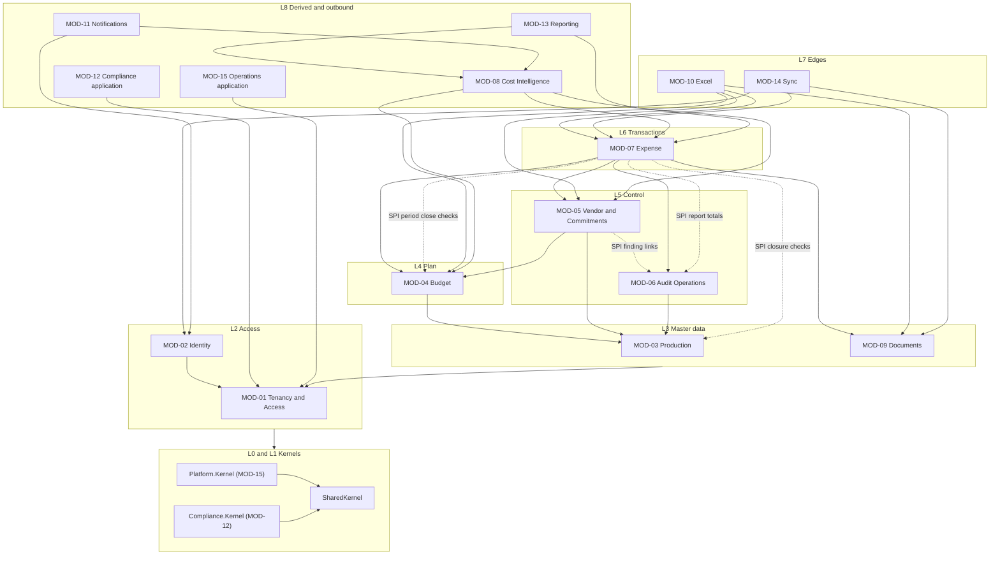

# Document 7: Module & Dependency Architecture

**Product:** SlateIQ — Production Cost Intelligence & Audit Monitoring Platform
**Document ID:** SLQ-ARCH-007
**Version:** 1.0.0
**Classification:** Internal — Architecture Foundation
**Status:** Draft — For Review
**Date:** 2026-11-06
**Authors:** Principal Software Architect, Backend Lead Architect, Frontend Lead Architect
**Reviewers:** Principal Architect (TBD), Security Architect (TBD), Engineering Manager (TBD), Mobile Lead (TBD)

---

## Document Control

### Revision History

| Version | Date | Author | Change |
|---------|------|--------|--------|
| 1.0.0 | 2026-11-06 | Architecture Team | First issue. Evaluates the governing brief's twenty candidate modules against the fifteen modules of Document 6, specifies every module, fixes the dependency graph and its enforcement, defines the in-process contracts and cross-module transaction patterns, catalogues all asynchronous processing, and sets the backend, web and mobile code structure |

### Related Documents

| Document | Relationship |
|----------|--------------|
| Document 1 — Product Vision & Business Requirements | FR, NFR, BR identifiers cited here |
| Document 2 — Domain Model & Capability Map | Entity names, bounded contexts (one context per module), CAP-001 to CAP-026 |
| Document 3 — Actor, Permission, Tenancy & Identity | Permission keys (Appendix A), table inventory (Appendix D), policy decision point (§5.12), identity API (§11), identity and grant events (§12) |
| Document 4 — Core Business Workflows & State Machines | SM-01 to SM-19 and the workflows each module executes |
| Document 5 — Business Rules & Invariants Catalogue | Invariants enforced by the modules specified here |
| Document 6 — High-Level Solution Architecture | Module catalogue (§5), dependency rules R1–R7 (§4.3), transaction model (§4.4), asynchronous processing (§6.7, §7.5), sync (§9), integration (§10), API surface (Appendix A), events (Appendix B) |
| Document 8 — Database Conceptual Model & ERD | Physical tables named here |
| Document 9 — API Architecture & Endpoint Catalogue | Endpoint detail for every module API summarised here |
| Document 11 — Mobile & Offline Architecture | Mobile module detail summarised in section 11 |
| Document 14 — Audit & Observability Architecture | Audit event model and telemetry for every async flow |
| Document 16 — Testing Strategy | Test levels referenced in each module's testing requirements |
| Document 17 — Risk Register & ADRs | Consolidates ADR-032 to ADR-034 and R7-nn |

### Conventions

| Convention | Meaning |
|------------|---------|
| `MOD-nn` | Module from Document 6 §5.1 |
| `AP-nn` | Asynchronous processing flow (section 8) |
| `RP-x` | Retry profile (section 8.2) |
| `T1`–`T6` | Cross-module transaction pattern (section 7) |
| `L0`–`L8` | Dependency layer (section 5.1) |
| Contract | A public interface in a module's `Contracts` assembly: query, command, service-provider interface (SPI) or event |
| Upstream / downstream | Upstream modules are depended upon; downstream modules depend on them |

---

## 1. Purpose, Scope and Inputs

### 1.1 Purpose

Document 6 decided that SlateIQ is a modular monolith with fifteen modules, one PostgreSQL schema per module, in-process contracts and asynchronous side effects through a transactional outbox (ADR-001, ADR-003). This document turns that decision into a buildable structure. It answers five questions for every engineer who adds code:

1. Which module owns this concept, this table and this endpoint?
2. Which other modules may this code call, and through which contract?
3. How does a business operation that touches several modules stay correct?
4. What happens asynchronously, how is it retried, and how does an operator recover it?
5. Where does the file go in the backend, web and mobile repositories?

### 1.2 Scope

| In scope | Out of scope (owner) |
|----------|----------------------|
| Evaluation of the governing brief's candidate modules (brief §11) | Business rules in full (Document 5) |
| Specification of MOD-01 to MOD-15 | States and transitions in full (Document 4) |
| Dependency graph, layers and enforcement | Column definitions (Document 8) |
| In-process contracts and transaction patterns | Endpoint contracts (Document 9) |
| Asynchronous processing catalogue (brief §19) | Telemetry schema (Document 14) |
| .NET solution, web and mobile structure | Mobile offline internals (Document 11), CI/CD (Document 15) |

### 1.3 Binding Inputs

The decisions in `_build/AUTHORING-BRIEF.md` §2 are not reopened: .NET 10 LTS, Minimal APIs, EF Core for writes and Dapper for reads, PostgreSQL 17 with RLS forced on every tenant table, Redis 7.4 for rate limits, reference cache and the revocation denylist, the transactional outbox with `FOR UPDATE SKIP LOCKED` and Quartz.NET, three hosts (API, Sync, Worker) plus the Renderer from one image, and the monorepo layout of Document 6 §6.11. Reconciliations RC-01 to RC-05 are applied throughout, in particular RC-02 (no cross-schema foreign keys; the owning module validates references in the same transaction), RC-03 (`budget.forecast` owns forecast entries) and RC-04 (`tenancy.delegation`).

---

## 2. Module Evaluation

### 2.1 Evaluation Criteria

The governing brief (§11) asks for at least twenty candidate modules to be evaluated and warns against both giant modules and duplication. A candidate becomes a module of its own only if it passes all four tests below; otherwise it is merged into the module whose data it changes.

| Test | Question | Failure means |
|------|----------|---------------|
| Ownership | Does it own aggregates that no other module writes? | It is a feature of the module that owns its data |
| Invariant | Does it enforce invariants that need its own transaction boundary? | Splitting would create a distributed transaction |
| Change cadence | Does it change for different reasons, at a different rate, or by a different team? | Separate deployment adds cost with no benefit |
| Runtime profile | Does it need different scaling, isolation or failure handling? | It can share a host and a worker lane |

### 2.2 Mapping of the Twenty Candidates

| # | Brief candidate | Realised by | Decision | Reason |
|---|-----------------|-------------|----------|--------|
| 1 | Tenant and organization | MOD-01 Tenancy & Access (tenant data), MOD-15 Platform Operations (provisioning, region) | Merged | Tenant lifecycle and access control share the organization aggregate and the `scope_version` invariant; provisioning mechanics are platform work that must not run with tenant credentials (Document 3 §9.8) |
| 2 | User, role and permission | MOD-01 (membership, role, assignment, grant, delegation), MOD-02 Identity (person, credential, session, device) | Split along identity versus authority | Document 3 §3.2 separates identity from membership and authority; credentials need a privileged service role, authority does not |
| 3 | Show and production | MOD-03 Production | Kept | Owns the production hierarchy every financial record references |
| 4 | Budget and revision | MOD-04 Budget | Kept | Owns the one-active-version invariant (BR-BUD-001), periods and approval workflows |
| 5 | Department and category | MOD-03 Production | Merged | Reference taxonomy with the same owner (Organization Administrator), the same cadence and the same cache; a separate module would own two tables |
| 6 | Vendor | MOD-05 Vendor & Commitments | Kept, with commitments | Commitments reference the vendor and share its status rules; splitting would put BR-VND-003 and BR-VND-001 in different transactions |
| 7 | Audit assignment | MOD-06 Audit Operations | Kept | Owns time-bound assignment authority (BR-AUD-001) and audit work products |
| 8 | Auditor mobile backend | MOD-14 Sync (protocol), MOD-07 Expense (capture semantics), MOD-02 Identity (device) | Distributed; no module | A "mobile backend" module would duplicate expense validation and break ADR-011. The mobile app is a client; Sync is its anti-corruption edge |
| 9 | Expense and daily cost capture | MOD-07 Expense | Kept | Owns the financial transaction, its revisions and cost postings |
| 10 | Document and evidence | MOD-09 Documents (files), MOD-07 Expense (evidence links and verification) | Split along file versus business meaning | The file pipeline (upload, scan, version, retention) is generic; whether evidence is verified is a fact about an expense (Document 2 §6.7) |
| 11 | Audit review and approval | MOD-07 Expense (expense approval), MOD-04 Budget (approval-chain resolution), MOD-06 (audit reports and findings) | Merged | Approval is a step in the subject's lifecycle and must commit with it; a separate approval module would need a distributed transaction for every decision |
| 12 | Cost variance intelligence | MOD-08 Cost Intelligence | Kept | Rebuildable projections with their own freshness SLOs (NFR-PERF-004, NFR-PERF-005) |
| 13 | Exception and alert | MOD-07 Expense (exceptions), MOD-08 Cost Intelligence (alert rules and instances) | Split | Exceptions are raised on a record in its transaction (FR-EXP-023); alerts are raised on measures computed by projections (FR-CIN-007) |
| 14 | Management BI dashboard | MOD-08 (dashboard read models), MOD-13 Reporting (catalogue, runs) | Merged | Dashboards read the projections MOD-08 owns; a BI module with no data would be a pass-through |
| 15 | Excel import and export | MOD-10 Excel | Kept | Owns batch state (SM-17) and the anti-corruption mapping; uses owning modules' commands (BR-XLS-002) |
| 16 | Reports and analytics | MOD-13 Reporting | Kept | Reproducible runs with parameters and watermarks; separate renderer profile |
| 17 | Notifications | MOD-11 Notifications | Kept | Own delivery state (SM-18), preferences and provider adapters |
| 18 | Audit trail and activity history | MOD-12 Compliance | Kept, with legal hold, DSR and breach | Single append-only writer (ADR-012); retention and hold are the same control family |
| 19 | System administration | MOD-01 (tenant administration), MOD-15 (platform administration) | Merged | Administration is a set of screens over data other modules own; Document 3 §11.12 forbids mixing tenant and platform administration |
| 20 | Integration management | MOD-15 (delivery store, router, credentials resolver), MOD-11 (webhook endpoints, Phase 1) | Merged | Integrations are adapters on the outbox (Document 6 §10.2); a module would own only configuration |

**Result.** Twenty candidates map to fifteen modules: twelve domain modules and three platform modules, exactly the catalogue of Document 6 §5.1. No new module is created. Candidates 8, 11, 14, 19 and 20 are deliberately not modules, and candidate 13 is deliberately split, because each would otherwise own no data or would cut an invariant in half.

### 2.3 Splits Considered and Rejected

| Proposal | Rejected because |
|----------|------------------|
| Separate Approval module serving all subjects | Every decision would cross a module boundary while the subject's state must change in the same transaction; resolution is shared (MOD-04 contract, ADR-033), persistence stays with the subject |
| Separate FX module | One table (`budget.fx_rate`), one daily job and one read contract; MOD-04 already owns base-currency rules (BR-BUD-008) |
| Separate Period module | Period lock (BR-BUD-009) and budget revision effective dates (BR-BUD-005) are one invariant family |
| Separate Commitment module | Commitments and vendors share status checks and the one-owner rule; the split would add a contract call to every commitment write |
| Separate Search module | PostgreSQL full-text search inside each module until the Document 6 §7.8 trigger is met |
| Merge Reporting into Cost Intelligence | Reporting renders documents with a different memory profile and its own failure domain (Renderer host) |
| Merge Sync into Expense | Sync carries device protocol, cursors and conflicts for several entity types and runs on its own host (ADR-001) |

### 2.4 Granularity Check

| Module | Aggregates | Public contracts | Assessment |
|--------|-----------:|-----------------:|------------|
| MOD-07 Expense | 6 (Expense, ApprovalInstance, Exception, CostPosting, ExpenseAmendment, Comment) | 6 | Largest module. Acceptable because every aggregate shares the expense revision invariant; watch item R7-01 |
| MOD-01 Tenancy & Access | 9 | 7 | Large by count, small by volume; split trigger is an independent identity-governance team |
| MOD-13 Reporting | 3 | 1 | Small; kept separate for runtime isolation, not for size |
| All others | 3–7 | 2–5 | Within range |

---

## 3. Module Structure Conventions

### 3.1 Internal Layers

Each module is delivered as two assemblies (ADR-032):

| Assembly | Visibility | Contents |
|----------|------------|----------|
| `SlateIQ.<Module>.Contracts` | `public` | Query and command interfaces, SPI interfaces the module declares, DTOs, event payload records, error codes. No EF Core, no Dapper, no ASP.NET Core references |
| `SlateIQ.<Module>` | `internal` except the composition entry point | Folders `Api` (Minimal API endpoint groups and request validators), `Application` (command and query handlers), `Domain` (aggregates, value objects, domain services), `Infrastructure` (EF Core `DbContext` for the module schema, Dapper queries, outbox mapping, job definitions, adapters) |

Inside `SlateIQ.<Module>`, namespace rules apply: `Domain` references only the shared kernel; `Application` references `Domain` and contracts; `Infrastructure` references `Application` and `Domain`; `Api` references `Application` only. Each module registers itself through one public `AddModule(IServiceCollection, IConfiguration)` and one `MapModuleEndpoints(IEndpointRouteBuilder)` call made by the host.

### 3.2 Contract Kinds

| Kind | Direction | Transaction | Example |
|------|-----------|-------------|---------|
| Query | Downstream calls upstream | Joins the caller's read snapshot | `IVendorStatusQuery.GetStatus(vendorRef)` |
| Command | Edge module calls owning module | Co-transactional: executes in the caller's unit of work, writes only the callee's schema (pattern T3) | `IExpenseCommands.CreateDraft(...)` from Sync |
| SPI | Upstream declares, downstream implements | Joins the caller's transaction, read-only | `IShowClosureCheck` declared by Production, implemented by Expense |
| Event | Publisher writes outbox; any module consumes | Separate transaction per consumer | `ExpenseApproved` |

A query or SPI never writes. A command is permitted only on the allow-list in section 7.1 (T3). Events carry identifiers and codes, never authority (Document 3 §12.1).

### 3.3 Specification Template

Section 4 specifies each module with the same fourteen attributes the brief requires. "APIs" lists resource families only; Document 9 §4 holds the routes. "Tables" uses Document 3 Appendix D names. Events use the names of Document 6 Appendix B and Document 3 §12; events this document adds are marked **(new)** and listed again in section 4.16.

---

## 4. Module Specifications

### 4.1 MOD-01 Tenancy & Access

| Aspect | Specification |
|--------|---------------|
| Purpose | Define who may act in which organization, over which scope, under which authority, and decide every authorization request (Document 3 §5.12) |
| Entities | Organization, OrganizationSetting, Entitlement, Membership, Invitation, Role, RoleVersion, Assignment, CrossOrganizationAccessGrant, Delegation, ApprovalLimit, SodException, AccessReviewCampaign, AuditorProfile |
| Responsibilities | Tenant state (SM-01) and settings; membership and invitation; roles and assignments; grants (Document 3 §8); delegation (RC-04) and approval limits; SoD vetoes; access reviews; the policy decision point and scope resolution used by every module |
| Dependencies | Platform.Kernel, Compliance.Kernel. Declares SPI `IUserDisplayProvider` (implemented by MOD-02) so that it never depends on Identity |
| Business rules | FR-TNT-018 (server-side tenant context), BR-ACC-002, BR-ACC-003, BR-ACC-004, BR-ACC-005, BR-ACC-006, BR-ACC-007, BR-AUD-002, BR-AUD-003, BR-AUD-004; SoD rules of Document 3 §5.8 |
| Permissions | `tenancy.*`; `audit.access_grant.*` (Document 3 Appendix A) |
| APIs | Members, invitations, roles, assignments, grants, auditor workspace, access reviews, delegations, approval limits, SoD (Document 3 §11.7–§11.11; Document 9 §4.1) |
| Tables | `tenancy.organization`, `organization_setting`, `organization_entitlement`, `membership`, `invitation`, `role`, `role_permission`, `role_version`, `assignment`, `assignment_scope`, `delegation`, `approval_limit`, `sod_exception`, `access_review_campaign`, `access_review_item`, `auditor_profile`, `access_grant`, `access_grant_version`, `grant_acknowledgment`, `coi_declaration`, `grant_expiry_notice`; global `sod_rule`, `permission`, `grant_profile` |
| Transactions | T1 for every grant, role, assignment and delegation change: row, `scope_version` bump, audit event and outbox event commit together. T3 for invitation acceptance (MOD-02 calls `IMembershipCommands.AcceptInvitation` in its unit of work) |
| Events published | Document 3 §12.4 (tenancy), §12.7 (role, assignment, delegation, approval limit), §12.8 (grant lifecycle, RC-05), §12.9 (access review); `UserInvited`, `UserDeactivated` |
| Events consumed | `AuditorAssigned`, `AssignmentRevoked` (MOD-06: extend or revoke the linked grant); `TenantProvisioned` (MOD-15: activate); `UserErased` (MOD-02: drop cached display data) |
| Jobs | Grant expiry (every 5 min), grant expiry notice (daily 06:00 tenant local), invitation expiry (hourly), access review reminder (daily), scope validity check (daily), role and catalogue drift checks (daily), orphan access scan (weekly) — Document 3 §10.11 |
| Failure handling | The PDP fails closed: an exception is a denial and a P1 alert. Redis unavailable: scope resolution falls back to the database and the denylist check falls back to the session row. A revocation cascade that returns `PARTIAL` opens an incident automatically (Document 3 §12.8) |
| Audit | Every state change of every entity above; every denial; permits for sensitive actions (approve, export, administer) through `AuthorizeAndRecordAsync` |
| Testing | Authorization matrix generated from Appendix A (every route: one allowed, one denied test); isolation suite (Document 3 §16.5); grant lifecycle tests (§16.7); PDP p99 under 5 ms with a warm cache |

### 4.2 MOD-02 Identity

| Aspect | Specification |
|--------|---------------|
| Purpose | Prove who the caller is and mint revocable authority |
| Entities | User, UserPii, Credential, MfaFactor, RecoveryCode, RefreshSession, DeviceRegistration, PasswordReset, EmailChange, ServiceAccount (P1), FederatedIdentity (P1), IdentityTransfer |
| Responsibilities | Login, MFA, refresh rotation with reuse detection, step-up, logout, password lifecycle, device registration and wipe commands, personal-data encryption and erasure |
| Dependencies | Platform.Kernel, Compliance.Kernel, MOD-01 contracts (`IMembershipDirectory` for the token `org`, tenant state, `IMembershipCommands` for invitation acceptance). Implements MOD-01 SPI `IUserDisplayProvider` |
| Business rules | BR-ACC-001, BR-ACC-007, FR-TNT-007, FR-TNT-008, FR-TNT-022, FR-EXP-030, NFR-SEC-003, NFR-MOB-004 |
| Permissions | `identity.*` |
| APIs | Authentication, `/me`, users, sessions, devices (Document 3 §11.5–§11.6) |
| Tables | `identity.user`, `user_pii`, `user_email_alias`, `credential`, `mfa_factor`, `recovery_code`, `refresh_session`, `device_registration`, `password_reset`, `email_change`, `service_account`, `federated_identity`, `identity_transfer` |
| Transactions | T1. Refresh rotation updates the session family row under `SELECT … FOR UPDATE`; reuse detection revokes the family in the same transaction |
| Events published | Document 3 §12.5 and §12.6 (`UserAuthenticated`, `LoginFailed`, `SessionRevoked`, `DeviceRevoked`, `DeviceWipeRequested`, `MfaEnrolled`, `UserErased`, others) |
| Events consumed | `UserDeactivated`, `GrantSuspended`, `GrantRevoked`, `GrantExpired` (revoke grant-bound sessions); `OrganizationSuspended`; `DeviceWiped` (MOD-14: close wipe record) |
| Jobs | Session purge (daily), device purge (daily), lockout release (hourly sweep) |
| Failure handling | KMS unavailable: login refused with `503 DEPENDENCY_UNAVAILABLE`; existing access tokens remain valid until `exp`. Denylist write failure aborts logout so the client retries |
| Audit | Security events for every authentication outcome (Compliance.Kernel `ISecurityEventWriter`); business audit for administrative actions |
| Testing | Session and credential tests (Document 3 §16.8); timing-equivalence test for unknown accounts; device-binding tests |

### 4.3 MOD-03 Production

| Aspect | Specification |
|--------|---------------|
| Purpose | Own the production hierarchy and taxonomy every financial record references |
| Entities | Show, Season, Episode, Department, Category, CategoryDepartment, Party, ShowParty, PartyOrganizationLink, ShowClosure |
| Responsibilities | Show lifecycle (SM-02), seasons and episodes, department hierarchy, category taxonomy and mapping, parties and party links, show closure checklist and sign-off (SM-14) |
| Dependencies | Kernels, MOD-01 contracts. Declares SPIs `IShowClosureCheck` (implemented by MOD-04, MOD-05, MOD-06, MOD-07, MOD-10) and `IShowClosureApprovalRouting` (implemented by MOD-04) |
| Business rules | BR-PRD-001 (closure blockers), BR-PRD-002 (closure blocks new expenses, keeps read access), BR-PRD-003 (no hard delete of categories and departments), BR-PRD-004 (parties are vendor-type records), BR-PRD-005, BR-PRD-006 (depth ≤3, acyclic), FR-PRD-010 (deactivation never alters history), FR-PRD-015 |
| Permissions | `production.*` |
| APIs | Shows, seasons, episodes, departments, categories, parties, party links, closure, comments (Document 9 §4.2) |
| Tables | `prod.show`, `season`, `episode`, `department`, `category`, `category_department`, `party`, `show_party`, `party_organization_link`, `show_closure` |
| Transactions | T1 for all writes. Closure request runs every `IShowClosureCheck` inside the request transaction (T2, read-only) and stores the checklist result; `BLOCKED` or `READY` is decided from the stored result |
| Events published | `ShowCreated`, `ShowStatusChanged`, `PartyLinked`, `CategoryChanged`, `DepartmentChanged` **(new)**, `ShowClosureStatusChanged` **(new)** |
| Events consumed | `OrganizationSuspended`, `OrganizationActivated` (mandatory for every module, Document 3 §12.11); `BudgetApproved` (enables the `PLANNING` to `ACTIVE` prompt) |
| Jobs | None scheduled; reference cache version bump on every taxonomy change |
| Failure handling | A closure check provider that throws or times out yields checklist item `CHECK_UNAVAILABLE` and the closure stays `BLOCKED` (fail closed) |
| Audit | Every create, update and transition, including show change history (FR-PRD-002) |
| Testing | Hierarchy property tests (acyclic, depth ≤3); closure checklist with each blocker; category deactivation does not alter historic lines |

### 4.4 MOD-04 Budget

| Aspect | Specification |
|--------|---------------|
| Purpose | Own the approved plan, its revisions, financial periods, FX rates and the configuration of approval chains |
| Entities | Budget, BudgetVersion, BudgetLine, Variation, EpisodeAllocation, ApprovalWorkflow (with steps), FinancialPeriod, PeriodCloseRun, Forecast (P1, RC-03), FxRate |
| Responsibilities | Budget and version lifecycle (SM-03, SM-04), contingency and variations, episode allocation, period close and reopen (SM-05), FX rate table and overrides, approval-chain resolution for every subject type (ADR-033) |
| Dependencies | Kernels, MOD-01, MOD-03 contracts. Provides `IApprovalChainResolver`, `IFxRateService`, `IPeriodStatusQuery`, `IBudgetBaselineFeed`. Declares SPI `IPeriodCloseCheck` (implemented by MOD-05, MOD-07, MOD-10). Implements MOD-03 SPIs |
| Business rules | BR-BUD-001 to BR-BUD-012, BR-FIN-003, BR-FIN-010, BR-EXP-007, BR-EXP-008 |
| Permissions | `budget.*` |
| APIs | Budgets, versions, lines, variations, episode allocations, periods, approval workflows, FX rates, forecasts (P1) (Document 9 §4.3) |
| Tables | `budget.budget`, `budget_version`, `budget_line`, `episode_allocation`, `variation`, `approval_workflow`, `approval_workflow_step`, `financial_period`, `period_close_run`, `forecast`; requested additions `budget.fx_rate`, `budget.approval_instance`, `budget.approval_decision` (RC-7-03, RC-7-04) |
| Transactions | T1. Version approval activates the new version and supersedes the previous one in one transaction (BR-BUD-001). Period lock runs `IPeriodCloseCheck` providers (T2) and transitions `CLOSING` to `LOCKED` under an optimistic lock on the period row (UC-11) |
| Events published | `BudgetSubmitted`, `BudgetApproved`, `BudgetRevised`, `PeriodLocked`, `PeriodReopened`, `BudgetVersionReturned` **(new**: changes requested, rejected or withdrawn**)**, `VariationApplied` **(new)**, `EpisodeAllocationChanged` **(new)**, `ApprovalTaskAssigned` **(new**, for budget subjects**)** |
| Events consumed | `ShowCreated` (create budget containers), `ShowStatusChanged` (freeze on `CLOSED`), organization events |
| Jobs | FX fetch (daily 16:30 CET, hourly retry until success, Document 6 §10.3.5); period close reminder (daily) |
| Failure handling | FX source down: latest rate marked `FALLBACK` and an `FX_FALLBACK` exception raised by the consumer (QA-10). Resolver failure fails the caller's submission; no partial chain is ever stored |
| Audit | Every version, line, variation, period and FX override change; approval decisions with limit applied and delegation |
| Testing | Invariant tests for BR-BUD-001, BR-BUD-003, BR-BUD-007; resolver table tests per subject type and threshold; concurrent close test |

### 4.5 MOD-05 Vendor & Commitments

| Aspect | Specification |
|--------|---------------|
| Purpose | Own the vendor master and obligations not yet spent |
| Entities | Vendor, VendorTaxRegistration, VendorContact, VendorBankReference, ManualCommitment, CommitmentAmendment, PurchaseOrder, PurchaseOrderLine, PoReceipt (P1), PaymentReference |
| Responsibilities | Vendor lifecycle (SM-06), duplicate detection, risk rating, masked bank references, commitment lifecycle (SM-07) and amendments, payment references for reconciliation only |
| Dependencies | Kernels, MOD-01, MOD-03, MOD-04 (`IFxRateService`, `IApprovalChainResolver`, `IPeriodStatusQuery`). Provides `IVendorStatusQuery`, `ICommitmentQuery`, `ICommitmentFeed`. Implements `IShowClosureCheck`, `IPeriodCloseCheck`, and MOD-06 SPI `IAuditableRecordResolver` |
| Business rules | BR-VND-001 to BR-VND-007, BR-FIN-006, FR-VND-017 |
| Permissions | `vendor.*` |
| APIs | Vendors, tax registrations, contacts, bank references, risk ratings, commitments, purchase orders (P1), payment references (Document 9 §4.4) |
| Tables | `vendor.vendor`, `vendor_tax_registration`, `vendor_contact`, `vendor_bank_reference`, `manual_commitment`, `commitment_amendment`, `purchase_order`, `purchase_order_line`, `po_receipt`, `payment_reference`; commitment approvals are stored in `budget.approval_instance`, `budget.approval_step`, `budget.approval_decision` through the Budget approval contract (RC-7-04 resolved by Document 8 RC-08-01) |
| Transactions | T1. Commitment submission locks its FX snapshot and stores the resolved chain in one transaction |
| Events published | `VendorBlocked`, `VendorStatusChanged` **(new)**, `CommitmentCreated`, `CommitmentApproved` **(new**: becomes `OPEN`**)**, `CommitmentAmended`, `CommitmentClosed` (payload `final_status` = `CLOSED`, `CANCELLED` or `EXPIRED`), `PurchaseOrderChanged` (P1), `ApprovalTaskAssigned` **(new)** |
| Events consumed | `ShowCreated`, `ShowStatusChanged` (no new commitments on a closed show), organization events |
| Jobs | Commitment expiry (daily), vendor duplicate scan (nightly, FR-VND-006) |
| Failure handling | Duplicate scan failure leaves the previous findings visible and alerts; creation-time uniqueness (BR-VND-001) is a database constraint and never depends on the scan |
| Audit | Every vendor status, bank reference access and change, commitment transition and amendment |
| Testing | Uniqueness by normalised name and tax identifier; masking in every read and export path (BR-VND-007); commitment state tests |

### 4.6 MOD-06 Audit Operations

| Aspect | Specification |
|--------|---------------|
| Purpose | Own time-bound audit mandates and the auditor's work products |
| Entities | AuditTeam, AuditAssignment, AuditScope, AuditorWorkProfile, CoverageRequirement, AuditReport, AuditFinding, FindingResponse, AuditEvidence |
| Responsibilities | Teams; assignment lifecycle (SM-08) and handover; scope; coverage and timeliness; audit reports (SM-10); findings (SM-11) and responses; working papers |
| Dependencies | Kernels, MOD-01 (`IGrantQuery`: an assignment cannot exceed its grant), MOD-03. Provides `IAssignmentScopeQuery`. Declares SPIs `IAuditReportTotalsProvider` (implemented by MOD-07) and `IAuditableRecordResolver` (implemented by MOD-05, MOD-07). Implements `IShowClosureCheck` |
| Business rules | BR-AUD-001, BR-AUD-005, BR-AUD-006, BR-AUD-007, BR-AUD-008, FR-AUD-006, FR-AUD-013 |
| Permissions | `audit.audit_plan.*`, `audit.audit_team.*`, `audit.audit_assignment.*`, `audit.auditor_work_profile.*`, `audit.audit_finding.*`, `audit.finding_response.*`, `audit.audit_evidence.*`, `audit.audit_report.*` |
| APIs | Teams, assignments, auditors, coverage, audit reports, findings, responses, working papers (Document 9 §4.5) |
| Tables | `auditops.audit_team`, `audit_team_member`, `audit_assignment`, `audit_scope`, `auditor_work_profile`, `coverage_requirement`, `audit_report`, `audit_finding`, `finding_response`, `audit_evidence` |
| Transactions | T1. Audit report submission takes the totals snapshot through `IAuditReportTotalsProvider` (T2) in the submitting transaction, so the snapshot and the `SUBMITTED` state cannot diverge |
| Events published | `AuditorAssigned`, `AssignmentRevoked`, `CoverageUpdated`, `AssignmentStatusChanged` **(new)**, `AuditReportSubmitted` **(new)**, `AuditReportDecided` **(new**: accepted or returned**)**, `AuditFindingStatusChanged` **(new)** |
| Events consumed | `GrantSuspended`, `GrantRevoked`, `GrantExpired` (suspend or revoke dependent assignments); `ShowStatusChanged`; `ExpenseSubmitted` (timeliness and coverage counters) |
| Jobs | Assignment end sweep (every 5 min: `ACTIVE` past end to `COMPLETED`); daily report due check (A2-03); coverage computation (hourly) |
| Failure handling | A grant event arriving out of order is resolved by a state check against `IGrantQuery`; the stricter state wins |
| Audit | Every transition; finding visibility changes at high severity (BR-AUD-006) |
| Testing | Appointing-party-only revocation; handover ends predecessor access at the handover time (BR-AUD-007); finding visibility isolation |

### 4.7 MOD-07 Expense

| Aspect | Specification |
|--------|---------------|
| Purpose | Own the captured cost event from draft to approved actual cost |
| Entities | Expense (revision), ExpenseLine, ExpenseSplit, ExpenseTax, FxSnapshot (embedded), EvidenceLink, ApprovalInstance, ApprovalDecision, ExpenseAmendment, Exception, ExceptionActivity, ExpenseComment, CostPosting |
| Responsibilities | Capture, validation and submission (SM-09); duplicate detection (BR-EXP-006); approval execution against the chain resolved at submission (SM-13); amendment and cancellation; evidence verification; exceptions (SM-15); cost postings (BR-EXP-010) |
| Dependencies | Kernels, MOD-01, MOD-03, MOD-04 (`IApprovalChainResolver`, `IFxRateService`, `IPeriodStatusQuery`), MOD-05 (`IVendorStatusQuery`, `ICommitmentQuery`), MOD-06 (`IAssignmentScopeQuery`), MOD-09 (`IDocumentService`). Provides `IExpenseCommands`, `IExpenseQuery`, `ICostPostingFeed`. Implements `IShowClosureCheck`, `IPeriodCloseCheck`, `IAuditReportTotalsProvider`, `IAuditableRecordResolver` |
| Business rules | BR-EXP-001 to BR-EXP-017, BR-FIN-002 (half-up, RC-01), BR-FIN-003, BR-FIN-005, BR-FIN-007, BR-FIN-008, BR-FIN-009, BR-FIN-011, BR-BUD-009, FR-EXP-013, FR-EXP-029 |
| Permissions | `expense.expense.*`, `expense.exception.*`, `expense.comment.*`, `document.evidence.approve`, `document.evidence.reject` |
| APIs | Expenses, lines, submission, decisions, amendment, cancellation, evidence links, exceptions, comments, approval tasks (Document 9 §4.6) |
| Tables | `expense.expense`, `expense_line`, `expense_split`, `expense_tax`, `evidence_link`, `approval_instance`, `approval_decision`, `expense_amendment`, `exception`, `exception_activity`, `expense_comment`, `cost_posting` |
| Transactions | T1 for submit (expense, lines, splits, FX snapshot, approval instance, exceptions, audit, outbox) and for the final approval (decision, status, cost postings per line split, supersession of the prior revision with reversal postings, audit, outbox). T3 as callee of Excel and Sync |
| Events published | `ExpenseSubmitted`, `ExpenseApproved`, `ExpenseRejected`, `ExpenseAmended`, `ExpenseCancelled`, `ExceptionRaised`, `ExpenseInfoRequested` **(new)**, `CostPostingsRecorded` **(new)**, `ExceptionStatusChanged` **(new)**, `EvidenceVerificationChanged` **(new)**, `ApprovalTaskAssigned` **(new)** |
| Events consumed | `PeriodLocked`, `PeriodReopened`, `CategoryChanged`, `VendorBlocked`, `ShowStatusChanged`, `DocumentScanned`, `DocumentQuarantined`, `UserDeactivated` (reassign or flag pending approvals, BR-ACC-004), `DelegationRevoked`, `GrantRevoked` |
| Jobs | Approval reassignment sweep (hourly, for deactivated or revoked approvers); evidence completeness recalculation (event-driven, AP-03) |
| Failure handling | A dependency query failure (vendor, FX, assignment) fails the submission with `503 DEPENDENCY_UNAVAILABLE`; the draft is untouched. Duplicate-detection timeout raises a `DUPLICATE_SUSPECTED` exception with reason `CHECK_INCOMPLETE` instead of passing silently |
| Audit | Every transition and decision with `on_behalf_of`, limit applied and authority source; every evidence verification |
| Testing | Money property tests (split rounding BR-EXP-012, header equals lines BR-FIN-011); approval SoD (BR-EXP-005); cost-posting ledger tests for approve, cancel, supersede across periods; Excel and Sync parity tests (ADR-011) |

### 4.8 MOD-08 Cost Intelligence

| Aspect | Specification |
|--------|---------------|
| Purpose | Turn source postings, commitments and budgets into variance, alerts and dashboard read models |
| Entities | CostFact, CommitmentFact, VarianceSnapshot, AlertRule, AlertInstance, DashboardDefinition, SavedView, BenchmarkAggregate (P1), ProjectorCheckpoint |
| Responsibilities | Projections with freshness tiers (show ≤60 s, portfolio ≤5 min, ADR-010); variance (Document 6 §8.10); alert rule evaluation on events and on a sweep (FR-CIN-008); alert lifecycle (SM-16); dashboard queries with `as_of` (FR-CIN-020); drill-down (FR-CIN-015); EFC from `budget.forecast` (P1, RC-03) |
| Dependencies | Kernels, MOD-01, MOD-03, MOD-04 (`IBudgetBaselineFeed`), MOD-05 (`ICommitmentFeed`), MOD-07 (`ICostPostingFeed`) for rebuilds only. Provides `IDashboardQuery`, `IVarianceQuery`, `IDigestSource` |
| Business rules | BR-FIN-005, BR-FIN-006, BR-FIN-011, BR-FIN-012, FR-CIN-001, FR-CIN-002, FR-CIN-004 to FR-CIN-009, NFR-PERF-004, NFR-PERF-005 |
| Permissions | `intel.*`, `report.dashboard.read`, `report.saved_view.*` |
| APIs | Dashboards, variance, drill-down, alerts, alert rules, saved views, forecast and benchmarks (P1) (Document 9 §4.7) |
| Tables | `intel.cost_fact`, `commitment_fact`, `variance_snapshot`, `alert_rule`, `alert_instance`, `saved_view`, `dashboard_definition`, `benchmark_aggregate`, `projector_checkpoint` |
| Transactions | T6: each projector applies one event and advances its checkpoint in one transaction; upserts are idempotent by `(source_event_id)` |
| Events published | `AlertTriggered`, `VarianceBreached`, `ProjectionCheckpoint`, `AlertStatusChanged` **(new)** |
| Events consumed | `CostPostingsRecorded`, `ExpenseSubmitted`, `ExpenseRejected`, `ExpenseCancelled`, `CommitmentCreated`, `CommitmentApproved`, `CommitmentAmended`, `CommitmentClosed`, `BudgetApproved`, `BudgetRevised`, `VariationApplied`, `EpisodeAllocationChanged`, `CategoryChanged`, `DepartmentChanged`, `ShowCreated`, `ShowStatusChanged`, `CoverageUpdated`, `PeriodLocked` |
| Jobs | Alert sweep (every 15 min); portfolio aggregate refresh (every 2 min, ≤5 min target); period snapshot freeze (on `PeriodLocked`); nightly reconciliation of facts against postings; projection rebuild (on demand, shadow schema per Document 6 §8.6); benchmark build (nightly, P1) |
| Failure handling | A projector that falls behind marks dashboards `stale` through `as_of`; it never serves an unlabelled stale figure. Reconciliation mismatch raises an operations alert and blocks period snapshot freeze for that show |
| Audit | Alert rule changes and alert transitions; projection rebuilds as platform audit events |
| Testing | Golden-dataset tests for every measure (Document 13); replay test (process every event twice, identical result); freshness SLO test under load |

### 4.9 MOD-09 Documents

| Aspect | Specification |
|--------|---------------|
| Purpose | Store, scan, version and serve files under retention and legal hold |
| Entities | Document, DocumentVersion, DocumentLink, DocumentAccessLog, ScanResult, UploadTicket, RetentionPolicy |
| Responsibilities | Upload tickets and presigned PUT; hash verification; scan-before-serve (ADR-006, SM-12 document part); thumbnails after a clean scan; signed GET ≤15 minutes; access logging; soft delete and retention-driven purge |
| Dependencies | Kernels (including Compliance.Kernel `ILegalHoldQuery`), MOD-01. Provides `IDocumentService` (section 6.7) |
| Business rules | BR-DOC-001 to BR-DOC-007, FR-DOC-017, NFR-SEC-007, NFR-SEC-008 |
| Permissions | `document.document.*`, `document.version.*`; `compliance.retention_policy.*` for policies |
| APIs | Upload tickets, completion, metadata, versions, download, access log, retention policies (Document 9 §4.8) |
| Tables | `docs.document`, `document_version`, `document_link`, `document_access_log`, `scan_result`, `upload_ticket`, `retention_policy` |
| Transactions | T1. The document row carries denormalised scope keys (`show_id`, `department_id`, `assignment_id`) supplied by the linking module, so access checks never query an upstream module |
| Events published | `DocumentUploaded`, `DocumentScanned`, `DocumentQuarantined`, `DocumentDeleted` **(new**: soft delete or purge**)** |
| Events consumed | `LegalHoldApplied`, `LegalHoldReleased` |
| Jobs | Scan dispatch (AP-03); scan timeout sweep (every 5 min); upload ticket expiry (hourly); thumbnail generation; retention sweep (daily, approval-gated for destructive steps in the first 12 months, Document 6 §8.7); orphan object reconciliation (nightly) |
| Failure handling | Scanner unavailable: file stays `PENDING_SCAN` and is never served (Document 6 §10.3.4). Storage unavailable: ticket issuance returns `503` with retry guidance; mobile keeps the local file |
| Audit | Every view, download, upload and delete in `docs.document_access_log` with actor, IP class and grant ID |
| Testing | Never-serve-before-clean test; hash mismatch rejection; signed URL expiry; legal hold blocks purge |

### 4.10 MOD-10 Excel

| Aspect | Specification |
|--------|---------------|
| Purpose | Make Excel a first-class import and export path without a second validation path |
| Entities | ExcelTemplate, TemplateVersion, ValueMapping, ImportBatch, ImportRow, ExportJob |
| Responsibilities | Template versions and mappings; workbook intake through Documents; streaming parse; validation through the owning modules' commands in dry-run mode; preview; commit approval; chunked commit; reversal; exports |
| Dependencies | Kernels, MOD-01, MOD-03, MOD-04, MOD-05, MOD-07 command contracts (`IExpenseCommands`, `IBudgetLineImportCommands`, `IVendorImportCommands`, `ICommitmentImportCommands`, `IReferenceDataImportCommands`), MOD-09 `IDocumentService`, MOD-04 `IApprovalChainResolver` (subject `IMPORT_COMMIT`). Implements `IShowClosureCheck`, `IPeriodCloseCheck` (open batches) |
| Business rules | BR-XLS-001 to BR-XLS-006, BR-EXP-016, FR-XLS-016, NFR-PERF-006 |
| Permissions | `excel.*` plus the target domain's `create` key at commit (Document 3 Appendix A) |
| APIs | Templates, imports and their lifecycle, preview, errors, commit, reversal, exports (Document 9 §4.9) |
| Tables | `xls.excel_template`, `template_version`, `value_mapping`, `import_batch`, `import_row`, `export_job`; commit approvals are stored in `budget.approval_instance`, `budget.approval_step`, `budget.approval_decision` through the Budget approval contract (RC-7-04 resolved by Document 8 RC-08-01) |
| Transactions | T5: each 1,000-row chunk commits target records (T3 into the owning module), row outcomes and a batch checkpoint in one transaction; the batch resumes from the checkpoint |
| Events published | `ImportCommitted`, `ImportRejected`, `ExportCompleted`, `ImportValidated` **(new)**, `ImportReversed` **(new)**, `ExportFailed` **(new)**, `ApprovalTaskAssigned` **(new)** |
| Events consumed | `DocumentScanned`, `DocumentQuarantined` (workbook intake) |
| Jobs | Parse and validate, commit, reversal, export (AP-02); batch expiry (daily: `VALIDATED` or `AWAITING_COMMIT_APPROVAL` older than 7 days to `EXPIRED`); export file expiry (daily, 7 days) |
| Failure handling | Parse or validation failure: batch `FAILED` with a downloadable error file. Commit failure mid-batch: resume from checkpoint; under `ALL_OR_NOTHING` a permanent row failure compensates the committed chunks through the reversal path before the batch becomes `FAILED` (BR-XLS-006) |
| Audit | Every batch transition with actor, template version, counts and file hash (BR-XLS-005) |
| Testing | Parity suite: every row-level rule produces the same code through UI and import; 50,000-row benchmark (≤10 s per 1,000 rows); macro and ZIP-bomb rejection; resume after kill |

### 4.11 MOD-11 Notifications

| Aspect | Specification |
|--------|---------------|
| Purpose | Deliver the right message to the right person on the right channel, with evidence |
| Entities | NotificationTemplate, Notification, NotificationPreference, DeliveryAttempt, DigestRun, EscalationPolicy, Announcement (P1); WebhookEndpoint (P1, requested) |
| Responsibilities | Event-to-recipient routing, preference and quiet-hours evaluation, rendering, channel adapters (in-app with SSE, email; push P1; signed webhooks P1, FR-NTF-010), digests, reminders and escalation, delivery tracking (SM-18) |
| Dependencies | Kernels, MOD-01 (`IRecipientResolver`: holders of a permission at a scope), MOD-02 (`IContactResolver` under service authority), MOD-08 (`IDigestSource`), pending-approval queries of MOD-04, MOD-05, MOD-07 and MOD-10 |
| Business rules | FR-NTF-001 to FR-NTF-007, FR-NTF-012, FR-NTF-014, FR-NTF-015; no amounts or document content in email and push bodies (Document 2 §6.10) |
| Permissions | `notification.*` |
| APIs | Inbox, stream, preferences, templates, webhook endpoints (P1) (Document 9 §4.10) |
| Tables | `notify.notification_template`, `notification`, `notification_preference`, `delivery_attempt`, `digest_run`, `escalation_policy`, `announcement` |
| Transactions | T6 for routing (one consumer transaction creates notification rows and marks the event delivered); each delivery attempt is its own transaction |
| Events published | `NotificationDelivered`, `NotificationFailed` |
| Events consumed | `ApprovalTaskAssigned`, `ExpenseApproved`, `ExpenseRejected`, `ExpenseInfoRequested`, `ExceptionRaised`, `AlertTriggered`, `VarianceBreached`, `BudgetSubmitted`, `BudgetApproved`, `BudgetVersionReturned`, `VendorBlocked`, `AuditorAssigned`, `AssignmentStatusChanged`, `AuditReportDecided`, `AuditFindingStatusChanged`, `ImportValidated`, `ImportRejected`, `ExportCompleted`, `ExportFailed`, `ReportCompleted`, `ReportFailed`, `DocumentQuarantined`, `UserInvited`, `GrantSubmitted`, `GrantApproved`, `GrantExpiryNoticeSent`, `DsrFulfilled`, `BreachDeclared` |
| Jobs | Dispatcher (continuous); daily digest at 07:00 tenant local (FR-NTF-006); approval SLA reminders (hourly, FR-NTF-004); critical escalation timer (every minute, 15 minutes unacknowledged, FR-NTF-007); bounce and complaint processing; retention purge (13 months) |
| Failure handling | Email provider outage: queue and retry (RP-C); critical alerts remain in-app; secondary provider when configured. A digest built from stale aggregates is marked `DEGRADED` (Document 6 §3.4.6) |
| Audit | Every delivery attempt (FR-NTF-015); template and preference changes |
| Testing | Preference matrix; quiet hours; duplicate suppression within 10 minutes; at-least-once delivery under provider failure |

### 4.12 MOD-12 Compliance

| Aspect | Specification |
|--------|---------------|
| Purpose | Keep tamper-evident business and security history, and run legal hold, privacy and breach workflows |
| Entities | AuditEvent, AuditChainHead, AuditAnchor, SecurityEvent, LegalHold, LegalHoldTarget, DsrRequest, RopaEntry, BreachIncident, ControlEvidence |
| Responsibilities | Delivered as two assemblies. **Compliance.Kernel** (layer L1): `IAuditWriter`, `ISecurityEventWriter`, `ILegalHoldQuery`, and the SPIs `IPersonalDataContributor` and `ILegalHoldTargetResolver`. **Compliance** (layer L8): audit search and export, chain verification, legal hold, DSR, ROPA, breach, control evidence |
| Dependencies | Kernel: Platform.Kernel only. Application: MOD-01 for authorization; SPIs implemented by every module holding personal data or holdable records |
| Business rules | FR-CMP-001 to FR-CMP-015, BR-DOC-003, NFR-AUD-001 to NFR-AUD-005, NFR-SEC-012 |
| Permissions | `compliance.*` |
| APIs | Audit events, chain verification, legal holds, retention, DSR, ROPA, breaches, control evidence (Document 9 §4.11) |
| Tables | `compliance.audit_event`, `audit_chain_head`, `audit_anchor`, `security_event`, `legal_hold`, `legal_hold_target`, `dsr_request`, `ropa_entry`, `breach_incident`, `control_evidence` |
| Transactions | The audit writer runs inside the caller's transaction (ADR-012) and serialises per tenant on `audit_chain_head` (`SELECT … FOR UPDATE`); legal hold and DSR changes are T1 |
| Events published | `LegalHoldApplied`, `LegalHoldReleased`, `ErasureBlocked`, `DsrReceived`, `DsrFulfilled`, `DsrRejected` (Document 3 §12.9; `DsrCompleted` of Document 6 maps to `DsrFulfilled`), `BreachDeclared` |
| Events consumed | Security telemetry events of Document 3 §12.6 and §12.7 into `security_event`; `NotificationDelivered` and `NotificationFailed` (delivery evidence) |
| Jobs | Chain verification (daily); anchor to WORM storage (daily); monthly archive; DSR deadline tracker (daily); breach 72-hour clock (every 15 min while open) |
| Failure handling | Audit write failure aborts the business transaction (no change without its audit row). Chain verification failure is a P1 incident and freezes anchoring until resolved |
| Audit | The module is the audit; access to it is itself audited at high severity |
| Testing | Append-only trigger test; chain tamper detection; hold blocks every deletion path; DSR bundle completeness through every SPI implementation |

### 4.13 MOD-13 Reporting

| Aspect | Specification |
|--------|---------------|
| Purpose | Produce reproducible reports (RPT-01 to RPT-18) and their files |
| Entities | ReportDefinition, ReportRun, ReportOutput, ReportSchedule (P1) |
| Responsibilities | Report catalogue; run request with parameters and scope snapshot; data watermark; XLSX, CSV and PDF rendering on the Renderer host; signed download; schedules (P1, FR-CIN-022) |
| Dependencies | Kernels, MOD-01, MOD-08 (`IDashboardQuery`, `IVarianceQuery`), MOD-07 (`IExpenseQuery`), MOD-05, MOD-06 read contracts, MOD-09 (output storage) |
| Business rules | Reproducibility (Document 6 §5.3), NFR-PERF-007, scope at generation (Document 3 Appendix A `report_run`) |
| Permissions | `report.report_definition.*`, `report.report_run.*`, `report.schedule.*` (P1) |
| APIs | Catalogue, runs, downloads, schedules (P1) (Document 9 §4.12) |
| Tables | `report.report_definition`, `report_run`, `report_output`, `report_schedule` (P1) |
| Transactions | T4: run row (`QUEUED`), worker claim, output object, completion row; idempotent by `run_id` |
| Events published | `ReportCompleted`, `ReportFailed` |
| Events consumed | None at MVP |
| Jobs | Report run (AP-05), output expiry (daily), schedule trigger (P1) |
| Failure handling | Renderer out-of-memory or timeout: retry once on a fresh renderer (RP-D), then `FAILED` with a stable error code; partial files are deleted |
| Audit | Run requested, completed, downloaded; restricted reports require step-up for export |
| Testing | Reproducibility test (same parameters and watermark produce the same output hash); 100,000-row run within 30 s |

### 4.14 MOD-14 Sync

| Aspect | Specification |
|--------|---------------|
| Purpose | Be the anti-corruption edge between the offline device and the system of record (Document 6 §9) |
| Entities | DeviceSyncState, SyncCursor, MutationLog, ConflictRecord; change log (requested table, RC-7-05) |
| Responsibilities | Handshake, push (ordered, deduplicated mutations), pull (scoped change log), ack, conflicts (policy C1–C5), evidence ticket and completion on behalf of the device, wipe enforcement |
| Dependencies | Kernels, MOD-01 (`IScopeResolver`), MOD-02 (`IDeviceQuery`), MOD-03, MOD-04 (`IPeriodStatusQuery`), MOD-05 (`IVendorStatusQuery`), MOD-07 (`IExpenseCommands`, `IExpenseQuery`), MOD-09 (`IDocumentService`) |
| Business rules | BR-EXP-011, FR-EXP-002 to FR-EXP-004, NFR-MOB-001 to NFR-MOB-006, D-015 limits |
| Permissions | `sync.sync_batch.*`, `sync.sync_conflict.*`, `sync.checkpoint.read` |
| APIs | `/sync/*` (Document 6 §9.3; Document 9 §4.13) |
| Tables | `sync.device_sync_state`, `sync_cursor`, `mutation_log`, `conflict_record`; requested `sync.change_log` |
| Transactions | T3 per mutation: one transaction applies the mutation through `IExpenseCommands` and records the `mutation_log` result; the batch checkpoint commits after each mutation |
| Events published | `SyncConflictDetected`, `DeviceWiped` |
| Events consumed | `GrantRevoked`, `UserDeactivated`, `SessionRevoked`, `DeviceRevoked`, `DeviceWipeRequested`, `LegalHoldApplied`, `LegalHoldReleased`; all change-log source events (`Expense*`, `CategoryChanged`, `DepartmentChanged`, `ShowStatusChanged`, `VendorStatusChanged`, `PeriodLocked`, `PeriodReopened`, `DocumentScanned`, `EvidenceVerificationChanged`, `RoleChanged`, `RoleAssignmentCreated`, `RoleAssignmentRemoved`, `GrantActivated`) |
| Jobs | Change log prune (daily, 30 days); mutation log prune (daily, 30 days, suspended under hold); conflict escalation to manager after 7 days (UC-05); stale device report (daily) |
| Failure handling | A mutation returning `RETRY` stops the batch so later mutations cannot overtake it; a gap in `device_seq_range` forces a handshake (Document 6 §9.3) |
| Audit | Mutation outcomes with device ID and server time; conflict decisions |
| Testing | Document 6 §9.8 suite (180-item backlog, interrupted batch, duplicate delivery, concurrent edit, clock skew, revocation mid-sync, wipe, schema upgrade, long offline) |

### 4.15 MOD-15 Platform Operations

| Aspect | Specification |
|--------|---------------|
| Purpose | Provide the mechanics every module relies on, and operate tenants without reading their data |
| Entities | OutboxEvent, EventDelivery, InboxDedup, Job, JobAttempt, IdempotencyKey, FeatureFlag, TenantRegion, ProvisioningRun, SupportAccess |
| Responsibilities | Delivered as two assemblies. **Platform.Kernel** (L1): `IOutbox`, `IJobScheduler`, `IIdempotencyStore`, `IFeatureFlags`, `IUnitOfWork` with `SET LOCAL` tenant context, SPI `ITenantProvisioningStep`. **Platform Operations** (L8): dispatcher, job runner, dead-letter console, provisioning saga, support access, flags administration, integration router and credential resolver (Document 6 §10.2) |
| Dependencies | Kernel: shared kernel only. Application: MOD-01 for authorization; provisioning steps implemented by MOD-01, MOD-02, MOD-12 |
| Business rules | Every job and event has an idempotency key and a terminal state (Document 6 §5.3); BR-ACC-008; NFR-INTG-001, NFR-INTG-002, NFR-INTG-004 |
| Permissions | `ops.*` (platform-only) |
| APIs | Jobs, dead letters, feature flags, tenant administration, support access, service accounts (Document 3 §11.12; Document 9 §4.14) |
| Tables | `ops.outbox_event`, `event_delivery`, `inbox_dedup`, `job`, `job_attempt`, `idempotency_key` (family A); `tenant_region`, `provisioning_run`, `support_access`, `feature_flag` (family F) |
| Transactions | Outbox insert joins the business transaction; dispatch and delivery are separate transactions per subscription (section 8.2) |
| Events published | `JobFailed`, `TenantProvisioned`, `ProvisioningStepFailed`, `ProvisioningCompensated`, `IsolationProbePassed`, `IsolationProbeFailed`, `SupportAccessGranted`, `SupportAccessEnded` |
| Events consumed | None; it hosts consumers rather than being one |
| Jobs | Outbox fan-out (continuous); stale claim reaper (every minute, heartbeat older than 2 minutes); idempotency key purge (daily); partition maintenance (monthly); provisioning retry (every 2 min); dead-letter digest (daily); support access expiry (every minute) |
| Failure handling | Dispatcher crash: claims expire and are re-claimed; consumers are idempotent. Outbox backlog older than 5 minutes alerts and scales workers (Document 6 §10.7) |
| Audit | Every replay, flag change, support access and provisioning step |
| Testing | Kill-the-dispatcher test; per-aggregate ordering property test; idempotency replay test; provisioning compensation test |

### 4.16 Events Added by This Document

Document 6 Appendix B remains the base catalogue, with the grant lifecycle replaced by Document 3 §12.8 (RC-05). The events below are required by the module specifications above and are proposed for consolidation in Document 14.

| Event | Publisher | Consumers | Key payload | Reason |
|-------|-----------|-----------|-------------|--------|
| `ApprovalTaskAssigned` | MOD-04, MOD-05, MOD-07, MOD-10 (and MOD-03 for closures) | MOD-11 | `subject_type`, `subject_id`, `approval_instance_id`, `step_no`, `assignee_ids[]`, `due_at` | FR-NTF-004 needs a queue-entry event for every subject |
| `CostPostingsRecorded` | MOD-07 | MOD-08 | `expense_id`, `root_expense_id`, `posting_ids[]`, `posting_type`, `period_ids[]` | Actual cost is projected from postings (D2-17), not from status events |
| `ExpenseInfoRequested` | MOD-07 | MOD-11 | `expense_id`, `step_no`, `requested_by` | SM-09 `REQUIRES_INFO` |
| `ExceptionStatusChanged` | MOD-07 | MOD-08, MOD-11 | `exception_id`, `from_status`, `to_status`, `reason_code` | SM-15 transitions drive dashboards |
| `EvidenceVerificationChanged` | MOD-07 | MOD-08, MOD-14 | `evidence_link_id`, `expense_id`, `status` | Disputed evidence blocks final approval (UC-07) and BR-EXP-017 |
| `BudgetVersionReturned` | MOD-04 | MOD-08, MOD-11 | `budget_version_id`, `outcome` (`CHANGES_REQUESTED`, `REJECTED`, `WITHDRAWN`) | SM-04 non-approval outcomes |
| `VariationApplied` | MOD-04 | MOD-08 | `variation_id`, `from_line_key`, `to_line_key`, `amount` | Variance must reflect reallocations |
| `EpisodeAllocationChanged` | MOD-04 | MOD-08 | `budget_version_id`, `episode_id`, `amount` | Episode variance (FR-CIN-004) |
| `VendorStatusChanged` | MOD-05 | MOD-07, MOD-14 | `vendor_id`, `from_status`, `to_status` | Activation and unblocking are not covered by `VendorBlocked` |
| `CommitmentApproved` | MOD-05 | MOD-08, MOD-11 | `commitment_id`, `show_id`, `base_amount` | Only `OPEN` counts as committed (BR-VND-003) |
| `DepartmentChanged` | MOD-03 | MOD-08, MOD-14 | `department_id`, `change`, `effective_at` | Reference-data symmetry with `CategoryChanged` |
| `ShowClosureStatusChanged` | MOD-03 | MOD-11 | `closure_id`, `show_id`, `to_status` | SM-14 |
| `AssignmentStatusChanged` | MOD-06 | MOD-01, MOD-11, MOD-14 | `assignment_id`, `from_status`, `to_status` | SM-08 transitions other than revoke |
| `AuditReportSubmitted`, `AuditReportDecided` | MOD-06 | MOD-08, MOD-11 | `audit_report_id`, `assignment_id`, `outcome` | SM-10 |
| `AuditFindingStatusChanged` | MOD-06 | MOD-08, MOD-11 | `finding_id`, `to_status`, `visibility` | SM-11 |
| `AlertStatusChanged` | MOD-08 | MOD-11 | `alert_id`, `to_status` | SM-16 |
| `DocumentDeleted` | MOD-09 | MOD-07, MOD-12 | `document_id`, `mode` (`SOFT`, `PURGE`) | Evidence completeness and retention evidence |
| `ImportValidated`, `ImportReversed`, `ExportFailed` | MOD-10 | MOD-08, MOD-11, MOD-12 | `import_batch_id` or `export_job_id`, counts, `error_code` | SM-17 and ExportJob outcomes |

---

## 5. Dependency Rules and Enforcement

### 5.1 Dependency Layers

A module may depend only on the contracts of modules in a lower layer, plus the explicit same-layer edges in section 5.2. Upward needs are met by an SPI that the lower module declares and the higher module implements.

| Layer | Members | May depend on |
|-------|---------|---------------|
| L0 Shared kernel | `SlateIQ.SharedKernel` (Money, identifiers, clock, `Result`, error base types, `RequestContext` abstraction) | Nothing |
| L1 Platform kernels | `SlateIQ.Platform.Kernel` (MOD-15), `SlateIQ.Compliance.Kernel` (MOD-12) | L0 |
| L2 Access | MOD-01 Tenancy & Access, MOD-02 Identity | L0–L1; MOD-02 → MOD-01 |
| L3 Master data | MOD-03 Production, MOD-09 Documents | L0–L2 |
| L4 Plan | MOD-04 Budget | L0–L3 |
| L5 Control | MOD-05 Vendor & Commitments, MOD-06 Audit Operations | L0–L4; MOD-05 → MOD-06 (SPI implementation only) |
| L6 Transactions | MOD-07 Expense | L0–L5 |
| L7 Edges | MOD-10 Excel, MOD-14 Sync | L0–L6 |
| L8 Derived and outbound | MOD-08 Cost Intelligence, MOD-13 Reporting, MOD-11 Notifications, Compliance application, Platform Operations application | L0–L7; MOD-13 → MOD-08; MOD-11 → MOD-08 |

### 5.2 Allowed Dependency Matrix

Rows depend on columns. `C` = contract dependency, `S` = implements an SPI the column declares, `K` = kernel only, blank = forbidden. MOD-12 and MOD-15 columns refer to their kernels unless stated.

| From \ To | 01 | 02 | 03 | 04 | 05 | 06 | 07 | 08 | 09 | 12K | 15K |
|-----------|----|----|----|----|----|----|----|----|----|-----|-----|
| MOD-01 | — | | | | | | | | | C | C |
| MOD-02 | C | — | | | | | | | | C | C |
| MOD-03 | C | | — | | | | | | | C | C |
| MOD-09 | C | | | | | | | | — | C | C |
| MOD-04 | C | | C, S | — | | | | | | C | C |
| MOD-05 | C | | C, S | C, S | — | S | | | | C | C |
| MOD-06 | C | | C, S | | | — | | | | C | C |
| MOD-07 | C | | C, S | C, S | C | C, S | — | | C | C | C |
| MOD-10 | C | | C, S | C, S | C | | C | | C | C | C |
| MOD-14 | C | C | C | C | C | | C | | C | C | C |
| MOD-08 | C | | C | C | C | | C | — | | C | C |
| MOD-13 | C | | | | C | C | C | C | C | C | C |
| MOD-11 | C | C | | C | C | | C | C | | C | C |
| MOD-12 app | C | | | | | | | | | — | C |
| MOD-15 app | C | | | | | | | | | C | — |

Every module also implements the kernel SPIs it needs (`IPersonalDataContributor`, `ILegalHoldTargetResolver`, `ITenantProvisioningStep`); those edges point down to L1 and are not shown. MOD-02 implements MOD-01's `IUserDisplayProvider` through its existing `C` edge.

### 5.3 Module Dependency Diagram

Edges point from the consumer to the contracts it depends on. Dashed edges are SPI implementations (the arrow still points to the declaring module). Every module also depends on the L1 kernels and on MOD-01; those edges are drawn once from each layer group.



### 5.4 Rules

Rules R1 to R7 of Document 6 §4.3 remain in force. This document refines them and adds R8 to R14.

| Rule | Statement | Enforcement |
|------|-----------|-------------|
| R1 (refined) | Dependencies point to a lower layer, or along an allow-listed same-layer edge | Architecture test AT-01, AT-02 |
| R2 (refined) | No cycle in the assembly graph; SPIs are the only way to satisfy an upward need | AT-03 (build fails on cycle) |
| R3 | Only `SlateIQ.<Module>.Contracts` types are visible to other modules | `internal` by default plus AT-04 |
| R4 | No query against another module's schema; no cross-schema join or foreign key (RC-02) | AT-08 SQL lint over Dapper SQL and EF model; Document 3 §16.5 inventory test |
| R5 | Cross-module side effects use the outbox; synchronous cross-module writes only on the T3 allow-list | AT-05 (command contracts may be referenced only by the allow-listed callers) |
| R6 | Shared kernel holds money, identifiers, time, results and the request-context abstraction; no domain entity | AT-06 |
| R7 | Audit writes go only through `IAuditWriter`; no module references `compliance` tables | AT-07, database grant: `slateiq_app` has `INSERT` on `compliance.audit_event` only through the writer function |
| R8 | A contract never exposes an EF Core entity, `IQueryable`, `DbContext` or ASP.NET Core type | AT-09 |
| R9 | Query and SPI contracts are side-effect free; they run inside the caller's transaction and never commit | Code review checklist; AT-10 forbids `IUnitOfWork` in query handlers |
| R10 | An event handler writes only its own module's schema | AT-11 (handler assembly equals schema owner) |
| R11 | Every endpoint declares a permission key from Document 3 Appendix A, or `Authenticated` for `SELF` routes | Route inventory test (Document 3 §11.16) |
| R12 | Every scheduled job declares an owner module, a retry profile and an alert route | Job registry test at host start-up |
| R13 | Hosts compose modules; modules never reference hosts | AT-12 |
| R14 | No module reads `ops` family-F tables; only the Platform Operations application, connecting as `slateiq_ops`, does | Database grants (Document 3 §9.8) |

### 5.5 Architecture Tests

`tests/SlateIQ.ArchitectureTests` runs in every pull request with NetArchTest over the compiled assemblies, plus two SQL checks. A failure blocks merge.

| ID | Assertion (pseudocode) |
|----|------------------------|
| AT-01 | For each module assembly M and each referenced module assembly N: `layer(N) < layer(M)` or `(M, N)` is in the same-layer allow-list |
| AT-02 | Types in `SlateIQ.<M>` that depend on `SlateIQ.<N>` reference only `SlateIQ.<N>.Contracts` |
| AT-03 | The module reference graph built from AT-01 has no strongly connected component larger than one |
| AT-04 | Types in `SlateIQ.<M>` excluding the composition root are not public |
| AT-05 | Types implementing or referencing `I*Commands` contracts reside only in the allow-listed caller modules of section 7.1 (T3) |
| AT-06 | `SlateIQ.SharedKernel` references no `SlateIQ.*` assembly and contains no type named after a Document 2 entity |
| AT-07 | No type outside `SlateIQ.Compliance*` references the compliance `DbContext` or schema name |
| AT-08 | SQL lint: every Dapper SQL string and EF mapping in module M references only schema `<M>` (plus `ref`) |
| AT-09 | Public members of `*.Contracts` do not expose `Microsoft.EntityFrameworkCore`, `Microsoft.AspNetCore` or `System.Linq.IQueryable` types |
| AT-10 | Query handler types do not depend on `IUnitOfWork` or `IOutbox` |
| AT-11 | Integration-event handlers in module M do not reference other modules' command contracts |
| AT-12 | No module assembly references `SlateIQ.Host.*` |
| AT-13 | Within a module: `Domain` depends on nothing but the shared kernel; `Api` does not depend on `Infrastructure` |

The same-layer allow-list and the T3 allow-list live in one file, `tests/SlateIQ.ArchitectureTests/allowlist.json`. Changing it requires an architecture review, so a new edge is a recorded decision rather than an accident.

---

## 6. In-Process Module Contracts

### 6.1 Principles

| Principle | Detail |
|-----------|--------|
| Interfaces, not services | A contract is a C# interface in `Contracts`; the implementation is registered by the owning module. No network hop at MVP (Document 3 §5.12) |
| Request context is ambient | Every contract receives the server-built `RequestContext` (Document 2 §7): principal, home and tenant organization, authority source, scope version, correlation ID. Callers cannot pass another tenant |
| Tenant-safe by construction | Contracts run on the caller's connection with `SET LOCAL app.org_id`, so RLS applies to every query a contract executes |
| Results, not exceptions | Expected outcomes (`NotFound`, `Denied`, `Invalid`) are `Result` values with stable error codes (Document 9 §2.11); exceptions mean defects |
| Extraction-ready | Each contract is shaped so it could become an HTTP or message call (Document 6 §4.5): identifiers in, DTOs out, no lazy loading |

### 6.2 Authorization Service (MOD-01)

| Element | Definition |
|---------|------------|
| Interface | `IAuthorizationService` with `AuthorizeAsync(ctx, permissionKey, resourceRef, amount?)` returning `Decision { allow, reasonCode, obligations[] }`, and `AuthorizeAndRecordAsync(...)` which enforces obligations and writes the decision record |
| Consumers | Every module's endpoint filter and command handler; never the domain layer |
| Evaluation order | Tenant state, principal state, session, authority source, permission, scope, SoD, delegation and limit, entitlement, step-up (Document 3 §5.12) |
| Approval support | `amount` is the base-currency amount at the locked rate (BR-EXP-008); the decision returns `limit_applied`, `delegation_id` and `on_behalf_of` for the approval record |
| Caching | `(user_id, org_id, scope_version)`, 60 s TTL backstop; decisions never cached across tenants |
| Failure | Fail closed with `DEPENDENCY_UNAVAILABLE` logged as P1 |
| Test obligation | Every sensitive route uses `AuthorizeAndRecordAsync` (contract test) |

### 6.3 Scope Resolver (MOD-01)

| Element | Definition |
|---------|------------|
| Interface | `IScopeResolver.ResolveAsync(ctx)` returning `EffectiveScope { authoritySource, authorityId, orgWide, showIds[], seasonIds[], episodeIds[], departmentIds[], assignmentIds[], selfOnly, scopeVersion }`; `ContainsAsync(ctx, resourceRef)` for a single object |
| Consumers | List queries (to build predicates), Sync pull (to filter the change log), Reporting and exports (scope snapshot at generation) |
| Semantics | Intersection of role permissions and scope (BR-ACC-003); a grant scope never widens the tenant boundary (Document 6 §5.3) |
| Session variables | The resolver's output populates `app.scope`, `app.grant_ids` and `app.authority_source` (Document 3 §11.3 step 11) |
| Caching | Per session for 60 s; evicted by `ScopeVersionBumped` |

### 6.4 Audit Writer (MOD-12 kernel)

| Element | Definition |
|---------|------------|
| Interface | `IAuditWriter.AppendAsync(ctx, AuditRecord { action, entityType, entityRef, beforeHash?, afterHash?, changedFields[], reasonCode?, note? })`; `ISecurityEventWriter.AppendAsync(...)` for security events |
| Transaction | Joins the caller's unit of work; appends to `compliance.audit_event` and advances `compliance.audit_chain_head` for the tenant under a row lock (ADR-012) |
| Identity | `event_id` ULID; actor, authority source and authority ID, correlation ID and `traceparent` come from `RequestContext` |
| Content rules | Changed field names and hashes, not full payloads, for confidential fields; free-text notes allowed in the audit record but never in events (Document 3 §12.12) |
| Failure | An append failure throws and aborts the business transaction |
| Throughput | One chain-head lock per tenant per transaction; measured in Document 14; batching inside one transaction appends many records under one lock |

### 6.5 Approval-Chain Resolver (MOD-04)

| Element | Definition |
|---------|------------|
| Interface | `IApprovalChainResolver.ResolveAsync(ctx, ApprovalSubject { subjectType, subjectRef, showId, departmentId?, categoryId?, baseAmount, submitterUserId, creatorUserIds[] })` returning `ResolvedChain { workflowId, workflowVersion, steps[ { stepNo, approverRule, candidateUserIds[], limitRequired, commissionerFinal } ], resolvedAt }` |
| Subject types | `BUDGET_VERSION`, `VARIATION`, `EXPENSE`, `COMMITMENT`, `PERIOD_REOPEN`, `IMPORT_COMMIT`, `SHOW_CLOSURE`, `EXCEPTION_WAIVER` (Document 2 §6.4) |
| Ownership | Read-only. Budget owns workflow configuration and resolution; the subject module persists the returned chain as its approval instance and executes decisions (ADR-033) |
| Rules applied | Thresholds on base amount at the locked rate (BR-EXP-008); total budget value for budgets (BR-BUD-011); commissioner final approval above threshold (BR-BUD-010); submitter and creators excluded from candidates (BR-EXP-005, BR-BUD-012); delegation candidates added through MOD-01 |
| Immutability | The chain is frozen at submission and never re-resolved (BR-EXP-007); a financial amendment re-submits and therefore re-resolves (BR-EXP-009) |
| Failure | No active workflow or an empty step returns `Invalid(APPROVAL_CHAIN_UNRESOLVED)` and the submission fails |
| Production access | MOD-03 obtains routing through its SPI `IShowClosureApprovalRouting`, which MOD-04 implements with the same resolver |

### 6.6 FX Service (MOD-04)

| Element | Definition |
|---------|------------|
| Interface | `IFxRateService.GetRateAsync(ctx, from, to, rateDate)` returning `FxQuote { rate numeric(19,6), rateDate, source, overrideId?, isFallback }`; `ConvertAsync(ctx, Money original, rateDate)` returning the full FxSnapshot value object |
| Rules | Rate effective on the expense date from the organization table, else the latest published rate marked fallback (BR-FIN-003); `base_amount = round_half_up(original × rate, 4)` (RC-01); identity conversion when currencies match |
| Consumers | MOD-07 at submission, MOD-05 at commitment submission, MOD-10 validation preview (non-binding quote) |
| Immutability | The caller stores the snapshot; the service never revalues (D-008) |
| Failure | No rate at all for the currency pair returns `Invalid(FX_RATE_UNAVAILABLE)`; submission fails with a field error |

### 6.7 Document Service (MOD-09)

| Element | Definition |
|---------|------------|
| Interface | `IDocumentService` with `IssueUploadTicketAsync(ctx, UploadRequest { documentId?, purpose, declaredType, sizeBytes, sha256, scopeKeys })`, `CompleteUploadAsync(ctx, documentId, sha256)`, `GetStatusAsync(ctx, documentIds[])`, `AssertLinkableAsync(ctx, documentId, ownerScopeKeys)`, `AttachToOwnerAsync(ctx, documentId, ownerType, ownerRef, scopeKeys)` |
| Semantics | `documentId` may be device-generated (UUIDv7) for offline capture; `AssertLinkableAsync` checks same tenant, not quarantined, not deleted, and scope keys inside the caller's scope |
| Transaction | Query methods join the caller's snapshot; `AttachToOwnerAsync` is a T3 command writing `docs.document_link` and the denormalised scope keys in the caller's transaction |
| Consumers | MOD-07 (evidence links), MOD-05, MOD-06 (document links), MOD-10 (workbooks, export files), MOD-13 (outputs), MOD-14 (device evidence) |
| Failure | Storage presign failure returns `DependencyUnavailable`; the caller surfaces `503` and keeps its own state |

### 6.8 Other Contracts

| Contract | Owner | Kind | Purpose |
|----------|-------|------|---------|
| `IMembershipDirectory`, `IMembershipCommands` | MOD-01 | Query, command (T3 for MOD-02 only) | Active membership for token minting; invitation acceptance |
| `IGrantQuery` | MOD-01 | Query | Grant state and scope for assignment validation |
| `IRecipientResolver` | MOD-01 | Query | Members holding a permission at a scope, for notifications |
| `IUserDisplayProvider` | Declared by MOD-01, implemented by MOD-02 | SPI | Display names for member lists without a dependency on Identity |
| `IDeviceQuery`, `IContactResolver` | MOD-02 | Query | Device state for Sync; contact details for Notifications under service authority |
| `IProductionReferenceQuery` | MOD-03 | Query | Show, season, episode, department, category and mapping lookups with versions |
| `IShowClosureCheck`, `IShowClosureApprovalRouting` | Declared by MOD-03 | SPI | Closure blockers (BR-PRD-001) and closure approval routing |
| `IPeriodStatusQuery`, `IBudgetBaselineFeed` | MOD-04 | Query | Period lock checks (BR-BUD-009); active budget lines for projections |
| `IPeriodCloseCheck` | Declared by MOD-04 | SPI | Period close blockers |
| `IVendorStatusQuery`, `ICommitmentQuery`, `ICommitmentFeed` | MOD-05 | Query | Vendor status (BR-EXP-013); commitment amount and state; projection feed |
| `IAssignmentScopeQuery` | MOD-06 | Query | Assignment window and scope for auditor capture |
| `IAuditReportTotalsProvider`, `IAuditableRecordResolver` | Declared by MOD-06 | SPI | Totals snapshot; validation of linked records |
| `IExpenseCommands`, `IExpenseQuery`, `ICostPostingFeed` | MOD-07 | Command (T3 for MOD-10, MOD-14), query | Draft, update, submit for edges; registers; posting feed |
| `I*ImportCommands` | MOD-03, MOD-04, MOD-05 | Command (T3 for MOD-10) | Reference data, budget lines into a draft version, vendors, commitments |
| `IDashboardQuery`, `IVarianceQuery`, `IDigestSource` | MOD-08 | Query | Dashboards, variance, digest content |
| `IOutbox`, `IJobScheduler`, `IIdempotencyStore`, `IFeatureFlags`, `IUnitOfWork` | Platform.Kernel | Kernel | Mechanics (section 8) |
| `ILegalHoldQuery`, `IPersonalDataContributor`, `ILegalHoldTargetResolver` | Compliance.Kernel | Kernel query, SPI | Hold checks before deletion; DSR bundles; hold scoping |

---

## 7. Cross-Module Transaction Patterns

### 7.1 Pattern Catalogue

All modules share one PostgreSQL database per region, so a single local transaction can span schemas. The patterns below decide when that is allowed. No pattern uses a distributed transaction.

| Pattern | Name | Shape | Consistency | Allowed for |
|---------|------|-------|-------------|-------------|
| T1 | Module transaction | One module writes its schema, appends audit (`IAuditWriter`) and outbox rows (`IOutbox`), commits | Immediate inside the module | Every command handler |
| T2 | In-transaction validation | T1 plus read-only queries or SPIs of other modules on the same connection and snapshot | Immediate; the validated reference cannot change unseen because RLS and the snapshot apply | Reference validation (RC-02), status checks, closure and period checks, FX quotes, chain resolution |
| T3 | Co-transactional command | An edge module calls an owning module's command contract inside its own unit of work; each writes only its own schema | Atomic across the two schemas | Allow-list only: MOD-02 → MOD-01 (invitation acceptance); MOD-10 → MOD-03, MOD-04, MOD-05, MOD-07 import commands; MOD-14 → MOD-07 expense commands; any module → MOD-09 `AttachToOwnerAsync` |
| T4 | Tracked asynchronous operation | Request writes a job or run row and returns `202`; a worker completes it in later transactions | Eventual; status queryable | Exports, report runs, grant revocation cascade, tenant provisioning, DSR bundles |
| T5 | Chunked resumable batch | Work split into chunks; each chunk is a T1 or T3 transaction that also advances a checkpoint | Per-chunk atomic; batch resumable; compensation through reversal | Import commit and reversal (1,000 rows), retention purge, projection rebuild |
| T6 | Event-driven follow-on | Outbox event; each consumer applies it in its own transaction with `inbox_dedup` | Eventual, at-least-once, ordered per aggregate | Projections, notifications, cross-module reactions, choreographed sagas |

**Why T3 exists.** Excel and Sync are anti-corruption layers whose record of what happened (`xls.import_row`, `sync.mutation_log`) must agree with the business record the owning module wrote. Splitting them into two transactions would allow an expense with no row outcome, or a row outcome with no expense, after a crash. T3 keeps them atomic while each module still writes only its own schema. The price is recorded in ADR-032: the pair must be extracted together, or converted to a T5 saga, if Document 6 §4.5 extraction triggers fire.

**What T3 is not.** It is not a licence for domain modules to call each other's commands. A domain module that needs another module to change state publishes an event (T6). The allow-list is enforced by AT-05.

### 7.2 Worked Flows

| Flow | Steps and patterns | Failure behaviour |
|------|--------------------|-------------------|
| Expense final approval | T1 in MOD-07 with T2 calls: authorization with amount and obligations (MOD-01); period status (MOD-04); evidence status, disputed blocks (UC-07). Same transaction: decision, step and instance state, expense `APPROVED`, prior revision `SUPERSEDED` with reversal postings in the current period, approval postings per line split in the expense-date period, audit, outbox (`ExpenseApproved`, `CostPostingsRecorded`). T6: MOD-08 projects, MOD-11 notifies, MOD-14 appends change log | Any check failure rolls back everything; the approver sees a stable code. Projection lag is labelled through `as_of` |
| Expense cancellation of an approved revision | T1 in MOD-07: status `CANCELLED`, one reversal per approval posting in the period of the cancellation (BR-EXP-010), audit, outbox. Rejected if the current period is locked (BR-BUD-009) | Online only (Document 6 §9.4) |
| Import commit | T5 in MOD-10: per chunk, T3 calls to the owning module's command for each valid row, row outcomes, checkpoint, audit; final transaction moves the batch to `COMMITTED` or `PARTIALLY_COMMITTED` and emits `ImportCommitted` | Crash: resume from checkpoint; idempotent by `(import_batch_id, row_number)` client IDs. `ALL_OR_NOTHING` permanent failure: reversal chunks, then `FAILED` |
| Grant revocation | T1 in MOD-01 (grant `REVOKED`, `scope_version` bump, denylist entries, audit, outbox `GrantRevoked`); T4 cascade job with RP-B; T6 consumers: MOD-02 revokes sessions, MOD-06 revokes assignments, MOD-14 forces scope resync, MOD-10 and MOD-13 cancel pending exports | Cascade result `PARTIAL` opens an incident; the decision-time check refuses access regardless (BR-AUD-003) |
| Period lock | T1 in MOD-04 with T2 `IPeriodCloseCheck` providers (MOD-05, MOD-07, MOD-10); period `LOCKED`, close run snapshot reference, audit, outbox `PeriodLocked`. T6: MOD-07 rejects late mutations, MOD-08 freezes snapshots, MOD-14 publishes to devices | Concurrent close: optimistic lock on the period row returns `409` to the second caller |
| Show closure | T1 in MOD-03 with T2 `IShowClosureCheck` providers; checklist stored, closure `BLOCKED` or `READY`; approval through `IShowClosureApprovalRouting`; on approval, show `CLOSED`, outbox `ShowStatusChanged`. T6: MOD-04 freezes budgets, MOD-05 and MOD-07 block new records | Provider failure yields `CHECK_UNAVAILABLE` and the closure stays `BLOCKED` |
| User deactivation | T1 in MOD-01 (membership, `scope_version`), outbox `UserDeactivated`; T6: MOD-02 revokes sessions within 60 s, MOD-07 reassigns or flags pending approvals within one business day (BR-ACC-004), MOD-14 queues device wipe | Each consumer retries independently (RP-B for session revocation) |

### 7.3 Concurrency and Consistency Rules

| Concern | Rule |
|---------|------|
| Optimistic concurrency | Every mutable aggregate carries `version bigint`; updates check it; the API exposes it as `ETag` (Document 9 §2.13) |
| Pessimistic locks | Only for: audit chain head per tenant; grant state transitions; refresh session family; period close; approval step decision (`SELECT … FOR UPDATE` on the instance row, so two approvers produce one decision and one `409`) |
| Read-your-writes | The response to a command carries the authoritative resource; clients do not re-read projections to confirm their own write |
| Projection staleness | Every read model response carries `as_of`; dashboards never mix tiers without labelling (FR-CIN-020) |
| Ordering | Per aggregate only (Document 6 §4.4); consumers needing cross-aggregate order re-read state through a query contract |
| Idempotency | HTTP: `Idempotency-Key` plus client-generated IDs (Document 9 §2.12). Events: `inbox_dedup(event_id, consumer)`. Jobs: unique business key per job type |
| Lock ordering | Within a transaction: subject aggregate first, then audit chain head last, so the hottest lock is held for the shortest time |

---

## 8. Asynchronous Processing Catalogue

### 8.1 Evaluation of the Transactional Outbox

The governing brief (§19) asks for the outbox to be evaluated, not assumed.

| Option | Assessment | Decision |
|--------|------------|----------|
| Transactional outbox in PostgreSQL, polled with `FOR UPDATE SKIP LOCKED` | Atomic with the business change; no extra infrastructure; throughput far above pilot need (Document 6 §11.5); replay from the table | **Selected** (ADR-003) |
| Managed queue (SQS, RabbitMQ) written after commit | Dual-write gap: a crash between commit and publish loses the event, or a publish before commit announces a change that never happened | Rejected |
| Queue fed from the outbox (outbox relay to a broker) | Keeps atomicity, adds a broker for fan-out and backpressure | Deferred; becomes the extraction path if notifications or integrations hit the Document 6 §4.5 triggers |
| Change data capture (logical replication) | Atomic and low-latency; operationally heavy; exposes table shapes as contracts | Rejected at MVP |
| In-process events after `SaveChanges` | Lost on crash; no retry; no replay | Rejected |

### 8.2 Mechanics

**Fan-out with per-subscription delivery.** The dispatcher claims new `ops.outbox_event` rows (`PENDING`) in batches of 200 and inserts one `ops.event_delivery` row per subscribed consumer, then marks the event `PROCESSING`. Each consumer lane claims its own delivery rows. An event becomes `SUCCEEDED` when every delivery has succeeded (SM-19). This gives each consumer its own cursor and failure isolation (Document 3 §12.3) and replaces the single `DISPATCHED` flag of Document 6 §7.5 (RC-7-01).

**Per-aggregate ordering.** A lane claims a delivery only if no earlier delivery for the same `(consumer, aggregate_id)` is `PENDING`, `PROCESSING` or `FAILED`:

```
claim(lane, n):
  select d.* from ops.event_delivery d
  where d.lane = :lane and d.status in ('PENDING','FAILED') and d.available_at <= now()
    and not exists (select 1 from ops.event_delivery e
                    where e.consumer = d.consumer and e.aggregate_id = d.aggregate_id
                      and e.event_seq < d.event_seq and e.status <> 'SUCCEEDED')
  order by d.event_seq
  limit :n
  for update skip locked
```

A dead delivery therefore holds back only later events for the same aggregate and consumer, never the whole lane.

**Consumer transaction.** Set tenant context from `org_id`; insert `ops.inbox_dedup(event_id, consumer)` (conflict means already applied, mark delivery `SUCCEEDED`); apply; commit. Handlers re-check the aggregate state when ordering matters (Document 3 §12.3).

**Jobs.** Long or user-requested work uses `ops.job` with `ops.job_attempt`, a heartbeat every 30 s, checkpoints for resumable work and a maximum runtime of 30 minutes per attempt (Document 6 §6.7). Quartz.NET (clustered) only enqueues jobs; it never runs business logic itself, so every scheduled run has a job row, an attempt history and a terminal state.

**Lanes.** Each lane has its own worker concurrency, so a slow import cannot delay a revocation.

| Lane | Work | Host | Default concurrency | Retry profile |
|------|------|------|---------------------|---------------|
| `security` | Session, grant and device cascades | Worker | 4 | RP-B |
| `projection` | MOD-08 projectors, MOD-14 change log | Worker | 8 | RP-A |
| `domain` | Cross-module reactions (MOD-06, MOD-07, MOD-09 consumers) | Worker | 8 | RP-A |
| `notify` | Routing, email, in-app, digests | Worker | 8 | RP-C for provider calls, RP-A for routing |
| `bulk` | Import parse, validate, commit, reversal; exports | Worker | 2 per region, 1 per tenant | RP-D |
| `render` | PDF and large XLSX reports | Renderer | 2 | RP-D |
| `integration` | Scanner, FX, webhooks (P1), ERP (P1) | Worker | 4 | RP-C or RP-E |
| `maintenance` | Retention, purge, reconciliation, partition and log pruning | Worker | 1 | RP-E |

**Retry profiles.** Jitter ±20 % on every delay. Classification follows Document 6 §10.2: `TRANSIENT` retries; `PERMANENT` and poison (deserialisation failure, unknown major `schema_version`, contract violation) go to `DEAD` after at most three attempts, which is the Document 3 §12.3 poison rule; `UNKNOWN` retries three times, then alerts and continues on the profile.

| Profile | Schedule | Terminal |
|---------|----------|----------|
| RP-A Domain event | 1 s, 5 s, 30 s, 2 min, 10 min, 30 min, 2 h, 6 h (Document 6 §7.5) | `DEAD` after attempt 8 |
| RP-B Security cascade | 1 s, 2 s, 5 s, 10 s, 30 s, 60 s, then every 5 min until 24 h | Page at attempt 3; `DEAD` only after 24 h (Document 3 §12.3) |
| RP-C External delivery | 1 min, 5 min, 30 min, 2 h, 6 h, then every 6 h until 24 h (Document 6 §10.3.2) | `FAILED` for the attempt, `DEAD` for the delivery after 24 h |
| RP-D Long job | Resume from checkpoint after 30 s, 2 min, 10 min | `FAILED` after 3 attempts with a stable error code |
| RP-E Scheduled poll | Next scheduled tick (FX: hourly until success; scanner: 5 attempts over 30 min) | Domain-specific fallback (FX `FALLBACK`, document `SCAN_FAILED`) |

### 8.3 Catalogue

Each flow lists the attributes the governing brief §19 requires.

#### AP-01 Notifications

| Attribute | Design |
|-----------|--------|
| Producer | Every module through outbox events (section 4.11 consumed list); MOD-11 schedulers for digests, reminders and escalations |
| Consumer | MOD-11 router (lane `notify`), then channel adapters: in-app with SSE, email (INTG-02); push P1 (INTG-10); webhooks P1 (INTG-08) |
| Payload | Event envelope with identifiers and codes; the router loads display data under its own authority and renders a versioned template; email and push bodies carry no amounts or document content |
| Retry and backoff | Routing RP-A; provider delivery RP-C; secondary provider after 5 consecutive failures (Document 6 §10.7) |
| Idempotency | `notification_id = uuidv5(event_id, recipient_id, channel)`; provider idempotency key = `notification_id`; duplicate suppression within 10 minutes |
| Ordering | None required across notifications; per-recipient digest built from a snapshot |
| Dead letter | Delivery `DEAD` after 24 h (SM-18 `DEAD`); critical alerts stay visible in-app; bounces set `BOUNCED` and suppress the address |
| Monitoring | Queue age, delivery success rate by channel and provider, bounce rate, escalation count, digest `DEGRADED` count |
| Recovery | Operator replays a `DEAD` delivery from the console (`ops.job.update`); provider switch; digest re-run for a date is idempotent by `(org_id, date, recipient)` |

#### AP-02 Excel Processing

| Attribute | Design |
|-----------|--------|
| Producer | `POST /excel/imports/{id}/upload-complete`, commit and reversal requests (MOD-10); `POST /excel/exports` |
| Consumer | Lane `bulk` jobs: `xls.parse_validate`, `xls.commit`, `xls.reverse`, `xls.export` |
| Payload | Job row with `import_batch_id` or `export_job_id`, template version, commit mode, checkpoint (`last_row_number`); export filters and scope snapshot |
| Retry and backoff | RP-D, resuming from the checkpoint; validation is deterministic, so retries re-validate only unprocessed rows |
| Idempotency | Batch: file hash plus template version (BR-XLS-003 confirmation on duplicates); rows: deterministic record IDs `uuidv5(import_batch_id, row_number)` passed to the owning module's command; export: `export_job_id` |
| Ordering | One active commit per batch (advisory lock on `import_batch_id`); at most one bulk job per tenant at a time |
| Dead letter | Batch `FAILED` with error file; export `FAILED`; job `DEAD` visible to operators |
| Monitoring | Rows per second (target ≤10 s per 1,000, NFR-PERF-006), queue wait (p95 ≤10 min trigger, Document 6 §4.5), failure rate by error code |
| Recovery | Resume command on a `FAILED` batch while not `EXPIRED`; reversal for committed batches (BR-XLS-006) |

#### AP-03 Document Processing

| Attribute | Design |
|-----------|--------|
| Producer | `CompleteUploadAsync` (MOD-09) emits `DocumentUploaded` after hash verification |
| Consumer | Lane `integration` scan job (INTG-04); on `CLEAN`, promotion and thumbnail job; MOD-07 and MOD-10 consume `DocumentScanned` and `DocumentQuarantined` |
| Payload | `document_id`, object version, SHA-256, detected type, size |
| Retry and backoff | RP-E: 5 attempts over 30 minutes, then `SCAN_FAILED`; promotion RP-A |
| Idempotency | Keyed by object version; rescanning is safe (Document 6 §10.3.4) |
| Ordering | Per document |
| Dead letter | `SCAN_FAILED` or `QUARANTINED`; never served (BR-DOC-005); uploader notified; `INFECTED` raises a security event |
| Monitoring | Scan queue age (alert above 10 min), infected count, scan failure rate, promotion lag |
| Recovery | Rescan action after scanner recovery; quarantined files reviewed by security, never released by tenant users |

#### AP-04 Dashboard Aggregation

| Attribute | Design |
|-----------|--------|
| Producer | MOD-04, MOD-05, MOD-06, MOD-07 events (section 4.8 consumed list) |
| Consumer | MOD-08 projectors (lane `projection`): cost fact, commitment fact, variance snapshot; portfolio refresh job every 2 minutes |
| Payload | Event identifiers; projectors read amounts through feed contracts or from the event payload where Document 6 Appendix B carries them |
| Retry and backoff | RP-A |
| Idempotency | Upsert keyed by source posting or commitment ID; `projector_checkpoint` per projector and tenant |
| Ordering | Per aggregate; postings are append-only, so order affects only intermediate values, never the final sum |
| Dead letter | A dead delivery pauses that aggregate for that projector; dashboards show the affected show as stale |
| Monitoring | Freshness per tier (show ≤60 s, portfolio ≤5 min; NFR-PERF-004, NFR-PERF-005), lag per tenant, nightly reconciliation result |
| Recovery | Replay dead delivery; full rebuild in a shadow schema, verified against reconciliation totals, then swapped (Document 6 §8.6) |

#### AP-05 Scheduled Reports

| Attribute | Design |
|-----------|--------|
| Producer | `POST /reports/{reportId}/runs` at MVP; `report.report_schedule` trigger at Phase 1 (FR-CIN-022); daily digests are AP-01 |
| Consumer | MOD-13 run job (lane `bulk` for data, lane `render` for PDF) |
| Payload | `run_id`, definition version, parameters, scope snapshot, data watermark |
| Retry and backoff | RP-D; renderer failure retried once on a fresh renderer |
| Idempotency | `run_id`; a schedule tick is idempotent by `(schedule_id, fire_time)` |
| Ordering | None |
| Dead letter | Run `FAILED` with error code; `ReportFailed` notifies the requester |
| Monitoring | Run duration (≤30 s for 100,000 rows, NFR-PERF-007), renderer memory, failure rate |
| Recovery | Re-run with the same parameters and watermark reproduces the output hash |

#### AP-06 Cost Alerts

| Attribute | Design |
|-----------|--------|
| Producer | MOD-08 after each projection update (event-driven evaluation) and the 15-minute sweep (FR-CIN-008) |
| Consumer | MOD-08 alert evaluator (lane `projection`); MOD-11 for `AlertTriggered` and `VarianceBreached` |
| Payload | `alert_rule_id`, rule version, scope key, period, measured value, threshold, severity |
| Retry and backoff | RP-A |
| Idempotency | One instance per `(rule_id, scope_key, period)` while not resolved (Document 2 §6.8); cooldown per rule |
| Ordering | Per scope key |
| Dead letter | Evaluation failure alerts operations; the sweep re-evaluates on the next tick, so a missed event is caught within 15 minutes |
| Monitoring | Evaluation latency against NFR-PERF-010 by severity; alert volume per tenant; false-positive ratio |
| Recovery | Sweep is the recovery path; manual re-evaluation command per show |

#### AP-07 Data Synchronisation

| Attribute | Design |
|-----------|--------|
| Producer | Device push (synchronous on the Sync host); domain events feeding the change log; conflict and wipe timers |
| Consumer | MOD-14 change-log appender (lane `projection`); conflict escalation job; wipe command delivery |
| Payload | Change log row `(server_seq, org_id, entity_type, entity_id, version, op, changed_at)` (Document 6 §9.3) |
| Retry and backoff | Server side RP-A; device side 5 s, 15 s, 60 s, 5 min, 15 min, 1 h, then every 6 h while foregrounded (Document 6 §9.5) |
| Idempotency | `mutation_id` on push; `(event_id)` on change-log append; pull by opaque cursor |
| Ordering | Per device by `seq` with gap detection; pull by `server_seq` |
| Dead letter | `REJECTED` mutations to the device's "needs attention" list; server-side dead change-log deliveries pause that entity's pull until replayed |
| Monitoring | Document 6 §9.7 metrics (push success, drain time, conflict rate, `CURSOR_EXPIRED` rate, unacknowledged wipes) |
| Recovery | Device full resync on `CURSOR_EXPIRED`; change-log rebuild from source tables for a tenant |

#### AP-08 External Integrations

| Attribute | Design |
|-----------|--------|
| Producer | Outbox events routed by the integration router (Document 6 §10.2); FX schedule; user-triggered webhook test (P1) |
| Consumer | Adapters in lane `integration`: email (INTG-02), storage (INTG-03), scanner (INTG-04), FX (INTG-05); Phase 1 webhooks (INTG-08), ERP (INTG-07), SCIM (INTG-06), push (INTG-10) |
| Payload | Contract per integration in `contracts/` (Document 6 §10.5); field allow-list; no evidence content |
| Retry and backoff | RP-C for deliveries; RP-E for FX; circuit breaker per provider and tenant after 10 consecutive failures in 60 s |
| Idempotency | FX unique on `(rate_date, base, quote, source)`; webhooks `event_id` plus timestamp; ERP batch ID plus journal hash (NFR-INTG-001) |
| Ordering | Webhooks per aggregate; ERP batches strictly sequential per tenant |
| Dead letter | `ops.event_delivery` `DEAD`; webhook endpoint auto-disabled after 20 consecutive failures |
| Monitoring | Lag, failure rate and retries per integration and tenant (NFR-INTG-004) |
| Recovery | Replay console with a new attempt counter (Document 6 §10.2); manual FX rate entry; credential rotation with dual-credential overlap |

### 8.4 Dead Letters and Recovery Procedure

| Step | Action | Control |
|------|--------|---------|
| 1 | Delivery or job reaches `DEAD`; `JobFailed` emitted; payload hash and error retained | Alert to the owning module's route |
| 2 | Operator inspects through `GET /outbox/dead-letters` (Document 9 §4.14: metadata, error, payload hash; payload body only for platform roles with a ticket) | `ops.job.read` |
| 3 | Fix deployed or dependency restored | Change record |
| 4 | Replay with a new attempt counter; original attempts retained | `ops.job.update`; replay is an audit event |
| 5 | Verify: delivery `SUCCEEDED`, held-back later deliveries for the same aggregate drain | Lane metrics |
| 6 | Abandon (rare): mark `CANCELLED` with reason; for projections, schedule a rebuild instead | Second operator approval |

Dead letters are reviewed weekly by each owning team (Document 3 §12.3). A dead letter older than seven days without an owner action is escalated.

### 8.5 Monitoring Summary

| Metric | Alert |
|--------|-------|
| Oldest `PENDING` outbox event | Above 5 minutes (Document 6 §10.7) |
| Oldest claimable delivery per lane | `security` above 30 s; `projection` above 60 s; others above 10 min |
| Dead deliveries per consumer | Any new `DEAD` in `security`; more than 10 per hour elsewhere |
| Job heartbeat gaps | Any job without heartbeat for 2 minutes (reaper requeues) |
| Retry rate per consumer | Above 5 % of deliveries for 15 minutes |
| Scheduled job last success | Older than twice its interval |

All metrics carry `lane`, `consumer`, `event_type` and hashed `org_id` labels (NFR-OBS-004); traces continue across the outbox through `traceparent` in event metadata.

---

## 9. .NET Solution Layout

```
backend/
  SlateIQ.sln
  Directory.Build.props            nullable, warnings as errors, analyzers
  Directory.Packages.props         central package versions
  src/
    BuildingBlocks/
      SlateIQ.SharedKernel/        Money, ids (UUIDv7, ULID), clock, Result, error base
      SlateIQ.Platform.Kernel/     IOutbox, IJobScheduler, IIdempotencyStore, IFeatureFlags, IUnitOfWork, tenant context
      SlateIQ.Compliance.Kernel/   IAuditWriter, ISecurityEventWriter, ILegalHoldQuery, SPIs
      SlateIQ.Web.Common/          endpoint filters (auth, idempotency, If-Match, audit), ProblemDetails, cursor paging
    Modules/
      Tenancy/        SlateIQ.Tenancy.Contracts/        SlateIQ.Tenancy/
      Identity/       SlateIQ.Identity.Contracts/       SlateIQ.Identity/
      Production/     SlateIQ.Production.Contracts/     SlateIQ.Production/
      Budget/         SlateIQ.Budget.Contracts/         SlateIQ.Budget/
      Vendor/         SlateIQ.Vendor.Contracts/         SlateIQ.Vendor/
      AuditOps/       SlateIQ.AuditOps.Contracts/       SlateIQ.AuditOps/
      Expense/        SlateIQ.Expense.Contracts/        SlateIQ.Expense/
      Intelligence/   SlateIQ.Intelligence.Contracts/   SlateIQ.Intelligence/
      Documents/      SlateIQ.Documents.Contracts/      SlateIQ.Documents/
      Excel/          SlateIQ.Excel.Contracts/          SlateIQ.Excel/
      Notifications/  SlateIQ.Notifications.Contracts/  SlateIQ.Notifications/
      Compliance/     SlateIQ.Compliance.Contracts/     SlateIQ.Compliance/
      Reporting/      SlateIQ.Reporting.Contracts/      SlateIQ.Reporting/
      Sync/           SlateIQ.Sync.Contracts/           SlateIQ.Sync/
      PlatformOps/    SlateIQ.PlatformOps.Contracts/    SlateIQ.PlatformOps/
        (each module project: Api/ Application/ Domain/ Infrastructure/ Persistence/Migrations/)
    Hosts/
      SlateIQ.Host.Api/            all module endpoints except /sync; no consumers
      SlateIQ.Host.Sync/           /sync endpoints; module libraries for commands
      SlateIQ.Host.Worker/         dispatcher, lanes, Quartz scheduler, consumers, jobs
      SlateIQ.Host.Renderer/       report rendering (headless Chromium)
      SlateIQ.Host.Migrator/       one-shot: applies module migrations in layer order
  tests/
    SlateIQ.ArchitectureTests/     AT-01..AT-13, allowlist.json
    SlateIQ.<Module>.UnitTests/
    SlateIQ.<Module>.IntegrationTests/   PostgreSQL in containers, RLS on
    SlateIQ.IsolationTests/        Document 3 §16.5
    SlateIQ.AuthorizationMatrixTests/
    SlateIQ.ContractTests/         OpenAPI conformance and event schema tests
```

| Decision | Detail |
|----------|--------|
| Two projects per module | `Contracts` and the module; layers are folders with namespace rules (AT-13), not projects, keeping the solution near 40 projects instead of 80 (ADR-032) |
| One `DbContext` per module | Mapped to the module schema only; migration history table inside the schema; Dapper read queries live in `Infrastructure/Queries` |
| Migrations | Generated by EF Core, reviewed as SQL, applied by the Migrator in layer order (L1 first) before new API tasks start (Document 6 §15.6) |
| Host composition | Each host calls `AddModule` for the modules it needs and maps only its endpoints; the image is the same, the entry point differs (ADR-001) |
| Generated server stubs | Request and response DTOs and route constants are generated from `contracts/openapi` into each module's `Api/Generated` folder (Document 9 ADR-041) |
| Configuration | Strongly typed options per module (`Modules:<Name>:*`), validated at start-up; secrets from the managed store only (Document 15) |

---

## 10. Web Application Structure

```
web/
  src/
    app/          router, providers, auth bootstrap, error boundary, layout shell
    api/
      generated/  TypeScript client and types generated from contracts/openapi (never edited)
      client.ts   fetch wrapper: bearer token, refresh, Idempotency-Key, If-Match, ProblemDetails mapping
      queryKeys.ts
    features/
      workspace/  tenancy/  identity/  shows/  budgets/  periods/  vendors/  commitments/
      audit/  expenses/  approvals/  exceptions/  evidence/  dashboards/  alerts/
      imports/  exports/  reports/  notifications/  compliance/  platform/
        <feature>/ routes.tsx  pages/  components/  hooks/  schemas/  permissions.ts  i18n/
    shared/       design system, tables (virtualised), forms, money and date formatting, Can and RequirePermission
    lib/          auth (in-memory access token, refresh), telemetry, feature flags
```

| Concern | Design |
|---------|--------|
| Feature folders | One folder per business feature mirroring the modules; features import `shared/` and `api/`, never another feature's internals (lint rule) |
| Routes | Route-level lazy loading (Document 6 §6.4); each route declares the permission keys it needs for rendering, for example `/shows/:showId/expenses/:expenseId` declares `expense.expense.read` at `SHOW` |
| Permission-driven rendering | `GET /me/permissions` loaded at bootstrap with `ETag` equal to `scope_version`; `Can` hides or disables actions and states the missing permission in business language (Document 3 §5.13); a failing route guard renders a 403 page with a support reference. Advisory only: the server authorises every request |
| Scope changes | A `401`, `403` or `scope_version` change triggers a projection refetch and re-render; a `400 TENANT_CONTEXT_MISMATCH` reloads the workspace context |
| Generated client | Regenerated in CI from `contracts/openapi`; a contract change that breaks the web build fails the pull request |
| Server state | TanStack Query keyed by resource and filter; mutations invalidate by key; optimistic updates only for reversible actions |
| Forms | React Hook Form with Zod schemas derived from the OpenAPI schemas; server `errors[]` mapped to fields (NFR-UX-008) |
| Money | Decimal strings end to end; formatting at currency minor units for display only (RC-01) |
| Auditor workspace | A distinct shell with a persistent client banner (`GET /workspace/context`), entered and exited explicitly (Document 3 §11.11) |

---

## 11. Mobile Module Structure (Summary)

Document 11 is authoritative; this summary fixes the boundary with the backend modules.

| Mobile module | Responsibility | Backend counterpart |
|---------------|----------------|---------------------|
| `auth` | Login, MFA, device registration, keystore tokens, offline grant window (7 days) | MOD-02 |
| `scope` | Cached effective scope and `scope_version` | MOD-01 through Sync handshake and pull |
| `reference` | Shows, seasons, episodes, departments, categories, vendors, currencies, periods | MOD-03, MOD-05, MOD-04 through pull |
| `capture` | Expense drafts, lines, splits, local validation mirroring server codes | MOD-07 through Sync push |
| `evidence` | Camera, compression ≤2 MB, hashing, encrypted file store, upload queue | MOD-09 through Sync tickets |
| `sync-engine` | Local mutation queue, push, pull, ack, conflicts, retry schedule | MOD-14 |
| `assignments` | Active assignments and audit reports drafts | MOD-06 (audit report submission online only at MVP) |
| `db` | SQLCipher schema and migrations (Document 6 §9.2) | — |
| `api` | Client generated from the same `contracts/openapi` | Document 9 |

The mobile app never calls a domain endpoint for capture while offline-capable flows exist; online-only actions (approval, amendment, cancellation) call the API host directly and are disabled offline (Document 6 §9.4).

---

## 12. Traceability

| Requirement | Satisfied by |
|-------------|--------------|
| Brief §11 (module evaluation) | Section 2, section 4 |
| Brief §19 (asynchronous processing) | Section 8 |
| Brief §23 (repository and project structure) | Sections 9, 10, 11 |
| FR-TNT-018 | Section 6.1 (ambient server-built context), section 6.3 |
| BR-EXP-007, BR-EXP-008, BR-BUD-010, BR-BUD-011, BR-BUD-012 | Section 6.5, ADR-033 |
| BR-EXP-010, BR-FIN-005, BR-FIN-009 | Sections 4.7, 7.2 |
| BR-EXP-016, BR-XLS-002, FR-XLS-016 | Section 4.10, pattern T3 |
| BR-BUD-009, FR-EXP-029 | Sections 4.4, 7.2 |
| BR-AUD-003, BR-ACC-004, BR-ACC-007 | Section 7.2, RP-B |
| BR-PRD-001 | Section 4.3, `IShowClosureCheck` |
| FR-NTF-004, FR-NTF-006, FR-NTF-007, FR-NTF-012 | Sections 4.11, 8.3 AP-01 |
| FR-CIN-008, FR-CIN-020 | Sections 4.8, 8.3 AP-04 and AP-06 |
| NFR-PERF-004, NFR-PERF-005, NFR-PERF-006, NFR-PERF-007 | Section 8.3 |
| NFR-INTG-001, NFR-INTG-002, NFR-INTG-004 | Sections 8.2, 8.3 AP-08 |
| NFR-AUD-001, NFR-SEC-012 | Section 6.4 |
| NFR-MNT-002, NFR-MNT-003 | Sections 5.5, 9 |
| NFR-OBS-004 | Section 8.5 |
| CAP-001 to CAP-026 | Section 4 (Document 2 §4 mapping preserved) |
| ADR-001, ADR-003, ADR-010, ADR-011, ADR-012 | Sections 2, 7, 8 |
| ADR-032, ADR-033, ADR-034 | Section 16 |

---

## 13. Assumptions and Open Questions

| ID | Assumption or question | Impact if wrong | Owner |
|----|------------------------|-----------------|-------|
| A7-01 | One PostgreSQL database per region hosts all module schemas, so T3 is a local transaction | T3 pairs need sagas | Principal Architect |
| A7-02 | Pilot event volume stays below 50 events per second per region | Outbox relay to a broker earlier than planned | Platform Lead |
| A7-03 | A single bulk job per tenant at a time is acceptable to pilot users | Import queueing complaints; raise per-tenant concurrency | Product Owner |
| A7-04 | Approval instances for non-expense subjects are low volume and fit per-module tables | Revisit a shared approval store | Backend Lead |
| OQ-7-01 | Should the same-layer edge MOD-11 → MOD-08 be replaced by digest content pushed through events? | Simpler graph versus heavier events | Architecture review |
| OQ-7-02 | Is a dedicated `render` lane needed at MVP, or can PDF rendering share `bulk` until GA? | Cost versus isolation | Platform Lead |
| OQ-7-03 | Should audit reports be submittable offline (Phase 1)? | Sync scope extends to MOD-06 commands, a new T3 edge | Product Owner, Audit SME |

---

## 14. Risks Raised

| ID | Risk | Likelihood | Impact | Mitigation |
|----|------|-----------|--------|------------|
| R7-01 | MOD-07 grows into a giant module as features accrete | Medium | Medium | Granularity review each quarter; split candidates pre-identified (exceptions, cost postings) behind existing contracts |
| R7-02 | T3 edges couple edge modules to owning modules and block independent extraction | Medium | Medium | Allow-list in AT-05; extraction plan converts T3 to T5 sagas |
| R7-03 | Audit chain-head lock becomes a per-tenant write bottleneck at peak | Low | High | Batch appends per transaction; measure in load tests; Document 14 to define sharded chains if needed |
| R7-04 | Per-aggregate head-of-line blocking hides a dead delivery behind "slow" dashboards | Medium | Medium | Dead-delivery alert per consumer; stale labelling through `as_of` |
| R7-05 | SPI implementations multiply and make closure or period checks slow | Low | Medium | Each SPI call budgeted at 50 ms; contract tests time them |
| R7-06 | Developers bypass contracts with raw SQL across schemas | Medium | High | AT-08 SQL lint, database grants per schema, code review |

---

## 15. Reconciliation Notes

| ID | Conflict | Proposed resolution |
|----|----------|---------------------|
| RC-7-01 | Document 6 §7.5 marks an outbox event `DISPATCHED` after all consumers succeed; the brief fixes SM-19 states; Document 3 §12.3 requires per-subscription cursors | Per-subscription `ops.event_delivery` rows; the event is `SUCCEEDED` when all deliveries succeed. `DISPATCHED` is not used |
| RC-7-02 | Document 6 §7.5 retries 8 attempts then dead-letters; Document 3 §12.3 retries for 24 hours and dead-letters after three failed deliveries | Retry profiles in section 8.2: poison and permanent errors die after at most three attempts; transient domain events follow RP-A; security and external deliveries retry for 24 hours (RP-B, RP-C) |
| RC-7-03 | Document 6 §10.3.5 stores rates in `budget.fx_rate`; Document 3 Appendix D omits the table | Add `budget.fx_rate` (family B) to Document 3 Appendix D and Document 8; manual overrides are rows with source `MANUAL` |
| RC-7-04 | SM-13 covers approval for every subject, but Appendix D has approval instance tables only in `expense` | Add `approval_instance` and `approval_decision` to `budget`, `vendor`, `xls` and `prod` (family B); MOD-07 also stores `EXCEPTION_WAIVER` instances in its existing tables (ADR-033) |
| RC-7-05 | Document 6 §9.3 defines `sync.change_log`; Appendix D omits it | Add `sync.change_log` (family A) to Appendix D and Document 8 |
| RC-7-06 | Document 6 §10.2 names `ops.integration_delivery`; Appendix D lists `ops.event_delivery` | Integration deliveries are `ops.event_delivery` rows with subscription type `EXTERNAL` |
| RC-7-07 | Document 6 Appendix B lists `DelegationChanged` published by MOD-04; RC-04 moves delegation to `tenancy.delegation` | `DelegationCreated` and `DelegationRevoked` published by MOD-01 (Document 3 §12.7) |
| RC-7-08 | Document 6 §3.4.4 says report requests insert an `export_job` row | Report runs use `report.report_run`; `xls.export_job` is only for data exports |
| RC-7-09 | Document 6 §4.3 draws Tenancy as the single root and does not place Compliance and Platform Operations | Layers of section 5.1: kernels at L1, applications at L8 |

---

## 16. Architecture Decision Records

### ADR-032 — Two-Assembly Modules with Layered, Test-Enforced Contract Dependencies

**Status:** Proposed.

**Context.** Document 6 requires enforced boundaries (R1–R7) but leaves open how modules are packaged, how upward needs are met without cycles, and when one module may write through another.

**Decision.** Each module ships a public `Contracts` assembly and an internal implementation assembly. Modules are placed in layers L0–L8; a module depends only on lower-layer contracts or allow-listed same-layer edges. Upward needs use SPIs declared by the lower module. Four contract kinds exist: query, command, SPI and event. Commands are co-transactional (T3) and allowed only on an explicit allow-list (Excel, Sync, invitation acceptance, document attachment). Compliance and Platform Operations are each split into a kernel (L1) and an application (L8). NetArchTest tests AT-01 to AT-13 enforce all of this in CI.

**Alternatives rejected.** Five projects per module (doubles project count with no extra enforcement over namespace rules); a single shared `Contracts` assembly (becomes a dumping ground and hides ownership); events only, no commands (breaks atomicity of import and sync outcomes); Roslyn analyzers alone (do not see compiled dependency graphs).

**Consequences.** Boundaries are mechanical, not cultural. SPIs add indirection that reviewers must follow. T3 pairs must be extracted together or converted to sagas.

### ADR-033 — Approval-Chain Resolution Owned by Budget, Persistence Owned by the Subject

**Status:** Proposed.

**Context.** Eight subject types need approval chains (Document 2 §6.4). Chains must be resolved at submission and never altered retroactively (BR-EXP-007), and every decision must commit with the subject's state change.

**Decision.** MOD-04 owns workflow configuration and a read-only `IApprovalChainResolver`. The subject module calls it at submission (T2), stores the resolved chain as its own `approval_instance`, and records decisions in its own transaction. Production reaches the resolver through its own SPI.

**Alternatives rejected.** A separate Approval module (cross-module write on every decision); resolution duplicated in each module (divergent threshold logic); a shared approval table written by all modules (violates schema ownership).

**Consequences.** One place to change thresholds; decisions remain atomic with subject state. Requires approval tables in four further schemas (RC-7-04).

### ADR-034 — Per-Subscription Delivery, Lanes and Retry Profiles on the Outbox

**Status:** Proposed.

**Context.** Document 6 and Document 3 specify different retry and dead-letter rules, and a single dispatch flag couples consumers: one failing consumer delays all others.

**Decision.** The dispatcher fans out each outbox event into one `ops.event_delivery` row per subscription. Deliveries are claimed per lane with per-aggregate ordering per consumer. Five retry profiles (RP-A to RP-E) are assigned by lane and error class; poison messages die after at most three attempts. Quartz only enqueues jobs into `ops.job`.

**Alternatives rejected.** A single `DISPATCHED` flag (no consumer isolation); one global retry schedule (security cascades would give up too early or bulk jobs would retry too long); a broker at MVP (operational cost without need, Document 6 §6.12).

**Consequences.** More rows per event (one per subscriber), offset by isolation and precise monitoring. Lane concurrency becomes a tuning surface documented in Document 15.

---

## Document Approval

| Role | Name | Signature | Date |
|------|------|-----------|------|
| Principal Architect | | | |
| Backend Lead Architect | | | |
| Frontend Lead Architect | | | |
| Security Architect | | | |
| Engineering Manager | | | |

*End of Document 7*
