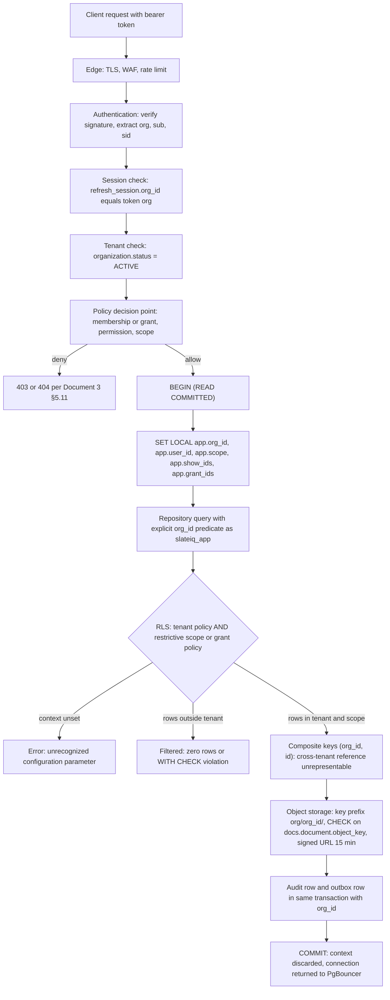
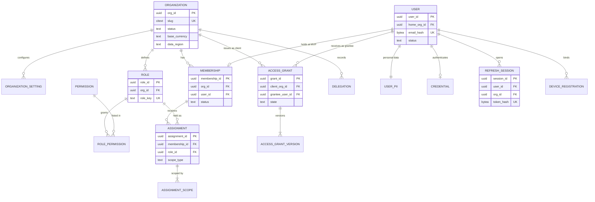
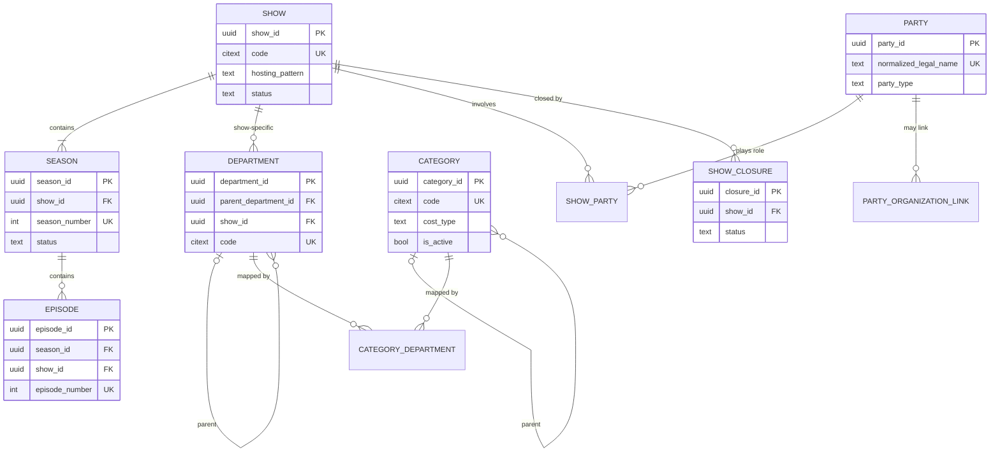
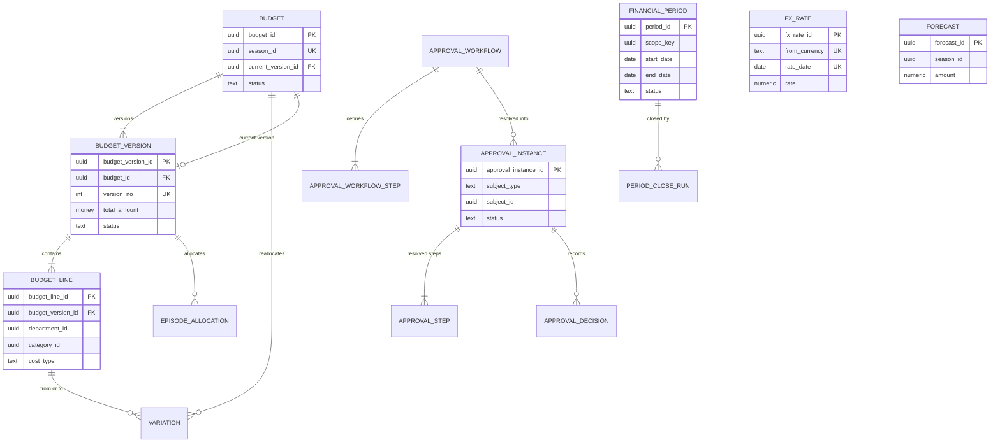
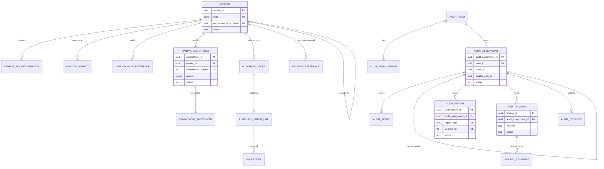
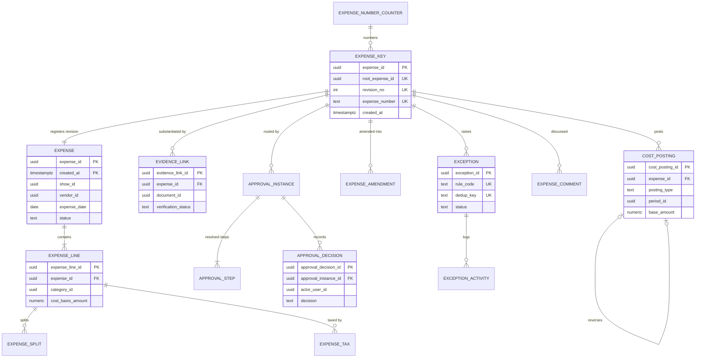
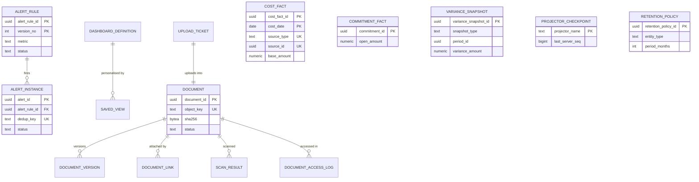
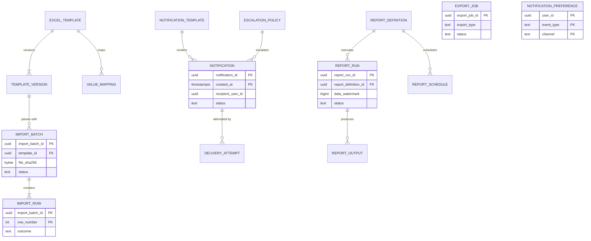
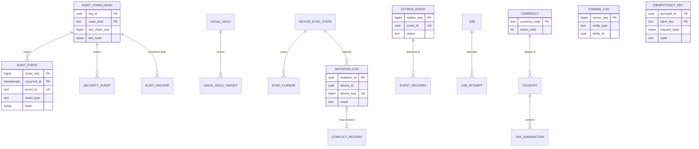

# Document 8: Database Conceptual Model & ERD

**Product:** SlateIQ — Production Cost Intelligence & Audit Monitoring Platform
**Document ID:** SLQ-ARCH-008
**Version:** 1.0.0
**Classification:** Internal — Architecture Foundation
**Status:** Draft — For Review
**Date:** 2026-11-06
**Authors:** Principal Database Architect, Data Architect
**Reviewers:** Principal Architect (TBD), Security Architect (TBD), Finance SME (TBD), Platform Operations Lead (TBD)

---

## Document Control

### Revision History

| Version | Date | Author | Change |
|---------|------|--------|--------|
| 1.0.0 | 2026-11-06 | Architecture Team | First issue: database architecture, concurrency and locking, idempotency, partitioning, deletion, retention, migrations, backup and per-tenant restore, ERDs and table specifications for every schema of Document 3 Appendix D; ADR-035 to ADR-039 |

### Related Documents

| Document | Relationship |
|----------|--------------|
| Document 1 — Product Vision & Business Requirements | FR, NFR, BR and D identifiers cited here |
| Document 2 — Domain Model & Capability Map | Entities, attributes and lifecycles realised as tables (§6) |
| Document 3 — Actor, Permission, Tenancy & Identity | RLS families and templates (§7), tenancy and identity logical model (§9), grant tables (§8.14), authoritative table inventory (Appendix D) |
| Document 4 — Core Business Workflows & State Machines | Transition rules behind the state CHECK constraints of §12 |
| Document 5 — Business Rules & Invariants Catalogue | Invariants whose database enforcement is specified here |
| Document 6 — High-Level Solution Architecture | Data ownership (§5.4), data and storage stack (§6.6), data architecture (§8), sync protocol (§9.3), DR (§12) |
| Document 13 — Analytics & Cost Calculation Architecture | Formulas over `expense.cost_posting`, `intel.*` and `budget.*` |
| Document 14 — Audit & Observability Architecture | Audit event taxonomy, compliance workflows (DSR, breach) |
| Document 15 — Infrastructure & Deployment Architecture | Managed PostgreSQL, KMS, backup infrastructure, migration pipeline |
| Document 17 — Risk Register & ADRs | Consolidates ADR-035 to ADR-039 and risks R8-01 to R8-07 |

---

## 1. Purpose and Scope

This document is the physical realisation of the Document 2 domain model in PostgreSQL. It fixes how data is stored, isolated, locked, versioned, deleted, archived, migrated, backed up and restored, and it specifies every table in the authoritative inventory of Document 3 Appendix D.

| In scope | Out of scope |
|----------|--------------|
| Database platform, schemas, roles, privileges, RLS application | Application code, migration scripts (no DDL is issued here; SQL fragments illustrate constraints only) |
| Isolation levels, explicit locks, queues, optimistic concurrency, idempotency storage | Workflow transition rules (Document 4) |
| Partitioning, indexing, deletion, archival, retention, migrations, backup and restore | Calculation formulas (Document 13) |
| Table specifications for `prod`, `budget`, `vendor`, `auditops`, `expense`, `intel`, `docs`, `xls`, `notify`, `compliance`, `report`, `sync`, `ops`, `ref` | Full column lists for `tenancy` and `identity` (Document 3 §8.14, §9.5, §9.6 remain authoritative; §14.1 summarises keys) |

Binding inputs: ADR-002 (shared database, RLS), ADR-003 (transactional outbox, `FOR UPDATE SKIP LOCKED`), ADR-005 (decimal money, immutable FX snapshots), ADR-009 (one region per tenant), ADR-010 (rebuildable read models), ADR-012 (in-transaction hash-chained audit), and the reconciliations RC-01 to RC-05 of the authoring brief.

---

## 2. Design Principles and Conventions

### 2.1 Principles

| ID | Principle | Consequence in the schema |
|----|-----------|---------------------------|
| DP-1 | The database is the last line of defence, not the only one | Tenant, uniqueness, state, money and append-only rules are constraints or triggers; cross-module rules are service-enforced with a nightly consistency job (Document 3 §9.16) |
| DP-2 | Tenant first | `org_id` is the first column of every tenant table, of every primary key and of every composite index (ADR-035) |
| DP-3 | Financial records are never overwritten | Approved revisions, cost postings, decisions and accepted reports are immutable; corrections are new rows linked to the original (BR-FIN-009) |
| DP-4 | One writer per schema | A module writes only its own schema (Document 6 §5.4); no cross-schema foreign keys (RC-02) |
| DP-5 | States are closed sets | Every status column is `text` with a CHECK constraint listing exactly the states of its state machine (§12, ADR-036) |
| DP-6 | Money is exact | `numeric(19,4)` amounts, `numeric(19,6)` rates, rounding half-up at defined points (BR-FIN-001, BR-FIN-002, RC-01) |
| DP-7 | Server time is audit time | `created_at`, `posted_at`, `occurred_at` are server `now()`; device times are stored as metadata only (BR-EXP-011) |
| DP-8 | Everything is rebuildable or retained | `intel` and `report` are projections (ADR-010); everything else follows a retention class (§9) |

### 2.2 Naming

| Object | Rule | Example |
|--------|------|---------|
| Table | Singular `snake_case`; inventory name from Document 3 Appendix D | `expense.expense_line` |
| Primary key column | `<entity>_id` (`uuid`, UUIDv7, application-generated); `bigint GENERATED ALWAYS AS IDENTITY` only for high-volume append-only logs (Document 6 §8.2) | `expense_line_id`, `outbox_seq` |
| Constraint | `pk_`, `fk_`, `uq_`, `ck_`, `ix_`, `ex_` (exclusion), `trg_` (trigger) + table + purpose | `uq_budget_version_one_active` |
| Policy | `<table>_<family>_<command>` | `expense_tenant_read`, `expense_scope_read` |
| Boolean | `is_` or `has_` prefix, `NOT NULL` with default | `is_credit` |
| Time | `*_at` `timestamptz` (UTC); `*_date` `date` (business date in the organization timezone) | `approved_at`, `expense_date` |

### 2.3 Notation Used in the Table Specifications

| Token | Meaning |
|-------|---------|
| `money` | `numeric(19,4)` |
| `rate` | `numeric(19,6)` with `CHECK (> 0)` |
| `pct` | `numeric(9,4)` |
| `ccy` | `char(3)`, FK to `ref.currency` (the only foreign keys allowed across schemas are to `ref`, ADR-035) |
| `text(n)` | `text` with `CHECK (char_length(col) BETWEEN 1 AND n)` |
| `ts` | `timestamptz` |
| `?` suffix | Nullable. Columns without `?` are `NOT NULL` |
| `=x` | Default value |
| `st:<SM>` | `text NOT NULL` with the state CHECK constraint of §12 |
| `FK→t` | Composite foreign key `(org_id, t_id)` to table `t` in the same schema |
| `→s.t` | Cross-schema reference (RC-02): no foreign key; `org_id` is shared; the owning module validates the reference in the same transaction; the nightly reconciliation job reports orphans (NFR-DAT-003) |
| `enc` | `bytea` ciphertext, AES-256-GCM, envelope-encrypted with the tenant data key (Document 6 §8.8) |

### 2.4 Standard Columns Block

Every table specification names its block; the block's columns, keys and triggers are not repeated.

| Block | Columns | Keys and rules | Used by |
|-------|---------|----------------|---------|
| **K** (key) | `org_id uuid NOT NULL`, `<entity>_id uuid NOT NULL` | `pk_<table> PRIMARY KEY (org_id, <entity>_id)`; RLS `ENABLE` and `FORCE`; policies of the table's family (Document 3 §7.4) | All tenant tables |
| **C** (creation) | `created_at ts NOT NULL DEFAULT now()`, `created_by uuid NOT NULL →identity.user` (user or service account) | Indexed only where queried | All tables |
| **M** (mutable) | `updated_at ts NOT NULL DEFAULT now()`, `updated_by uuid NOT NULL`, `row_version bigint NOT NULL DEFAULT 1 CHECK (row_version >= 1)` | `row_version` is the EF Core concurrency token and the source of the HTTP `ETag` (ADR-007); every UPDATE sets `row_version = row_version + 1 WHERE row_version = :expected` | Mutable aggregate roots and children |
| **S** (soft delete) | `deleted_at ts?`, `deleted_by uuid?`, `delete_reason text(500)?` | `CHECK ((deleted_at IS NULL) = (deleted_by IS NULL))`; live-row indexes are partial `WHERE deleted_at IS NULL` | Only where recovery is a requirement (§8) |
| **A** (append-only) | Block C only | Trigger `trg_<table>_append_only` (`BEFORE UPDATE OR DELETE`, and `BEFORE TRUNCATE` at statement level) raises an exception; `slateiq_app` holds `INSERT, SELECT` only; RLS has read and insert policies only | Logs, decisions, postings, versions |
| **FX** (FX snapshot) | `original_currency ccy`, `fx_rate rate?`, `fx_rate_date date?`, `fx_rate_source text?`, `fx_rate_id uuid? →budget.fx_rate`, `base_currency ccy` | `ck_<table>_fx_source CHECK (fx_rate_source IN ('BASE','ORG_TABLE','FALLBACK','MANUAL_OVERRIDE'))`; `ck_<table>_fx_locked CHECK (status IN ('DRAFT') OR (fx_rate IS NOT NULL AND fx_rate_date IS NOT NULL AND fx_rate_source IS NOT NULL))`; `ck_<table>_fx_base CHECK (original_currency <> base_currency OR (fx_rate = 1 AND fx_rate_source = 'BASE'))`; trigger `trg_<table>_fx_immutable` rejects any change to the block once `status <> 'DRAFT'` (BR-FIN-003, D-008) | `expense.expense`, `vendor.manual_commitment` |

**Profiles.** `STD-M` = K + C + M (mutable root). `STD-A` = K + C + A (append-only). `STD-MS` = K + C + M + S. A table that departs from its profile states the difference.

**Denormalised scope columns.** A child that carries `show_id` (or `season_id`, `department_id`) for RLS (Document 3 §7.3) includes it in its composite foreign key to a parent unique key `(org_id, show_id, <parent>_id)`, so the copy cannot diverge from the parent. Example: `auditops.audit_finding (org_id, show_id, audit_assignment_id) REFERENCES auditops.audit_assignment (org_id, show_id, audit_assignment_id)`.

---

## 3. Database Platform Architecture

### 3.1 PostgreSQL 17 Evaluation

PostgreSQL 17 is binding (ADR-002, Document 6 §6.6). The evaluation below records why it remains the right choice for the requirements this document must meet.

| Requirement | PostgreSQL 17 capability | Alternatives considered |
|-------------|--------------------------|-------------------------|
| Tenant isolation in a shared schema (NFR-SEC-004) | Row-level security with `FORCE`, permissive and restrictive policies, `SET LOCAL` settings | SQL Server has RLS but adds licence cost and weaker managed options in both regions; MySQL has no RLS |
| Exact money (BR-FIN-001) | Arbitrary-precision `numeric` | All candidates; floating types prohibited everywhere |
| Integrity (NFR-DAT-003) | Composite foreign keys, partial unique indexes, exclusion constraints (`btree_gist`) for period overlap, deferrable constraint triggers | Distributed SQL (CockroachDB, YugabyteDB) lacks parts of RLS and exclusion constraints; scale not needed (NFR-SCL-001 is 5 M expenses per year) |
| Large-table lifecycle (NFR-DAT-005) | Declarative range partitioning, partition-wise pruning, detach `CONCURRENTLY`, foreign keys to and from partitioned tables | — |
| Recovery (NFR-DAT-001, NFR-AVL-007) | WAL archiving, PITR, PostgreSQL 17 incremental base backups | — |
| Search (NFR-PERF-008) | `tsvector` with GIN, `pg_trgm` | External search deferred (Document 6 §7.8) |
| Managed availability in India and EU (NFR-PRV-009) | Managed Multi-AZ PostgreSQL in both regions | Per-tenant databases rejected: 500 tenants × migrations × backups is operational cost without an isolation benefit RLS does not already give (ADR-002) |

**Extensions (allow-list).** `citext` (slugs, codes), `btree_gist` (exclusion constraints), `pg_trgm` (fuzzy vendor and party search), `pg_stat_statements` (query budgets). Hash chains use the built-in `sha256()`. UUIDv7 values are generated by the application (PostgreSQL 17 has no native generator). Any other extension requires an ADR.

**Server settings that carry architectural weight.**

| Setting | Value | Reason |
|---------|-------|--------|
| `default_transaction_isolation` | `read committed` | §4.1 |
| `timezone` | `UTC` | DP-7 |
| `statement_timeout` (role default for `slateiq_app`) | `5s`; report and export transactions `SET LOCAL statement_timeout = '60s'` | Document 6 §11.4 |
| `lock_timeout` (role default) | `3s` | A blocked request fails fast with a retryable `409`/`503` instead of piling up |
| `idle_in_transaction_session_timeout` | `30s` | Protects pooled connections and locks |
| `row_security` | `on` | A query that would be filtered by RLS for a role with `BYPASSRLS` errors instead (defence against misconfiguration) |
| `log_min_duration_statement` | `500ms`, parameters not logged | Query budgets without logging financial values (Document 3 §15.4) |

### 3.2 Schema per Module

Each module owns one schema and is its only writer (Document 2 §3, Document 6 §5.4). Schema owner is `slateiq_migrator`.

| Schema | Module | Tables (Appendix D + §15 additions) | Dominant RLS family |
|--------|--------|-------------------------------------|---------------------|
| `tenancy` | MOD-01 | 24 | A (C for `access_grant`), E for catalogues |
| `identity` | MOD-02 | 13 | A (`user` keyed on `home_org_id`) |
| `prod` | MOD-03 | 10 | B, C allowlist |
| `budget` | MOD-04 | 10 + 4 | B, C allowlist |
| `vendor` | MOD-05 | 10 | A (master), B (commitments, POs) |
| `auditops` | MOD-06 | 10 | B, C allowlist |
| `expense` | MOD-07 | 12 + 3 | B, C allowlist |
| `intel` | MOD-08 | 9 | B; E for `benchmark_aggregate` |
| `docs` | MOD-09 | 7 | B, C allowlist |
| `xls` | MOD-10 | 6 | A (templates), B (batches, jobs) |
| `notify` | MOD-11 | 7 | A with recipient self-read |
| `compliance` | MOD-12 | 10 | D (audit), A (others) |
| `report` | MOD-13 | 4 | B |
| `sync` | MOD-14 | 4 + 1 | A with device-owner self-read |
| `ops` | MOD-15 | 10 (+2 from Document 3 §9.8) | A (queues, idempotency), F (platform) |
| `ref` | Shared reference | 3 | E |

### 3.3 Database Roles and Privileges

Roles extend Document 3 §7.7. No role used by a running service owns objects, holds `BYPASSRLS`, or is `SUPERUSER`.

| Role | Login | Purpose | Privileges | RLS |
|------|:-----:|---------|------------|-----|
| `slateiq_migrator` | CI/CD only | Owns all schemas and objects; DDL, policies, grants, partition maintenance | Ownership; not `SUPERUSER`; credential exists only in the pipeline secret scope | `FORCE` applies; data backfills set tenant context like the application |
| `slateiq_app` | Yes | API, Sync and Worker hosts | Per-table `SELECT/INSERT/UPDATE/DELETE` from the grant manifest; `INSERT, SELECT` only on block-A tables; no `ops` family F tables; no secret columns of `identity` | All tenant policies |
| `slateiq_identity` | Yes | Identity module's credential path | `SELECT, INSERT, UPDATE` on the secret columns of `identity.credential`, `mfa_factor`, `recovery_code`, `refresh_session` (Document 3 Appendix D: "secrets readable only by the identity service role") | Tenant policies; pre-authentication lookups through two `SECURITY DEFINER` functions owned by the migrator, audited, returning only `user_id` and hash |
| `slateiq_dispatch` | Yes | Outbox dispatcher and job claimer in the Worker host | `SELECT, UPDATE (status, attempts, next_attempt_at, locked_by, locked_until, heartbeat_at, dispatched_at, last_error_code)` on `ops.outbox_event`, `ops.event_delivery`, `ops.job`; `INSERT` on `ops.job_attempt` | A dedicated permissive policy `TO slateiq_dispatch USING (true)` on those four tables only; the handler then runs as `slateiq_app` under the message's tenant context (Document 3 §7.2) |
| `slateiq_ops` | Yes | Platform operations service (separate deployment) | Family F tables, `tenancy.organization` directory columns, `ops` queue health views; no financial tables | Not applicable to F tables; tenancy directory read through a view |
| `slateiq_readonly` | Yes (Phase 1) | Reporting replica and BI extract | `SELECT` on published `report` views only | All tenant policies; context set per extract transaction |
| `slateiq_test_app` | Test only | Isolation and integration suites | Identical to `slateiq_app` (asserted by a grant-diff test) | Identical |
| `slateiq_breakglass` | Vaulted | Managed-database emergency account | Two-person release; use pages Security (Document 3 §7.7) | — |

**Grant manifest.** Grants are generated from a manifest keyed by table and family (Document 3 §7.4 Family C) and applied by migration; a drift test compares `information_schema.role_table_grants` with the manifest on every build.

### 3.4 Tenant Context and RLS

Tenant context is propagated exactly as Document 3 §7.2 specifies; this section fixes the physical settings.

| Setting (`SET LOCAL`) | Type | Set by | Read by |
|-----------------------|------|--------|---------|
| `app.org_id` | uuid | Middleware after authority resolution | Every tenant policy, without `missing_ok`, so an unset context raises an error |
| `app.user_id` | uuid | Middleware | Self-read policies (`membership`, `delegation`, `notify`, `sync`) |
| `app.authority` | `MEMBERSHIP` or `GRANT` | Middleware | Grant restrictive policy |
| `app.grant_ids` | uuid[] | Middleware (grant sessions) | Family C grant policy |
| `app.scope` | `ORG`, `SHOW`, `DEPARTMENT`, … | Middleware | Family B restrictive scope policy |
| `app.show_ids`, `app.department_ids` | uuid[] (≤200, Document 3 §7.4) | Middleware | Family B restrictive scope policy |
| `app.correlation_id` | text | Middleware | Audit insert trigger |

**Family application.** The family of every table is fixed by Document 3 Appendix D and repeated in each specification of §14. Templates are those of Document 3 §7.4: Family A tenant read and write; Family B adds the restrictive scope policy on `show_id` and `department_id`; Family C adds the grant read policy and the evidence write allowlist; Family D read and insert only plus the append-only trigger; Family E no RLS, `SELECT` only; Family F not granted to `slateiq_app`. Block-A tables of any family receive no `UPDATE` or `DELETE` policy, so even a mistaken grant cannot modify them.

**Verification.** The inventory, coverage, drift, cross-tenant read and write, unset-context and grant tests of Document 3 §7.8 and §9.10 run against this schema on every build as `slateiq_test_app`.

### 3.5 Tenant Isolation Model



### 3.6 Composite Keys and the Cross-Schema Rule (RC-02)

| Relationship | Physical rule | Enforcement |
|--------------|---------------|-------------|
| Within a schema | `FOREIGN KEY (org_id, parent_id) REFERENCES parent (org_id, parent_id)`; denormalised scope columns included (§2.4) | Database; a cross-tenant reference cannot be inserted |
| Across schemas | Store `(entity_id, org_id)` (the row's own `org_id`); no foreign key | Owning module contract validates existence, tenant and state in the same transaction (for example `IShowDirectory.AssertActive(org, show)`); nightly orphan report, no silent repair (Document 6 §8.10) |
| To `ref` | Ordinary foreign key to global, immutable, migration-only reference data | Database (ADR-035) |
| To `tenancy`, `identity` | Cross-schema reference (no FK), although the authorization path reads these schemas directly (Document 3 §9.1) | Contract plus nightly job |
| Self-reference | Composite FK including `org_id` | Database |
| Polymorphic owner (`docs.document_link`, `compliance.legal_hold_target`, `expense.exception`) | `(owner_type, owner_id)` with CHECK on `owner_type` | Contract plus nightly job |

The schema test of Document 3 §9.9 asserts that every foreign key between tenant tables includes `org_id` and that no foreign key crosses schemas except to `ref`.

---

## 4. Transactions, Concurrency and Locking

### 4.1 Isolation Levels

| Workload | Level | Reason |
|----------|-------|--------|
| All OLTP commands (API, Sync, Worker handlers) | `READ COMMITTED` (default) | Each statement sees committed data; invariants that span rows are protected by the explicit locks of §4.2, not by a stronger level |
| Reports, exports, period-close snapshot, reconciliation | `REPEATABLE READ READ ONLY` | One consistent snapshot for a multi-query read; no write anomalies possible |
| Projector rebuild in a shadow schema | `REPEATABLE READ` per tenant batch | Stable source snapshot per batch |
| `SERIALIZABLE` | Not used | Serialization failures under RLS and high fan-in would turn into retry storms; the locking strategy is explicit and testable instead |

### 4.2 Explicit Locks

| Protected invariant | Lock | Taken by | Held until |
|---------------------|------|----------|------------|
| No transaction is created, amended, approved, cancelled or imported in a period that is `CLOSING` or `LOCKED` (BR-BUD-009, BR-EXP-003, FR-EXP-029) | `SELECT … FROM budget.financial_period WHERE … FOR SHARE` on the period of the expense date, and for cancellation and supersession also on the period of the event date (BR-EXP-010) | Budget module contract `IPeriodGuard.HoldOpen(org, show, date)` called by Expense, Vendor and Excel in the caller's transaction | Commit |
| Period transition `OPEN`/`REOPENED` → `CLOSING` → `LOCKED` waits for in-flight postings and then blocks new ones | `SELECT … FOR UPDATE` on the period row, then status update with `row_version` check | Period close | Commit |
| Exactly one `ACTIVE` budget version; variation and revision activation are serial per budget (BR-BUD-001, BR-BUD-006) | `SELECT … FROM budget.budget WHERE … FOR UPDATE` (the budget container) | Version submit, approve, withdraw; variation apply; budget freeze at show closure | Commit |
| Gapless, unique expense number per show and year at first submission | `INSERT … ON CONFLICT (org_id, show_id, year_yy) DO UPDATE SET last_value = last_value + :n RETURNING last_value` on `expense.expense_number_counter` (implicit row lock) | Expense submission; import commit allocates a range of `n` in one statement | Commit |
| One open revision per expense root | Unique `(org_id, root_expense_id, revision_no)` on `expense.expense_key`; the amendment command locks the current revision row `FOR UPDATE` | Amendment | Commit |
| Approval decisions are applied once per step | `SELECT … FROM expense.approval_instance … FOR UPDATE` | Approve, reject, request information | Commit |
| Audit chain continuity (ADR-012) | `SELECT … FROM compliance.audit_chain_head WHERE org_id = … AND chain_kind = … FOR UPDATE` | In-transaction audit writer, last statement before commit | Commit |

### 4.3 Lock Order

Deadlocks are prevented by a single global acquisition order. A command that needs several of these locks acquires them in this order and never in reverse; a static review rule and a deadlock test (two commands, reversed inputs, 1,000 iterations) enforce it.

1. `budget.financial_period` (all periods needed, ascending `start_date`)
2. `budget.budget` (container)
3. `expense.expense_number_counter`
4. Aggregate root rows (`FOR UPDATE` or `row_version` update), ascending primary key when several
5. Child rows
6. `compliance.audit_chain_head` (last, held for the shortest time)

### 4.4 Work Queues with `SKIP LOCKED`

| Queue table | Claim predicate | Lease and retry |
|-------------|-----------------|-----------------|
| `ops.outbox_event` | `status IN ('PENDING','FAILED') AND next_attempt_at <= now()` ordered by `outbox_seq` within partition key | `locked_until = now() + 60s`; backoff with jitter, 8 attempts, then `DEAD` (Document 6 §6.7) |
| `ops.event_delivery` | Per consumer, same predicate | Same |
| `ops.job` | `status IN ('PENDING','FAILED') AND next_attempt_at <= now()` ordered by `priority, next_attempt_at` | Heartbeat every 30 s; lease expiry returns the job to `FAILED` for retry; checkpoint in `checkpoint` |
| `notify.notification` | `status = 'QUEUED' AND next_attempt_at <= now()` | `SENDING` with lease; attempts recorded in `notify.delivery_attempt` |
| `xls.import_batch`, `report.report_run`, `xls.export_job` | Driven by `ops.job` rows; the domain row is locked `FOR UPDATE NOWAIT` by the job handler | A second handler fails fast and abandons |

The claim statement is `SELECT … ORDER BY … LIMIT :n FOR UPDATE SKIP LOCKED`, followed by an `UPDATE` that sets the lease, in one short transaction run as `slateiq_dispatch`. Business handling runs afterwards in its own transaction under tenant context. Consumers are idempotent through `ops.inbox_dedup` (§5).

### 4.5 Optimistic Concurrency

Every block-M table carries `row_version`. Commands carry the expected version (HTTP `If-Match`, sync `base_version`); the update predicate includes it, and zero affected rows produce `409 CONFLICT` (or a sync `CONFLICT` result, Document 6 §9.4). `row_version` is never reused and never reset. Pessimistic locks (§4.2) are used only where a lost update would break an invariant that spans rows; everything else is optimistic.

### 4.6 Database-Enforced Invariants

| Invariant | Mechanism |
|-----------|-----------|
| Header total equals sum of rounded lines (BR-FIN-011) | Deferrable constraint trigger `trg_expense_totals` (`INITIALLY DEFERRED`) fires at commit when an expense leaves `DRAFT` or its lines change |
| Splits sum to 100 percent and to the line amount (BR-EXP-012) | Deferred constraint trigger on `expense.expense_split` |
| Budget version total equals sum of lines (BR-BUD-003); episode allocations within total (BR-BUD-007) | Deferred constraint triggers on submission |
| Approved and non-draft records immutable (BR-FIN-009) | Transition trigger rejects changes to financial columns when `status` is not editable (`budget_version` outside `DRAFT`, `expense` outside `DRAFT`/`REQUIRES_INFO`, `audit_report` in `ACCEPTED`) |
| Legal state transitions | Transition trigger per state machine table compares `OLD.status`/`NEW.status` with the allowed-transition set of Document 4 (Document 3 §8.14 `grant_state_trigger` pattern) |
| Cost postings append-only; reversal mirrors original | Block A plus `trg_cost_posting_reversal` (§14.6) |
| Approver is not the submitter (BR-EXP-005) | `ck_approval_decision_not_submitter` |
| Periods never overlap (Document 2 §6.4) | Exclusion constraint `ex_financial_period_no_overlap` |

---

## 5. Idempotency Storage

| Layer | Table | Key | Retention | Semantics |
|-------|-------|-----|-----------|-----------|
| HTTP commands (`Idempotency-Key`, ADR-007) | `ops.idempotency_key` | `(org_id, principal_id, idem_key)` | 7 days (Document 6 Appendix A) | Below |
| Sync mutations | `sync.mutation_log` | `(org_id, mutation_id)`; replay defence `(org_id, device_id, device_seq)` | 30 days | Repeated mutation returns the stored result (Document 6 §9.3) |
| Event consumers | `ops.inbox_dedup` | `(consumer, event_id)` | 13 months | Insert first; conflict means already processed |
| Jobs | `ops.job` | `(org_id, job_type, idempotency_key)` | Per job retention | Duplicate schedule is a no-op |
| Business keys | Unique constraints | Expense number, approval posting per split, reversal per posting, accepted report per date, active grant per pair | Life of record | Second writer fails with a mapped `409` |

**HTTP idempotency algorithm (pseudocode).**

```text
BEGIN; SET LOCAL tenant context
INSERT INTO ops.idempotency_key (org_id, principal_id, idem_key, method, route_template,
       request_hash, state='IN_PROGRESS', expires_at=now()+7d)
  ON CONFLICT DO NOTHING
IF no row inserted:
    -- a concurrent duplicate waits here on the unique index until the first commits or aborts
    SELECT state, request_hash, response_* FROM ops.idempotency_key WHERE key = …
    IF request_hash differs  -> ROLLBACK; 422 IDEMPOTENCY_KEY_REUSED
    IF state = 'COMPLETED'   -> ROLLBACK; replay stored status, headers, body
execute command; write audit and outbox
UPDATE ops.idempotency_key SET state='COMPLETED', response_status, response_body, resource_type, resource_id
COMMIT
```

Because the key row is written in the business transaction, a rolled-back command leaves no key and can be retried; a committed command always has its stored response. Response bodies larger than 64 KB store only `resource_type` and `resource_id`, and the replay re-reads the resource.

---

## 6. Partitioning

All partitioning is declarative monthly range partitioning on a server-assigned timestamp (DP-7). There is no default partition: an insert outside the prepared range fails loudly (Document 3 §9.13).

| Table | Partition key | Source | Hot | After hot | Note |
|-------|---------------|--------|-----|-----------|------|
| `expense.expense` | `created_at` | Document 6 §8.7 | 24 months | Parquet archive, 7 years | ADR-037: PK `(org_id, expense_id, created_at)`; uniqueness and FK anchor in `expense.expense_key` |
| `expense.expense_line` | `expense_created_at` (the parent's partition key) | Document 6 §8.7 (RC-08-04) | 24 months | Parquet, 7 years | Co-located with the parent partition |
| `compliance.audit_event` | `occurred_at` | Document 6 §8.7 | 24 months | WORM + Parquet, 7 years | |
| `compliance.security_event` | `occurred_at` | Addition (RC-08-04) | 24 months | WORM + Parquet, 7 years | Same shape as audit |
| `notify.notification` | `created_at` | Document 6 §8.7 | 6 months | Dropped at 13 months | |
| `ops.outbox_event` | `occurred_at` | Document 6 §8.7 | 3 months | Archive to 13 months, then dropped | |
| `intel.cost_fact` | `cost_date` | Document 6 §8.7 | 36 months | Aggregates retained | Rebuildable |
| `docs.document_access_log` | `occurred_at` | Addition (RC-08-04) | 24 months | Parquet, 7 years | |
| `sync.change_log` | `changed_at` | Addition (RC-08-01) | 2 months | Dropped | ≥30-day cursor retention |
| `identity.refresh_session` | `issued_at` | Document 3 §9.13 | 90 days after expiry | Dropped | By reference |
| `tenancy.access_review_item` | `campaign_id` (list) | Document 3 §9.13 | 7 years | Archive | By reference |

**Partition maintenance.** A scheduled pipeline job (not the runtime, which has no DDL) runs daily as `slateiq_migrator`: it keeps three future monthly partitions, creates indexes on new partitions before attach, and raises a P2 alert when fewer than two future partitions exist. Detach uses `DETACH PARTITION … CONCURRENTLY`.

**Partition drop gate.** A partition past its hot period is exported to Parquet in the region's archive bucket (row counts and SHA-256 manifest verified), then dropped only if: every row's show is `CLOSED`, `ARCHIVED` or `CANCELLED`; every period it covers is `LOCKED`; no row is under legal hold; and the export manifest verifies. Otherwise the partition stays attached and the next run re-evaluates. Queries on partitioned tables must carry the time predicate (Document 6 §11.4).

---

## 7. Indexing Standard

Document 3 §9.12 is adopted in full. Additional rules:

| Rule | Detail |
|------|--------|
| Primary keys lead with `org_id` | `(org_id, <entity>_id)`; the PK index serves RLS and point lookups together |
| Every foreign key is indexed | Composite FK columns in FK order; PostgreSQL does not create them |
| Scope predicates | `(org_id, show_id, …)` on every family B table above 10,000 rows; `(org_id, department_id)` where the restrictive scope policy reads it |
| List queries | Keyset index `(org_id, <filter>, created_at DESC, <entity>_id DESC)` for each list endpoint in Document 9; `OFFSET` prohibited |
| Queues | Partial index on the claim predicate, for example `ix_job_claim ON ops.job (priority, next_attempt_at) WHERE status IN ('PENDING','FAILED')` |
| Live-state uniqueness | Partial unique indexes express "at most one active" rules (`WHERE status = 'ACTIVE'`) |
| Append-only time columns | BRIN on `created_at`/`occurred_at` for tables above 10 M rows (`cost_posting`, `document_access_log`) in addition to the B-tree access paths |
| Search | Generated `tsvector` column with GIN on `expense.expense` (description, document number), `vendor.vendor` (names); `pg_trgm` GIN on `vendor.vendor.normalized_legal_name` and `prod.party.normalized_legal_name` |
| `NULLS NOT DISTINCT` | Used where a nullable dimension participates in uniqueness (PostgreSQL 15+) |
| Creation | `CREATE INDEX CONCURRENTLY` outside a transaction for tables above 100,000 rows; on partitioned tables, create on each partition concurrently, then on the parent `ONLY`, then attach |
| Budget | Each table below lists its required indexes; any other index needs a query it serves and an `EXPLAIN` in CI (Document 6 §11.4) |

---

## 8. Deletion Strategy

| Record class | Strategy | Mechanism | Examples |
|--------------|----------|-----------|----------|
| Financial records after first submission | **Never deleted**: cancel, reject, supersede or reverse | Status transition; reversal postings; credit notes referencing the original (BR-FIN-008, BR-FIN-009) | `expense.*`, `vendor.manual_commitment`, `budget.budget_version`, `expense.cost_posting` |
| Drafts that never left `DRAFT` | Hard delete by the author, audited | `DELETE` allowed by RLS only when `status = 'DRAFT'` (restrictive policy) | Draft expense, draft budget version, draft grant, draft alert rule |
| Records that must be recoverable | Soft delete (block S) | `deleted_at`; partial indexes; restore is an audited update | `docs.document` (`SOFT_DELETED` state, BR-DOC-002), `vendor.vendor_contact`, `intel.saved_view` |
| Reference and master data | Deactivate, never delete | `is_active` or status (`BR-PRD-003`, BR-VND-002) | Department, category, vendor |
| Logs and audit | Append-only; dropped only with their partition after retention | Block A, partition drop gate | `compliance.audit_event`, `docs.document_access_log` |
| Personal data | Crypto-shred, pseudonym retained | Destroy the data key, then delete the PII row (Document 3 §9.14) | `identity.user_pii`, `vendor.vendor_contact` ciphertext |
| Ephemeral rows | Purge job after TTL | Batched `DELETE` by index on `expires_at` | `ops.idempotency_key`, `docs.upload_ticket`, `sync.mutation_log` |
| Anything at end of retention | **Purge only through the retention workflow** | Retention job reads `docs.retention_policy`, checks `compliance.legal_hold_target`, writes an action report, requires approval in the first 12 months (Document 6 §8.7) | All classes |

No foreign key uses `ON DELETE CASCADE`. Tenant purge walks a declared child-to-parent order (Document 3 §9.9) per schema and leaves the tombstone of Document 3 §9.14.

---

## 9. Archival and Retention

| Class | Retention | Hot store | Archive | Clock starts (BR-DOC-004) |
|-------|-----------|-----------|---------|---------------------------|
| Financial records (expenses, postings, commitments, approvals, budgets) | 7 years (D-014, NFR-PRV-008); budgets and approval decisions forever (Document 6 §8.4) | 24 months for partitioned expense tables; postings and approvals stay hot | Parquet in region archive bucket, SSE-KMS | Later of record closure, period lock or hold release |
| Business and security audit | 7 years (D-020, NFR-AUD-003) | 24 months | WORM (Object Lock, compliance mode) + Parquet | Event time |
| Evidence files | Linked record's retention; legal hold overrides (BR-DOC-003) | Object storage, infrequent-access after 90 days | Same bucket, lifecycle tier | Linked record |
| Projections (`intel`) | Rebuildable; facts 36 months hot, aggregates and period-close snapshots 7 years | PostgreSQL | Not archived | — |
| Notifications | 13 months | 6 months | Not archived | Creation |
| Sync mutation log; change log | 30 days; ≥30 days | PostgreSQL | Not archived | Receipt |
| Conflict records | 7 years | PostgreSQL | Parquet with show | Resolution |
| Outbox | 3 months hot, 13 months archive | PostgreSQL | Partition archive | Occurrence |
| Idempotency keys | 7 days | PostgreSQL | None | Creation |

**Retention is data.** The retention job reads `docs.retention_policy` (class, jurisdiction, period, legal basis); changing a period is a compliance approval (`compliance.retention_policy.approve`), not a deployment. **Archived data remains readable** through an archive retrieval job that loads the requested show's Parquet files into a tenant-scoped temporary schema for a report run; the archive manifest names `org_id` and the job runs under tenant context (Document 3 §7.6 export rule).

---

## 10. Migrations

| Topic | Decision |
|-------|----------|
| Tooling | EF Core migrations model tables, columns, keys and indexes. RLS policies, grants, triggers, CHECK constraints EF cannot express, partitions and exclusion constraints are reviewed SQL scripts in the same migration sequence. The pipeline produces one idempotent SQL artefact per release (`migrations script --idempotent` plus the SQL scripts) that is reviewed in the pull request and applied by `slateiq_migrator`. The application never migrates at start-up |
| Expand/contract | Release N adds (nullable column, new table, new CHECK `NOT VALID`); a backfill job runs per tenant with checkpoints; release N+1 enforces (`VALIDATE CONSTRAINT`, `SET NOT NULL` via a validated CHECK); release N+2 removes. A dropped column needs two releases (Document 6 §5.4) |
| Zero downtime | Code at version N−1 runs against schema N (compatibility test); `lock_timeout = '5s'` in every migration session, with retry; no table rewrite on a large table (no type changes, no volatile defaults); foreign keys added `NOT VALID` then validated; indexes `CONCURRENTLY`; enum-like CHECK changes add the value first and remove it only when no row or code path uses it (Document 3 §9.15) |
| State lists | Adding a state = replace the CHECK (`NOT VALID` + validate) and the transition trigger in one migration, after Document 4 changes |
| Data migrations | Run as `ops.job` per tenant, never in a request path and never as one statement over all tenants (Document 3 §9.15) |
| Rollback | Each migration has a tested down script or is marked forward-fix-only in review |
| Migration tests (CI) | (1) apply from empty; (2) apply on a snapshot of the previous release with production-shaped synthetic data for two tenants; (3) N−1 application test suite against schema N; (4) RLS coverage, policy drift, grant drift and inventory tests (Document 3 §7.8); (5) lock-duration test: no statement holds `ACCESS EXCLUSIVE` longer than 1 s on the synthetic dataset; (6) down-script round trip; (7) state CHECK lists match the Document 4 manifest |

---

## 11. Backup, Restore and Per-Tenant Logical Restore

### 11.1 Physical Backup and Disaster Recovery

| Control | Design | Requirement |
|---------|--------|-------------|
| PITR | Continuous WAL archiving; any second within 35 days; RPO ≤15 minutes | NFR-DAT-001, NFR-AVL-007 |
| Snapshots | Daily, 35-day retention; PostgreSQL 17 incremental base backups between full backups | NFR-DAT-001 |
| Residency | Backups region-local, encrypted with the region KMS key; restore in another region fails decryption (Document 3 §7.8) | NFR-PRV-009 |
| Regional DR | Restore into a pre-provisioned recovery stack in the same region; RTO ≤4 hours (Document 6 §12.6) | NFR-AVL-006 |
| Restore isolation | Always to a new instance, verified, then promoted; never over production (Document 6 §12.5) | — |
| Verification | Row counts, financial checksum (sum of `expense.cost_posting.base_amount` by tenant and period), budget version counts, audit chain verification, smoke tests | NFR-DAT-002 |
| Exercise | Quarterly full restore, monthly spot check, evidence retained | NFR-DAT-002 |

### 11.2 Per-Tenant Logical Restore

A shared database cannot be rolled back for one tenant by a physical restore. When one tenant's data is damaged (operator error, faulty migration backfill, corrupted import) and other tenants are healthy, the per-tenant logical restore of ADR-039 applies. It requires `ops.tenant.administer`, two approvers through `ops.support_access`, and a ticket.

| Step | Action | Control |
|------|--------|---------|
| 1 Declare | Record incident, tenant, damaged scope (tenant, show, entity set) and target time T; check legal holds on the scope | Two approvers; tenant contact informed |
| 2 Contain | Put the tenant in `SUSPENDED` (SM-01) for a full-tenant rewind, or freeze the affected show (writes rejected by the Production contract) for a scoped repair | Devices keep capturing offline; nothing is discarded (Document 2 §9) |
| 3 Clone | Create an isolated PITR clone of the regional database at T in the same region | Never in production; clone destroyed after step 9 |
| 4 Extract | On the clone, as `slateiq_migrator` with `SET LOCAL app.org_id = :tenant`, export every table of the tenant in the declared dependency order (Appendix D order), with per-table row counts and SHA-256 manifest | RLS applies to the migrator (`FORCE`), so only the tenant's rows can be read |
| 5 Diff | Compare extract with production for the scope: rows missing, rows changed, rows created after T (from `compliance.audit_event` after T) | Diff report reviewed by the tenant's Finance Head and the platform |
| 6 Plan | Choose **scoped repair** (default: re-insert missing rows, restore mutable rows to their T values with a new `row_version`) or **full rewind** (only with written tenant approval; post-T data is exported first and handed to the tenant) | Append-only tables are never rewritten: missing postings are re-inserted; wrong postings are reversed by new postings; the audit chain is continued, never edited |
| 7 Apply | In production, as `slateiq_migrator` under the tenant's context, apply the plan per table in batches; outbox writes are tagged `restore_mode` so notifications are suppressed | Audit event `data.restored` per batch with the manifest hash |
| 8 Objects | Restore object versions under `org/{org_id}/` as of T from bucket versioning; verify SHA-256 against `docs.document` | Object Lock archives untouched |
| 9 Rebuild and verify | Rebuild the tenant's `intel` projections in a shadow schema and swap; verify financial checksums, audit chain, RLS probes; verify other tenants' checksums unchanged | Restore report retained as SOC 2 evidence |
| 10 Resume | Reactivate tenant or unfreeze show; publish post-incident review | Document 17 runbook |

---

## 12. State CHECK Catalogue

Every status column is `text NOT NULL` with the CHECK below (DP-5, ADR-036). Transitions are enforced by the table's transition trigger (§4.6) against Document 4.

| SM | Table.column | Constraint and allowed values |
|----|--------------|-------------------------------|
| SM-01 | `tenancy.organization.status` | Document 3 §2.5: `PROVISIONING`, `PROVISIONING_FAILED`, `ACTIVE`, `SUSPENDED`, `ARCHIVED`, `PENDING_DELETION`, `PURGING`, `PURGED` |
| SM-02 | `prod.show.status` | `ck_show_status`: `PLANNING`, `ACTIVE`, `COMPLETED`, `CLOSING`, `CLOSED`, `ARCHIVED`, `CANCELLED` |
| SM-03 | `budget.budget.status` | `ck_budget_status`: `NOT_BASELINED`, `BASELINED`, `REVISION_IN_PROGRESS`, `FROZEN` |
| SM-04 | `budget.budget_version.status` | `ck_budget_version_status`: `DRAFT`, `SUBMITTED`, `CHANGES_REQUESTED`, `ACTIVE`, `SUPERSEDED`, `REJECTED`, `WITHDRAWN` |
| SM-05 | `budget.financial_period.status` | `ck_financial_period_status`: `OPEN`, `CLOSING`, `LOCKED`, `REOPENED` |
| SM-06 | `vendor.vendor.status` | `ck_vendor_status`: `CANDIDATE`, `ACTIVE`, `INACTIVE`, `BLOCKED`, `REJECTED`, `MERGED` |
| SM-07 | `vendor.manual_commitment.status` | `ck_manual_commitment_status`: `DRAFT`, `PENDING_APPROVAL`, `OPEN`, `CLOSED`, `CANCELLED`, `EXPIRED` |
| SM-08 | `auditops.audit_assignment.status` | `ck_audit_assignment_status`: `PLANNED`, `ACTIVE`, `SUSPENDED`, `COMPLETED`, `REVOKED`, `HANDED_OVER` |
| SM-09 | `expense.expense.status` | `ck_expense_status`: `DRAFT`, `SUBMITTED`, `REQUIRES_INFO`, `APPROVED`, `REJECTED`, `CANCELLED`, `SUPERSEDED` |
| SM-10 | `auditops.audit_report.status` | `ck_audit_report_status`: `DRAFT`, `SUBMITTED`, `RETURNED`, `ACCEPTED`, `SUPERSEDED` |
| SM-11 | `auditops.audit_finding.status` | `ck_audit_finding_status`: `DRAFT`, `OPEN`, `RESPONDED`, `CLOSED`, `ESCALATED`, `WITHDRAWN` |
| SM-12 | `docs.document.status` | `ck_document_status`: `UPLOAD_PENDING`, `PENDING_SCAN`, `AVAILABLE`, `QUARANTINED`, `SCAN_FAILED`, `SOFT_DELETED`, `PURGED` |
| SM-12 | `expense.evidence_link.verification_status` | `ck_evidence_link_verification`: `UNVERIFIED`, `VERIFIED`, `DISPUTED` |
| SM-13 | `expense.approval_instance.status`, `budget.approval_instance.status` | `ck_approval_instance_status`: `PENDING`, `IN_PROGRESS`, `INFO_REQUESTED`, `APPROVED`, `REJECTED`, `CANCELLED` |
| SM-13 | `expense.approval_step.status`, `budget.approval_step.status` | `ck_approval_step_status`: `WAITING`, `ACTIVE`, `APPROVED`, `REJECTED`, `SKIPPED` |
| SM-14 | `prod.show_closure.status` | `ck_show_closure_status`: `REQUESTED`, `BLOCKED`, `READY`, `APPROVED`, `REJECTED`, `WITHDRAWN` |
| SM-15 | `expense.exception.status` | `ck_exception_status`: `OPEN`, `ACKNOWLEDGED`, `RESOLVED`, `FALSE_POSITIVE`, `WAIVED` |
| SM-16 | `intel.alert_instance.status` | `ck_alert_instance_status`: `TRIGGERED`, `ACKNOWLEDGED`, `RESOLVED`, `FALSE_POSITIVE`, `ESCALATED` (`ESCALATED` emitted from Phase 1) |
| SM-17 | `xls.import_batch.status` | `ck_import_batch_status`: `UPLOADED`, `SCANNING`, `PARSING`, `VALIDATING`, `VALIDATED`, `AWAITING_COMMIT_APPROVAL`, `COMMITTING`, `COMMITTED`, `PARTIALLY_COMMITTED`, `REJECTED`, `FAILED`, `EXPIRED`, `REVERSAL_PENDING`, `REVERSED` |
| SM-18 | `notify.notification.status` | `ck_notification_status`: `QUEUED`, `SENDING`, `SENT`, `DELIVERED`, `READ`, `BOUNCED`, `FAILED`, `DEAD`, `SUPPRESSED` |
| SM-19 | `ops.outbox_event.status`, `ops.event_delivery.status`, `ops.job.status`, `notify.digest_run.status` | `ck_<table>_status`: `PENDING`, `PROCESSING`, `SUCCEEDED`, `FAILED`, `DEAD`, `CANCELLED` |
| — | `xls.export_job.status` | `ck_export_job_status`: `QUEUED`, `RUNNING`, `COMPLETED`, `FAILED`, `EXPIRED` |
| — | `tenancy.access_grant.state`; `identity.user.status` | Document 3 §8.2 and §3.4 (by reference) |

Secondary lifecycles from Document 2 §6 (not numbered state machines) use the same pattern; their value lists appear in the table specifications (for example `prod.season.status`: `PLANNED`, `ACTIVE`, `COMPLETED`).

---

## 13. Entity-Relationship Diagrams

One diagram per schema group, key attributes only (PK, FK, UK and the status column). Relationships inside a schema are composite foreign keys; relationships labelled `ref` cross schemas and have no foreign key (RC-02). Every entity also carries `org_id` as the leading key column except the global entities of `ref` and `tenancy.permission`.

### 13.1 Tenancy and Identity (Document 3 §9)



### 13.2 Production (`prod`)



### 13.3 Budget (`budget`)



### 13.4 Vendor and Audit Operations (`vendor`, `auditops`)



### 13.5 Expense (`expense`)



### 13.6 Cost Intelligence and Documents (`intel`, `docs`)



### 13.7 Excel, Notifications and Reporting (`xls`, `notify`, `report`)



### 13.8 Compliance, Sync, Platform Operations and Reference (`compliance`, `sync`, `ops`, `ref`)



---

## 14. Table Specifications

Each specification names its RLS family (Document 3 Appendix D), its standard block profile (§2.4), the columns beyond the block in the notation of §2.3, keys, constraints and indexes, the deletion strategy (§8) and how history is retained. Every state change on every table writes a business audit event in the same transaction (ADR-012); "history: audit" refers to that trail.

### 14.1 `tenancy` and `identity` (by reference to Document 3 §8.14, §9.5, §9.6)

Column definitions are authoritative in Document 3. Document 8 adds, for every table that other tenancy tables reference, `uq_<table>_tenant UNIQUE (org_id, <entity>_id)` so that composite foreign keys can be declared (RC-08-06), and the block-C/M columns where Document 3 lists timestamps only.

| Table | Family | Primary key | Key constraints |
|-------|--------|-------------|-----------------|
| `tenancy.organization` | A (`org_id = id`) | `org_id` | Unique `slug` (`citext`, `^[a-z0-9-]{3,40}$`, immutable after `ACTIVE`); status SM-01; `base_currency` FK `ref.currency`, immutable after first approved financial record (BR-FIN-004, trigger reading a flag set by Expense); `data_region IN ('IN','EU')` immutable; purge requires two distinct approvers |
| `tenancy.organization_setting` | A | `(org_id, key)` | `key` from the closed catalogue; value validated against the key schema; effective-dated history in the audit trail |
| `tenancy.organization_entitlement` | A | `(org_id, entitlement_key)` | `source IN ('PLAN','OVERRIDE','TRIAL')`; `valid_until > valid_from` |
| `tenancy.membership` | A + self-read | `membership_id` | Unique `(org_id, user_id) WHERE status <> 'LEFT'`; unique `(user_id) WHERE status = 'ACTIVE'` (MVP one membership); status `INVITED`, `ACTIVE`, `SUSPENDED`, `LEFT` |
| `tenancy.invitation` | A | `invitation_id` | Expiry 72 hours (FR-TNT-004); purged 30 days after expiry |
| `tenancy.role`, `role_permission`, `role_version` | A | `role_id`; `(role_id, permission_key)`; `role_version_id` | Unique `(org_id, role_key)`; `role_permission.permission_key` FK `tenancy.permission`; unique `(role_id, version_no)`; system roles immutable (trigger) |
| `tenancy.assignment`, `assignment_scope` | A | `assignment_id`; `(assignment_id, scope_id)` | `role_id` composite FK with same `org_id`; `scope_type` in the seven scopes; `valid_until > valid_from` |
| `tenancy.delegation` | A + self-read | `delegation_id` | `delegator_user_id <> delegate_user_id`; `end_at <= start_at + interval '90 days'` (BR-ACC-006) |
| `tenancy.approval_limit` | A | `limit_id` | Exactly one of `role_id`, `user_id` (`num_nonnulls(...) = 1`); `max_amount >= 0` |
| `tenancy.sod_exception` | A | `exception_id` | `valid_until <= valid_from + 90 days`; partial unique live exception per subject and rule; `approver_one <> approver_two` |
| `tenancy.access_review_campaign`, `access_review_item` | A | `campaign_id`; `(campaign_id, item_id)` | Item list-partitioned by campaign (Document 3 §9.13); reviewer is not the subject |
| `tenancy.auditor_profile` | A | `user_id` | `firm_org_id` set; attestation fields |
| `tenancy.access_grant`, `access_grant_version`, `grant_acknowledgment`, `coi_declaration`, `grant_expiry_notice` | A + grantee self-read (C for `access_grant`) | `grant_id`; `grant_version_id`; `ack_id`; `declaration_id`; `notice_id` | Document 3 §8.14 constraints `grant_term_valid` (≤12 months, BR-AUD-002), `grant_scope_present`, `grant_no_self`, `grant_one_active`, `grant_approved_distinct`, `grant_state_trigger`; unique `(grant_id, version_no)`, `(grant_id, stage)` |
| `tenancy.sod_rule`, `permission`, `grant_profile` | E | `rule_key`; `permission_key`; `profile_key` | Migration-only; `SELECT` only |
| `identity.user` | A (`home_org_id`) + self-read | `user_id` | Unique `email_hash WHERE erased_at IS NULL`; status per Document 3 §3.4 |
| `identity.user_pii`, `user_email_alias` | A | `user_id`; `alias_id` | `enc` columns; `key_destroyed_at` on erasure |
| `identity.credential`, `mfa_factor`, `recovery_code`, `password_reset`, `email_change` | A; secret columns readable by `slateiq_identity` only | `credential_id`; `factor_id`; `code_id`; … | Unique `credential.user_id`; one active TOTP factor per user (partial unique) |
| `identity.refresh_session` | A | `(session_id, issued_at)` (partitioned monthly) | Unique `token_hash` per partition plus global uniqueness by 256-bit random token; indexes `(user_id, revoked_at)`, `(org_id, revoked_at)`, `(family_id)`, `(authority_id)` |
| `identity.device_registration` | A + owner self-read | `device_id` | `trust_state`; purged 90 days after revocation |
| `identity.service_account`, `federated_identity`, `identity_transfer` | A | `service_account_id`; `federated_identity_id`; `transfer_id` | Unique `(org_id, name)`; transfer `state IN ('REQUESTED','APPROVED','COMPLETED','CANCELLED')` with three approvals |

### 14.2 `prod` — Production (MOD-03)

| Table · purpose · family · profile | Columns beyond the block | Keys, constraints, indexes | Deletion · history |
|------------------------------------|--------------------------|----------------------------|--------------------|
| **`prod.show`** — production being costed and audited. B/C. STD-M | `code citext` (`^[A-Z0-9]{3,12}$`, A2-05); `title text(200)`; `show_type text` (`SERIES`, `FILM`, `REALITY`, `LIVE_EVENT`, `DOCUMENTARY`, `OTHER`); `format text(100)?`; `genre text(100)?`; `language text(35)?`; `planned_start_date date?`; `planned_end_date date?`; `planned_shoot_days int?`; `hosting_pattern text` (`H1`, `H2`, ADR-025); `status st:SM-02 ='PLANNING'`; `closed_at ts?`; `archived_at ts?`; `cancelled_at ts?`; `cancel_reason text(2000)?` | UQ `(org_id, code)`; CK `planned_end_date >= planned_start_date`; CK `planned_shoot_days >= 0`; CK cancelled ⇒ `cancel_reason` set; trigger: `hosting_pattern` and `code` immutable after `ACTIVE`; IX `(org_id, status, planned_start_date)`; GIN `tsvector(code, title)` | Never deleted; `CANCELLED` or `ARCHIVED`. History: audit (FR-PRD-002); 7 years after `CLOSED` |
| **`prod.season`** — production cycle with its own budget. B/C. STD-M | `show_id FK→show`; `season_number int` (≥1); `title text(200)?`; `planned_episodes int?`; `planned_start_date date?`; `planned_end_date date?`; `status text ='PLANNED'` (`PLANNED`, `ACTIVE`, `COMPLETED`) | UQ `(org_id, show_id, season_number)`; UQ `(org_id, show_id, season_id)` (target for denormalised children); a film has exactly one season (service, nightly check) | With show |
| **`prod.episode`** — unit of allocation and reporting. B/C. STD-M | `show_id`, `season_id` FK→season `(org_id, show_id, season_id)`; `episode_number int` (≥1); `title text(200)?`; `shoot_start_date date?`; `shoot_end_date date?`; `status text ='PLANNED'` (`PLANNED`, `IN_PRODUCTION`, `SHOT`, `DELIVERED`, `DROPPED`) | UQ `(org_id, season_id, episode_number)`; IX `(org_id, show_id)` | `DROPPED`, never deleted |
| **`prod.department`** — cost centre, organization-wide or show-specific. B/C. STD-M | `code citext`; `name text(200)`; `parent_department_id uuid? FK→department`; `show_id uuid? FK→show`; `depth smallint` (1 to 3, BR-PRD-006); `is_active bool =true`; `deactivated_at ts?` | UQ `(org_id, show_id, code) NULLS NOT DISTINCT`; CK `parent_department_id <> department_id`; trigger: acyclic and `depth = parent.depth + 1`; IX `(org_id, parent_department_id)`, `(org_id, show_id)` | Deactivate only (BR-PRD-003); indefinite |
| **`prod.category`** — organization cost taxonomy. B (tenant policy; no scope column)/C. STD-M | `code citext`; `name text(200)`; `parent_category_id uuid? FK→category`; `cost_type text` (`ABOVE_THE_LINE`, `BELOW_THE_LINE`, `POST_PRODUCTION`, `OTHER`, A2-02); `is_leaf bool =true` (trigger-maintained); `input_tax_recoverable_default bool =false` (A2-04); `evidence_policy text ='ALWAYS'` (`ALWAYS`, `ABOVE_THRESHOLD`, `POLICY_DEFAULT`); `evidence_threshold_amount money?`; `is_active bool =true` | UQ `(org_id, code)`; CK `ABOVE_THRESHOLD` ⇒ threshold set and ≥0; trigger: a non-leaf category is not postable (BR-EXP-015 read by Expense contract) | Deactivate only; history never altered (FR-PRD-010) |
| **`prod.category_department`** — which categories a department may use. B. K without own id + C + M | PK `(org_id, category_id, department_id)`; both FK; `is_active bool =true` | IX `(org_id, department_id)` | Deactivate only |
| **`prod.party`** — commissioner, production house or co-producer record. B. STD-M | `legal_name text(300)`; `normalized_legal_name text(300)` (application-normalised); `party_type text` (`COMMISSIONER`, `PRODUCTION_HOUSE`, `CO_PRODUCER`, `OTHER`); `tax_scheme text?`; `tax_identifier text(30)?`; `vendor_id uuid? →vendor.vendor`; `status text ='ACTIVE'` (`ACTIVE`, `INACTIVE`) | UQ `(org_id, normalized_legal_name, tax_identifier) NULLS NOT DISTINCT` (BR-VND-001 rule); GIN `pg_trgm(normalized_legal_name)` | Deactivate; 7 years |
| **`prod.show_party`** — role a party plays on a show. B. K without own id + C + M | PK `(org_id, show_id, party_id, party_role, effective_from)`; `party_role text` (`COMMISSIONER`, `PRODUCTION_HOUSE`, `CO_PRODUCER`, `APPOINTING_PARTY`); `is_primary bool =false`; `effective_from date`; `effective_to date?` | Partial UQ `(org_id, show_id) WHERE party_role = 'PRODUCTION_HOUSE' AND is_primary AND effective_to IS NULL`; CK `effective_to >= effective_from` | End-dated, never deleted |
| **`prod.party_organization_link`** — confirms a party is a SlateIQ organization (BR-PRD-004). B plus linked-organization policy. STD-M | `link_id`; `party_id FK→party`; `linked_org_id uuid →tenancy.organization`; `agreement_terms text(4000)?`; `status text ='PROPOSED'` (`PROPOSED`, `ACTIVE`, `TERMINATED`); `accepted_by_owner uuid?`; `accepted_by_linked uuid?`; `activated_at ts?`; `terminated_at ts?` | CK `linked_org_id <> org_id`; CK `status <> 'ACTIVE' OR (accepted_by_owner IS NOT NULL AND accepted_by_linked IS NOT NULL)`; partial UQ `(org_id, party_id) WHERE status <> 'TERMINATED'`; additional permissive `SELECT` and `UPDATE` policies `linked_org_id = app.org_id`, exposed through view `prod.v_party_link_inbound`; trigger limits the linked side to `accepted_by_linked` and `TERMINATED` | Terminated, never deleted; confers no data access |
| **`prod.show_closure`** — close checklist, waiver and sign-off (D2-18). B. STD-M | `closure_id`; `show_id FK→show`; `status st:SM-14 ='REQUESTED'`; `requested_by uuid`; `checklist_result jsonb` (snapshot); `waivers jsonb ='[]'`; `approval_instance_id uuid? →budget.approval_instance`; `decided_by uuid?`; `decided_at ts?`; `decision_comment text(2000)?` | Partial UQ `(org_id, show_id) WHERE status IN ('REQUESTED','BLOCKED','READY')`; CK `decided_by <> requested_by`; CK decided states ⇒ `decided_by`, `decided_at` set | Never deleted; 7 years |

### 14.3 `budget` — Budget (MOD-04)

| Table · purpose · family · profile | Columns beyond the block | Keys, constraints, indexes | Deletion · history |
|------------------------------------|--------------------------|----------------------------|--------------------|
| **`budget.budget`** — budget container per season. B/C. STD-M | `show_id →prod.show`; `season_id →prod.season`; `status st:SM-03 ='NOT_BASELINED'`; `current_version_id uuid?` FK→budget_version (`DEFERRABLE INITIALLY DEFERRED`); `base_currency ccy`; `frozen_at ts?` | UQ `(org_id, season_id)` (one budget per season); UQ `(org_id, show_id, budget_id)`; CK `(status = 'NOT_BASELINED') = (current_version_id IS NULL)`; CK `FROZEN` ⇒ `frozen_at`; row is the **container lock** (§4.2) | Never deleted; forever |
| **`budget.budget_version`** — immutable approved plan or a draft (SM-04). B/C. STD-M | `budget_id`, `show_id` FK→budget `(org_id, show_id, budget_id)`; `version_no int`; `version_type text` (`ORIGINAL`, `REVISION`); `reason text(2000)?`; `effective_date date?`; `total_amount money`; `contingency_amount money ='0'`; `status st:SM-04 ='DRAFT'`; `supersedes_version_id uuid? FK→budget_version`; `approval_instance_id uuid? FK→approval_instance`; `submitted_by uuid?`; `submitted_at ts?`; `approved_at ts?` | UQ `(org_id, budget_id, version_no)`; partial UQ `uq_budget_version_one_active (org_id, budget_id) WHERE status = 'ACTIVE'` (BR-BUD-001); partial UQ `(org_id, budget_id) WHERE status IN ('DRAFT','SUBMITTED','CHANGES_REQUESTED')` (A8-06); CK `ORIGINAL` ⇔ `version_no = 1`; CK `REVISION` ⇒ `reason` and `effective_date` set (BR-BUD-005); CK amounts ≥0; deferred trigger total = Σ lines (BR-BUD-003); immutability trigger outside `DRAFT` | Draft hard-deletable; otherwise never; forever |
| **`budget.budget_line`** — planned amount per line key. B/C. K + C (immutable after version leaves `DRAFT`) | `budget_version_id`, `show_id` FK→budget_version; `department_id uuid? →prod.department`; `category_id uuid? →prod.category`; `cost_type text` (four values); `line_type text ='OPERATIONAL'` (`OPERATIONAL`, `CONTINGENCY`); `amount money` (≥0); `quantity numeric(19,4)?`; `unit text(20)?`; `rate money?`; `notes text(2000)?` | UQ `(org_id, budget_version_id, department_id, category_id, cost_type) NULLS NOT DISTINCT` (BR-BUD-002); CK `line_type = 'CONTINGENCY' OR (department_id IS NOT NULL AND category_id IS NOT NULL)`; IX `(org_id, department_id, category_id)` | With version; forever |
| **`budget.episode_allocation`** — planned share for an episode (D2-03). B. K without own id + C | PK `(org_id, budget_version_id, episode_id)`; `show_id` in FK; `episode_id →prod.episode`; `amount money` (≥0) | Deferred trigger Σ allocations ≤ version total (BR-BUD-007) | With version |
| **`budget.variation`** — reallocation between lines of the active version. B. STD-M | `budget_id`, `show_id` FK→budget; `budget_version_id FK→budget_version`; `from_budget_line_id FK→budget_line`; `to_budget_line_id FK→budget_line`; `amount money` (>0); `reason text(2000)`; `status text ='REQUESTED'` (`REQUESTED`, `APPROVED`, `REJECTED`, `APPLIED`); `requires_revision bool`; `approval_instance_id uuid? FK→approval_instance`; `applied_at ts?` | CK `from_budget_line_id <> to_budget_line_id`; IX `(org_id, budget_id, status)`. Current budget per line = active version line + Σ applied variations in − out (lines are never updated); contingency moves only by variation (BR-BUD-004) | Never deleted; forever |
| **`budget.approval_workflow`** — configured chain per subject type. B. K `(org_id, workflow_id, version_no)` + C + M | `subject_type text` (`BUDGET_VERSION`, `VARIATION`, `EXPENSE`, `COMMITMENT`, `PERIOD_REOPEN`, `IMPORT_COMMIT`, `SHOW_CLOSURE`, `EXCEPTION_WAIVER`); `show_id uuid? →prod.show` (show override); `name text(200)`; `status text ='DRAFT'` (`DRAFT`, `ACTIVE`, `RETIRED`); `threshold_currency ccy`; `requires_commissioner_final bool =false` (BR-BUD-010) | Partial UQ `(org_id, subject_type, show_id) NULLS NOT DISTINCT WHERE status = 'ACTIVE'`; trigger: a version is immutable once `ACTIVE` (chains resolved at submission, BR-EXP-007) | Retired, never deleted; all versions |
| **`budget.approval_workflow_step`** — ordered step definition. B. K `(org_id, workflow_id, version_no, step_no)` + C | `approver_role_key text`; `scope_rule text` (`SUBJECT_SHOW`, `SUBJECT_DEPARTMENT`, `ORG`); `min_base_amount money ='0'`; `max_base_amount money?`; `delta_threshold_amount money?` (BR-BUD-011); `is_commissioner_step bool =false`; `exclude_author bool =true` (BR-BUD-012) | FK→approval_workflow; CK `step_no >= 1`; CK `max_base_amount IS NULL OR max_base_amount >= min_base_amount` | With workflow version |
| **`budget.financial_period`** — fiscal period (D2-13, SM-05). B. STD-M | `period_id`; `scope_type text` (`ORGANIZATION`, `SHOW`); `show_id uuid? →prod.show`; `scope_key uuid GENERATED ALWAYS AS (COALESCE(show_id, org_id)) STORED`; `fiscal_year int`; `period_no smallint` (1 to 13); `start_date date`; `end_date date`; `status st:SM-05 ='OPEN'`; `locked_at ts?`; `locked_by uuid?`; `reopened_at ts?`; `reopen_reason text(2000)?`; `reopen_approval_instance_id uuid? FK→approval_instance` | CK `(scope_type = 'SHOW') = (show_id IS NOT NULL)`; CK `end_date >= start_date`; `ex_financial_period_no_overlap EXCLUDE USING gist (org_id WITH =, scope_key WITH =, daterange(start_date, end_date, '[]') WITH &&)`; UQ `(org_id, scope_key, fiscal_year, period_no)`; gap check nightly; IX `(org_id, scope_key, start_date)`; row is the **period lock** (§4.2) | Never deleted; forever |
| **`budget.period_close_run`** — one execution of the close checklist. B. STD-M | `run_id`; `period_id FK→financial_period`; `status text ='RUNNING'` (`RUNNING`, `BLOCKED`, `COMPLETED`); `checklist_result jsonb`; `waivers jsonb ='[]'`; `snapshot_ref uuid? →intel.variance_snapshot`; `completed_at ts?` | Partial UQ `(org_id, period_id) WHERE status = 'RUNNING'` (no concurrent close, UC-11) | Never deleted; 7 years |
| **`budget.forecast`** — estimate to complete (Phase 1, D2-19, RC-03). B. STD-A (superseded by new rows) | `forecast_id`; `show_id`, `season_id`, `department_id`, `category_id` (→prod), `cost_type text`; `period_id FK→financial_period`; `amount money`; `method text` (`MANUAL`, `LINEAR`); `assumptions text(4000)?`; `effective_from ts`; `supersedes_forecast_id uuid? FK→forecast` | IX `(org_id, season_id, department_id, category_id, effective_from DESC)` | Append-only; 7 years |
| **`budget.fx_rate`** — organization rate table (D2-04, D-007). Addition RC-08-01. A. STD-A | Column table below | | Append-only; 7 years |
| **`budget.approval_instance`**, **`approval_step`**, **`approval_decision`** — approval engine for non-expense subjects. Addition RC-08-01. B | Same shape as `expense.approval_instance`, `approval_step`, `approval_decision` (§14.6) with `subject_type IN ('BUDGET_VERSION','VARIATION','COMMITMENT','PERIOD_REOPEN','IMPORT_COMMIT','SHOW_CLOSURE')`, and `subject_id` a cross-schema reference when the subject is in another module (the subject module calls the Budget approval contract) | As §14.6 | Decisions forever |

**`budget.fx_rate`** (append-only; a correction is a new row with a higher `revision_no`).

| Column | Type | Null | Default / constraint |
|--------|------|:----:|----------------------|
| `org_id`, `fx_rate_id` | uuid | No | Block K |
| `from_currency` | char(3) | No | FK `ref.currency` |
| `to_currency` | char(3) | No | FK `ref.currency`; CK equals the organization base currency (contract) and `<> from_currency` |
| `rate_date` | date | No | Business date the rate is effective |
| `rate` | numeric(19,6) | No | CK `rate > 0` |
| `source` | text | No | CK `IN ('ECB','OER','MANUAL')` |
| `revision_no` | int | No | `1`; CK `>= 1` |
| `override_reason` | text(2000) | Yes | CK `source <> 'MANUAL' OR override_reason IS NOT NULL` |
| `fetched_at` | ts | Yes | Feed retrieval time; CK `source = 'MANUAL' OR fetched_at IS NOT NULL` |
| `created_at`, `created_by` | | No | Block C (feed rows created by the service account) |

Keys: UQ `(org_id, from_currency, to_currency, rate_date, source, revision_no)`; IX `(org_id, from_currency, to_currency, rate_date DESC)`. Resolution at submission (BR-FIN-003): highest-revision `MANUAL` row for the expense date, else feed row for the date, else latest earlier row recorded as `FALLBACK` with an `FX_FALLBACK` exception. Overrides require `budget.financial_period.update` (Document 2 §6.4). The chosen row's id is stored in the FX block of the record and never re-resolved (D-008).

### 14.4 `vendor` — Vendor and Commitments (MOD-05)

| Table · purpose · family · profile | Columns beyond the block | Keys, constraints, indexes | Deletion · history |
|------------------------------------|--------------------------|----------------------------|--------------------|
| **`vendor.vendor`** — supplier master (SM-06). A/C. STD-M | `code citext`; `legal_name text(300)`; `normalized_legal_name text(300)`; `trade_name text(300)?`; `vendor_type text` (`INDIVIDUAL`, `SOLE_PROPRIETOR`, `PARTNERSHIP`, `COMPANY`, `GOVERNMENT`, `OTHER`, A8-02); `primary_tax_identifier text(30)?`; `status st:SM-06 ='CANDIDATE'`; `risk_rating text ='UNRATED'` (`LOW`, `MEDIUM`, `HIGH`, `UNRATED`); `blocked_reason text(2000)?`; `merged_into_vendor_id uuid? FK→vendor`; `created_via text` (`MASTER`, `ONE_TIME_PAYEE`, `IMPORT`) | UQ `(org_id, code)`; partial UQ `(org_id, normalized_legal_name, primary_tax_identifier) NULLS NOT DISTINCT WHERE status NOT IN ('MERGED','REJECTED')` (BR-VND-001); CK `(status = 'MERGED') = (merged_into_vendor_id IS NOT NULL)`; CK `BLOCKED` ⇒ reason; GIN trgm `normalized_legal_name`; GIN `tsvector(legal_name, trade_name)` | Never deleted (BR-VND-002); merge irreversible (BR-VND-006); 7 years after last transaction |
| **`vendor.vendor_tax_registration`** — GST, PAN, VAT identifiers. A. K without own id + C + M | PK `(org_id, vendor_id, scheme, identifier)`; FK→vendor; `scheme text` (`GSTIN`, `PAN`, `VAT`, `TIN`, `OTHER`); `identifier text(30)`; `tax_jurisdiction_code text? FK ref.tax_jurisdiction`; `status text ='ACTIVE'` (`ACTIVE`, `INACTIVE`) | CK `scheme <> 'GSTIN' OR identifier ~ '^[0-9]{2}[A-Z]{5}[0-9]{4}[A-Z][1-9A-Z]Z[0-9A-Z]$'` (checksum in service); CK `scheme <> 'PAN' OR identifier ~ '^[A-Z]{5}[0-9]{4}[A-Z]$'`; partial UQ `(org_id, scheme, identifier) WHERE status = 'ACTIVE'` | Inactivate; with vendor |
| **`vendor.vendor_contact`** — contact person. A. STD-MS | `vendor_id FK→vendor`; `name_ciphertext enc`; `email_ciphertext enc?`; `phone_ciphertext enc?`; `key_id uuid`; `contact_role text(100)?`; `is_primary bool =false` | Partial UQ `(org_id, vendor_id) WHERE is_primary AND deleted_at IS NULL` | Soft delete; crypto-shred on erasure |
| **`vendor.vendor_bank_reference`** — bank details for reconciliation, never payment (Restricted). A. STD-M | `reference_id`; `vendor_id FK→vendor`; `masked_identifier text(40)`; `value_ciphertext enc`; `key_id uuid`; `bank_code text(20)?`; `status text ='ACTIVE'` (`ACTIVE`, `SUPERSEDED`); `superseded_by_reference_id uuid? FK`; `verified_by uuid?` (second approver, Phase 1) | Partial UQ `(org_id, vendor_id) WHERE status = 'ACTIVE'`; masked in exports (BR-VND-007) | Superseded; life of vendor + 30 days |
| **`vendor.manual_commitment`** — known obligation not yet spent (D2-06, SM-07). B/C. STD-M + FX | `commitment_id`; `commitment_number text(40)`; `show_id →prod.show`; `season_id uuid? →prod.season`; `vendor_id FK→vendor`; `department_id →prod.department`; `category_id →prod.category`; `commitment_type text` (`DEAL_MEMO`, `RENTAL`, `CONTRACT`, `OTHER`); `description text(2000)`; `amount money` (>0, original currency); `base_amount money?`; `valid_from date`; `valid_to date?`; `status st:SM-07 ='DRAFT'`; `approval_instance_id uuid? →budget.approval_instance`; `closed_at ts?`; `close_reason text(2000)?` | UQ `(org_id, commitment_number)`; UQ `(org_id, show_id, commitment_id)`; CK `valid_to >= valid_from`; CK `status IN ('DRAFT') OR base_amount IS NOT NULL`; IX `(org_id, show_id, status)`, `(org_id, vendor_id)`; only `OPEN` counts as committed (BR-VND-003) | Draft deletable; otherwise cancel or close; 7 years |
| **`vendor.commitment_amendment`** — reasoned change to an open commitment. B. STD-M | `amendment_id`; `commitment_id`, `show_id` FK→manual_commitment; `amount_before money`; `amount_after money` (>0); `valid_to_before date?`; `valid_to_after date?`; `reason text(2000)`; `status text ='DRAFT'` (`DRAFT`, `PENDING_APPROVAL`, `APPROVED`, `REJECTED`); `approval_instance_id uuid? →budget.approval_instance`; `decided_at ts?` | Partial UQ `(org_id, commitment_id) WHERE status IN ('DRAFT','PENDING_APPROVAL')`; reduction beyond threshold needs approval (BR-VND-004) | Never deleted after submission; 7 years |
| **`vendor.purchase_order`**, **`purchase_order_line`**, **`po_receipt`** — Phase 1 PO lifecycle (CAP-009). B. STD-M | PO: `po_id`, `po_number text(40)`, `show_id`, `vendor_id FK`, FX block, `status text` (state list per Document 4 §5, added with the Phase 1 migration). Line: `po_line_id`, `po_id FK`, line key columns, `quantity`, `unit_price money`, `amount money`. Receipt: `po_receipt_id`, `po_line_id FK`, `received_quantity`, `received_date` | UQ `(org_id, po_number)`; over-receipt tolerance trigger (BR-VND-005) | Phase 1; 7 years |
| **`vendor.payment_reference`** — records a payment made elsewhere. A. STD-M | `payment_reference_id`; `vendor_id FK→vendor`; `external_reference text(100)`; `amount money`; `currency ccy`; `payment_date date`; `linked_root_expense_ids uuid[] ='{}'` (→expense); `reconciliation_status text ='RECORDED'` (`RECORDED`, `RECONCILED`, `MISMATCHED`) | UQ `(org_id, vendor_id, external_reference)`; no payment execution in any release | Never deleted; 7 years |

### 14.5 `auditops` — Audit Operations (MOD-06)

| Table · purpose · family · profile | Columns beyond the block | Keys, constraints, indexes | Deletion · history |
|------------------------------------|--------------------------|----------------------------|--------------------|
| **`auditops.audit_team`** — auditors under a lead. B. STD-M | `team_id`; `name text(200)`; `lead_user_id uuid →identity.user`; `status text ='ACTIVE'` (`ACTIVE`, `DISBANDED`) | UQ `(org_id, name) WHERE status = 'ACTIVE'` | Disbanded; 7 years |
| **`auditops.audit_team_member`** — membership of a team. B. K `(org_id, team_id, user_id, joined_at)` + C + M | `team_role text` (`LEAD`, `MEMBER`); `joined_at ts`; `left_at ts?` | Partial UQ `(org_id, team_id) WHERE team_role = 'LEAD' AND left_at IS NULL` (exactly one lead, service checks presence) | End-dated |
| **`auditops.audit_assignment`** — auditor's time-bound mandate on a show (SM-08). B/C. STD-M | `audit_assignment_id`; `show_id →prod.show`; `auditor_user_id →identity.user`; `team_id uuid? FK→audit_team`; `assignment_type text` (`INTERNAL`, `PLATFORM_APPOINTED`, `EXTERNAL`); `appointing_party_id uuid? →prod.party`; `grant_id uuid? →tenancy.access_grant`; `start_date date`; `end_date date`; `permission_level text` (`READ_ONLY`, `CAPTURE`, `REVIEW`, A8-08); `predecessor_assignment_id uuid? FK→audit_assignment`; `status st:SM-08 ='PLANNED'`; `handed_over_at ts?`; `revoked_by uuid?`; `revoke_reason text(2000)?` | UQ `(org_id, show_id, audit_assignment_id)`; CK `end_date >= start_date` (BR-AUD-001); CK `EXTERNAL` ⇒ `grant_id`; CK `PLATFORM_APPOINTED` ⇒ `appointing_party_id`; CK `REVOKED` ⇒ reason; IX `(org_id, auditor_user_id, status)`, `(org_id, show_id, status)`; overlap is a warning (FR-AUD-006), not a constraint | Never deleted; 7 years |
| **`auditops.audit_scope`** — what an assignment covers. B. K `(org_id, audit_assignment_id, element_type, element_id)` + C | `show_id` in FK→audit_assignment; `element_type text` (`SEASON`, `DEPARTMENT`, `CATEGORY`); `element_id uuid →prod` | IX `(org_id, element_type, element_id)` | Narrowing deletes rows (audited); with assignment |
| **`auditops.auditor_work_profile`** — professional profile and capacity. B. K `(org_id, user_id)` + C + M | `employee_ref text(50)?`; `qualification text(200)?`; `specialization text(200)?`; `capacity_shows smallint?`; `status text ='ACTIVE'` (`ACTIVE`, `INACTIVE`) | Workload warns, never blocks (BR-AUD-008) | Inactivate; 7 years |
| **`auditops.coverage_requirement`** — required coverage for a show. B. STD-M | `requirement_id`; `show_id →prod.show`; `department_id uuid? →prod.department`; `frequency text` (`DAILY`, `WEEKLY`, `FORTNIGHTLY`, `MONTHLY`); `status text ='ACTIVE'` (`ACTIVE`, `RETIRED`) | IX `(org_id, show_id, status)` | Retired; 7 years |
| **`auditops.audit_report`** — daily or periodic report (D2-16, SM-10). B/C. STD-M | `audit_report_id`; `audit_assignment_id`, `show_id` FK→audit_assignment; `report_type text` (`DAILY`, `WEEKLY`, `FORTNIGHTLY`, `MONTHLY`, `CLOSING`); `report_date date?`; `period_start date?`; `period_end date?`; `version_no int ='1'`; `supersedes_report_id uuid? FK→audit_report`; `summary text(20000)`; `totals_snapshot jsonb`; `petty_cash_checked bool =false`; `petty_cash_variance money?`; `status st:SM-10 ='DRAFT'`; `submitted_at ts?`; `accepted_by uuid?`; `accepted_at ts?`; `returned_reason text(2000)?` | UQ `(org_id, audit_assignment_id, report_type, COALESCE(report_date, period_end), version_no)`; partial UQ same key without version `WHERE status = 'ACCEPTED'`; CK `DAILY` ⇒ `report_date`, otherwise period dates with `period_end >= period_start`; CK `accepted_by <> created_by`; immutable when `ACCEPTED` (trigger) | Never deleted; superseded by a new version; 7 years |
| **`auditops.audit_finding`** — observation requiring a response (SM-11). B/C. STD-M | `finding_id`; `audit_assignment_id`, `show_id` FK→audit_assignment; `department_id uuid? →prod.department`; `severity text` (`LOW`, `MEDIUM`, `HIGH`, `CRITICAL`); `finding_category text(100)`; `title text(200)`; `description text(20000)`; `linked_entity_type text?` (`EXPENSE`, `VENDOR`, `COMMITMENT`); `linked_entity_id uuid?`; `visibility text` (`APPOINTING_PARTY_ONLY`, `SHARED_WITH_PRODUCTION`); `due_date date?`; `status st:SM-11 ='DRAFT'`; `closure_reason text(2000)?` | CK `CLOSED` ⇒ `closure_reason`; CK linked type and id both set or both null; additional restrictive `SELECT` policy hides `APPOINTING_PARTY_ONLY` rows from production-side principals (BR-AUD-006); grant `UPDATE` only own findings pre-submit (Document 3 §7.4 C) | `WITHDRAWN`, never deleted; 7 years |
| **`auditops.finding_response`** — response to a finding. B. STD-A | `response_id`; `finding_id`, `show_id` FK→audit_finding; `responder_user_id uuid`; `response_text text(20000)` | IX `(org_id, finding_id, created_at)` | Append-only; 7 years |
| **`auditops.audit_evidence`** — auditor working-paper evidence. B/C. STD-A | `audit_evidence_id`; `audit_assignment_id`, `show_id` FK→audit_assignment; `finding_id uuid? FK→audit_finding`; `audit_report_id uuid? FK→audit_report`; `document_id →docs.document`; `description text(2000)?` | IX `(org_id, audit_assignment_id)` | Append-only; 7 years |

### 14.6 `expense` — Expense (MOD-07)

The expense header and lines are partitioned (ADR-037); the three central financial tables are specified column by column.

**`expense.expense`** — one row per revision (SM-09). Family B/C. Profile STD-M + FX, except that the primary key is `pk_expense (org_id, expense_id, created_at)` because `created_at` is the partition key. Monthly range partitions on `created_at`.

| Column | Type | Null | Default / constraint |
|--------|------|:----:|----------------------|
| `org_id`, `expense_id` | uuid | No | `expense_id` device-generated UUIDv7 for offline capture (Document 2 §6.7), server-generated otherwise; FK `(org_id, expense_id)` → `expense_key` |
| `created_at` | ts | No | `now()`; partition key; server time (BR-EXP-011) |
| `root_expense_id` | uuid | No | Equals `expense_id` for revision 1 |
| `revision_no` | int | No | `1`; CK `>= 1`; CK `(revision_no = 1) = (root_expense_id = expense_id)` |
| `supersedes_expense_id` | uuid | Yes | CK `(revision_no = 1) = (supersedes_expense_id IS NULL)`; FK → `expense_key` |
| `expense_number` | text(40) | Yes | Assigned at first submission as `{SHOW_CODE}-{YY}-{seq}`; carried unchanged to later revisions; CK `status = 'DRAFT' OR expense_number IS NOT NULL` |
| `show_id` | uuid | No | →`prod.show` (validated active at submission) |
| `season_id` | uuid | Yes | →`prod.season`; CK `status = 'DRAFT' OR season_id IS NOT NULL` |
| `department_id` | uuid | Yes | →`prod.department` (header default; lines and splits may differ) |
| `vendor_id` | uuid | Yes | →`vendor.vendor`; a one-time payee creates a `CANDIDATE` vendor (FR-EXP-006); CK `status = 'DRAFT' OR vendor_id IS NOT NULL` |
| `expense_date` | date | No | CK `expense_date <= (created_at AT TIME ZONE 'UTC')::date + 2` as coarse guard; precise two-day tolerance in organization time by the service (BR-EXP-002) |
| `document_type` | text | No | CK `IN ('TAX_INVOICE','BILL','RECEIPT','PETTY_CASH_VOUCHER','CREDIT_NOTE','OTHER')` |
| `document_number` | text(60) | Yes | |
| `payment_mode` | text | Yes | CK `IN ('CASH','PETTY_CASH','BANK_TRANSFER','CARD','UPI','CHEQUE','OTHER')` (A8-01) |
| `description` | text(2000) | No | |
| `source` | text | No | CK `IN ('MOBILE','WEB','EXCEL_IMPORT','API')` |
| `audit_assignment_id` | uuid | Yes | →`auditops.audit_assignment`; scope re-evaluated at approval (BR-EXP-004) |
| `import_batch_id` | uuid | Yes | →`xls.import_batch`; CK `(source = 'EXCEL_IMPORT') = (import_batch_id IS NOT NULL)` |
| `device_id` | uuid | Yes | →`identity.device_registration`; CK `source <> 'MOBILE' OR device_id IS NOT NULL` |
| `device_captured_at` | ts | Yes | Device clock, metadata only |
| FX block | | | §2.4: `original_currency`, `fx_rate`, `fx_rate_date`, `fx_rate_source`, `fx_rate_id`, `base_currency`; locked at submission |
| `total_net_amount`, `total_tax_amount`, `total_gross_amount` | money | No | `0`; original currency; CK `total_gross_amount = total_net_amount + total_tax_amount` |
| `base_total_gross_amount`, `base_cost_basis_amount` | money | Yes | Set at submission; CK `status = 'DRAFT' OR both NOT NULL` |
| `duplicate_of_root_id` | uuid | Yes | Linked suspected duplicate (BR-EXP-006) |
| `duplicate_justification` | text(2000) | Yes | CK `duplicate_of_root_id IS NULL OR duplicate_justification IS NOT NULL OR status = 'DRAFT'` |
| `has_disputed_evidence` | bool | No | `false`; maintained by the evidence command; blocks final approval (UC-07) and is reported after approval (BR-EXP-017) |
| `status` | text | No | `st:SM-09`, default `'DRAFT'` |
| `submitted_at`, `approved_at`, `decided_at` | ts | Yes | CK `status IN ('DRAFT') OR submitted_at IS NOT NULL` |
| `cancel_reason` | text(2000) | Yes | CK `status <> 'CANCELLED' OR cancel_reason IS NOT NULL` |
| `search_tsv` | tsvector | No | Generated from `description`, `document_number`, `expense_number` |
| Blocks C, M | | | `created_by` is the capturing user (or service account for import) |

Indexes (per partition): `(org_id, show_id, status, expense_date DESC)`; `(org_id, show_id, vendor_id, expense_date)` for the duplicate probe (BR-EXP-006); `(org_id, root_expense_id, revision_no)`; `(org_id, created_by, status)` for "my expenses"; `(org_id, department_id)` for the scope policy; GIN `search_tsv`. Triggers: FX immutability; financial-column immutability outside `DRAFT`/`REQUIRES_INFO`; transition trigger; deferred `trg_expense_totals` (BR-FIN-011). Deletion: hard delete only while `DRAFT` and never submitted; afterwards cancel or supersede (BR-FIN-009). History: every revision retained and linked; audit; 7 years (24 months hot, ADR-037).

**`expense.expense_line`** — one costed item. Family B/C. Profile K + C + M with PK `(org_id, expense_line_id, expense_created_at)`; partitioned on `expense_created_at`.

| Column | Type | Null | Default / constraint |
|--------|------|:----:|----------------------|
| `org_id`, `expense_line_id` | uuid | No | Block K |
| `expense_id`, `expense_created_at` | uuid, ts | No | FK `(org_id, expense_id, expense_created_at)` → `expense`; partition key equals the parent's |
| `show_id` | uuid | No | Copied from header for RLS; CK enforced by trigger equal to header |
| `line_no` | smallint | No | CK `>= 1`; UQ `(org_id, expense_id, line_no, expense_created_at)` |
| `category_id` | uuid | No | →`prod.category` (active, leaf, mapped to department; BR-EXP-015) |
| `department_id` | uuid | No | →`prod.department` |
| `cost_type` | text | No | Four values (A2-01) |
| `episode_id` | uuid | Yes | →`prod.episode` |
| `description` | text(500) | Yes | |
| `quantity` | numeric(19,4) | No | `1`; CK `quantity > 0` |
| `unit_price` | money | No | |
| `tax_rate` | pct | No | `0`; CK `BETWEEN 0 AND 100` |
| `is_tax_inclusive` | bool | No | `false` |
| `net_amount`, `tax_amount`, `gross_amount` | money | No | Rounded half-up at line level (RC-01); CK `gross_amount = net_amount + tax_amount` |
| `recoverable_tax_amount` | money | No | `0`; CK `abs(recoverable_tax_amount) <= abs(tax_amount)` |
| `recoverability_override_reason` | text(500) | Yes | Override of the category default (A2-04) |
| `cost_basis_amount` | money | No | CK `cost_basis_amount = net_amount + tax_amount - recoverable_tax_amount` |
| `base_net_amount`, `base_tax_amount`, `base_cost_basis_amount` | money | Yes | `round_half_up(original × fx_rate, 4)` at submission (ADR-005) |
| `is_credit` | bool | No | `false`; CK `is_credit OR (net_amount >= 0 AND tax_amount >= 0)`; CK `NOT is_credit OR (net_amount <= 0 AND credit_of_expense_line_id IS NOT NULL)` (BR-FIN-008) |
| `credit_of_expense_line_id` | uuid | Yes | Original line (cross-partition reference, validated by service) |
| `commitment_id` | uuid | Yes | →`vendor.manual_commitment` consumed by this line (BR-FIN-006) |

Indexes: `(org_id, expense_id)`, `(org_id, category_id)`, `(org_id, commitment_id) WHERE commitment_id IS NOT NULL`. Deletion and history follow the header.

| Table · purpose · family · profile | Columns beyond the block | Keys, constraints, indexes | Deletion · history |
|------------------------------------|--------------------------|----------------------------|--------------------|
| **`expense.expense_key`** — non-partitioned registry of revisions; global uniqueness and FK anchor (ADR-037). Addition RC-08-01. B. K + C (`expense_number` set once at first submission) | `created_at ts` (equals the revision's partition key); `show_id →prod.show`; `root_expense_id uuid`; `revision_no int`; `expense_number text(40)?` | UQ `(org_id, root_expense_id, revision_no)` (serialises amendments); partial UQ `(org_id, expense_number) WHERE revision_no = 1 AND expense_number IS NOT NULL`; inserted in the same transaction as the revision | Never deleted before purge; survives partition archival so child FKs remain valid |
| **`expense.expense_number_counter`** — per-show, per-year sequence. Addition RC-08-01. B. PK `(org_id, show_id, year_yy)` + M | `show_id →prod.show`; `year_yy smallint` (0 to 99; OQ-8-03); `last_value int ='0'` (≥0) | Locked by upsert (§4.2); range allocation for imports | Never deleted |
| **`expense.expense_split`** — allocation of a line (BR-EXP-012). B. K `(org_id, expense_line_id, split_seq, expense_created_at)` + C | FK→expense_line `(org_id, expense_line_id, expense_created_at)`; `split_seq smallint` (≥1); `department_id →prod.department`; `category_id →prod.category`; `percentage pct` (>0, ≤100); `base_amount money?` | Deferred trigger: Σ percentage = 100 and Σ amount = line amount, remainder to the largest split | With line |
| **`expense.expense_tax`** — tax components stored separately (BR-FIN-007). B. K `(org_id, expense_line_id, tax_component, expense_created_at)` + C | FK→expense_line; `tax_component text` (`CGST`, `SGST`, `IGST`, `VAT`, `CESS`, `OTHER`); `tax_rate pct`; `tax_amount money`; `base_tax_amount money?`; `is_recoverable bool` | Deferred trigger Σ components = line `tax_amount` | With line |
| **`expense.evidence_link`** — document tied to an expense or line (SM-12 evidence). B. STD-M | `evidence_link_id`; `expense_id FK→expense_key`; `expense_line_id uuid?`; `document_id →docs.document`; `evidence_type text` (`INVOICE`, `RECEIPT`, `PHOTO`, `DELIVERY_NOTE`, `CONTRACT`, `OTHER`, A8-03); `verification_status text ='UNVERIFIED'`; `verified_by uuid?`; `verified_at ts?`; `dispute_reason text(2000)?`; `is_review_required bool =false` (attached offline after approval) | UQ `(org_id, expense_id, expense_line_id, document_id) NULLS NOT DISTINCT`; CK `DISPUTED` ⇒ reason (FR-DOC-007); CK `VERIFIED` ⇒ `verified_by <> created_by`; trigger: `VERIFIED` row immutable (BR-DOC-001); detaching evidence of an approved record prohibited (BR-DOC-007) | Removable only while expense `DRAFT`; 7 years |
| **`expense.approval_instance`** — resolved chain for one submission (SM-13). B. STD-M | `approval_instance_id`; `expense_id FK→expense_key`; `subject_type text` (`EXPENSE`, `EXCEPTION_WAIVER`); `subject_id uuid`; `show_id`; `workflow_id`, `workflow_version_no` (→budget.approval_workflow); `threshold_base_amount money`; `submitted_by uuid`; `status st:SM-13 ='PENDING'`; `current_step_no smallint?`; `completed_at ts?` | Partial UQ `(org_id, subject_type, subject_id) WHERE status IN ('PENDING','IN_PROGRESS','INFO_REQUESTED')`; IX `(org_id, status, show_id)` for approval queues; row locked per decision (§4.2) | Never deleted; forever (Document 6 §8.4) |
| **`expense.approval_step`** — resolved step. Addition RC-08-01. B. K `(org_id, approval_instance_id, step_no)` + C + M | FK→approval_instance; `approver_role_key text`; `candidate_user_ids uuid[]` (resolved at submission, BR-EXP-007); `required_limit_amount money?`; `status text ='WAITING'` (SM-13 step); `activated_at ts?`; `completed_at ts?` | Partial UQ `(org_id, approval_instance_id) WHERE status = 'ACTIVE'` (one active step) | With instance; forever |
| **`expense.approval_decision`** — each decision. B. STD-A | `approval_decision_id`; `approval_instance_id FK`; `step_no smallint`; `actor_user_id uuid`; `on_behalf_of_user_id uuid?`; `delegation_id uuid? →tenancy.delegation`; `subject_submitted_by uuid` (copied); `limit_applied_amount money?`; `decision text` (`APPROVE`, `REJECT`, `REQUEST_INFO`, `RESPOND_INFO`); `comment text(2000)?`; `decided_at ts =now()` | `ck_approval_decision_not_submitter CHECK (actor_user_id <> subject_submitted_by AND on_behalf_of_user_id IS DISTINCT FROM subject_submitted_by)` (BR-EXP-005); CK `decision IN ('APPROVE','RESPOND_INFO') OR comment IS NOT NULL` (FR-EXP-015); CK `(on_behalf_of_user_id IS NULL) = (delegation_id IS NULL)` | Append-only; forever |
| **`expense.expense_amendment`** — reason for a new revision. B. STD-A | `amendment_id`; `original_expense_id FK→expense_key`; `new_expense_id FK→expense_key`; `reason text(2000)`; `is_financial bool` (resets approval to level one, BR-EXP-009) | UQ `(org_id, new_expense_id)`; CK `original_expense_id <> new_expense_id` | Append-only; 7 years |
| **`expense.exception`** — flagged condition (SM-15). B. STD-M | `exception_id`; `exception_type text` (`OVER_BUDGET`, `UNBUDGETED_SPEND`, `DUPLICATE_SUSPECTED`, `POLICY_VIOLATION`, `UNAUTHORIZED_VENDOR`, `UNUSUAL_AMOUNT`, `MISSING_EVIDENCE`, `CASH_LIMIT`, `COMMITMENT_EXCEEDED`, `LATE_SUBMISSION`, `FX_FALLBACK`); `severity text` (`LOW`, `MEDIUM`, `HIGH`, `CRITICAL`); `rule_code text(60)`; `dedup_key text(200)`; `subject_type text` (`EXPENSE`, `EXPENSE_LINE`, `VENDOR`, `BUDGET_LINE_KEY`, `COMMITMENT`); `subject_id uuid?`; `expense_id uuid? FK→expense_key`; `show_id uuid?`; `department_id uuid?`; `raised_by text` (`RULE`, `REVIEWER`); `owner_user_id uuid?`; `status st:SM-15 ='OPEN'`; `resolution_reason text(2000)?`; `waiver_approval_instance_id uuid? FK→approval_instance`; `resolved_at ts?` | Partial UQ `(org_id, rule_code, dedup_key) WHERE status IN ('OPEN','ACKNOWLEDGED')` (one open per rule and key); CK terminal states ⇒ reason; CK `WAIVED` ⇒ waiver instance; IX `(org_id, show_id, status, severity)` | Never deleted; 7 years |
| **`expense.exception_activity`** — transitions and notes on an exception. B. STD-A, `bigint` identity PK `(org_id, activity_seq)` | `exception_id FK→exception`; `activity_type text` (`RAISED`, `ACKNOWLEDGED`, `COMMENTED`, `RESOLVED`, `REOPENED`, `WAIVED`, `FALSE_POSITIVE`); `note text(2000)?` | IX `(org_id, exception_id, activity_seq)` | Append-only; 7 years |
| **`expense.expense_comment`** — collaboration without changing values (FR-EXP-027). B. STD-A | `comment_id`; `expense_id FK→expense_key`; `parent_comment_id uuid? FK→expense_comment`; `body text(4000)` | IX `(org_id, expense_id, created_at)` | Append-only; 7 years |
| **`expense.cost_posting`** — append-only source of actual cost (D2-17). B. STD-A | Column table below | | Never updated or deleted; 7 years |

**`expense.cost_posting`.** Approval posts one row per line split in the period of the expense date; cancellation and supersession post one reversal per posting in the period of the event (BR-EXP-010). Actual cost is the sum of postings (BR-FIN-005).

| Column | Type | Null | Default / constraint |
|--------|------|:----:|----------------------|
| `org_id`, `cost_posting_id` | uuid | No | Block K |
| `posting_type` | text | No | CK `IN ('APPROVAL','REVERSAL')` |
| `expense_id` | uuid | No | FK → `expense_key` (the revision approved, or the revision being reversed) |
| `root_expense_id` | uuid | No | For root-level actuals |
| `expense_line_id`, `split_seq` | uuid, smallint | No | Source split; `split_seq = 0` when the line has no split |
| `reverses_cost_posting_id` | uuid | Yes | FK `(org_id, reverses_cost_posting_id)` → `cost_posting`; CK `(posting_type = 'APPROVAL') = (reverses_cost_posting_id IS NULL)` |
| `period_id` | uuid | No | →`budget.financial_period` (held `FOR SHARE` during the posting, §4.2) |
| `posting_date` | date | No | Expense date for approvals; event date for reversals |
| `show_id`, `season_id`, `department_id`, `category_id` | uuid | No | Line key dimensions (BudgetLineKey, Document 2 §7) |
| `episode_id`, `vendor_id` | uuid | Yes | Optional dimensions |
| `cost_type` | text | No | Four values |
| `base_currency` | char(3) | No | FK `ref.currency` |
| `base_amount` | money | No | Signed; credit notes post negative approvals |
| `source_event_id` | uuid | No | Outbox event that announces the posting |
| `created_at`, `created_by` | | No | Block C (`created_at` is the posting time) |

Constraints: `uq_cost_posting_approval UNIQUE (org_id, expense_id, expense_line_id, split_seq) WHERE posting_type = 'APPROVAL'`; `uq_cost_posting_reversal UNIQUE (org_id, reverses_cost_posting_id) WHERE posting_type = 'REVERSAL'`; `trg_cost_posting_reversal` (`BEFORE INSERT`) requires a reversal to carry `base_amount = −original.base_amount` and identical dimensions; `trg_cost_posting_append_only` rejects `UPDATE`, `DELETE`, `TRUNCATE`; `slateiq_app` holds `INSERT, SELECT` only; RLS read and insert policies only. Indexes: `(org_id, show_id, period_id)`, `(org_id, season_id, department_id, category_id, cost_type)`, `(org_id, root_expense_id)`, BRIN `(created_at)`. Not partitioned at MVP (OQ-8-02).

### 14.7 `intel` — Cost Intelligence (MOD-08)

All tables are rebuildable projections (ADR-010) except `alert_rule`, `alert_instance`, `saved_view` and `dashboard_definition`.

| Table · purpose · family · profile | Columns beyond the block | Keys, constraints, indexes | Deletion · history |
|------------------------------------|--------------------------|----------------------------|--------------------|
| **`intel.cost_fact`** — actual and pending cost per dimension, one row per source. B. K `(org_id, cost_fact_id, cost_date)` + C; monthly partitions on `cost_date` | `fact_type text` (`ACTUAL`, `PENDING`); `source_type text` (`COST_POSTING`, `EXPENSE_LINE_SPLIT`); `source_id uuid`; `show_id`, `season_id`, `department_id`, `category_id`, `cost_type`, `episode_id?`, `vendor_id?`, `period_id`; `base_amount money`; `is_current bool =true` (pending rows replaced on decision); `checkpoint_seq bigint` | UQ `(org_id, source_type, source_id, cost_date)` (idempotent projection); IX `(org_id, show_id, period_id, fact_type)`; nightly: every fact has a source (Document 6 §8.10) | Partition drop after 36 months |
| **`intel.commitment_fact`** — open commitment per commitment. B. K `(org_id, commitment_id)` + M | `show_id`, `season_id`, `department_id`, `category_id`, `cost_type`, `vendor_id`; `commitment_base_amount money`; `consumed_base_amount money`; `open_amount money` | CK `open_amount = GREATEST(commitment_base_amount - consumed_base_amount, 0)` for `OPEN` (BR-FIN-006); IX `(org_id, show_id)` | Rebuildable |
| **`intel.variance_snapshot`** — budget, actual, committed, variance per line key. B. STD-M | `variance_snapshot_id`; `snapshot_type text` (`LIVE`, `PERIOD_CLOSE`); `period_id uuid?`; `show_id`, `season_id`, `department_id?`, `category_id?`, `cost_type?`; `budget_version_id uuid`; `budget_amount money`; `actual_amount money`; `committed_amount money`; `variance_amount money`; `variance_pct pct?`; `as_of ts`; `is_frozen bool =false` | CK `variance_amount = budget_amount - actual_amount - committed_amount` (Document 6 §8.10); CK `budget_amount <> 0 OR variance_pct IS NULL` (not applicable, Document 2 §7); UQ `(org_id, snapshot_type, period_id, season_id, department_id, category_id, cost_type) NULLS NOT DISTINCT`; trigger: frozen rows immutable | `LIVE` rebuildable; period-close snapshots 7 years |
| **`intel.alert_rule`** — configured condition. B. K `(org_id, alert_rule_id, version_no)` + C | `scope_type text` (`ORG`, `SHOW`); `show_id uuid?`; `metric text` (A8-04); `comparator text` (`GT`, `GTE`, `LT`, `LTE`); `threshold numeric(19,4)`; `severity text` (four values); `cooldown_minutes int` (≥0); `status text ='ACTIVE'` (`ACTIVE`, `DISABLED`); `is_current bool` | Partial UQ `(org_id, alert_rule_id) WHERE is_current`; CK `(scope_type = 'SHOW') = (show_id IS NOT NULL)` | Disabled; all versions retained |
| **`intel.alert_instance`** — one firing (SM-16). B. STD-M | `alert_id`; `alert_rule_id`, `rule_version_no` FK→alert_rule; `show_id uuid?`; `period_id uuid?`; `dedup_key text(200)` (rule, scope, period); `measured_value numeric(19,4)`; `threshold numeric(19,4)`; `severity text`; `status st:SM-16 ='TRIGGERED'`; `acknowledged_by uuid?`; `acknowledged_at ts?`; `resolved_at ts?`; `resolution_note text(2000)?` | Partial UQ `(org_id, alert_rule_id, dedup_key) WHERE status IN ('TRIGGERED','ACKNOWLEDGED','ESCALATED')` (idempotent per rule, scope, period); IX `(org_id, status, severity)` | Never deleted; 7 years |
| **`intel.saved_view`** — user filters (SELF scope). B + owner self-read. STD-MS | `saved_view_id`; `owner_user_id uuid`; `dashboard_key text(60)`; `name text(120)`; `filters jsonb`; `is_default bool =false` | Partial UQ `(org_id, owner_user_id, dashboard_key) WHERE is_default AND deleted_at IS NULL` | Soft delete; 2 years |
| **`intel.dashboard_definition`** — dashboard layout. B. STD-M | `dashboard_key text(60)`; `version_no int`; `layout jsonb`; `status text` (`ACTIVE`, `RETIRED`) | UQ `(org_id, dashboard_key, version_no)` | Retired; 2 years |
| **`intel.benchmark_aggregate`** — anonymised distribution (Phase 1). E (no `org_id`). PK `benchmark_id` + C | `category_code text`; `show_type text`; `statistic text` (`P25`, `MEDIAN`, `P75`, `MEAN`); `value numeric(19,4)`; `sample_org_count int`; `period_start date`; `period_end date`; `computed_at ts` | CK `sample_org_count >= 5` (FR-CIN-016) | Rebuildable; indefinite |
| **`intel.projector_checkpoint`** — replay position per projector and tenant. B. PK `(org_id, projector_name)` + M | `last_outbox_seq bigint`; `last_event_at ts`; `lag_seconds int` | Read by freshness metrics (Document 6 §8.6) | Rebuildable |

### 14.8 `docs` — Documents (MOD-09)

| Table · purpose · family · profile | Columns beyond the block | Keys, constraints, indexes | Deletion · history |
|------------------------------------|--------------------------|----------------------------|--------------------|
| **`docs.document`** — stored file and metadata (SM-12). B/C. STD-M (state `SOFT_DELETED` instead of block S) | `document_id` (device-generated for offline capture); `show_id uuid? →prod.show`; `department_id uuid?`; `object_key text`; `storage_bucket text`; `original_filename text(255)`; `declared_mime text(100)`; `detected_mime text(100)?`; `size_bytes bigint`; `sha256 bytea`; `current_version_no int ='1'`; `status st:SM-12 ='UPLOAD_PENDING'`; `is_under_legal_hold bool =false` (maintained from compliance events); `soft_deleted_at ts?`; `soft_deleted_by uuid?`; `soft_delete_reason text(2000)?`; `retention_until date?`; `purged_at ts?` | UQ `(org_id, object_key)`; `ck_document_object_prefix CHECK (object_key LIKE 'org/' \|\| org_id::text \|\| '/%')` (storage isolation, Document 3 §7.6); CK `size_bytes > 0`; CK `octet_length(sha256) = 32`; CK `SOFT_DELETED` ⇒ reason (FR-DOC-010); CK `PURGED` ⇒ not under hold; IX `(org_id, show_id, status)`, `(org_id, sha256)` | Soft delete; purge only by retention job (BR-DOC-002) |
| **`docs.document_version`** — replaced file retained (FR-DOC-003). B/C. K `(org_id, document_id, version_no)` + A | FK→document; `object_key text`; `sha256 bytea`; `size_bytes bigint`; `replace_reason text(2000)?` | UQ `(org_id, object_key)`; same prefix CHECK | Append-only; as document |
| **`docs.document_link`** — attaches a document to a non-expense owner. B. STD-M | `document_link_id`; `document_id FK→document`; `owner_type text` (`VENDOR`, `COMMITMENT`, `AUDIT_REPORT`, `AUDIT_FINDING`, `BUDGET_VERSION`, `SHOW`, `IMPORT_BATCH`); `owner_id uuid`; `status text ='ACTIVE'` (`ACTIVE`, `DETACHED`); `detached_at ts?`; `detach_reason text(2000)?` | Partial UQ `(org_id, document_id, owner_type, owner_id) WHERE status = 'ACTIVE'`; IX `(org_id, owner_type, owner_id)` | Detached, never deleted |
| **`docs.document_access_log`** — every view, download, upload, delete (FR-DOC-013). B. Append-only, `bigint` identity PK `(org_id, access_seq, occurred_at)`; monthly partitions | `document_id uuid`; `action text` (`UPLOAD`, `VIEW`, `PREVIEW`, `DOWNLOAD`, `REPLACE`, `SOFT_DELETE`, `RESTORE`, `PURGE`, `URL_ISSUED`); `actor_id uuid`; `grant_id uuid?`; `ip_hash bytea?`; `user_agent_hash bytea?`; `occurred_at ts =now()` | IX `(org_id, document_id, occurred_at)`; BRIN `occurred_at` | Append-only; 7 years |
| **`docs.scan_result`** — malware scan outcome. B. STD-A | `scan_result_id`; `document_id`, `version_no` FK→document_version; `engine text(60)`; `signature_version text(60)`; `verdict text` (`CLEAN`, `INFECTED`, `ERROR`, `UNSUPPORTED`); `detail text(2000)?` | IX `(org_id, document_id, created_at DESC)`; a document becomes `AVAILABLE` only after a `CLEAN` row (BR-DOC-005) | Append-only; as document |
| **`docs.upload_ticket`** — presigned upload authorisation. B. STD-M | `upload_ticket_id`; `document_id uuid`; `object_key text` (quarantine prefix); `expected_sha256 bytea?`; `max_size_bytes bigint`; `issued_to_user_id uuid`; `device_id uuid?`; `expires_at ts`; `status text ='ISSUED'` (`ISSUED`, `COMPLETED`, `EXPIRED`, `CANCELLED`); `used_at ts?` | IX `(expires_at) WHERE status = 'ISSUED'` | Hard delete 30 days after expiry |
| **`docs.retention_policy`** — retention rule by entity type and jurisdiction (RC-08-03). A. K `(org_id, retention_policy_id, version_no)` + C | `entity_type text(60)`; `jurisdiction_code text? FK ref.tax_jurisdiction`; `retention_class text` (`FINANCIAL`, `AUDIT`, `PERSONAL`, `OPERATIONAL`); `period_months int`; `legal_basis text(500)`; `status text` (`DRAFT`, `ACTIVE`, `RETIRED`); `approved_by uuid?`; `effective_from date` | CK `period_months >= regulatory_minimum_months` (stored column, seeded); partial UQ `(org_id, entity_type, jurisdiction_code) NULLS NOT DISTINCT WHERE status = 'ACTIVE'`; CK `ACTIVE` ⇒ `approved_by <> created_by` | Retired; forever |

### 14.9 `xls` — Excel (MOD-10)

| Table · purpose · family · profile | Columns beyond the block | Keys, constraints, indexes | Deletion · history |
|------------------------------------|--------------------------|----------------------------|--------------------|
| **`xls.excel_template`** — import or export layout. A. STD-M | `template_id`; `code citext`; `name text(200)`; `direction text` (`IMPORT`, `EXPORT`); `target text` (`EXPENSE`, `BUDGET_LINES`, `VENDOR`, `COMMITMENT`, `DEPARTMENT_CATEGORY`); `owning_party_id uuid? →prod.party`; `active_version_no int?`; `status text ='DRAFT'` (`DRAFT`, `ACTIVE`, `RETIRED`) | UQ `(org_id, code)` | Retired; all versions |
| **`xls.template_version`** — immutable mapping version. A. K `(org_id, template_id, version_no)` + C | FK→excel_template; `mapping jsonb` (columns, transforms; snapshot); `workbook_signature text(128)`; `compatible_version_nos int[] ='{}'`; `status text` (`DRAFT`, `ACTIVE`, `RETIRED`); `published_at ts?` | Trigger: immutable once `ACTIVE` (BR-XLS-001) | Never deleted |
| **`xls.value_mapping`** — legacy label to canonical identifier. A. K `(org_id, template_id, kind, normalized_source_value)` + C + M | `kind text` (`DEPARTMENT`, `CATEGORY`, `VENDOR`, `PAYMENT_MODE`, `CURRENCY`, `DOCUMENT_TYPE`); `source_value text(200)`; `target_id uuid?`; `target_code text(60)?` | CK `num_nonnulls(target_id, target_code) = 1` | Replaced by update (audited) |
| **`xls.import_batch`** — one workbook from upload to commit or reversal (SM-17). B. STD-M | `import_batch_id`; `template_id`, `template_version_no` FK→template_version; `show_id →prod.show`; `source_document_id →docs.document`; `file_name text(255)`; `file_sha256 bytea`; `commit_mode text` (`ALL_OR_NOTHING`, `PARTIAL`); `status st:SM-17 ='UPLOADED'`; `row_count int ='0'`; `valid_count`, `warning_count`, `error_count`, `committed_count int ='0'`; `error_threshold_pct pct?`; `duplicate_confirmed_by uuid?`; `approval_instance_id uuid? →budget.approval_instance`; `committed_at ts?`; `reversed_at ts?`; `reversal_reason text(2000)?`; `expires_at ts` | CK counts ≥0 and `valid_count + error_count <= row_count`; CK `PARTIAL` commit only below threshold (BR-XLS-004, service plus CK on `PARTIALLY_COMMITTED`); CK `REVERSED` ⇒ reason; IX `(org_id, file_sha256)` (BR-XLS-003), `(org_id, show_id, status)` | Committed batches never deleted, reversed (BR-XLS-006); journal 7 years (BR-XLS-005) |
| **`xls.import_row`** — one row and its outcome. B. K `(org_id, import_batch_id, row_number)` + C + M | FK→import_batch; `sheet_name text(100)`; `raw_values jsonb`; `mapped_values jsonb?`; `messages jsonb ='[]'` (cell references); `outcome text ='PENDING'` (`PENDING`, `VALID`, `WARNING`, `INVALID`, `COMMITTED`, `SKIPPED`, `REVERSED`); `created_entity_type text?`; `created_entity_id uuid?` | IX `(org_id, import_batch_id, outcome)` | With batch |
| **`xls.export_job`** — one requested export (ExportJob lifecycle). B. STD-M | `export_job_id`; `export_type text(60)`; `format text` (`XLSX`, `CSV`, `PDF`); `filters jsonb`; `scope_snapshot jsonb`; `status text ='QUEUED'` (§12); `output_document_id uuid? →docs.document`; `row_count int?`; `manifest_sha256 bytea?`; `expires_at ts?`; `error_code text(60)?` | IX `(org_id, created_by, created_at DESC)`; manifest names `org_id` (Document 3 §7.6) | Job 7 years; file 7 days |

### 14.10 `notify` — Notifications (MOD-11)

| Table · purpose · family · profile | Columns beyond the block | Keys, constraints, indexes | Deletion · history |
|------------------------------------|--------------------------|----------------------------|--------------------|
| **`notify.notification_template`** — message definition. A. K `(org_id, template_id)` + C + M | `template_key text(100)`; `channel text` (`IN_APP`, `EMAIL`, `PUSH`, `WEBHOOK`); `locale text(35)`; `version_no int`; `subject text(200)?`; `body text(20000)`; `status text` (`DRAFT`, `ACTIVE`, `RETIRED`) | UQ `(org_id, template_key, channel, locale, version_no)`; email and push bodies carry no amounts or document content (Document 2 §6.10) | Retired |
| **`notify.notification`** — instance per recipient and channel (SM-18). A + recipient self-read. K `(org_id, notification_id, created_at)` + C + M; monthly partitions | `recipient_user_id uuid`; `channel text`; `template_key text`; `template_version_no int`; `source_event_id uuid`; `payload_ref jsonb` (identifiers only); `priority smallint =5`; `status st:SM-18 ='QUEUED'`; `attempts smallint =0`; `next_attempt_at ts =now()`; `locked_until ts?`; `sent_at`, `delivered_at`, `read_at ts?`; `failure_code text(60)?` | IX `(org_id, recipient_user_id, status, created_at DESC)`; claim IX `(next_attempt_at) WHERE status = 'QUEUED'` | Partition drop at 13 months |
| **`notify.notification_preference`** — channel preference. A + self-read. K `(org_id, user_id, event_type, channel)` + M | `is_enabled bool =true`; `delivery_mode text ='IMMEDIATE'` (`IMMEDIATE`, `DAILY_DIGEST`) | Mandatory notifications cannot be disabled (service) | Deleted with membership purge |
| **`notify.delivery_attempt`** — provider attempt. A. Append-only, `bigint` identity PK `(org_id, attempt_seq)` | `notification_id uuid`; `notification_created_at ts`; `attempt_no smallint`; `provider text(40)`; `provider_message_id text(200)?`; `result text` (`ACCEPTED`, `DELIVERED`, `BOUNCED`, `FAILED`, `TIMEOUT`); `error_code text(60)?`; `attempted_at ts =now()` | IX `(org_id, notification_id)` | Purged with notification |
| **`notify.digest_run`** — daily digest per user (SM-19). A. STD-M | `digest_run_id`; `user_id uuid`; `digest_date date`; `status text ='PENDING'`; `notification_count int ='0'` | UQ `(org_id, user_id, digest_date)` (idempotent) | 13 months |
| **`notify.escalation_policy`** — escalation of unacknowledged items. A. STD-M | `escalation_policy_id`; `event_type text(100)`; `steps jsonb` (delay, role key); `status text` (`ACTIVE`, `RETIRED`) | Partial UQ `(org_id, event_type) WHERE status = 'ACTIVE'` | Retired |
| **`notify.announcement`** — tenant or platform notice. A + recipient self-read. STD-M | `announcement_id`; `title text(200)`; `body text(4000)`; `severity text` (`INFO`, `WARNING`, `CRITICAL`); `starts_at ts`; `ends_at ts?`; `status text` (`DRAFT`, `PUBLISHED`, `WITHDRAWN`) | CK `ends_at > starts_at`; platform announcements use the platform tenant's `org_id` | Withdrawn; 13 months |

### 14.11 `compliance` — Compliance (MOD-12)

| Table · purpose · family · profile | Columns beyond the block | Keys, constraints, indexes | Deletion · history |
|------------------------------------|--------------------------|----------------------------|--------------------|
| **`compliance.audit_event`** — business audit trail (Document 6 §8.5). D. PK `(org_id, chain_seq, occurred_at)`; monthly partitions on `occurred_at` | `event_id char(26)` (ULID); `chain_seq bigint`; `event_type text(100)`; `actor_id uuid`; `actor_type text` (`USER`, `SERVICE`, `SYSTEM`); `authority_source text?` (`MEMBERSHIP`, `GRANT`, `SUPPORT`); `grant_id uuid?`; `entity_type text(60)`; `entity_id uuid`; `action text` (`CREATE`, `UPDATE`, `DELETE`, `APPROVE`, `REJECT`, `ACCESS`, `IMPORT`, `EXPORT`); `before_state jsonb?`; `after_state jsonb?`; `metadata jsonb`; `correlation_id text(64)`; `source text` (`WEB`, `MOBILE`, `SYNC`, `IMPORT`, `API`, `JOB`); `occurred_at ts =now()`; `prev_hash bytea`; `hash bytea`; `schema_version int` | UQ `(org_id, event_id, occurred_at)`; insert trigger takes the chain head row lock, sets `chain_seq` and `hash = sha256(prev_hash ‖ canonical jsonb)` (RC-08-07); append-only trigger; IX `(org_id, entity_type, entity_id, occurred_at)`, `(org_id, actor_id, occurred_at)`, `(org_id, correlation_id)` (NFR-AUD-005) | Append-only; 7 years; WORM archive |
| **`compliance.security_event`** — authentication and authorization history (FR-CMP-002). D. As `audit_event`, own chain (`chain_kind = 'SECURITY'`) | `event_type`, `actor_id?` (pre-authentication events), `outcome text` (`SUCCESS`, `FAILURE`, `DENIED`), `ip_hash`, `user_agent_hash`; pre-authentication events use the platform tenant | As `audit_event` | 7 years |
| **`compliance.audit_chain_head`** — chain tip per tenant and kind. D (updated only by the insert trigger, owner-defined function). PK `(org_id, chain_kind)` | `chain_kind text` (`BUSINESS`, `SECURITY`); `last_chain_seq bigint`; `last_hash bytea`; `last_occurred_at ts`; `updated_at ts` | Locked `FOR UPDATE` last in every writing transaction (§4.3, R8-01) | Never deleted |
| **`compliance.audit_anchor`** — daily anchor written to Object Lock. D. PK `(org_id, chain_kind, anchor_date)` + A | `last_chain_seq bigint`; `last_hash bytea`; `event_count bigint`; `object_key text`; `anchored_at ts` | Verification job compares anchors and chain daily (Document 6 §8.5) | Forever |
| **`compliance.legal_hold`** — matter-relevant preservation (D2-08). A. STD-M | `legal_hold_id`; `matter_reference text(100)`; `description text(2000)`; `custodian text(200)?`; `issuing_authority text(200)`; `status text ='ACTIVE'` (`ACTIVE`, `RELEASE_REQUESTED`, `RELEASED`); `release_requested_by uuid?`; `released_by uuid?`; `released_at ts?` | CK `released_by <> release_requested_by` (second approver, BR-DOC-003, FR-CMP-011); CK `RELEASED` ⇒ both set | Never deleted; forever |
| **`compliance.legal_hold_target`** — record or set under hold. A. K `(org_id, legal_hold_id, target_type, target_id)` + C | FK→legal_hold; `target_type text` (`ORGANIZATION`, `SHOW`, `USER`, `DOCUMENT`, `EXPENSE`, `VENDOR`, `AUDIT_ASSIGNMENT`) | IX `(org_id, target_type, target_id)` read by every purge, erasure and partition-drop path | With hold |
| **`compliance.dsr_request`** — data subject request (FR-CMP-008, FR-CMP-009). A. STD-M | `dsr_request_id`; `subject_user_id uuid`; `request_type text` (`ACCESS`, `EXPORT`, `RECTIFICATION`, `ERASURE`, `RESTRICTION`); `status text` (`RECEIVED`, `VERIFIED`, `IN_PROGRESS`, `COMPLETED`, `REJECTED`, A8-07); `received_at ts`; `due_at ts` (`received_at + 30 days`, NFR-PRV-006); `completed_at ts?`; `refusal_basis text(2000)?` | CK `REJECTED` ⇒ basis; IX `(org_id, status, due_at)` | 7 years |
| **`compliance.ropa_entry`** — processing record (FR-CMP-014). A. STD-M | `ropa_entry_id`; `purpose text(500)`; `data_categories text[]`; `recipients text[]`; `retention_text text(500)`; `legal_basis text(200)`; `version_no int`; `status text` (`ACTIVE`, `RETIRED`) | UQ `(org_id, ropa_entry_id, version_no)` | Retired; 7 years |
| **`compliance.breach_incident`** — breach workflow (FR-CMP-015). A. STD-M | `incident_id`; `severity text` (four values); `detected_at ts`; `notification_due_at ts` (`detected_at + 72 hours`, NFR-PRV-007); `contained_at ts?`; `notified_at ts?`; `status text` (`OPEN`, `CONTAINED`, `NOTIFIED`, `CLOSED`, A8-07); `affected_scope jsonb` | IX `(org_id, status)` | 7 years |
| **`compliance.control_evidence`** — SOC 2 evidence item. A. STD-A | `control_evidence_id`; `control_ref text(40)`; `period_start date`; `period_end date`; `document_id →docs.document`; `sha256 bytea` | IX `(org_id, control_ref, period_end)` | 7 years |

### 14.12 `report` — Reporting (MOD-13)

| Table · purpose · family · profile | Columns beyond the block | Keys, constraints, indexes | Deletion · history |
|------------------------------------|--------------------------|----------------------------|--------------------|
| **`report.report_definition`** — reproducible report definition. B (tenant policy). K `(org_id, report_definition_id, version_no)` + C | `report_key text(100)`; `parameters_schema jsonb`; `template_version text(40)`; `status text` (`ACTIVE`, `RETIRED`) | UQ `(org_id, report_key, version_no)` | Retired; forever |
| **`report.report_run`** — one execution (Document 6 §5.3). B. STD-M | `report_run_id`; `report_definition_id`, `definition_version_no` FK; `show_id uuid?`; `parameters jsonb`; `data_watermark bigint` (outbox sequence or `as_of`); `status text ='QUEUED'` (`QUEUED`, `RUNNING`, `COMPLETED`, `FAILED`); `started_at`, `completed_at ts?`; `row_count bigint?`; `error_code text(60)?` | IX `(org_id, created_by, created_at DESC)`, `(org_id, status)`; runs in `REPEATABLE READ READ ONLY` (§4.1) | 7 years |
| **`report.report_output`** — generated file. B. STD-A | `report_output_id`; `report_run_id FK→report_run`; `format text` (`XLSX`, `CSV`, `PDF`); `document_id →docs.document`; `sha256 bytea`; `size_bytes bigint`; `expires_at ts?` | IX `(org_id, report_run_id)` | Per retention policy |
| **`report.report_schedule`** — scheduled run (Phase 1). B. STD-M | `report_schedule_id`; `report_definition_id FK`; `cron_expression text(100)`; `timezone text(64)`; `parameters jsonb`; `recipient_user_ids uuid[]`; `status text` (`ACTIVE`, `PAUSED`, `RETIRED`) | IX `(org_id, status)` | Retired |

### 14.13 `sync` — Sync (MOD-14)

| Table · purpose · family · profile | Columns beyond the block | Keys, constraints, indexes | Deletion · history |
|------------------------------------|--------------------------|----------------------------|--------------------|
| **`sync.device_sync_state`** — per-device protocol state. A + device-owner self-read. K `(org_id, device_id)` + M | `user_id uuid`; `app_version text(20)`; `scope_version int`; `last_device_seq bigint ='0'` (replay defence); `last_batch_id uuid?`; `last_handshake_at ts?`; `pending_conflicts int ='0'` | IX `(org_id, user_id)` | Deleted 90 days after device revocation |
| **`sync.sync_cursor`** — pull position per stream. A + self-read. K `(org_id, device_id, stream)` + M | `stream text` (`REFERENCE`, `OWN_RECORDS`, `SHOW_RECORDS`); `server_seq bigint`; `acked_at ts?` | — | With device state |
| **`sync.mutation_log`** — idempotent record of each device mutation. A + self-read. PK `(org_id, mutation_id)` + C | `device_id uuid`; `user_id uuid`; `device_seq bigint`; `batch_id uuid`; `entity_type text(40)`; `entity_id uuid`; `operation text` (`CREATE`, `UPDATE`, `DELETE_EVIDENCE`, `SUBMIT`, `AMEND`); `base_version bigint`; `client_occurred_at ts`; `payload_hash bytea`; `result text` (`APPLIED`, `CONFLICT`, `REJECTED`, `RETRY`); `reason_code text(60)?`; `result_payload jsonb?` | UQ `(org_id, device_id, device_seq)` (Document 6 §9.3 replay defence); IX `(created_at)` for purge | Hard delete after 30 days |
| **`sync.conflict_record`** — manual conflict (policy C4). A + self-read. STD-M | `conflict_id`; `mutation_id uuid` (no FK: the log is purged first); `device_id uuid`; `entity_type text(40)`; `entity_id uuid`; `field_path text(200)`; `client_value jsonb`; `server_value jsonb`; `status text ='OPEN'` (`OPEN`, `RESOLVED`); `resolution text?` (`KEEP_SERVER`, `KEEP_CLIENT`, `MERGED`); `resolved_by uuid?`; `resolved_at ts?` | CK `RESOLVED` ⇒ resolution, actor, time; IX `(org_id, created_by, status)` | Never deleted silently; 7 years |
| **`sync.change_log`** — server change feed for pull (Document 6 §9.3). Addition RC-08-01. A. PK `(server_seq, changed_at)`; `bigint` identity; monthly partitions | `org_id uuid`; `entity_type text(40)`; `entity_id uuid`; `entity_version bigint`; `op text` (`UPSERT`, `DELETE`); `show_id uuid?`; `owner_user_id uuid?`; `changed_at ts =now()` | IX `(org_id, server_seq)`; written in the business transaction by the owning module's change hook | Partition drop after 2 months |

### 14.14 `ops` — Platform Operations (MOD-15)

| Table · purpose · family · profile | Columns beyond the block | Keys, constraints, indexes | Deletion · history |
|------------------------------------|--------------------------|----------------------------|--------------------|
| **`ops.outbox_event`** — transactional outbox (ADR-003, SM-19). A + `slateiq_dispatch` claim policy. PK `(outbox_seq, occurred_at)`; `bigint` identity; monthly partitions | `org_id uuid`; `event_id uuid`; `event_type text(100)`; `schema_version int`; `aggregate_type text(60)`; `aggregate_id uuid`; `partition_key text(100)` (per-aggregate ordering); `payload jsonb` (identifiers, Document 3 §12.12); `correlation_id text(64)`; `status text ='PENDING'`; `attempts smallint =0`; `next_attempt_at ts =now()`; `locked_by text(100)?`; `locked_until ts?`; `dispatched_at ts?`; `last_error_code text(60)?`; `payload_hash bytea`; `is_restore_mode bool =false` (§11.2) | UQ `(event_id, occurred_at)`; claim IX `(next_attempt_at, outbox_seq) WHERE status IN ('PENDING','FAILED')`; IX `(org_id, outbox_seq)` (projector replay) | 3 months hot, 13 months archive |
| **`ops.event_delivery`** — delivery per consumer. A + claim policy. PK `(event_id, consumer)` + M | `org_id uuid`; `consumer text(100)`; `status text ='PENDING'` (SM-19); `attempts smallint`; `next_attempt_at ts`; `locked_until ts?`; `last_error_code text(60)?` | Claim IX as outbox | With outbox |
| **`ops.inbox_dedup`** — consumer deduplication. A. PK `(consumer, event_id)` | `org_id uuid`; `processed_at ts =now()` | Insert-first idempotency (§5) | 13 months |
| **`ops.job`** — resumable background job (SM-19). A + claim policy. STD-M | `job_id`; `job_type text(100)`; `idempotency_key text(200)`; `payload jsonb`; `priority smallint =5`; `status text ='PENDING'`; `attempts smallint =0`; `max_attempts smallint =8`; `next_attempt_at ts`; `locked_by text(100)?`; `locked_until ts?`; `heartbeat_at ts?`; `checkpoint jsonb?`; `started_at`, `completed_at ts?`; `last_error_code text(60)?`; `correlation_id text(64)` | UQ `(org_id, job_type, idempotency_key)`; CK `attempts <= max_attempts`; claim IX `(priority, next_attempt_at) WHERE status IN ('PENDING','FAILED')` | Terminal jobs 13 months |
| **`ops.job_attempt`** — attempt history. A. Append-only, `bigint` identity PK `(org_id, attempt_seq)` | `job_id uuid`; `attempt_no smallint`; `started_at ts`; `ended_at ts?`; `outcome text` (`SUCCEEDED`, `FAILED`, `TIMED_OUT`); `error_code text(60)?`; `error_hash bytea?` | IX `(org_id, job_id)` | 13 months |
| **`ops.idempotency_key`** — stored HTTP command result (§5). A. PK `(org_id, principal_id, idem_key)` + C | `principal_id uuid`; `idem_key text(255)`; `method text(10)`; `route_template text(200)`; `request_hash bytea`; `state text` (`IN_PROGRESS`, `COMPLETED`); `response_status smallint?`; `response_headers jsonb?`; `response_body jsonb?` (≤64 KB); `resource_type text(60)?`; `resource_id uuid?`; `expires_at ts` | CK `state <> 'COMPLETED' OR response_status IS NOT NULL`; IX `(expires_at)` for purge | Hard delete after 7 days |
| **`ops.tenant_region`**, **`ops.provisioning_run`**, **`ops.support_access`**, **`ops.feature_flag`** | F. Columns per Document 3 §9.8 | `tenant_region` PK `org_id` (one row per tenant); `provisioning_run` PK `run_id`, UQ `idempotency_key`, status `RUNNING`, `SUCCEEDED`, `FAILED`, `COMPENSATED`; `support_access` CK `approver_one <> approver_two`, CK `expires_at <= starts_at + interval '60 minutes'`; `feature_flag` UQ `(flag_key, region, org_id) NULLS NOT DISTINCT`, CK `rollout_percent BETWEEN 0 AND 100` | Not granted to `slateiq_app`; history: audit |
| **`ops.region_capacity`**, **`ops.key_rotation`** (Document 3 §9.8; RC-08-05) | F | PK `(region, cell)`; PK `key_id` | Capacity and key lifecycle evidence |

Quartz.NET's clustered job store tables (`qrtz_*`) live in `ops` on the documented exception manifest (no `org_id`; A8-10).

### 14.15 `ref` — Global Reference Data (Family E)

| Table | Columns | Keys and constraints | Change process |
|-------|---------|----------------------|----------------|
| **`ref.currency`** | `currency_code char(3)`; `numeric_code char(3)`; `name text(100)`; `minor_units smallint`; `is_active bool` | PK `currency_code`; CK `currency_code ~ '^[A-Z]{3}$'`; CK `minor_units BETWEEN 0 AND 4` | Migration only; display rounding uses `minor_units` (RC-01) |
| **`ref.country`** | `country_code char(2)`; `alpha3 char(3)`; `name text(100)`; `default_currency_code char(3)` FK `ref.currency`; `data_region_hint text?` | PK `country_code`; UQ `alpha3` | Migration only |
| **`ref.tax_jurisdiction`** | `tax_jurisdiction_code text(10)`; `country_code` FK; `parent_code text?` FK self; `name text(100)`; `tax_scheme text` (`GST`, `VAT`, `OTHER`); `effective_from date`; `effective_to date?` | PK `tax_jurisdiction_code`; CK `effective_to >= effective_from` | Migration only |

---

## 15. Reconciliation Notes

| ID | Conflict | Proposed resolution |
|----|----------|---------------------|
| RC-08-01 | Document 3 Appendix D has no table for: the organization FX rate table (Document 2 §6.4 FxRate); approval instances of non-expense subjects (Document 2 §6.4 lists eight subject types, Appendix D stores instances only in `expense`); resolved approval steps (SM-13 step states); the per-show expense number counter; a global uniqueness anchor for the partitioned expense table; the sync change feed (Document 6 §9.3 `sync.change_log`) | Add to Appendix D: `budget.fx_rate` (A), `budget.approval_instance`, `budget.approval_step`, `budget.approval_decision` (B), `expense.approval_step`, `expense.expense_key`, `expense.expense_number_counter` (B), `sync.change_log` (A). The Budget module owns the approval engine for non-expense subjects (Document 6 MOD-04 owns ApprovalWorkflow and ApprovalStep); other modules call its contract |
| RC-08-02 | Document 3 §7.4 Family F says `ops.*` is not granted to `slateiq_app`; Appendix D classifies outbox, delivery, dedup, job, attempt and idempotency tables as Family A | Appendix D wins: queue and idempotency tables are Family A and written by `slateiq_app` in the business transaction; claiming across tenants uses the new `slateiq_dispatch` role (§3.3), to be added to Document 3 §7.7. Family F applies to `tenant_region`, `provisioning_run`, `support_access`, `feature_flag`, `region_capacity`, `key_rotation` |
| RC-08-03 | Document 3 §9.10 and §9.13 name `compliance.retention_policy`; Appendix D and Document 2 §6.9 place it in `docs` | `docs.retention_policy`; the permission keys `compliance.retention_policy.*` are unchanged |
| RC-08-04 | Document 6 §8.7 partitions `expense.expense_line` by its own `created_at`; lines added to a draft later would land in a different partition from their header. Document 6 omits partitions needed for retention of `compliance.security_event`, `docs.document_access_log`, `sync.change_log` | Partition lines by the parent's `created_at` (`expense_created_at`); add the three partitioned tables of §6 |
| RC-08-05 | Names used in Document 3 but absent from Appendix D: `vendor.contract` (§7.4 Family C), `sync.sync_batch` (§9.13), `notification.notification` (§9.13), `identity.audit_event` view (§9.13), `ops.region_capacity` and `ops.key_rotation` (§9.8), `tenancy.grant_projection` (§8.14) | `vendor.contract` → `vendor.manual_commitment` with `commitment_type = 'CONTRACT'` (Family C allowlist applies to `manual_commitment`); `sync.sync_batch` → `batch_id` on `sync.mutation_log`; `notification.notification` → `notify.notification`; `identity.audit_event` → a view over `compliance.audit_event` filtered to identity entity types; add `ops.region_capacity`, `ops.key_rotation` (F) and `tenancy.grant_projection` (A) to Appendix D |
| RC-08-06 | Document 3 §9.2 uses single-column primary keys; RC-02 requires composite foreign keys `(org_id, parent_id)` | Domain schemas use `PRIMARY KEY (org_id, <entity>_id)` (ADR-035); `tenancy` and `identity` keep the Document 3 keys and add `UNIQUE (org_id, <entity>_id)` |
| RC-08-07 | Document 6 §8.5 has the application `IAuditWriter` compute the hash; Document 3 §7.4 Family D computes it in the insert trigger | The insert trigger computes `chain_seq` and `hash` under the chain-head lock; `IAuditWriter` supplies the canonical payload. A writer cannot then bypass or fork the chain. Business and security events use separate chains (`chain_kind`) |

**Catalogue additions requested:** none. The keys cited here (`ops.tenant.administer`, `budget.financial_period.update`, `compliance.retention_policy.approve`) exist in Document 3 Appendix A.

---

## 16. Traceability

| Requirement | Where satisfied |
|-------------|-----------------|
| FR-TNT-018, NFR-SEC-004, NFR-SEC-005 | §3.3 to §3.6 (roles, context, families, isolation model, composite keys) |
| NFR-PRV-009 | §3.1, §11.1 (region-local data and backups) |
| BR-FIN-001, BR-FIN-002, BR-FIN-003, BR-FIN-012, D-007, D-008 | §2.3 money types; FX block §2.4; `budget.fx_rate` §14.3 |
| BR-FIN-004 | §14.1 `tenancy.organization.base_currency` immutability |
| BR-FIN-005, BR-FIN-006, BR-EXP-010 | `expense.cost_posting` §14.6; `intel.commitment_fact` §14.7 |
| BR-FIN-007, BR-FIN-008, BR-FIN-011 | `expense.expense_line`, `expense.expense_tax`, deferred totals trigger §4.6 |
| BR-FIN-009, BR-XLS-006, BR-DOC-001 | §8 deletion strategy; immutability triggers §4.6; block A |
| BR-FIN-010, BR-BUD-009, BR-EXP-003, FR-EXP-029 | `budget.financial_period` §14.3; period lock §4.2 |
| BR-BUD-001 to BR-BUD-007, BR-BUD-010 to BR-BUD-012 | `budget.*` §14.3; container lock §4.2 |
| BR-EXP-002, BR-EXP-004 to BR-EXP-009, BR-EXP-012, BR-EXP-015, BR-EXP-017 | `expense.*` §14.6 |
| BR-VND-001 to BR-VND-007 | `vendor.*` §14.4 |
| BR-AUD-001, BR-AUD-002, BR-AUD-006, BR-AUD-008 | `auditops.*` §14.5; `tenancy.access_grant` §14.1 |
| BR-DOC-002 to BR-DOC-007, FR-DOC-003, FR-DOC-010, FR-DOC-013 | `docs.*` §14.8; §8, §9 |
| BR-XLS-001 to BR-XLS-005 | `xls.*` §14.9 |
| BR-PRD-001, BR-PRD-003, BR-PRD-004, BR-PRD-006 | `prod.*` §14.2 |
| NFR-AUD-001 to NFR-AUD-005, NFR-SEC-012, FR-CMP-001 to FR-CMP-003 | `compliance.audit_event`, chain head, anchors §14.11; RC-08-07 |
| FR-CMP-008 to FR-CMP-011, FR-CMP-014, FR-CMP-015, NFR-PRV-006, NFR-PRV-007, NFR-PRV-008 | `compliance.*` §14.11; retention §9 |
| NFR-DAT-001, NFR-DAT-002, NFR-AVL-006, NFR-AVL-007 | §11 |
| NFR-DAT-003, NFR-DAT-004 | Composite keys, CHECK constraints, nightly reconciliation §3.6, §4.6 |
| NFR-DAT-005, NFR-SCL-001 | §6 partitioning; §7 indexing |
| NFR-PERF-003, NFR-PERF-008, NFR-PERF-012 | §7 indexing; §4 lock timeouts |
| NFR-MNT-001, NFR-MNT-004 | §10 migrations (N−1 compatibility; configuration as data) |
| CAP-001, CAP-003 | §3, §14.1 |
| CAP-004 to CAP-016, CAP-019 to CAP-026 | §14.2 to §14.14 |
| ADR-002, ADR-003, ADR-005, ADR-010, ADR-012 | §3.4, §4.4, §2.4, §14.7, §14.11 |
| ADR-035 to ADR-039 | §19 |

---

## 17. Assumptions and Open Questions

| ID | Assumption or question | Impact if wrong | Validate with |
|----|------------------------|-----------------|---------------|
| A8-01 | Payment modes: `CASH`, `PETTY_CASH`, `BANK_TRANSFER`, `CARD`, `UPI`, `CHEQUE`, `OTHER` | CHECK list change (expand/contract) | Finance SME |
| A8-02 | Vendor types: `INDIVIDUAL`, `SOLE_PROPRIETOR`, `PARTNERSHIP`, `COMPANY`, `GOVERNMENT`, `OTHER` | CHECK list change | Finance SME |
| A8-03 | Evidence types: `INVOICE`, `RECEIPT`, `PHOTO`, `DELIVERY_NOTE`, `CONTRACT`, `OTHER` | CHECK list change | Audit SME |
| A8-04 | Alert metrics are a closed list defined by Document 13 and enforced by CHECK when that document is published | Rule validation moves to a lookup table | Document 13 author |
| A8-05 | A show-scoped fiscal calendar, when defined, overrides the organization calendar for that show's transactions | Period resolver and exclusion key change | Finance SME |
| A8-06 | One open (draft, submitted or changes-requested) budget version per budget at a time | Partial unique index removed; concurrent drafts need merge rules | Product Owner |
| A8-07 | DSR and breach state lists are provisional until Document 14 | CHECK list change | Document 14 author |
| A8-08 | Audit assignment permission levels: `READ_ONLY`, `CAPTURE`, `REVIEW` | CHECK list change | Audit SME |
| A8-09 | Expenses of closed shows older than 24 months are read through the archive retrieval job, not online | Longer hot retention and larger database | Product Owner |
| A8-10 | Quartz.NET job-store tables sit in `ops` on the exception manifest, accessed by the scheduler through `slateiq_dispatch` | Separate schema and role | Platform Operations |
| OQ-8-01 | Is minutes-level archive retrieval acceptable to auditors reviewing closed shows older than 24 months? | Drives A8-09 | Audit SME |
| OQ-8-02 | Should `expense.cost_posting` be partitioned by posting year once it passes about 50 million rows? | Reversal FK must then include the partition key | Principal Architect at GA |
| OQ-8-03 | Is `YY` in the expense number the calendar year or the organization fiscal year of first submission? | Counter key and number format | Finance SME |
| OQ-8-04 | Is a per-tenant full rewind (§11.2) offered contractually, or only scoped repair? | DPA wording and restore tooling scope | Business owner, Legal |

---

## 18. Risks Raised

| ID | Risk | Likelihood | Impact | Mitigation |
|----|------|:----------:|:------:|------------|
| R8-01 | The per-tenant audit chain-head lock serialises the commit tail of every writing transaction in a tenant, worst during import commits | Medium | Medium | Lock taken last (§4.3); import commits in batches of at most 500 rows per transaction; lock-wait metric and alert; revisit ADR-012 with sharded chains if P95 wait exceeds 50 ms |
| R8-02 | A missing future partition makes expense inserts fail (capture outage) | Low | High | Three partitions ahead, P2 alert below two, daily pipeline job, runbook; mobile capture continues offline |
| R8-03 | Cross-schema references without foreign keys allow orphans through a code path that skips the contract | Medium | Medium | Same-transaction contract validation; nightly orphan report; schema test forbids cross-schema SQL in module code |
| R8-04 | The per-tenant logical restore is complex and rarely exercised | Low | High | Scripted tooling; quarterly drill on staging with two synthetic tenants; two-person control |
| R8-05 | RLS scope arrays and restrictive policies degrade hot queries as data grows | Medium | Medium | Scope-leading indexes; `EXPLAIN` assertions for the top queries in CI (Document 3 §7.8) |
| R8-06 | Expense number counter contention during large import commits for one show | Low | Low | Range allocation in one statement; counter row locked last among financial locks |
| R8-07 | `expense.cost_posting` growth (about 15 million rows a year) slows reconciliation and rebuilds | Medium | Medium | BRIN and dimension indexes; period-close snapshots; OQ-8-02 |

---

## 19. Architecture Decision Records

### ADR-035 — Tenant-Leading Composite Keys and No Cross-Schema Foreign Keys

**Status:** Accepted. **Context:** RC-02 requires composite in-schema foreign keys and forbids cross-schema foreign keys; Document 3 §9.9 makes a cross-tenant reference a build failure. **Decision:** Every domain table's primary key is `(org_id, <entity>_id)`; in-schema foreign keys are composite and include denormalised scope columns; cross-schema references carry no foreign key and are validated by the owning module's contract in the same transaction plus a nightly orphan report; foreign keys to the global, immutable `ref` schema are allowed. **Alternatives rejected:** single-column UUID keys with a trigger asserting tenant equality (slower, bypassable by a disabled trigger); cross-schema foreign keys (couple module deployments and migrations, Document 6 §5.4). **Consequences:** cross-tenant references are unrepresentable inside a schema; key indexes double as RLS indexes; cross-module integrity is eventually verified rather than declared (R8-03).

### ADR-036 — State Columns as Text with CHECK Constraints and Transition Triggers

**Status:** Accepted. **Context:** Document 6 §8.2 allows PostgreSQL enums for code-coupled states; the brief requires every state list to be enforced as a CHECK. **Decision:** Every status column is `text NOT NULL` with a named CHECK listing exactly the states of §12, and a transition trigger enforces Document 4's allowed transitions for financial and access aggregates. **Alternatives rejected:** native enums (values cannot be removed, which blocks contract steps of expand/contract); lookup tables with foreign keys (a join for every state check and a mutable list). **Consequences:** adding or retiring a state is a reviewed migration; the CHECK manifest is tested against Document 4.

### ADR-037 — Monthly Partitioning of Expense Tables with a Key Registry

**Status:** Accepted. **Context:** Document 6 §8.7 partitions expenses monthly; PostgreSQL requires the partition key in every unique constraint, so `expense_id` (device-generated for offline capture) cannot be globally unique on the partitioned table, and children cannot reference it by `(org_id, expense_id)`. **Decision:** Partition `expense.expense` by server `created_at` and `expense.expense_line` by the parent's `created_at`; keep a non-partitioned `expense.expense_key` registry holding `(org_id, expense_id)`, root and revision uniqueness and the expense number; non-line children reference the registry. **Alternatives rejected:** no partitioning (fails NFR-DAT-005 at 10-year volume); partitioning by UUIDv7 range (device clock skew would place offline captures outside prepared partitions); carrying `created_at` into every child key (wide keys, fragile joins). **Consequences:** global uniqueness and foreign keys survive partition archival; one extra insert per revision.

### ADR-038 — Read Committed with Explicit, Ordered Pessimistic Locks

**Status:** Accepted. **Context:** Period lock, single active budget version, gapless expense numbers and audit chaining are invariants spanning rows under concurrent writes. **Decision:** `READ COMMITTED` by default; `FOR SHARE` on the financial period for every posting command and `FOR UPDATE` for close; `FOR UPDATE` on the budget container and the expense number counter; `FOR UPDATE SKIP LOCKED` for queues; `row_version` optimistic concurrency elsewhere; a single global lock order (§4.3); `lock_timeout` 3 s. **Alternatives rejected:** `SERIALIZABLE` everywhere (retry storms, opaque failures); advisory locks (invisible to row-level reasoning, easy to leak across pooled connections); application-level distributed locks in Redis (not transactional with the data). **Consequences:** invariants are explicit and testable with deterministic concurrency tests; throughput per show is bounded by short critical sections.

### ADR-039 — Per-Tenant Logical Restore from an Isolated PITR Clone

**Status:** Accepted. **Context:** In a shared database a physical restore rewinds every tenant; one tenant's damage must be repairable without affecting others (NFR-DAT-001, ADR-002). **Decision:** Restore the regional database to a new isolated instance at time T, extract the tenant's rows under its RLS context, diff against production, and apply a reviewed scoped repair (default) or an approved full rewind under tenant context, never rewriting append-only tables or the audit chain (§11.2). **Alternatives rejected:** database per tenant (operational cost across 500 tenants, ADR-002); restoring over production (affects all tenants); per-tenant logical dumps as the primary backup (no PITR granularity). **Consequences:** a procedure that needs tooling and drills (R8-04); repairs are themselves audited and reproducible from the manifest.

---

## Document Approval

| Role | Name | Signature | Date |
|------|------|-----------|------|
| Principal Database Architect | | | |
| Principal Architect | | | |
| Security Architect | | | |
| Finance SME | | | |
| Platform Operations Lead | | | |

*End of Document 8*
