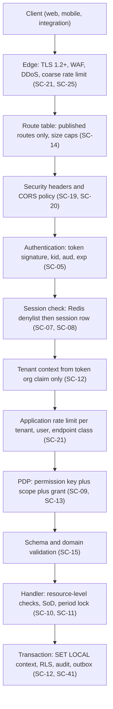
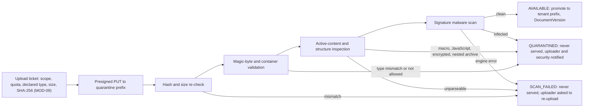
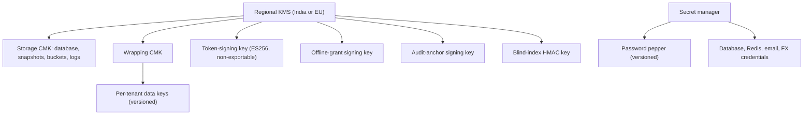
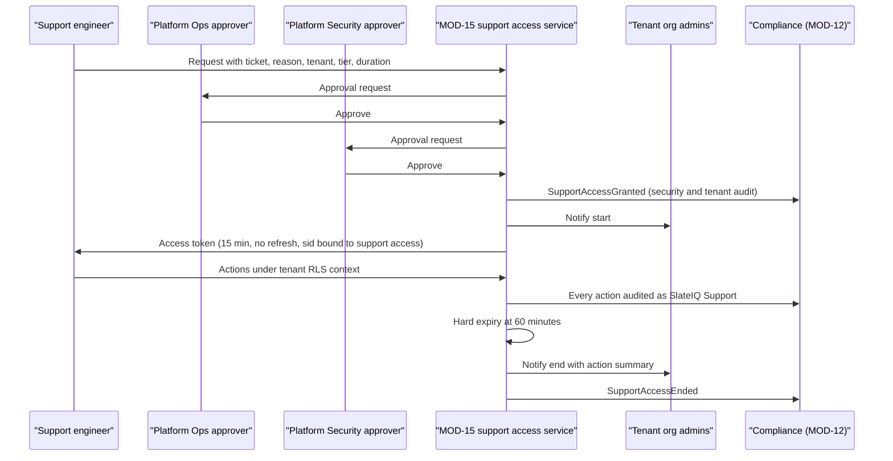
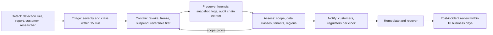

# Document 10: Security Architecture

**Product:** SlateIQ — Production Cost Intelligence & Audit Monitoring Platform
**Document ID:** SLQ-ARCH-010
**Version:** 1.0.0
**Classification:** Internal — Architecture Foundation (Security Sensitive)
**Status:** Draft — For Review
**Date:** 2026-11-06
**Authors:** Principal Security Architect, Principal Observability Architect
**Reviewers:** CISO (TBD), Data Protection Officer (TBD), Principal Architect (TBD), Head of Engineering (TBD), Legal Counsel (TBD)

---

## Document Control

### Revision History

| Version | Date | Author | Change |
|---------|------|--------|--------|
| 1.0.0 | 2026-11-06 | Security Architecture | Initial security architecture: principles, classification, control catalogue SC-01 to SC-43, OWASP ASVS Level 2 mapping, business-module STRIDE summary, privacy and compliance, support and break-glass access, incident response, vulnerability management, penetration testing, ADR-044 to ADR-047 |

### Related Documents

| Document | Relationship |
|----------|--------------|
| Document 1 — Product Vision & Business Requirements | Authoritative for FR, NFR (NFR-SEC, NFR-PRV, NFR-AUD, NFR-OBS targets), BR, D and OQ identifiers cited here |
| Document 2 — Domain Model & Capability Map | Entity ownership, module boundaries and retention used for classification (§3, §6) |
| Document 3 — Actor, Permission, Tenancy & Identity | Authoritative for authentication (§4), authorization (§5, §6), isolation (§7), grants (§8), identity threat model (§13), security monitoring (§15), permission catalogue (Appendix A), table inventory (Appendix D), control index (Appendix E). This document consumes them and does not restate them |
| Document 4 — Workflows & State Machines | State names used in threat scenarios |
| Document 6 — High-Level Solution Architecture | Architectural security commitments (§13), trust boundaries TB-01 to TB-09, threats T-01 to T-24, cryptographic design (§13.6), data classification (§8.1), residency and keys (§8.8), ADR-001 to ADR-015 |
| Document 11 — Mobile & Offline Architecture | Owns device, local-store, offline-grant, pinning and wipe controls (SC-39) |
| Document 12 — Excel & Legacy Reporting Architecture | Owns workbook parsing, template, formula and round-trip controls (SC-40) |
| Document 14 — Audit & Observability Architecture | Owns the business and security audit stores, hash chain, telemetry, detections plumbing, dashboards and runbooks (SC-30, SC-31, SC-41) |
| Document 15 — Infrastructure & Deployment Architecture | Realises network, container, backup and pipeline controls named here |
| Document 16 — Testing Strategy | Owns the security test suites that verify the controls (TS identifiers) |
| Document 17 — Risk Register & ADRs | Consolidates R10-nn and ADR-044 to ADR-047 |

### Conventions

| Convention | Meaning |
|------------|---------|
| `SC-nn` | Security control in this document's catalogue (section 5) |
| `T10-nn` | Business-module threat (section 8). Identity threats are `T4-nn` (Document 3 §13.6); platform threats are `T-nn` (Document 6 §13.5) |
| `TB-nn` | Trust boundary from Document 6 §13.2 |
| `DET-4-nn` | Security detection from Document 3 §15.6 |
| `[LEGAL-VALIDATE]` | A statement about a statute or regulator that requires confirmation by counsel before it becomes a binding commitment |
| MUST, SHOULD, MAY | RFC 2119 meanings |

---

## 1. Purpose, Scope and Authority

This document is the security architecture of SlateIQ. It consolidates the security commitments made in Document 6 §13 and Document 3 into one control catalogue, extends them to the business modules that Document 3's threat model explicitly excludes (expense, budget, documents, Excel, sync, reporting), and defines the compliance, support-access, incident and assurance processes that operate those controls.

**What this document owns.**

1. The security principles that every module and document must honour (section 2).
2. The data classification scheme and its handling rules (section 4).
3. The control catalogue SC-01 to SC-43, each with mechanism, owner module, verification and evidence (sections 5 and 6).
4. The OWASP ASVS Level 2 mapping required by NFR-SEC-009 (section 7).
5. The STRIDE threat summary for business modules (section 8).
6. Privacy and regulatory obligations: GDPR, India DPDP, CERT-In, SOX-supporting controls, SOC 2 (section 9).
7. Support and break-glass access (section 10), incident response (section 11), vulnerability management (section 12) and penetration testing (section 13).

**What it does not own.** Identity mechanics are specified in Document 3 §4 and are referenced, not repeated. Audit storage, telemetry, detection plumbing, dashboards and runbooks are Document 14. Mobile device controls are Document 11. Workbook parsing is Document 12. Infrastructure realisation is Document 15. Test procedures are Document 16.

**Precedence.** Where this document and Document 3 describe the same identity or isolation mechanism, Document 3 governs. Where this document and Document 6 §13 differ, this document governs for control detail and Document 6 governs for architectural shape; every known difference is listed in section 17 as a reconciliation note.

---

## 2. Security Principles

| ID | Principle | Consequence in the design |
|----|-----------|---------------------------|
| SP-01 | **Deny by default** | Every route requires authentication unless explicitly marked anonymous and reviewed; every permission must be granted (BR-ACC-002); unknown fields, types and permission keys are rejected |
| SP-02 | **The server is the only authority** | Tenant, actor, scope, totals, FX conversion, timestamps and state transitions are computed server-side; client values are hints (FR-TNT-018, BR-EXP-011) |
| SP-03 | **Isolation fails closed** | Missing tenant context raises an error, never an empty predicate (Document 3 §7.2); a Redis outage degrades revocation checks to the database, never to "allow" |
| SP-04 | **Defence in depth with independently testable layers** | Each layer (edge, authentication, PDP, query, RLS, storage, cache, job) has its own negative test (Document 3 §7.1) |
| SP-05 | **No plaintext secrets, no sensitive payloads in telemetry** | Passwords, keys and tokens are hashed or encrypted at rest and never logged; financial documents and amounts never enter logs, traces or metrics (governing brief §16) |
| SP-06 | **Least privilege and no standing access** | Application database role without `BYPASSRLS`; platform operators reach tenant data only through time-boxed, two-person support access |
| SP-07 | **Immutability of financial truth** | Approved records, cost postings, verified evidence and audit events are append-only; corrections are new records (BR-FIN-009, BR-DOC-001) |
| SP-08 | **Every control produces its own evidence** | Controls write audit or telemetry records as a side effect of operating, so SOC 2 and SOX evidence is never reconstructed by hand (Document 3 §15.11) |
| SP-09 | **Residency is structural** | Data, keys, backups, logs and telemetry of a tenant stay in its region (NFR-PRV-009, D-013) |
| SP-10 | **Secure by configuration, not by fork** | Tenant variation in policy (idle timeout, partial import, thresholds) is configuration bounded by platform minimums; no tenant may configure below a security floor (NFR-MNT-004) |
| SP-11 | **Assume breach; detect quickly** | Every critical-impact threat has a detective control and a runbook (Document 3 §13.1 rule 2) |
| SP-12 | **Prefer boring, proven primitives** | No custom cryptography; managed KMS; standard protocols (TLS, OIDC, JWT with asymmetric signatures, AES-GCM, Argon2id, SHA-256, HMAC) |

---

## 3. Trust Boundaries and Security Request Pipeline

Document 6 §13.2 defines trust boundaries TB-01 to TB-09 for the platform; Document 3 §13.4 defines B1 to B10 for the identity surface. They describe the same system at different resolutions. The mapping below is used throughout this document.

| Document 6 boundary | Document 3 boundary | Primary controls in this document |
|---------------------|---------------------|-----------------------------------|
| TB-01 Internet → TB-02 Edge | B1 | SC-21, SC-25, SC-34 |
| TB-02 Edge → TB-03 Application | B2 | SC-01, SC-05, SC-14, SC-15, SC-20 |
| TB-03 → TB-04 Data | B3, B4, B5, B6 | SC-12, SC-16, SC-22, SC-26, SC-27, SC-28 |
| TB-03 → TB-05 Integrations | — | SC-35 |
| TB-06 Tenant boundary | B2, B3 | SC-12 |
| TB-07 Cross-organization grant | B2 | SC-13 |
| TB-08 Platform operations | B8, B9 | SC-38, section 10 |
| TB-09 Mobile device | — | SC-39 (Document 11) |
| Region boundary | B10 | SC-26, SC-32, SC-28 |

The request pipeline applies controls in a fixed order. A request that fails a step never reaches the next one; every denial after authentication is a security event (SC-30).



**Why rate limiting follows authentication.** The edge applies a coarse per-address limit before authentication; the application limit needs the tenant and user identity to be fair. Authentication endpoints have their own pre-authentication limits keyed by account and address class (SC-21).

---

## 4. Data Classification and Handling

### 4.1 Classes

NFR-SEC-014 requires four classes. Document 6 §8.1 assigns them to data families; this section adds handling rules. Personal data is not a fifth class: it is an overlay tag (`pii_class`, Document 3 §12.2) carried by records of any class, because a vendor contact's phone number and an auditor's name are personal data inside Confidential business records.

| Class | Definition | Examples (owning module) |
|-------|------------|--------------------------|
| **Restricted** | Disclosure enables account takeover, impersonation, decryption or payment fraud | Password verifiers, pepper, TOTP secrets, recovery codes, refresh-token hashes, signing keys, tenant data keys, vendor bank references, PAN of individual vendors, integration credentials (MOD-02, MOD-05, MOD-15) |
| **Confidential** | Tenant business data and evidence; disclosure harms the customer commercially or legally | Expenses, budgets, commitments, evidence files, audit findings and reports, grants, business and security audit events, exports (MOD-04 to MOD-13) |
| **Internal** | Operational data without tenant business content | Aggregated telemetry, job metadata, template definitions, feature flags, platform dashboards (MOD-08, MOD-15) |
| **Public** | Intended for publication | Product documentation, status page, published taxonomy labels, `security.txt` |

### 4.2 Handling Matrix

| Handling | Restricted | Confidential | Internal | Public |
|----------|------------|--------------|----------|--------|
| Storage at rest | Storage encryption plus field-level encryption or one-way hash (SC-27); secrets in the secret manager (SC-29) | Storage encryption with region CMK (SC-26); RLS (SC-12) | Storage encryption | No restriction |
| Transit | TLS 1.2+; never in URLs | TLS 1.2+; never in URLs or query strings except opaque identifiers | TLS 1.2+ | TLS |
| Logs, traces, metrics | Never, including in exception text (SC-31) | Identifiers only; no amounts, names, file names, free text | Allowed | Allowed |
| Domain events | Never | Identifiers and codes only (Document 3 §12.12) | Allowed | Allowed |
| API responses | Never returned after creation (MFA secret, recovery codes shown once) | Within scope; masked fields per role (bank reference, PAN) | Authorised users | Anyone |
| Export | Never exported; bank reference and PAN masked (BR-VND-007) | Scope re-evaluated at generation; watermark; step-up above 1,000 rows (SC-37) | Platform operators | — |
| Mobile local store | Only the refresh token and device key, in the platform keystore | SQLCipher-encrypted local database (Document 11) | Allowed | Allowed |
| Support access | Not readable by design | Read-only, ticketed, two-person (section 10) | Platform operators | — |
| Retention | Life of account + 30 days; hashes purged on erasure | 7 years default (D-014), legal hold overrides | 13 months unless derived | — |
| Disposal | Crypto-shred and delete | Retention engine with hold precedence (Document 14) | Lifecycle expiry | — |

### 4.3 Classification Mechanics

| Mechanism | Rule |
|-----------|------|
| Column inventory | Document 8 tags every column with a class and, where relevant, `pii_class`. A column without a tag fails the schema lint |
| Restricted column guard | A column tagged Restricted must be either a hash, a ciphertext column with a key-version column, or absent from `slateiq_app` SELECT grants |
| Serializer guard | Types that carry Restricted values implement a redacting `ToString` and JSON converter emitting `[REDACTED]`; a unit test asserts it (Document 3 §4.2) |
| Event schema | Event payload schemas declare `pii_class`; CI rejects a payload field that is tagged Restricted |
| Evidence files | Always Confidential; file names are user-supplied text and are treated as Confidential, so they never appear in logs |

---

## 5. Security Control Catalogue

Each control states its **mechanism** (how it works), **owner** (the module or team accountable for the implementation), **verification** (how a test or audit proves it operates) and **evidence** (the artefact that remains for SOC 2, SOX-supporting review or a customer audit). Owner "Platform host" means the shared API, Sync and Worker host pipeline maintained with MOD-15.

### 5.1 Identity and Session (SC-01 to SC-08)

| ID | Control | Mechanism | Owner | Verification | Evidence |
|----|---------|-----------|-------|--------------|----------|
| SC-01 | Secure authentication | Built-in identity at MVP with email and password plus TOTP; federation (OIDC, SAML, SCIM) at Phase 1 with the MVP seams of Document 3 §4.12. Constant-time verification and dummy-hash for unknown accounts; progressive delay; 15-minute lock after five failures (FR-TNT-007); new `session_id` at every privilege boundary; internal-path-only redirects. No SMS OTP, security questions, magic links or social login (Document 3 §4.1) | MOD-02 | ST-4-01, ST-4-02, ST-4-12 (Document 3 §16); enumeration timing test | `UserAuthenticated`, `AuthenticationFailed`, `AccountLocked` security events; lockout metrics |
| SC-02 | Password hashing | Argon2id, 64 MiB, 3 iterations, parallelism 4, 16-byte salt, 32-byte output, versioned pepper applied as HMAC-SHA-256 before hashing, PHC encoding, rehash on login (Document 3 §4.2). Policy: 12 to 128 characters, three of four classes or 16-character passphrase, breach-list check, last five rejected, no calendar expiry (Document 3 §4.3) | MOD-02 | Unit test of parameters; breach-list rejection test; timing test of dummy hash | `identity.credential.params_version` and `pepper_version` distribution report |
| SC-03 | Multi-factor authentication | TOTP (RFC 6238) with replay guard and five attempts per challenge; ten Argon2id-hashed recovery codes; mandatory for roles that hold `administer` or `approve`, for `ORG_ADMIN`, `FINANCE_HEAD`, `AUDIT_MANAGER`, `PLATFORM_OPERATIONS`, `PLATFORM_SECURITY`, `SUPPORT_ENGINEER` and every external auditor (NFR-SEC-003, BR-ACC-001); administrator reset requires `identity.mfa_factor.administer`, step-up and a second approver (SOD-09). WebAuthn preferred at Phase 1 | MOD-02 | Daily MFA coverage job (100 per cent target); ST-4-04, ST-4-05 | MFA coverage report; `MfaEnrolled`, `MfaReset` events |
| SC-04 | Step-up authentication | Server-side, action-class-specific freshness (5 to 15 minutes) for credential changes, grant changes, exports above 1,000 rows, security-policy changes, break-glass start, bulk role change (Document 3 §4.10); catalogue keys marked Step-up require an assertion at most 15 minutes old | MOD-02, Platform host | Endpoint matrix: every Step-up key rejected without a fresh assertion | `StepUpGranted` events |
| SC-05 | Access tokens | JWT, 15 minutes, asymmetric signature (ES256) with private key non-exportable in regional KMS, `kid` and `ver`, `iss`/`aud` per environment and region, thin claims (`sub`, `org`, `sid`, `amr`, `scope_version`, `device_id`); no roles, permissions, names or emails; held in client memory only, never in `localStorage` (Document 3 §4.6) | MOD-02 | Token matrix (forged, expired, wrong audience, wrong region, unknown `kid`); ST-4-08 rotation drill | Signing-key rotation records; `token_validation_total` |
| SC-06 | Refresh rotation and reuse detection | Opaque 256-bit `<token_id>.<secret>`, SHA-256 hash at rest in `identity.refresh_session`, 14-day rotating within a family, 30-day absolute bound; reuse burns the family, revokes the session, bumps `scope_version`, emits `RefreshTokenReuseDetected`; fixed 60-second idempotent grace for the immediate predecessor; mobile refresh signed by the device key (Document 3 §4.7) | MOD-02 | ST-4-06 replay suite; grace-window boundary test | `RefreshTokenReuseDetected` (DET-4-05) |
| SC-07 | Session management | Idle timeout 30 minutes default, configurable 15 minutes to 8 hours (FR-TNT-022); absolute 30 days; five concurrent sessions (three for privileged roles), oldest evicted; secure logout revokes server session and denylists `sid`; web refresh cookie `__Host-slateiq_rt` `Secure`, `HttpOnly`, `SameSite=Lax`, `Path=/` | MOD-02 | Idle, absolute and concurrency tests; logout replay test | `SessionRevoked` events with reason |
| SC-08 | Revocation | Session table authoritative, Redis denylist as fast path, `scope_version` invalidates cached decisions; deactivation, role change, grant revocation and tenant suspension propagate under 60 seconds against the 5-minute commitment (BR-ACC-007, FR-TNT-006, FR-TNT-016); Redis failure degrades to database validation, never to allow (Document 3 §4.9) | MOD-02, MOD-01 | ST-4-07, ST-4-16, ST-4-24; chaos test "remove Redis" (Document 6 §12.8) | `session_revocation_duration_ms`, `grant_cascade_duration_ms`; revocation SLO report (100 per cent within 5 minutes) |

### 5.2 Authorization and Isolation (SC-09 to SC-13)

| ID | Control | Mechanism | Owner | Verification | Evidence |
|----|---------|-----------|-------|--------------|----------|
| SC-09 | Role-based access control | Eighteen system roles, immutable; custom roles within the author's own authority (no amplification); permission keys `domain.resource.action` from Document 3 Appendix A with nine flat actions; deny by default (BR-ACC-002); effective permission is role intersected with scope (BR-ACC-003) | MOD-01 | Authorization matrix test on every endpoint (NFR-SEC-004, FR-TNT-014); role escalation test (T-21) | Role version history; matrix test report per build |
| SC-10 | Resource-level authorization | Endpoint filter checks one catalogue key and scope; handler checks the specific resource: ownership, state (SM-xx guard), period lock (BR-BUD-009), evidence dispute (UC-07), scope re-evaluated at approval (BR-EXP-004), signed-URL issuance re-checked per request (BR-DOC-006). Foreign or out-of-scope objects return `404`, not `403`, where existence would disclose information (Document 3 §5.11) | All business modules | IDOR matrix per resource type (ST-4-09); state-guard tests per transition (Document 4) | Denial events with `policy.reason` |
| SC-11 | Segregation of duties and approval limits | Decision-time SoD veto (Document 3 §5.8): submitter never approves (BR-EXP-005), budget approver is not sole author (BR-BUD-012), grant creator never approves (SOD-07); approval limits on base amount at the locked rate (BR-EXP-008); delegation ≤90 days, unchained, no SoD bypass (BR-ACC-006) | MOD-01, MOD-04, MOD-07 | SoD rule tests per rule key; delegation chain test | `SodBlocked` events; SoD exception register export |
| SC-12 | Tenant isolation | Tenant from the token `org` claim only; `SET LOCAL app.org_id` per transaction; RLS `ENABLE` and `FORCE` on every tenant table; `slateiq_app` without ownership, DDL or `BYPASSRLS`; unset context raises; composite keys `(org_id, id)` within a schema and owning-module validation across schemas (RC-02); per-tenant object prefix and cache prefix; workers assert context per message (Document 3 §7) | MOD-01, Platform host, all modules | RLS verification suite (Document 3 §7.8) every build, every deploy and nightly; isolation probe at provisioning; annual penetration test (NFR-SEC-005) | CI inventory report; probe results; `cross_tenant_attempt_total` |
| SC-13 | Cross-organization grants | The only cross-tenant primitive: one client, one grantee, profile `AUDIT_READ`, `AUDIT_EVIDENCE` or `AUDIT_FINANCE`, `ASSIGNMENT`-bounded scope, maximum 12 months (BR-AUD-002); activation requires MFA, NDA and conflict declaration (FR-TNT-016); approved versions immutable; one workspace at a time; restrictive RLS grant policy; table allow-list enforced by SQL grants (Document 3 §8) | MOD-01 | Grant profile matrix (ST-4-14); widen-after-approval test (ST-4-13) | Grant register; `GrantRevoked`, `GrantWorkspaceEntered` events |

### 5.3 Application and API (SC-14 to SC-21)

| ID | Control | Mechanism | Owner | Verification | Evidence |
|----|---------|-----------|-------|--------------|----------|
| SC-14 | API security | REST `/api/v1` only; authentication required by default and every anonymous route on a reviewed allow-list; OpenAPI generated, linted and diffed in CI, so an undocumented route fails the build (inventory management); JSON ≤1 MB, evidence never through the API (presigned upload); explicit request DTOs with no mass assignment (server-owned fields such as `org_id`, `status`, totals, `created_by` are not bindable); `Idempotency-Key` bound to method, path, actor and body hash for money, evidence, imports and grants; `ETag`/`If-Match` on mutable financial records; keyset pagination with `limit` ≤200; handler timeout 10 seconds, long work returns `202` (Document 6 §7.4) | Platform host | Route inventory test; OpenAPI diff gate; mass-assignment test per DTO; idempotency replay test (ST-4-23) | OpenAPI diff report; anonymous-route register |
| SC-15 | Input validation | Three layers: (1) schema validation at the edge of the handler with FluentValidation for type, length, range, format and allow-listed enumerations; (2) domain invariants inside aggregates (Document 5); (3) database constraints (`CHECK`, `NOT NULL`, composite keys, `numeric(19,4)`). Money parsed from decimal strings with currency code, never floats; identifiers must be UUIDs; free text NFC-normalised, length-bounded, control characters stripped, stored as plain text; dates validated against the organization timezone; Excel rows use the same validators (ADR-011, BR-XLS-002) | Platform host, all modules | Property-based tests for money and dates; fuzzing of public endpoints weekly (Document 6 §13.11) | Validation failure metrics by `error_code` |
| SC-16 | SQL injection prevention | Parameterised SQL only: EF Core LINQ for writes, Dapper with parameters for reads; no string concatenation of identifiers or values; dynamic sort and filter fields mapped from an allow-list to fixed column expressions; tenant context set with `set_config('app.org_id', $1, true)` as a bound parameter; `statement_timeout` per role; analyzer rule rejects raw-SQL APIs with interpolated strings | Platform host | CodeQL SQL-injection queries on every pull request; DAST; analyzer rule in build | CodeQL report; zero-suppression register |
| SC-17 | Cross-site scripting prevention | React output encoding by default; `dangerouslySetInnerHTML` banned by lint rule with a reviewed exception list (none at MVP); user text never rendered as HTML or Markdown; Trusted Types enforced; strict CSP without `unsafe-inline` or `unsafe-eval` (section 6.2); evidence never rendered inline from the application origin (SC-22); server responses `application/json` with `nosniff`; email templates escape all variables | Web client, MOD-11 | ESLint gate; DAST (ZAP) nightly; CSP violation reports monitored | CSP report volume; lint gate result |
| SC-18 | Cross-site request forgery prevention | Access token sent as `Authorization: Bearer` from memory, so ordinary API calls carry no ambient credential; the only cookie (`__Host-slateiq_rt`) is `SameSite=Lax`, host-only and scoped to the refresh and logout endpoints' host; refresh and logout require a double-submit CSRF token bound to the session plus an `Origin` check against the allow-list (Document 3 §4.4); state-changing methods are never `GET` | MOD-02, Platform host | CSRF test with forged cross-site form and missing token | Refresh rejections by reason |
| SC-19 | CORS policy | Web application and API are served from the same origin per region (SPA static assets and `/api/v1` routed by the edge), so the browser needs no cross-origin API access. The CORS policy is an explicit, empty-by-default allow-list of exact origins (no wildcards, no `null`, no reflected `Origin`); credentials are never allowed cross-origin; preflight cache 10 minutes; mobile and server-to-server clients are not CORS subjects | Platform host | CORS negative test (foreign origin, `null`, subdomain look-alike) | Configuration in IaC; drift test |
| SC-20 | Security headers and CSP | HSTS with preload, `nosniff`, `Referrer-Policy`, minimal `Permissions-Policy`, `frame-ancestors 'none'`, Cross-Origin-Opener-Policy, `Cache-Control: no-store` on authenticated responses, server banner removal, strict CSP with report endpoint (section 6.2; Document 6 §13.8) | Platform host, edge | Header conformance test per response class; external scanner | Header test report; CSP report dashboard |
| SC-21 | Rate limiting and abuse protection | Edge WAF and per-address limits; application limits per tenant, user, device and endpoint class in Redis using GCRA with atomic scripts; pre-authentication limits per account and per address class; `429` with `Retry-After`; per-tenant fairness so one tenant cannot starve another; on Redis loss each replica falls back to a local bucket at its share of the limit (ADR-044, section 6.1, NFR-SEC-013) | Platform host, MOD-02 | Abuse load test with attack mix (ST-4-27); Redis failure chaos test | `rate_limited_total` by class; DET-4-01 to DET-4-03 |

### 5.4 Documents and Files (SC-22 to SC-24)

| ID | Control | Mechanism | Owner | Verification | Evidence |
|----|---------|-----------|-------|--------------|----------|
| SC-22 | Secure document storage | Private buckets with public access blocked and TLS-only policy; keys `org/{org_id}/...`; upload by presigned PUT (≤15 minutes, content length and SHA-256 bound) into a `quarantine/` prefix; promotion to the tenant prefix only after a clean scan (BR-DOC-005); signed GET ≤15 minutes (NFR-SEC-008), generated per request after an authorization check (BR-DOC-006), with forced `Content-Disposition: attachment`, `Content-Type` from the detected type, `X-Content-Type-Options: nosniff` and `Content-Security-Policy: sandbox` response overrides; versioning on; Object Lock for audit archives; every view, download, upload and delete in `docs.document_access_log` (FR-DOC-013); the signer resolves `org_id` from the database, not from the key | MOD-09 | Bucket policy test; URL expiry and cross-tenant reuse test (Document 6 §13.4 invariant 7); hash re-verification on download (FR-DOC-002) | Access log; bucket policy in IaC; URL issuance metrics |
| SC-23 | File type validation (magic bytes) | Content-based detection on the server after upload and before scan completion: magic-byte signature, container structure check, declared extension, declared MIME and detected type must all agree; allow-list JPEG, PNG, HEIC, PDF, XLSX, DOCX for evidence and XLSX for import; macro-enabled, encrypted, polyglot and archive files rejected; size ≤25 MB per evidence file (OQ-06 pending) and ≤50 MB for workbooks; image dimension and decompression ceilings (ADR-046, section 6.3) | MOD-09, MOD-10 | Malicious file corpus test (polyglot, renamed executable, ZIP bomb, macro document, PDF with JavaScript) | `docs.scan_result` outcome with reason code |
| SC-24 | Malware scanning | Signature engine in-region and in-VPC, updated at least every 4 hours, plus structural inspection (archive depth, embedded objects, PDF active content); scan job keyed by object version, idempotent; no file served before `AVAILABLE`; `QUARANTINED` and `SCAN_FAILED` never served; scanner outage leaves files `PENDING_SCAN` with no bypass; previews generated only after a clean scan in the isolated renderer; periodic rescan of files uploaded in the previous 7 days when signatures update (FR-DOC-006, NFR-SEC-007) | MOD-09 | EICAR and corpus tests; chaos test "scanner unavailable" (Document 6 §12.8) | Scan telemetry (100 per cent scanned); `FileQuarantined` security events; ALR-014 |

### 5.5 Cryptography and Secrets (SC-25 to SC-29)

| ID | Control | Mechanism | Owner | Verification | Evidence |
|----|---------|-----------|-------|--------------|----------|
| SC-25 | Encryption in transit | TLS 1.3 preferred, 1.2 minimum with AEAD suites only at the edge (NFR-SEC-001); HSTS preload; edge to load balancer to task re-encrypted with TLS; PostgreSQL `sslmode=verify-full`; Redis TLS with auth; object storage TLS-only bucket policy; KMS and secret manager over private endpoints; managed certificates rotated before 90 days with expiry alert at 21 days (ALR-023); mobile pins the SPKI of the issuing intermediate with a backup pin (Document 11) | Platform (Document 15) | TLS configuration scan (SSL Labs class A minimum); internal TLS assertion test | Scan reports; certificate inventory |
| SC-26 | Encryption at rest | AES-256 for database storage, snapshots, WAL archive, object storage (SSE-KMS), Redis persistence where enabled and log stores, each with the region's customer-managed key (NFR-SEC-002); no cross-region key use; mobile local store SQLCipher (Document 11) | Platform (Document 15) | IaC policy scan rejects unencrypted volumes and buckets; configuration audit | Config scan report; KMS key policy |
| SC-27 | Field-level encryption | Restricted fields encrypted in the application with AES-256-GCM under a per-tenant data key wrapped by the regional CMK, with authenticated context `org_id`, table, column, row identifier and key version; searchable Restricted values use a keyed HMAC blind index; one-way values (passwords, tokens, recovery codes) are hashed, not encrypted (ADR-045, section 6.4) | MOD-02, MOD-05, Platform host | Ciphertext-at-rest test (no plaintext in a database dump); AAD substitution test (copy ciphertext between rows fails) | Field inventory with key versions; KMS decrypt audit |
| SC-28 | Key management | Per-region KMS: storage CMK, tenant-key-wrapping CMK, token-signing key (asymmetric, non-exportable), offline-grant signing key, audit-anchor signing key, blind-index HMAC key; per-tenant data keys; separate keys per environment; key administration by `PLATFORM_SECURITY` holding `ops.key.administer` with two-person rule; rotation per section 6.5; crypto-shredding of the tenant data key at purge (Document 6 §8.8) | MOD-15, Platform Security | Key-policy audit; rotation drill; restore-in-other-region decryption failure test (Document 3 §7.8) | KMS audit log; rotation records; `SigningKeyRotated` events |
| SC-29 | Secrets management | All secrets in the regional cloud secret manager, fetched at start-up through workload identity and refreshed on rotation; no secrets in code, images, environment files, IaC state outputs or logs (NFR-SEC-006); 90-day rotation for credentials with dual-credential overlap; database access through IAM authentication where supported, otherwise rotating credentials per role; CI uses OIDC federation, no static cloud keys; Gitleaks on every commit (section 6.5) | MOD-15, Platform | Secret scanning gate; rotation-age report; image scan for embedded secrets | Secret inventory with last-rotated dates |

### 5.6 Logging, Platform and Supply Chain (SC-30 to SC-38)

| ID | Control | Mechanism | Owner | Verification | Evidence |
|----|---------|-----------|-------|--------------|----------|
| SC-30 | Security event logging | Authentication, MFA, session, authorization denial, cross-tenant attempt, grant, role, export, file quarantine, rate-limit breach summary, support access, key and configuration events written to `compliance.security_event` in an independent transaction, so they persist when the business transaction rolls back; per-tenant hash chain; envelope with actor, tenant, authority source, IP class, user-agent hash, device, correlation ID, outcome, reason code (FR-CMP-002; taxonomy and storage in Document 14 §5, ADR-059) | MOD-12, MOD-02 | Security-event completeness test per denial path; chain verification | Security event stream; chain verification report |
| SC-31 | Log and telemetry hygiene | Allow-list structured logging; no secrets, tokens, personal data, amounts, file names, request or response bodies, or `ex.Message` for data-bearing exceptions; redaction at source and a collector-side scrubber; CI redaction test; tenant identifier only as an opaque UUID (Document 14 §8, ADR-060) | Platform host | PII pattern scan on staging logs (Document 6 §13.9); CI log-capture assertion (ST-4-25) | Dropped-field counter; scan reports |
| SC-32 | Backup security | Backups and WAL archive encrypted with the region CMK, stored in a separate backup account and vault with WORM lock and deletion protection; no cross-region copy (D-013); restore only into an isolated new instance with two-person approval; restore verification includes audit chain and financial reconciliation; backup access audited; quarterly restore test (NFR-DAT-002) | Platform (Document 15), MOD-15 | Quarterly restore drill; cross-region restore decryption failure (ST-4-22) | Restore reports; vault-lock configuration |
| SC-33 | Supply-chain security | Lockfiles with integrity hashes; Renovate with grouped, reviewed updates; SCA and licence allow-list on every build; GitHub Actions pinned by commit SHA; OIDC to cloud; protected branches, required reviews (two for security-sensitive and financial code), CODEOWNERS; container images from minimal pinned-digest bases; SBOM (Syft, CycloneDX) per image; cosign signing and admission-time verification; SLSA Build Level 2 provenance at MVP, Level 3 target at Phase 1; package installs in CI without lifecycle scripts unless allow-listed; scoped internal package names to prevent dependency confusion; mobile build signing keys held in the build service vault | Platform engineering | CI supply-chain gate (T-24, ST-4-26); signature verification at deploy | SBOMs, signatures, provenance attestations retained 3 years |
| SC-34 | Infrastructure and network hardening | Edge WAF managed and custom rules, DDoS protection; only the load balancer public; private subnets for all hosts; security groups per tier; renderer without database route and without internet egress; non-root, read-only root filesystem, no privileged containers, seccomp; image rebuild monthly and within 7 days of a critical CVE; no bastion, session-managed administrative access with MFA and recording; IaC policy scanning (Document 6 §13.7) | Platform (Document 15) | IaC scan gate; CIS benchmark scan; quarterly network review | Scan reports; IaC plans |
| SC-35 | Egress and SSRF control | Egress allow-list per adapter (email, FX, scanner signature mirror, KMS, storage); no user-supplied URL fetch at MVP; Phase 1 webhooks validated against public address ranges with private, loopback, link-local and metadata addresses rejected after DNS resolution and on every redirect; PDF renderer loads only bundled assets (Document 6 §10.6) | Platform host, MOD-13 | SSRF test suite; renderer network isolation test | Egress firewall logs |
| SC-36 | Error handling and information disclosure | RFC 9457 ProblemDetails with stable `code` and `traceId`; no stack traces, SQL, internal hostnames or foreign identifiers; uniform `404` for foreign objects; identical bodies and timing for known and unknown accounts on login and reset; generic `500` with correlation identifier | Platform host | Error-response review; DAST; response-diff test (ST-4-12) | DAST report |
| SC-37 | Export and data egress controls | Exports run as jobs under the requester's tenant context with scope re-evaluated at generation; row caps; step-up above 1,000 rows; visible watermark (requester, tenant, timestamp, job identifier) on XLSX and PDF; output link ≤15 minutes; manifest with `org_id`, row counts and SHA-256; every export a business audit and security event; grant profiles gate auditor exports (Document 3 §8; FR-XLS-012) | MOD-10, MOD-13 | Export cap, watermark and expiry test (ST-4-21) | Export manifests; DET-4-12 |
| SC-38 | Privileged and support access | No standing access; support access two-person approved, ticketed, read-only by default, at most 60 minutes per session and at most 8 hours cumulative per ticket, tenant administrators notified, every action in the tenant audit trail attributed to SlateIQ Support; break-glass credentials sealed with two custodians; database emergency account vaulted (section 10; Document 3 §4.11; BR-ACC-008) | MOD-15, Platform Security | ST-4-18, ST-4-19; monthly review | `ops.support_access` records; session recordings; DET-4-13, DET-4-14 |

### 5.7 Financial Integrity and Delegated Controls (SC-39 to SC-43)

| ID | Control | Mechanism | Owner | Verification | Evidence |
|----|---------|-----------|-------|--------------|----------|
| SC-39 | Mobile and endpoint security | Device registration, SQLCipher local store with keystore-held key, biometric or passcode gate, offline grant ≤7 days (NFR-MOB-004), refresh signed by device key, certificate pinning, remote wipe on deactivation (NFR-SEC-011), screenshot and clipboard restrictions, root and jailbreak signal. **Specified in Document 11**; this document requires the evidence listed | Mobile (Document 11) | Device security test (ST-4-28) | `WipeQueued`, `WipeAcknowledged` events |
| SC-40 | Excel import and export security | Streaming parse, ≤50 MB and ≤50,000 rows, external entities disabled, formulas rejected unless allow-listed, macro and external-link parts rejected, shared validators and authorization (BR-XLS-002, FR-XLS-016), duplicate file hash confirmation (BR-XLS-003), formula-injection neutralisation on export. **Specified in Document 12** | MOD-10 (Document 12) | Malicious workbook corpus; parity tests | Import batch journal (BR-XLS-005) |
| SC-41 | Audit integrity | In-transaction business audit through `IAuditWriter`, append-only `compliance.audit_event` with no `UPDATE` or `DELETE` grant and a rejecting trigger, per-tenant SHA-256 chain, daily signed anchors to Object Lock, daily verification (ADR-012, NFR-SEC-012). **Specified in Document 14** | MOD-12 (Document 14) | Tamper simulation (QA-11, ST-4-30) | Verification report; anchors |
| SC-42 | Server-side financial integrity | Server recomputes line, tax, converted and header amounts with half-up rounding at the defined points (RC-01, BR-FIN-002, BR-FIN-011); FX rate locked at submission (BR-FIN-003); approved revisions immutable (BR-FIN-009); cost postings append-only (BR-EXP-010); duplicate detection (BR-EXP-006); optimistic concurrency; nightly reconciliation (Document 6 §8.10) | MOD-07, MOD-04, MOD-08 | Property-based money tests; tamper test where the client sends wrong totals (T-05) | Reconciliation reports |
| SC-43 | Vulnerability management | Severity SLAs critical ≤7 days, high ≤30 days, medium ≤90 days, low ≤180 days (NFR-SEC-010); single tracker; exceptions with compensating control and expiry (section 12) | Platform Security | Monthly SLA report | Vulnerability tracker export |

---

## 6. Detailed Control Designs

### 6.1 Rate Limiting (SC-21, ADR-044)

**Algorithm.** Generic cell rate algorithm (GCRA) implemented as one atomic Redis script per check. GCRA stores a single timestamp per key, allows a configured burst, and gives an exact `Retry-After`. Keys always start with the class and, after authentication, the tenant: `rl:{class}:{org_id}:{subject}`. Pre-authentication keys use the account's keyed email hash or the address class (`/24` IPv4, `/48` IPv6).

| Class | Key subject | Default limit (initial; configuration) | Burst | Response | Notes |
|-------|-------------|----------------------------------------|-------|----------|-------|
| `EDGE` | Source address | 1,200 requests per minute | 200 | Edge `429` or challenge | WAF rule; independent of the application |
| `AUTH_ACCOUNT` | Email hash | 10 password attempts per 15 minutes | 5 | `429`, uniform body | Lockout after five failures is a separate, authoritative counter in MOD-02 (FR-TNT-007) |
| `AUTH_ADDRESS` | Address class | 30 per minute; 300 per hour | 10 | `429` | Feeds DET-4-01 and DET-4-02 |
| `RESET` | Email hash, address class | 3 per account per hour; 10 per address per hour | 0 | Generic `202` | Response identical for unknown accounts (Document 3 §4.3) |
| `PUBLIC` | Address class | 60 per minute | 10 | `429` | Invitation preview, health, `security.txt` |
| `API_READ` | User | 600 per minute | 100 | `429` | Per user within tenant |
| `API_WRITE` | User | 120 per minute | 30 | `429` | Money, evidence and grant writes |
| `TENANT` | Organization | 6,000 per minute (plan-dependent) | 1,000 | `429` | Fairness ceiling across all users of a tenant |
| `SYNC` | Device | 60 push batches per minute, batch ≤100 mutations | 10 | `429` with `Retry-After` honoured by the sync engine | Separate budget (Document 6 §7.4); replay storm control (T-20) |
| `UPLOAD` | User | 300 upload tickets per hour | 50 | `429` | Quota checked before ticket issue (FR-DOC-017) |
| `EXPORT` | User | 20 export or report jobs per hour; 3 concurrent | 0 | `429` | Separate budget for reports; DET-4-12 consumes volume |
| `IMPORT` | Organization | 5 concurrent batches; 50 per day | 0 | `409 IMPORT_CONCURRENCY` | Locks per tenant in Redis (Document 6 §7.6) |

**Headers.** `429` responses carry `Retry-After` and a ProblemDetails body with code `RATE_LIMITED` and the class. Successful responses on write classes carry `RateLimit` and `RateLimit-Policy` headers so well-behaved clients can back off.

**Failure behaviour.** If Redis is unreachable, each replica enforces a local token bucket at `limit / healthy_replicas`, read from the service registry every 30 seconds. This permits a bounded over-allowance during the outage (R10-03) and never blocks legitimate traffic. Revocation and lockout do not use this fallback: they degrade to the database (SC-08).

**Telemetry.** `rate_limited_total{class, outcome}` with no user or tenant label; per-tenant breaches are aggregated in Document 14's tenant-health view by opaque `org_id` only.

### 6.2 Security Headers, CSP and CORS (SC-19, SC-20)

**Response headers.**

| Header | Value | Applies to |
|--------|-------|------------|
| `Strict-Transport-Security` | `max-age=63072000; includeSubDomains; preload` | All |
| `X-Content-Type-Options` | `nosniff` | All |
| `Referrer-Policy` | `strict-origin-when-cross-origin` (application shell); `no-referrer` (API) | All |
| `Permissions-Policy` | `camera=(), microphone=(), geolocation=(), payment=(), usb=(), interest-cohort=()` | Application shell |
| `Cross-Origin-Opener-Policy` | `same-origin` | Application shell |
| `Cross-Origin-Resource-Policy` | `same-origin` | API |
| `X-Frame-Options` | `DENY` (legacy companion to `frame-ancestors`) | Application shell |
| `Cache-Control` | `no-store` | Authenticated API responses (Document 6 §13.8) |
| `Server`, `X-Powered-By` | Removed | All |
| `Content-Security-Policy` | Below | Application shell |

**Content Security Policy for the application shell.**

```text
default-src 'none';
script-src 'self';
style-src 'self';
img-src 'self' blob: data: https://<regional-object-storage-host>;
font-src 'self';
connect-src 'self' https://<regional-object-storage-host> https://<regional-rum-collector>;
worker-src 'self' blob:;
manifest-src 'self';
frame-src 'none';
object-src 'none';
base-uri 'none';
form-action 'self';
frame-ancestors 'none';
upgrade-insecure-requests;
require-trusted-types-for 'script';
trusted-types slateiq-default;
report-to csp
```

The Vite build emits no inline scripts, so `script-src 'self'` with Subresource Integrity is sufficient. If an inline bootstrap is ever required, the edge injects a per-response nonce as Document 6 §13.8 provides; `unsafe-inline` and `unsafe-eval` are prohibited. PDF evidence preview (FR-DOC-009) renders with pdf.js in a Web Worker with scripting and eval disabled, fed from a short-lived signed URL; the browser's native PDF viewer is never embedded in the application origin.

**Evidence responses from object storage** carry `Content-Disposition: attachment`, `Content-Security-Policy: sandbox`, `X-Content-Type-Options: nosniff` and the detected `Content-Type`, set through presigned response-header overrides that the signer fixes and the client cannot change.

**CORS.** Web shell and API share one origin per region; the edge routes `/api/v1/*` to the load balancer and everything else to the static asset store. The CORS allow-list is empty at MVP. Any future first-party origin is added by IaC change with security review; the policy never reflects the request `Origin`, never allows `null`, and never allows credentials cross-origin.

### 6.3 File Validation Pipeline (SC-23, SC-24, ADR-046)



State names follow SM-12: `UPLOAD_PENDING` until the object exists, `PENDING_SCAN` during validation and scan, then `AVAILABLE`, `QUARANTINED` or `SCAN_FAILED`.

| Declared type | Required signature | Structural checks | Rejected variants |
|---------------|--------------------|-------------------|-------------------|
| JPEG | `FF D8 FF` at offset 0 | Decodes; ≤60 megapixels; ≤25 MB | Trailing data after `FF D9` beyond 1 KB (polyglot) |
| PNG | `89 50 4E 47 0D 0A 1A 0A` | Decodes; ≤60 megapixels; chunk CRCs valid | Unknown critical chunks |
| HEIC | `ftyp` box at offset 4 with brand `heic`, `heix`, `mif1` or `msf1` | ISO BMFF box structure valid; ≤60 megapixels | Image sequences beyond one item |
| PDF | `%PDF-` within the first 1,024 bytes | Cross-reference parses; page count ≤500 | JavaScript, `/Launch`, `/EmbeddedFile`, `/RichMedia`, XFA forms, encryption (scan impossible) |
| XLSX | `50 4B 03 04` | OOXML package with `[Content_Types].xml` declaring the workbook main part; total uncompressed ≤200 MB; compression ratio ≤100; ≤1,000 entries; no nested archives | `vbaProject.bin`, macro-enabled content types, external links, OLE objects, DDE fields |
| DOCX | `50 4B 03 04` | OOXML package with the document main part; same archive bounds | Macros, external template references, OLE objects, `INCLUDETEXT` or DDE fields |

**Ordering rationale.** Cheap deterministic checks run before the signature scan, so most malformed or disguised files are rejected without engine cost, and the engine sees only files whose type is known. A file that passes all checks is still served only with `attachment` disposition and sandbox CSP (section 6.2), because a clean scan is evidence of no known malware, not proof of harmlessness.

**Rescan.** When signatures update, files promoted in the previous 7 days are rescanned at low priority; a newly detected file moves to `QUARANTINED`, links remain, and the owning record raises a `MISSING_EVIDENCE` exception through MOD-07 so the approval impact is visible.

### 6.4 Field-Level Encryption and Blind Indexes (SC-27, ADR-045)

| Table and column | Class | Treatment | Lookup need | Key |
|------------------|-------|-----------|-------------|-----|
| `identity.credential.password_hash` | Restricted | Argon2id with pepper (SC-02) | Verify only | Pepper in secret manager |
| `identity.mfa_factor.secret_ciphertext` | Restricted | AES-256-GCM | None | Tenant data key of the user's home organization |
| `identity.recovery_code.code_hash` | Restricted | Argon2id | Verify only | — |
| `identity.refresh_session.token_hash`, `identity.password_reset.token_hash` | Restricted | SHA-256 of a 256-bit random secret | Exact match | — |
| `identity.service_account.secret_hash` | Restricted | SHA-256 of a 256-bit random secret | Exact match | — |
| `identity.user_pii` email | Confidential, personal | AES-256-GCM plus HMAC-SHA-256 blind index on the normalised address | Login and uniqueness | Tenant data key; regional blind-index key |
| `identity.user_pii` phone | Confidential, personal | AES-256-GCM | None | Tenant data key |
| `identity.email_change.new_email_ciphertext` | Confidential, personal | AES-256-GCM | None | Tenant data key |
| `vendor.vendor_bank_reference` value | Restricted | AES-256-GCM; masked form stored separately for display | None | Tenant data key |
| `vendor.vendor_tax_registration` identifier where scheme is `PAN` | Restricted (personal for individuals) | AES-256-GCM plus blind index | Uniqueness (BR-VND-001) | Tenant data key; blind-index key |
| `vendor.vendor_tax_registration` identifier for GSTIN or VAT | Confidential | Plaintext (public registers) | Search and validation | — |

**Envelope.** Each ciphertext is stored as `(key_version, nonce, ciphertext, tag)`. The authenticated additional data is `org_id || schema.table.column || row_id || key_version`, so a ciphertext copied to another row, column or tenant fails authentication. Nonces are 96-bit random values; a data key is retired after 2^30 encryptions or one year, whichever comes first.

**Data-key cache.** Unwrapped data keys are cached in process memory for at most 5 minutes, keyed by `(org_id, key_version)`, never written to Redis or disk, and zeroed on eviction. KMS decrypt calls are audited by the provider and by `KeyUnwrapped` sampling in Document 14.

**What is deliberately not field-encrypted.** Amounts, dates, dimensions and statuses on financial records: they must be aggregated, indexed and protected by RLS and storage encryption. Encrypting them would remove the database's ability to enforce constraints and run variance queries without providing protection against the threat that matters (an authorised but malicious application path), which RLS and audit address.

**Erasure and purge.** Destroying a tenant data key renders that tenant's field-encrypted values unreadable in live data and in every backup still within its 35-day window, which is the reason the key exists per tenant (crypto-shredding, Document 6 §13.6). Individual erasure (FR-CMP-009) deletes or pseudonymises the subject's rows; it does not rotate the tenant key.

### 6.5 Key Hierarchy and Rotation (SC-28, SC-29)



| Material | Rotation | Mechanism | Compromise response |
|----------|----------|-----------|---------------------|
| Storage CMK | Annual, provider automatic (Document 6 §13.6) | Provider retains prior versions for decrypt | Re-encrypt by snapshot copy; incident |
| Wrapping CMK | Annual, automatic | Data keys rewrapped lazily | Rewrap all data keys under a new CMK |
| Tenant data key | Annual or after 2^30 encryptions | New version for writes; background re-encryption | New key version, re-encrypt, destroy old version |
| Token-signing key | 90 days with `kid` overlap (Document 3 T4-08) | Publish new `kid`, sign with new, accept old until tokens expire | Denylist old `kid`, all tokens rejected in ≤15 minutes (Document 3 §4.9) |
| Offline-grant signing key | 90 days, overlap of 7 days (offline window) | Mobile app trusts current and previous public keys | Revoke old key; devices re-authenticate online |
| Audit-anchor signing key | Annual | Anchors record `kid`; verifier keeps public keys forever | New key; re-sign is not possible and not needed; incident review |
| Blind-index key | Not rotated routinely | Rotation requires recomputing every index | Rotate with full recompute under a maintenance flag |
| Password pepper | Annual, and on suspicion | Versioned; rehash on login; forced reset after 180 days of non-use (Document 3 §4.2) | New version; force reset for all credentials on old version |
| Service credentials | 90 days (NFR-SEC-006) | Dual-credential overlap | Immediate rotation; access review |
| TLS certificates | ≤90 days, managed | Automated renewal | Revoke and reissue |

Every rotation writes a security event and appears on Document 14's security dashboard; a credential older than its rotation period raises a SEV-3 ticket.

---

## 7. OWASP ASVS Level 2 Mapping

NFR-SEC-009 requires ASVS Level 2. The baseline is ASVS 4.0.3 as named in Document 6 §13.1; migration to ASVS 5.0 is tracked as OQ-10-06. The table maps each chapter to the controls that satisfy it, the verification method, and any requirement that is deliberately satisfied in a non-default way. Requirement-level evidence is kept in the security assessment workbook generated from Document 16's test inventory, one row per ASVS requirement.

| ASVS 4.0.3 chapter | Satisfied by | Verification | Notes and deviations |
|--------------------|--------------|--------------|----------------------|
| V1 Architecture, Design and Threat Modeling | Sections 2, 3, 8; Document 3 §13; Document 6 §13.5; SC-33 | Threat model review per epic and release (section 15) | Threat models stored with the architecture repository |
| V2 Authentication | SC-01, SC-02, SC-03, SC-04 | ST-4-01 to ST-4-05; breach-list test | 2.1.1 satisfied with a 12-character minimum; composition alternative (three classes or 16-character passphrase) per Document 3 §4.3 resolves FR-TNT-008 against 2.1.9; 2.2.1 lockout per FR-TNT-007 |
| V3 Session Management | SC-05, SC-06, SC-07, SC-08, SC-18 | Session and token suites | 3.3.2 re-authentication: 30-day absolute session, idle 30 minutes default |
| V4 Access Control | SC-09, SC-10, SC-11, SC-12, SC-13 | Authorization matrix, RLS suite, IDOR matrix | 4.3.1 administrative interfaces require MFA (SC-03) |
| V5 Validation, Sanitization and Encoding | SC-15, SC-16, SC-17, SC-40 | CodeQL, DAST, fuzzing, Excel corpus | 5.2.x sanitisation: user text is never rendered as HTML, so no HTML sanitiser is required |
| V6 Stored Cryptography | SC-02, SC-27, SC-28 | Ciphertext-at-rest test; key-policy audit | 6.2.1 AES-GCM only; 6.4 secrets in a managed store |
| V7 Error Handling and Logging | SC-30, SC-31, SC-36; Document 14 | Log-capture assertion; error-response review | 7.1.1 no credentials or tokens in logs; 7.3.3 audit integrity through hash chain |
| V8 Data Protection | Section 4; SC-20 (`no-store`); SC-37; SC-39 | Classification lint; cache header test | 8.3.4 sensitive data inventory: Document 8 column tags |
| V9 Communication | SC-25 | TLS scan; internal TLS assertion | 9.2.1 internal TLS for database, Redis and service hops |
| V10 Malicious Code | SC-33; code review; SC-29 | SCA, Gitleaks, signed artefacts | 10.3.2 integrity of updates: signed images; mobile OTA limited to JavaScript bundles signed by the build service (Document 11) |
| V11 Business Logic | SC-11, SC-21, SC-42; section 8 | Business abuse tests (T10 scenarios) | 11.1.4 anti-automation through rate classes and duplicate detection |
| V12 Files and Resources | SC-22, SC-23, SC-24, SC-35 | Malicious file corpus; SSRF suite | 12.4.1 files stored outside the web root, served only by signed URL with attachment disposition |
| V13 API and Web Service | SC-14, SC-18, SC-19 | OpenAPI diff gate; mass-assignment test | 13.2.6 headers and `Content-Type` validated; 13.1.3 no API keys in URLs |
| V14 Configuration | SC-20, SC-29, SC-33, SC-34 | IaC scan; header test; build reproducibility | 14.2.x dependency pinning and SBOM |

### 7.1 OWASP API Security Top 10 (2023) Cross-Check

| Risk | Primary controls |
|------|------------------|
| API1 Broken Object Level Authorization | SC-10, SC-12 (RLS), uniform `404` |
| API2 Broken Authentication | SC-01 to SC-08 |
| API3 Broken Object Property Level Authorization | SC-14 (no mass assignment; explicit response DTOs per role; masked Restricted fields) |
| API4 Unrestricted Resource Consumption | SC-21, payload caps (SC-14), Excel and report caps (SC-40, SC-37) |
| API5 Broken Function Level Authorization | SC-09 (one catalogue key per endpoint), authorization matrix |
| API6 Unrestricted Access to Sensitive Business Flows | SC-11, SC-42, SC-37 (export step-up), DET-4-12 |
| API7 Server-Side Request Forgery | SC-35 |
| API8 Security Misconfiguration | SC-20, SC-34, IaC scanning |
| API9 Improper Inventory Management | SC-14 (OpenAPI inventory gate, deprecation headers, NFR-MNT-001) |
| API10 Unsafe Consumption of APIs | Document 6 §10.6: schema-validated adapter responses, allow-listed hosts, timeouts and circuit breakers |

---

## 8. STRIDE Threat Summary for Business Modules

Document 3 §13 covers identity, tenancy and access; Document 6 §13.5 covers the platform (T-01 to T-24). This section covers the business threats those models exclude: manipulation of money, evidence, imports, offline mutations and reports. Likelihood (L) and impact (I) are rated before controls on Low, Medium, High, Critical. Residual is after controls.

### 8.1 Expense (MOD-07)

| ID | STRIDE | Scenario | L | I | Preventive controls | Detective controls | Residual |
|----|--------|----------|---|---|---------------------|--------------------|----------|
| T10-01 | Tampering | An approved expense's amount, vendor or category is changed after approval | Medium | Critical | Approved revisions immutable (BR-FIN-009); amendment creates a revision and resets approval when financial (BR-EXP-009); `If-Match`; no `UPDATE` path on approved rows | Business audit with before and after state; nightly reconciliation of postings to approved lines | Low |
| T10-02 | Elevation | A submitter approves their own expense through a second account, a delegation or a colluding delegate | Medium | High | SoD veto at decision time (BR-EXP-005); delegation unchained and SoD-preserving (BR-ACC-006); approval chain resolved at submission (BR-EXP-007) | DET-4-19; same-IP or same-device approver rule on approval decisions | Medium (collusion between two genuine people) |
| T10-03 | Tampering | The same invoice is claimed twice, on the same or a different show, or split into several expenses below an approval limit | High | High | Duplicate rule BR-EXP-006 on vendor, document number, date and amount; evidence SHA-256 duplicate check across the tenant; approval limits on base amount (BR-EXP-008) | `DUPLICATE_SUSPECTED` and `UNUSUAL_AMOUNT` exceptions; split-pattern analytics (Phase 1, R10-08) | Medium |
| T10-04 | Tampering | An expense is backdated into a locked period or post-dated to evade a budget check | Medium | High | Period lock rejects create, amend, approve and import (BR-BUD-009); future-date tolerance 2 days (BR-EXP-002); server time is audit time (BR-EXP-011) | `LATE_SUBMISSION` exception; device-versus-server time skew metric | Low |
| T10-05 | Tampering | A manual FX override inflates the base amount | Low | High | Override requires a reason and is audited; rate locked at submission (BR-FIN-003); override limited to finance roles | `FX_FALLBACK` exception; override report in period close | Low |
| T10-06 | Information disclosure | An approver or coordinator sees expenses outside their scope through inbox, search or comments | Medium | High | RLS restrictive scope policy; PDP scope check; search over RLS-protected tables (Document 3 §7.6) | Denial events; scope-escape tests | Low |

### 8.2 Budget and Commitments (MOD-04, MOD-05)

| ID | STRIDE | Scenario | L | I | Preventive controls | Detective controls | Residual |
|----|--------|----------|---|---|---------------------|--------------------|----------|
| T10-07 | Elevation | A budget revision is authored and approved by the same person | Low | High | BR-BUD-012 SoD; commissioner final approval above threshold where configured (BR-BUD-010) | `SodBlocked` events | Low |
| T10-08 | Tampering | Contingency is drained through many variations each below the direct-apply threshold | Medium | Medium | Contingency moves only through variations (BR-BUD-004); cumulative variation total per budget version counted against the threshold (POL in Document 5) | Variation velocity alert; variance alerts | Medium until cumulative rule confirmed (OQ-10-08) |
| T10-09 | Tampering | A period is reopened to slip transactions in after close | Low | High | Reopen requires `budget.financial_period.approve` by a Finance Head distinct from the requester; reopen window bounded; every reopen audited | Reopen report in the compliance dashboard; DET-4-09 analogue for period reopen | Low |
| T10-10 | Repudiation | A commissioner denies approving a budget version or a high-value commitment | Low | Medium | Step-up for approvals above the delegated limit (Document 3 §4.10); immutable approval decisions with `amr` | Audit export with chain proof | Low |
| T10-11 | Tampering | A vendor's bank reference is changed to divert a payment reconciled outside SlateIQ | Medium | High | Restricted class, encrypted and masked (SC-27); change audited and notified to vendor owners; second approver at Phase 1 (Document 2 §6.5); SlateIQ executes no payments | Bank-reference change report; change-then-payment-reference correlation rule | Medium until Phase 1 second approver |

### 8.3 Documents and Evidence (MOD-09)

| ID | STRIDE | Scenario | L | I | Preventive controls | Detective controls | Residual |
|----|--------|----------|---|---|---------------------|--------------------|----------|
| T10-12 | Tampering | Evidence linked to an approved expense is replaced or detached | Medium | High | BR-DOC-007; verified evidence immutable (BR-DOC-001); versioning; SHA-256 bound at upload and checked on download | Version history; hash mismatch alert | Low |
| T10-13 | Spoofing | A fabricated or AI-generated receipt is uploaded as evidence | High | High | Evidence policy by category and amount (BR-EXP-001); auditor verification and dispute (FR-DOC-007); duplicate-hash detection | Auditor sampling; EXIF and capture-source metadata retained for review; perceptual-hash duplicate detection (Phase 1) | High (R10-01): technical controls cannot prove authenticity |
| T10-14 | Elevation | A malicious file (polyglot, PDF JavaScript, macro document) attacks a reviewer's browser or workstation | Medium | High | SC-23 content validation; SC-24 scan; attachment disposition and sandbox CSP; pdf.js with scripting disabled; previews rendered in the isolated renderer | `FileQuarantined` events; ALR-014 | Low to Medium (R10-02 zero-day in viewers) |
| T10-15 | Information disclosure | A signed URL is shared or an object key is guessed | Medium | Medium | 15-minute single-object URL; tenant prefix; signer resolves `org_id` from the database; no public bucket | Access log; download-from-new-address rule | Medium (human behaviour, Document 6 T-13) |
| T10-16 | Denial of service | Storage or scan capacity is exhausted by bulk uploads | Medium | Medium | Quota at ticket issue (FR-DOC-017); `UPLOAD` rate class; per-tenant scan queue fairness | Scan queue age (ALR-013); quota alert (ALR-020) | Low |
| T10-17 | Tampering | Evidence under legal hold is deleted by retention or a user | Low | Critical | Hold flag checked by the retention engine and by `delete`; Object Lock on audit archives; destructive retention steps approved in year one (Document 6 §8.7) | Retention action report; hold reconciliation | Low |

### 8.4 Excel (MOD-10)

| ID | STRIDE | Scenario | L | I | Preventive controls | Detective controls | Residual |
|----|--------|----------|---|---|---------------------|--------------------|----------|
| T10-18 | Elevation | Import writes rows outside the user's scope or bypasses validation | Medium | High | Shared validators and authorization (ADR-011, BR-XLS-002, FR-XLS-016); commit approval where configured (`excel.import_job.approve`) | Row outcome journal; parity tests | Low |
| T10-19 | Denial of service | ZIP bomb, oversized sheet or entity expansion exhausts a worker | Medium | Medium | SC-23 archive bounds; streaming parse; XML external entities disabled; ≤50,000 rows; dedicated worker pool with memory limit (Document 6 T-19) | Worker memory and failure metrics (ALR-018) | Low |
| T10-20 | Tampering | Exported cells carry formulas that execute when opened (formula or CSV injection) | Medium | High | Values beginning with `=`, `+`, `-`, `@`, tab or carriage return are written as text with a leading apostrophe in CSV and as typed string cells in XLSX; no formulas emitted except template-defined ones | Export fidelity tests (FR-XLS-015) | Low |
| T10-21 | Tampering | A committed workbook is re-imported to duplicate cost | Medium | High | File hash registry and confirmation (BR-XLS-003); row-level duplicate rule (BR-EXP-006); reversal instead of delete (BR-XLS-006) | Duplicate import report | Low |

### 8.5 Sync (MOD-14)

| ID | STRIDE | Scenario | L | I | Preventive controls | Detective controls | Residual |
|----|--------|----------|---|---|---------------------|--------------------|----------|
| T10-22 | Tampering | A modified client sends server-owned fields (status, totals, approver, server timestamps) | Medium | High | Sync commands accept only client-owned fields; server recomputes and validates through the owning module (SC-42); device timestamp stored as metadata only (BR-EXP-011) | Rejected-field counter; conflict records | Low |
| T10-23 | Spoofing | A user whose access was revoked while offline syncs captured records | Medium | Medium | Offline authorization is provisional; every mutation re-authorised on sync; rejected records preserved locally for export (Document 3 §4.8) | Security event on rejected offline write | Low |
| T10-24 | Tampering | A mutation is replayed or its identifier reused with a different body | Medium | Medium | `mutation_id` bound to device, user and body hash; different body returns `409`; dedupe in `sync.mutation_log` (30 days) | `IDEMPOTENCY_KEY_REUSED` events | Low |
| T10-25 | Information disclosure | After a scope narrowing, a device keeps pulling or holding out-of-scope records | Medium | Medium | Pull filtered by current scope; scope change emits purge instructions; `scope_version` checked on every pull | Purge acknowledgement metric | Medium until purge acknowledgement is mandatory (Document 11) |

### 8.6 Reporting and Cost Intelligence (MOD-08, MOD-13)

| ID | STRIDE | Scenario | L | I | Preventive controls | Detective controls | Residual |
|----|--------|----------|---|---|---------------------|--------------------|----------|
| T10-26 | Information disclosure | A dashboard, report or aggregate includes rows outside the viewer's scope | Medium | High | Read models carry scope columns and RLS; scope re-evaluated at report generation (Document 6 §13.4); report run records its scope snapshot | Scope-escape tests on every dashboard endpoint | Low |
| T10-27 | Information disclosure | Benchmark aggregates allow re-identification of a tenant | Low | High | k ≥5 organizations (FR-CIN-016); consent; suppression of small cells (Phase 1) | Publication check (Document 6 §8.10) | Low |
| T10-28 | Tampering | A generated report is altered after download and presented as authentic | Medium | Medium | Report output SHA-256 recorded in `report.report_output`; signed PDF for regulator packs; watermark | Verification endpoint compares hashes | Low |
| T10-29 | Denial of service | Expensive report or dashboard queries starve the platform | Medium | Medium | Asynchronous reports; per-role `statement_timeout`; read replica for heavy reads; `EXPORT` rate class; queue isolation | Report queue wait (ALR-019) | Low |
| T10-30 | Information disclosure | The PDF renderer is abused to fetch internal URLs or local files | Low | High | Renderer has no database route and no internet egress; templates server-owned; external resource loading disabled (SC-35) | Renderer egress denials | Low |

### 8.7 Notifications and Audit Operations (MOD-11, MOD-06)

| ID | STRIDE | Scenario | L | I | Preventive controls | Detective controls | Residual |
|----|--------|----------|---|---|---------------------|--------------------|----------|
| T10-31 | Spoofing | Phishing email imitates SlateIQ approval or reset messages | High | Medium | SPF, DKIM, DMARC `p=reject` on sending domains; no amounts or document content in email (Document 2 §6.10); links go to the application, never to direct approval actions | DMARC aggregate reports | Medium |
| T10-32 | Information disclosure | A finding marked `APPOINTING_PARTY_ONLY` becomes visible to production-house users | Medium | High | Visibility enforced in the RLS predicate for `auditops.audit_finding` and in notification fan-out; independence rule (BR-AUD-006) | Visibility test matrix | Low |

---

## 9. Privacy and Compliance

### 9.1 Roles and Lawful Position

| Data | SlateIQ role | Customer role | Basis |
|------|--------------|---------------|-------|
| Tenant business data, evidence, personal data of tenant users and vendor contacts | Processor (GDPR Art. 28); Data Processor (DPDP Act 2023) | Controller; Data Fiduciary | Customer agreement and DPA. Joint-controller question for auditor data is OQ-09 and OQ-10 of Document 1 |
| Account, billing contact and security telemetry of SlateIQ's own service | Controller; Data Fiduciary | — | Legitimate interest and contract `[LEGAL-VALIDATE]` |
| Cross-tenant benchmark aggregates (Phase 1) | Controller of anonymised output | Contributor by consent | k ≥5 anonymisation (FR-CIN-016); OQ-15 of Document 1 |

### 9.2 Obligation Map

| Obligation | Source | Mechanism | Owner | Evidence |
|------------|--------|-----------|-------|----------|
| Security of processing | GDPR Art. 32; DPDP s.8(5) reasonable security safeguards | Control catalogue (section 5) | CISO | SOC 2 report; this catalogue's evidence column |
| Records of processing | GDPR Art. 30; FR-CMP-014 | `compliance.ropa_entry` maintained with `compliance.ropa_entry.update` | DPO | ROPA export |
| Data subject rights | GDPR Art. 15 to 22; DPDP s.11 to s.14; FR-CMP-008, FR-CMP-009, NFR-PRV-006 | `compliance.dsr_request` workflow ≤30 days; identity bundle via `identity.user.export`; erasure with retention and hold precedence; pseudonym retained (ADR-022) | DPO, MOD-12 | DSR log |
| Minimisation | GDPR Art. 5(1)(c); NFR-PRV-005 | Column inventory with justification (section 4.3); EXIF stripped except orientation and timestamp on capture (Document 6 §6.10) | DPO, Data Architect | Data inventory review |
| Residency | NFR-PRV-009, D-013 | Region-pinned stacks, keys, backups, telemetry (SC-26, SC-28, SC-32) | Platform | Infrastructure audit |
| Subprocessors | GDPR Art. 28(2); NFR-PRV-010 | Subprocessor register with purpose, location, DPA reference; customer notice before change | Legal | Register |
| Retention | NFR-PRV-008, D-014, BR-DOC-004 | Retention engine with legal-hold precedence (Document 14 §7) | MOD-12 | Retention action reports |
| Breach notification | GDPR Art. 33 and 34; DPDP s.8(6) and DPDP Rules 2025; CERT-In Directions; NFR-PRV-007; FR-CMP-015 | `compliance.breach_incident` with clock tracking (section 11.3) | DPO, CISO | Breach register |
| Cross-border transfer | GDPR Chapter V; DPDP s.16 | No tenant data leaves its region; support staff outside the region access through in-region sessions only, recorded as transfer in ROPA `[LEGAL-VALIDATE]` | DPO | ROPA transfer entries |

### 9.3 CERT-In Directions (India) `[LEGAL-VALIDATE]`

The CERT-In Directions of 28 April 2022 under section 70B(6) of the Information Technology Act, 2000 impose obligations on service providers and body corporates. Their application to a SaaS processor serving Indian tenants, and to EU-region infrastructure, must be confirmed by counsel (OQ-10-01). The architecture is designed to comply if they apply.

| Obligation as understood | Architectural response | Status |
|--------------------------|------------------------|--------|
| Report specified cyber incidents to CERT-In within **six hours** of noticing them | Incident clock starts at `noticed_at` on `compliance.breach_incident`; the incident commander role includes a named CERT-In reporter; a pre-filled report template is generated from the incident record; the six-hour clock is shown alongside the GDPR and DPDP clocks (section 11.3) | Designed; legal validation required |
| Maintain logs of ICT systems for a rolling **180 days** within Indian jurisdiction and provide them on request | India-region log retention: security events 13 months hot (Document 3 §12.12), operational logs 30 days hot plus 13 months cold in-region (Document 6 §14.1), edge, WAF, load balancer, DNS and VPC flow logs retained ≥180 days in the India region; retrieval runbook RB-SEC-04 (Document 14 §13) with a target of four hours to produce a scoped extract | Designed; scope of "ICT systems" requires legal validation |
| Synchronise system clocks to NTP of NIC or NPL, or to sources traceable to them | Hosts use the cloud provider's time service; traceability to NPL to be confirmed, otherwise the India-region hosts point to an NPL-traceable source (A10-05) | Open |
| Designate a point of contact | CISO office provides the named contact; recorded in the incident runbook | Process |
| Customer and subscriber records (applies to data centres, cloud, VPS and VPN providers) | Believed not to apply to a SaaS application provider; customer records are kept for the contract life plus 7 years regardless | Legal validation required |

### 9.4 India DPDP Act 2023 and DPDP Rules 2025 `[LEGAL-VALIDATE]`

| Topic | Architectural response |
|-------|------------------------|
| Notice and consent (DPDP s.5, s.6) | Customers are the Data Fiduciary for their users; SlateIQ provides versioned notice and consent records at organization and user level (Document 6 §13.9) |
| Reasonable security safeguards, including encryption, access control, monitoring and log retention for detection | SC-12, SC-26, SC-27, SC-30; security logs retained 13 months, which covers the one-year log retention that the Rules are understood to require `[LEGAL-VALIDATE]` |
| Breach intimation to the Data Protection Board and to affected Data Principals | Processor duty: notify the customer without undue delay with the information the customer needs; clock and templates in section 11.3; the Rules are understood to require a detailed report to the Board within 72 hours `[LEGAL-VALIDATE]` |
| Data Principal rights | DSR workflow (FR-CMP-008, FR-CMP-009) |
| Erasure when purpose is served | Retention engine; 7-year financial retention is a legal-obligation exception (D-014) |
| Significant Data Fiduciary obligations | Not expected to apply to SlateIQ; customers that are SDFs may require DPIA support and audit rights, provided through the DPA |

### 9.5 SOX-Supporting Controls

SlateIQ is not a financial reporting system of record, but customers rely on it for cost evidence that feeds their reporting (NFR-PRV-003). The platform therefore operates IT general controls (ITGC) and application controls that a customer's auditor can test.

| Control family | SlateIQ control | Evidence |
|----------------|-----------------|----------|
| ITGC — access to programs and data | SC-09 to SC-13, SC-38; quarterly access review (FR-TNT-021, BR-ACC-005); leavers within 24 hours | Access review exports; `UserDeactivated` events; support access records |
| ITGC — program change | Protected branches, two reviewers for financial logic, signed artefacts, change records linked to deployments (Document 6 §14.9); SC-33 | Pull request and deployment audit; SBOM and signatures |
| ITGC — computer operations | Backups, restore tests, job monitoring, incident management (SC-32, Document 14) | Restore reports; incident records |
| Application — segregation of duties | SC-11 | SoD rule inventory; `SodBlocked` events; exception register |
| Application — authorization limits | Approval limits and delegation (BR-EXP-008, BR-ACC-006) | Approval decisions with limit applied |
| Application — completeness and accuracy | SC-42; nightly reconciliation; import batch reconciliation (BR-XLS-005) | Reconciliation reports |
| Application — immutability and audit trail | SC-41; BR-FIN-009 | Chain verification reports; audit exports (FR-CMP-005) |
| Application — period control | Period lock (BR-BUD-009), reopen approval | Period close runs |

Customers whose auditors place reliance on SlateIQ for internal control over financial reporting may require a SOC 1 Type II report in addition to SOC 2; this is OQ-10-04 and risk R10-07.

### 9.6 SOC 2 Type II

NFR-PRV-004 targets SOC 2 Type II within 12 months of GA. Document 6 §13.14 maps architectural evidence to criteria; Document 3 §15.11 maps identity evidence. The additions below complete the Common Criteria coverage.

| Criterion | Control | Evidence source |
|-----------|---------|-----------------|
| CC2.2, CC2.3 communication | Security policies published; customer security page; `security.txt` and disclosure policy (section 12) | Policy repository |
| CC3.2 risk assessment | Risk register (Document 17), threat models (section 8) | Quarterly risk review minutes |
| CC6.1 logical access | SC-01 to SC-13 | Access review exports, MFA coverage |
| CC6.2, CC6.3 provisioning and removal | Invitation, deactivation cascade, grants | Identity and grant events |
| CC6.6 boundary protection | SC-21, SC-34, SC-35 | WAF and IaC configuration |
| CC6.7 transmission | SC-25, SC-22 | TLS scans |
| CC6.8 malicious software | SC-24, SC-33 | Scan telemetry; supply-chain gate |
| CC7.1 vulnerability detection | SC-43, section 13 | Scanner reports, pen-test reports |
| CC7.2 monitoring | SC-30; Document 14 detections and SLO alerts | Alert history |
| CC7.3 to CC7.5 incident response and recovery | Section 11; SC-32 | Incident records, post-incident reviews, restore reports |
| CC8.1 change management | SC-33; Document 6 §14.9 | Deployment audit |
| CC9.2 vendor management | Subprocessor register; NFR-PRV-010 | Register and DPA references |
| A1.2, A1.3 availability and recovery | Document 6 §12; Document 14 SLOs | DR exercise evidence |
| C1.1, C1.2 confidentiality and disposal | Section 4; retention engine | Classification inventory; retention reports |
| PI1.x processing integrity | SC-42 | Reconciliation reports |
| P-series privacy | Section 9.2 | DSR log, ROPA |

Evidence is collected automatically into `compliance.control_evidence` by the producing control and packaged with `compliance.evidence_pack.create` and `compliance.evidence_pack.export` (Document 14 §6).

---

## 10. Support and Break-Glass Access

### 10.1 Access Tiers

| Tier | Purpose | Who | Approval | Bound | Data reach |
|------|---------|-----|----------|-------|------------|
| T0 Metadata support | Diagnose without tenant data | `SUPPORT_ENGINEER`, `PLATFORM_OPERATIONS` | None | Standing | Telemetry, tenant state and region, job and outbox status with identifiers only (NFR-OBS-004) |
| T1 Read support access | Inspect a tenant's records to resolve a ticket | `SUPPORT_ENGINEER` with MFA | Two-person: Platform Operations plus Platform Security (`ops.support_access.create`, `ops.support_access.approve`) | ≤60 minutes per session; renewal needs fresh approval; ≤8 hours cumulative per ticket (BR-ACC-008) | Read-only through `slateiq_app` under the tenant's RLS context, attributed to SlateIQ Support |
| T2 Write support access | Correct a defect with a named action on a named object | `SUPPORT_ENGINEER` with MFA | T1 approvals plus a separate approval naming the permission key and object | Same as T1 | One named permission on one object; cannot change roles or grants, reset MFA, disable audit, bulk export or read credentials (Document 3 §4.11) |
| T3 Break-glass infrastructure | Recover the platform when the application path is unavailable | Two named custodians from `PLATFORM_SECURITY` | Ticket, two approvers, hardware-key MFA | ≤60 minutes; credentials rotated after every use | Sealed database emergency account or infrastructure role in one region; full session recording |

### 10.2 Flow



### 10.3 Rules

1. Break-glass and support access are platform controls, not grants; they never appear in the client's grant register and cannot be issued by a tenant (Document 3 §4.11).
2. The tenant is notified at start and end; for financial-data access the notification is mandatory and cannot be suppressed (BR-ACC-008).
3. Every T1 to T3 use is reviewed monthly by Platform Security; T2 and T3 uses are reviewed within 24 hours (Document 6 §13.3) and any write during support raises DET-4-13.
4. Session recording covers T3 and the administrative console path of T1 and T2; recordings are Confidential, retained 1 year in-region, and accessible only to Platform Security.
5. A support engineer cannot approve their own request; approvers cannot be the requester's direct reports in the same ticket (SoD rule in `tenancy.sod_rule`, platform tenant).
6. Support bundles (exports for engineering) are generated only under T1, contain only the named tenant, are watermarked, expire after 7 days and are access-logged (Document 3 §7.6).

---

## 11. Incident Response

### 11.1 Lifecycle



**Freeze before fix** (Document 3 §7.9): containment uses reversible actions (session revocation, grant freeze, tenant suspension, feature flag) before any deletion; every containment action is audited. Preservation precedes remediation where feasible (Document 6 §13.12).

### 11.2 Security Incident Classes and Severity

Severity levels and response times follow Document 6 §14.8 for paging and Document 3 §15.9 for security routing. Classes add the security-specific defaults.

| Class | Examples | Default severity | First actions |
|-------|----------|------------------|---------------|
| SI-1 Cross-tenant exposure | RLS drift, isolation probe failure, export with foreign rows | SEV-1 | Suspend affected path or tenant; preserve; "do not delete anything" |
| SI-2 Credential or token compromise | Refresh reuse, signing-key anomaly, credential stuffing success | SEV-1 or SEV-2 | Revoke family or rotate key (section 6.5); notify users |
| SI-3 Audit integrity failure | Chain verification mismatch, missing anchor | SEV-1 | Stop retention jobs; preserve partitions; freeze exports (Document 6 §8.10) |
| SI-4 Malware | Infected evidence, rescan detection | SEV-2 | Confirm quarantine; notify uploader and tenant security contact |
| SI-5 Insider or privileged misuse | Support write without approval, break-glass outside incident | SEV-1 | Revoke access; rotate credentials; legal hold on records |
| SI-6 Availability attack | Volumetric DDoS, application-layer flood | SEV-2 | Edge mitigation; raise WAF level; degrade per Document 6 §12.3 |
| SI-7 Supply chain | Malicious dependency, unsigned image, compromised CI | SEV-1 | Halt deployments; verify signatures; rebuild from known-good |
| SI-8 Personal-data leak in telemetry | PII scanner hit in logs | SEV-3 (SEV-2 if Restricted) | Purge affected log partitions in-region; fix redaction |

### 11.3 Notification Clocks

| Clock | Trigger | Deadline | Recipient | Owner | Status |
|-------|---------|----------|-----------|-------|--------|
| CERT-In | Specified cyber incident noticed (India nexus) | 6 hours from noticing | CERT-In | CISO | `[LEGAL-VALIDATE]` |
| Customer (processor duty) | Personal data breach or Confidential data exposure affecting a tenant | Without undue delay; internal target 24 hours from confirmation; contractual value in the DPA | Tenant security contact and Organization Administrators | DPO, Account owner | DPA |
| GDPR supervisory authority | Personal data breach (controller duty for SlateIQ's own data; customers for theirs) | 72 hours from awareness (NFR-PRV-007) | Lead supervisory authority | DPO | Statutory |
| DPDP Board | Personal data breach (Data Fiduciary duty; SlateIQ supports customers) | Intimation without delay; detailed report within 72 hours | Data Protection Board of India | Customer, supported by DPO | `[LEGAL-VALIDATE]` |
| Data subjects | High-risk breach | Without undue delay | Affected individuals | Controller | Statutory |
| Status page | SEV-1 or SEV-2 availability impact | 30 minutes | Public, regional | Incident commander | Process |

`compliance.breach_incident` stores `noticed_at`, `confirmed_at`, affected tenants, regions, data classes, and one row per clock with due time and sent time. The compliance dashboard (FR-CMP-013) shows every running clock; a clock within 25 per cent of its deadline pages the DPO.

### 11.4 Roles

| Role | Responsibility |
|------|----------------|
| Incident commander | Owns the incident, severity, decisions and communication cadence |
| Security lead | Containment, forensics, detection tuning |
| DPO | Privacy assessment, regulator and data-subject notification |
| CERT-In point of contact | Six-hour report and follow-up `[LEGAL-VALIDATE]` |
| Communications lead | Customer and status-page messages |
| Scribe | Timeline in the incident record |
| Legal counsel | Privilege, regulatory wording, legal hold |

Tabletop exercises run quarterly (Document 6 §14.7), alternating SI-1, SI-2 and SI-3 scenarios, and must include a timed six-hour report drill.

---

## 12. Vulnerability Management

| Element | Design |
|---------|--------|
| Sources | CodeQL, SCA, Trivy, Gitleaks, IaC scan, DAST, fuzzing, penetration tests, bug reports, vendor advisories, threat intelligence |
| Single tracker | Every finding becomes one ticket with asset, CVSS 3.1 or 4.0 base score, exploitability context and owner |
| Prioritisation | CVSS severity adjusted up when listed in the CISA Known Exploited Vulnerabilities catalogue or EPSS ≥0.1; adjusted down only with a documented reachability analysis |
| SLAs (NFR-SEC-010) | Critical ≤7 days; High ≤30 days; Medium ≤90 days; Low ≤180 days, measured from triage confirmation (triage within 2 business days) |
| Container base images | Rebuilt at least monthly and within 7 days of a critical CVE (Document 6 §13.7) |
| Exceptions | Compensating control, expiry ≤90 days, CISO approval; renewal requires re-assessment; listed in the monthly report |
| Disclosure | `/.well-known/security.txt` with contact, policy and expiry; coordinated disclosure policy with safe harbour; vulnerability disclosure programme at MVP, paid bounty evaluated at GA (OQ-10-07) |
| Reporting | Monthly: open by severity, SLA compliance, ageing, exceptions; quarterly to leadership |
| Gate | No release with an open critical; high findings older than SLA block release unless excepted |

---

## 13. Penetration Testing and Security Assurance

| Activity | Scope | Frequency | Performer | Exit criterion |
|----------|-------|-----------|-----------|----------------|
| Pre-pilot penetration test | Web, API, mobile (both platforms), Excel import, evidence pipeline, cross-tenant and grant boundaries, support access | Once, before pilot go-live | Independent CREST or CERT-In empanelled firm (for India-region evidence) | Critical and high fixed and retested (Document 6 §14.10) |
| Annual penetration test | Same plus infrastructure and cloud configuration review | Annually and before a major release (Document 3 §16) | Independent firm | No unremediated high; isolation finding above medium blocks (Document 3 §7.8) |
| ASVS Level 2 assessment | All ASVS chapters (section 7) | Before GA, then annually | Independent firm or qualified internal team with external review | NFR-SEC-009 met |
| Cross-tenant isolation exercise | Dedicated time-boxed attempt with two seeded tenants and colliding keys | Every penetration test | Same firm | Zero cross-tenant reads |
| Business-logic test | T10 scenarios: duplicate claims, period lock bypass, SoD bypass, formula injection, sync replay | Every penetration test | Same firm with SlateIQ domain briefing | Findings mapped to T10 identifiers |
| Red-team exercise | Objective-based, including social engineering of support for MFA reset (T4-04) | Phase 2, annually | External red team | Report to CISO |
| Continuous testing | SAST, SCA, DAST, authorization matrix, RLS suite, fuzzing (Document 6 §13.11) | Per pull request to weekly | CI | Gates in Document 16 |

**Rules of engagement.** Testing in a production-shaped staging environment with synthetic tenants; production testing only for edge and TLS configuration, with written authorisation, outside pilot business hours and with the incident channel informed. Test accounts are created by provisioning tooling and destroyed after the test. Reports are Confidential and retained 3 years as SOC 2 evidence.

---

## 14. Mobile and Excel Pointers

| Topic | Owner | Requirements this document imposes |
|-------|-------|-----------------------------------|
| Device registration, offline grant, biometric gate, SQLCipher, keystore, pinning, wipe, screenshot and clipboard restrictions, OTA integrity, root and jailbreak signal | Document 11 | SC-39 evidence; T10-22 to T10-25 controls; offline grant signing key rotation per section 6.5; pinning with backup pin and a remote kill-switch for pin rotation |
| Workbook parsing, templates, value mappings, formula policy, round-trip fidelity, import commit approval, export watermarking and injection neutralisation | Document 12 | SC-23 container checks before parse; SC-40; T10-18 to T10-21 controls; import runs under the importer's authority (BR-XLS-002) |

---

## 15. Security Governance and Metrics

### 15.1 Secure Development Lifecycle Gates

| Stage | Gate | Owner |
|-------|------|-------|
| Epic definition | Threat model delta (STRIDE against section 8 and Document 3 §13) and data classification of new fields | Security champion, Security architect |
| Design review | New trust boundary, integration, data class or region requires security architect sign-off and DPIA where personal data changes (Document 6 §13.9) | Security architect, DPO |
| Pull request | CodeQL, SCA, Gitleaks, lint rules (no raw SQL interpolation, no `dangerouslySetInnerHTML`, no session-level `SET`); two reviewers for security-sensitive and financial code | Engineering |
| Build | Authorization matrix, RLS suite, header test, redaction test, OpenAPI diff | CI |
| Release | DAST clean of high; no open critical; signatures verified; SBOM stored | Release manager |
| Operate | Detections tuned after 30 days (Document 3 §15.6); monthly vulnerability and access reports | Security operations |

### 15.2 Key Risk Indicators

| Indicator | Target | Source |
|-----------|--------|--------|
| MFA coverage of mandatory roles and grantees | 100 per cent | Daily identity audit job |
| Revocation within 5 minutes | 100 per cent | Document 3 §15.7 SLO |
| Vulnerabilities within SLA | ≥95 per cent; 100 per cent for critical | Tracker |
| Files served without a clean scan | 0 | Scan telemetry |
| Audit chain verification failures | 0 | Document 14 |
| Secrets older than rotation period | 0 | Secret inventory |
| Support access without notification | 0 | `ops.support_access` reconciliation |
| PII scanner hits in logs | 0 | Document 14 log scan |
| Mean time to contain SEV-1 security incidents | ≤4 hours | Incident records |

---

## 16. Traceability

### 16.1 Requirements to Controls

| Requirement | Controls |
|-------------|----------|
| NFR-SEC-001 | SC-25 |
| NFR-SEC-002 | SC-26, SC-27, SC-32 |
| NFR-SEC-003 | SC-03, SC-04 |
| NFR-SEC-004 | SC-09, SC-10, SC-12 |
| NFR-SEC-005 | SC-12, section 13 |
| NFR-SEC-006 | SC-29, section 6.5 |
| NFR-SEC-007 | SC-23, SC-24 |
| NFR-SEC-008 | SC-22 |
| NFR-SEC-009 | Section 7 |
| NFR-SEC-010 | SC-43, section 12 |
| NFR-SEC-011 | SC-39 (Document 11) |
| NFR-SEC-012 | SC-41 (Document 14) |
| NFR-SEC-013 | SC-21 |
| NFR-SEC-014 | Section 4 |
| NFR-PRV-001, NFR-PRV-002 | Section 9 |
| NFR-PRV-003 | Section 9.5 |
| NFR-PRV-004 | Section 9.6 |
| NFR-PRV-005, NFR-PRV-006 | Sections 4.3, 9.2 |
| NFR-PRV-007 | Section 11.3 |
| NFR-PRV-008 | Section 9.2; Document 14 §7 |
| NFR-PRV-009 | SC-26, SC-28, SC-32 |
| NFR-PRV-010 | Section 9.2 |
| NFR-AUD-001 to NFR-AUD-005 | SC-30, SC-41 (Document 14) |
| NFR-OBS-004, NFR-OBS-005 | SC-31, SC-38, section 10 |
| NFR-DAT-002 | SC-32 |
| NFR-MOB-004 | SC-39 |
| FR-TNT-006 to FR-TNT-008 | SC-01, SC-02, SC-03, SC-08 |
| FR-TNT-014 | SC-09, SC-10 |
| FR-TNT-015, FR-TNT-016 | SC-13 |
| FR-TNT-018 | SC-12 |
| FR-TNT-021 | Section 9.5 |
| FR-TNT-022 | SC-07 |
| FR-DOC-002, FR-DOC-004, FR-DOC-005 | SC-22 |
| FR-DOC-006 | SC-24 |
| FR-DOC-009 | Section 6.2 (pdf.js preview) |
| FR-DOC-013 | SC-22 |
| FR-DOC-017 | SC-21 (`UPLOAD`), SC-23 |
| FR-XLS-012, FR-XLS-016 | SC-37, SC-40 |
| FR-CMP-002 | SC-30 |
| FR-CMP-008, FR-CMP-009, FR-CMP-014 | Section 9.2 |
| FR-CMP-015 | Section 11.3 |
| BR-ACC-001 to BR-ACC-008 | SC-03, SC-08, SC-09, SC-11, SC-38 |
| BR-DOC-001 to BR-DOC-007 | SC-22, SC-23, SC-24, T10-12, T10-17 |
| BR-FIN-009, BR-EXP-005, BR-EXP-006, BR-EXP-010, BR-EXP-011 | SC-11, SC-42, T10-01 to T10-04, T10-22 |
| BR-XLS-002, BR-XLS-003 | SC-40, T10-18, T10-21 |
| BR-BUD-009, BR-BUD-012 | SC-10, SC-11 |

### 16.2 Capabilities and ADRs

| Item | Relationship |
|------|--------------|
| CAP-002, CAP-003 | SC-01 to SC-13 |
| CAP-014 | SC-22 to SC-24 |
| CAP-020, CAP-021 | SC-37, SC-40 |
| CAP-022, CAP-023 | SC-30, SC-41 |
| CAP-024 | Section 9.2 retention and hold |
| ADR-002 | SC-12 |
| ADR-006 | SC-22, SC-24, ADR-046 |
| ADR-008 | SC-01 |
| ADR-009 | SC-26, SC-28 |
| ADR-011 | SC-15, SC-40 |
| ADR-012 | SC-41 |
| ADR-013 | SC-39 |
| ADR-014 | SC-31 |
| ADR-015 | SC-33, SC-34 |
| ADR-044 to ADR-047 | Section 21 |

---

## 17. Reconciliation Notes

| ID | Conflict | Proposed resolution |
|----|----------|---------------------|
| RC-10-01 | BR-ACC-008 time-boxes support access to 8 hours; Document 3 §4.11 caps a support session at 60 minutes; Document 3 Appendix E describes break-glass with an "8-hour bound" | Both apply: each session ≤60 minutes with fresh two-person approval for renewal, cumulative ≤8 hours per ticket (section 10.1). Document 3 Appendix E should read "60-minute session, 8-hour cumulative bound" |
| RC-10-02 | Document 3 T4-30 names "monthly chain verification"; Document 6 §8.5, §8.10 and ADR-012 require daily verification | Daily verification governs (Document 14 §4.4); monthly is the deep full-history verification |
| RC-10-03 | Document 6 §13.6 states annual key rotation; NFR-SEC-006 requires 90-day secret rotation; Document 3 T4-08 rotates signing keys every 90 days | Different materials, different periods: CMKs annual, signing keys and service credentials 90 days, pepper annual (section 6.5) |
| RC-10-04 | NFR-SEC-014 and Document 6 §8.1 use four classes; Document 3 §13.2 uses "Secret" and "Personal" as classifications | Four classes are authoritative; "Secret" maps to Restricted; "Personal" is the `pii_class` overlay (section 4.1) |
| RC-10-05 | Document 6 §7.7 allows XLSX and DOCX as evidence while rejecting "archives"; both formats are ZIP containers | OOXML packages are allowed containers subject to the structural checks of section 6.3; generic archives (ZIP, RAR, 7z) remain rejected |
| RC-10-06 | Document 6 §13.12 SEV-1 notification text "≤72 h where required" omits the CERT-In six-hour clock | Section 11.3 clock table governs, subject to legal validation |

---

## 18. Assumptions and Open Questions

| ID | Assumption | Impact if wrong | Validate with | Status |
|----|------------|-----------------|---------------|--------|
| A10-01 | The cloud provider's regional KMS supports non-exportable asymmetric signing keys and HMAC keys in both India and EU regions (ADR-015 provisional) | Token signing and blind indexes need an HSM-backed alternative | Platform Architect | Open |
| A10-02 | The web shell and API are served from one origin per region through the edge, so CORS stays empty and the `__Host-` cookie works | CORS allow-list and cookie design change | Platform Architect | Open |
| A10-03 | The malware engine runs in-region inside the VPC with signature updates through an allow-listed mirror; no evidence leaves the region | A SaaS scanner would breach residency | Security Architect | Open |
| A10-04 | Evidence file types are limited to JPEG, PNG, HEIC, PDF, XLSX and DOCX at MVP | New types need signatures and structural checks | Product Owner | Open |
| A10-05 | The provider time service is traceable to UTC sources acceptable for CERT-In, or India-region hosts can be pointed to an NPL-traceable source | Clock compliance gap | Platform Architect, Legal | Open |

| ID | Open question | Owner | Needed by |
|----|---------------|-------|-----------|
| OQ-10-01 | Do the CERT-In Directions apply to SlateIQ as a SaaS processor, and do they reach EU-region infrastructure serving Indian customers? | Legal | Before India pilot go-live |
| OQ-10-02 | Under the DPDP Rules 2025, which log retention period and breach-reporting content apply to SlateIQ as Data Processor, and what must the DPA require? | Legal, DPO | Before pilot go-live |
| OQ-10-03 | Should customer-managed keys (Document 1 OQ-05) be offered at GA? The per-tenant data key supports it; key custody and availability terms do not yet exist | Security, Product Owner | Before GA |
| OQ-10-04 | Do pilot customers require a SOC 1 Type II report for ICFR reliance in addition to SOC 2? | Product Owner, Finance SME | Before GA contracts |
| OQ-10-05 | Is a second malware engine or a detonation sandbox required for evidence from untrusted vendors? | Security | Before GA |
| OQ-10-06 | When does the ASVS baseline move from 4.0.3 to 5.0? | Security | Before the GA assessment |
| OQ-10-07 | Paid bug bounty at GA or vulnerability disclosure programme only? | CISO | Before GA |
| OQ-10-08 | Should cumulative variations per budget version count against the direct-apply threshold (T10-08)? | Finance SME | Before MVP design freeze |

---

## 19. Risks Raised

| ID | Risk | Likelihood | Impact | Mitigation |
|----|------|-----------|--------|------------|
| R10-01 | Fabricated or AI-generated receipts pass technical checks; authenticity depends on auditor review | High | High | Evidence policy, auditor verification and dispute, duplicate hashing, capture metadata retained, perceptual hashing and anomaly scoring at Phase 1 |
| R10-02 | No content disarm and reconstruction at MVP; a zero-day in a PDF or image decoder could reach a reviewer | Low | High | Content validation, attachment disposition, sandbox CSP, pdf.js with scripting disabled, previews in an isolated renderer; revisit CDR at GA (OQ-10-05) |
| R10-03 | Rate limits become per-replica approximations when Redis is lost, allowing a short abuse window | Medium | Low | Edge limits remain; lockout and revocation unaffected; Redis Multi-AZ; alert on fallback mode |
| R10-04 | CERT-In and DPDP obligations are interpreted incorrectly, leading to a missed reporting deadline | Medium | High | Legal validation (OQ-10-01, OQ-10-02); clocks designed to the strictest reading; quarterly drill |
| R10-05 | A purged tenant's data persists in encrypted backups for up to 35 days, and storage-level encryption is not per tenant | Certain | Medium | Field-level secrets crypto-shredded immediately; backups age out within 35 days; disclosed in the DPA; restore of a purged tenant prohibited by runbook |
| R10-06 | Signature-based scanning misses novel malware | Medium | Medium | Structural checks before scan, rescan on signature update, safe serving rules; second engine evaluated (OQ-10-05) |
| R10-07 | Customers require SOC 1 Type II and none is planned | Medium | Medium | Confirm early (OQ-10-04); SOX-supporting controls already produce evidence (section 9.5) |
| R10-08 | Expense splitting below approval limits is not detected at MVP | Medium | Medium | Duplicate rule and `UNUSUAL_AMOUNT` exceptions at MVP; split-pattern detection at Phase 1; auditor sampling |

---

## 20. Catalogue Additions Requested

| Key | Reason | Scope | Step-up |
|-----|--------|-------|---------|
| `vendor.payment_term.administer` | Reveal the unmasked vendor bank reference for reconciliation (section 6.4). `vendor.payment_term.read` returns the masked form only; a distinct key keeps the reveal auditable and grantable to fewer roles | ORG | Yes |

---

## 21. Architecture Decision Records

### ADR-044 — Layered Rate Limiting with Redis GCRA and Local Fallback

- **Status:** Accepted
- **Context:** NFR-SEC-013 requires configurable limits and abuse protection. Limits must be fair across tenants, users and devices, survive multiple API replicas, and give exact retry guidance to the mobile sync engine. Redis 7.4 is already in the stack for rate limits (Document 6 §6.2), and Document 6 §12.2 requires degradation to in-memory limits when Redis is lost.
- **Decision:** Apply three layers: edge per-address limits; pre-authentication limits keyed by account hash and address class; post-authentication limits per tenant, user, device and endpoint class. Implement application limits with the generic cell rate algorithm in one atomic Redis script per check, keyed `rl:{class}:{org_id}:{subject}`. On Redis loss, each replica enforces a local bucket at its share of the limit. Lockout and revocation never use the local fallback.
- **Alternatives rejected:** Fixed-window counters (burst at window edges, imprecise `Retry-After`); edge-only limiting (cannot see tenant or user, unfair across tenants behind one NAT); fail-closed on Redis loss (turns a cache outage into a platform outage).
- **Consequences:** Exact, fair limits with one Redis round trip per request; bounded over-allowance during a Redis outage (R10-03); limit values become tenant-plan configuration with security floors.

### ADR-045 — Application-Level Field Encryption with Per-Tenant Data Keys and Blind Indexes

- **Status:** Accepted
- **Context:** Storage encryption protects media, not a database dump read by a compromised credential. Restricted fields (MFA secrets, bank references, individual PAN) and personal identifiers need protection beyond RLS, while email lookup at login and PAN uniqueness (BR-VND-001) need equality search. Tenant purge requires crypto-shredding (Document 6 §8.8).
- **Decision:** Encrypt Restricted and selected personal fields in the application with AES-256-GCM under per-tenant data keys wrapped by the regional CMK, with authenticated data binding tenant, table, column, row and key version. Provide equality lookup through HMAC-SHA-256 blind indexes under a regional KMS HMAC key. Hash one-way secrets. Do not field-encrypt amounts, dimensions or statuses.
- **Alternatives rejected:** PostgreSQL `pgcrypto` (keys reach the database server and appear in statement logs); transparent column encryption by a proxy (opaque operations, harder key-per-tenant); encrypting all financial columns (destroys constraints, indexing and aggregation without addressing the authorised-path threat).
- **Consequences:** A database dump yields no Restricted plaintext; per-tenant crypto-shredding works for live data and within-window backups; KMS dependency on read paths for encrypted fields, mitigated by a 5-minute in-memory data-key cache; blind-index rotation is expensive and therefore rare.

### ADR-046 — Content-Based File Validation Before Scanning, Without Content Disarm at MVP

- **Status:** Accepted
- **Context:** Evidence comes from vendors and crew in uncontrolled formats. NFR-SEC-007 requires scanning before availability and FR-DOC-017 requires type and size limits. Extension and declared MIME type are attacker-controlled. Content disarm and reconstruction (CDR) would alter evidence, which conflicts with hash-bound immutability (BR-DOC-001).
- **Decision:** Validate every upload by magic bytes, container structure, declared-versus-detected agreement, size, dimension and archive bounds, and active-content inspection before the signature scan; quarantine any failure. Serve clean files only by signed URL with attachment disposition, sandbox CSP and `nosniff`; render previews only in the isolated renderer. Keep the original bytes unaltered; no CDR at MVP.
- **Alternatives rejected:** Extension and MIME allow-list only (trivially bypassed); CDR on every file (changes evidence hashes, breaks verification and legal value, adds a licence dependency); third-party SaaS scanning (residency breach unless in-region).
- **Consequences:** Most malicious files are rejected cheaply and deterministically; evidence remains byte-identical to what was captured; residual zero-day viewer risk (R10-02) is contained by serving rules and reviewed before GA.

### ADR-047 — Multi-Clock Incident Notification and In-Region Security Log Retention

- **Status:** Accepted, subject to legal validation of statutory periods
- **Context:** One incident can start several clocks: CERT-In six hours, GDPR 72 hours, DPDP intimation and 72-hour report, and contractual customer notice. CERT-In requires 180-day log availability within India. Document 6 §14.1 retains hot logs 30 days; Document 3 §12.12 retains security events 13 months hot.
- **Decision:** Model every applicable clock as a row on `compliance.breach_incident` with due and sent times, started from `noticed_at`, displayed on the compliance dashboard and escalated at 75 per cent of elapsed time. Retain security events 13 months hot and 7 years archived, and edge, WAF, load balancer, DNS and network flow logs at least 180 days, all in the tenant region; provide a scoped extract runbook with a four-hour target.
- **Alternatives rejected:** A single 72-hour process (misses the six-hour clock); global log aggregation outside India (breaches residency and the CERT-In jurisdiction requirement); 30-day retention for all logs (insufficient for CERT-In and for incident scoping).
- **Consequences:** Higher in-region log storage cost; legal review becomes a pilot gate (OQ-10-01, OQ-10-02); quarterly drills must exercise the six-hour report.

---

## Document Approval

| Role | Name | Signature | Date |
|------|------|-----------|------|
| CISO | | | |
| Data Protection Officer | | | |
| Principal Architect | | | |
| Head of Engineering | | | |
| Legal Counsel | | | |

*End of Document 10*

