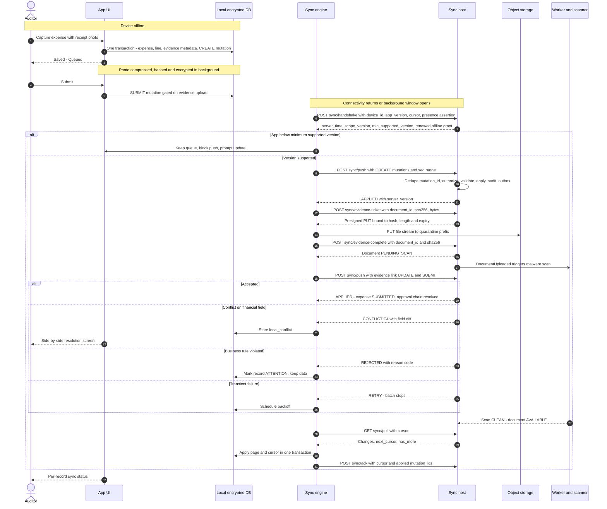

# Document 11: Mobile & Offline Architecture

**Product:** SlateIQ — Production Cost Intelligence & Audit Monitoring Platform
**Document ID:** SLQ-ARCH-011
**Version:** 1.0.0
**Classification:** Internal — Architecture Foundation
**Status:** Draft — For Review
**Date:** 2026-11-06
**Authors:** Principal Mobile Architect, Principal Integration Architect
**Reviewers:** Principal Architect (TBD), Security Architect (TBD), Audit SME (TBD), Product Owner (TBD)

---

## Document Control

### Revision History

| Version | Date | Author | Change |
|---------|------|--------|--------|
| 1.0.0 | 2026-11-06 | Architecture Team | Initial mobile and offline architecture: app modules, capture flow, local data model, key management, offline authentication, shared devices, sync strategy, failure handling, background limits, update policy, telemetry, testability; ADR-048 to ADR-051 |

### Related Documents

| Document | Relationship |
|----------|--------------|
| Document 1 — Product Vision & Business Requirements | Authoritative scope: UC-04, UC-05, FR-EXP, NFR-MOB, NFR-UX-001, D-015 |
| Document 2 — Domain Model & Capability Map | Entity names (Expense, ExpenseLine, ExpenseSplit, Document, EvidenceLink, DeviceRegistration, DeviceSyncState, SyncCursor, MutationLog, ConflictRecord); CAP-012; the "no silent loss" rule (§9) |
| Document 3 — Actor, Permission, Tenancy & Identity | Session model (§4.6), refresh rotation (§4.7), device binding and offline grant (§4.8), revocation (§4.9), device endpoints (§11.5, §11.6), permission catalogue (Appendix A), table inventory (Appendix D), ADR-023 |
| Document 4 — Core Business Workflows & State Machines | SM-09 Expense and SM-12 Document states used here by name |
| Document 6 — High-Level Solution Architecture | Mobile stack (§6.5), offline and sync architecture (§9), evidence pipeline (§7.7), mobile security (§13.13), sync API (Appendix A.13), events (Appendix B.6), ADR-004, ADR-013 |
| Document 9 — API Architecture & Endpoint Catalogue | Owns the sync and evidence endpoint contracts; receives the contract obligations in section 20 |
| Document 10 — Security Architecture | Owns the control catalogue; this document supplies the mobile controls |
| Document 14 — Audit & Observability Architecture | Owns telemetry pipelines and audit event schemas used in sections 16 and 11 |
| Document 15 — Infrastructure & Deployment Architecture | Owns build, signing, store release and OTA channels referenced in section 15 |
| Document 16 — Testing Strategy | Consumes the test obligations in section 18 |

### Conventions

| Convention | Meaning |
|------------|---------|
| "Device" | One installation of the SlateIQ app on one physical phone or tablet |
| "Profile" | One signed-in user's isolated partition on a device (section 8) |
| "Server" | The Sync host for `/api/v1/sync/*` and the API host for other routes (Document 6, ADR-001) |
| `local_*` | Tables in the on-device SQLCipher database; they are not PostgreSQL tables and do not appear in Document 3 Appendix D |
| C1 to C5 | Conflict policy codes of Document 6 §9.4 |
| A11-nn, OQ-11-nn, R11-nn, RC-11-nn | Assumptions, open questions, risks and reconciliation notes raised here |

---

## 1. Purpose and Scope

This document specifies how the SlateIQ auditor app captures expenses and evidence at the point of spend, keeps that data safe on a device for up to seven days without connectivity, and delivers it to the server exactly once with deterministic outcomes. It refines Document 6 §9 (the protocol and conflict matrix, which remain authoritative) into a buildable mobile architecture, and it closes the governing brief's section 12 obligations.

**In scope (MVP).** Expense capture with lines, splits, tax, currency, vendor or one-time payee; evidence capture (camera, gallery, files); drafts and autosave; offline capture within D-015 limits; background and foreground sync; conflict resolution; per-record sync status; assignment-scoped reference data; on-device authentication; shared devices; remote wipe; optional location capture; update enforcement; telemetry.

**Out of scope at MVP.** Expense approval on mobile (online-only approval screens are Phase 1, A11-03); audit report and finding authoring on mobile (web only at MVP, A11-04); receipt OCR; push notifications (D-016, Phase 1); expense templates and favourites (FR-EXP-025, Phase 1).

**What this document does not decide.** API payload schemas (Document 9), physical server tables (Document 8), the security control catalogue (Document 10), and store release mechanics (Document 15).

---

## 2. Architectural Drivers

### 2.1 Requirements

| Driver | Target | Section |
|--------|--------|---------|
| NFR-UX-001 | Standard expense entry ≤30 seconds median for a trained auditor | 4 |
| NFR-MOB-001, NFR-AVL-005, D-015 | 7 days, 500 expenses, 500 MB evidence per device; full capture offline | 5.6, 7 |
| NFR-MOB-002, FR-EXP-004 | Deterministic, server-authoritative, audited conflict resolution with field-level diff | 9.7 |
| NFR-MOB-003 | ≥95% of queued records synced within 5 minutes of connectivity, without blocking capture | 9, 14 |
| NFR-MOB-004, FR-EXP-030 | Offline authentication ≤7 days; biometric or passcode required | 7 |
| NFR-MOB-005 | Images ≤2 MB with legible text | 12 |
| NFR-MOB-006 | Functional at 128 kbps with incremental retry | 9.4, 10 |
| NFR-SEC-011, FR-EXP-003 | No plaintext financial data on the device; remote wipe on deactivation | 5, 6, 10 |
| NFR-PERF-009 | Launch to usable state ≤3 seconds on a mid-range device | 3.4, 4 |
| NFR-PERF-011 | Evidence upload ≥1 MB/s on 4G; 10 MB in ≤15 seconds | 9.5 |
| NFR-UX-003, NFR-UX-005 | VoiceOver and TalkBack; iOS 16+ and Android 10+ | 3, 14 |
| FR-EXP-001 to FR-EXP-013 | Capture, autosave, offline queue, lines, vendor, category, tax, FX, evidence, evidence rules, submit, validation | 4, 9 |
| BR-EXP-011 | Server timestamp governs audit time; device time is metadata | 9.2 |
| Governing brief §12 | Fast entry through device session management, and eight named failure scenarios | 4 to 11 |

### 2.2 Mobile Design Principles

| ID | Principle | Consequence |
|----|-----------|-------------|
| MP-01 | The device is the system of capture; the server is the system of record (Document 6 AP-08) | Every user action commits locally first; the network is never on the capture path |
| MP-02 | One local transaction per user intent | Saving an expense writes the record, its lines, its evidence metadata and its outbox mutation atomically |
| MP-03 | Nothing captured is lost silently | Removal of captured data happens only through the explicit, audited paths of section 11 |
| MP-04 | Client validation is advice; server validation is law | The app runs a generated subset of rules for fast feedback; the server re-runs the full shared validators (ADR-011) |
| MP-05 | Control points are online-only | Approve, reject, amend, cancel, FX lock and scope changes are never decided on the device (Document 6 §9.4) |
| MP-06 | The UI reads the local database only | Screens observe local tables; the sync engine is the only network writer of business data |
| MP-07 | Background work is opportunistic, never relied upon | Correctness never depends on the OS granting background time (section 14) |

---

## 3. App Architecture and Module Structure

### 3.1 Layers

The app is one TypeScript code base under `mobile/` in the monorepo (Document 6 §6.11), built with React Native and an Expo development build (ADR-013). It is organised in three layers with one-way dependencies.

| Layer | Contents | May depend on |
|-------|----------|---------------|
| Routes | Screen components and navigation (`mobile/app/`) | Features |
| Features | Use-case modules with view models and screen-specific state (`mobile/src/features/*`) | Core |
| Core | Platform-neutral services without UI (`mobile/src/core/*`) | Generated contracts only |

### 3.2 Module Catalogue

| Module | Layer | Responsibility | Key collaborators |
|--------|-------|----------------|-------------------|
| `features/auth` | Feature | Sign-in, MFA, device registration, unlock screen, offline-grant status, re-authentication | `core/session`, `core/keys` |
| `features/profiles` | Feature | Profile chooser, profile PIN, add and remove profile on shared devices | `core/session`, `core/keys` |
| `features/assignments` | Feature | Active assignments, show and department context, scope expiry banners | `core/db` |
| `features/capture` | Feature | Quick capture and full capture of expenses, lines, splits, tax, currency, payee | `core/db`, `core/domain`, `features/evidence` |
| `features/evidence` | Feature | Camera, gallery, file picker, compression, preview, legibility check | `core/media`, `core/crypto` |
| `features/expenses` | Feature | Expense list, detail, server status mirror, comments (read online) | `core/db` |
| `features/sync-status` | Feature | Queue summary, per-record status, "needs attention" list, manual sync | `core/sync` |
| `features/conflicts` | Feature | Side-by-side conflict resolution (UC-05), held-record explanations | `core/sync`, `core/db` |
| `features/settings` | Feature | Location consent, storage usage, diagnostics export (redacted), sign-out | `core/telemetry`, `core/platform` |
| `core/db` | Core | SQLCipher connection, schema migrations, reactive queries, storage accounting | `core/keys` |
| `core/keys` | Core | Key hierarchy, keystore access, wrapping and unwrapping, zeroisation (section 6) | Native key module |
| `core/crypto` | Core | AES-256-GCM file encryption, SHA-256 hashing, signature verification | Native crypto module |
| `core/session` | Core | Token store, refresh with device signature, offline grant verification, presence assertions | `core/api`, `core/keys` |
| `core/sync` | Core | Sync engine: outbox scheduler, push, pull, ack, evidence uploader, backoff, conflict intake | `core/api`, `core/db` |
| `core/api` | Core | HTTP client generated from `contracts/openapi`; certificate pinning; ProblemDetails mapping | Generated contracts |
| `core/domain` | Core | Generated validation subset, tax and split arithmetic with decimal types, reason-code catalogue | Generated contracts |
| `core/media` | Core | Image resize, JPEG encode, EXIF policy, blur metric | Native image module |
| `core/platform` | Core | Background task registration, connectivity, storage free space, location, app state | Expo and OS APIs |
| `core/telemetry` | Core | Event buffer, redaction, OTLP export, crash capture (section 16) | `core/api` |
| `test-hooks` | Test only | Fault injection and determinism hooks (section 18); excluded from release builds | Core |

**Dependency rules.** Features never import other features except through declared public entry points (`features/evidence` exposes a capture component to `features/capture`). Core never imports features. `core/sync` has no UI imports and runs headless in a Node test harness against a real Sync host (section 18). A lint rule enforces the graph in CI.

### 3.3 Shared Contracts

`contracts/` (Document 6 §6.11) is the single source of the sync mutation schemas, ProblemDetails reason codes, enumerations (expense status, document type, payment mode, conflict policy) and the client-side validation subset. The mobile build generates TypeScript types and validators from it; a contract change that breaks the mobile build fails CI before it can reach the server.

Money on the device uses a decimal type with scale 4 and half-up rounding at the points defined in RC-01 of the authoring brief (line amount, tax amount, converted amount, total). JavaScript `number` is never used for money; persisted amounts are decimal strings with an ISO 4217 code.

### 3.4 Runtime Model

| Runtime element | Thread or process | Notes |
|-----------------|-------------------|-------|
| UI | JavaScript thread with native rendering | Never awaits the network on a capture path |
| Database | Native SQLite worker thread | WAL mode; outbox writes use `synchronous=FULL` |
| Sync engine | JavaScript, scheduled by app state and background tasks | One instance per unlocked profile; single-flight lock |
| Media pipeline | Native image worker | Compression and hashing off the JavaScript thread |
| Background tasks | iOS BGTaskScheduler, Android WorkManager via Expo task APIs | Bounded; checkpointed (section 14) |

Cold start reaches the unlock screen without opening the database; the database opens after unlock in parallel with the first screen render, which keeps NFR-PERF-009 (≤3 seconds) achievable on mid-range Android devices.

---

## 4. Capture Flow for the 30-Second Target

### 4.1 Time Budget

NFR-UX-001 sets a 30-second median for a standard expense: one line, a known vendor, one receipt photo. The flow is engineered against the following budget, measured by the telemetry events of section 16.

| Step | Design | Budget |
|------|--------|-------:|
| Unlock | Biometric prompt on launch or resume (section 7); warm start | 2 s |
| Context | Show, season and department preselected from the last capture inside an active assignment; one tap to change | 2 s |
| Amount | Numeric keypad autofocused; currency defaults to the last used for the show, else the organization base currency | 5 s |
| Vendor | Local index search with recent vendors first; "one-time payee" action inline (FR-EXP-006) | 5 s |
| Category | Filtered to categories mapped to the department (FR-EXP-007, BR-EXP-015); five most recent pinned | 3 s |
| Receipt | Camera opens in ≤500 ms on the capture screen; tap or auto-capture; compression runs asynchronously | 6 s |
| Description | Optional; suggestion chips from the category and recent entries | 3 s |
| Save | One local transaction (≤100 ms); confirmation with sync status | 1 s |
| **Total** | | **27 s** |

Defaults derived from reference data and the auditor's own history do the work: expense date defaults to today in the organization timezone; tax rate and inclusive flag default from the category (FR-EXP-008); document type and payment mode default from the last use for the same vendor. No default is ever applied to an amount.

### 4.2 Quick Capture and Full Capture

| Mode | Use | Fields shown |
|------|-----|--------------|
| Quick capture | The standard expense: one line | Context, amount, vendor, category, receipt, optional description |
| Full capture | Multi-line bills, splits, episodes, commitment consumption, foreign currency detail | Header plus lines (FR-EXP-005), splits (FR-EXP-026), episode, quantity and unit price, tax per line, commitment reference |

Quick capture produces the same Expense and ExpenseLine records as full capture; switching mode never discards entered values.

### 4.3 Local Validation

The generated validation subset (`core/domain`) runs on every field change and on save. It covers mandatory fields, arithmetic (BR-FIN-011 header equals sum of rounded lines; BR-EXP-012 splits equal exactly 100% and the line total, remainder to the largest split), future-date tolerance using the skew-corrected clock (BR-EXP-002), category-department mapping (BR-EXP-015), vendor status from the last pull (BR-EXP-013), evidence requirement by category, amount threshold and policy (BR-EXP-001), and the locked-period check from cached period status (BR-EXP-003).

| Outcome | Behaviour |
|---------|-----------|
| Error on save as draft | Never blocks a draft; the field is marked |
| Error on submit | Blocks the local submit with an actionable message (NFR-UX-008) |
| Advisory (for example a possible duplicate in local data, BR-EXP-006) | Shown inline; the auditor may link, justify or continue; the justification travels with the submission |

Local validation can be stale. The server is authoritative and may still reject; section 9.7 defines the outcomes.

### 4.4 Drafts and Autosave

Every capture screen autosaves to the local database every 5 seconds of inactivity and on every navigation or app-state change (FR-EXP-002). An autosaved draft is a `local_expense` row with `sync_state = LOCAL_ONLY` and no outbox mutation. Explicit "Save" or "Submit" creates the outbox mutation. Drafts are synchronised to the server as `DRAFT` expenses when the auditor saves explicitly, so a draft survives device loss once synced; the client UUIDv7 prevents duplicate drafts (FR-EXP-002 acceptance).

### 4.5 Submit While Offline

Submitting offline records the auditor's intent: the expense moves to the local display state "Submitted, waiting to sync" and a `SUBMIT` mutation enters the outbox, gated on the evidence it depends on (section 9.5). The server decides the real outcome (`SUBMITTED`, a rejection with reasons, or a conflict). The UI never shows a server status the server has not returned.

---

## 5. Local Data Model (SQLCipher)

### 5.1 Storage Layout per Profile

| Store | Location | Protection |
|-------|----------|------------|
| Database | `profiles/{profile_id}/slateiq.db` (SQLCipher 4, AES-256, page HMAC) | Key `K_db` (section 6) |
| Evidence files | `profiles/{profile_id}/evidence/{document_id}.bin` | AES-256-GCM per file with a per-file key wrapped by `K_file` |
| Thumbnails | Inside the database as encrypted blobs ≤40 KB | Database encryption |
| Profile registry | `profiles/registry.json` | Contains only profile ID, hashed user ID, initials, pending-item count and lock state; no amounts, names or tokens |
| Secrets | iOS Keychain or Android Keystore | Section 6 |

Files are written to a temporary name, flushed, then renamed atomically; a crash never leaves a half-written evidence file that is referenced by the database. All app files are excluded from cloud backup (iOS `isExcludedFromBackup`, Android `allowBackup=false` and data-extraction rules), so local data never leaves the device except through sync.

### 5.2 Reference and Scope Tables

| Table | Purpose | Key columns |
|-------|---------|-------------|
| `local_scope` | Cached identity, membership, effective scope summary and validity | `user_id`, `org_id`, `scope_version`, `scope_json`, `valid_to`, `permission_snapshot_hash` |
| `local_assignment` | Active and recently ended audit assignments with scope elements | `assignment_id`, `show_id`, `status`, `start_date`, `end_date`, `scope_json`, `version` |
| `local_reference` | Reference data by kind: show, season, episode, department, category, category-department mapping, vendor (active and candidate), currency, tax rate, payment mode, document type | `kind`, `id`, `version`, `payload`, `effective_from`, `deleted` |
| `local_period` | Financial period status for date guards | `period_id`, `scope_type`, `scope_id`, `start_date`, `end_date`, `status`, `version` |
| `local_policy` | Evidence thresholds, per-transaction and per-day limits, duplicate tolerance, offline limits, location policy | `key`, `value_json`, `version` |
| `local_fx_hint` | Latest organization rates for display only; never used for the locked conversion (BR-FIN-003) | `from_currency`, `to_currency`, `rate`, `rate_date`, `source` |

Vendor reference data is scoped to the shows the user can access; a tenant with more than 20,000 active vendors syncs the 5,000 most recently used in the user's shows and performs an online search for the rest (A11-05).

### 5.3 Capture Tables

| Table | Purpose | Key columns |
|-------|---------|-------------|
| `local_expense` | Expense header for one revision and its server status mirror | `id` (UUIDv7, the `expense_id`), `root_expense_id`, `revision`, `server_version`, `base_version`, `server_status` (SM-09 name or null), `sync_state`, `show_id`, `season_id`, `department_id`, `vendor_id`, `one_time_payee_json`, `expense_date`, `document_type`, `document_number`, `payment_mode`, `currency`, `total_gross`, `assignment_id`, `device_created_at`, `server_received_at`, `capture_location_json`, `duplicate_justification`, `discarded_at` |
| `local_expense_line` | Lines with tombstones | `id`, `expense_id`, `seq`, `category_id`, `episode_id`, `description`, `quantity`, `unit_price`, `tax_rate`, `tax_inclusive`, `net`, `tax`, `gross`, `commitment_id`, `deleted` |
| `local_expense_split` | Splits per line | `line_id`, `seq`, `department_id`, `category_id`, `percentage`, `amount`, `deleted` |
| `local_evidence` | Document metadata, link target and file state | `document_id` (UUIDv7), `expense_id`, `line_id`, `evidence_type`, `mime_type`, `bytes`, `sha256`, `file_state`, `upload_state`, `server_doc_status` (SM-12 name or null), `verification_status`, `captured_at`, `evicted_at` |

**Sync state of a local record (`sync_state`).** These are device states, not business states, and never replace the SM-09 status.

| State | Meaning |
|-------|---------|
| `LOCAL_ONLY` | Autosaved; no mutation queued |
| `QUEUED` | One or more mutations pending |
| `SYNCING` | A batch containing its mutation is in flight |
| `SYNCED` | Server acknowledged; `server_version` current |
| `CONFLICT` | A `local_conflict` row awaits a decision |
| `ATTENTION` | Rejected by the server with a reason the auditor must act on |
| `HELD` | Accepted by the server into a held conflict for supervisor review (section 11.3) |

### 5.4 Outbox, Uploads, Cursor and Conflicts

| Table | Purpose | Key columns |
|-------|---------|-------------|
| `local_mutation` | Ordered outbox of pending changes | `mutation_id` (UUIDv7), `seq` (monotonic per profile), `entity_type`, `entity_id`, `operation`, `base_version`, `payload` (changed fields, schema-versioned), `payload_schema_version`, `depends_on_documents`, `state`, `attempts`, `next_attempt_at`, `result_code`, `result_detail`, `created_at`, `client_occurred_at` |
| `local_upload` | Evidence upload jobs | `document_id`, `ticket_id`, `ticket_expires_at`, `upload_mode` (`SINGLE`, `MULTIPART`), `part_size`, `parts_done`, `bytes_sent`, `state`, `attempts`, `last_error` |
| `local_sync_state` | Pull cursor and handshake facts | `cursor`, `scope_version`, `last_handshake_at`, `last_success_at`, `server_time_skew_ms`, `min_supported_version`, `offline_until`, `resync_required` |
| `local_conflict` | Conflicts and held items awaiting decision | `conflict_id`, `entity_type`, `entity_id`, `policy`, `reason_code`, `server_value`, `client_value`, `field_diff`, `created_at`, `resolution`, `resolved_at` |
| `local_journal` | Local record of explicit user actions that remove or replace captured data, awaiting server acknowledgement | `journal_id`, `action` (`DRAFT_DISCARDED`, `CONFLICT_RESOLVED`, `EVIDENCE_RECAPTURED`, `PROFILE_REMOVED`), `entity_id`, `reason`, `occurred_at`, `reported_at` |
| `local_telemetry` | Redacted telemetry buffer (section 16) | `event`, `attrs_json`, `occurred_at` |

**Outbox states (`local_mutation.state`).** `PENDING` → `SENDING` → `APPLIED` | `CONFLICT` | `REJECTED` | `RETRY` (back to `PENDING` at `next_attempt_at`) | `HELD`. A `SENDING` mutation found at startup returns to `PENDING`; the server deduplicates by `mutation_id`, so re-sending is safe.

**Operations.** The device emits only `CREATE`, `UPDATE`, `DELETE_EVIDENCE` and `SUBMIT` (Document 6 §9.3). `AMEND` is not emitted from the offline queue (RC-11-03).

### 5.5 Migrations

The local schema carries `PRAGMA user_version`. Migrations are forward-only, run inside one transaction before the sync engine starts, and are tested from each of the last four released schema versions with a populated outbox (Document 6 §9.8 "schema upgrade"). A migration never rewrites `local_mutation.payload`; payloads keep their `payload_schema_version`, and the server accepts the current and previous mutation schema versions (section 15.3). A failed migration restores the pre-migration database copy taken immediately before it and blocks the app with a support code; it never starts with a partially migrated database.

### 5.6 Limits and Storage Accounting

| Limit (D-015) | Measure | 80% warning | 100% behaviour |
|---------------|---------|-------------|----------------|
| 7 days offline | `offline_until` from the offline grant | Banner from day 5; daily reminder | Capture locked; queue retained encrypted (section 7.4) |
| 500 expenses | Count of `local_expense` rows not `SYNCED` | Banner and sync prompt | New capture blocked; drafts and queue retained (UC-04) |
| 500 MB evidence | Sum of `local_evidence.bytes` for files not yet uploaded and confirmed | Banner and sync prompt | New photos blocked; text capture allowed; existing evidence retained (UC-04) |

Synced records do not count against the limits. Records whose server status is terminal (`APPROVED`, `REJECTED`, `CANCELLED`, `SUPERSEDED`) and acknowledged for 30 days are pruned from the device, because the server holds them; pruning is not discarding (section 11.1). Evidence files whose server document is `AVAILABLE` are evicted after 7 days or earlier under storage pressure, keeping the encrypted thumbnail.

---

## 6. Key Management

### 6.1 Key Hierarchy

| Key | Type and storage | Protects | Availability |
|-----|------------------|----------|--------------|
| `KEK_dev` | AES-256, non-exportable, hardware-backed (Secure Enclave-wrapped Keychain item on iOS; Android Keystore, StrongBox where present); accessibility `AfterFirstUnlockThisDeviceOnly` | Wraps `K_db` | After the device is first unlocked after boot; usable by background tasks |
| `K_db` | 256-bit random, generated on profile creation | SQLCipher database | In memory only while the profile is open; zeroised on lock timeout, sign-out or wipe |
| `K_file` | 256-bit random, stored inside the encrypted database | Wraps per-file keys | When the database is open |
| Per-file key | 256-bit random per evidence file, AES-256-GCM with a 96-bit random nonce | One evidence file | When the database is open |
| `KD` (device key) | EC P-256, non-exportable, hardware-backed; no user-presence requirement | Signs refresh and sync requests (Document 3 §4.8) | Foreground and background |
| `KP` (presence key) | EC P-256, non-exportable, hardware-backed; user presence required (biometric or device passcode); invalidated when biometric enrolment changes | Signs presence assertions and the local unlock challenge | Only after a successful biometric or passcode prompt |
| `K_pin` | Derived with Argon2id from the profile PIN (shared-device mode only) | Second wrap of `K_db` (section 8) | Only after the PIN is entered |
| `K_rec` | 256-bit recovery secret held by the server under KMS in the device registration record; never stored on the device unwrapped | Recovery wrap of `K_db` | Released only after full online re-authentication with password and MFA |
| Refresh token | Opaque; Keychain or Keystore-encrypted storage | Session continuation | Used with a `KD` signature |
| Offline grant | Server-signed structure (Document 3 §4.8) | Offline authorization snapshot | Verified with the pinned server public key |

### 6.2 Lifecycle Events

| Event | Key handling |
|-------|--------------|
| First sign-in on a device | Generate `KD` and `KP`; register the device with both public keys and platform attestation (`POST /auth/device/register`); create `K_db`, `K_file`; wrap `K_db` under `KEK_dev`; obtain `K_rec` from the registration response and store only `wrap(K_rec, K_db)` |
| Unlock | Biometric or passcode prompt produces a `KP` signature over a local challenge; on success open the database with `K_db` |
| App backgrounded | UI re-locks after 5 minutes in background (Document 6 §13.13); the sync engine may keep the database open for up to the background window (section 14.3) |
| Biometric enrolment changed | `KP` is invalidated by the OS; the user signs in online with password and MFA; a new `KP` is registered. `K_db` is unaffected because it is wrapped by `KEK_dev` |
| `KEK_dev` unusable (keystore reset after OS update or restore) | The app requests `K_rec` after online password and MFA, unwraps `K_db` from the recovery wrap and re-wraps it under a new `KEK_dev`. Captured data survives (MP-03) |
| Sign-out | Refresh session revoked server-side (Document 3 §4.6); local data stays encrypted for the next sign-in of the same user unless the outbox is empty and the user chooses "remove from this device" |
| Remote wipe | Delete the database and files, delete `KEK_dev` wrap entries, `KD`, `KP` and tokens; acknowledge (section 10.10) |

**Rationale.** `K_db` is device-bound rather than presence-bound so that background sync can run when the OS grants time (NFR-MOB-003). User presence is enforced cryptographically through `KP`: no refresh with a new idle window, no offline-grant unlock and no UI access is possible without it. The residual exposure (an attacker who controls an unlocked, running device) is Document 3 risk R4-04 and is bounded by the seven-day grant, the background window and remote wipe. ADR-049 records the decision.

### 6.3 Cryptographic Parameters

| Item | Parameter |
|------|-----------|
| SQLCipher | Version 4 defaults: AES-256-CBC with HMAC-SHA512 page authentication, PBKDF2 disabled because the key is random (raw key mode) |
| Evidence files | AES-256-GCM, 96-bit random nonce, 128-bit tag, associated data = `document_id` and `sha256` of the plaintext |
| Hash | SHA-256 over the final plaintext bytes before encryption; the same hash binds the upload ticket |
| PIN derivation | Argon2id, memory 64 MiB, iterations 3, parallelism 1, 16-byte salt; calibrated on the lowest supported Android device |
| Transport | TLS 1.2 or later with public-key pinning for the API and Sync hosts, two pins (current and next) delivered in the app binary (Document 6 §9.6) |

---

## 7. On-Device Authentication, Biometric Gate and the Offline Grant

### 7.1 Session Layers on the Device

Document 3 §4.6 defines the server layers. The device adds a local unlock layer and holds the offline grant.

| Layer | Lifetime | Enforced by |
|-------|----------|-------------|
| Access token | 15 minutes | Server |
| Refresh token | 14 days, rotating, signed with `KD` | Server (Document 3 §4.7, including the 60-second grace window) |
| Absolute session | 30 days | Server; at expiry the user signs in with password and MFA |
| Offline grant | `offline_until = min(last online authentication + configured offline days, absolute session expiry)`; configured days 1 to 7, default 7 | Device verification of the server signature; server re-authorization on sync |
| UI lock | Re-prompt on cold start, and after 5 minutes in background or the organization's idle timeout, whichever is shorter | Device, using `KP` |

### 7.2 Biometric Gate

The unlock screen requests a biometric with device-passcode fallback (NFR-MOB-004). The prompt result is not trusted as a boolean: the app asks `KP` to sign a fresh random challenge, which the OS permits only after user verification, and verifies the signature locally. A device without a passcode cannot create `KP`, so the app refuses to register on such a device.

Each successful unlock produces a **presence assertion**: `{device_id, user_id, counter, device_time}` signed by `KP`. The next refresh sends the newest assertion. The server accepts an assertion whose counter exceeds the last seen value and records `last_presence_at` for idle evaluation (RC-11-04). This makes the user's presence verifiable even when the unlock happened offline.

### 7.3 The Offline Grant

The offline grant is issued and renewed on every successful online refresh that carries a valid presence assertion. Its fields are Document 3 §4.8: `user_id`, `org_id`, `device_id`, `offline_until`, `permission_snapshot_hash` and a server signature. The device stores the grant with the matching `local_scope` snapshot; a snapshot whose hash differs from the grant's is discarded and the scope is re-pulled.

| Rule | Detail |
|------|--------|
| Renewal | Any successful online refresh with a presence assertion renews the window; password and MFA are required only at absolute session expiry, after reuse detection, after `KP` invalidation, or when the server demands step-up (A11-01) |
| Organization bound | `mobile.offline_grant_days` (1 to 7) shortens the window; it can never extend beyond D-015 |
| Early invalidation | A wipe command, revocation response (`401 SESSION_EXPIRED`, `TOKEN_REUSED`), or `scope_version` change with loss of all assignments invalidates the grant at the next contact |
| Provisional authority | Records captured under the grant are re-authorised on sync (Document 3 §4.8); the grant never makes an offline decision final |

### 7.4 Expiry Behaviour

| Time | Behaviour |
|------|-----------|
| `offline_until` − 48 h | Banner: "Connect within 2 days to keep capturing" |
| `offline_until` − 24 h | Banner on every unlock; sync prompt |
| `offline_until` reached | Capture, edit and evidence capture are disabled; the expense list remains readable after unlock; the queue remains encrypted (FR-EXP-030); the only actions are "Sign in" and "View pending items" |
| First online contact | Refresh or full sign-in; on success the queue drains automatically |

### 7.5 Expired Server Session

When refresh fails because the absolute session ended or the session was revoked, the app keeps the profile, the database and the outbox, shows the sign-in screen and requires password and MFA. After sign-in as the **same** user, the queue resumes from its first `PENDING` mutation. A sign-in as a different user on the same device creates or opens a different profile (section 8); it never inherits the previous user's queue.

---

## 8. Shared-Device and Multi-User Handling

Production units share tablets between auditors on different shifts. A device is never a principal (ADR-023), so sharing is modelled as several **profiles**, each with its own human session and its own encrypted partition.

| Concern | Design |
|---------|--------|
| Registration | Each profile registers its own `device_id` with its own `KD` and `KP` (Document 2 DeviceRegistration binds one device to one user). The installation ID links registrations for administration only |
| Partition | Separate database, evidence directory, `K_db`, `K_file`, tokens, offline grant and outbox per profile; no shared tables |
| Limit | `mobile.max_profiles_per_device`, default 3, maximum 5; `409 DEVICE_LIMIT_REACHED` is surfaced with the list of existing profiles |
| Shared-device mode | Organization setting `mobile.shared_device_mode`. When on, `K_db` is double-wrapped under `KEK_dev` and `K_pin`; unlocking a profile needs the device biometric or passcode and the profile PIN. Device biometrics alone cannot separate people who all know the device passcode |
| PIN policy | 6 digits minimum; 5 failed attempts lock the profile until online sign-in with password and MFA; PIN reset requires online sign-in |
| Switching | "Switch user" locks the active profile: the sync engine stops at the next mutation boundary, the database closes, keys are zeroised, the UI clears its memory caches |
| Background sync | Only the most recently unlocked profile may sync in the background; other profiles sync while unlocked. In shared-device mode no profile syncs while locked, because `K_pin` is absent (A11-06) |
| Pending work visibility | The profile chooser shows initials and the pending-item count from the registry; never amounts or names |
| Removing a profile | Allowed only when its outbox and conflicts are empty, or by explicit "remove with pending items" requiring the profile owner's PIN or sign-in and a typed confirmation; the removal is journalled and reported (section 11) |
| Wipe | A user-level wipe erases one profile; a device-level wipe (all registrations of the installation revoked) erases all profiles |

---

## 9. Offline-First Sync Strategy

Document 6 §9 is authoritative for the protocol, endpoint limits, mutation envelope, push and pull rules and the conflict matrix. This section defines the device behaviour that realises it.

### 9.1 Identifiers and Idempotency

| Identifier | Generated by | Purpose |
|------------|--------------|---------|
| `expense_id`, `expense_line_id`, `document_id`, split keys | Device (UUIDv7) | The server accepts client IDs; retries collapse onto the same row (Document 6 §9.2) |
| `mutation_id` | Device (UUIDv7) | Idempotency key; a repeated mutation returns its original result (push rule 3) |
| `seq` | Device, monotonic per profile | Ordering and gap detection (push rule 2) |
| `batch_id` | Device | Correlates a push request; also the `correlation_id` seed for server audit events |
| `server_version` | Server | Optimistic concurrency; the device sends it as `base_version` |
| `server_seq`, cursor | Server | Pull position in `sync.change_log` (RC-11-05) |

UUIDv7 embeds the device clock in its prefix; ordering never relies on it. A device clock set far in the past or future produces valid but oddly sorted IDs, which is harmless because the server orders by `server_seq` (BR-EXP-011).

### 9.2 Timestamps

The device records `client_occurred_at` and `device_created_at` as metadata. The server stamps `server_received_at` and uses server time for audit, period evaluation of submission time, SLA ageing and ordering (BR-EXP-011). The expense date is a business date chosen by the auditor, not a timestamp, and is validated against period status by the server (BR-EXP-003). Skew above 10 minutes is shown as a warning (Document 6 §9.5).

### 9.3 Sync Triggers and Scheduling

| Trigger | Action |
|---------|--------|
| Connectivity regained | Full cycle: handshake, uploads, push, pull, ack |
| App foregrounded or unlocked | Full cycle if the last success is older than 60 seconds |
| Local save with a new mutation | Push within 2 seconds when online (coalesced) |
| Background task window | Bounded cycle with checkpoints (section 14) |
| Pull-to-refresh | Full cycle; manual sync never bypasses backoff for `REJECTED` items |
| Handshake reports `scope_version` change | Scoped reference resync before the next push |

One cycle runs at a time per profile (single-flight). Capture is never blocked by a running cycle; new mutations join the next batch.

### 9.4 Push

1. Select up to 25 `PENDING` mutations in `seq` order whose `next_attempt_at` has passed and whose evidence dependencies are satisfied (section 9.5). Stop at the first mutation that is gated, so later mutations for the same entity cannot overtake it; mutations for other entities may proceed only if no earlier mutation in the selection targets the same entity.
2. Cap the request at 512 KB; under measured bandwidth below 256 kbps, reduce to 5 mutations; after two consecutive timeouts, send one at a time (NFR-MOB-006).
3. Mark the selection `SENDING` in one local transaction, send `POST /sync/push` with gzip compression.
4. Apply per-item results in one local transaction: `APPLIED` updates `server_version`, `server_status` and `sync_state`; `CONFLICT` creates `local_conflict`; `REJECTED` sets `ATTENTION` with the reason code; `RETRY` stops processing the remaining results and schedules backoff.
5. On transport failure, return the selection to `PENDING` and back off. The server's batch checkpoint and `mutation_id` dedupe make the retry exactly-once in effect (Document 6 §9.5).

**Gap handling.** If the server reports a `seq` gap (for example after a restored backup of an older database, which the backup exclusion of section 5.1 makes improbable), the device performs a handshake with its lowest pending `seq`; the server responds with the last processed `seq` for the device, and the device resends from there.

### 9.5 Evidence Upload Before Linking

Evidence moves on its own channel and is linked only after the server holds a verified copy.

| Step | Device action | Server outcome |
|------|---------------|----------------|
| 1 | After local compression and hashing, `local_upload` is created in `PENDING` | — |
| 2 | Request `POST /sync/evidence-ticket` with `document_id`, `show_id`, `expense_id`, `sha256`, `bytes`, `mime_type` (up to 50 per call) | `docs.document` created in `UPLOAD_PENDING`; `docs.upload_ticket` binds length, type, hash, tenant prefix and expiry ≤15 minutes (Document 6 §10.3.3) |
| 3 | Decrypt the file as a stream and `PUT` it to the quarantine prefix; files above 5 MB use multipart with 5 MB parts and per-part resumption (RC-11-06) | Object stored in quarantine |
| 4 | `POST /sync/evidence-complete` with `document_id` and `sha256` | Server-side hash verified; document moves to `PENDING_SCAN`; `DocumentUploaded` emitted |
| 5 | Mark the upload `CONFIRMED`; release the outbox mutations that list this document in `depends_on_documents` | — |
| 6 | Push the `UPDATE` mutation that creates the EvidenceLink, then any gated `SUBMIT` | Link accepted while the document is `PENDING_SCAN` or `AVAILABLE` (RC-11-07) |
| 7 | Pull reports `AVAILABLE` or `QUARANTINED` | Scan outcome mirrored in `local_evidence.server_doc_status` |

Three uploads run in parallel. Upload throughput is measured and reported (NFR-PERF-011). An expired ticket is replaced transparently. A hash mismatch at step 4 triggers a local re-hash: if the local file is intact, the upload restarts; if decryption fails the GCM tag check, the file is marked `LOCAL_CORRUPT` and the auditor is asked to recapture (section 10.8). A `QUARANTINED` result notifies the auditor; the link remains for audit but does not satisfy BR-EXP-001, and the server raises a `MISSING_EVIDENCE` exception.

### 9.6 Pull, Cursor and Acknowledgement

| Rule | Device behaviour |
|------|------------------|
| Pull | `GET /sync/pull?cursor=` until `has_more` is false; each page (≤500 records, ≤5 MB) is applied in one local transaction together with the new cursor, so a crash never advances the cursor without the data |
| Apply | Server versions overwrite the status mirror and server-owned fields; local pending edits are preserved because they live in the outbox and are re-applied to the view model on top of the server row |
| Ack | `POST /sync/ack` with the applied cursor and up to 500 applied `mutation_id`s; the server prunes its per-device queue state |
| `CURSOR_EXPIRED` | Full resync in the order of Document 6 §9.3: reference data, open expenses of the current and previous period, evidence metadata. Pending outbox mutations are kept and pushed first |
| Scope change | A higher `scope_version` triggers a scoped reference resync; records for shows no longer in scope are hidden from lists, but local unsynced records for those shows are kept and handled as section 10.9 |

### 9.7 Conflict Handling (C1 to C5)

The matrix of Document 6 §9.4 applies unchanged. The device realises each policy as follows.

| Policy | Device realisation | Data retained on the device |
|--------|-------------------|-----------------------------|
| C1 Server-authoritative | Apply the server value; show a dismissible notice naming the field and the reason | The discarded client value is written to `local_journal` with the server's reason and reported; the server records it in `sync.mutation_log` |
| C2 Field-level last-writer-wins | Apply the server-chosen value; show "updated on another device" | As C1 |
| C3 Merge | Apply both changes (for example two added lines with distinct IDs) | Nothing is lost |
| C4 Manual | Create `local_conflict` with server value, client value and field diff; the record shows `CONFLICT`; the conflict screen offers per-field choice and "accept server version" (UC-05) | Both versions until resolution; the resolution is pushed through `POST /sync/conflicts/{id}/resolve` and audited with both versions |
| C5 Reject | Mark `ATTENTION` with the stable reason code and the corrective action (for example `PERIOD_LOCKED`: change the date) | The record and its evidence stay on the device until the auditor corrects and resubmits, or discards explicitly |

**Additional mobile cases.** These extend, and do not change, the Document 6 matrix.

| Case | Server result | Device behaviour |
|------|---------------|------------------|
| Possible duplicate at submission (BR-EXP-006) | `REJECTED` `DUPLICATE_SUSPECTED` with candidate expense references | Show candidates; the auditor links, justifies or cancels; a justification resubmits with `duplicate_justification` |
| Show closed (BR-PRD-002) | `REJECTED` `SHOW_CLOSED` | `ATTENTION`; the auditor may discard explicitly or ask the Audit Manager to reopen through the business process |
| Assignment revoked or scope lost | `HELD` `SCOPE_REVOKED` | Section 10.9 |
| Server record now `REQUIRES_INFO` while the device holds an older draft edit | `CONFLICT` C4 on financial fields; C2 on descriptive fields | Conflict screen shows the approver's comment |
| Server record approved or locked (UC-05 alternate) | C1 for status; edits rejected with `AMEND_REQUIRED` | The app offers comment only; amendment is online through the web or a later online mobile screen |
| Conflict open for 7 days | Unchanged on the device | Server flags it to the Audit Manager (`sync.sync_conflict.approve`, UC-05); a manager resolution arrives through pull and closes the local conflict |

### 9.8 Server-Side State Used by the Device

| Table (Document 3 Appendix D) | Device-relevant content |
|------------------------------|-------------------------|
| `sync.device_sync_state` | Last processed `seq`, last handshake, app version, `scope_version` seen, wipe state, background presence window |
| `sync.sync_cursor` | Issued cursors and their tenant and device binding |
| `sync.mutation_log` | One row per `mutation_id` with result and reason; retained 30 days (Document 2) |
| `sync.conflict_record` | C4 conflicts and held items with both values; retained 7 years |
| `identity.device_registration` | Device public keys, attestation, status, wipe mode, recovery secret reference |
| `docs.document`, `docs.upload_ticket` | Evidence state and tickets |

Permissions evaluated by the server: `sync.sync_batch.create` and `sync.sync_batch.read` at `SELF` for push and pull, `sync.checkpoint.read`, `sync.sync_conflict.read` and `sync.sync_conflict.update` at `SELF` for the auditor's own conflicts, `sync.sync_conflict.approve` for manager resolution, and the business keys of each mutation (`expense.expense.create`, `expense.expense.update`, `expense.expense.submit`, `expense.expense.delete` for discarding a server draft, `document.document.create`, `document.document.delete` for `DELETE_EVIDENCE`) in the scope of the target show (BR-EXP-004).

### 9.9 Required Diagram: Mobile Offline Synchronisation Sequence

---

## 10. Failure and Edge-Scenario Handling

Every scenario named in governing brief §12, plus revoked assignment, device wipe and full storage, has a defined detection, device behaviour, server behaviour and guarantee.

### 10.1 Scenario Matrix

| # | Scenario | Detection | Device behaviour | Server behaviour | Guarantee |
|---|----------|-----------|------------------|------------------|-----------|
| 1 | Poor connectivity | Request timeouts, measured throughput below 256 kbps, OS connectivity state | Adaptive batch size (25 → 5 → 1); gzip; multipart uploads with 5 MB parts resumed per part; timeouts scaled to measured throughput; backoff 5 s, 15 s, 60 s, 5 min, 15 min, 1 h, then 6 h in foreground (Document 6 §9.5) with ±20% jitter; capture unaffected | Batch checkpoint per mutation; partial batches resume at the next unapplied `seq` | Functional at 128 kbps (NFR-MOB-006); no duplicate, no loss |
| 2 | Repeated submissions (double tap, retry, replay) | Local state machine; `mutation_id` | Submit button disabled after the first tap until the local transaction commits; a second submit on a record already `SUBMIT` queued is a no-op; network retries resend the same `mutation_id` | `mutation_id` dedupe returns the original result; a second `SUBMIT` on an already submitted or approved expense is C1 and a no-op | One expense, one approval instance (UC-05 alternate) |
| 3 | App closure during submission | Mutation found in `SENDING` at startup | Reset to `PENDING` and resend; the local intent was committed before the network call | If the first request was applied, the dedupe returns `APPLIED`; if not, it is applied now | Exactly-once effect |
| 4 | Device restart | App cold start | Database opens after unlock (or `KEK_dev` in a background task after first device unlock); WAL recovery; `SENDING` reset; incomplete temporary evidence files deleted (only files never referenced by a committed row) | None | Durable outbox; `synchronous=FULL` on outbox commits |
| 5 | Concurrent edits (same user on two devices, or the auditor and an office user) | `base_version` mismatch on push | Applies the server's C1, C2, C3 or C4 outcome (section 9.7) | Matrix of Document 6 §9.4; `SyncConflictDetected` event | Deterministic outcome; both values retained for C4 |
| 6 | Conflicting updates (server-side status change such as `REQUIRES_INFO`, vendor blocked, category deactivated, period locked) | Push result or pull | `CONFLICT` or `ATTENTION` with the server reason; pickers refreshed from pulled reference data | C1, C4 or C5 as the matrix states | No implicit last-writer-wins on financial fields |
| 7 | Expired session | `401 SESSION_EXPIRED`, `TOKEN_REUSED`, absolute expiry, or offline grant expiry | Section 7.4 and 7.5: capture stops at grant expiry, queue retained encrypted, sign-in resumes the same queue | Re-authentication audited (FR-EXP-030) | Queue survives any session outcome |
| 8 | Failed uploads | Ticket expiry, transport error, hash mismatch, GCM tag failure, `QUARANTINED` | Section 10.4 | Ticket re-issue; hash verification; quarantine | No unverified evidence linked; no evidence silently dropped |
| 9 | Revoked assignment or lost scope | `scope_version` bump at handshake; `HELD` result | Section 10.2 | Section 10.2 | Data held for supervisor decision |
| 10 | Device wipe | Wipe instruction on refresh or handshake | Section 10.3 | Section 10.3 | Discard only through an audited administrator action |
| 11 | Full storage | Free-space probe before each capture and on every write failure `SQLITE_FULL` | Section 10.5 | None | Existing data never sacrificed for new data |
| 12 | Clock skew | `server_time` comparison | Warning above 10 minutes; date guards use skew-corrected time | Server time governs (BR-EXP-011) | Ordering by `server_seq` |
| 13 | App upgrade with pending queue | Migration on first start | Section 5.5 | Accepts current and previous mutation schema versions | Queue preserved (Document 6 §9.8) |
| 14 | OS kills the app during a pull page | Next start | Page not committed locally, cursor unchanged; page re-pulled | Pull is idempotent | No partial page applied |
| 15 | Uninstall with pending items | Not detectable by the app | The OS deletes app data; the server sees an unacknowledged device | Device with pending `seq` gap and no contact for 7 days is reported to the Org Admin (section 16.3) | Detected and surfaced; cannot be prevented (R11-06) |

### 10.2 Revoked Assignment and Lost Scope

When an assignment is revoked, suspended, completed or handed over (SM-08), `AssignmentRevoked` bumps the auditor's `scope_version` (Document 3 §4.9). Offline-captured records for that show may still be in the queue.

1. At handshake the device learns the new `scope_version`, re-pulls scope and reference data, and hides the show from capture pickers.
2. Pushed mutations for the show return `HELD` with `SCOPE_REVOKED`. The server does not create business records. It stores the full mutation payloads and the linked evidence documents (uploaded under the still-valid session for scan and safekeeping only) in a `sync.conflict_record` with policy C5 and status open, and emits `SyncConflictDetected` and a security event for the attempted write (Document 3 §4.8).
3. The device marks the records `HELD`, keeps them read-only, and explains: "Your assignment for this show has ended; your Audit Manager will review these items."
4. A user holding `sync.sync_conflict.approve` at the show scope (normally the Audit Manager; for platform-appointed assignments, the appointing party, BR-AUD-006) decides one of: **re-attribute** to an active assignment (the server replays the mutations under that assignment's scope with full validation, recording both actors), **return** to the capturer if access is restored, or **discard with reason**. Each decision is audited with both versions.
5. The pull delivers the decision; the device clears the held items only after the server confirms the decision.

If the capturer's whole membership is deactivated, there is no session to push with; section 10.3 applies.

### 10.3 Device Wipe and Supervised Salvage

Revoking a device (`DELETE /organizations/{orgId}/users/{userId}/devices/{deviceId}`, `identity.device.delete`) or deactivating a user queues a wipe (Document 3 §4.9). The administrator chooses a mode.

| Mode | When | Behaviour |
|------|------|-----------|
| `IMMEDIATE` | Lost or stolen device, suspected compromise | On next contact the server returns a wipe instruction; the device deletes the profile database, evidence files, wrapped keys, `KD`, `KP` and tokens, then sends a wipe acknowledgement signed with `KD` before deleting `KD`. The acknowledgement carries counts of unsynced mutations, documents and bytes destroyed; the server audits them (`DeviceWiped`) |
| `SUPERVISED_SALVAGE` (default for deactivation of a departing user) | Device is in the organization's custody | On next contact the device locks the profile with "Pending items must be transferred by an administrator". A user holding `identity.device.delete` and `sync.sync_conflict.approve` for the affected shows signs in on the device in their own profile and starts salvage. The server releases the departed profile's `K_rec` to that session for that device only; the app unwraps the departed profile's `K_db`, uploads pending evidence and pushes pending mutations through the salvage endpoint (RC-11-09); the server stores them as held conflict records attributed to the capturer and the salvaging administrator; then the profile is wiped and acknowledged |

Salvage is offered for `mobile.salvage_window_days` (default 14). After the window, the next contact executes `IMMEDIATE`. Both modes are explicit administrator actions with audit evidence of what was destroyed, which satisfies the no-silent-discard rule (Document 2 §9). Wipe commands unacknowledged for 7 days alert (Document 6 §9.7).

### 10.4 Failed Uploads

| Failure | Handling |
|---------|----------|
| Ticket expired | Request a new ticket; resume multipart from the last confirmed part when the object key is unchanged, otherwise restart |
| Transport error | Retry the part with backoff; three consecutive failures on one part restart the part only |
| Server hash mismatch | Re-hash the local plaintext; if equal, restart the upload; if different, the local file was altered and is marked `LOCAL_CORRUPT` |
| GCM tag failure on read | `LOCAL_CORRUPT`; notify the auditor to recapture; the expense stays queued; the gated `SUBMIT` waits; recapture is journalled (`EVIDENCE_RECAPTURED`) |
| Quota exceeded (FR-DOC-017) | `ATTENTION` with `QUOTA_EXCEEDED`; the file stays local; the administrator is notified by the server |
| `QUARANTINED` or `SCAN_FAILED` | Auditor notified; evidence shown as blocked; the link does not satisfy BR-EXP-001; recapture or another file is required for submission or approval |
| Type or size rejected (Document 6 §7.7) | Prevented locally by the allow-list; if the server rejects, `ATTENTION` with the reason |

### 10.5 Full Storage

| Free space on device | Behaviour |
|----------------------|-----------|
| Below 1 GB | Warning in the sync status area; evict evidence files already `AVAILABLE` on the server |
| Below 300 MB | Block new photos and file attachments; allow text capture and drafts; prompt to sync and free space |
| Below 100 MB | Block new captures; keep the app usable for sync, viewing and conflict resolution |
| `SQLITE_FULL` on a write | Roll back the transaction; keep the form state in memory and show "Free space to save"; the previous saved state of the record is intact |

The app never deletes unsynced records, unsynced evidence, conflicts or journal entries to free space.

---

## 11. The No-Silent-Discard Rule

### 11.1 Rule

Captured data — any expense, line, split, evidence file or edit that the auditor saved on the device — leaves the device only by being acknowledged by the server, or through one of the explicit paths below. Every path is a deliberate human action, recorded on the device in `local_journal` and on the server in the business or security audit trail.

| Path | Actor | Evidence |
|------|-------|----------|
| Server acknowledgement followed by pruning (section 5.6) | System | The server holds the record; pruning is not loss |
| Discard of a never-synced draft | The capturer, with confirmation | `DRAFT_DISCARDED` journalled and reported at next handshake |
| Discard of a server draft | The capturer online (`expense.expense.delete`) | Business audit event |
| Conflict resolution choosing the server value (C4) | The capturer or manager | Both versions in `sync.conflict_record` and the audit trail |
| C1 or C2 override | Server, by policy | Overridden client value stored in `sync.mutation_log` and reported to the device |
| Held-item discard (section 10.2) | Supervisor with `sync.sync_conflict.approve` | Reason and payload retained in `sync.conflict_record` |
| Profile removal with pending items | The profile owner with PIN or sign-in and typed confirmation | Journalled; reported at the owner's next sign-in on any device; if never reported, the server sees the `seq` gap |
| Remote wipe | Administrator (section 10.3) | `DeviceWiped` with destroyed counts |

### 11.2 Invariants Tested

| ID | Invariant |
|----|-----------|
| MINV-11-01 | No code path deletes a `local_mutation` row in `PENDING`, `SENDING`, `CONFLICT`, `REJECTED` or `HELD` state except the explicit paths above |
| MINV-11-02 | Every deletion of a `local_expense` not `SYNCED` writes a `local_journal` row in the same transaction |
| MINV-11-03 | Evidence files referenced by a non-pruned `local_evidence` row are never deleted unless the server document is `AVAILABLE` |
| MINV-11-04 | The outbox count shown to the user equals the count of non-terminal `local_mutation` rows |

These are mobile-local invariants and are proposed for inclusion in Document 5 (RC-11-10).

---

## 12. Photo Capture and Compression

| Stage | Design |
|-------|--------|
| Capture | Expo Camera with document-friendly defaults: autofocus on centre, flash auto, shutter sound per OS rules; multi-page capture produces one document per page linked to the same expense |
| Sources | Camera, gallery, files (PDF); type allow-list JPEG, PNG, HEIC, PDF (Document 6 §7.7) |
| Resize | Long edge scaled to 2,048 px; images below 1,600 px long edge are kept as is and flagged if text legibility is likely low |
| Encode | JPEG; quality starts at 0.80 and steps down by 0.05 to a floor of 0.55 until ≤2 MB (NFR-MOB-005); HEIC is converted to JPEG for universal review |
| Legibility check | Laplacian-variance blur metric and exposure histogram; below threshold the app offers "Retake" without blocking |
| Metadata | EXIF stripped except orientation and capture timestamp (Document 6 §6.5); GPS EXIF always removed (location is captured only by section 13) |
| PDFs | Not recompressed; ≤25 MB per file (OQ-06 in Document 1 governs the final limit) |
| Hash and encrypt | SHA-256 over final bytes; encrypt with a per-file key; thumbnail 320 px generated and stored encrypted |
| Performance | Processing on the native image worker; the save transaction does not wait for compression; the evidence row is created immediately in `file_state = PROCESSING` and moves to `READY` |
| Storage | Raw camera output is held only in memory or the OS camera temporary location and deleted after encoding; the app never writes an unencrypted copy to its own storage |

---

## 13. Location Capture with Consent

The governing brief permits location "where permitted". Location is personal data of the auditor and is collected only when all three conditions hold.

| Condition | Design |
|-----------|--------|
| Organization policy | `mobile.location_capture` is `OFF` (default) or `OPTIONAL`; it is never mandatory at MVP |
| In-app consent | A notice states purpose (substantiating on-location spend), recipients (reviewers of the expense), retention (that of the expense) and withdrawal; consent is recorded per user with version and time, synchronised to the server, and withdrawable in settings at any time (NFR-PRV-001, NFR-PRV-002) |
| OS permission | "While using the app" only; background location is never requested |

**Collection.** One location fix is requested when the auditor saves a new expense, with a 3-second timeout that never delays the save; accuracy is coarse (≤100 m) and coordinates are rounded to three decimal places. The value is stored as `capture_location_json` (`lat`, `lon`, `accuracy_m`, `captured_at`, `consent_version`) and sent with the `CREATE` mutation. No location is collected for edits, drafts restored later, or any other screen. Withdrawal stops future collection; past values remain with their expenses as part of the record. Server storage and visibility are Document 8 and Document 10 obligations (RC-11-08). The lawful basis is OQ-11-02.

---

## 14. Background Execution on iOS and Android

### 14.1 Platform Limits

| Platform | Mechanism | Practical budget | Design response |
|----------|-----------|------------------|-----------------|
| iOS 16+ | BGAppRefreshTask | About 30 seconds, scheduled at the OS's discretion based on usage | One push batch and one pull page per window; checkpoint after each step |
| iOS 16+ | BGProcessingTask with network requirement | Minutes, usually while charging and idle | Full drain including uploads |
| iOS 16+ | Background URLSession | Survives app suspension | Not used for evidence because it requires a plaintext file on disk (NFR-SEC-011); uploads stream from the encrypted file only while the app runs (ADR-049) |
| iOS 16+ | Short extension on backgrounding | About 30 seconds | Finish the in-flight batch and checkpoint |
| Android 10+ | WorkManager periodic work with a network constraint | Minimum 15-minute interval; deferred by Doze and standby buckets | Periodic drain |
| Android 10+ | Expedited work | Short, quota-limited | User-initiated sync after reconnect |
| Android 14+ | Foreground service of type `dataSync` with a visible notification | Until the drain finishes, subject to OS limits | Used only when the queue exceeds 50 mutations or 20 MB and the user has started the sync |

### 14.2 Consequences

Correctness never depends on background execution (MP-07). The 5-minute drain target (NFR-MOB-003) is met deterministically when the app is in the foreground and opportunistically in the background; whether the target applies when the app is not running is OQ-11-01. The sync status screen and the 24-hour queue-age reminder make a stalled queue visible to the auditor, and the server reports devices whose queues age (Document 6 §9.7).

### 14.3 Background Key Window

A background task may open the most recently unlocked profile's database with `K_db` (section 6.2). It may refresh tokens with `KD` only while `now − last_presence_at` is within `mobile.background_window_hours` (default 12); beyond that the server refuses a background refresh and the task exits without network activity. Shared-device profiles never sync in the background (section 8).

---

## 15. Update and Minimum-Version Policy

### 15.1 Release Channels

| Channel | Content | Rule |
|---------|---------|------|
| Store release | Native and JavaScript changes, local schema migrations, new native modules | iOS App Store and Google Play, staged rollout 10% → 50% → 100% over at least 72 hours (Document 15) |
| Over-the-air update | JavaScript-only changes compatible with the installed native runtime | Bound to a runtime version derived from the native fingerprint; applied on the next cold start only when no sync cycle is in progress; never contains a local schema migration |
| Emergency rollback | Server marks an OTA update as withdrawn | Devices revert to the embedded bundle on next start |

### 15.2 Version Enforcement

The handshake returns `min_supported_version` and `recommended_version` per platform (Document 6 §13.13).

| Installed version | Behaviour |
|-------------------|-----------|
| At or above recommended | Normal |
| Between minimum and recommended | Non-blocking update prompt, at most daily |
| Below minimum | Push and pull blocked with `APP_VERSION_UNSUPPORTED`; local capture and the queue keep working under the offline grant; a blocking prompt links to the store; after update, migrations preserve the queue and sync resumes |

Raising the minimum version is a change-managed action: the server first reports the count of active devices below the proposed minimum and their pending queue sizes, and the minimum is raised only after the previous version's devices have drained or the risk is accepted (Document 15 obligation).

### 15.3 Compatibility Window

The Sync host accepts the current and previous mutation payload schema versions for at least 90 days after a new version ships. A breaking change to a mutation schema creates a new `payload_schema_version`; the server translates the previous version through an adapter until the window ends. Pull payloads are additive within a version.

---

## 16. Telemetry

### 16.1 Principles

Telemetry measures the app and the sync pipeline, never the business content. It follows ADR-014 (OpenTelemetry) and NFR-OBS-004.

| Never collected | Collected |
|-----------------|-----------|
| Amounts, vendor names, descriptions, document numbers, images, location, names, emails, tokens | Event names, durations, counts, reason codes, app and OS versions, device class, hashed device ID, tenant ID, network type, storage percentages |

### 16.2 Event Catalogue

| Event | Attributes | Purpose |
|-------|------------|---------|
| `app.start` | cold or warm, duration to unlock screen, duration to usable | NFR-PERF-009 |
| `capture.completed` | mode, duration from screen open to save, line count, photo count, field-edit count | NFR-UX-001 median |
| `capture.abandoned` | step reached, duration | Flow tuning |
| `sync.cycle` | trigger, foreground or background, duration, mutations sent, applied, conflicts, rejected, retried, bytes up and down | NFR-MOB-003 |
| `sync.queue` | depth, oldest item age, bytes pending, percent of D-015 limits | Queue health |
| `upload.completed` | bytes, duration, parts, retries, network type | NFR-PERF-011 |
| `sync.result_code` | reason code counts | Rule and conflict tuning |
| `auth.offline_grant` | hours remaining at contact, expiry events | NFR-MOB-004 |
| `storage.pressure` | free-space band | Section 10.5 |
| `crash` | stack trace symbolicated server-side, breadcrumbs of screen names only | Stability |

### 16.3 Transport and Server Use

Events are buffered in `local_telemetry` (bounded to 2 MB, oldest dropped first — telemetry is the only local data the app may drop), and exported over OTLP/HTTP to the tenant region's collector ingress with the access token (RC-11-09). A compact device-health summary (queue depth, oldest item age, app version, storage band) also travels in every handshake so that operations metrics in Document 6 §9.7 work even when telemetry export is blocked by a network. The server derives: devices with queue age above 24 hours, devices with pending `seq` and no contact for 7 days (reported to the Org Admin), and wipe acknowledgements outstanding.

---

## 17. Mobile Security Controls Summary

Document 10 owns the control catalogue; the mobile controls are listed here for completeness.

| Control | Design | Section |
|---------|--------|---------|
| Data at rest | SQLCipher database; AES-256-GCM evidence files; no plaintext staging; backup exclusion | 5.1, 6 |
| Keys | Hardware-backed, non-exportable; presence-bound signing key; recovery wrap | 6 |
| Authentication | Device-key-signed refresh; biometric or passcode gate; offline grant ≤7 days | 7 |
| Transport | TLS 1.2+ with public-key pinning | 6.3 |
| Replay | `mutation_id` uniqueness and `seq` monotonicity (Document 6 §9.6) | 9 |
| Screen protection | Android `FLAG_SECURE` on evidence and conflict screens; iOS blur in the app switcher (Document 6 §13.13) | — |
| Clipboard | Copy disabled on read-only financial values | — |
| Logs | No amounts or personal data in local logs or crash reports | 16 |
| Root and jailbreak | Detected and reported as a risk signal; not a block at MVP (Document 6 §9.6) | — |
| Remote wipe | Two modes with destroyed-count acknowledgement | 10.3 |
| Debug surface | Test hooks compiled out of release builds; CI scans the release binary for hook symbols | 18 |

---

## 18. Testability Hooks and Test Obligations

### 18.1 Hooks (Debug and Test Builds Only)

| Hook | Purpose |
|------|---------|
| Injectable clock | Clock skew, offline-grant expiry, backoff schedules, period boundaries |
| Deterministic ID seed | Reproducible UUIDv7 and `mutation_id` sequences in golden tests |
| Network shaper | Bandwidth, latency, loss and drop-after-N-bytes per request class |
| Fault points | Kill the process after the local commit, after `SENDING`, after push response received but before local apply, mid pull-page apply, mid upload part, mid migration |
| Storage simulator | Report low free space; force `SQLITE_FULL` |
| Keystore simulator | Invalidate `KP`; make `KEK_dev` unusable |
| Headless sync engine | `core/sync` runs in Node against a real Sync host and PostgreSQL for protocol and property-based tests |
| State inspector | Read-only dump of outbox, conflicts and journal with values redacted |

Release builds are produced with the hooks excluded at compile time; a CI step fails the release if hook symbols or the inspector route are present.

### 18.2 Test Obligations for Document 16

| Test | Pass criterion |
|------|----------------|
| Kill at every fault point during a 50-mutation drain | Zero duplicates, zero losses, final server state equals the no-fault run |
| Duplicate delivery ×3 of every mutation type | One record; identical results (Document 6 §9.8) |
| 7 days, 500 expenses, 500 MB evidence on the lowest supported Android device | Capture still under 30 s median; warnings at 80%; blocks at 100% without data loss |
| 180-item backlog at 128 kbps and on 4G | ≥95% applied within 5 minutes on 4G; functional at 128 kbps |
| Concurrent edit on two devices for every row of the Document 6 §9.4 matrix | Matrix outcome exactly |
| Assignment revoked mid-queue | Items `HELD`; supervisor decisions round-trip |
| Wipe in both modes with 50 pending items | Salvage transfers all; immediate wipe reports exact destroyed counts |
| `KEK_dev` unusable, `KP` invalidated | Data recovered after online sign-in; no loss |
| Upgrade from each of the last four schema versions with a populated outbox | Queue preserved and applied |
| Shared device with three profiles | No cross-profile read possible through UI, files or database |
| Usability test with trained auditors | Median standard entry ≤30 s (NFR-UX-001) |
| Accessibility | VoiceOver and TalkBack complete the capture flow (NFR-UX-003) |
| No-silent-discard invariants | MINV-11-01 to MINV-11-04 hold under property-based random operation sequences |

---

## 19. Configuration Keys

| Key | Level | Default | Range | Notes |
|-----|-------|---------|-------|-------|
| `mobile.offline_grant_days` | Organization setting | 7 | 1 to 7 | Never exceeds D-015 |
| `mobile.max_offline_expenses` | Platform | 500 | — | D-015 |
| `mobile.max_offline_evidence_mb` | Platform | 500 | — | D-015 |
| `mobile.limit_warning_pct` | Platform | 80 | — | UC-04 |
| `mobile.ui_lock_background_minutes` | Organization setting | 5 | 1 to 15 | Shorter of this and the organization idle timeout |
| `mobile.background_window_hours` | Organization setting | 12 | 1 to 24 | Section 14.3 |
| `mobile.shared_device_mode` | Organization setting | `false` | — | Section 8 |
| `mobile.max_profiles_per_device` | Organization setting | 3 | 1 to 5 | Section 8 |
| `mobile.profile_pin_max_attempts` | Platform | 5 | — | Section 8 |
| `mobile.location_capture` | Organization setting | `OFF` | `OFF`, `OPTIONAL` | Section 13 |
| `mobile.salvage_window_days` | Organization setting | 14 | 1 to 30 | Section 10.3 |
| `mobile.autosave_seconds` | Organization setting | 5 | 3 to 30 | FR-EXP-002 |
| `mobile.terminal_record_prune_days` | Platform | 30 | — | Section 5.6 |
| `mobile.evidence_evict_days` | Platform | 7 | — | Section 5.6 |
| `mobile.image_max_bytes` | Platform | 2,097,152 | — | NFR-MOB-005 |
| `sync.min_supported_version.{ios,android}` | Platform | — | — | Section 15 |
| `sync.recommended_version.{ios,android}` | Platform | — | — | Section 15 |
| `sync.mutation_schema_window_days` | Platform | 90 | ≥90 | Section 15.3 |

---

## 20. Contract Obligations for Other Documents

| Obligation | Owner | Detail |
|------------|-------|--------|
| Presence assertion on refresh | Document 9, Document 3 | Optional `presence_assertion` field on `POST /auth/refresh`; server records `last_presence_at` |
| Background refresh flag | Document 9 | `context=background` on refresh; refused beyond the background window |
| Recovery secret | Document 9, Document 8 | `K_rec` returned once at device registration; `POST /auth/device/recovery` releases it after password and MFA |
| Wipe instruction and acknowledgement | Document 9 | Wipe instruction in refresh and handshake responses (`mode`); `POST /auth/device/wipe-ack` signed with `KD` carrying destroyed counts |
| Salvage | Document 9 | `POST /sync/salvage` accepting a departed profile's mutations under the supervisor's session; results always `HELD` |
| Multipart evidence tickets | Document 9 | Ticket variant with part URLs and a completion call (RC-11-06) |
| Mutation result `HELD` | Document 9, Document 6 §9.3 | Fifth per-item result for scope-revoked and salvaged items |
| Device health in handshake | Document 9 | Queue depth, oldest item age, storage band, app version |
| Telemetry ingress | Document 14, Document 15 | Regional OTLP/HTTP ingress authenticated by access token |
| Expense columns | Document 8 | `capture_location` (nullable), `duplicate_justification`, `device_created_at` |
| Events | Document 9, Document 14 | `DeviceWipeAcknowledged`, `SyncItemsHeld`, `SyncSalvageCompleted`, `DraftDiscardReported` |

---

## 21. Reconciliation Notes

| ID | Conflict | Proposed resolution |
|----|----------|---------------------|
| RC-11-01 | Document 6 §9.1 labels NFR-MOB-001 as "capture in ≤30 s", NFR-MOB-002 as "180 items drain in ≤5 min", NFR-MOB-004 as "encrypted, wipeable", NFR-MOB-005 as "background sync" and NFR-MOB-006 as "visible sync state". Document 1 §9.9 defines NFR-MOB-001 as the 7-day window, -002 conflicts, -003 background sync, -004 offline authentication, -005 photo compression, -006 low bandwidth; the 30-second target is NFR-UX-001 and wipe is NFR-SEC-011 | Document 1 identifiers prevail; this document uses them; Document 6 §9.1 to be relabelled |
| RC-11-02 | Document 6 §9.4 names the field `transaction_date`; Document 2 names it the expense date | Use `expense_date` everywhere |
| RC-11-03 | Document 6 §9.3 lists `AMEND` as a mutation operation; §9.4 makes amendment online-only (C5) | The device never queues `AMEND`; amendments use `POST /expenses/{expenseId}/amend` online; the Sync host rejects `AMEND` with `ONLINE_ONLY` at MVP |
| RC-11-04 | Document 3 §4.8 shortens the offline window to the organization idle timeout, whose default is 30 minutes (FR-TNT-022), which would defeat D-015 and NFR-AVL-005 | The idle timeout governs the UI lock and server-side idleness measured from verified presence assertions; the offline window is `mobile.offline_grant_days` (1 to 7) |
| RC-11-05 | `sync.change_log` (Document 6 §9.3) is absent from Document 3 Appendix D | Add `sync.change_log` to the inventory, family A, partitioned by day, retained 30 days |
| RC-11-06 | Document 6 §7.7 and §10.3.3 define a single presigned PUT; 25 MB PDFs at 128 kbps need resumable transfer | Multipart presigned upload for files above 5 MB, with the same hash, length and expiry binding |
| RC-11-07 | Document 6 §7.7 lists "link to expense line" after a clean scan | Links are accepted at `PENDING_SCAN` so capture does not wait on the scanner; final approval requires `AVAILABLE`; `QUARANTINED` raises `MISSING_EVIDENCE` |
| RC-11-08 | Document 2 Expense attributes omit capture location and duplicate justification | Add both as nullable attributes in Document 8 |
| RC-11-09 | Document 6 Appendix A.13 and Document 3 §11.5 lack the endpoints of section 20 | Document 9 adds them |
| RC-11-10 | Document 5 has no mobile-local invariants | Add MINV-11-01 to MINV-11-04 or reference this document |

---

## 22. Traceability

| Requirement | Realised in |
|-------------|-------------|
| FR-EXP-001, FR-EXP-005, FR-EXP-006, FR-EXP-007, FR-EXP-008, FR-EXP-009, FR-EXP-026 | 4.1, 4.2, 4.3, 5.3 |
| FR-EXP-002 | 4.4 |
| FR-EXP-003, FR-EXP-004 | 5, 6, 9 |
| FR-EXP-010, FR-EXP-011 | 9.5, 10.4, 12 |
| FR-EXP-012, FR-EXP-013 | 4.3, 4.5, 9.7 |
| FR-EXP-029 | 9.7 (C5 `PERIOD_LOCKED`) |
| FR-EXP-030 | 7.3, 7.4 |
| FR-DOC-001, FR-DOC-002, FR-DOC-006, FR-DOC-017 | 9.5, 10.4 |
| FR-TNT-006, FR-TNT-022 | 7, 10.3, RC-11-04 |
| NFR-UX-001, NFR-UX-003, NFR-UX-005, NFR-UX-008 | 4, 3, 14, 4.3 |
| NFR-MOB-001 to NFR-MOB-006 | 5.6, 9.7, 14, 7, 12, 10.1 |
| NFR-AVL-005, NFR-SEC-011, NFR-PERF-009, NFR-PERF-011 | 5, 6, 3.4, 9.5 |
| NFR-PRV-001, NFR-PRV-002, NFR-PRV-005, NFR-OBS-004 | 13, 16 |
| BR-EXP-001, BR-EXP-002, BR-EXP-003, BR-EXP-004, BR-EXP-006, BR-EXP-011, BR-EXP-012, BR-EXP-013, BR-EXP-015 | 4.3, 9.2, 9.7, 9.8 |
| BR-FIN-003, BR-FIN-011 | 4.3, 5.2 |
| BR-AUD-006, BR-PRD-002 | 10.2, 9.7 |
| D-015, D-016 | 5.6, 7, 1 |
| UC-04, UC-05 | 4, 9, 10 |
| CAP-012, CAP-014, CAP-002 | Whole document; 9.5; 7 |
| ADR-004, ADR-013, ADR-023, ADR-014 | 9; 3; 7, 8; 16 |
| ADR-048 to ADR-051 | 25 |

---

## 23. Assumptions and Open Questions

### 23.1 Assumptions

| ID | Assumption | Impact if wrong | Validate with |
|----|------------|-----------------|---------------|
| A11-01 | An online refresh carrying a valid presence assertion satisfies "online re-authentication" in D-015 and FR-EXP-030; password and MFA are required at the 30-day absolute expiry | Auditors re-enter password and MFA weekly; capture friction rises | Security Architect, Product Owner |
| A11-02 | Pilot devices run iOS 16+ or Android 10+ with a hardware-backed keystore and a device passcode | Unsupported devices cannot register | Pilot customers |
| A11-03 | Approval screens on mobile are Phase 1 and online-only | Approvers need the web at MVP | Product Owner |
| A11-04 | Audit report and finding authoring is web-only at MVP | Mobile scope grows | Audit SME |
| A11-05 | Vendor reference sync is capped at the 5,000 most recently used vendors in the user's shows | Offline vendor search misses rare vendors; one-time payee path used | Product Owner |
| A11-06 | Shared-device profiles do not sync in the background | Shared tablets drain only while in use | Pilot customers |
| A11-07 | The "standard expense" for NFR-UX-001 is one line, a known vendor and one photo | Time budget re-planned | Audit SME |
| A11-08 | Operational telemetry without business content is processed under legitimate interest without a consent prompt | Consent screen added | Legal |

### 23.2 Open Questions

| ID | Question | Owner | Needed by |
|----|----------|-------|-----------|
| OQ-11-01 | Does NFR-MOB-003 (95% within 5 minutes of connectivity) apply when the app is not running, given iOS background limits? | Product Owner, Mobile Architect | Before MVP build start |
| OQ-11-02 | Is location capture wanted for the pilot, and is the lawful basis consent or legitimate interest under GDPR and DPDP? | Legal, Product Owner | Before pilot go-live |
| OQ-11-03 | Will pilot customers share devices, and should shared-device mode be the default for them? | Product Owner | Before pilot onboarding |
| OQ-11-04 | Is a 14-day salvage window acceptable to audit and HR processes for departing auditors? | Audit SME, Compliance | Before MVP build start |
| OQ-11-05 | Is RC-11-04 (idle timeout semantics for mobile) accepted by Security? | Security Architect | Before MVP build start |

---

## 24. Risks Raised

| ID | Risk | Likelihood | Impact | Mitigation |
|----|------|-----------|--------|------------|
| R11-01 | iOS grants too little background time to meet NFR-MOB-003 when the app is closed | High | Medium | Foreground sync on open and unlock; BGProcessing; queue-age reminders; server reports aged queues; OQ-11-01 |
| R11-02 | Device-bound `K_db` lets an attacker controlling a running, once-unlocked device read local data within the grant window (extends Document 3 R4-04) | Low | High | Presence-bound `KP` for all network and UI authority; 7-day bound; background window; remote wipe; root detection signal |
| R11-03 | An Expo SDK or native module upgrade breaks SQLCipher or keystore access, making local data unreadable | Medium | High | Pinned modules; upgrade migration tests with populated outboxes; recovery wrap `K_rec`; staged rollout; pre-migration database copy |
| R11-04 | OEM Android keystore defects invalidate keys and strand an offline auditor until online sign-in | Medium | Medium | Recovery wrap; device matrix testing on pilot hardware; clear recovery messaging |
| R11-05 | Auditors share profile PINs on shared devices, defeating attribution | Medium | Medium | PIN required per profile; attempts limit; access review signals on unusual profile switching; training |
| R11-06 | Held and salvaged items accumulate unreviewed, or an uninstall destroys a queue | Medium | Medium | Held-item dashboard and 7-day escalation; seq-gap and no-contact detection reported to the Org Admin |
| R11-07 | The 30-second target is missed on low-end Android devices | Medium | Medium | Native image worker; local indexes; telemetry on `capture.completed`; usability test gate |
| R11-08 | Location capture is challenged as disproportionate monitoring of auditors | Low | Medium | Off by default; consent; coarse precision; capture only at save; OQ-11-02 |

---

## 25. Architecture Decision Records

### ADR-048 — Per-Profile Encrypted Local Store with a Transactional Outbox and Evidence-Gated Mutations

**Status.** Proposed.

**Context.** Document 6 §9 defines the protocol but not how the device guarantees that a saved intent survives crashes, restarts and app updates, or how evidence and the records that cite it stay consistent when they travel on different channels.

**Decision.** Each signed-in user has a separate SQLCipher database and evidence directory. Every user intent commits the business rows and its outbox mutation in one local transaction. Mutations carry `depends_on_documents`; the scheduler releases a mutation only after the server confirms every document it cites (`evidence-complete`). The outbox is ordered by a per-profile `seq` and drained in batches of at most 25.

**Alternatives rejected.** Network-first capture with a retry cache (loses data when the app is killed). A single shared database for all users of a device (breaks isolation and ADR-023). Linking evidence before upload completes (creates links to objects the server does not hold).

**Consequences.** Deterministic recovery after any crash; simple reasoning for the no-silent-discard invariants. Costs: local schema migrations, a dependency scheduler, and storage accounting per profile.

### ADR-049 — Device Key Hierarchy with Presence-Bound Signing and a Server-Escrowed Recovery Wrap

**Status.** Proposed.

**Context.** Background sync needs the database without a user prompt, while Document 3 requires that user presence gate authority, and keystore invalidation must not destroy captured data.

**Decision.** `K_db` is wrapped by a device-bound, hardware-backed `KEK_dev` available after first device unlock. Authority is gated by a presence-bound key `KP` that signs unlock challenges and presence assertions; background refresh uses a non-presence key `KD` only within a bounded background window after the last verified presence. `K_db` is also wrapped by a server-held recovery secret released only after password and MFA. Evidence is never staged as plaintext, so iOS background URL sessions are not used for uploads.

**Alternatives rejected.** Presence-bound `K_db` (no background sync; biometric enrolment change destroys data). Unwrapped key in secure storage without hardware backing (weaker against extraction). Plaintext staging for background uploads (violates NFR-SEC-011).

**Consequences.** Background sync is possible, presence is verifiable by the server, and key loss is recoverable online. Residual risk R11-02 is accepted for the pilot.

### ADR-050 — No Silent Discard: Held Items, Journalled Discards and Supervised Salvage Before Wipe

**Status.** Proposed.

**Context.** Document 2 §9 forbids discarding captured offline data without an explicit, audited action. Scope revocation and user deactivation previously left only two options: reject (data stranded on the device) or wipe (data destroyed).

**Decision.** Scope-revoked mutations are accepted into held conflict records for a supervisor's decision rather than rejected. Every user-initiated local discard is journalled and reported. Wipes have two administrator-chosen modes; the default for deactivation transfers pending items under a supervising administrator's session before erasure, and every wipe acknowledges the counts it destroyed.

**Alternatives rejected.** Plaintext export of rejected records by the auditor (violates NFR-SEC-011 and moves financial data outside the platform). Accepting revoked-scope records as business records (violates BR-EXP-004). Silent wipe (violates Document 2 §9).

**Consequences.** No captured item disappears without evidence; supervisors gain a review queue and new endpoints (`/sync/salvage`, wipe acknowledgement). Unreviewed held items are an operational risk (R11-06).

### ADR-051 — Shared Devices as Isolated Per-User Profiles with a Profile PIN

**Status.** Proposed.

**Context.** Production units share tablets across shifts. A device is never a principal (ADR-023), and device biometrics cannot distinguish people who know the device passcode.

**Decision.** A shared device holds up to `mobile.max_profiles_per_device` profiles, each a separate device registration with its own keys, database, outbox and session. In shared-device mode a profile PIN (Argon2id-derived `K_pin`) double-wraps `K_db`. Switching users closes and zeroises the active profile. Locked shared-device profiles do not sync in the background.

**Alternatives rejected.** One profile with a user switcher over a shared database (cross-user exposure; attribution failure). Forcing full sign-out and re-download on every switch (destroys unsynced work or blocks switching). Device as a service principal with users as attributes (contradicts ADR-023).

**Consequences.** Clean attribution and isolation on shared hardware. Costs: more device registrations, PIN management, and slower background drain for shared tablets (A11-06).

---

## 26. Catalogue Additions Requested

None. This document uses only existing keys of Document 3 Appendix A: `sync.sync_batch.create`, `sync.sync_batch.read`, `sync.checkpoint.read`, `sync.sync_conflict.read`, `sync.sync_conflict.update`, `sync.sync_conflict.approve`, `expense.expense.create`, `expense.expense.update`, `expense.expense.submit`, `expense.expense.delete`, `document.document.create`, `document.document.delete`, `identity.device.read`, `identity.device.update`, `identity.device.delete`.

---

## Document Approval

| Role | Name | Signature | Date |
|------|------|-----------|------|
| Principal Mobile Architect | | | |
| Security Architect | | | |
| Audit SME | | | |
| Product Owner | | | |
| Principal Architect | | | |

*End of Document 11*
