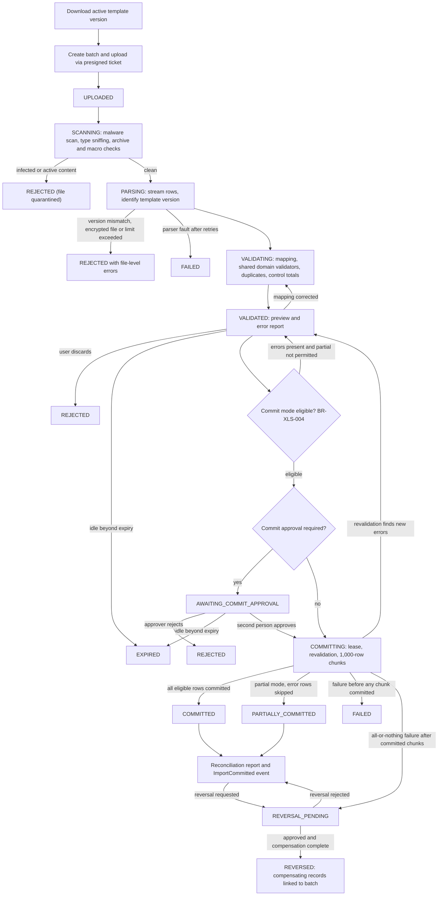

# Document 12: Excel Integration Architecture

**Product:** SlateIQ — Production Cost Intelligence & Audit Monitoring Platform
**Document ID:** SLQ-ARCH-012
**Version:** 1.0.0
**Classification:** Internal — Architecture Foundation
**Status:** Draft — For Review
**Date:** 2026-11-06
**Authors:** Principal Integration Architect, Principal Mobile Architect
**Reviewers:** Principal Architect (TBD), Finance SME (TBD), Audit SME (TBD), Security Architect (TBD), Product Owner (TBD)

---

## Document Control

### Revision History

| Version | Date | Author | Change |
|---------|------|--------|--------|
| 1.0.0 | 2026-11-06 | Architecture Team | Initial Excel integration architecture: templates, legacy mapping, upload and scan, streaming parse, shared validation, duplicates, preview, commit modes, approval, chunked commit, reconciliation, reversal, provenance, opening balances, security, limits, exports and round-trip fidelity; ADR-052 to ADR-054 |

### Related Documents

| Document | Relationship |
|----------|--------------|
| Document 1 — Product Vision & Business Requirements | Authoritative scope: UC-08, FR-XLS-001 to FR-XLS-017, BR-XLS-001 to BR-XLS-006, BR-EXP, NFR-PERF-006, NFR-PERF-007, D-017, report catalogue RPT-01 to RPT-18 |
| Document 2 — Domain Model & Capability Map | ExcelTemplate, TemplateVersion, ValueMapping, ImportBatch, ImportRow, ExportJob; CAP-020, CAP-021; Excel as an anti-corruption layer (§3) |
| Document 3 — Actor, Permission, Tenancy & Identity | `excel.*` and source-domain permission keys (Appendix A); `xls` tables (Appendix D); scope resolution (§6) |
| Document 4 — Core Business Workflows & State Machines | SM-17 ImportBatch and the ExportJob lifecycle, used here by name |
| Document 5 — Business Rules & Invariants Catalogue | Invariants the shared validators enforce |
| Document 6 — High-Level Solution Architecture | Reporting and Excel stack (§6.8), evidence pipeline (§7.7), INTG-01 (§10.3.1), malware scanning (§10.3.4), API (Appendix A.11), events (Appendix B.5), ADR-003, ADR-006, ADR-010, ADR-011, ADR-012 |
| Document 9 — API Architecture & Endpoint Catalogue | Receives the endpoint obligations of section 25 |
| Document 11 — Mobile & Offline Architecture | Shares the ProblemDetails reason-code catalogue and the evidence ticket mechanism |
| Document 13 — Analytics & Cost Calculation Architecture | Owns measure definitions behind the export templates; receives RC-12-04 |
| Document 14 — Audit & Observability Architecture | Owns audit events and metrics referenced in sections 16 and 24 |

### Conventions

| Convention | Meaning |
|------------|---------|
| "Workbook" | An uploaded XLSX, legacy XLS or CSV file |
| "Row" | One data row of the data sheet; for expenses one row is one expense line |
| "Group" | The rows that together form one business record (an expense and its lines) |
| "Owning module" | The module that owns the target entity (MOD-04, MOD-05, MOD-03 or MOD-07) |
| SM-17 states | Upper-case names from authoring brief §4: `UPLOADED`, `SCANNING`, `PARSING`, `VALIDATING`, `VALIDATED`, `AWAITING_COMMIT_APPROVAL`, `COMMITTING`, `COMMITTED`, `PARTIALLY_COMMITTED`, `REJECTED`, `FAILED`, `EXPIRED`, `REVERSAL_PENDING`, `REVERSED` |
| A12-nn, OQ-12-nn, R12-nn, RC-12-nn | Assumptions, open questions, risks and reconciliation notes raised here |

---

## 1. Purpose and Scope

Excel is how production finance teams and auditors already work. The governing brief (§17) and D-017 make Excel a first-class, validated interface: imports never bypass authorization, validation or audit history, and exports reproduce the standard management and audit reports. This document specifies the import and export architecture inside MOD-10 (schema `xls`) and its contracts with the owning modules.

**In scope (MVP).** Import of expenses, opening balances, manual commitments, budget lines into a draft budget version, vendors and the department-category taxonomy; legacy auditor formats through column and value mappings; standard exports mapped to RPT identifiers; editable extracts that round-trip.

**Phase 1.** Scheduled exports (FR-XLS-014); completion notifications and progress streaming for large imports (FR-XLS-017); purchase-order import (CAP-009).

**Out of scope.** Writing to customer spreadsheets in place; evaluating spreadsheet formulas; ERP journal export (Document 6 §10.4); import of approvals, cost postings or audit events (these are never created from files).

---

## 2. Architectural Drivers

| Driver | Statement | Section |
|--------|-----------|---------|
| BR-EXP-016, BR-XLS-002, FR-XLS-016, ADR-011 | Imports use the same validation and authorization as UI entry; no bypass | 9, ADR-052 |
| BR-XLS-001, FR-XLS-001 to FR-XLS-003 | Versioned templates; version mismatch rejects unless compatible | 4 |
| FR-XLS-002 | Column mapping with transformations for dates, decimals, currencies, tax codes | 5 |
| FR-XLS-004, BR-DOC-005 | File type, size and malware checks before parse | 6, 20 |
| FR-XLS-005, NFR-PERF-006 | Every row validated; ≤10 seconds per 1,000 rows; row and column references | 8, 9, 21 |
| FR-XLS-010, BR-XLS-003, BR-EXP-006 | Duplicate files and duplicate business records | 10 |
| FR-XLS-006, FR-XLS-009 | Preview with valid, warning and error rows; downloadable error report | 11 |
| FR-XLS-007, BR-XLS-004 | All-or-nothing by default; partial commit only when enabled and under the error threshold | 12 |
| Governing brief §17, UC-08 | Approval before commit; reconciliation against control totals | 13, 15 |
| FR-XLS-008, BR-XLS-006 | Committed batches reversed by compensating records, never deleted | 16 |
| FR-XLS-011, BR-XLS-005 | Batch journal with actor, template version, filters, counts, outcome | 17 |
| FR-XLS-012, FR-XLS-013, FR-EXP-024, NFR-PERF-007 | Standard exports with filters and column selection; 100,000 rows ≤30 seconds | 22 |
| FR-XLS-015 | Round-trip fidelity above 99% for supported fields | 23 |
| BR-BUD-009, BR-EXP-003 | Locked periods reject import rows | 9, 18 |

---

## 3. Component Architecture

### 3.1 Components

| Component | Host | Responsibility |
|-----------|------|----------------|
| Import API | API host | Batch creation, upload tickets, status, preview pages, mapping edits, commit request, approval, reversal, error and reconciliation downloads (`/api/v1/excel/*`) |
| Template service | API host | Template and version lifecycle, compatibility, template workbook generation |
| File gate | Worker host, `xls` queue | Type sniffing, archive inspection, macro and active-content detection, limit checks; runs before and after the malware scan |
| Streaming parser | Worker host, `xls` queue | Forward-only row reader (ExcelDataReader, Document 6 §6.8) writing raw rows to `xls.import_row` |
| Mapper | Worker host | Column mapping, transforms, value mappings, reference resolution, group assembly into commands |
| Validation adapter | Worker host | Calls the owning module's command validator in dry-run mode under the uploader's request context |
| Duplicate detector | Worker host | File-hash registry, in-file business keys, BR-EXP-006 candidates via the Expense module contract |
| Commit coordinator | Worker host | Commit lease, revalidation, 1,000-row chunked execution through owning-module command handlers, checkpoints, compensation |
| Reconciler | Worker host | Control totals, reconciliation report, reconciliation notes |
| Export generator | Worker host (XLSX, CSV); Renderer host (PDF) | Report-definition query, scope snapshot, streaming writer, watermark, metadata sheet |

The Worker pool for the `xls` queue is dedicated so that a large import cannot starve notifications or projections (ADR-011 mitigation). All jobs use `ops.job` with checkpoints, heartbeats and the 30-minute maximum runtime of Document 6 §6.7; a long validation or commit continues as successive resumable job slices.

### 3.2 Anti-Corruption Boundary

MOD-10 never writes another module's tables. Each target type has an adapter that turns a group of rows into the owning module's public command and calls that module's validator and handler (Document 2 §3, Document 6 §4.3 rule R4).

| Target (TemplateVersion `target`) | Owning module | Command | Target permission (in addition to `excel.import_job.create`) |
|-----------------------------------|---------------|---------|----------------------------------|
| `EXPENSE` | MOD-07 | Create expense (and submit when the template says so) | `expense.expense.create`; `expense.expense.submit` when submitting |
| `COMMITMENT` | MOD-05 | Create manual commitment and submit for approval | `vendor.commitment.create`, `vendor.commitment.submit` |
| `BUDGET_LINES` | MOD-04 | Replace lines of a `DRAFT` budget version | `budget.budget_version.update` |
| `VENDOR` | MOD-05 | Create vendor as `CANDIDATE`; update non-financial attributes | `vendor.vendor.create`, `vendor.vendor.update` |
| `DEPARTMENT_CATEGORY` | MOD-03 | Create or update departments, categories and mappings | `production.department.create`, `production.department.update`, `production.category.create`, `production.category.update` |

### 3.3 Data Stores

| Store | Content |
|-------|---------|
| `xls.excel_template`, `xls.template_version`, `xls.value_mapping` | Templates, versions with column mappings, value mappings |
| `xls.import_batch` | One row per batch: template version, purpose, show, commit mode, file hash, counts, control totals, approval facts, reconciliation notes, status |
| `xls.import_row` | Raw values, mapped values, messages, outcome, planned record ID, created record ID |
| `xls.export_job` | Export request, scope snapshot, watermark, output document, expiry |
| `docs.document`, `docs.document_link`, `docs.upload_ticket` | Uploaded workbook, batch evidence set, reconciliation report, export outputs |
| `ops.job`, `ops.idempotency_key`, `ops.outbox_event` | Job checkpoints, per-group idempotency, held events (section 14.4) |

### 3.4 Required Diagram: Excel Import Workflow



### 3.5 SM-17 Usage

Document 4 owns SM-17. This document uses the transitions shown above with these meanings, which Document 4 must contain (RC-12-01).

| State | Meaning here |
|-------|--------------|
| `UPLOADED` | Object stored in quarantine; server hash recorded |
| `SCANNING` | Malware scan (INTG-04) and file gate |
| `PARSING` | Streaming read into `xls.import_row` |
| `VALIDATING` | Mapping, dry-run validation, duplicates, batch checks |
| `VALIDATED` | Preview available; batch may contain error rows; this is the "staged" state of Document 6 §10.3.1 |
| `AWAITING_COMMIT_APPROVAL` | Commit requested; second-person approval pending |
| `COMMITTING` | Commit coordinator holds the lease and executes chunks |
| `COMMITTED`, `PARTIALLY_COMMITTED` | Terminal success states; reversible |
| `REJECTED` | Business or security rejection: infected file, file-level errors, user discard, approver rejection |
| `FAILED` | Technical failure with nothing committed, after job retries are exhausted |
| `EXPIRED` | Not committed within `excel.batch_expiry_days` |
| `REVERSAL_PENDING` | User-requested reversal awaiting approval, or system compensation after an aborted all-or-nothing commit |
| `REVERSED` | Every record created by the batch has its compensating record |

---

## 4. Templates and Versions

### 4.1 Model

An **ExcelTemplate** names a purpose for one target. A **TemplateVersion** is an immutable layout: once `ACTIVE`, it never changes; changes create a new version (ADR-011). Exactly one version per template is `ACTIVE`; `RETIRED` versions remain readable for audit and for reversal of their batches.

| TemplateVersion attribute | Content |
|---------------------------|---------|
| `version` | Integer, monotonic per template |
| `status` | `DRAFT`, `ACTIVE`, `RETIRED` (Document 2 §6.10) |
| `target`, `purposes` | Target type; allowed purposes (`STANDARD`, `OPENING_BALANCE`) |
| `sheets` | Data sheet name; optional `Splits`, `Control` and `_slateiq` metadata sheets |
| `columns` | Per column: canonical field, header text, header synonyms, data type, required, maximum length, format, transform, value-mapping kind, `allow_formula`, restricted flag |
| `group_key` | Column whose value groups rows into one record (`expense_ref` for expenses) |
| `header_signature` | SHA-256 of the normalised header row, used to identify legacy files without a metadata sheet |
| `locale` | Decimal separator, grouping style (including Indian lakh grouping), date format for text dates |
| `compatible_from` | Lowest earlier version whose files this version accepts (BR-XLS-001) |
| `defaults` | Defaults for unmapped optional fields (for example document type) |
| `create_as` | For `EXPENSE`: `SUBMITTED` (default) or `DRAFT`; never `APPROVED` |
| `owning_party_id` | Optional Party (an audit firm) whose legacy format this version represents |

**Compatibility rule (BR-XLS-001).** A workbook is accepted when its declared template ID and version equal the active version, or when the active version's `compatible_from` is at or below the workbook's version. Compatibility may be declared only when the newer version adds optional columns or synonyms; any change to a required column, type, group key or meaning is breaking and the template author cannot declare compatibility for it (validated at activation).

**Governance.** Creating and editing templates requires `excel.template.create` and `excel.template.update`; activation and retirement are audited (FR-XLS-001). Tenants receive the platform's standard templates as tenant-owned copies at provisioning; platform updates arrive as new draft versions for the tenant to activate.

### 4.2 Standard Import Templates

| Template key | Target | Purpose | Notes |
|--------------|--------|---------|-------|
| `IMP-EXPENSE` | `EXPENSE` | `STANDARD` | One row per line; `expense_ref` groups lines; optional `Splits` sheet keyed by `expense_ref` and `line_no` |
| `IMP-EXPENSE-OPENING` | `EXPENSE` | `OPENING_BALANCE` | Section 18 |
| `IMP-COMMITMENT` | `COMMITMENT` | `STANDARD`, `OPENING_BALANCE` | Open commitments at cutover use the remaining open amount |
| `IMP-BUDGET-LINES` | `BUDGET_LINES` | `STANDARD` | Into a `DRAFT` budget version only (BR-BUD-002, BR-BUD-003) |
| `IMP-VENDOR` | `VENDOR` | `STANDARD` | Creates `CANDIDATE` vendors (BR-VND-001 uniqueness) |
| `IMP-TAXONOMY` | `DEPARTMENT_CATEGORY` | `STANDARD` | Hierarchy depth ≤3 (BR-PRD-006); never deactivates by omission |
| `IMP-EXPENSE-LEGACY-*` | `EXPENSE` | `STANDARD` | One per legacy auditor format (section 5) |

### 4.3 Template Workbook Generation

`GET` of a template version (FR-XLS-003) generates an XLSX on demand:

| Sheet | Content |
|-------|---------|
| `Instructions` | Purpose, column rules, examples, limits, the version, and the reason codes users will see |
| Data sheet | Protected header row; column data types and number formats; data-validation lists for enumerations |
| `Lists` (very hidden) | Codes for shows, departments, categories, currencies, payment modes and up to 5,000 vendors, all limited to the requester's scope at download time |
| `Control` | Optional control totals the preparer fills (section 15) |
| `_slateiq` (very hidden) | Template ID, version, generated-at, requester scope hash, checksum of the sheet structure |

The download is logged (FR-XLS-003). Lists are a convenience; validation never trusts them, because a workbook can be edited.

---

## 5. Column Mapping and Value Mappings for Legacy Auditor Formats

### 5.1 Why Mapping Is a Template Concern

Each audit firm and production finance team has its own workbook layout and vocabulary (governing brief §3). SlateIQ absorbs that variety in versioned mappings rather than in code: a legacy format is a TemplateVersion whose columns carry the legacy headers as synonyms and whose values are translated by ValueMappings. The canonical fields and every validation rule stay the same.

### 5.2 Column Mapping Specification

```json
{
  "templateKey": "IMP-EXPENSE-LEGACY-ACME-AUDIT",
  "version": 3,
  "target": "EXPENSE",
  "dataSheet": { "name": "Daily Exp", "headerRowSearch": { "firstRows": 20, "minMatchRatio": 0.8 } },
  "groupKey": "expense_ref",
  "locale": { "decimal": ".", "grouping": "INDIAN", "textDateFormat": "dd/MM/yyyy" },
  "columns": [
    { "field": "expense_ref", "headers": ["Voucher No", "V. No."], "type": "TEXT", "required": true, "maxLength": 40 },
    { "field": "expense_date", "headers": ["Date", "Bill Date"], "type": "DATE", "required": true },
    { "field": "department_code", "headers": ["Dept"], "type": "TEXT", "required": true, "valueMapping": "DEPARTMENT" },
    { "field": "category_code", "headers": ["Head", "Expense Head"], "type": "TEXT", "required": true, "valueMapping": "CATEGORY" },
    { "field": "vendor_ref", "headers": ["Party", "Vendor"], "type": "TEXT", "required": true, "valueMapping": "VENDOR" },
    { "field": "document_number", "headers": ["Bill No"], "type": "TEXT", "required": false, "maxLength": 60 },
    { "field": "net_amount", "headers": ["Amount"], "type": "DECIMAL", "scale": 4, "required": true },
    { "field": "tax_code", "headers": ["GST %"], "type": "TEXT", "required": false, "valueMapping": "TAX_CODE" },
    { "field": "gross_amount", "headers": ["Total"], "type": "DECIMAL", "scale": 4, "required": true, "allowFormula": true },
    { "field": "currency", "headers": ["Curr"], "type": "TEXT", "required": false, "default": "SHOW_CURRENCY" },
    { "field": "payment_mode", "headers": ["Mode"], "type": "TEXT", "required": true, "valueMapping": "PAYMENT_MODE" },
    { "field": "description", "headers": ["Particulars"], "type": "TEXT", "required": true, "maxLength": 500 }
  ]
}
```

### 5.3 Transforms

| Transform | Rule |
|-----------|------|
| Decimal (numeric cell) | The IEEE double is normalised to 15 significant digits (Excel's display precision), converted to decimal, then checked against the column scale; a value with more decimal places than the scale is an error `SCALE_EXCEEDED`, never rounded silently |
| Decimal (text cell) | Parsed with the template locale; grouping separators accepted only in the declared style; currency symbols stripped only when they match the row currency |
| Date (numeric cell) | Excel serial date in the workbook's date system (1900 or 1904, read from the workbook); the 1900 leap-year anomaly handled; time part rejected for date-only fields |
| Date (text cell) | Only the declared format; ambiguous formats (for example `03/04/2026` without a declared format) are errors |
| Tax code | Mapped to a tax rate and inclusive flag via ValueMapping `TAX_CODE`; numeric percentages accepted when the column declares `PERCENT` |
| Currency | ISO 4217 code; legacy symbols mapped through `CURRENCY` |
| Text | Unicode NFC; control characters removed; trimmed; length-checked; leading-zero identifiers preserved because text columns read the cell's string value |
| Boolean | `Y`, `N`, `Yes`, `No`, `TRUE`, `FALSE`, case-insensitive |

### 5.4 Value Mappings

| Kind | Source examples | Target |
|------|-----------------|--------|
| `DEPARTMENT` | "Camera Dept", "CAM" | `department_id` |
| `CATEGORY` | "Conveyance", "Local Travel" | Leaf `category_id` (FR-PRD-010) |
| `VENDOR` | Legacy party names | `vendor_id`, matched by code, then tax identifier, then mapped name |
| `PAYMENT_MODE`, `DOCUMENT_TYPE`, `TAX_CODE`, `CURRENCY` | Firm vocabulary | Canonical enumeration or reference ID |
| `SHOW`, `EPISODE` | Legacy show and episode labels | `show_id`, `episode_id` |

Comparison uses a normalised key per kind (case-folded, whitespace collapsed, punctuation removed for names). Matching is exact on the normalised key. Fuzzy similarity only produces **suggestions** (top three by trigram similarity) shown in the preview; it never maps a value automatically. A user holding `excel.template.update` can accept a suggestion or add a mapping from the preview; the mapping is saved to the template (audited, applies to future batches) and the batch is revalidated (`POST /excel/imports/{importId}/validate`). Unknown vendors are errors unless `excel.create_candidate_vendors` is enabled, in which case the row must carry a justification and the vendor is created as `CANDIDATE` at commit (FR-EXP-006, BR-EXP-013 still applies to blocked vendors).

### 5.5 Identifying a Legacy File

A workbook without a `_slateiq` sheet is identified by header detection: the first 20 rows are scanned for a row matching at least 80% of a candidate version's header synonyms, and the normalised header signature is compared with `header_signature`. Exactly one active version must match; zero or multiple matches reject the file with `TEMPLATE_NOT_IDENTIFIED`, listing the closest candidates. The user may also pick the template explicitly at upload, in which case only that version is tested.

---

## 6. Upload and Scan

| Step | Design |
|------|--------|
| 1 Create batch | `POST /excel/imports` with template key (optional for legacy detection), show (required for `EXPENSE` and `COMMITMENT`, A12-04), purpose, preferred commit mode, file name, size and client SHA-256. Requires `excel.import_job.create` at `SHOW` or `ORG` scope and the target permission of section 3.2 |
| 2 Ticket | A presigned PUT ticket (≤15 minutes) bound to size, content type and hash into the quarantine prefix (Document 6 §10.3.3); the batch row is created with status `UPLOADED` once the object is confirmed |
| 3 Hash | The server computes SHA-256 over the stored object; the server hash is authoritative for BR-XLS-003 |
| 4 Scan | The object is scanned (INTG-04). `INFECTED` or `FAILED` keeps it quarantined, sets the batch `REJECTED` and raises a security event (FR-XLS-004, BR-DOC-005). The scanner being unavailable keeps the batch in `SCANNING`; it is never parsed unscanned |
| 5 File gate | Sections 20.1 and 20.2: magic bytes, extension agreement, archive limits, active content, encryption |
| 6 Evidence set (optional) | For `EXPENSE` imports, up to 500 supporting files per batch are uploaded through the same ticket mechanism, scanned, and linked to the batch through `docs.document_link`; rows reference them by file name in `evidence_files` (section 9.4) |

The uploaded workbook is a `docs.document` linked to the batch. For committed batches it is retained with the batch journal for 7 years as the source record of every created row (BR-XLS-005). For batches that end `REJECTED`, `FAILED` or `EXPIRED`, the workbook and raw row values are purged after 90 days while the batch journal (counts, hashes, error summary, actor) is retained (A12-05).

---

## 7. Streaming Parse

| Concern | Design |
|---------|--------|
| Reader | ExcelDataReader forward-only reader for XLSX and, where enabled, XLS (BIFF8); RFC 4180 reader for CSV (Document 6 §6.8) |
| Input | The object is copied from storage to an encrypted, size-capped ephemeral volume of the worker task (XLSX needs random access to the ZIP directory); deleted at job end |
| Memory | Bounded by limits: one row in flight per parser; shared-strings table capped (section 21); no DOM load of the workbook |
| Output | Raw cell values (typed: number, string, boolean, date serial, error) written to `xls.import_row` in batches of 1,000 rows using binary copy |
| Formulas | Formula cells are read as their cached value and flagged; section 20.3 decides acceptance |
| Sheets | Only the declared data, `Splits` and `Control` sheets are read; other sheets are ignored and reported as information |
| Hidden content | Hidden rows and columns in the data sheet are read and flagged with warning `HIDDEN_CONTENT`, which must be acknowledged before commit |
| Encoding (CSV) | UTF-8 with or without BOM, UTF-16 with BOM; other encodings only when the template declares one |
| Empty rows | Trailing empty rows ignored; an empty row inside the data block is an information message |
| Checkpointing | The parser checkpoints the last persisted row number; a resumed job continues from there |

---

## 8. Validation Pipeline

### 8.1 Stages

| Stage | Scope | Checks | Error examples |
|-------|-------|--------|----------------|
| V0 File | Batch | Template identification and version (BR-XLS-001), sheet presence, row count limit, control sheet presence | `TEMPLATE_VERSION_MISMATCH`, `ROW_LIMIT_EXCEEDED` |
| V1 Structure | Row | Required columns, types, formats, lengths, scale, formula policy | `REQUIRED`, `INVALID_DATE`, `SCALE_EXCEEDED`, `FORMULA_NOT_ALLOWED` |
| V2 Mapping | Row | Value mappings, reference resolution within the tenant and the selected show | `UNMAPPED_VALUE`, `UNKNOWN_CATEGORY`, `CATEGORY_NOT_LEAF` |
| V3 Assembly | Group | Header fields consistent across a group's rows; line arithmetic; provided gross equals computed gross after half-up rounding; splits sum to 100% and the line total (BR-EXP-012) | `GROUP_HEADER_INCONSISTENT`, `AMOUNT_MISMATCH`, `SPLIT_NOT_100` |
| V4 Domain | Group | Owning-module validator in dry-run mode (section 9) | Domain reason codes, identical to the API |
| V5 Duplicates | Batch, group | File hash, in-file keys, BR-EXP-006 (section 10) | `DUPLICATE_FILE`, `DUPLICATE_IN_FILE`, `DUPLICATE_SUSPECTED` |
| V6 Batch | Batch | Control totals (section 15), error rate against BR-XLS-004, commit-mode eligibility, approval requirement | `CONTROL_TOTAL_MISMATCH`, `ERROR_RATE_ABOVE_THRESHOLD` |

A row with an error at stage V1 or V2 is not assembled; a group with any erroneous row is erroneous as a whole, because a partial expense would distort totals.

### 8.2 Message Model

Every message carries: `severity` (`ERROR`, `WARNING`, `INFO`), `code` (the shared reason-code catalogue in `contracts/`, the same codes the API returns in ProblemDetails), `sheet`, `row` (workbook row number), `column` (letter), `cell` (A1 reference), `field` (canonical name), `value` (as read; masked for restricted columns), `message` (the problem) and `action` (the next step, NFR-UX-008). Warnings that require acknowledgement (`DUPLICATE_SUSPECTED`, `HIDDEN_CONTENT`, `LIMIT_ROUTES_TO_EXTRA_APPROVAL`) carry `requires_ack = true`.

---

## 9. Validation Through the Shared Domain Validators

### 9.1 Mechanism

The validation adapter builds, for every group, exactly the command the web or mobile client would send, and calls the owning module's validator with `mode = DRY_RUN` under a request context built server-side for the uploader (Document 2 §7 RequestContext): principal, tenant, authority source, `scope_version`, correlation ID. The validator is the same code path as the API (ADR-011, BR-XLS-002); there is no import-specific rule set and no import-only relaxation (BR-EXP-016).

| Rule family | Applied by | Examples |
|-------------|-----------|----------|
| Authorization and scope | Policy decision point | Show, department and category within the uploader's effective scope (BR-EXP-004, FR-XLS-016); rows outside scope are errors `OUT_OF_SCOPE` |
| Period | Budget module contract | Expense date in an `OPEN` or `REOPENED` period (BR-EXP-003, BR-BUD-009); locked periods produce `PERIOD_LOCKED` |
| Dates | Expense validator | Future tolerance and show-start grace (BR-EXP-002) |
| Taxonomy | Production module contract | Category active and mapped to the department (BR-EXP-015) |
| Vendor | Vendor module contract | Status `ACTIVE`, or `CANDIDATE` creation policy; blocked or inactive vendors rejected (BR-EXP-013) |
| Evidence | Expense validator | BR-EXP-001 against the batch evidence set (section 9.4) |
| Limits | Expense validator | Per-transaction and per-day limits route to additional approval, not rejection (BR-EXP-014): warning `LIMIT_ROUTES_TO_EXTRA_APPROVAL` |
| FX | Expense validator | A rate exists or the fallback applies (D-007); preview shows an indicative base amount; the rate is locked at submission during commit (BR-FIN-003) |
| Financial arithmetic | Shared money library | Half-up rounding at the defined points (BR-FIN-002 as reconciled in RC-01); header equals sum of rounded lines (BR-FIN-011) |

### 9.2 Revalidation

Validation results are a snapshot. Reference data, scope and periods can change before commit, so the commit coordinator revalidates (section 14.2), and `POST /excel/imports/{importId}/validate` lets a user revalidate after correcting mappings or after a period is reopened.

### 9.3 Performance Design (NFR-PERF-006)

| Technique | Effect |
|-----------|--------|
| Per-batch reference preload | Department, category, mapping, tax, currency and show reference sets loaded once into memory; vendors loaded for the show plus mapped vendors |
| Set-based period and duplicate lookups | One query per 1,000-row chunk using a temporary candidate table rather than one query per row |
| Partitioned validation | Up to four chunks of 1,000 rows validated in parallel per batch; results merged deterministically by row number |
| Read replica | Dry-run reads use the read replica where replica lag is under 5 seconds; commit always uses the primary |

Budget per 1,000 rows: parse 0.5 s, mapping 1.0 s, domain validation 5.0 s, duplicates 2.0 s, persistence of outcomes 1.5 s — 10 seconds in total. The CI benchmark validates a 50,000-row expense workbook in ≤500 seconds on the reference worker size; a regression fails the build.

### 9.4 Evidence for Imported Expenses

BR-EXP-001 applies to imported expenses exactly as to captured ones. A row satisfies it by naming files of the batch evidence set in `evidence_files`; the commit creates EvidenceLinks to those documents. A row that requires evidence and has none is an error when the template's `create_as` is `SUBMITTED`. When `excel.missing_evidence_action = CREATE_AS_DRAFT`, such a row becomes a warning and the expense is created as `DRAFT`, to be completed and submitted through the normal path; it is never submitted without evidence.

---

## 10. Duplicate Detection

| Level | Key | Rule | Outcome |
|-------|-----|------|---------|
| File | Server SHA-256 of the workbook | Matches a `COMMITTED` or `PARTIALLY_COMMITTED` batch in the tenant (BR-XLS-003) | Error `DUPLICATE_FILE` until the uploader confirms the re-import with a reason; the confirmation makes commit approval mandatory |
| File | Same hash, batch in progress | Matches a batch in `VALIDATED` or `AWAITING_COMMIT_APPROVAL` | Information with a link to the existing batch; the user continues that batch or discards it |
| Source reference | `(show_id, template owning party or source system, document number or legacy voucher number)` | Matches an existing non-cancelled record created from a previous import | Error `ALREADY_IMPORTED`; prevents the same legacy voucher being imported twice through different files |
| In file | Same vendor, document number and expense date, or identical group content | Two groups in one workbook | Warning `DUPLICATE_IN_FILE` requiring acknowledgement |
| Business | BR-EXP-006: same vendor, amount within 1%, date within 7 days, existing non-cancelled expense in the same show | Checked against existing expenses and against other groups in the batch | Warning `DUPLICATE_SUSPECTED` with candidate references; per BR-EXP-006 the user must link, justify or exclude the row before commit; the justification is stored on the created expense |

The duplicate policy per template (`excel.duplicate_policy`) chooses for `DUPLICATE_SUSPECTED`: `REQUIRE_JUSTIFICATION` (default), `SKIP` (row excluded with outcome `SKIPPED_DUPLICATE`), or `REJECT` (row error). The policy never allows silent creation of a suspected duplicate (FR-XLS-010).

The commit's idempotency key is not the file hash (RC-12-02): it is the planned record identity per group (section 14.3), so a confirmed re-import creates new records while a retried commit of the same batch never does.

---

## 11. Preview and Cell-Referenced Error Reports

### 11.1 Preview

`GET /excel/imports/{importId}/preview` returns counts and pages of rows (200 per page) filtered by outcome.

| Element | Content |
|---------|---------|
| Counts | Rows read, groups, valid, warning, error, skipped, by severity and code; counts reconcile to the file (FR-XLS-006) |
| Totals | Gross, tax and net per currency; indicative base-currency total; control totals and differences |
| Row view | Mapped values next to raw values; messages with cell references; suggestions for unmapped values |
| Actions | Acknowledge warnings, add value mappings (with `excel.template.update`), exclude rows (partial mode only), revalidate, discard, request commit |
| Commit eligibility | Mode, error rate against threshold, approval requirement and reason |

Restricted columns (for example vendor bank references, BR-VND-007) are masked unless the viewer holds `vendor.payment_term.update`.

### 11.2 Error Report (FR-XLS-009)

`GET /excel/imports/{importId}/errors?format=xlsx|csv` (`excel.validation_error.read`) produces:

| Format | Content |
|--------|---------|
| XLSX | A copy of the uploaded data sheet with two added columns (`SlateIQ status`, `SlateIQ messages`), erroneous cells highlighted, cell comments holding the message and action, a `Summary` sheet by code, and the `_slateiq` metadata sheet so a corrected file is recognised as the same template version |
| CSV | One line per message: row, column, cell, field, value, severity, code, message, action |

The XLSX report is generated with the same export safeguards as any export (section 22.6), including CSV-injection neutralisation of echoed values.

---

## 12. All-or-Nothing Versus Partial Commit (BR-XLS-004)

| Mode | Eligibility | Behaviour |
|------|-------------|-----------|
| `ALL_OR_NOTHING` (default) | Zero error groups and every acknowledgement-required warning acknowledged | Every eligible group is committed or none is (section 14) |
| `PARTIAL` | `excel.partial_commit_enabled` is true for the organization **and** the error rate (error groups ÷ all groups) is below `excel.partial_commit_max_error_rate` | Error groups and excluded groups are skipped and reported; the rest are committed; the batch ends `PARTIALLY_COMMITTED` |

When partial commit is not permitted and errors exist, commit is blocked until the errors are fixed and the batch revalidated, or the file is corrected and re-uploaded (UC-08 alternate "error rate above threshold"). The chosen mode, the error rate at commit and the threshold in force are written to the batch journal.

---

## 13. Approval Before Commit

### 13.1 When Approval Is Required

Commit approval uses the ApprovalWorkflow subject `IMPORT_COMMIT` (Document 2 §6.4) and is required when any condition holds:

| Condition | Default |
|-----------|---------|
| Organization setting `excel.commit_approval_required` for the target | `true` for `EXPENSE`, `COMMITMENT`, `BUDGET_LINES`; `false` for `VENDOR`, `DEPARTMENT_CATEGORY` |
| Batch base-currency total at or above `excel.commit_approval_threshold` | Organization-defined |
| Purpose `OPENING_BALANCE` | Always |
| Confirmed re-import of a duplicate file hash | Always |
| Commit mode `PARTIAL` | Always |

### 13.2 Approval Rules

| Rule | Detail |
|------|--------|
| Permission | `excel.import_job.approve` at `SHOW` or `ORG` scope covering the batch (Document 3 Appendix A, step-up required) |
| Segregation of duties | The approver is not the uploader nor the person who requested commit |
| Information shown | Preview counts, totals by currency and base, control-total comparison, duplicate acknowledgements and justifications, excluded rows, reconciliation notes |
| Decision | Approve or reject with a mandatory comment on rejection; recorded with workflow version, approver, time and comment |
| Validity | Approval binds to the exact set of eligible groups (a hash of their row numbers and mapped values). If revalidation at commit changes that set, the approval lapses and the batch returns to `VALIDATED` |
| Expiry | `AWAITING_COMMIT_APPROVAL` expires after `excel.batch_expiry_days` (default 7) |

**Commit approval does not approve the records.** Imported expenses enter `SUBMITTED` (or `DRAFT`) and follow their own approval chains resolved at submission (BR-EXP-007), with thresholds on the locked base amount (BR-EXP-008); commitments enter `PENDING_APPROVAL` (SM-07). Approvers may use bulk approval with per-item confirmation (FR-EXP-022). The import approval is a control over the batch; it never substitutes for the business approval of each record.

---

## 14. Chunked Idempotent Commit

### 14.1 Commit Lease

Before committing, the coordinator acquires a lease keyed by `(org_id, show_id)` and records on the batch the financial periods its rows touch. The period-close workflow treats a batch in `COMMITTING` that touches the period as a blocking checklist item, so a period cannot move to `CLOSING` mid-commit (RC-12-09). Only one batch per show commits at a time; other commit requests queue.

### 14.2 Algorithm

```
commit(batch):
  require state = VALIDATED (approval not required) or approval granted on AWAITING_COMMIT_APPROVAL
  acquire lease(org_id, show_id); set state COMMITTING; checkpoint = batch.last_committed_chunk
  eligible = groups with outcome VALID or acknowledged WARNING (and not excluded)
  revalidate(eligible) under current reference data, scope and periods
  if mode = ALL_OR_NOTHING and any eligible group now fails:
      record diff; release lease; state VALIDATED; approval lapses; stop
  if mode = PARTIAL and the new error rate exceeds the threshold:
      record diff; release lease; state VALIDATED; stop
  for chunk in partition(eligible, 1,000 rows, never splitting a group), ordered:
      if chunk.index <= checkpoint: continue
      begin transaction with tenant context
          for group in chunk:
              command = build(group, planned_record_id, provenance, actor = uploader)
              result = owning_module.execute(command)            -- same handler as the API
              if result failed:
                  if mode = PARTIAL: roll back to the group savepoint; mark group COMMIT_FAILED
                  else: roll back the transaction; goto abort
              mark rows COMMITTED with created_record_id
          audit events in the same transaction (ADR-012); outbox events with hold_key = batch id
          batch.last_committed_chunk = chunk.index
      commit transaction
  finalise in one transaction:
      state COMMITTED or PARTIALLY_COMMITTED; release held events; write reconciliation;
      emit ImportCommitted; release lease
abort:
  if checkpoint = 0: state FAILED; cancel held events; release lease
  else: state REVERSAL_PENDING (reason COMMIT_ABORTED, system-initiated, no approval);
        compensate committed groups (section 16); state REVERSED; cancel held events; release lease
```

### 14.3 Idempotency

| Mechanism | Detail |
|-----------|--------|
| Planned identity | During validation every group receives a UUIDv7 `planned_record_id` stored in `xls.import_row`; the command creates the record with that ID, so a retried chunk collides on the primary key and returns the existing record |
| Idempotency key | `ops.idempotency_key` entry `xls:{import_batch_id}:{group_key}` with the command result |
| Chunk checkpoint | A chunk is one transaction; a crash rolls it back entirely; the job resumes at `last_committed_chunk + 1` |
| Job retries | Transient failures retry the job with backoff (Document 6 §6.7) without changing batch state |

### 14.4 Visibility During Commit

Events produced by committed chunks carry `hold_key = import_batch_id`; the outbox dispatcher skips held events until finalisation releases them, or cancels them (SM-19 `CANCELLED`) if the batch is compensated (RC-12-07). Dashboards, alerts and notifications therefore never see a half-committed batch. Records are visible in operational lists with an "Import in progress" badge, and approval, amendment and cancellation commands on records whose batch is `COMMITTING` are refused with `IMPORT_IN_PROGRESS`.

---

## 15. Reconciliation with Control Totals

### 15.1 Control Totals

| Source | Totals |
|--------|--------|
| Workbook `Control` sheet (standard templates) or declared footer cells (legacy templates) | Row count, group count, gross, tax and net per currency, optional hash total of document numbers |
| Parser | The same measures computed from the rows read |
| Validation | The same measures for valid, warning, error and skipped groups |
| Commit | The same measures for committed groups, plus base-currency totals at the locked rates |

A difference between the workbook's control totals and the parsed totals is a batch error `CONTROL_TOTAL_MISMATCH`: the file is internally inconsistent and must be corrected. A legacy format without control totals produces information `NO_CONTROL_TOTALS`, and the reconciliation uses parsed totals only.

### 15.2 Reconciliation Report

Produced at finalisation (UC-08 step 7) as XLSX and PDF, stored as a document linked to the batch, and available from `GET /excel/imports/{importId}/reconciliation`:

| Section | Content |
|---------|---------|
| Identity | Batch, template version, file name and hash, uploader, approver, commit mode, timestamps, correlation ID |
| Waterfall | Workbook control totals → parsed → valid → excluded or skipped (by reason) → committed, per currency and in base currency |
| Breakdown | Committed totals by department and category, and by period of expense date |
| Exceptions | Duplicate justifications, limit routings, candidate vendors created |
| Reconciliation notes | Structured notes recorded during the batch (section 15.3) |

### 15.3 Reconciliation Notes

A reconciliation note (`code`, `text`, `amounts`, `author`, `time`) explains a known difference between the source workbook and what SlateIQ holds — for example rows excluded because their period is locked. Notes are append-only on the batch, shown to the approver and printed on the reconciliation report. System notes are written automatically for every exclusion class; users with `excel.import_job.update` may add notes before commit.

---

## 16. Reversal (BR-XLS-006)

| Step | Design |
|------|--------|
| Request | `POST /excel/imports/{importId}/reversal` with reason; requires `excel.import_job.delete` (delete means reverse for committed records, Document 3 Appendix A.1) and the target permission that cancels or deactivates the record: `expense.expense.delete`, `vendor.commitment.update` (the catalogue has no commitment `delete`; cancellation is an update, RC-12-10), `budget.budget_version.update`, `vendor.vendor.update`, `production.department.update`, `production.category.update` |
| Precheck | Every created record must be reversible (table below). If any is not, the request is refused with the list of blockers; the batch stays committed. Reversal is all-or-nothing |
| Approval | State `REVERSAL_PENDING`; a different person with `excel.import_job.approve` approves or rejects |
| Execution | Chunked like commit; each compensating action through the owning module's command; audit events; then `REVERSED` and `ImportReversed` |
| Never | Records are never deleted; the batch, its rows and its source file remain (BR-XLS-006) |

| Created record and current state | Compensating action | Blocker |
|-----------------------------------|---------------------|---------|
| Expense `DRAFT` | Discard draft | — |
| Expense `SUBMITTED`, `REQUIRES_INFO` | Cancel with reason `IMPORT_REVERSED`; approval instance cancelled | — |
| Expense `APPROVED` | Cancel; reversal cost postings in the period of the reversal (BR-EXP-010) | — |
| Expense amended (a later revision exists) or with `VERIFIED` evidence from outside the batch | — | `REVISED_AFTER_IMPORT`; resolve manually first |
| Expense consuming a commitment | Cancel; consumption released | — |
| Commitment `DRAFT`, `PENDING_APPROVAL`, `OPEN` | Cancel | Consumed by non-cancelled expense lines: `COMMITMENT_CONSUMED` |
| Budget lines in a `DRAFT` version | Restore the version's prior lines | Version no longer `DRAFT`: `BUDGET_VERSION_ADVANCED` |
| Vendor `CANDIDATE` or `ACTIVE` without transactions | Set `INACTIVE` | Transactions exist: `VENDOR_IN_USE` |
| Department or category created | Deactivate | Referenced by records: `TAXONOMY_IN_USE` |

Reversal of an opening-balance batch is allowed only while no later opening-balance batch exists for the show.

---

## 17. Provenance on Every Created Record

| Provenance element | Where |
|--------------------|-------|
| `source = EXCEL_IMPORT` | Expense attribute (Document 2 §6.7); ManualCommitment attribute (Document 8 obligation, RC-12-11) |
| `import_batch_id`, `import_row_number` | On Expense and ManualCommitment (Document 8 obligation); for other targets through `xls.import_row.created_record_id` |
| Template version, file SHA-256, uploader, approver | On `xls.import_batch` |
| Source reference (legacy voucher or document number, owning party) | Expense document number and `source_reference` (Document 8 obligation) |
| Audit | Every create carries `source = EXCEL_IMPORT`, `import_batch_id` and the batch correlation ID in the business audit event (FR-CMP-001, ADR-012) |
| Row trace | Expense detail shows "Imported from {file}, row {n}, batch {id}"; the batch shows every created record (UC-08 postcondition) |

---

## 18. Opening-Balance Import for Shows Onboarded Mid-Production

### 18.1 Problem

A show that joins SlateIQ after shooting has started already has spend and open obligations recorded in legacy ledgers. Budget versus actual and committed (RPT-01) is meaningless without them. The import must bring them in without any rule exception: BR-EXP-016 forbids an import-only bypass, and locked periods reject transactions dated in them (BR-BUD-009).

### 18.2 Preconditions

| Precondition | Check |
|--------------|-------|
| Show status `PLANNING` or `ACTIVE` | Production module contract |
| No other committed, unreversed opening-balance batch for the same show and season | Batch registry |
| Cutover date declared on the batch | Must lie in an `OPEN` or `REOPENED` period of the show, not before the show's planned start minus the BR-EXP-002 grace period, and not in the future beyond tolerance |
| Vendors and taxonomy present | `IMP-VENDOR` and `IMP-TAXONOMY` batches committed first, or the values mapped |
| Active budget version | Recommended; a missing budget is a warning, because variance cannot be read until it exists |

### 18.3 Two Modes

| Mode | Granularity | Expense date | Use |
|------|-------------|--------------|-----|
| **Summary** (default) | One row per vendor × department × category (× episode when allocated) for spend up to the legacy cut-off | The cutover date | Legacy ledgers whose transaction detail is incomplete, or whose dates fall in locked periods |
| **Detail** | One row per historical transaction | The original transaction date | Clean ledgers whose dates fall in open periods; preserves period history |

Both modes create ordinary Expense records through the `EXPENSE` adapter with `source = EXCEL_IMPORT` and purpose `OPENING_BALANCE` on the batch. Summary rows use document type `OTHER`, document number `OB-{batch short ID}-{n}` and a description stating the legacy cut-off date. Each record is validated by the full shared validators and is created `SUBMITTED`, so it flows through its expense approval chain; approvals post actual cost in the period of the expense date (D2-17), which in summary mode is the cutover period.

### 18.4 How Each Rule Is Satisfied

| Rule | Treatment |
|------|-----------|
| BR-EXP-016, BR-XLS-002 | Same validators and authorization; nothing is skipped |
| BR-BUD-009, BR-EXP-003 | Summary rows are dated at the cutover date, in an open period. In detail mode, rows dated in `LOCKED` periods are errors; the user either obtains a period reopen through the normal approval (`budget.financial_period.approve`, UC-11) or moves those rows into a summary batch. Each such move is recorded as a system reconciliation note with the count and amount per locked period |
| BR-EXP-002 | Cutover date validated against show start grace and future tolerance |
| FR-EXP-001 vendor mandatory | Summary granularity is per vendor; legacy petty cash without a vendor uses a one-time payee with justification (FR-EXP-006) |
| BR-EXP-006 | Summary rows of one batch share a date, so the same vendor across categories can match within 1%; each match requires a justification (the batch approver confirms the text "opening balance aggregation by category") stored per expense; nothing is suppressed |
| BR-EXP-001 | Rows link the legacy ledger workbook (the batch source document) and any supporting files from the evidence set. Whether a ledger satisfies an evidence policy that demands invoice-level evidence above a threshold is not settled by existing rules (RC-12-03); until it is, such rows are created as `DRAFT` with warning `EVIDENCE_POLICY_UNRESOLVED` and cannot be submitted |
| BR-EXP-007, BR-EXP-008 | Chains resolved at submission; large summary amounts route to senior approvers by design |
| BR-EXP-014 | Limits route to additional approval, never block |
| BR-FIN-003 | Foreign-currency summary rows lock the rate effective on the cutover date |
| Commitments (BR-FIN-006) | Open commitments at cutover are imported through `IMP-COMMITMENT` with the remaining open amount (the consumed part is already inside the opening spend); the original contract value is carried in the description and reconciliation note |

### 18.5 Reporting Consequence

In summary mode the whole pre-cutover spend appears in the cutover period. Period-wise views would show an artificial spike. Expense records carry the batch purpose through provenance, so Document 13 can present it as a "brought forward" line in period views of RPT-01, RPT-02 and RPT-14 while show-to-date totals stay correct (RC-12-04).

### 18.6 Rule Conflict Recorded

No existing rule blocks a compliant opening balance outright, but BR-EXP-001 combined with an invoice-level evidence policy can block summary rows above the evidence threshold. This is raised as RC-12-03 with a proposed policy rather than resolved by an import exception.

---

## 19. Batch Journal and Retention

| Item | Retention | Basis |
|------|-----------|-------|
| `xls.import_batch` journal: actor, template version, purpose, show, mode, counts, hashes, approval, outcome, reconciliation notes | 7 years | BR-XLS-005, Document 2 §6.10 |
| `xls.import_row` for committed batches | 7 years (with the batch) | Row-level traceability (UC-08) |
| `xls.import_row` raw and mapped values for `REJECTED`, `FAILED`, `EXPIRED` batches | Purged after 90 days; counts and message summary retained | Data minimisation (NFR-PRV-005), A12-05 |
| Source workbook of committed batches | 7 years; legal hold overrides | Source record of created data |
| Reconciliation report | 7 years | UC-08 |
| `xls.export_job` record | 7 years | Document 2 §6.10 |
| Export output file | 7 days, then deleted (`EXPIRED`) | Document 2 §6.10 |

Batch history is searchable by template, show, actor, state, date and file hash (FR-XLS-011) through `GET /excel/imports` with `excel.import_job.read`.

---

## 20. Security

### 20.1 File Gate

| Threat | Control |
|--------|---------|
| Disguised file type | Magic bytes must match the extension: XLSX is a ZIP with `[Content_Types].xml` and `xl/workbook.xml`; XLS is an OLE compound file; CSV must be text in an accepted encoding. `.xlsm`, `.xlsb`, `.xltm`, `.xlam` and `.ods` are rejected |
| Legacy XLS | Accepted only for legacy-mapped templates when `excel.allow_legacy_xls` is enabled (OQ-12-05) |
| ZIP bomb | At most 500 archive entries, 250 MB total uncompressed, compression ratio ≤100:1 per entry, no nested archives, no ZIP64 tricks beyond declared sizes; entries are inspected before any XML is parsed |
| Encrypted workbook | Password-protected or encrypted files rejected with `ENCRYPTED_WORKBOOK` (they cannot be scanned) |
| Macros and active content | Reject if the package contains `vbaProject.bin`, macro sheets (including Excel 4.0 macro sheets), ActiveX parts, OLE embeddings, or external workbook links; for XLS, reject any VBA storage or macro sheet records |
| Malware | Scanned before parse (section 6); never parsed if unscanned |

### 20.2 Parser Hardening

| Threat | Control |
|--------|---------|
| XML external entities and entity expansion | DTD processing prohibited; external resolution disabled; maximum element depth 64 |
| Shared-strings or cell-size exhaustion | Shared strings ≤1,000,000 entries and ≤100 MB characters; cell text ≤4,000 characters (32,767 is Excel's maximum) |
| Parser defects | Parsing runs in the `xls` worker task with a 1 GB memory limit, CPU time limit, read-only root file system, no network egress other than object storage and the database, and an ephemeral encrypted volume; dependency updated under the vulnerability SLA (NFR-SEC-010); fuzzed in CI with malformed workbooks |
| Resource abuse | Per-tenant concurrency and size limits (section 21); rate limits on batch creation |

### 20.3 Formula Cells

Formulas are never evaluated by SlateIQ. A formula cell in a column without `allow_formula` is an error `FORMULA_NOT_ALLOWED`. In an allow-listed column (typically a computed total), the cached value is used as data and must still pass every check (for example `AMOUNT_MISMATCH` against the recomputed gross); a formula without a cached value, or referencing another workbook, is an error. Cached values are normalised to 15 significant digits before the scale check (section 5.3).

### 20.4 Data Protection

| Concern | Control |
|---------|---------|
| Authorization | Every import endpoint and every stage runs under the uploader's request context; RLS applies to all `xls` tables (family A for templates, B for batches and jobs, Document 3 Appendix D) |
| Restricted data | Restricted columns masked in preview, error reports and logs |
| Logs | No cell values in logs or traces; only batch IDs, row numbers and codes (NFR-OBS-004) |
| Storage | Quarantine and tenant prefixes with SSE-KMS (Document 6 §6.6) |
| Download | Error and reconciliation reports via signed URLs ≤15 minutes, re-authorised per request (FR-DOC-004) |

### 20.5 CSV and Formula Injection on Export

| Output | Control |
|--------|---------|
| XLSX | Every text value is written as a typed string cell; data is never written as a formula; hyperlinks are never generated from data; numbers are numeric cells |
| CSV | A text field beginning with `=`, `+`, `-`, `@`, tab or carriage return is prefixed with a single quote and the field is quoted; numeric fields that match a strict decimal pattern are exempt so negative amounts stay numeric |
| Echoed input | Error reports apply the same neutralisation to values copied from uploaded files |
| Document properties | Author and company properties scrubbed; only SlateIQ metadata written |

---

## 21. Limits

| Limit | Value | Source |
|-------|-------|--------|
| Workbook size | ≤50 MB | Document 6 §6.8 |
| Data rows | ≤50,000 per batch | Document 6 §6.8 |
| Columns | ≤100 in the data sheet | This document |
| Cell text | ≤4,000 characters | This document |
| Archive | ≤500 entries, ≤250 MB uncompressed, ratio ≤100:1 | Section 20.1 |
| Evidence set | ≤500 files, each ≤25 MB, ≤2 GB per batch | Document 6 §7.7 |
| Concurrent batches | ≤3 in `PARSING` or `VALIDATING` per tenant; 1 `COMMITTING` per show | Section 14.1 |
| Active uploads per user | ≤2 | This document |
| Batch expiry | 7 days in `VALIDATED` or `AWAITING_COMMIT_APPROVAL` | `excel.batch_expiry_days` |
| Commit chunk | 1,000 rows, never splitting a group | ADR-011 |
| Validation throughput | ≤10 seconds per 1,000 rows | NFR-PERF-006 |
| Preview page | 200 rows | This document |
| Export XLSX | ≤1,000,000 rows per sheet (Excel maximum 1,048,576); ≤2,000,000 rows per file, else CSV | This document |
| Export CSV | ≤5,000,000 rows | This document |
| Export time | 100,000 rows ≤30 seconds | NFR-PERF-007 |
| Download link | ≤15 minutes | Document 6 §6.8, FR-DOC-004 |
| Export file retention | 7 days | Document 2 §6.10 |

Every import runs as a background job at MVP; the UI polls batch status with stage progress. Completion notification for large files is FR-XLS-017 (Phase 1).

---

## 22. Export Architecture

### 22.1 Principle

Exports are generated from report definitions, not hand-built spreadsheets (ADR-011, ADR-054). An export template binds a report definition (an RPT identifier from Document 1 §11.2 where one exists) to a layout, and an ExportJob runs it asynchronously for one requester.

### 22.2 Standard Export Templates

| Export template | Content | RPT | Source permission (plus `excel.export_job.create`) | Formats |
|-----------------|---------|-----|---------------------------------------------------|---------|
| `EXP-AUDIT-REPORT` | Daily or periodic audit report for an assignment: summary, totals snapshot, petty-cash check, findings filtered by visibility (BR-AUD-006) | No identifier (RC-12-05); coverage section from RPT-09 | `audit.audit_report.export` | XLSX, PDF |
| `EXP-AUDIT-COVERAGE` | Assignment completion and submission punctuality | RPT-09 | `audit.audit_report.export` | XLSX, PDF |
| `EXP-DAILY-EXPENSE` | Expenses with expense date or submission date equal to the chosen business day per show: status, evidence state, exceptions, approver | RPT-03 with the daily preset (RC-12-05) | `expense.expense.export` | XLSX, CSV, PDF |
| `EXP-EXPENSE-REGISTER` | Full expense line listing with filters and column selection; editable extract variant for round trip | RPT-03 | `expense.expense.export` | XLSX, CSV |
| `EXP-SHOW-SUMMARY` | Budget, actual, committed and variance per show and season | RPT-01 at show grain | `intel.variance.export` | XLSX, PDF |
| `EXP-DEPARTMENT` | The same measures per department and category within a show | RPT-01 at department grain | `intel.variance.export` | XLSX, PDF |
| `EXP-VENDOR` | Spend concentration and exposure by vendor, show and category | RPT-05 | `vendor.vendor.export` | XLSX, CSV |
| `EXP-VARIANCE` | Significant variances with commentary | RPT-02 | `intel.variance.export` | XLSX, PDF |
| `EXP-COMMITMENTS` | Open obligations and ageing | RPT-07 | `vendor.commitment.export` | XLSX |
| `EXP-EXCEPTIONS` | Open exceptions by type, severity and owner | RPT-11 | `report.report_run.export` (the catalogue has no `expense.exception.export`) | XLSX |
| `EXP-MANAGEMENT-PACK` | Portfolio summary (board pack) with RPT-01 summary, top RPT-11 exceptions and RPT-07 commitments as sections | RPT-14 | `intel.portfolio_view.export`; each section also requires its own source permission, and a section the requester cannot read is omitted with a note | XLSX, PDF |

Organization Administrators may configure tenant export templates (column order, labels, extra columns from the report definition's allow-list) as new versions (FR-XLS-013); they cannot add columns the report definition does not expose.

### 22.3 Job Lifecycle

| State | Entry | Work |
|-------|-------|------|
| `QUEUED` | `POST /excel/exports` authorised | Scope snapshot written; job enqueued through the outbox |
| `RUNNING` | Worker claims the job | Scope re-resolution, query, streaming write, hash, store output |
| `COMPLETED` | Output stored | `ExportCompleted` emitted; requester notified in-app (D-016) |
| `FAILED` | Retries exhausted | Error code recorded; requester notified |
| `EXPIRED` | 7 days after completion | Output deleted; job record retained |

### 22.4 Scope Snapshot

At request time the API resolves the requester's effective scope (Document 3 §6) and stores on the job: principal, tenant, authority source (membership assignment or grant ID), `scope_version`, the resolved show, department and assignment sets, and a hash of the filters. At generation the worker resolves scope again and uses the **intersection** of the snapshot and the current scope: an export never widens beyond what the requester could see when asking, and never shows what they can no longer see when it runs (Document 3 Appendix A `export_job` note). A grant revoked in between yields `FAILED` with `SCOPE_REVOKED`. Restricted fields are masked unless the requester holds the unmasking permission (for example `vendor.payment_term.update` for bank references, BR-VND-007). Restricted reports require step-up per Document 3 (`report.report_run` `E` for restricted reports, `compliance.audit_event.export`).

### 22.5 Data Consistency and Freshness

All sheets of one export are read inside one `REPEATABLE READ` transaction on the reporting replica, so totals across sheets agree. The job records the **data watermark**: the read-model projector checkpoint (`server_seq`) and the `as_of` time of each read model used (show-level ≤60 seconds, portfolio ≤5 minutes, ADR-010). The watermark is printed on the cover sheet and stored on the job, which makes the export reproducible from its parameters (Document 6 §5.3).

### 22.6 Watermark and Metadata

| Element | Content |
|---------|---------|
| Cover sheet | Report name and RPT identifier, organization, filters, scope summary, data watermark, generated-at (UTC and organization time), export job ID, classification "Confidential" |
| Header and footer on every sheet and PDF page | Organization, "Confidential", requester reference (user ID short form, not name), job ID, page or sheet number |
| `_slateiq` metadata sheet (very hidden) | Template ID and version, report definition and version, export job ID, scope hash, data watermark, row counts per sheet, SHA-256 of data content |
| Document custom properties | Job ID and template version, for detection when files circulate |

### 22.7 Delivery

The output is stored as a system-generated document under the tenant prefix (no scan is required for files SlateIQ generates) with SHA-256 recorded. `GET /excel/exports/{exportId}` re-authorises the requester on every call: only the requester may download, the session must be valid, and the authority source (grant or assignment) must still be active. It returns a signed GET URL valid ≤15 minutes with `Content-Disposition: attachment`. Every issue of a link writes `DocumentAccessLog` and a business audit event (FR-EXP-024 "export is audited"). Scheduled delivery (FR-XLS-014, Phase 1) sends a link, never an attachment (Document 6 §6.8).

### 22.8 Performance (NFR-PERF-007)

Rows are streamed from a server-side cursor to a SAX-style OpenXML writer (Document 6 §6.8) with constant memory; PDF output goes to the Renderer host. The benchmark target is 100,000 rows in ≤30 seconds for XLSX and CSV. Exports above 2,000,000 rows are offered as CSV only.

---

## 23. Round-Trip Fidelity (FR-XLS-015)

### 23.1 Editable Extracts

An editable extract is an export produced from an import template version: identical headers and types, a `_slateiq` sheet naming the template version and the export job, and protected hidden key columns (`record_id`, `record_version`). Re-uploading it is recognised by the metadata sheet and validated like any import.

| Target | Rows with `record_id` on re-import |
|--------|------------------------------------|
| `EXPENSE`, `COMMITMENT` | Error `UPDATE_NOT_SUPPORTED`; financial changes are amendments, which are reasoned, versioned and online (BR-EXP-009) (A12-01) |
| `VENDOR`, `DEPARTMENT_CATEGORY` | Update of non-financial attributes with optimistic concurrency: a `record_version` older than the server's is error `STALE_RECORD` |
| `BUDGET_LINES` | Replace the lines of the same `DRAFT` version; any other version is `BUDGET_VERSION_ADVANCED` |

### 23.2 Value Fidelity Rules

| Value | Export | Import | Fidelity |
|-------|--------|--------|----------|
| Money (scale 4) | Numeric cell when the absolute value has ≤15 significant digits (up to 99,999,999,999.9999); otherwise text with metadata type `DECIMAL_TEXT` | Section 5.3; both forms accepted | Exact |
| Currency code | Text | Text | Exact |
| Rates (scale 6) | Numeric cell | Normalised to 15 significant digits, scale check 6 | Exact |
| Business date | Date cell, format `yyyy-mm-dd` | Serial or ISO text | Exact |
| Timestamp | ISO 8601 UTC text plus an organization-time display column | UTC text column authoritative | Exact |
| Identifiers with leading zeros (GSTIN, document numbers) | Text cell | Text | Exact |
| Enumerations | Canonical code plus a display label column | Code authoritative | Exact |
| Percent | Numeric cell with percent format | Numeric | Exact within scale 4 |
| Unicode text | Text; NFC | NFC | Exact |
| Empty versus null | Empty cell means null | Empty cell means null; an empty string is not representable and is documented | Documented limitation |

**Unsupported and documented.** Formulas, rich-text formatting, cell comments, images, merged cells, conditional formatting and columns added by users are not round-tripped; added columns are ignored with information messages.

### 23.3 Fidelity Test

A golden corpus per template version (including boundary amounts, every currency in use, Indian and international number formats, both workbook date systems, leading-zero identifiers and multilingual text) is exported, re-imported and compared field by field on canonical values. The CI gate requires ≥99% field equality over the corpus (FR-XLS-015), with a target of 100% for supported fields; any mismatch on money is a build failure regardless of the overall percentage.

---

## 24. Observability and Operations

| Metric | Target | Alert |
|--------|--------|-------|
| Validation duration per 1,000 rows | ≤10 s (NFR-PERF-006) | p95 above 10 s for 1 hour |
| Batches in `COMMITTING` | <30 minutes | Any batch above 30 minutes |
| Commit aborts with compensation (`COMMIT_ABORTED`) | 0 | Any occurrence |
| Batches awaiting commit approval | Oldest <3 days | Oldest above 5 days (expiry approaching) |
| File-gate rejections by reason | Trend | Spike of active-content rejections in one tenant (possible attack) |
| Malware detections in workbooks | 0 | Any (security event, INTG-04) |
| Export queue age | <2 minutes | Above 10 minutes |
| Export duration per 100,000 rows | ≤30 s (NFR-PERF-007) | p95 above 30 s for 1 hour |
| Export links issued per user per hour | Trend | Above 50 (possible bulk exfiltration) |

Events (Document 6 Appendix B.5 plus obligations in section 25): `ImportCommitted`, `ImportRejected`, `ExportCompleted`, and the new `ImportValidated`, `ImportCommitApprovalRequested`, `ImportCommitAborted`, `ImportReversed`, `ExportDownloaded`. Runbooks for stuck commits, compensation and scanner backlog are Document 14 obligations.

---

## 25. Contract Obligations for Other Documents

| Obligation | Owner | Detail |
|------------|-------|--------|
| Endpoints | Document 9 | `GET /excel/imports` (history), `GET /excel/imports/{importId}` (status and progress), `POST /excel/imports/{importId}/upload-complete`, `POST /excel/imports/{importId}/evidence-ticket`, `GET /excel/imports/{importId}/errors`, `POST /excel/imports/{importId}/acknowledgements`, `POST /excel/imports/{importId}/exclusions`, `POST /excel/imports/{importId}/reject`, `POST /excel/imports/{importId}/approve`, `POST /excel/imports/{importId}/reversal`, `POST /excel/imports/{importId}/reversal/approve`, `GET /excel/imports/{importId}/reconciliation`, `POST /excel/imports/{importId}/notes`, `GET /excel/templates/{templateId}/versions/{version}/workbook`, `PUT /excel/templates/{templateId}/versions/{version}` (draft edit), `POST /excel/templates/{templateId}/versions/{version}/activate`, `PUT /excel/templates/{templateId}/value-mappings` |
| Commit semantics | Document 9 | `POST /excel/imports/{importId}/commit` requests commit; it moves to `AWAITING_COMMIT_APPROVAL` when approval is required, otherwise starts the commit job; `Idempotency-Key` required |
| ImportBatch attributes | Document 8 | `purpose`, `cutover_date`, `opening_mode`, `control_totals`, `computed_totals`, `error_rate`, `approval_workflow_version_id`, `approved_by`, `approved_at`, `approval_set_hash`, `last_committed_chunk`, `reconciliation_notes`, `source_document_id`, `evidence_set` (through `docs.document_link`) |
| ImportRow attributes | Document 8 | `group_key`, `planned_record_id`, `created_record_id`, `outcome` (`VALID`, `WARNING`, `ERROR`, `SKIPPED_DUPLICATE`, `EXCLUDED`, `COMMITTED`, `COMMIT_FAILED`, `REVERSED`), `acknowledged_by` |
| ExportJob attributes | Document 8 | `template_version_id`, `report_definition_id`, `scope_snapshot`, `filters_hash`, `data_watermark`, `output_document_id`, `content_sha256` |
| Provenance columns | Document 8 | `import_batch_id`, `import_row_number`, `source_reference` on Expense and ManualCommitment; `source` on ManualCommitment |
| Outbox hold | Document 8, Document 6 §6.7 | `hold_key` on `ops.outbox_event`; dispatcher skips held events; release and cancel operations |
| Period-close checklist | Document 4 | Batches in `COMMITTING` touching the period block `OPEN` → `CLOSING` |
| Events | Document 9, Document 14 | Section 24 |
| Opening-balance presentation | Document 13 | "Brought forward" line in period views (RC-12-04) |

---

## 26. Configuration Keys

| Key | Level | Default | Notes |
|-----|-------|---------|-------|
| `excel.partial_commit_enabled` | Organization setting | `false` | BR-XLS-004 |
| `excel.partial_commit_max_error_rate` | Organization setting | 5% | BR-XLS-004; 0% to 20% |
| `excel.commit_approval_required.{target}` | Organization setting | Section 13.1 | Governing brief §17 |
| `excel.commit_approval_threshold` | Organization setting | Organization-defined | Base currency |
| `excel.duplicate_policy` | Template version | `REQUIRE_JUSTIFICATION` | Section 10 |
| `excel.create_candidate_vendors` | Organization setting | `false` | FR-EXP-006 |
| `excel.missing_evidence_action` | Organization setting | `ERROR` | `ERROR` or `CREATE_AS_DRAFT` |
| `excel.allow_legacy_xls` | Organization setting | `false` | OQ-12-05 |
| `excel.batch_expiry_days` | Organization setting | 7 | 1 to 30 |
| `excel.raw_row_purge_days` | Platform | 90 | A12-05 |
| `excel.max_file_mb`, `excel.max_rows` | Platform | 50, 50,000 | Document 6 §6.8 |
| `excel.commit_chunk_rows` | Platform | 1,000 | ADR-011 |
| `excel.validation_parallelism` | Platform | 4 | Section 9.3 |
| `export.link_ttl_minutes` | Platform | 15 | ≤15 |
| `export.retention_days` | Platform | 7 | Document 2 |
| `export.max_xlsx_rows` | Platform | 2,000,000 | Section 21 |

---

## 27. Test Obligations for Document 16

| Test | Pass criterion |
|------|----------------|
| Parity suite | For every validation rule, the same invalid input submitted through the API and through an import yields the same reason code (FR-XLS-016) |
| Scope | Rows for out-of-scope shows, departments or categories are rejected; an import never exceeds the uploader's UI permissions |
| 50,000-row benchmark | Validation ≤500 seconds on the reference worker (NFR-PERF-006) |
| Crash during commit at every chunk boundary and mid-chunk | No duplicate records; resume completes; all-or-nothing batches either commit fully or are compensated fully |
| Revalidation drift | A vendor blocked or a period locked between approval and commit returns the batch to `VALIDATED` with the approval lapsed |
| Duplicate file | Same hash after commit requires confirmation and forces approval |
| Reversal | Every created record compensated; blockers refuse the reversal; cost postings reversed in the period of reversal |
| Malicious files | ZIP bomb, macro workbook, Excel 4.0 macro sheet, external links, XXE payload, encrypted workbook, oversized shared strings: all rejected before parse with the stated code |
| CSV injection | Exported values beginning with `=`, `+`, `-`, `@`, tab or carriage return do not execute in Excel, LibreOffice or Google Sheets |
| Export scope | Grant revoked between request and generation yields `FAILED`; narrowed scope yields fewer rows; never more |
| Round trip | ≥99% field equality on the golden corpus; zero money mismatches (FR-XLS-015) |
| Opening balance | Summary and detail modes on a show with a locked period produce the expected records, reconciliation notes and postings |
| Reconciliation | Waterfall totals reconcile from workbook to committed for every test batch |

---

## 28. Reconciliation Notes

| ID | Conflict | Proposed resolution |
|----|----------|---------------------|
| RC-12-01 | Document 6 §10.3.1 says a batch is `STAGED` until confirmed and moves to `FAILED` on validation errors; SM-17 has no `STAGED` | `VALIDATED` (and `AWAITING_COMMIT_APPROVAL`) are the staged states; validation errors do not fail a batch; `FAILED` is reserved for technical failure with nothing committed; file-level business and security rejections use `REJECTED`. Document 4 to include the transitions of section 3.5 |
| RC-12-02 | Document 6 §6.8 and ADR-011 make commits "idempotent by file hash + template version"; BR-XLS-003 permits a confirmed re-import of the same file | The file hash is a duplicate signal requiring confirmation; commit idempotency is per batch and group (`planned_record_id`, `ops.idempotency_key`) |
| RC-12-03 | BR-EXP-001 may demand invoice-level evidence above a threshold, which summary opening-balance rows cannot provide | Document 5 adds a configurable policy: evidence type `OPENING_BALANCE_LEDGER` satisfies BR-EXP-001 only for opening-balance expenses and only with Finance Head approval of the commit; until adopted, such rows are created `DRAFT` |
| RC-12-04 | Summary opening balances post all pre-cutover cost in the cutover period (D2-17, BR-FIN-010) | Document 13 presents opening-balance postings as a separate "brought forward" line in period views; show-to-date totals unchanged |
| RC-12-05 | Document 1 §11.2 has no RPT identifier for the daily or periodic audit report (CAP-026) or for a daily expense report | Daily expense report maps to RPT-03 with a daily preset; Document 1 to add the next free identifier for the audit report export |
| RC-12-06 | Document 3 Appendix A gives `expense.exception` no `export` action while RPT-11 is exportable at MVP | Use `report.report_run.export` for `EXP-EXCEPTIONS` |
| RC-12-07 | Document 6 §6.7 has no mechanism to withhold events of an uncommitted batch | Add `hold_key` to `ops.outbox_event` (section 14.4) |
| RC-12-08 | Document 6 Appendix A.11 lacks approval, reversal, error-report, reconciliation and template-management endpoints | Document 9 adds the endpoints of section 25 |
| RC-12-09 | Document 4 period close (UC-11) does not consider in-flight imports | Batches in `COMMITTING` touching a period block its move to `CLOSING` |
| RC-12-10 | The catalogue has no `vendor.commitment.delete`, yet Document 3 A.1 maps cancellation to `delete` for financial records | Cancellation of commitments uses `vendor.commitment.update` through the SM-07 workflow; Document 3 to confirm or add the key |
| RC-12-11 | Document 2 ManualCommitment lacks `source` and import provenance; Expense lacks `import_batch_id` and `source_reference` | Document 8 adds the provenance columns of section 17 |
| RC-12-12 | Document 2 ApprovalInstance lives in `expense`; `IMPORT_COMMIT` approvals belong to MOD-10, which has no approval table | At MVP the single-step decision is stored on `xls.import_batch`; Document 4 and Document 8 decide whether a shared approval store is introduced for non-expense subjects |

---

## 29. Traceability

| Requirement | Realised in |
|-------------|-------------|
| FR-XLS-001, FR-XLS-002, FR-XLS-003, FR-XLS-013 | 4, 5, 22.2 |
| FR-XLS-004 | 6, 20.1 |
| FR-XLS-005, NFR-PERF-006 | 8, 9.3 |
| FR-XLS-006, FR-XLS-009 | 11 |
| FR-XLS-007, BR-XLS-004 | 12, 14 |
| FR-XLS-008, BR-XLS-006 | 16 |
| FR-XLS-010, BR-XLS-003, BR-EXP-006 | 10 |
| FR-XLS-011, BR-XLS-005 | 17, 19 |
| FR-XLS-012, FR-EXP-024, NFR-PERF-007 | 22 |
| FR-XLS-014, FR-XLS-017 | 1, 21, 22.7 (Phase 1) |
| FR-XLS-015 | 23 |
| FR-XLS-016, BR-XLS-002, BR-EXP-016 | 9 |
| BR-XLS-001 | 4.1, 5.5 |
| BR-EXP-001, BR-EXP-002, BR-EXP-003, BR-EXP-004, BR-EXP-007, BR-EXP-008, BR-EXP-010, BR-EXP-012, BR-EXP-013, BR-EXP-014, BR-EXP-015 | 9, 13, 16, 18 |
| BR-BUD-009, BR-FIN-003, BR-FIN-006, BR-FIN-011, BR-VND-007, BR-AUD-006, BR-DOC-005 | 9, 18, 11, 22 |
| UC-08 | 3.4, 11, 15, 17 |
| D-017, D-014 | Whole document; 19 |
| CAP-020, CAP-021 | 3 to 19; 22 to 23 |
| ADR-003, ADR-006, ADR-010, ADR-011, ADR-012 | 14.4; 6; 22.5; 9; 14, 17 |
| ADR-052 to ADR-054 | 32 |

---

## 30. Assumptions and Open Questions

### 30.1 Assumptions

| ID | Assumption | Impact if wrong | Validate with |
|----|------------|-----------------|---------------|
| A12-01 | Imports create financial records only; updates through import are limited to non-financial master data and draft budget lines | Amendment-by-import would need reasoned versioning per row | Finance SME |
| A12-02 | Commit approval is a batch control and never replaces record approval | Approval design changes | Finance SME, Audit SME |
| A12-03 | One row equals one expense line; `expense_ref` groups lines | Template layouts change | Audit SME |
| A12-04 | An `EXPENSE` or `COMMITMENT` batch targets one show | Multi-show workbooks must be split by the user | Product Owner |
| A12-05 | Raw row values of uncommitted batches are purged after 90 days; the journal is kept 7 years | Retention policy update | Compliance |
| A12-06 | Imported expenses default to `SUBMITTED` | Default `DRAFT` would add a manual submit step | Product Owner |

### 30.2 Open Questions

| ID | Question | Owner | Needed by |
|----|----------|-------|-----------|
| OQ-12-01 | Will pilot customers enable partial commit, and is 5% the right default threshold? | Finance SME | Before MVP build start |
| OQ-12-02 | Which legacy auditor formats must be mapped for the pilot? Sample workbooks are needed per firm | Audit SME, Product Owner | Before pilot onboarding |
| OQ-12-03 | Is summary or detail the preferred opening-balance mode, and is ledger evidence acceptable (RC-12-03)? | Finance SME | Before pilot onboarding |
| OQ-12-04 | Must the audit report export be signed (PDF signature) for appointing parties? | Audit SME | Before MVP build start |
| OQ-12-05 | Do legacy formats require `.xls` (BIFF) support at pilot? | Product Owner | Before MVP build start |

---

## 31. Risks Raised

| ID | Risk | Likelihood | Impact | Mitigation |
|----|------|-----------|--------|------------|
| R12-01 | Legacy formats vary so much that mapping each firm is slow, delaying onboarding | High | Medium | Mapping profiles, header synonyms, suggestions in preview, onboarding service, sample corpus per firm (OQ-12-02) |
| R12-02 | Domain validation of complex expenses misses the 10 s per 1,000 rows target at 50,000 rows | Medium | Medium | Preloads, set-based lookups, parallel chunks, CI benchmark gate |
| R12-03 | An all-or-nothing commit aborts after chunks committed and compensation produces confusing history | Low | Medium | Revalidation and lease make aborts rare; events held; alert on every abort; clear audit reason `COMMIT_ABORTED` |
| R12-04 | Opening balances distort period analytics and trigger duplicate warnings | Medium | Medium | Brought-forward presentation (RC-12-04); batch-level justification; detail mode where periods allow |
| R12-05 | A crafted workbook exploits the parser | Low | High | File gate before parse, malware scan, sandboxed worker, fuzzing, patch SLA |
| R12-06 | Exported files leak outside the organization | Medium | High | Scope snapshot and intersection, watermarks, step-up for restricted reports, 15-minute links, download audit, exfiltration alert |
| R12-07 | Spreadsheet double precision or user rounding causes reconciliation differences | Medium | Low | 15-digit normalisation, scale errors instead of rounding, text form for very large amounts, control totals |

---

## 32. Architecture Decision Records

### ADR-052 — Imports Execute Through Owning-Module Commands from a Staged Batch

**Status.** Proposed.

**Context.** ADR-011 requires shared validation. Writing imported rows directly into target tables, even after validation, would duplicate the owning modules' invariants, audit and event logic and break module ownership (Document 6 §5.4).

**Decision.** Every workbook is staged in `xls.import_row`. Validation builds the same commands the API builds and calls the owning module's validator in dry-run mode under the uploader's request context. Commit calls the same command handlers with pre-assigned record IDs and import provenance. MOD-10 never writes another module's tables.

**Alternatives rejected.** Bulk insert into target tables after validation (bypasses invariants and audit; drift). A separate import rule engine (guaranteed divergence). Client-side validation only (untrusted).

**Consequences.** Parity by construction and complete audit history. Throughput is bounded by command handlers; mitigated by preloads, parallel validation and chunking.

### ADR-053 — All-or-Nothing Semantics over Chunked Commits

**Status.** Proposed.

**Context.** A 50,000-row batch cannot be one database transaction without long locks, yet BR-XLS-004 requires all-or-nothing by default.

**Decision.** Commit acquires a per-show lease that also blocks period close for touched periods, revalidates the approved set, commits 1,000-row chunks idempotently, holds outbox events until finalisation, and on failure after any chunk compensates every committed record automatically (`REVERSAL_PENDING` → `REVERSED`, reason `COMMIT_ABORTED`). Partial mode skips failing groups with savepoints.

**Alternatives rejected.** One giant transaction (lock contention, timeouts, replica lag). Chunked commit without compensation (violates all-or-nothing). Shadow tables swapped at the end (duplicates every owning module's schema and logic).

**Consequences.** All-or-nothing is guaranteed in effect, and downstream consumers never see partial batches. Costs: an outbox hold mechanism and a visible compensation trail in the rare abort case.

### ADR-054 — Report-Definition Exports with Scope Snapshot, Watermark and Round-Trip Metadata

**Status.** Proposed.

**Context.** Exports are a primary leakage path and must match on-screen reports exactly; FR-XLS-015 requires round trips.

**Decision.** Every export is an asynchronous job over a report definition (RPT where defined) with a stored scope snapshot intersected with scope at generation, a single consistent read with a recorded data watermark, visible and embedded watermarks, a hidden metadata sheet that makes editable extracts re-importable, typed cells with injection neutralisation, and re-authorised 15-minute download links.

**Alternatives rejected.** Synchronous in-request generation (timeouts, no reproducibility). Hand-built spreadsheets per screen (drift from reports). Long-lived or emailed attachments (uncontrolled distribution).

**Consequences.** Exports are reproducible, scoped and traceable. Costs: a job pipeline, storage of outputs for 7 days, and template governance for export layouts.

---

## 33. Catalogue Additions Requested

None required. RC-12-10 asks Document 3 to confirm that commitment cancellation uses `vendor.commitment.update`; if Document 3 prefers a `delete` action, `vendor.commitment.delete` would be the addition. Keys used: `excel.template.read`, `excel.template.create`, `excel.template.update`, `excel.import_job.read`, `excel.import_job.create`, `excel.import_job.update`, `excel.import_job.delete`, `excel.import_job.approve`, `excel.export_job.create`, `excel.export_job.read`, `excel.validation_error.read`, and the source and target keys listed in sections 3.2, 16 and 22.2.

---

## Document Approval

| Role | Name | Signature | Date |
|------|------|-----------|------|
| Principal Integration Architect | | | |
| Finance SME | | | |
| Audit SME | | | |
| Security Architect | | | |
| Principal Architect | | | |

*End of Document 12*
