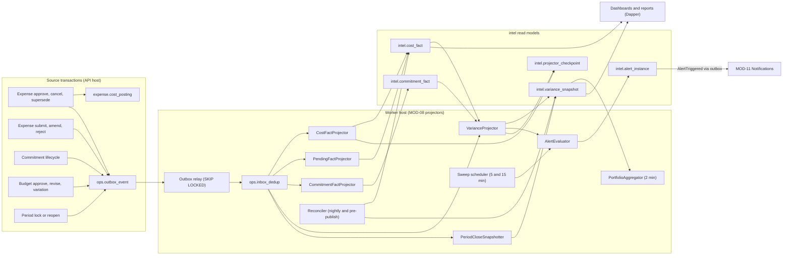

# Document 13: Analytics & Cost Calculation Architecture

**Product:** SlateIQ — Production Cost Intelligence & Audit Monitoring Platform
**Document ID:** SLQ-ARCH-013
**Version:** 1.0.0
**Classification:** Internal — Architecture Foundation
**Status:** Draft — For Review
**Date:** 2026-11-06
**Authors:** Principal Enterprise Solution Architect, Finance Architect, Data Architect
**Reviewers:** Product Owner (TBD), Finance SME (TBD), Tax Advisor (TBD), Audit SME (TBD), Principal Architect (TBD)

---

## Document Control

### Revision History

| Version | Date | Author | Change |
|---------|------|--------|--------|
| 1.0.0 | 2026-11-06 | Architecture Team | First issue: measures M-01 to M-36, currency, FX, rounding, tax and period semantics, grain and dimensions, projection pipeline, freshness tiers, reconciliation checks RCN-01 to RCN-12, alert semantics, report and dashboard mapping, golden examples GX-01 to GX-13, ADR-055 to ADR-058 |

### Related Documents

| Document | Relationship |
|----------|--------------|
| Document 1 — Product Vision & Business Requirements | FR-CIN-001 to FR-CIN-024, NFR-PERF-004, NFR-PERF-005, NFR-PERF-010, BR-FIN-001 to BR-FIN-012, RPT-01 to RPT-18, DSH-01 to DSH-07, D-007, D-008, D-010 |
| Document 2 — Domain Model & Capability Map | CostPosting (D2-17), CostFact, CommitmentFact, VarianceSnapshot, AlertRule, AlertInstance, BudgetLineKey, FxSnapshot, cost basis definition (§2.4) |
| Document 3 — Actor, Permission, Tenancy & Identity | `intel.*` and `report.*` permission keys; RLS family B for `intel` tables, family E for `intel.benchmark_aggregate` |
| Document 4 — Core Business Workflows & State Machines | SM-05 FinancialPeriod, SM-07 ManualCommitment, SM-09 Expense, SM-16 AlertInstance |
| Document 5 — Business Rules & Invariants Catalogue | Rule enforcement, policies POL-011, POL-022, POL-031 to POL-036, POL-042; invariants INV-016 to INV-020, INV-025, INV-035 |
| Document 6 — High-Level Solution Architecture | ADR-010 CQRS-lite read models, §8.3 money and FX, §8.6 read models, §8.7 partitioning, §8.10 data quality controls, Appendix B events |
| Document 8 — Database Conceptual Model & ERD | Physical columns of `intel.cost_fact`, `intel.commitment_fact`, `intel.variance_snapshot` |
| Document 16 — Testing Strategy | Golden examples of section 14 are financial-calculation test fixtures |

---

## 1. Purpose and Scope

The governing brief §13 requires precise formulas and financial semantics for every cost measure, distinguishing actual, committed and forecast, using decimal arithmetic with defined currency, rounding, tax and period treatment, and "no calculation without business meaning". Document 1 RP-01 requires one number with one definition. This document is that definition. Every dashboard tile, report column and alert metric in SlateIQ resolves to a measure here, and every measure resolves to source records.

In scope: measure definitions, financial conventions, the projection pipeline from `expense.cost_posting` and other source tables to the `intel` read models, freshness, reconciliation, alert semantics, the mapping of reports and dashboards to measures, and worked golden examples. Out of scope: report layouts (Document 1 §11 and the Reporting module), physical columns (Document 8), API shapes (Document 9).

---

## 2. Financial Semantics

### 2.1 The Three Kinds of Cost

| Kind | Business meaning | Source of truth | Changes when |
|------|------------------|-----------------|--------------|
| **Actual** | Money the production has spent and that has been approved as a valid production cost | `expense.cost_posting` (append-only ledger, D2-17) | An expense revision is approved (posting), cancelled or superseded (reversal) |
| **Committed** | Money promised under an agreement but not yet spent or claimed | `vendor.manual_commitment` (MVP) and purchase orders (Phase 1), net of consumption | A commitment opens, is amended, consumed by expense lines, closes, expires or is cancelled |
| **Forecast** | Management's estimate of money still to be spent to finish the work (Phase 1) | `budget.forecast` entries (RC-03) and the linear method | A forecast entry is made or the linear inputs move |

**Pending** (submitted, not yet decided) and **rejected** expenses are tracked and reported but are not actual cost (BR-FIN-005). Pending is visible as a separate exposure so management sees spend that is in the approval pipeline.

### 2.2 Principles

| # | Principle | Consequence |
|---|-----------|-------------|
| FP-01 | Actual cost is read from postings, never derived from expense status | Cancelling or amending an expense changes actual only through reversal postings; period history is stable (ADR-055) |
| FP-02 | All measures are in the organization base currency at rates locked on each source record | No revaluation (D-008, BR-FIN-012); report-to-record traceability is exact |
| FP-03 | Additive measures are summed; ratios are recomputed from summed components | A department's variance % is never the average of its categories' percentages |
| FP-04 | A ratio with a zero denominator is "not applicable", never zero | Value object `Percentage` (Document 2 §7) |
| FP-05 | Every number shown carries its as-of time and period basis | RP-02, RP-06, FR-CIN-020 |
| FP-06 | Everything in `intel` is rebuildable from source modules | Document 6 §5.4; INV-025 |

---

## 3. Currency, FX and Rounding

### 3.1 Currency

1. Each organization has one base currency, immutable after its first approved financial record (BR-FIN-004).
2. Budgets are held in base currency only (BR-BUD-008). A foreign-currency budget entry is converted at the budget effective date and the rate is stored on the line.
3. Every expense line and commitment keeps its original currency and amount for traceability and RPT-15; every measure uses the base amount.
4. Arithmetic between different currencies is prohibited in the `Money` value object; conversion produces a new `Money` in base currency.
5. Display currency other than base is not offered at MVP (OQ-13-02).

### 3.2 FX Conversion

| Aspect | Rule |
|--------|------|
| Rate selection | Rate from the organization rate table effective on the expense date; else the latest rate dated on or before the expense date; else the latest published rate (BR-FIN-003, D-007). Rate date older than POL-022 raises an `FX_FALLBACK` exception |
| Rate direction | `rate` = units of base currency per one unit of original currency, `numeric(19,6)` |
| Lock point | Submission of the expense revision or of the commitment; immutable afterwards (INV-016) |
| Amendment | A new revision keeps the prior rate unless the expense date changes and policy allows a re-lock (Document 6 §8.3) |
| Conversion grain | Each monetary component of each line is converted separately: `net_base = R(net × rate)`, `tax_base = R(tax × rate)`, `recoverable_tax_base = R(recoverable_tax × rate)`; `cost_basis_base = net_base + (tax_base − recoverable_tax_base)`; header base totals are sums of line base amounts (RC-13-05) |
| Revaluation | None in MVP or Phase 1 (D-008) |

`R(x)` denotes half-up rounding to scale 4 (section 3.3).

### 3.3 Rounding

RC-01 and BR-FIN-002 bind: rounding mode is half-up (`MidpointRounding.AwayFromZero`), stored scale is 4, display is at the currency's minor units from `ref.currency`.

| Rounding point | Formula | Scale |
|----------------|---------|-------|
| Line amount | `net = R(quantity × unit_price)` (exclusive) or `net = R(gross ÷ (1 + rate))` (inclusive) | 4 |
| Tax amount | Exclusive: `tax_c = R(net × rate_c)` per component c; inclusive: total tax `= gross − net`, components apportioned by rate with the remainder on the largest component | 4 (a jurisdiction profile may require 2, POL-030) |
| Converted amount | `R(original × fx_rate)` per component (section 3.2) | 4 |
| Split allocation | `split_i = R(line_cost_basis_base × pct_i ÷ 100)`; remainder `line − Σ split_i` added to the split with the largest amount (ties: lowest sequence) (BR-EXP-012) | 4 |
| Report total | Sum of stored scale-4 values, then rounded once for display | Display minor units |
| Percentages | Computed from unrounded sums, rounded at output | `numeric(9,4)` |

**No other rounding.** Sums of stored values are exact in `numeric`. Projections, roll-ups and SQL views never round intermediate values.

**Displayed totals.** A displayed total is the rounded exact sum, not the sum of the rounded rows. The two may differ by at most half a minor unit per row; reports state "totals are computed before display rounding". Reconciliation (BR-FIN-011) compares stored scale-4 values, never displayed values.

### 3.4 Commitments in Foreign Currency

A commitment's FX snapshot is locked at its submission. Committed cost is valued at that rate for the life of the commitment (ADR-056):

```
consumed_c   = Σ over consuming lines of:
                 line cost basis in original currency      if line currency = commitment currency
                 R(line cost_basis_base ÷ commitment_rate) otherwise
open_c       = max(0, commitment_amount_c − consumed_c)
open_base    = R(open_c × commitment_rate)
```

Exchange differences between the commitment rate and the expense rate appear in actual cost, where they belong, and never in committed cost.

---

## 4. Tax Treatment

### 4.1 Cost Basis

The **cost basis** of an expense line is the amount that counts as production cost (Document 2 §2.4):

```
gross              = net + tax
recoverable_tax    = R(tax × recoverable_pct)            (0 ≤ recoverable_pct ≤ 100%)
non_recoverable    = tax − recoverable_tax
cost_basis         = net + non_recoverable
```

Recoverable tax (for example GST input tax credit in India or deductible VAT in the EU) is reclaimed by the organization from the tax authority and is therefore not a production cost. Non-recoverable tax is a cost.

### 4.2 Determining Recoverability

| Factor | Effect |
|--------|--------|
| Category default (A2-04) | Each category carries a default recoverable percentage; categories subject to blocked credit (for example food and beverages and motor vehicles under CGST Act s.17(5)) default to 0% |
| Document type | Only `TAX_INVOICE` (and `CREDIT_NOTE` referencing one) can carry recoverable tax; `BILL`, `RECEIPT`, `PETTY_CASH_VOUCHER` and `OTHER` force 0% |
| Vendor registration | Recoverable only when the vendor has an active tax registration for the scheme (format-validated GSTIN or VAT number, Document 2 §6.5) |
| Foreign tax | Tax of a jurisdiction where the organization is not registered (for example German VAT on an Indian organization's expense) is non-recoverable at MVP |
| Line override | Accounts staff may override the percentage with a reason; the override is audited |
| Reverse charge | Tax the organization self-assesses is recorded as a tax component flagged `REVERSE_CHARGE`; its recoverability follows the same factors |

Recoverability is a cost-reporting estimate, not a tax filing. The ERP remains the ledger (D-006); this document does not compute tax returns.

### 4.3 Withholding Is Not a Cost

Tax deducted at source (for example TDS under Income Tax Act sections such as 194C or 194J, mirrored in the Income-tax Act 2025) reduces the amount paid to the vendor and is remitted to the government on the vendor's behalf. The full invoice remains the production's cost. Withholding is stored as metadata on the line (`withholding_amount`, `withholding_section`, A13-03), shown in RPT-03 as "net payable", and never enters cost basis, actual, committed or any variance measure (GX-01).

### 4.4 Credit Notes

A credit note is an expense with document type `CREDIT_NOTE`, negative lines and a mandatory reference to the original root expense (BR-FIN-008). Its recoverable percentage mirrors the original line's. It follows its own approval and posts a negative `APPROVAL` posting in the period of its own expense date (the credit note date), not in the original's period, and not as a reversal (GX-08). The sum of credit notes against an original cannot exceed the original's approved cost basis.

---

## 5. Period Semantics

### 5.1 Calendar

Periods come from `budget.financial_period` (Document 2 §6.4), generated from the fiscal calendar policy POL-029, contiguous and non-overlapping (INV-011). A show-scoped calendar may override the organization calendar. Business dates are in the organization timezone.

### 5.2 Assigning Amounts to Periods

| Item | Period | Basis |
|------|--------|-------|
| Approval posting | Period containing the expense date | BR-FIN-010 |
| Reversal posting (cancellation, supersession) | Period containing the business date of the reversing event | BR-EXP-010 |
| Credit note | Period containing the credit note's expense date | Section 4.4 |
| Pending, rejected | Period containing the expense date (informational) | — |
| Budget, committed, contingency | Not period flows; measured as at a point in time | — |

A reversing event in a `LOCKED` period cannot occur in normal operation because the current period is open; if an organization has locked the period containing today's date, the event is refused with `PERIOD_LOCKED` until the period is reopened. Cancellation of an expense dated in an earlier locked period is allowed and its reversal lands in the current period, leaving the locked period's figures untouched (RC-05-03, GX-07).

### 5.3 Period and Cumulative Measures

| Measure | Definition |
|---------|-----------|
| Period actual (M-17) | Σ actual postings whose `period_id` is the period (posting basis, default). An **economic basis** variant groups the currently approved revisions by expense date; it is offered as a view option and labelled |
| Cumulative actual (M-04) | Σ actual postings with period on or before the as-of period |
| Period variance movement (M-18) | `V(end of period) − V(end of previous period)`, where V is variance M-13; locked periods use their period-close snapshots |
| Cumulative variance to date (M-19) | V at the as-of instant |

Period movements sum exactly to cumulative variance, which satisfies FR-CIN-005. Budgets are not phased by period at MVP; a phased-budget comparison arrives with forecasts in Phase 1 (ADR-057).

### 5.4 Period-Close Snapshots

When a period moves to `LOCKED`, the snapshotter writes `intel.variance_snapshot` rows of kind `PERIOD_CLOSE` for every line key of every show in scope, in the lock transaction's outbox order. Those rows are immutable. A reopen followed by a relock writes a new snapshot version; the earlier version is retained and reports state which version they use.

---

## 6. Grain and Dimensions

### 6.1 Dimensions

| Dimension | Key | Notes |
|-----------|-----|-------|
| Organization | `org_id` | Tenant; never aggregated across tenants except anonymised benchmarks (Phase 1) |
| Show, season, episode | `show_id`, `season_id`, `episode_id` | Episode optional on lines |
| Department | `department_id` | From the split; roll-up through the hierarchy (depth ≤ 3) |
| Category | `category_id` | Leaf category from the split; roll-up through parents |
| Cost type | `cost_type` | `ABOVE_THE_LINE`, `BELOW_THE_LINE`, `POST_PRODUCTION`, `OTHER` (A2-02) |
| Budget line key | `(season_id, department_id, category_id, cost_type)` | The join between budget, actual and committed (Document 2 §7) |
| Vendor | `vendor_id` or one-time payee key | Not a budget dimension |
| Commitment | `commitment_id` | For consumption |
| Period | `period_id` | Section 5 |
| Dates | `posting_date`, `expense_date` | |
| Original currency | ISO 4217 | RPT-15 |
| Source | `MOBILE`, `WEB`, `EXCEL_IMPORT`, `API` | Data lineage |
| Assignment | `assignment_id` | Audit coverage and scope-limited views |

### 6.2 Read-Model Grain

| Read model | Grain | Kinds |
|------------|-------|-------|
| `intel.cost_fact` | One row per cost posting (`ACTUAL`), or per line split of the current undecided or rejected revision (`PENDING`, `REJECTED`) | `fact_kind` |
| `intel.commitment_fact` | One row per commitment and budget line key | — |
| `intel.variance_snapshot` | One row per budget line key, plus show-level and portfolio total rows, per snapshot kind | `LIVE`, `PERIOD_CLOSE` |
| `intel.alert_instance` | One row per firing (section 12) | — |
| `intel.benchmark_aggregate` | One row per category, show type, statistic and region (Phase 1) | — |

`intel.cost_fact` is partitioned monthly by `cost_date`, which is the posting date for `ACTUAL` rows and the expense date for `PENDING` and `REJECTED` rows (RC-13-07).

---

## 7. Measure Catalogue

Notation: `B` budget, `A` actual, `C` committed, `P` pending, all in base currency at the as-of instant and for a scope (line key, department, show, portfolio). `R()` is half-up rounding at scale 4. "Current revision" means the latest revision of a root expense.

### 7.1 Budget Measures

| ID | Measure | Formula | Business meaning | Source | Release |
|----|---------|---------|------------------|--------|---------|
| M-01 | Original budget | Σ line amounts of the first `ACTIVE` version (`version_type = ORIGINAL`) | What was first approved; the commissioning baseline | Budget contract | MVP |
| M-02 | Current budget | Σ line amounts of the `ACTIVE` version + Σ applied variations into the line − Σ applied variations out of the line | The authorized plan today; the variance denominator ("approved budget" of FR-CIN-006, RC-13-08) | Budget contract, `VariationApplied` | MVP |
| M-03 | Contingency balance | Current budget of lines with `line_type = CONTINGENCY` | Unallocated reserve still available to move into operational lines (BR-BUD-004) | As M-02 | MVP |
| M-16 | Budget drift | `M-02 − M-01` at show or line level | How far the plan has moved from the original approval | M-01, M-02 | MVP |

### 7.2 Cost Measures

| ID | Measure | Formula | Business meaning | Source | Release |
|----|---------|---------|------------------|--------|---------|
| M-04 | Approved actual | `A = Σ amount` of `ACTUAL` cost facts (approval postings positive, reversals negative, credit notes negative) with period ≤ as-of period | Production cost incurred and approved (BR-FIN-005, FR-CIN-001) | `cost_fact` ← `cost_posting` | MVP |
| M-05 | Pending | `P = P_new + P_amend`. `P_new` = Σ cost basis of current revisions in `SUBMITTED` or `REQUIRES_INFO` whose root has no `APPROVED` revision. `P_amend` = Σ (cost basis of the pending revision − cost basis of the approved revision) for roots that have both | Spend in the approval pipeline; amendment deltas avoid double counting the approved part already in A | `cost_fact` `PENDING` | MVP |
| M-06 | Rejected (reported, excluded) | Σ cost basis of current revisions in `REJECTED` | Claims refused; shown in registers and exception analysis, excluded from A, P and every variance | `cost_fact` `REJECTED` | MVP |
| M-07 | Commitment consumption | Per commitment: `consumed_c` of section 3.4 over lines of current revisions in `SUBMITTED`, `REQUIRES_INFO` or `APPROVED` that reference it. `DRAFT`, `REJECTED`, `CANCELLED` and `SUPERSEDED` revisions do not consume | How much of an agreement has been claimed | Expense events | MVP |
| M-08 | Committed | `C = Σ open_base` over commitments in `OPEN` (section 3.4); Phase 1 adds open purchase orders net of receipts | Known obligations not yet claimed (BR-FIN-006, FR-CIN-002) | `commitment_fact` | MVP |
| M-09 | Exposure | `A + C + P` | Everything spent, promised or claimed; the most conservative view of cost | M-04, M-05, M-08 | MVP |
| M-10 | Consumption | `A + C` | Budget used by approved spend and open obligations | M-04, M-08 | MVP |
| M-11 | Consumption % | `100 × (A + C) ÷ B`; not applicable when `B = 0` | Share of the plan used; the primary overrun early-warning metric | M-10, M-02 | MVP |
| M-12 | Remaining budget | `B − A − C − P` | What can still be committed after everything in flight is honoured | M-02, M-09 | MVP |
| M-17 | Period actual | Σ `ACTUAL` facts with `period_id = p` (posting basis; economic-basis view optional, section 5.3) | Cost booked in the period; a reversal of an older expense appears as a negative in the reversing period | `cost_fact` | MVP |
| M-20 | Unbudgeted spend | `A + C` on line keys whose current budget is 0 or absent | Spend outside the plan; drives `UNBUDGETED_SPEND` exceptions and alerts | `variance_snapshot` | MVP |

**Why pending is outside variance.** Variance is the binding definition `B − A − C` (Document 6 §8.10). Because consumption by a pending line reduces C before the line becomes A, a large pending claim against a commitment temporarily raises variance. M-09 and M-12 restore the full picture and are shown beside variance on RPT-01 and DSH-02 (R13-04).

### 7.3 Variance Measures

| ID | Measure | Formula | Business meaning | Release |
|----|---------|---------|------------------|---------|
| M-13 | Variance | `V = B − A − C` | Headroom left in the plan after approved spend and open obligations; negative means overrun | MVP |
| M-14 | Variance % | `R(100 × V ÷ B)` as `numeric(9,4)`; not applicable when `B = 0` (FR-CIN-006); classified against alert thresholds | Size of headroom or overrun relative to the plan | MVP |
| M-15 | Original-budget variance | `M-01 − A − C` | Performance against the first approval, for commissioners who measure the producer against the original deal | MVP |
| M-18 | Period variance movement | `V(end p) − V(end p−1)` (section 5.3) | How much headroom the period consumed or released | MVP |
| M-19 | Cumulative variance to date | `V` as at the as-of instant | Position to date; equals M-13 | MVP |

Sign convention: positive variance is favourable (under budget). Reports never invert signs; a negative value is labelled "overrun".

### 7.4 Forecast Measures (Phase 1)

| ID | Measure | Formula | Business meaning |
|----|---------|---------|------------------|
| M-21 | Estimate to complete (ETC) | Manual: latest effective `budget.forecast` amount for the line key (FR-CIN-003). Linear: `ETC = max(0, (A + P) ÷ p − (A + P + C))` where `p` = progress fraction (elapsed shoot days ÷ planned shoot days; calendar fallback); suppressed when `p < 0.10` (OQ-13-04) | Spend still expected beyond what is approved, pending or committed |
| M-22 | Estimated final cost (EFC) | `A + P + C + ETC` | Expected total cost at completion |
| M-23 | Forecast variance | `B − EFC`; % on `B` | Expected overrun or saving at completion |

The method, inputs and assumptions are stored with each EFC result so it is reproducible (FR-CIN-003). Forecast accuracy (RPT-18, Phase 2) is `|EFC at t − final A| ÷ final A` per show and horizon (FR-CIN-024).

### 7.5 Rate and Unit Measures

| ID | Measure | Formula | Business meaning | Release |
|----|---------|---------|------------------|---------|
| M-24 | Burn rate | Σ cost basis of currently approved revisions with expense date in the trailing window `W` ÷ `W` days (default `W` = 14; 7 and 30 selectable) | Daily spend pace by when the money was spent | MVP |
| M-25 | Runway | `M-12 ÷ M-24` in days; not applicable when burn is 0 | Days until remaining budget is exhausted at the current pace | MVP |
| M-26 | Cost per episode | Direct: Σ A on lines tagged with the episode. Average: season A ÷ episodes not `DROPPED` | Unit cost for commissioning comparison | MVP (average), Phase 1 (direct with allocation, RPT-16) |
| M-27 | Cost per shoot day | Show A ÷ shoot days elapsed (distinct episode shoot dates ≤ as-of, A13-02); planned: B ÷ planned shoot days | Daily production cost against plan | MVP |
| M-36 | Episode allocation variance | Episode allocation − direct episode A − committed tagged to the episode | Per-episode plan performance within the season budget (BR-PRD-005) | Phase 1 |

### 7.6 Vendor, Control and Operational Measures

| ID | Measure | Formula | Business meaning | Release |
|----|---------|---------|------------------|---------|
| M-28 | Vendor spend and concentration | Vendor A, C and P; share = vendor A ÷ scope A; concentration index `HHI = Σ (share × 100)²` | Dependence on few suppliers; FR-CIN-019 | MVP |
| M-29 | Approval age | `now − submitted_at` for revisions in `SUBMITTED` or `REQUIRES_INFO`, bucketed 0–1, 1–3, 3–7, > 7 days | Approval bottlenecks (RPT-08) | MVP |
| M-30 | Evidence completeness | Approved revisions whose required evidence (POL-011 to POL-013) is all `VERIFIED` ÷ approved revisions requiring evidence; by count and by base amount | Substantiation quality (RPT-10) | MVP |
| M-31 | Audit coverage | Required departments with an accepted audit report in the period ÷ required departments (CoverageRequirement) | Assurance coverage (RPT-09) | MVP |
| M-32 | Open exceptions | Count and base amount of exceptions in `OPEN` or `ACKNOWLEDGED`, by type, severity and age | Control backlog (RPT-11) | MVP |
| M-33 | Commitment ageing | Open committed by age since commitment date and by days to validity end | Stale obligations that should be closed or claimed | MVP |
| M-34 | Foreign-currency usage | Σ cost basis base and original amount by original currency; count of `FX_FALLBACK` exceptions; rate sources used | FX transparency (RPT-15) | MVP |
| M-35 | Benchmark percentiles | Per region, category and show type: each consenting organization contributes one value (median cost per episode of its completed seasons for the category); publish P25, P50, P75 and organization count only when count ≥ 5 (FR-CIN-016) | Peer comparison without identifying any organization | Phase 1 |

---

## 8. Roll-ups and Aggregation Rules

| Roll-up | Additive measures | Ratios | Notes |
|---------|-------------------|--------|-------|
| Line key → department | Σ over categories and cost types in the department and its descendants | Recomputed from sums | Department budget = Σ its line keys |
| Line key → category | Σ over departments; parent categories include descendants | Recomputed | |
| Season → show | Σ seasons | Recomputed | A film has one season |
| Show → portfolio | Σ shows in the tenant within the viewer's scope | Recomputed | Within one tenant only (Document 2 §2.3 rule 5) |
| Vendor | A, C, P only | Shares | No budget by vendor; variance by vendor is not defined and is never shown |
| Period | M-17 additive over periods; M-04 is the cumulative sum | — | |
| Episode | Direct A, C; allocation (Phase 1) | — | Untagged lines remain at season level |
| Splits | All measures use split dimensions | — | One line can feed two departments |

Scope filtering happens before aggregation: a Department Head's DSH-03 totals are the sums over the departments in their scope, never a portfolio total with rows hidden (RAC-02). Totals shown in a drill-down equal the sum of their children by construction (RCN-09).

---
## 9. Projection Pipeline

### 9.1 Sources and Events

Projectors in MOD-08 never read another module's schema (Document 6 §4.3); they consume outbox events and, for bulk reads during rebuild or budget refresh, call the owning module's read contract.

| Source of truth | Owner | Events consumed | Read model |
|-----------------|-------|-----------------|------------|
| `expense.cost_posting` | MOD-07 | `CostPostingsRecorded` (requested, section 15.2) | `intel.cost_fact` (`ACTUAL`) |
| `expense.expense`, `expense_line`, `expense_split` | MOD-07 | `ExpenseSubmitted`, `ExpenseAmended`, `ExpenseRejected`, `ExpenseApproved`, `ExpenseCancelled` | `intel.cost_fact` (`PENDING`, `REJECTED`); consumption on `intel.commitment_fact` |
| `vendor.manual_commitment`, `commitment_amendment` | MOD-05 | `CommitmentCreated`, `CommitmentAmended`, `CommitmentClosed`, `CommitmentStatusChanged` (requested) | `intel.commitment_fact` |
| `budget.budget_version`, `budget_line`, `variation` | MOD-04 | `BudgetApproved`, `BudgetRevised`, `VariationApplied` (requested) | Budget columns of `intel.variance_snapshot` |
| `budget.financial_period` | MOD-04 | `PeriodLocked`, `PeriodReopened` | `PERIOD_CLOSE` snapshots |
| `prod.*` | MOD-03 | `ShowCreated`, `ShowStatusChanged`, `CategoryChanged` | Dimension labels |

### 9.2 Pipeline



### 9.3 Projector Contracts

| Projector | Idempotency key | Write rule | Ordering |
|-----------|-----------------|------------|----------|
| CostFactProjector | `(org_id, cost_posting_id)` | Insert only; a duplicate insert is ignored. Postings are immutable, so a fact is never updated | Any order; facts are additive |
| PendingFactProjector | `(org_id, expense_revision_id, line, split)` with `source_version` | Upsert only when the incoming `source_version` is greater than the stored one; rows are deleted when the revision leaves `SUBMITTED`/`REQUIRES_INFO` (approved revisions are represented by postings, rejected ones move to `REJECTED`) | Monotonic version guard tolerates out-of-order delivery |
| CommitmentFactProjector | `(org_id, commitment_id, line_key)` with `source_version` | Recomputes `consumed_c`, `open_c`, `open_base` from the commitment and the consuming lines it has seen | Version guard |
| VarianceProjector | `(org_id, line_key, snapshot_kind)` | Recomputes the affected line key from sums over `cost_fact` and `commitment_fact` plus budget amounts; recomputes the show total row; one transaction per event batch | Recompute-from-sums makes order irrelevant |
| PortfolioAggregator | `(org_id, run_at)` | Recomputes tenant portfolio rows from show rows | Scheduled |
| PeriodCloseSnapshotter | `(org_id, period_id, snapshot_version)` | Insert once per lock event; never updated | On `PeriodLocked` |

Each projector writes its read-model change and its `intel.projector_checkpoint` (`projector`, `org_id`, `last_event_id`, `last_occurred_at`, `server_seq`) in one transaction, and records the event in `ops.inbox_dedup` (INV-030). The worker sets the tenant context from the event's `org_id` before touching any row (Document 3 Appendix D, `ops` family A).

### 9.4 Event Payload Requirements

`CostPostingsRecorded` carries every posting of the transaction: `cost_posting_id`, `posting_type`, `expense_id`, `root_expense_id`, line and split identifiers, all dimensions of section 6.1, `period_id`, `posting_date`, `expense_date`, original currency and amount, rate, base cost basis, base gross and base recoverable tax. `ExpenseSubmitted` and `ExpenseAmended` carry the revision's lines and splits with the same dimensions, `commitment_id` per line, cost basis and `source_version`. Payloads carry identifiers and amounts only, no personal data (Document 6 Appendix B).

### 9.5 Rebuild

Every projector supports a full rebuild for one tenant or all tenants (Document 6 §8.6): it reads source rows through the owning modules' bulk read contracts into a shadow schema, runs RCN-01 to RCN-10 against the shadow, and swaps only when all pass. `PERIOD_CLOSE` snapshots are copied, never recomputed; a recomputed value that differs from a frozen snapshot is reported as an RCN-11 finding, not silently replaced.

---

## 10. Freshness Tiers

| Tier | Content | Target | Requirement | Measured as |
|------|---------|--------|-------------|-------------|
| T0 Transactional | Source tables, expense register queries, approval queues | Synchronous | NFR-PERF-012 | — |
| T1 Show | `cost_fact`, `commitment_fact`, `variance_snapshot` `LIVE` rows of a show | ≤ 60 s at P95 from commit to visible | NFR-PERF-004, D-010 | `now − checkpoint.last_occurred_at` per projector and tenant |
| T2 Portfolio | Portfolio and cross-show aggregates, vendor roll-ups | ≤ 5 minutes | NFR-PERF-005 | Age of the last PortfolioAggregator run |
| T3 Alerts | Critical alert evaluation; standard alert evaluation | ≤ 5 minutes; ≤ 15 minutes | NFR-PERF-010, FR-CIN-008 | `alert.triggered_at − source event occurred_at` |
| T4 Daily | Benchmarks (Phase 1), reconciliation results, daily digest | By 07:00 local | D-010 | Job completion time |
| T5 Frozen | `PERIOD_CLOSE` snapshots | Immutable | — | — |

Every dashboard and report shows its as-of time, the minimum checkpoint of the read models it uses (FR-CIN-020, RP-02). When the lag exceeds the tier target the view shows a stale badge; beyond four times the target it shows a "data delayed" banner and DSH-07 raises an operations alert (NFR-OBS-002). A report run whose watermark is stale still runs but states the watermark (INV-028).

---

## 11. Reconciliation Checks

All checks compare stored scale-4 values with tolerance POL-042 (0.01 base-currency units, BR-FIN-011): a difference greater than 0.01 fails. They run nightly per tenant and, for RCN-01, RCN-06, RCN-09 and RCN-12, before any report run is published. A failure blocks publication (`RECONCILIATION_FAILED`), marks affected dashboards with a reconciliation warning, alerts finance operations and is never repaired silently (Document 6 §8.10).

| ID | Check | Invariant |
|----|-------|-----------|
| RCN-01 | Σ `ACTUAL` cost facts = Σ `expense.cost_posting` per organization, show, period | INV-035, BR-FIN-005 |
| RCN-02 | Posting completeness: each approved revision has one approval posting per split equal to its base cost basis; each cancelled or superseded approved revision has matching reversals; net per revision is cost basis or zero | INV-017 |
| RCN-03 | Expense header base totals = Σ line base amounts; line cost basis = Σ splits; `cost_basis = net + tax − recoverable_tax` | INV-016 |
| RCN-04 | Every fact has an existing source record and a checkpoint; orphans quarantined | INV-025 |
| RCN-05 | `commitment_fact.open_base` = recomputation from the commitment and its consuming lines; only `OPEN` commitments carry open amounts | INV-019, BR-FIN-006 |
| RCN-06 | For every `variance_snapshot` row, `variance = current_budget − actual − committed` | Document 6 §8.10 |
| RCN-07 | No posting with `period_id` of a `LOCKED` period has `created_at` after the lock time (except reversals, which never target locked periods) | INV-012 |
| RCN-08 | Snapshot budget columns = active version lines + applied variations; original budget = first active version | M-01, M-02 |
| RCN-09 | Roll-up additivity: show row = Σ line keys; portfolio = Σ shows | Section 8 |
| RCN-10 | `PENDING` facts = recomputation from current revisions in `SUBMITTED` or `REQUIRES_INFO` | M-05 |
| RCN-11 | `PERIOD_CLOSE` snapshot rows unchanged since creation (hash) and consistent with postings up to lock time | Section 5.4 |
| RCN-12 | A report run's printed totals = Σ its detail rows; drill-down totals = parent tile | RAC-01, BR-FIN-011 |

---

## 12. Alert Rule Semantics

### 12.1 Rule Definition

`intel.alert_rule` rows are created and maintained by holders of `intel.alert_rule.create`, `intel.alert_rule.update` and `intel.alert_rule.delete` (Finance Head by default); every change creates a new rule version (FR-CIN-007).

| Field | Values |
|-------|--------|
| Scope | `ORG` (portfolio), `SHOW`, `SEASON`, `DEPARTMENT`, `LINE_KEY`; a rule at a scope may fan out `FOR_EACH` child (for example "each line key of this show") |
| Metric | `CONSUMPTION_PCT` (M-11), `VARIANCE_PCT` (M-14), `VARIANCE_AMOUNT` (M-13), `REMAINING_BUDGET` (M-12), `COMMITTED_AMOUNT` (M-08), `PENDING_AMOUNT` (M-05), `UNBUDGETED_SPEND` (M-20), `PERIOD_ACTUAL` (M-17), `RUNWAY_DAYS` (M-25), `CONTINGENCY_REMAINING_PCT` (M-03 ÷ original contingency), `FORECAST_VARIANCE_PCT` (M-23, Phase 1) |
| Condition | `GT`, `GTE`, `LT`, `LTE` against a threshold in the metric's unit (percent, base-currency amount or days) |
| Severity | `INFO`, `WARNING`, `CRITICAL` |
| Cooldown | Hours (POL-033 default 24) |
| Evaluation | `EVENT_AND_SWEEP` (default) or `SWEEP_ONLY` for time-driven metrics (`RUNWAY_DAYS`) |
| Recipients | Roles at the rule's scope; resolved by MOD-11 within the recipients' permissions |

Validation on save (`ALERT_RULE_INVALID`, 422): metric applicable to scope; threshold within the metric's bounds; percentage rules not applied to line keys below POL-036; overlapping rules (same metric and scope) allowed with a warning (FR-CIN-007). Seeded defaults come from POL-031 and POL-032.

### 12.2 Evaluation

| Path | Trigger | Latency |
|------|---------|---------|
| Event | VarianceProjector commits a changed row; AlertEvaluator evaluates rules whose scope contains the changed key | Within T1 plus evaluation, well inside T3 |
| Sweep | Scheduler every 5 minutes for rules with any `CRITICAL` level, every 15 minutes otherwise; evaluates all active rules against current snapshots | Catches time-driven metrics and any missed event |

Evaluation reads only `intel` read models, so it is cheap and repeatable. A rule's value is computed with the measure formulas of section 7 on the scope's summed components.

### 12.3 Deduplication, Cooldown and Hysteresis

```
dedup_key = hash(rule_id, scope_key, period_key)      -- period_key = period_id for PERIOD_ACTUAL, "CUMULATIVE" otherwise
on evaluation(value):
    open = alert_instance where dedup_key and status in (TRIGGERED, ACKNOWLEDGED)
    if condition(value) is true:
        if open exists:
            update open.last_value, open.last_evaluated_at
            if severity(value) > open.severity: escalate severity, notify      -- worsening is never suppressed
        else if now >= last_closed_at(dedup_key) + cooldown or severity rose:
            insert alert_instance (TRIGGERED, rule_version, value, threshold, severity) and AlertTriggered in outbox
    else if open exists and condition is false by at least the hysteresis margin (POL-034):
        set open.status = RESOLVED, resolution = AUTO_CLEARED
```

A partial unique index on `(org_id, dedup_key) WHERE status IN ('TRIGGERED','ACKNOWLEDGED')` makes the insert idempotent under concurrent event and sweep evaluation (FR-CIN-008). Users acknowledge, resolve or mark false positive with a reason (`intel.alert.update`, FR-CIN-009). A false positive suppresses re-triggering for the same dedup key until the measured value worsens by more than the hysteresis margin. Escalation of unacknowledged alerts is Phase 1 (FR-CIN-010).

### 12.4 Alerts versus Exceptions

| | Exception (MOD-07) | Alert (MOD-08) |
|---|---|---|
| Subject | One record (expense, line, vendor) | A measure over a scope |
| Raised | Synchronously at submission or decision | Asynchronously after projection |
| Example | `OVER_BUDGET`: this expense takes its line key's consumption above 100% | `CONSUMPTION_PCT ≥ 100` on the show's art department |
| Owner | Approver of the record | Finance Head or Cost Controller |

Both can fire for the same overrun. They are linked by line key in RPT-11 and DSH-02 so a reviewer sees the record that caused the measure to cross.

### 12.5 Notification Content

In-app alerts show the measured value, threshold, amounts and a drill-down link. Email bodies show severity, metric, scope name, percentage values and the link, without absolute amounts, unless the tenant opts in (RC-13-06, OQ-13-03).

---

## 13. Report and Dashboard Mapping

| ID | Report or dashboard | Measures | Read model | Freshness | Release |
|----|---------------------|----------|------------|-----------|---------|
| RPT-01 | Budget vs Actual vs Committed | M-01, M-02, M-03, M-04, M-05, M-08, M-09, M-11, M-12, M-13, M-14 | `variance_snapshot` `LIVE` | T1 | MVP |
| RPT-02 | Variance Analysis with Commentary | M-13, M-14, M-15, M-16, M-18, M-19; commentary captured as budget comments by line key (FR-BUD-015) | `variance_snapshot` (`LIVE` and `PERIOD_CLOSE`) | T1 | MVP |
| RPT-03 | Expense Register | Line net, tax, recoverable tax, cost basis, withholding, net payable; status; M-04, M-05, M-06 contributions | Source tables via Expense read contract, `cost_fact` | T0/T1 | MVP |
| RPT-04 | Expense Detail and Evidence Pack | No aggregate measure; line amounts as RPT-03 | Source records | On demand | MVP |
| RPT-05 | Vendor Spend Summary | M-04, M-05, M-08, M-28 | `cost_fact`, `commitment_fact` | T2 | MVP |
| RPT-06 | Vendor 360° Profile | M-04, M-08, M-17 trend, M-28, M-33 | `cost_fact`, `commitment_fact` | T2 | MVP |
| RPT-07 | Commitment / Open Obligations | M-07, M-08, M-33 | `commitment_fact` | T1 | MVP |
| RPT-08 | Approval Ageing and SLA | M-29, M-05 | Expense read contract | T1 | MVP |
| RPT-09 | Audit Coverage and Timeliness | M-31 | Audit Ops read contract (`CoverageUpdated`) | T2 | MVP |
| RPT-10 | Evidence Completeness | M-30 | Expense and Documents read contracts | T2 | MVP |
| RPT-11 | Exception and Anomaly Register | M-32; linked alerts | Expense read contract, `alert_instance` | T1 | MVP |
| RPT-12 | Audit Trail Extract | No financial measure | `compliance.audit_event` | On demand | MVP |
| RPT-13 | Access and Grant Report | No financial measure | Tenancy read contract | T2 | MVP |
| RPT-14 | Portfolio Summary (Board Pack) | M-01, M-02, M-04, M-08, M-09, M-11, M-13, M-14; M-22 and M-23 from Phase 1 | `variance_snapshot` portfolio rows | T2 | MVP |
| RPT-15 | FX Rate Usage and Exposure | M-34 | `cost_fact` | T2 | MVP |
| RPT-16 | Episode Cost Allocation | M-26, M-36 | `cost_fact`, budget contract | T2 | Phase 1 |
| RPT-17 | Benchmark Comparison | M-35 against the tenant's own M-26 by category | `benchmark_aggregate` | T4 | Phase 1 |
| RPT-18 | Forecast Accuracy and EFC | M-21, M-22, M-23, forecast accuracy | Forecast history, `variance_snapshot` | T4 | Phase 2 |
| DSH-01 | Portfolio Dashboard | M-02, M-04, M-08, M-13, M-14 heat map, M-11, open critical alerts; forecast tile shows M-22 from Phase 1 and "—" at MVP | Portfolio and show rows | T2 aggregates, T1 show tiles | MVP |
| DSH-02 | Show Cost Dashboard | M-02 to M-05, M-08 to M-14, M-17 trend, M-24, M-25, M-27, M-28 top vendors, M-32 | `variance_snapshot`, `cost_fact` | T1 | MVP |
| DSH-03 | Department Dashboard | M-02, M-04, M-05, M-08, M-13, M-14 by line key; M-29 queue | `variance_snapshot` | T1 | MVP |
| DSH-04 | Audit Operations Dashboard | M-31, M-30 (disputes), M-29, auditor workload | Audit Ops and Expense contracts | T2 | MVP |
| DSH-05 | Compliance Dashboard | Operational counts only (DSRs, holds, reviews, overrides from Document 5 §9) | Compliance contract | T2 | MVP |
| DSH-06 | Vendor Dashboard | M-28, `DUPLICATE_SUSPECTED` count from M-32, blocked vendors, payment reference mismatches | `cost_fact`, Vendor contract | T2 | MVP |
| DSH-07 | Platform Operations Dashboard | Projection lag (section 10), RCN results, alert delivery; identifiers and aggregates only, no tenant amounts (NFR-OBS-004) | Checkpoints, job telemetry | ≤ 1 min | MVP |

Access: dashboards need `report.dashboard.read`; variance views `intel.variance.read` (export `intel.variance.export`); portfolio `intel.portfolio_view.read`; drill-down to facts `intel.cost_fact.read`; benchmarks `intel.benchmark.read`. Every export is audited (RAC-04).

---

## 14. Golden Examples

Organization: base currency INR, fiscal year April to March, monthly periods (P06 = September 2026, P07 = October 2026). Amounts at scale 4. These examples are fixtures for the G tests of Document 5 and Document 16.

**GX-01 Domestic invoice, recoverable GST, TDS.** Quantity 3 × unit price 1,250.0000; GST 18% exclusive (IGST), vendor GSTIN active, `TAX_INVOICE`, category recoverable 100%.

| Item | Value |
|------|-------|
| Net | `R(3 × 1,250.0000)` = 3,750.0000 |
| Tax | `R(3,750.0000 × 0.18)` = 675.0000 |
| Gross | 4,425.0000 |
| Recoverable / non-recoverable | 675.0000 / 0.0000 |
| Cost basis (posted on approval) | **3,750.0000** |
| TDS 2% on net (metadata) | 75.0000; net payable to vendor 4,350.0000; cost unchanged |

**GX-02 Blocked credit.** Catering, net 12,000.0000, GST 5% = 600.0000, category recoverable 0% (blocked credit). Cost basis **12,600.0000**.

**GX-03 Tax-inclusive receipt.** Gross 1,000.0000 including 18% GST, recoverable 100%. Net `R(1,000 ÷ 1.18)` = 847.4576; tax = 1,000.0000 − 847.4576 = 152.5424; cost basis **847.4576**. With document type `RECEIPT`, recoverability is forced to 0% and cost basis is 1,000.0000.

**GX-04 Foreign currency.** Location expense in Germany: net EUR 1,234.5600, German VAT 19% = `R(1,234.56 × 0.19)` = EUR 234.5664, non-recoverable for the Indian organization. Locked rate 90.123456 INR per EUR.

| Component | Original (EUR) | Base (INR) |
|-----------|----------------|------------|
| Net | 1,234.5600 | `R(1,234.56 × 90.123456)` = 111,262.8138 |
| Tax | 234.5664 | `R(234.5664 × 90.123456)` = 21,139.9346 |
| Cost basis | 1,469.1264 | **132,402.7484** |

Converting the gross in one step would give `R(1,469.1264 × 90.123456)` = 132,402.7485. The per-component rule (section 3.2) governs, so header base equals the sum of line components; the 0.0001 difference is expected and documented.

**GX-05 Split remainder.** Line cost basis 7,777.7777 split 33.3333% / 33.3333% / 33.3334%. Raw: 2,592.5900; 2,592.5900; 2,592.5978; sum 7,777.7778, remainder −0.0001 assigned to the largest split. Final: 2,592.5900; 2,592.5900; **2,592.5977**; sum 7,777.7777.

**GX-06 Amendment approved in a later period.** Revision r1 dated 2026-09-20, cost basis 50,000.0000, approved 2026-09-22. On 2026-10-05 a financial amendment r2 changes it to 55,000.0000; r2 approved 2026-10-07; P06 still open.

| Date | Event | Posting | P06 actual | P07 actual | Cumulative A | Pending |
|------|-------|---------|-----------|-----------|--------------|---------|
| 09-22 | r1 approved | +50,000.0000 to P06 | 50,000.0000 | 0.0000 | 50,000.0000 | 0.0000 |
| 10-05 | r2 submitted | — | 50,000.0000 | 0.0000 | 50,000.0000 | 5,000.0000 (`P_amend`) |
| 10-07 | r2 approved, r1 superseded | −50,000.0000 to P07 (event); +55,000.0000 to P06 (expense date) | 105,000.0000 | −50,000.0000 | **55,000.0000** | 0.0000 |

Cumulative actual is exact; period actual on the posting basis shows the reversal in October (R13-01). The economic-basis view shows 55,000.0000 in September. Had P06 been `LOCKED`, the amendment would have been refused with `PERIOD_LOCKED`.

**GX-07 Cancellation after the period locked.** Expense dated 2026-08-14, cost basis 40,000.0000, approved 2026-08-16 (+40,000.0000 to P05). P05 locked 2026-09-10 with a `PERIOD_CLOSE` snapshot. Cancelled 2026-10-12: reversal −40,000.0000 to P07. P05 remains 40,000.0000 in its snapshot; P07 shows −40,000.0000; cumulative actual 0.0000; P07 variance movement +40,000.0000.

**GX-08 Credit note.** Against GX-01, credit note dated 2026-10-15: net −1,000.0000, GST −180.0000 recoverable 100%. Cost basis **−1,000.0000**, posted as an approval posting to P07. Remaining creditable cost basis on the original: 2,750.0000.

**GX-09 Line key with commitment, pending and rejected.** Art department, set construction materials. Original budget 9,00,000.0000; variation from contingency +1,00,000.0000; current budget 10,00,000.0000. Commitment C1 (`OPEN`, INR) 4,00,000.0000. Expenses: E1 approved 1,50,000.0000 on C1; E2 submitted 50,000.0000 on C1; E3 rejected 30,000.0000 on C1; E4 approved 2,20,000.0000 (no commitment); E5 submitted 20,000.0000.

| Measure | Computation | Value |
|---------|-------------|-------|
| M-04 Actual | 1,50,000 + 2,20,000 | 3,70,000.0000 |
| M-07 Consumption of C1 | 1,50,000 + 50,000 (E3 rejected excluded) | 2,00,000.0000 |
| M-08 Committed | 4,00,000 − 2,00,000 | 2,00,000.0000 |
| M-05 Pending | 50,000 + 20,000 | 70,000.0000 |
| M-06 Rejected | E3 | 30,000.0000 |
| M-13 Variance | 10,00,000 − 3,70,000 − 2,00,000 | **4,30,000.0000** |
| M-14 Variance % | 100 × 4,30,000 ÷ 10,00,000 | 43.0000 |
| M-11 Consumption % | 100 × 5,70,000 ÷ 10,00,000 | 57.0000 |
| M-09 Exposure | 3,70,000 + 2,00,000 + 70,000 | 6,40,000.0000 |
| M-12 Remaining | 10,00,000 − 6,40,000 | 3,60,000.0000 |
| M-15 Original-budget variance | 9,00,000 − 5,70,000 | 3,30,000.0000 |

C1 is fully accounted for: 1,50,000 actual + 50,000 pending + 2,00,000 open = 4,00,000.

**GX-10 Foreign-currency commitment.** Commitment EUR 10,000.0000 at locked rate 90.000000 (base 9,00,000.0000). Expense A: EUR 4,000.0000 at 91.000000 (cost basis base 3,64,000.0000), approved. Expense B in INR, cost basis 1,82,000.0000, approved, on the same commitment.

| Item | Value |
|------|-------|
| Consumption from A (same currency) | EUR 4,000.0000 |
| Consumption from B | `R(1,82,000 ÷ 90.000000)` = EUR 2,022.2222 |
| Open | EUR 3,977.7778; `open_base = R(3,977.7778 × 90)` = **3,58,000.0020** |
| Actual | 3,64,000.0000 + 1,82,000.0000 = 5,46,000.0000 |
| A + C | 9,04,000.0020; the 4,000.0020 above the commitment's base value is the FX difference realised in actual on expense A plus rounding |

**GX-11 Period movement.** Show totals: end of P06 `B` 5,00,00,000, `A` 1,20,00,000, `C` 80,00,000, `V` 3,00,00,000. During P07: approved postings +45,00,000, reversals −40,000 (GX-07), new commitments +10,00,000, consumption of commitments by approved lines −15,00,000, variation within the show 0. End of P07: `A` 1,64,60,000, `C` 75,00,000, `V` 2,60,40,000. M-18 for P07 = 2,60,40,000 − 3,00,00,000 = **−39,60,000** (headroom consumed). M-17 for P07 = 44,60,000.

**GX-12 Alert lifecycle.** Rule: `CONSUMPTION_PCT GTE 80`, `WARNING`, line keys of show KTH, cooldown 24 h, hysteresis 2 points.

| Time | Measured | Outcome |
|------|----------|---------|
| Day 1 10:00 | 82.5 | Instance TRIGGERED, notification sent |
| Day 1 15:00 | 83.0 | Same instance updated; no notification |
| Day 2 09:00 | 79.0 | Still open (not below 78.0) |
| Day 2 12:00 | 77.5 | RESOLVED, `AUTO_CLEARED` |
| Day 2 18:00 | 81.0 | Suppressed: within 24 h of closure, same severity |
| Day 3 13:00 | 81.5 | New instance TRIGGERED (cooldown elapsed) |
| Day 3 14:00 | 101.0 with a second rule at `GTE 100 CRITICAL` | Separate dedup key; CRITICAL instance and notification at once |

**GX-13 Reconciliation tolerance.** P07 Σ postings 1,24,56,789.1334. Σ facts 1,24,56,789.1234: difference 0.0100, not greater than 0.01, passes. Σ facts 1,24,56,789.1233: difference 0.0101, fails RCN-01, blocks report publication and flags DSH-02.

---

## 15. Reconciliation Notes and Catalogue Additions

### 15.1 Reconciliation Notes

| ID | Conflict | Proposed resolution |
|----|----------|---------------------|
| RC-13-01 | Document 6 §8.3 states half-even rounding | RC-01 applies: half-up at scale 4 (section 3.3) |
| RC-13-02 | FR-CIN-004 acceptance says variance subtracts "forecast as configured"; Document 6 §8.10 binds `B − A − C` | Variance is `B − A − C` (M-13); forecast variance is a separate measure M-23 (Phase 1) |
| RC-13-03 | Document 6 §8.6 lists cost-fact source events without a posting event; `ExpenseRejected` does not list MOD-08 as consumer; no variation or commitment cancellation/expiry event exists | Add `CostPostingsRecorded`, `VariationApplied`, `CommitmentStatusChanged`; add MOD-08 as consumer of `ExpenseRejected` and `ExpenseApproved` (section 15.2) |
| RC-13-04 | Document 6 §8.6 places benchmarks in Phase 2; FR-CIN-016 and CAP-018 place them in Phase 1 | Phase 1 (Document 1 is authoritative) |
| RC-13-05 | Document 2 §7 defines `base_amount = R(original_amount × rate)` at header level | Conversion is per line component; header base = Σ line base amounts (section 3.2, GX-04) |
| RC-13-06 | Document 2 §6.10 forbids amounts in email and push bodies; FR-NTF-005 requires alert messages to include amounts | In-app includes amounts; email and push include percentages, threshold and link, amounts only when the tenant opts in (OQ-13-03) |
| RC-13-07 | Document 6 §8.7 partitions `intel.cost_fact` by `cost_date` without defining it | `cost_date` = posting date for `ACTUAL`, expense date for `PENDING` and `REJECTED` |
| RC-13-08 | FR-CIN-006 says the percentage uses the "approved budget" | Approved budget means current budget M-02 (active version plus applied variations) |

### 15.2 Catalogue Additions Requested

| Target | Addition |
|--------|----------|
| Document 6 Appendix B | `CostPostingsRecorded` (MOD-07 → MOD-08, MOD-12); `VariationApplied` (MOD-04 → MOD-08, MOD-12); `CommitmentStatusChanged` (MOD-05 → MOD-08) covering cancel and expiry; MOD-08 added to consumers of `ExpenseRejected`; payload extensions of section 9.4 for `ExpenseSubmitted` and `ExpenseAmended` |
| Document 8 | Columns: `expense_line.withholding_amount`, `withholding_section` (A13-03); `cost_fact.fact_kind`, `cost_date`, `source_version`; `variance_snapshot.snapshot_kind`, `snapshot_version`; `alert_instance.dedup_key`, `last_value`, `resolution` |
| Document 9 ERR catalogue | `ALERT_RULE_INVALID` (422); `RECONCILIATION_FAILED` is already requested by Document 5 |
| Document 3 Appendix A, Appendix D | None; all permission keys and tables used exist |

---

## 16. Traceability

| Requirement | Satisfied by |
|-------------|--------------|
| FR-CIN-001 | M-04, ADR-055, RCN-01, RCN-02 |
| FR-CIN-002 | M-07, M-08, ADR-056, RCN-05 |
| FR-CIN-003 | M-21, M-22 (Phase 1) |
| FR-CIN-004, FR-CIN-005, FR-CIN-006 | M-13, M-14, M-17 to M-19, section 5, ADR-057 |
| FR-CIN-007 to FR-CIN-010 | Section 12, ADR-058 |
| FR-CIN-011 to FR-CIN-015, FR-CIN-018, FR-CIN-019, FR-CIN-021 | Sections 8, 13 |
| FR-CIN-016, FR-CIN-017 | M-35 |
| FR-CIN-020 | Section 10 |
| FR-CIN-024 | Section 7.4 (Phase 2) |
| FR-EXP-008, FR-EXP-009, FR-EXP-019, FR-EXP-026 | Sections 3, 4, 5; GX-01 to GX-08 |
| BR-FIN-001 to BR-FIN-012 | Sections 3 to 5, 11 |
| BR-EXP-010, BR-EXP-012, BR-BUD-004, BR-BUD-008, BR-VND-003 | Sections 3.3, 5.2, 7 |
| NFR-PERF-004, NFR-PERF-005, NFR-PERF-010 | Section 10 |
| NFR-DAT-003, NFR-DAT-004 | Sections 3, 11 |
| NFR-OBS-004 | DSH-07 in section 13 |
| RPT-01 to RPT-18, DSH-01 to DSH-07, RAC-01 to RAC-04 | Section 13 |
| CAP-015 to CAP-019 | Sections 7 to 13 |
| ADR-003, ADR-010 | Section 9 |

---

## 17. Assumptions and Open Questions

| ID | Assumption or question | Impact if wrong | Validate with | Status |
|----|------------------------|-----------------|---------------|--------|
| A13-01 | Commitments are recorded on the cost basis (excluding recoverable tax), so consumption compares like with like | Consumption would need tax adjustment | Finance SME | Open |
| A13-02 | Shoot days elapsed are the distinct episode shoot dates on or before the as-of date; planned shoot days come from the show | M-27 and linear EFC progress change | Production SME | Open |
| A13-03 | Withholding is captured on the expense line as metadata only | RPT-03 net payable column needs another source | Finance SME | Open |
| A13-04 | Burn rate uses expense dates of currently approved revisions, default window 14 days | M-24, M-25 definitions | Finance SME | Open |
| A13-05 | Benchmarks are computed within one data region; Indian and EU tenants are never pooled | Sample sizes are smaller per region | Compliance | Open |
| OQ-13-01 | When a superseded revision's original period is still open, should the reversal post to that period instead of the event period? BR-EXP-010 as written requires the event period (GX-06) | Period reports, R13-01 | Finance SME | **Open — before MVP build** |
| OQ-13-02 | Is a display currency other than base needed at MVP, and at which rate? | Report layer and FX policy | Product Owner | Open |
| OQ-13-03 | May alert emails contain absolute amounts by default (RC-13-06)? | Notification templates, privacy posture | Product Owner, Security | Open |
| OQ-13-04 | Linear EFC progress: shoot days, calendar days or episodes delivered? | M-21 results | Finance SME | Open (Phase 1) |
| OQ-13-05 | Must GSTIN validity be checked online (GSTN) before tax is treated as recoverable? | Recoverability accuracy; integration effort | Tax Advisor | Open |

## 18. Risks Raised

| ID | Risk | Likelihood | Impact | Mitigation |
|----|------|------------|--------|------------|
| R13-01 | Supersession reversals in the event period make open-period reports show offsetting entries (GX-06) and confuse reviewers | Medium | Medium | Economic-basis view; labelled period basis; OQ-13-01 |
| R13-02 | Projection lag or out-of-order events show stale or inconsistent dashboards | Medium | High | Version guards, recompute-from-sums, checkpoints, freshness badges, nightly RCN checks, shadow rebuild |
| R13-03 | Benchmarks re-identify an organization in thin cells | Low | High | Minimum 5 organizations, one value per organization, region-bound, consent (OQ-15 of Document 1) |
| R13-04 | Pending claims against commitments reduce committed cost and flatter variance | Medium | Medium | Exposure (M-09) and remaining (M-12) shown beside variance; pending column on RPT-01 |
| R13-05 | Per-component FX conversion differs from invoice-level conversion by 0.0001 amounts and triggers reviewer queries | Medium | Low | Documented rule, GX-04, tolerance POL-042 |
| R13-06 | Alert fatigue from overlapping rules and volatile small lines | Medium | Medium | Cooldown, hysteresis, minimum budget floor, overlap warning, false-positive suppression |

---

## 19. Architecture Decision Records

### ADR-055 — Actual Cost Is Projected Only from the Cost Posting Ledger

**Status:** Proposed.

**Context.** Actual cost must follow BR-FIN-005, reverse in the period of cancellation (BR-EXP-010) and never change silently (BR-FIN-009). Deriving actual from current expense status recomputes history whenever a revision changes state.

**Decision.** `intel.cost_fact` `ACTUAL` rows are a one-to-one, insert-only projection of `expense.cost_posting`, keyed by posting identifier. No measure derives actual from expense status. Pending and rejected are separate fact kinds.

**Alternatives rejected.** Status-based aggregation over expense lines: rewrites past periods and cannot represent reversal timing. Periodic snapshot only: misses intra-period truth and the 60-second target.

**Consequences.** Idempotent, order-independent projection; exact reconciliation (RCN-01); period history stable; the posting ledger becomes a critical table with append-only protection.

### ADR-056 — Commitment Consumption at the Commitment's Locked Rate

**Status:** Proposed.

**Context.** BR-FIN-006 requires committed cost net of consumption without double counting. Commitments and expenses may be in different currencies and rates.

**Decision.** Consumption counts lines of current revisions in `SUBMITTED`, `REQUIRES_INFO` or `APPROVED`; it is measured in the commitment currency (converting other-currency lines at the commitment rate) and open amounts are valued at the commitment's locked rate. Exposure (M-09) and remaining budget (M-12) carry pending amounts.

**Alternatives rejected.** Consumption only by approved lines: pending claims would be counted twice in exposure. Consumption in base currency at expense rates: exchange differences would leak into committed cost and closing balances would not be zero.

**Consequences.** Committed cost is stable against FX; exchange differences land in actual; variance can briefly look favourable while claims are pending, mitigated by M-09 and M-12.

### ADR-057 — Period Measures as Posting-Period Actual and Variance Movement

**Status:** Proposed.

**Context.** FR-CIN-005 requires period and cumulative variance that reconcile. Budgets carry no period phasing at MVP.

**Decision.** Period actual is the sum of postings in the period; period variance is the movement of cumulative variance between period ends, using frozen period-close snapshots; an economic-basis view by expense date is available and labelled. Phased budgets arrive with forecasts in Phase 1.

**Alternatives rejected.** Linear phasing of the budget by calendar: arbitrary for production schedules and produces false overruns. Period variance on expense-date basis only: changes closed-period figures after cancellations.

**Consequences.** Period figures reconcile to cumulative exactly and closed periods never move; users must understand that a period can show negative actual after reversals.

### ADR-058 — Hybrid Alert Evaluation with Deduplication, Cooldown and Hysteresis

**Status:** Proposed.

**Context.** Alerts must fire within 5 or 15 minutes (NFR-PERF-010), be idempotent (FR-CIN-008), and avoid fatigue.

**Decision.** Evaluate on projection events for the changed keys and on a 5- or 15-minute sweep; deduplicate by rule, scope and period key with a partial unique index; apply cooldown to re-triggers, hysteresis to resolution, and never suppress severity escalation. Alerts live in `intel.alert_instance`; delivery goes through the outbox to MOD-11.

**Alternatives rejected.** Sweep only: misses the latency target at scale or costs too much at short intervals. Event only: misses time-driven metrics and lost events. Evaluating on source tables: couples MOD-08 to other schemas.

**Consequences.** Predictable latency and load; evaluation is cheap because it reads snapshots; rule semantics are testable with fixtures such as GX-12.

---

## Document Approval

| Role | Name | Signature | Date |
|------|------|-----------|------|
| Principal Architect | | | |
| Finance Architect | | | |
| Finance SME | | | |
| Tax Advisor | | | |
| Audit SME | | | |
| Product Owner | | | |

*End of Document 13*
