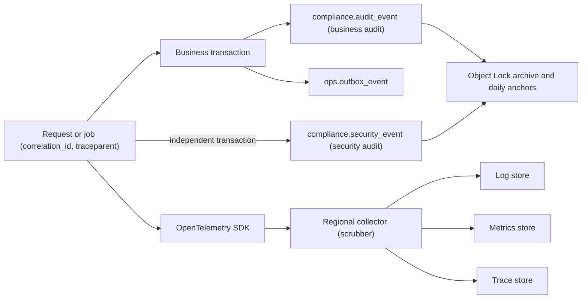
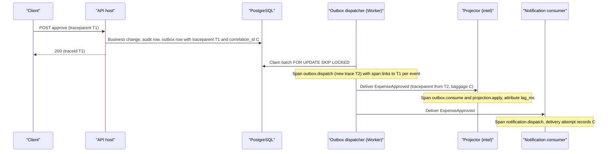

# Document 14: Audit & Observability Architecture

**Product:** SlateIQ — Production Cost Intelligence & Audit Monitoring Platform
**Document ID:** SLQ-ARCH-014
**Version:** 1.0.0
**Classification:** Internal — Architecture Foundation
**Status:** Draft — For Review
**Date:** 2026-11-06
**Authors:** Principal Observability Architect, Principal Security Architect, Compliance Architect
**Reviewers:** SRE Lead (TBD), CISO (TBD), Data Protection Officer (TBD), Audit SME (TBD), Principal Architect (TBD)

---

## Document Control

### Revision History

| Version | Date | Author | Change |
|---------|------|--------|--------|
| 1.0.0 | 2026-11-06 | Observability and Compliance Architecture | Initial architecture for business audit, security audit and operational telemetry: record model, taxonomy, per-module obligations, tamper evidence, search and export, retention and legal hold, OpenTelemetry instrumentation, logging, metrics, outbox tracing, health, SLOs, alerting, dashboards, runbooks; ADR-059 to ADR-061 |

### Related Documents

| Document | Relationship |
|----------|--------------|
| Document 1 — Product Vision & Business Requirements | FR-CMP-001 to FR-CMP-015, NFR-AUD, NFR-OBS, NFR-PERF, NFR-AVL, NFR-MOB targets used as SLOs |
| Document 2 — Domain Model & Capability Map | AuditEvent, SecurityEvent, AuditChainHead, LegalHold, DsrRequest entities (§6.10); CAP-022, CAP-023, CAP-024 |
| Document 3 — Actor, Permission, Tenancy & Identity | Event envelope and payload rules (§12), authentication security events (§4.14), metric catalogue, logging rules, authorization tracing, detections DET-4-01 to DET-4-20, identity SLOs and dashboards (§15) |
| Document 4 — Workflows & State Machines | State names whose transitions are audited |
| Document 6 — High-Level Solution Architecture | Audit event model (§8.5), retention (§8.7), observability model, telemetry standards, dashboards OPS-DSH-01 to OPS-DSH-12, alerts ALR-001 to ALR-025, runbooks RB-001 to RB-015 (§14), SLOs (§12.1), ADR-012, ADR-014 |
| Document 10 — Security Architecture | Control catalogue (SC-30, SC-31, SC-41), incident clocks, CERT-In log obligations, data classification |
| Document 15 — Infrastructure & Deployment | Collector topology, telemetry backends, storage and Object Lock realisation |
| Document 16 — Testing Strategy | Audit completeness, chain tamper, redaction and alert tests |
| Document 17 — Risk Register & ADRs | Consolidates R14-nn and ADR-059 to ADR-061 |

### Conventions

| Convention | Meaning |
|------------|---------|
| Business audit | Rows in `compliance.audit_event`: who changed which business record, from what to what |
| Security audit | Rows in `compliance.security_event`: authentication, authorization, privileged access, key and security configuration facts |
| Operational telemetry | Logs, metrics and traces in the regional telemetry backends; never a system of record |
| `ALR-nnn`, `RB-nnn`, `OPS-DSH-nn` | Alert, runbook and dashboard identifiers continuing Document 6 §14 |
| `RB-SEC-nn` | Security runbooks introduced here and referenced by Document 10 |

---

## 1. Purpose, Scope and Authority

This document specifies how SlateIQ proves what happened (audit) and knows what is happening (observability). It realises ADR-012 (in-transaction hash-chained audit) and ADR-014 (OpenTelemetry), and takes over the downstream obligations both ADRs assigned to the audit and operations documents.

**Owned here:** the separation of the three record streams; the business audit record and its taxonomy; per-module audit obligations; the hash chain, anchors and verification job; audit search and export (FR-CMP-004, FR-CMP-005); retention, legal hold and data-subject-request interplay for audit data; OpenTelemetry instrumentation; structured logging and redaction; the metric catalogue; tracing through the outbox; health and readiness endpoints; SLOs, alert rules, dashboards and the runbook index; tenant-aware telemetry without tenant data.

**Referenced, not restated:** the identity security events and detection rules (Document 3 §4.14, §15.6), the event envelope (Document 3 §12.2), the security control catalogue (Document 10), collector and backend deployment (Document 15).

---

## 2. Principles

| ID | Principle | Consequence |
|----|-----------|-------------|
| AO-01 | **Audit is a record; telemetry is a signal** | Audit stores are transactional, append-only, retained 7 years and legally meaningful. Telemetry is sampled, short-lived and may be lost without breaching a control |
| AO-02 | **No business change without its audit row** | The business audit row commits in the same transaction as the change; a failed audit write aborts the change (ADR-012) |
| AO-03 | **No denial without its security row** | Security events persist even when the request is rejected and its transaction rolls back (ADR-059) |
| AO-04 | **One correlation identifier end to end** | Request, audit rows, security rows, outbox events, consumer effects, notifications and logs share one `correlation_id` (NFR-AUD-004, FR-CMP-006) |
| AO-05 | **Identifiers, never content** | Telemetry carries opaque identifiers and codes; no amounts, names, emails, file names, free text or secrets (NFR-OBS-004; Document 10 section 4.2) |
| AO-06 | **Alert on symptoms and obligations** | Pages fire on SLO burn or a control obligation (audit chain, revocation, isolation), not on raw resource use (Document 6 §14.5) |
| AO-07 | **Region-local** | Audit, logs, metrics and traces for a tenant stay in the tenant's region; global views use tenant-free rollups (ADR-061) |
| AO-08 | **Evidence by construction** | Controls emit their own evidence into the audit and control-evidence stores; no evidence is assembled by hand (Document 3 §15.11) |

---

## 3. The Three Record Streams



| Property | Business audit | Security audit | Operational telemetry |
|----------|----------------|----------------|-----------------------|
| Store | `compliance.audit_event` | `compliance.security_event` | Regional log, metric and trace backends |
| Question answered | Who changed which business record, how, from where | Who authenticated, was denied, was granted or used privilege | Is the platform healthy, and why is it slow or failing |
| Writer | `IAuditWriter` in the caller's transaction | `ISecurityEventWriter` in an independent transaction | OpenTelemetry SDK through Serilog and instrumentation |
| Failure semantics | Audit failure aborts the business change | Write retried once; on failure the event goes to the fallback security log and `security_event_write_failure_total` increments (section 5.2) | Best effort; drops counted |
| Integrity | Per-tenant SHA-256 chain, daily signed anchors (section 4.4) | Separate per-tenant chain, same anchoring | None beyond transport |
| Retention | 24 months hot, 7 years archive (D-020, NFR-AUD-003) | 13 months hot, 7 years archive (Document 3 §12.12) | Logs 30 days hot, 13 months cold; traces 7 days; metrics 13 months (Document 6 §14.1) |
| Readers | Compliance roles with `compliance.audit_event.read`; record history views in modules | `compliance.security_event.read`; Platform Security | Platform engineering through backend access control; never tenants |
| Tenant data | Confidential; identifiers and minimal state diffs | Confidential; identifiers, address classes, hashes | None; opaque identifiers only |
| Grantee access | None (Document 3 §7.4 Family C) | None | None |

**Why two audit tables rather than one.** Security events have different volume, retention, readers and write semantics: a denied request has no business transaction to join, a failed login may have no tenant at all, and security analysts must not need business-audit read permission to investigate an attack. Business auditors, conversely, must not wade through denial noise. The streams share the envelope, the chain algorithm and the anchoring, so tooling is common (ADR-059).

---

## 4. Business Audit

### 4.1 Record Specification

The record realises Document 6 §8.5 and adds the fields the governing brief §20 and FR-CMP-001 require. Brief fields are marked **B**.

| Field | Type | Required | Purpose |
|-------|------|----------|---------|
| `event_id` | ULID | Yes | Time-sortable unique identifier (Document 6 §8.5) |
| `org_id` | uuid | Yes | **B organization**: the tenant whose record changed |
| `stream` | text | Yes | `BUSINESS` for this table; used by the chain head key |
| `chain_seq` | bigint | Yes | Per-tenant, per-stream sequence, gap-free |
| `event_type` | text | Yes | Stable taxonomy name, `entity.verb_past` (section 4.5) |
| `schema_version` | int | Yes | Event schema version |
| `action` | text | Yes | **B action**: `CREATE`, `UPDATE`, `DELETE`, `SUBMIT`, `APPROVE`, `REJECT`, `CANCEL`, `IMPORT`, `EXPORT`, `GRANT`, `REVOKE`, `ACCESS`, `CONFIGURE` (RC-14-01) |
| `entity_type` | text | Yes | **B entity**: Document 2 entity name in snake case (`expense`, `budget_version`) |
| `entity_id` | uuid | Yes | **B entity ID** |
| `entity_version` | int | No | Revision or optimistic-concurrency version after the change |
| `parent_type`, `parent_id` | text, uuid | No | Aggregate root when the entity is a child (`expense_line` under `expense`) |
| `before_state` | jsonb | Conditional | **B previous state**: minimal diff of changed fields before the change; null for `CREATE` (section 4.3) |
| `after_state` | jsonb | Conditional | **B new state**: minimal diff after the change; null for `DELETE` |
| `state_from`, `state_to` | text | Conditional | Lifecycle state names (SM-xx) when the action is a transition |
| `reason_code`, `reason_text` | text | Conditional | Mandatory where a business rule requires a reason (rejection, amendment, waiver, revocation); free text stays here and never in events (Document 3 §12.12) |
| `actor_id` | uuid | Yes | **B actor**: user, service account or system principal |
| `actor_type` | text | Yes | `USER`, `SERVICE`, `SYSTEM`, `PLATFORM` |
| `actor_org_id` | uuid | No | Actor's home organization when it differs from `org_id` (grantee, support) |
| `authority_source`, `authority_id` | text, uuid | Yes | `MEMBERSHIP`, `GRANT`, `SUPPORT`, `PLATFORM`, `SYSTEM` and the assignment, grant or support-access record that authorised the action |
| `on_behalf_of_id`, `delegation_id` | uuid | No | Delegator and delegation when acting under delegation (FR-TNT-020) |
| `source` | text | Yes | **B source**: `WEB`, `MOBILE`, `SYNC`, `EXCEL_IMPORT`, `API`, `JOB`, `SUPPORT` |
| `source_ref` | text | No | Import batch and row (`import_batch_id:row`), sync `mutation_id`, job identifier |
| `occurred_at` | timestamptz | Yes | **B timestamp**: database commit-time clock (`clock_timestamp()` at write, UTC); server time is audit time (BR-EXP-011) |
| `client_occurred_at` | timestamptz | No | Device timestamp for offline captures, metadata only |
| `correlation_id` | uuid | Yes | **B correlation ID** (NFR-AUD-004) |
| `trace_id` | text | No | OpenTelemetry trace for engineering drill-down |
| `request_meta` | jsonb | No | IP class (`/24`, `/48`), user-agent hash, `device_id`, `session_id` |
| `prev_hash`, `hash` | bytea | Yes | SHA-256 chain (section 4.4) |

**Example: expense approval.**

```json
{
  "event_id": "01JC8Z4N2Q7W3K5V9T6X8R1M0P",
  "org_id": "0193a7c2-1a2b-7c3d-8e4f-5a6b7c8d9e0f",
  "stream": "BUSINESS",
  "chain_seq": 184223,
  "event_type": "expense.approved",
  "schema_version": 1,
  "action": "APPROVE",
  "entity_type": "expense",
  "entity_id": "0193b0e1-77aa-7f10-8c11-2b3c4d5e6f70",
  "entity_version": 3,
  "before_state": { "status": "SUBMITTED", "approval_step": 2 },
  "after_state": { "status": "APPROVED", "approval_step": null, "approved_amount_base": { "amount": "48250.0000", "currency": "INR" } },
  "state_from": "SUBMITTED",
  "state_to": "APPROVED",
  "actor_id": "0193a7c2-3c4d-7e5f-8a6b-7c8d9e0f1a2b",
  "actor_type": "USER",
  "authority_source": "MEMBERSHIP",
  "authority_id": "0193a7c2-4d5e-7f6a-9b7c-8d9e0f1a2b3c",
  "on_behalf_of_id": null,
  "source": "WEB",
  "occurred_at": "2026-11-06T10:42:17.204Z",
  "correlation_id": "0193b0e1-9c2d-7a3b-8e4f-0a1b2c3d4e5f",
  "trace_id": "4bf92f3577b34da6a3ce929d0e0e4736",
  "request_meta": { "ip_class": "203.0.113.0/24", "ua_hash": "k1:9f2c…", "session_id": "0193b0d0-…" },
  "prev_hash": "base64:Gm3…",
  "hash": "base64:Q8p…"
}
```

Amounts appear in audit state because the audit trail must show what was approved; audit rows are Confidential tenant data under RLS, unlike telemetry, where amounts are prohibited.

### 4.2 Write Path

| Step | Behaviour |
|------|-----------|
| 1 | A module's application service calls `IAuditWriter.Record(...)` for each audited change; the writer buffers records in the unit of work |
| 2 | At the pre-commit point (the last statement before `COMMIT`), the writer locks `compliance.audit_chain_head` for `(org_id, 'BUSINESS')` with `SELECT … FOR UPDATE` |
| 3 | For each buffered record in order: assign `chain_seq = head.seq + 1`, set `prev_hash = head.hash`, compute `hash` (section 4.4), insert into `compliance.audit_event`, advance the head |
| 4 | The insert trigger verifies `chain_seq` and `prev_hash` against the head row and rejects a mismatch; a separate trigger rejects every `UPDATE` and `DELETE` |
| 5 | `COMMIT` releases the head lock; the outbox row written in the same transaction carries the same `correlation_id` |
| 6 | Failure in any step raises and rolls back the business change; `audit_write_failure_total{module}` increments (Document 3 §15.3) |

**Lock hold time.** Deferring the append to pre-commit keeps the head lock for the duration of a few inserts rather than the whole request. The lock wait is measured (`slateiq.audit.chain.lock_wait`); if p95 exceeds 20 ms for a tenant, the chain for that tenant is split into lanes (section 4.4, ADR-059).

**Bulk operations.** An Excel commit of 5,000 rows writes per-row audit records in the commit transaction of each chunk (Document 12) plus one `import_batch.committed` summary. A bulk operation never writes one audit row for many entities (Document 3 §12.1).

**Database role.** `slateiq_app` holds `INSERT` and `SELECT` on `compliance.audit_event` and `compliance.security_event`, `SELECT, UPDATE` on `compliance.audit_chain_head`, and nothing else on these tables (Document 3 §7.4 Family D).

### 4.3 State Diff Rules

| Rule | Detail |
|------|--------|
| Minimal diff | Only changed fields, plus the identifying business key (expense number, version number) |
| Money | Decimal strings with currency code, never floats |
| Restricted fields | Never present. A change to a Restricted field records the field name and `"changed": true` (for example bank reference, MFA factor) |
| Personal fields | Recorded as field name plus keyed HMAC of the new value, never the value; the value history lives in the owning module and is subject to DSR (section 7.3) |
| Free text | Descriptions and comments are recorded as a length and keyed hash; the text itself stays in the owning table |
| Files | Document identifier, version and SHA-256; never the file name or content |
| Collections | Child changes recorded as their own events with `parent_type` and `parent_id` |
| Size | Diff ≤16 KB; larger changes are split into child events |

The diff rules keep the chain stable under erasure: because no personal value enters a hashed record, erasing a person never requires rewriting an audit row.

### 4.4 Tamper Evidence

**Chain.** Per `(org_id, stream, lane)`:

```text
canonical = JCS(record without prev_hash and hash)          -- RFC 8785 JSON canonicalisation
hash      = SHA-256( prev_hash || canonical )
genesis   prev_hash = SHA-256("slateiq:" || org_id || ":" || stream || ":" || lane)
```

`IAuditWriter` computes the hash in the application, so the verifier can reproduce it from an export without PostgreSQL; the insert trigger guards linkage (RC-14-02). Lanes default to one; a tenant moved to multiple lanes routes records by `hash(entity_id) mod lanes`, preserving per-entity order, and anchors cover all lanes.

**Daily anchors.** At 00:30 UTC per region, the anchor job writes for every tenant and stream a row to `compliance.audit_anchor` and a signed object to the Object Lock bucket (compliance mode, retention ≥7 years):

| Anchor field | Value |
|--------------|-------|
| `org_id`, `stream`, `lane` | Chain identity |
| `anchor_date` | UTC date covered |
| `first_seq`, `last_seq`, `count` | Range covered that day |
| `last_hash` | Hash of the last record of the day |
| `previous_anchor_hash` | Hash of the previous day's anchor object, chaining the anchors |
| `signature`, `kid` | Signature by the regional audit-anchor key (Document 10 section 6.5) |

**Verification job.**

| Mode | Schedule | Work | On failure |
|------|----------|------|------------|
| Incremental | Daily after anchoring | Recompute every record written since the last verified anchor; compare with the new anchor; check `chain_seq` has no gaps | `audit_chain_verify_total{result="FAIL"}`; ALR-015 and DET-4-17 (SEV-1); RB-007 |
| Full | Monthly, staggered by tenant | Recompute the whole hot chain and verify every anchor signature and anchor-to-anchor link | Same |
| Archive | Quarterly sample, and on every audit export | Verify archived partitions against their manifests and anchors | Same |
| On demand | Before an evidence export or at a regulator's request | Range verification | Export refused until resolved |

On failure: retention jobs stop for the tenant, affected partitions are preserved, exports are frozen (Document 6 §8.10), and the incident follows Document 10 class SI-3. Verification results are written to `compliance.control_evidence` as SOC 2 evidence.

### 4.5 Event Taxonomy

`event_type` is `entity.verb_past` in lowercase snake case (`expense.approved`, `grant.revoked`, Document 6 §8.5). Each type has a registered schema; the build fails if code records an unregistered type. The verb vocabulary is closed:

| Verb | Action | Typical use |
|------|--------|-------------|
| `created`, `updated`, `deleted` | `CREATE`, `UPDATE`, `DELETE` | Master and configuration data; `deleted` means deactivate or soft delete for financial and identity records |
| `submitted`, `resubmitted`, `withdrawn` | `SUBMIT` | Expense, budget version, commitment, audit report, closure |
| `approved`, `rejected`, `info_requested`, `step_approved` | `APPROVE`, `REJECT` | Approval decisions (SM-13) |
| `cancelled`, `superseded`, `reversed` | `CANCEL` | Expense, commitment, import batch reversal |
| `posted` | `CREATE` | Cost postings (`cost_posting.posted`) |
| `imported`, `committed` | `IMPORT` | Import batches and rows |
| `exported` | `EXPORT` | Exports, reports, audit exports, evidence packs |
| `granted`, `activated`, `revoked`, `expired`, `suspended` | `GRANT`, `REVOKE` | Grants, assignments, delegations, support access |
| `viewed`, `downloaded` | `ACCESS` | Evidence access (also in `docs.document_access_log`), audit reads (sampled) |
| `configured`, `locked`, `reopened`, `held`, `released` | `CONFIGURE` | Settings, periods, legal holds, retention policies, feature flags |

### 4.6 Per-Module Audit Obligations

NFR-AUD-001 requires 100 per cent coverage of material business actions. The table is the coverage contract; the audit completeness test (Document 16) drives every command endpoint and asserts that the listed events appear with the correct `correlation_id`.

| Module | Material actions that MUST be audited | Representative event types |
|--------|---------------------------------------|----------------------------|
| MOD-01 Tenancy & Access | Organization settings, membership, invitation, role and role version, assignment, delegation, approval limit, SoD exception, access review decision, grant lifecycle, auditor profile attestation | `organization_setting.configured`, `assignment.granted`, `delegation.revoked`, `grant.activated`, `access_review_item.approved` |
| MOD-02 Identity | User lifecycle, profile change, device registration and revocation (security events in section 5 cover authentication) | `user.activated`, `user.deleted`, `device_registration.revoked` |
| MOD-03 Production | Show lifecycle (SM-02), season, episode, department, category and mapping changes, party and party link, show closure (SM-14) | `show.updated`, `category.deleted`, `party_organization_link.activated`, `show_closure.approved` |
| MOD-04 Budget | Budget version lifecycle (SM-04), lines in draft, variation, episode allocation, approval workflow versions, financial period transitions (SM-05), period close runs, forecast entries, FX override | `budget_version.approved`, `variation.approved`, `financial_period.locked`, `financial_period.reopened`, `fx_rate.configured` |
| MOD-05 Vendor & Commitments | Vendor lifecycle (SM-06), tax registration, bank reference change, commitment lifecycle (SM-07) and amendments, payment references | `vendor.updated`, `vendor_bank_reference.updated` (field names only), `manual_commitment.approved` |
| MOD-06 Audit Operations | Team, assignment lifecycle (SM-08), scope change, audit report (SM-10), finding (SM-11), finding response, coverage requirement | `audit_assignment.revoked`, `audit_report.submitted`, `audit_finding.closed` |
| MOD-07 Expense | Expense lifecycle (SM-09) per revision, lines and splits, evidence link and verification (SM-12 evidence), approval decisions, amendments, exceptions (SM-15), cost postings | `expense.submitted`, `expense.approved`, `evidence_link.disputed`, `exception.waived`, `cost_posting.posted` |
| MOD-08 Cost Intelligence | Alert rule versions, alert acknowledgement and resolution (SM-16), dashboard definitions; projections are not audited because they are derived | `alert_rule.updated`, `alert_instance.resolved` |
| MOD-09 Documents | Upload, version, scan outcome, soft delete, retention assignment, every view and download (FR-DOC-013) | `document.created`, `document_version.created`, `document.quarantined`, `document.downloaded` |
| MOD-10 Excel | Template versions, value mappings, import batch lifecycle (SM-17) with row outcomes, export jobs | `template_version.activated`, `import_batch.committed`, `import_batch.reversed`, `export_job.exported` |
| MOD-11 Notifications | Template changes, preference changes, announcements; deliveries are telemetry plus `notify.delivery_attempt` rows, not audit | `notification_template.updated`, `notification_preference.updated` |
| MOD-12 Compliance | Legal hold apply and release, retention policy change and destructive retention actions, DSR lifecycle, ROPA changes, breach incident updates, audit search exports, evidence packs | `legal_hold.held`, `legal_hold.released`, `dsr_request.approved`, `audit_event.exported` |
| MOD-13 Reporting | Report definitions, runs and exports with scope snapshot and output hash | `report_run.exported` |
| MOD-14 Sync | Conflict resolution decisions; applied mutations are audited by the owning module with `source = SYNC` and `source_ref = mutation_id` | `conflict_record.approved` |
| MOD-15 Platform Operations | Tenant lifecycle (SM-01), provisioning runs, entitlements, feature flags, support access lifecycle, job and dead-letter replays | `organization.suspended`, `feature_flag.configured`, `support_access.granted`, `job.updated` |

**Reads.** Ordinary reads are not business-audited (they are traced). Exceptions: evidence view and download (always), audit-trail reads (sampled at 10 per cent with every export recorded, Document 3 §7.4), grantee workspace entry and exit (security stream), and support-access reads (always, attributed to SlateIQ Support).

---

## 5. Security Audit

### 5.1 Record

`compliance.security_event` uses the business-audit columns with three differences: `stream = 'SECURITY'`; `severity` (`INFO`, `WARNING`, `HIGH`, `CRITICAL`, Document 3 §4.14) and `outcome` (`SUCCESS`, `FAILURE`, `DENIED`) are mandatory; `before_state` and `after_state` are replaced by `detail` (jsonb, identifiers and reason codes only). `event_type` keeps the PascalCase names of Document 3 §4.14 so that identity, detection and audit share one vocabulary.

**Tenant attribution.** An event belongs to the tenant whose data or authority was involved. A failed login for a known account is recorded in the user's home organization. An event with no resolvable tenant (unknown account, malformed token, pre-authentication abuse) is recorded in the platform tenant (`PLATFORM_INTERNAL`) with the keyed email hash and address class, so it is still chained and retained.

### 5.2 Write Semantics (ADR-059)

| Situation | Behaviour |
|-----------|-----------|
| Success events inside a business change (grant activated, role assigned) | Business audit row in the business transaction; security event in an independent transaction after commit with the same `correlation_id` |
| Denial, failed authentication, rejected token, cross-tenant attempt | Security event written synchronously in an independent transaction before the response is returned; the business transaction (if any) rolls back without affecting it |
| Write failure | One retry; then the event is emitted to the fallback security log channel (structured, same envelope) that the collector routes to the in-region security log store; `security_event_write_failure_total` increments and pages at any occurrence (ALR-028). A reconciler replays fallback records into the table and chain within 15 minutes of recovery |
| High-volume repetitive events (`RateLimitExceeded`, `PermissionDenied` beyond 20 per key per minute) | First 20 per minute recorded individually; the remainder summarised in one `…Summary` event per key per minute with a count |

### 5.3 Security Event Taxonomy

Document 3 §4.14 defines the authentication and session events and Document 3 §12 the identity domain events. The categories below complete the taxonomy across modules; every name is registered in the event manifest.

| Category | Events | Producer | Detection consumers |
|----------|--------|----------|---------------------|
| Authentication | `UserAuthenticated`, `AuthenticationFailed`, `AccountLocked`, `MfaChallenged`, `MfaEnrolled`, `MfaReset`, `RecoveryCodeUsed`, `PasswordChanged`, `PasswordResetRequested`, `StepUpGranted` | MOD-02 | DET-4-01 to DET-4-04, DET-4-18 |
| Session and token | `RefreshTokenReuseDetected`, `SessionRevoked`, `SessionConcurrencyExceeded`, `TokenRejected`, `EmergencyRevocation` | MOD-02 | DET-4-05, DET-4-06 |
| Device | `DeviceRegistered`, `DeviceRevoked`, `WipeQueued`, `WipeAcknowledged`, `OfflineWriteRejected` | MOD-02, MOD-14 | Wipe tracking |
| Authorization | `PermissionDenied`, `PermissionDeniedSummary`, `CrossTenantAccessAttempt`, `SodBlocked`, `ScopeTooBroad`, `TenantContextMismatch` | Platform host, MOD-01 | DET-4-07, DET-4-08, DET-4-19 |
| Authority change | `RoleAssignmentCreated`, `RoleChanged`, `ScopeVersionBumped`, `DelegationCreated` | MOD-01 | DET-4-09 |
| Grant | `GrantActivated`, `GrantRevoked`, `GrantAccessDenied`, `GrantWorkspaceEntered`, `GrantWorkspaceClosed`, `GrantExportCompleted` | MOD-01 | DET-4-10, DET-4-11 |
| Data egress | `ExportCompleted`, `EvidenceArchiveDownloaded`, `AuditExportCompleted`, `SignedUrlIssued` (sampled 10 per cent) | MOD-10, MOD-13, MOD-09, MOD-12 | DET-4-12 |
| Files | `FileQuarantined`, `FileScanFailed`, `FileRescanDetected` | MOD-09 | ALR-014 |
| Abuse | `RateLimitExceeded`, `RateLimitExceededSummary`, `IdempotencyKeyReused`, `WafBlockSummary` | Platform host, edge | DET-4-01, DET-4-02 |
| Privileged access | `SupportAccessRequested`, `SupportAccessGranted`, `SupportAccessEnded`, `SupportWriteExecuted`, `BreakGlassStarted`, `BreakGlassEnded` | MOD-15 | DET-4-13, DET-4-14 |
| Keys and secrets | `SigningKeyRotated`, `DataKeyRotated`, `KeyUnwrapped` (sampled 1 per cent), `SecretRotated`, `KmsAccessDenied` | MOD-15 | Key anomaly review |
| Security configuration | `SecurityPolicyChanged` (idle timeout, MFA policy, retention defaults), `RlsPolicyDriftDetected`, `IsolationProbeFailed`, `FeatureFlagChanged` (security-tagged flags) | MOD-01, MOD-15, CI | DET-4-16 |
| Audit integrity | `AuditChainVerified`, `AuditChainVerificationFailed`, `AuditAnchorWritten`, `AuditAnchorMissing` | MOD-12 | DET-4-17 |

---

## 6. Audit Search, Export and Evidence Packs

### 6.1 Search (FR-CMP-004, NFR-AUD-005)

| Aspect | Design |
|--------|--------|
| Permission | `compliance.audit_event.read` for business audit; `compliance.security_event.read` for security audit; scope `ORG` (Document 3 Appendix A) |
| Filters | Actor, action, event type, entity type and identifier, parent, correlation identifier, source, authority source, date range (mandatory, ≤366 days per query) |
| Indexes per monthly partition | `(org_id, occurred_at DESC)`, `(org_id, entity_type, entity_id, occurred_at)`, `(org_id, actor_id, occurred_at)`, `(org_id, correlation_id)`, `(org_id, event_type, occurred_at)` |
| Pagination | Keyset on `(occurred_at, event_id)`, page ≤200 |
| Target | ≤5 seconds for a 90-day window at 10-year volume (NFR-AUD-005, NFR-DAT-005); verified by the audit search performance test with production-shaped partitions |
| Archive search | Beyond 24 months, an asynchronous archive query job scans the tenant's Parquet archive and returns results as an export; no synchronous SLA |
| Correlation view | `GET` by `correlation_id` returns the business audit rows, security rows and outbox delivery outcomes for one action (FR-CMP-006); a business change whose correlation has no matching audit row is flagged by the nightly completeness check |
| Reading the trail | Audited as `audit_event.viewed` at a 10 per cent sample, always for exports |

**Contract example (illustrative; Document 9 owns the final API).**

```json
{
  "items": [
    {
      "eventId": "01JC8Z4N2Q7W3K5V9T6X8R1M0P",
      "eventType": "expense.approved",
      "action": "APPROVE",
      "entity": { "type": "expense", "id": "0193b0e1-77aa-7f10-8c11-2b3c4d5e6f70", "version": 3 },
      "actor": { "id": "0193a7c2-3c4d-7e5f-8a6b-7c8d9e0f1a2b", "type": "USER", "displayName": "R. Iyer" },
      "authority": { "source": "MEMBERSHIP", "id": "0193a7c2-4d5e-7f6a-9b7c-8d9e0f1a2b3c" },
      "stateFrom": "SUBMITTED",
      "stateTo": "APPROVED",
      "source": "WEB",
      "occurredAt": "2026-11-06T10:42:17.204Z",
      "correlationId": "0193b0e1-9c2d-7a3b-8e4f-0a1b2c3d4e5f",
      "chainSeq": 184223
    }
  ],
  "nextCursor": "eyJvIjoiMjAyNi0xMS0wNlQxMDo0MjoxNy4yMDRaIiwiZSI6IjAxSkM4WjROMlE3VzNLNVY5VDZYOFIxTTBQIn0"
}
```

The display name is joined at read time from the tenant's identity data under RLS; it is never stored in the audit row, so erasure replaces it with the pseudonym (ADR-022 of Document 3).

### 6.2 Export (FR-CMP-005)

| Aspect | Design |
|--------|--------|
| Permission | `compliance.audit_event.export` or `compliance.security_event.export`; step-up for more than 1,000 rows (Document 3 §4.10) |
| Execution | `ExportJob` (`QUEUED`, `RUNNING`, `COMPLETED`, `FAILED`, `EXPIRED`) under the requester's tenant context; on-demand range verification runs first (section 4.4) |
| Bundle | `manifest.json`, `events.ndjson` (records exactly as stored, JCS-canonical), `anchors/` (signed anchor objects for every day in range), `keys/` (public verification keys by `kid`), `VERIFY.md` (algorithm and steps) |
| Manifest | Tenant, stream, filters, requester, generated at, row count, first and last `chain_seq` per lane, `prev_hash` of the first record, SHA-256 of `events.ndjson`, verification result; signed with the audit-anchor key |
| Filtered exports | A filtered export (for example one show) cannot be chain-verified record by record; its manifest therefore also carries a completeness statement: the full-range verification result, each included record's `chain_seq` and `hash`, and the count of excluded records per day, so a recipient can see that the excerpt comes from a verified chain |
| Delivery | Output document in object storage, link ≤15 minutes, retention 7 days (Document 2 §6.10) |
| Audit | `audit_event.exported` business event and `AuditExportCompleted` security event |
| External auditors | Grantees have no access to `compliance.audit_event` (Document 3 §7.4); the client exports and shares a bundle, or includes it in an evidence pack |

### 6.3 Evidence Packs

Evidence packs bundle control evidence for SOC 2, SOX-supporting reviews or a customer audit: chain verification results, access review exports, MFA coverage, support access records, restore reports and audit-export bundles. Controls write evidence rows to `compliance.control_evidence` as they operate; a pack is assembled with `compliance.evidence_pack.create`, exported with `compliance.evidence_pack.export`, and carries the same signed-manifest format as section 6.2.

---

## 7. Retention, Legal Hold and Data-Subject Requests

### 7.1 Retention Schedule

| Record | Hot | Archive | Total | Basis |
|--------|-----|---------|-------|-------|
| `compliance.audit_event` | 24 months, monthly partitions | Per-tenant, per-month Parquet in Object Lock (compliance mode) | 7 years from `occurred_at`, extended by hold | D-020, NFR-AUD-003, Document 6 §8.7 |
| `compliance.security_event` | 13 months | Same archive format | 7 years | Document 3 §12.12 |
| `compliance.audit_anchor` and anchor objects | Indefinite in table | Object Lock | Longest chain retention plus 7 years | Verifiability of archives |
| `docs.document_access_log` | 24 months | Archive | 7 years | Document 2 §6.9 |
| Operational logs | 30 days | 13 months cold, in region | 13 months; ≥180 days for the CERT-In log set in India | Document 6 §14.1; Document 10 section 9.3 `[LEGAL-VALIDATE]` |
| Traces | 7 days | 30 days for sampled error and denial traces | 30 days | Document 3 §15.2 |
| Metrics | 15-second resolution 30 days | Downsampled 5-minute | 13 months | Document 3 §15.2 |
| Support session recordings | 1 year | — | 1 year | Document 10 section 10.3 |

### 7.2 Archive and Purge Mechanics

1. Monthly, after the partition passes its hot period, the archive job exports each tenant's rows for that month to Parquet with a manifest (first and last `chain_seq`, last hash, row count, SHA-256 of the file) and verifies the export against the chain before writing it to Object Lock.
2. When every tenant's archive for the month is verified, the hot partition is detached and dropped. Partitions are shared across tenants; per-tenant retention and holds therefore act on archive objects, never on hot partitions.
3. Archive objects are encrypted with a per-tenant audit-archive key that is separate from the tenant data key, so a tenant purge (SM-01 `PURGED`) crypto-shreds operational data immediately while audit archives remain verifiable until their retention ends; the archive key is destroyed when the last archive object expires (OQ-14-03).
4. Destructive retention actions produce an action report and, in the first 12 months of operation, require approval (Document 6 §8.7); each action is audited (`retention_action.configured`) in the platform tenant and the affected tenant.

### 7.3 Legal Hold

| Rule | Mechanism |
|------|-----------|
| Hold scope | `compliance.legal_hold_target` may name an organization, show, entity or date range |
| Effect on audit | Archive objects intersecting a held scope get Object Lock legal-hold flags; the retention engine skips them (BR-DOC-003) |
| Release | Second approver (`compliance.legal_hold.update` to request, `compliance.legal_hold.approve` to approve; Document 3 Appendix A.3); release recomputes retention from the release date (BR-DOC-004) |
| Hot data | Hot partitions are never dropped before archive, so holds need no hot-table action |

### 7.4 DSR Interplay

| Request | Effect on audit and telemetry |
|---------|-------------------------------|
| Access and portability (FR-CMP-008) | The DSR bundle includes business and security audit records where the subject is the actor, filtered to the subject's own actions, with identifiers resolved to names under the controller's authority |
| Erasure (FR-CMP-009) | Audit rows are retained under the legal-obligation and legal-claims exemptions and the request is answered with that lawful reason for the audit portion; because audit rows hold no personal values (section 4.3), erasing `identity.user_pii` leaves them pseudonymous and the chain intact |
| Rectification | The owning module corrects the record; its audit row records the correction; history is not rewritten |
| Telemetry | Contains no personal data by design; logs age out within 13 months; a confirmed PII leak into logs follows RB-SEC-07 (in-region purge of affected log partitions) |

---

## 8. Telemetry Instrumentation and Structured Logging

### 8.1 OpenTelemetry Instrumentation (ADR-014)

| Concern | Design |
|---------|--------|
| SDK | OpenTelemetry .NET SDK in the API, Sync, Worker and Renderer hosts through one shared instrumentation library; OTLP over gRPC to the regional collector |
| Automatic instrumentation | ASP.NET Core, `HttpClient`, Npgsql (statement name only, no parameters), Redis client, AWS SDK calls, Quartz job execution |
| Manual instrumentation | PDP decision spans (Document 3 §15.5), audit writer, outbox dispatch and consumers, projectors, import chunks, scan jobs, report renders, notification dispatch |
| Resource attributes | `service.name`, `service.version`, `service.instance.id`, `deployment.environment`, `cloud.region`, `deployment.cell`, `vcs.revision` |
| Propagation | W3C `traceparent` and `baggage`; baggage carries only `correlation_id`; HTTP, outbox, job and sync boundaries propagate it |
| Sampling | Head sampling 10 per cent of successful requests; tail sampling at the collector keeps 100 per cent of errors, denials, requests slower than twice their latency target, and all traces with a security event (Document 6 §14.2, Document 3 §15.5) |
| Collector | Regional, Multi-AZ, buffered with persistent queue; processors: memory limiter, attribute scrubber (section 8.3), tail sampler, batch; exporters to the regional backends only |
| Clients | Web real-user monitoring sends page load, route change and API timing with route templates; mobile sends sync and capture timings at handshake (Document 11); both via the same collector with the same scrubbing |
| Clock | Hosts synchronise to the provider time service; clock offset exported as `slateiq.host.clock.offset` and alerted above 100 ms (ALR-034) |

### 8.2 Structured Logging

| Rule | Detail |
|------|--------|
| Format | JSON lines to stdout via Serilog with the OpenTelemetry sink; one event per line |
| Base fields | `timestamp`, `level`, `service`, `version`, `environment`, `region`, `trace_id`, `span_id`, `correlation_id`, `org_id`, `actor_id`, `event`, `message_template`, `error_code`, `duration_ms` (Document 3 §15.2) |
| Allow-list | Every additional property is declared in the log field registry with type, class and maximum length; undeclared properties are dropped and counted (`slateiq.log.fields.dropped`) (ADR-060) |
| Message templates | Fixed templates with named holes; never string-interpolated messages |
| Levels | `Error` action required; `Warning` denied or degraded; `Information` completed state change; `Debug` disabled in production (Document 3 §15.4) |
| Sampling | High-volume read-path `Information` logs sampled at 1 per cent; security, state-change and error logs never sampled |
| Exceptions | Exception type, error code and stack frames; `Message` only for exception types on the safe list (Document 3 §15.4) |
| Request and response bodies | Never logged |

### 8.3 Redaction Rules

Redaction runs twice: at source in the logging and span processors, and in the collector's scrubber as a second defence.

| Data | Rule | Where enforced |
|------|------|----------------|
| Passwords, tokens, secrets, keys, recovery codes, connection strings, `Authorization` and `Cookie` headers | Dropped; field names on a deny list; values matching token patterns (`eyJ…`, 64-hex, `<id>.<secret>`) replaced with `[REDACTED]` | Source and collector |
| Email addresses, phone numbers | Replaced with keyed hash (`email_hash`) at source; pattern match in collector replaces with `[EMAIL]` and increments `slateiq.telemetry.redactions{rule}` | Source and collector |
| Money amounts | Not permitted as log fields; decimals with four or more digits in free-form attributes replaced with `[NUM]` in collector | Collector |
| Names, descriptions, comments, file names, document titles, show titles | Not registered fields; dropped | Source registry |
| IP addresses | Converted to address class (`/24`, `/48`) at source | Source |
| URLs | Route template only (`/api/v1/expenses/{id}`); query strings dropped | Source (instrumentation option) |
| SQL | Statement name or operation only; no parameters and no literal text | Source (Npgsql instrumentation option) |
| Card-like or PAN-like numbers | Luhn-valid digit runs and PAN pattern replaced | Collector |

**Tests.** A CI test pushes known secrets and PII patterns through every logger and span processor and fails on any match (Document 3 §15.4, ST-4-25). A daily job samples staging and production logs for the same patterns; a hit raises ALR-033 and triggers RB-SEC-07.

---

## 9. Metrics Catalogue

**Naming.** Instruments are named `slateiq.<domain>.<subject>` with the unit in OpenTelemetry metadata (Document 6 §14.2). The Prometheus-compatible exporter renders them as `slateiq_<domain>_<subject>_<unit>` with `_total` for counters; the identity metrics named in Document 3 §15.3 (`auth_login_total` and others) are kept as recording-rule aliases (RC-14-03). Labels are bounded enumerations; user, expense, document and URL-with-identifier labels are prohibited; `org_id` appears only in the tenant-health series of section 14.

### 9.1 RED Metrics (Services)

| Instrument | Type | Unit | Labels | Purpose |
|------------|------|------|--------|---------|
| `http.server.request.duration` (semantic convention) | Histogram | s | `http.route`, `http.request.method`, `http.response.status_code` class, `service.name` | Rate, errors and duration per route template |
| `http.server.active_requests` | UpDownCounter | {request} | `service.name` | Concurrency |
| `slateiq.api.errors` | Counter | {error} | `error_code`, `http.route` | Errors by stable ProblemDetails code |
| `slateiq.job.duration` | Histogram | s | `job_type`, `outcome` | Job RED (SM-19 terminal states) |
| `slateiq.outbox.consume.duration` | Histogram | s | `event_type`, `consumer`, `outcome` | Consumer RED |
| `slateiq.authz.decision.duration` | Histogram | ms | `cache`, `authority_source` | PDP latency (Document 3 §15.3) |

### 9.2 USE Metrics (Resources)

| Resource | Utilisation | Saturation | Errors |
|----------|-------------|------------|--------|
| Container CPU and memory | `container.cpu.utilization`, `container.memory.usage` | CPU throttling, OOM kills | Task restarts |
| PostgreSQL | CPU, IOPS, storage used | Connection pool in use versus max (`db.client.connections.usage`), lock waits, replication lag | Failed connections, deadlocks, serialization failures |
| PgBouncer | Active server connections | Waiting clients | Pool errors |
| Redis | Memory used, ops per second | Evictions, blocked clients | Command errors, failovers |
| Object storage | Requests per second | Throttled requests | 4xx and 5xx by operation |
| KMS | Requests per second | Throttling | Errors (feeds `KmsAccessDenied` review) |
| Worker queues | Claimed jobs per pool | `slateiq.job.queue.depth{pool}`, oldest age | Dead jobs |
| Collector | Accepted spans and logs | Queue fill ratio | `slateiq.telemetry.dropped{signal}` |

### 9.3 Business and Pipeline Metrics

| Instrument | Type | Unit | Labels | Definition | Target or alert |
|------------|------|------|--------|------------|-----------------|
| `slateiq.expense.capture.duration` | Histogram | s | `channel` (`MOBILE`, `WEB`) | Client-measured time from opening the capture form to local save | Median ≤30 s (NFR-UX-001) |
| `slateiq.expense.submit.duration` | Histogram | s | `source` | Server time for the submit command including validation and audit | P95 ≤1 s (NFR-PERF-003) |
| `slateiq.expense.submitted` | Counter | {expense} | `source` | Submissions | OPS-DSH-03 |
| `slateiq.expense.validation.failures` | Counter | {failure} | `error_code` | Submission validation failures | Trend |
| `slateiq.sync.push.batches` | Counter | {batch} | `outcome` (`ACCEPTED`, `PARTIAL`, `REJECTED`, `THROTTLED`) | Push batches | Success ≥98 % (ALR-010) |
| `slateiq.sync.mutations` | Counter | {mutation} | `outcome` (`APPLIED`, `DUPLICATE`, `CONFLICT`, `REJECTED`) | Mutation outcomes | Conflict rate ≤3 % (ALR-012) |
| `slateiq.sync.drain.duration` | Histogram | s | `client_platform` | Reconnect to empty device queue, reported at handshake | 95 % ≤5 min (NFR-MOB-003) |
| `slateiq.approval.pending.age` | Histogram (observed per pending step on a 5-minute scan) | h | `subject_type`, `step_index` bucket | Age of `ACTIVE` approval steps (SM-13) | ALR-026 |
| `slateiq.approval.decision.duration` | Histogram | h | `subject_type`, `decision` | Submission to final decision | Trend; workflow ageing dashboard |
| `slateiq.projection.lag` | Gauge | s | `projector` | Now minus `occurred_at` of the last event applied, from `intel.projector_checkpoint` | 99 % ≤60 s show, ≤5 min portfolio (NFR-PERF-004, NFR-PERF-005); ALR-008 |
| `slateiq.outbox.oldest_age` | Gauge | s | `queue_class` | Age of the oldest undispatched `ops.outbox_event` | ≤30 s SLI; page at 5 min (ALR-007, RC-14-05) |
| `slateiq.outbox.dead` | Gauge | {event} | `event_type` | Events in `DEAD` (SM-19) | Any new (ALR-009) |
| `slateiq.import.rows` | Counter | {row} | `outcome` (`VALID`, `INVALID`, `COMMITTED`, `SKIPPED`) | Import row outcomes | Trend |
| `slateiq.import.validation.rate` | Histogram | {row}/s | `template_target` | Validation throughput per batch | ≥100 rows per second (NFR-PERF-006); ALR-040 |
| `slateiq.import.batches` | Counter | {batch} | `final_state` (SM-17 terminal states) | Batch outcomes | ALR-018 |
| `slateiq.document.scan.queue.depth` | Gauge | {file} | — | Files in `PENDING_SCAN` | Trend |
| `slateiq.document.scan.oldest_age` | Gauge | s | — | Oldest `PENDING_SCAN` | ≤10 min (ALR-013) |
| `slateiq.document.scan.results` | Counter | {file} | `result` (`CLEAN`, `INFECTED`, `REJECTED_TYPE`, `ACTIVE_CONTENT`, `FAILED`) | Scan outcomes | `INFECTED` any (ALR-014) |
| `slateiq.document.upload.duration` | Histogram | s | `size_bucket` | Ticket issue to confirmed object | 10 MB ≤15 s (NFR-PERF-011) |
| `slateiq.notification.deliveries` | Counter | {delivery} | `channel`, `result` (SM-18 terminal states) | Delivery attempts | Failure >5 % (ALR-021, ALR-030) |
| `slateiq.notification.dead` | Gauge | {notification} | `channel` | Notifications in `DEAD` | ALR-030 |
| `slateiq.alert.evaluation.delay` | Histogram | s | `severity` | Triggering event to `AlertInstance` creation | Critical ≤5 min, standard ≤15 min (NFR-PERF-010); ALR-036 |
| `slateiq.report.queue.wait`, `slateiq.report.render.duration` | Histogram | s | `report_type` | Queue and render times | ≤30 s for 100,000 rows (NFR-PERF-007); ALR-019 |
| `slateiq.exception.open` | Gauge | {exception} | `type`, `severity` | Open exceptions (SM-15) | Trend |
| `slateiq.period.close.duration` | Histogram | min | `outcome` | Period close run duration | Trend |
| `slateiq.audit.write.duration` | Histogram | ms | `module` | `IAuditWriter` append time | P95 ≤10 ms |
| `slateiq.audit.chain.lock_wait` | Histogram | ms | `lane_count` | Head-lock wait | P95 ≤20 ms (section 4.2) |
| `slateiq.audit.write.failures` | Counter | {failure} | `module` | Aborted business changes due to audit failure | Any (ALR-027) |
| `slateiq.security_event.write.failures` | Counter | {failure} | `category` | Fallback path used | Any (ALR-028) |
| `slateiq.audit.verify.results` | Counter | {run} | `mode`, `result` | Chain verification | Any `FAIL` (ALR-015) |
| `slateiq.audit.search.duration` | Histogram | s | `window_bucket` | Audit search latency | ≤5 s for 90 days (NFR-AUD-005); ALR-038 |
| `slateiq.compliance.clock.remaining` | Gauge | h | `clock_type` (`DSR`, `BREACH_CUSTOMER`, `BREACH_REGULATOR`, `CERT_IN`, `HOLD_REVIEW`) | Minimum remaining time of open clocks | ALR-037 at 25 % remaining |
| `slateiq.db.wal.archive.lag` | Gauge | s | — | Age of the newest WAL segment not yet archived | ≤5 min; RPO ≤15 min (NFR-AVL-007); ALR-032 |
| `slateiq.revocation.duration` | Histogram | s | `trigger` | Revocation trigger to enforcement on all replicas | 100 % ≤5 min (BR-ACC-007); ALR-039 |

---

## 10. Tracing Through the Outbox

The outbox makes every cross-module effect asynchronous, so a single trace cannot be a single parent-child tree. The design uses parent links inside a hop and span links across the outbox (ADR-014).



| Hop | Span | Relationship | Attributes |
|-----|------|--------------|------------|
| Request | `http.server` and handler spans | Root of T1 | Route, status, `org.id`, `correlation_id` |
| Outbox write | `outbox.publish` | Child of the handler | `event_type`, `aggregate_type` (Document 3 §15.5) |
| Dispatch | `outbox.dispatch` | Root of a new trace per batch, with one span link per event to its originating span | Batch size, `queue_class`, oldest age |
| Consume | `outbox.consume` | Child of dispatch; link to the origin | `event_type`, `consumer`, `attempt`, outcome, `event.age_ms` |
| Projection | `projection.apply` | Child of consume | `projector`, `lag_ms`, rows written |
| Delivery | `notification.dispatch`, `integration.call` | Child of consume | Channel, provider, result code |
| Retry | Each attempt a new consume span; attempt number attribute | Linked to the origin | Backoff schedule per Document 6 §7.5 |

**Why links, not parents.** A dispatch batch carries events from many requests, and retries can occur hours later. Making each consume span a child of the original request would create traces lasting hours and would break tail sampling. Links preserve navigation from a request to its effects; `correlation_id` provides the guaranteed join because traces are sampled and short-lived while correlation is stored on every audit row, outbox row and delivery attempt.

**Sync and mobile.** The mobile client creates a `traceparent` per sync push; each mutation carries its `mutation_id`, which becomes `source_ref` on the audit row. Offline capture time is `client_occurred_at`; trace timing starts at the push.

**Lag measurement.** `slateiq.projection.lag` and `slateiq.outbox.oldest_age` are computed from database timestamps (`occurred_at`, commit time), not from span timing, so they remain correct when traces are sampled away.

---

## 11. Health and Readiness Endpoints

NFR-OBS-003 requires health and readiness on every service. Endpoints are served on an internal management port that the edge never routes; the load balancer and the container platform call them.

| Endpoint | Purpose | Checks | Failure effect |
|----------|---------|--------|----------------|
| `/health/live` | Process is alive and not deadlocked | Event loop responsive; no dependency checks | Container restarted |
| `/health/startup` | Initialisation complete | Configuration and secrets loaded; KMS reachable; database schema version compatible with the build; signing key available (API) | Task not admitted until passing; deployment rolls back after the grace period |
| `/health/ready` | Can serve traffic now | Per host, table below | Task removed from the load balancer or stops claiming work |
| `/health/info` | Build and runtime metadata | Version, commit, build time, region, cell | Informational (Document 6 §14.2) |

**Readiness by host.**

| Host | Critical (fails readiness) | Degraded (readiness passes, status `DEGRADED`) |
|------|---------------------------|------------------------------------------------|
| API | PostgreSQL primary reachable with `SELECT 1` under 500 ms; connection pool not exhausted | Redis (revocation falls back to the database, rate limits local); object storage (uploads blocked, reads continue); KMS (signing uses cached public material for validation, new logins fail); scanner |
| Sync | PostgreSQL primary | Redis; object storage (evidence queued on device) |
| Worker | PostgreSQL primary; can claim from the job table | Email provider, FX source, scanner (jobs retry per their own policy) |
| Renderer | Browser pool initialised; local scratch space available | — |

Redis and object storage are checked, as Document 6 §14.2 requires, but reported as degraded rather than failing readiness: failing readiness on a shared dependency would remove every task from the load balancer and turn a cache outage into a total outage, contradicting the degradation ladder of Document 6 §12.3 (RC-14-06).

**Response format.**

```json
{
  "status": "DEGRADED",
  "service": "slateiq-api",
  "version": "1.4.2+9f3c1ab",
  "region": "ap-south-1",
  "checks": [
    { "name": "postgres", "status": "UP", "latency_ms": 3 },
    { "name": "redis", "status": "DOWN", "mode": "DATABASE_REVOCATION_FALLBACK" },
    { "name": "object_storage", "status": "UP", "latency_ms": 41 }
  ],
  "degradation_mode": "NORMAL"
}
```

Check results are cached for 5 seconds to protect dependencies from probe storms. Every check failure emits `slateiq.health.check{name, status}`; flapping readiness (more than 3 transitions in 10 minutes) raises ALR-031. Synthetic probes from outside the region exercise login, capture submit and dashboard load every minute and are the availability SLI source together with real-user success rate (Document 6 §12.1).

---

## 12. SLOs, Alerting and Dashboards

### 12.1 SLO Register

Targets come from Document 1 §9 and Document 6 §12.1; where Document 6 is tighter than the NFR, Document 6 is the operating target and the NFR is the contractual floor. Windows are rolling 30 days.

| SLO | SLI | Target | Requirement | Alert |
|-----|-----|--------|-------------|-------|
| SLO-01 Platform availability | Good synthetic and real-user requests over valid requests | 99.5 % MVP; 99.9 % Phase 1 | NFR-AVL-001, NFR-AVL-002 | ALR-001 |
| SLO-02 API success | Non-5xx responses over all non-4xx requests | ≥99.5 % MVP; ≥99.9 % GA | Document 6 §12.1 | ALR-002 |
| SLO-03 Expense submit latency | Share of submits under 1 s | 95 % | NFR-PERF-003 | ALR-029 |
| SLO-04 CRUD latency | Share of standard reads and writes under 500 ms | 95 % | NFR-PERF-012 | ALR-003 |
| SLO-05 Dashboard latency | Share of dashboard loads and drill-downs under 2 s | 95 % | NFR-PERF-001, NFR-PERF-002 | ALR-003 |
| SLO-06 Search latency | Share of searches under 1 s | 95 % | NFR-PERF-008 | ALR-003 |
| SLO-07 Projection freshness | Share of 1-minute samples with show-level lag ≤60 s | 99 % | NFR-PERF-004 | ALR-008 |
| SLO-08 Portfolio freshness | Share of samples with portfolio lag ≤5 min | 99 % | NFR-PERF-005 | ALR-008 |
| SLO-09 Sync drain | Devices draining within 5 min of reconnect | 95 % | NFR-MOB-003 | ALR-011 |
| SLO-10 Import validation throughput | Batches validating at ≥100 rows per second | 95 % | NFR-PERF-006 | ALR-040 |
| SLO-11 Report generation | Standard reports ≤30 s for 100,000 rows; jobs reaching `COMPLETED` | 95 % within time; ≥99 % success | NFR-PERF-007; Document 6 §12.1 | ALR-019 |
| SLO-12 Alert evaluation | Critical alerts evaluated ≤5 min; standard ≤15 min | 99 % | NFR-PERF-010 | ALR-036 |
| SLO-13 Evidence scan | Files reaching a terminal scan state ≤10 min | 99 % | NFR-SEC-007 (supporting) | ALR-013 |
| SLO-14 Audit write | Business transactions committed with their audit rows | 100 % | NFR-AUD-001 | ALR-027 |
| SLO-15 Audit search | 90-day searches ≤5 s | 95 % | NFR-AUD-005 | ALR-038 |
| SLO-16 Revocation | Revocations enforced within 5 min | 100 % | BR-ACC-007; Document 3 §15.7 | ALR-039 |
| SLO-17 Notification delivery | In-app ≤60 s; email handed to provider p95 ≤30 s; failures ≤5 % | 99 % | Document 6 §6.10, §11.5 | ALR-021, ALR-030 |
| SLO-18 Backup recoverability | WAL archive lag ≤5 min (RPO ≤15 min) | 99.9 % of minutes | NFR-AVL-007, NFR-DAT-001 | ALR-032 |

Identity SLOs (authentication and authorization availability, PDP latency, grant expiry enforcement, provisioning, isolation probe, event freshness) are defined in Document 3 §15.7 and are part of this register by reference.

### 12.2 Alerting Model (ADR-061)

| Rule | Design |
|------|--------|
| Burn-rate pages | Multi-window, multi-burn-rate: page when burn ≥14.4 over 1 hour **and** over 5 minutes (2 % of a 30-day budget in 1 hour), or ≥6 over 6 hours **and** over 30 minutes (5 % in 6 hours); ticket when ≥1 over 3 days. The 5-minute short window bounds detection time within NFR-OBS-002 |
| Zero-budget SLOs | SLO-14 and SLO-16 page on any bad event |
| Severity and routing | SEV levels and response times per Document 6 §14.8; security routing per Document 3 §15.9 |
| Ownership | Every alert has an owner, a runbook link and a dashboard link; an alert without a runbook is not deployed (Document 3 §15.9) |
| Hygiene | Alerts silent-without-action for 30 days are reviewed (Document 6 §14.5); thresholds are configuration with change history |
| Tests | Every SEV-1 and SEV-2 alert is fired synthetically before pilot and after each change (Document 6 §14.10) |
| Maintenance | Announced windows (NFR-AVL-003) suppress availability pages and are excluded from SLIs; the suppression is itself logged |

**Alerts added to Document 6 §14.5.**

| ID | Alert | Condition | Severity | Runbook |
|----|-------|-----------|----------|---------|
| ALR-026 | Approval ageing | More than 10 % of active approval steps older than the organization's escalation threshold, or any step older than 5 business days | SEV-4 (operational signal; tenant escalation is a product feature) | RB-016 |
| ALR-027 | Audit write failure | Any `slateiq.audit.write.failures` | SEV-2 | RB-018 |
| ALR-028 | Security event write fallback | Any `slateiq.security_event.write.failures` | SEV-2 | RB-018 |
| ALR-029 | Expense submit burn | SLO-03 burn-rate rule | SEV-2 | RB-002 |
| ALR-030 | Notification dead letters | New `DEAD` notifications, or delivery failure >5 % for 15 min on any channel | SEV-3 | RB-017 |
| ALR-031 | Readiness flapping | More than 3 readiness transitions in 10 min, or any dependency `DOWN` for 5 min | SEV-3 | RB-001 |
| ALR-032 | WAL archive lag | Lag >5 min for 5 min | SEV-1 | RB-014 |
| ALR-033 | Personal data in telemetry | Any PII scanner hit in sampled logs | SEV-3 (SEV-2 if Restricted) | RB-SEC-07 |
| ALR-034 | Clock offset | Host offset >100 ms for 10 min | SEV-3 | RB-013 |
| ALR-035 | Telemetry loss | Collector drop ratio >1 % for 15 min or queue >80 % | SEV-3 | RB-019 |
| ALR-036 | Alert evaluation delay | SLO-12 burn-rate rule | SEV-2 | RB-004 |
| ALR-037 | Compliance clock | Any open DSR, breach or CERT-In clock with ≤25 % time remaining | SEV-2 (SEV-1 for CERT-In and regulator clocks) | RB-SEC-05 |
| ALR-038 | Audit search latency | SLO-15 burn-rate rule | SEV-3 | RB-020 |
| ALR-039 | Revocation breach | Any revocation not enforced within 5 min | SEV-1 | RB-008 |
| ALR-040 | Import throughput | SLO-10 burn-rate rule | SEV-3 | RB-009 |

### 12.3 Dashboards

Document 6 §14.4 defines OPS-DSH-01 to OPS-DSH-12 and Document 3 §15.8 defines the identity set OPS-DSH-4-01 to OPS-DSH-4-07. This document assigns their data sources and adds two.

| Dashboard | Primary instruments | Audience |
|-----------|---------------------|----------|
| OPS-DSH-01 Service health | RED per host; readiness status | On-call |
| OPS-DSH-02 SLO burn | SLO-01 to SLO-18 budgets and burn rates | Engineering, product |
| OPS-DSH-03 Capture and sync | `expense.capture.duration`, `expense.submit.duration`, `sync.*` | Product, support |
| OPS-DSH-04 Pipeline freshness | `outbox.oldest_age`, `outbox.dead`, `projection.lag`, reconciliation status | Data, finance |
| OPS-DSH-05 Database | USE for PostgreSQL and PgBouncer; `audit.chain.lock_wait`; WAL archive lag | SRE |
| OPS-DSH-06 Imports and reports | `import.*`, `report.*`, worker memory | Operations |
| OPS-DSH-07 Notifications | `notification.deliveries`, `notification.dead` by channel | Operations |
| OPS-DSH-08 Security | Security event counts by category and severity; detections; support access; quarantines | Security |
| OPS-DSH-09 Audit integrity | `audit.verify.results`, anchors written and missing, audit volume per module, write failures, retention actions | Compliance |
| OPS-DSH-10 Tenant health | Section 14 tenant-health series | Support |
| OPS-DSH-11 Cost | Telemetry and storage spend, including audit and log retention growth | Engineering leadership |
| OPS-DSH-12 Release | Deployment frequency, change failure rate, rollbacks | Engineering |
| **OPS-DSH-13 Workflow ageing** | `approval.pending.age` by subject type and step, `approval.decision.duration`, `exception.open`, period close duration | Product, customer success |
| **OPS-DSH-14 Compliance operations** | `compliance.clock.remaining`, DSR backlog, legal holds active, retention actions pending approval, evidence pack generation | DPO, compliance |

Tenant-facing views (the compliance dashboard of FR-CMP-013 and the in-product audit trail) are product features built from `compliance.*` tables under RLS, not from the telemetry backends.

---

## 13. Runbook Index

Document 6 §14.6 defines RB-001 to RB-015; Document 15 owns their operational detail. This index adds the runbooks this document and Document 10 require. Every runbook states its trigger alerts, first three actions, evidence to preserve, escalation and exit criteria.

| ID | Runbook | Trigger | Owner |
|----|---------|---------|-------|
| RB-001 to RB-015 | As defined in Document 6 §14.6 | ALR-001 to ALR-025, ALR-031, ALR-032, ALR-034 | Per Document 6 |
| RB-016 | Approval ageing and stuck workflows: identify steps without an eligible approver (deactivated user, expired delegation), reassign per BR-ACC-004 | ALR-026 | Product support |
| RB-017 | Notification dead letters: classify provider, template or address failures; replay with a new attempt counter; suppress bounced addresses | ALR-030 | Platform |
| RB-018 | Audit or security event write failure: identify module and cause, confirm no business change committed without audit, replay fallback security records, verify chain | ALR-027, ALR-028 | Compliance, Platform |
| RB-019 | Telemetry pipeline loss: collector scaling, backend health, sampling override; confirm audit stores unaffected | ALR-035 | SRE |
| RB-020 | Audit search degradation: partition and index health, plan regression, archive offload | ALR-038 | Data |
| RB-021 | Projection rebuild: shadow-schema rebuild and swap (Document 6 §8.6), reconciliation acceptance | ALR-008 persistent | Data |
| RB-SEC-01 | Cross-tenant exposure: "do not delete anything", suspend path or tenant, scope reads from audit and access logs, notify (Document 3 §7.9) | DET-4-07, DET-4-16 | Security |
| RB-SEC-02 | Credential, token or key compromise: revoke families, rotate keys per Document 10 section 6.5, force re-authentication | DET-4-05, DET-4-06, DET-4-20 | Security |
| RB-SEC-03 | Malware detection and rescan hit: confirm quarantine, identify linked records, raise `MISSING_EVIDENCE`, notify uploader and tenant | ALR-014 | Security |
| RB-SEC-04 | Regulatory log extract: produce a scoped, in-region extract of security events and infrastructure logs within 4 hours for CERT-In or a regulator; hash and sign the extract | Regulator request; incident | Security, DPO |
| RB-SEC-05 | Breach notification clocks: open the incident record, start every applicable clock, prepare CERT-In, customer and regulator notices (Document 10 section 11.3) | ALR-037; incident declaration | DPO, CISO |
| RB-SEC-06 | Support and break-glass review: monthly and 24-hour reviews, reconciliation of `ops.support_access` with notifications and recordings | DET-4-13, DET-4-14; schedule | Platform Security |
| RB-SEC-07 | Personal data in telemetry: identify emitting code path, hot-fix redaction, purge affected log partitions in-region, record in breach register if exposure occurred | ALR-033 | Security, SRE |
| RB-SEC-08 | Supply-chain compromise: halt deployments, verify signatures and provenance, rebuild from known-good, rotate CI credentials | SCA or provenance alert | Platform engineering |
| RB-007 | Audit chain verification failure (Document 6), extended: stop retention, preserve partitions, compare with anchors and archives, determine first divergent `chain_seq`, forensic snapshot | ALR-015, DET-4-17 | Compliance, Security |

---

## 14. Tenant-Aware Telemetry Without Tenant Data

NFR-OBS-004 requires monitoring that can isolate one tenant's experience without exposing that tenant's data (Document 3 §15.10).

| Signal | Tenant attribute | Rule |
|--------|------------------|------|
| Logs and spans (in region) | `org_id` (UUIDv7, opaque) | Allowed on every record; a log line without tenant context on a tenant path is a defect (Document 3 §7.2) |
| Metrics (general) | None | No `org_id` label on general instruments |
| Metrics (tenant-health set) | `org_id` | Only on the bounded set: request count and errors by status class, p95 latency, sync drain p95, projection lag, storage quota percentage, rate-limit breaches, open alerts. Bounded by tenant count (NFR-SCL-001: 500 organizations) × fewer than 10 instruments |
| Global and cross-region rollups | `tenant.hash` = HMAC of `org_id` under a regional key | Global capacity and cost views can count tenants and spot outliers without the ability to join to the tenant directory outside the region (Document 6 §14.2) |
| Prohibited everywhere | — | Organization name, slug or domain; user names or emails; show titles; amounts; document names; free text; request bodies |

**Support workflow.** A support engineer at tier T0 (Document 10 section 10.1) looks up a tenant's `org_id` in the in-region tenancy directory, then filters telemetry by it; telemetry itself never reveals which customer an identifier belongs to. Customer-facing status is regional and aggregate.

---

## 15. Traceability

| Requirement or item | Where satisfied |
|---------------------|-----------------|
| FR-CMP-001 | Sections 4.1, 4.5, 4.6 |
| FR-CMP-002 | Section 5 |
| FR-CMP-003 | Sections 4.2, 4.4 |
| FR-CMP-004 | Section 6.1 |
| FR-CMP-005 | Sections 6.2, 6.3 |
| FR-CMP-006 | Sections 6.1, 10 |
| FR-CMP-008 to FR-CMP-011 | Section 7 |
| FR-CMP-013 | Sections 12.3 (OPS-DSH-14), 9.3 (`compliance.clock.remaining`) |
| FR-DOC-013 | Sections 4.6 (MOD-09), 7.1 |
| FR-TNT-020 | Section 4.1 (`on_behalf_of_id`, `delegation_id`) |
| NFR-AUD-001 | Sections 4.2, 4.6; SLO-14 |
| NFR-AUD-002 | Section 4.4 |
| NFR-AUD-003 | Section 7.1 |
| NFR-AUD-004 | Sections 2 (AO-04), 4.1, 10 |
| NFR-AUD-005 | Section 6.1; SLO-15 |
| NFR-OBS-001 | Sections 8, 9, 10 |
| NFR-OBS-002 | Section 12.2 |
| NFR-OBS-003 | Section 11 |
| NFR-OBS-004 | Section 14 |
| NFR-OBS-005 | Sections 4.6 (MOD-15), 5.3 (privileged access), RB-SEC-06 |
| NFR-SEC-012 | Section 4.4 |
| NFR-PRV-005, NFR-PRV-006 | Sections 4.3, 7.4, 8.3 |
| NFR-PRV-009 | Sections 2 (AO-07), 14 |
| NFR-PERF-001 to NFR-PERF-012, NFR-AVL-001, NFR-AVL-002, NFR-AVL-007, NFR-MOB-003, NFR-UX-001 | Section 12.1 SLO register; section 9.3 |
| NFR-INTG-004 | Sections 9.3, 10 |
| NFR-DAT-004 | RB-021; Document 6 §8.10 checks emitted as metrics |
| BR-EXP-011 | Section 4.1 (`occurred_at` versus `client_occurred_at`) |
| BR-DOC-003, BR-DOC-004 | Section 7.3 |
| BR-ACC-007 | SLO-16, ALR-039 |
| CAP-022 | Section 4 |
| CAP-023 | Section 5 |
| CAP-024 | Section 7 |
| ADR-012 | Sections 4.2, 4.4 |
| ADR-014 | Sections 8, 10 |
| ADR-059 to ADR-061 | Section 20 |
| Document 10 SC-30, SC-31, SC-41 | Sections 5, 8, 4 |

---

## 16. Reconciliation Notes

| ID | Conflict | Proposed resolution |
|----|----------|---------------------|
| RC-14-01 | Document 6 §8.5 lists six audit actions; FR-CMP-001 requires import, export and access-grant actions to be recorded distinctly | Action enumeration extended to thirteen values (section 4.1); existing six unchanged |
| RC-14-02 | Document 3 §7.4 Family D says the hash is computed in the insert trigger; Document 6 §8.5 and ADR-012 describe `IAuditWriter` with a locked head row | `IAuditWriter` computes the RFC 8785 canonical hash so exports are verifiable outside PostgreSQL; the trigger guards sequence and linkage and rejects update and delete |
| RC-14-03 | Document 6 §14.2 names metrics `slateiq.<domain>.<subject>.<unit>`; Document 3 §15.3 uses Prometheus names such as `auth_login_total` | OpenTelemetry instrument names follow Document 6; Document 3 names are kept as recording-rule aliases |
| RC-14-04 | Document 6 §14.2 allows "hashed or opaque `org_id` only" and a `tenant.hash` resource attribute; Document 3 §7.2 and §15.10 put raw `org_id` on spans, logs and low-cardinality metrics | Raw `org_id` is an opaque UUID and is allowed in-region on logs, spans and the bounded tenant-health metric set; `tenant.hash` is used for global rollups (ADR-060) |
| RC-14-05 | Document 3 §15.3 and §15.7 alert on outbox age above 30 seconds; Document 6 ALR-007 pages at 5 minutes | 30 seconds is the SLI threshold (ticket on sustained breach); 5 minutes pages |
| RC-14-06 | Document 6 §14.2 says readiness checks database, Redis and storage | All three are checked; only the database fails readiness; Redis and storage report `DEGRADED` to honour the degradation ladder (section 11) |
| RC-14-07 | Document 6 §7.5 dead-letters after 8 attempts over about 9 hours; Document 3 §12.3 describes 24 hours of relay retries and three failed deliveries before DLQ | Document 6 §7.5 schedule governs dispatch retries; Document 3's three-delivery rule applies to consumer poison detection within one attempt cycle; Document 15 to align wording |

---

## 17. Assumptions and Open Questions

| ID | Assumption | Impact if wrong | Validate with | Status |
|----|------------|-----------------|---------------|--------|
| A14-01 | Telemetry backends (logs, metrics, traces, error tracking) are hosted in each tenant region, self-managed or regional managed services | A US-hosted backend breaches residency (Document 6 §6.2 error-tracking note) | SRE Lead | Open |
| A14-02 | Audit volume is about 100 million business rows per year platform-wide at NFR-SCL-001 scale (5 million expenses with about 10 audited changes each, plus other modules) | Partition sizing and search targets change | Data Architect | Open |
| A14-03 | One chain lane per tenant sustains pilot write rates (≤50 audited transactions per second per tenant) with lock wait p95 ≤20 ms | Lanes enabled earlier | Performance test | Open |
| A14-04 | Object Lock compliance mode is available in both regions for anchors and archives | Alternative WORM store required | Platform Architect | Open |

| ID | Open question | Owner | Needed by |
|----|---------------|-------|-----------|
| OQ-14-01 | Which telemetry backend: self-hosted open-source stack per region or a regional managed service? | SRE Lead | Before MVP build start |
| OQ-14-02 | Which SIEM receives the Phase 1 streaming export, and can it be region-local for India and EU? | CISO | Phase 1 planning |
| OQ-14-03 | After contract exit and tenant purge, are audit archives retained by SlateIQ for 7 years, returned to the customer, or both? | Legal, DPO | Before pilot contracts |
| OQ-14-04 | Should tenants receive a self-service audit-bundle verifier (open-source command-line tool) at GA? | Product Owner | Before GA |
| OQ-14-05 | Approved retention for security logs versus financial records (Document 1 OQ-11) | Security, Legal | Before GA |

---

## 18. Risks Raised

| ID | Risk | Likelihood | Impact | Mitigation |
|----|------|-----------|--------|------------|
| R14-01 | Per-tenant chain-head locking throttles write throughput for a busy tenant during bulk import or period close | Medium | Medium | Pre-commit append, lock-wait metric, chain lanes (ADR-059), import chunking |
| R14-02 | New code paths leak personal or financial data into telemetry despite the allow-list | Medium | High | Field registry, source and collector redaction, CI test, daily scanner, RB-SEC-07 |
| R14-03 | Telemetry and audit retention costs grow faster than revenue, especially in-region duplication for two regions | Medium | Medium | Sampling, downsampling, Parquet archives, cost dashboard OPS-DSH-11, quarterly review |
| R14-04 | Security events written outside the business transaction are lost in a crash between rejection and write | Low | Medium | Synchronous write before response, fallback log channel, reconciler, ALR-028 |
| R14-05 | Alert fatigue from new SLOs and detections causes missed pages | Medium | High | Burn-rate alerting, 30-day hygiene review, synthetic tests, ownership rule |
| R14-06 | Audit search misses its 5-second target at 10-year volume because of cross-partition scans | Low | Medium | Mandatory date range, tenant-leading indexes, archive offload beyond 24 months, SLO-15 |

---

## 19. Catalogue Additions Requested

None. Every action in this document maps to an existing key in Document 3 Appendix A: `compliance.audit_event.read`, `compliance.audit_event.export`, `compliance.security_event.read`, `compliance.security_event.export`, `compliance.legal_hold.update`, `compliance.legal_hold.approve`, `compliance.evidence_pack.create`, `compliance.evidence_pack.export`, `compliance.control.read`, `identity.user.export`. Platform telemetry access is governed by the telemetry backends' own access control for platform roles, not by tenant permission keys.

---

## 20. Architecture Decision Records

### ADR-059 — Separate Business and Security Audit Streams with Independent Per-Tenant Chains

- **Status:** Accepted
- **Context:** ADR-012 makes business audit transactional. Security events differ: denials and failed logins have no business transaction or roll it back, some have no resolvable tenant, volume is bursty, and readers differ (Document 3 §15.1). A single table would either lose denials with rolled-back transactions or weaken the transactional guarantee for business changes.
- **Decision:** Keep `compliance.audit_event` (business) and `compliance.security_event` (security) as separate append-only tables with the same envelope, chain algorithm and anchoring, each with its own per-tenant chain head keyed `(org_id, stream, lane)`. Business rows commit in the business transaction; security rows commit in an independent transaction written synchronously before a rejection response, with a fallback log channel and reconciler. Unresolvable events are attributed to the platform tenant. Chains may be split into lanes per tenant when head-lock wait exceeds 20 ms.
- **Alternatives rejected:** One combined table (couples retention and readers; loses denials or weakens ADR-012); security events only in the log store (not tamper-evident, short retention, fails FR-CMP-002 immutability); asynchronous security events through the outbox (outbox rows roll back with the transaction).
- **Consequences:** Clear separation of readers and retention; denials are durable evidence; two chains to verify and anchor per tenant; an independent write per security event on rejection paths.

### ADR-060 — Allow-List Structured Logging with Two-Stage Redaction and Opaque Tenant Identifiers

- **Status:** Accepted
- **Context:** The governing brief forbids logging sensitive financial documents or secrets; NFR-OBS-004 requires tenant-aware monitoring without tenant data. Document 6 and Document 3 differ on whether raw `org_id` may appear in telemetry (RC-14-04). Deny-list redaction fails open when a developer adds a new field.
- **Decision:** Log through message templates with a registry of allowed fields; drop and count undeclared fields. Redact at source and again in the regional collector. Permit the opaque `org_id` on in-region logs and spans and on a bounded tenant-health metric set; use `tenant.hash` (regional HMAC) for global rollups. Prohibit names, amounts, free text, file names, bodies and secrets everywhere.
- **Alternatives rejected:** Deny-list redaction only (new fields leak by default); hashing `org_id` everywhere (support cannot correlate an incident to a tenant inside the region without a lookup service, and the UUID is already opaque); no tenant attribute (cannot satisfy tenant-aware monitoring).
- **Consequences:** Developers register fields before logging them; some debugging detail moves to traces with shorter retention; telemetry is safe to hold under platform-role access only.

### ADR-061 — SLO-Based Multi-Window Burn-Rate Alerting on Region-Local Telemetry

- **Status:** Accepted
- **Context:** NFR-OBS-002 requires SLO breaches to alert within 5 minutes; Document 6 §14.5 prefers symptom-based paging; residency requires telemetry to stay in region (NFR-PRV-009). Threshold alerts on raw metrics either page too late or too often.
- **Decision:** Define SLOs from Document 1 targets (section 12.1) and page on multi-window, multi-burn-rate rules with a 5-minute short window; page on any bad event for zero-budget obligations (audit write, revocation, chain verification). Run telemetry backends and alert evaluation per region; build global views only from tenant-free rollups.
- **Alternatives rejected:** Static thresholds per metric (noisy and slow to detect gradual burn); one global telemetry backend (residency breach, single point of failure); vendor anomaly detection as the primary pager (opaque, hard to tie to NFR evidence).
- **Consequences:** Pages correspond to customer impact or control failure; per-region rule duplication managed in IaC; SLO definitions become versioned configuration reviewed with the error-budget policy (Document 6 §12.1).

---

## Document Approval

| Role | Name | Signature | Date |
|------|------|-----------|------|
| Principal Observability Architect | | | |
| SRE Lead | | | |
| CISO | | | |
| Data Protection Officer | | | |
| Principal Architect | | | |

*End of Document 14*

