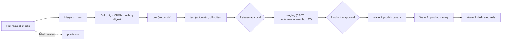
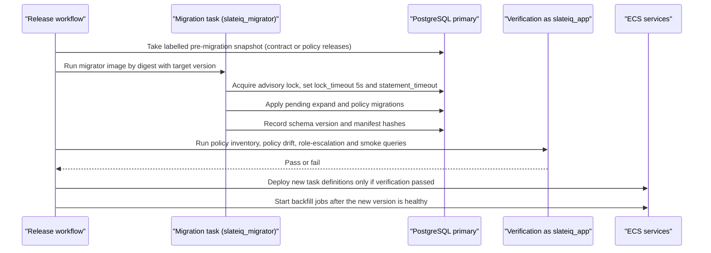

# Document 15: Infrastructure & Deployment Architecture

**Product:** SlateIQ — Production Cost Intelligence & Audit Monitoring Platform
**Document ID:** SLQ-ARCH-015
**Version:** 1.0.0
**Classification:** Internal — Architecture Foundation
**Status:** Draft — For Review
**Date:** 2026-11-06
**Authors:** Principal DevOps Architect, Platform Architect, SRE Lead
**Reviewers:** Principal Architect (TBD), Security Architect (TBD), Data Architect (TBD), Mobile Lead (TBD), Compliance Lead (TBD)

---

## Document Control

### Revision History

| Version | Date | Author | Change |
|---------|------|--------|--------|
| 1.0.0 | 2026-11-06 | Architecture Team | First issue. Consolidates and extends Document 6 §12 and §15; defines account, network, compute, data-service, repository, environment, configuration, container, pipeline, migration, release, dedicated-deployment, backup and disaster-recovery architecture; ADR-062 to ADR-065 |
| 1.1.0 | 2026-11-12 | Architecture Team | Adds §14A, the zero-cost deployment profile required by constraint C-01 (Document 0 §8, ADR-068) |

### Related Documents

| Document | Relationship |
|----------|--------------|
| Document 1 — Product Vision & Business Requirements | NFR targets (§9), business acceptance and pilot gates (§17), decisions D-013, D-015, D-018 |
| Document 2 — Domain Model & Capability Map | Module-to-schema ownership (§3), show hosting topology (§2.3) |
| Document 3 — Actor, Permission, Tenancy & Identity | Tenant lifecycle and provisioning (§2.9, §10), residency (§2.8), database roles (§7.7), capacity (§14), test strategy (§16), table inventory (Appendix D), permission keys (Appendix A) |
| Document 6 — High-Level Solution Architecture | Containers (§3), stack (§6), performance (§11), availability and DR (§12), network security (§13.7), observability (§14), deployment and CI/CD (§15), ADR-001, ADR-009, ADR-015 |
| Document 10 — Security Architecture | Security controls that this document implements in infrastructure (network, KMS, secrets, hardening) |
| Document 11 — Mobile & Offline Architecture | Mobile build, distribution and over-the-air update policy |
| Document 14 — Audit & Observability Architecture | Telemetry content, alert catalogue and runbook content; this document provides the backends and the paging path |
| Document 16 — Testing Strategy | Test types and gates that the pipelines in §11 execute |
| Document 17 — Risk Register & ADRs | Consolidates ADR-062 to ADR-065 and risks R15-01 onward |
| Document 18 — Phased Implementation Roadmap | Sequences the environments, the second region and the dedicated tier |

### Conventions

| Convention | Meaning |
|------------|---------|
| Reference cloud | ADR-015 is provisional. Service names use the AWS reference implementation (ECS Fargate, RDS for PostgreSQL, ElastiCache, S3, KMS, Secrets Manager, SES). Each is reached through a port in the application, and §4.6 lists the provider-neutral equivalent |
| Logical region | `IN` or `EU` (Document 3 §2.8). Physical mapping at launch: `IN` → `ap-south-1` (Mumbai), `EU` → `eu-central-1` (Frankfurt) |
| Environment code | `local`, `ci`, `dev`, `test`, `preview`, `staging`, `prod`, `recovery`, `ded` (dedicated cell) |
| Resource name | `slq-{env}-{region}-{component}`, lowercase, for example `slq-prod-in-evidence` |
| `[secret]` | A configuration value that in every deployed environment is injected from the regional secret manager and never written to a file, image, log or pipeline variable |
| `A15-nn`, `OQ-15-nn`, `R15-nn`, `RC-15-nn` | Assumptions, open questions, risks and reconciliation notes raised by this document |

---

## 1. Purpose and Scope

### 1.1 Purpose

This document is the build specification for every environment that runs SlateIQ. It tells the platform team what to provision, how code reaches production, how a release is undone, and how the platform is recovered after a failure. It consolidates Document 6 §12 (availability and disaster recovery) and §15 (deployment, environments and CI/CD) and extends them to the level a team can implement without further architectural decisions. Where this document is more specific than Document 6, it refines Document 6; where it appears to disagree, the disagreement is recorded in §22 with a proposed resolution.

### 1.2 Scope

| In scope | Out of scope (owner) |
|----------|----------------------|
| Cloud accounts, regions, networks, edge | Security control catalogue and threat model (Document 10) |
| ECS Fargate services, sizing and autoscaling | Module internals and dependency rules (Document 7) |
| PostgreSQL, Redis, object storage, KMS, secrets, email, malware scanning, telemetry backends | Physical schema and partitioning (Document 8) |
| Monorepo layout and backend, web, mobile project structures, `contracts/` package | API resource design (Document 9) |
| Environments, configuration, `.env.example` | Telemetry content, dashboards, alert thresholds, runbook text (Document 14) |
| Container images, CI/CD pipelines, gates, migrations in the pipeline | Test design and critical release scenarios (Document 16) |
| Deployment strategies, rollback, release waves | Mobile sync protocol and device data model (Document 11) |
| Dedicated enterprise deployment model | Commercial pricing of the dedicated tier (Document 18 and the business owner) |
| Backup, restore, disaster recovery and their runbooks | Incident management procedure (Document 14) |
| Capacity and cost envelope | Business continuity at the customer site (Document 1 §17, Document 6 §12.7) |
| Infrastructure side of tenant provisioning | Provisioning workflow logic (Document 3 §2.9 and §10) |

### 1.3 What Must Be True

| Outcome | Measure | Source |
|---------|---------|--------|
| Production is reproducible from code | A complete regional stack is created by Terraform with only secrets and DNS supplied; tested quarterly | Document 6 §15.9 |
| What was tested is what runs | Production runs the image digest that passed staging; no rebuild between environments | Document 6 §15.3 |
| Tenant data never leaves its region | No cross-region replication, backup copy or telemetry carrying tenant identifiers | NFR-PRV-009, ADR-009 |
| A bad release is undone quickly | Automatic rollback within 15 minutes of an SLO alarm | Document 6 §12.2 |
| Data loss is bounded | RPO ≤15 minutes, RTO ≤4 hours for the scenarios in §15.2 | NFR-AVL-006, NFR-AVL-007 |
| Secrets are never in code | Secret scanning blocks every commit; secrets injected at runtime; 90-day rotation | NFR-SEC-006 |
| Every change is traceable | Deployment record links commit, pull request, approver, image digest and migration version | Document 6 §14.9, NFR-PRV-003 |

---

## 2. Drivers, Principles and Inherited Decisions

### 2.1 Requirement Drivers

| Driver | Target | Infrastructure consequence |
|--------|--------|----------------------------|
| NFR-AVL-001 / NFR-AVL-002 | 99.5% MVP, 99.9% Phase 1, monthly | Multi-AZ everything; no single-task service on the interactive path; automatic rollback |
| NFR-AVL-003 | ≤4 hours planned maintenance per month, 72-hour notice | Zero-downtime deployment is the default; maintenance windows reserved for engine upgrades |
| NFR-AVL-004 | Graceful degradation, no data loss | Degradation ladder of Document 6 §12.3 wired to health checks and feature flags |
| NFR-AVL-006 / NFR-AVL-007 / NFR-DAT-001 | RTO ≤4 h, RPO ≤15 min, daily full and 15-minute PITR | Continuous WAL archiving, daily and hourly snapshots, locked cross-account copies, rehearsed runbooks |
| NFR-DAT-002 | Quarterly restore tests | Scheduled drills with retained evidence (§15.6) |
| NFR-SCL-001 to NFR-SCL-006 | 500 organizations, 50,000 users, 10,000 concurrent, 3× peak, 10-year data | Stateless horizontal tiers, vertical-then-replica database, partition archival |
| NFR-PERF-001 to NFR-PERF-012 | Latency and throughput targets | Capacity plan of Document 6 §11.2; queue classes; separate Sync host |
| NFR-SEC-001, NFR-SEC-002, NFR-SEC-006, NFR-SEC-007, NFR-SEC-008 | TLS 1.2+, AES-256 at rest, managed secrets, scan before availability, ≤15-minute signed URLs | Edge TLS policy, KMS everywhere, secret manager, isolated scanner, short presign TTL |
| NFR-PRV-009 | India and EU residency, no cross-region storage | Region-pinned accounts, region-restricted service control policies, no cross-region copies |
| NFR-OBS-001 to NFR-OBS-004 | Logs, metrics, traces, health, tenant-aware without tenant data | Regional OpenTelemetry pipeline; paging metadata stripped of tenant identifiers |
| NFR-MNT-002 / NFR-MNT-003 | Documented, ≥80% coverage on critical paths | Pipeline gates (§11.6) |
| NFR-MNT-004 | Single codebase for all tenants | Dedicated deployments run the same digest (§14) |

### 2.2 Principles

1. **Build once, promote by digest.** Environments differ only in configuration and secrets (Document 6 §15.3).
2. **The region is the blast radius.** Each production region is an independent account and stack; shared services hold no tenant content (ADR-009, ADR-062).
3. **Infrastructure exists only as code.** No console writes in any persistent environment; daily drift detection blocks the next deployment (Document 6 §15.8).
4. **Least privilege by construction.** One task role per service, one database role per workload class, one secret per credential.
5. **Recovery is a product feature.** A restore that has not been rehearsed is not a recovery capability; drills are scheduled, timed and evidenced.
6. **Prefer managed services, keep the ports.** Managed PostgreSQL, Redis, object storage, KMS and secrets reduce operations; the application reaches each through a port so the provider can change (ADR-015 consequences).
7. **No branching on deployment shape.** A dedicated enterprise cell runs the same image and the same code paths as the shared stack (Document 3 §2.2).

### 2.3 Inherited Decisions (not reopened)

| Decision | Source | Applied here |
|----------|--------|--------------|
| Modular monolith; one codebase, API, Sync and Worker hosts plus Renderer | ADR-001 | §5; extended by an internal Ops host profile (ADR-063) |
| PostgreSQL 17 with RLS, `slateiq_app` without `BYPASSRLS`, separate `slateiq_migrator` | ADR-002, Document 3 §7.7 | §6.1, §12 |
| Transactional outbox, Quartz.NET, no external broker | ADR-003 | §5.4 (worker scaling on oldest-job age) |
| Object storage with scan-before-serve | ADR-006 | §6.3, §6.6 |
| One region per tenant, restore-based DR in region | ADR-009 | §4, §15 |
| OpenTelemetry | ADR-014 | §6.7 |
| ECS Fargate, Terraform, GitHub Actions, cosign, promote by digest (provisional) | ADR-015 | Whole document |
| Monorepo with `backend/`, `web/`, `mobile/`, `infra/`, `contracts/`, `docs/` | Document 6 §6.11 | §7 |
| Expand/contract migrations, migration before application | Document 6 §15.6 | §12 |

---

## 3. Deployment Architecture Overview

### 3.1 Deployment Architecture Diagram

The diagram shows one production region in full. The EU region is an identical, independent stack; it is collapsed to a single node to keep the diagram readable. Dashed edges are asynchronous or recovery paths.

```mermaid
flowchart TB
    subgraph Clients["Clients"]
        WEB["Web SPA in browser"]
        MOB["Mobile app (iOS, Android)"]
    end

    subgraph Shared["Shared services account (no tenant content)"]
        CDN["Global CDN, WAF, TLS 1.2+"]
        DIRS["Region directory (slug to region only)"]
        SPA["SPA asset bucket (versioned)"]
        ECR["Container registry (signed digests)"]
        GHA["GitHub Actions via OIDC"]
        DNS["DNS zone slateiq.com"]
    end

    subgraph ProdIN["Production account IN, ap-south-1, 3 AZs"]
        subgraph PubIN["Public subnets"]
            ALB["Regional ALB with WAF"]
            NAT["NAT and egress firewall (allow-list)"]
        end
        subgraph AppIN["Private application subnets"]
            API["API service (Fargate)"]
            SYN["Sync service (Fargate)"]
            WRK["Worker service (Fargate)"]
            OPS["Ops service (internal only)"]
            PGB["PgBouncer service (transaction pooling)"]
            OTC["OTel Collector gateway"]
            MIG["Migration task (one-off, slateiq_migrator)"]
        end
        subgraph IsoIN["Isolated subnets (no internet route)"]
            RND["Renderer (headless Chromium)"]
            SCN["Malware scanner"]
        end
        subgraph DataIN["Private data subnets"]
            PGP["PostgreSQL 17 primary"]
            PGS["Multi-AZ standby"]
            PGR["Read replica"]
            RDS["Redis primary and replica"]
        end
        S3E["S3: evidence, imports, exports"]
        S3A["S3: audit archive (Object Lock compliance)"]
        KMS["KMS: regional CMKs and tenant keys"]
        SEC["Secrets Manager"]
        SES["SES regional email"]
        TEL["Regional telemetry backends"]
    end

    subgraph RecIN["Recovery account IN, same region"]
        VLT["Locked backup vault"]
        S3R["Replica buckets"]
        STK["Pre-created recovery stack (scaled to zero)"]
    end

    EUSTACK["Production account EU, eu-central-1 (identical stack)"]
    EUREC["Recovery account EU (same region)"]
    PAGE["Paging provider (alert metadata only)"]

    WEB --> CDN
    MOB --> CDN
    CDN --> SPA
    CDN --> DIRS
    CDN -->|"api.in / sync.in"| ALB
    CDN -->|"api.eu / sync.eu"| EUSTACK
    MOB -.->|"presigned PUT and GET"| S3E
    ALB --> API
    ALB --> SYN
    API --> PGB
    SYN --> PGB
    WRK --> PGB
    OPS --> PGB
    PGB --> PGP
    PGB --> PGR
    PGP -.->|"synchronous replication"| PGS
    PGP -.->|"streaming replication"| PGR
    API --> RDS
    SYN --> RDS
    WRK --> RND
    WRK --> SCN
    WRK --> S3E
    WRK --> SES
    API --> S3E
    WRK --> S3A
    API --> KMS
    API --> SEC
    MIG --> PGP
    API --> OTC
    WRK --> OTC
    OTC --> TEL
    TEL -.-> PAGE
    WRK --> NAT
    GHA --> ECR
    ECR -.->|"pull by digest"| API
    GHA -.->|"deploy"| MIG
    PGP -.->|"hourly snapshot copy"| VLT
    S3E -.->|"same-region replication"| S3R
    S3A -.->|"same-region replication"| S3R
    EUSTACK -.-> EUREC
```



### 3.2 Runtime Inventory per Production Region

| Component | Runtime | Subnet tier | Inbound from | Outbound to |
|-----------|---------|-------------|--------------|-------------|
| Regional ALB | Managed load balancer, WAF attached | Public | CDN only (origin-restricted by managed prefix list and a secret origin header) | API, Sync target groups |
| API service | Fargate, backend image, `api` profile | Application | ALB | PgBouncer, Redis, VPC endpoints (S3, KMS, Secrets, STS, Logs), OTel Collector |
| Sync service | Fargate, backend image, `sync` profile | Application | ALB (separate host name and target group) | Same as API |
| Worker service | Fargate, backend image, `worker` profile | Application | None | PgBouncer, Redis, Renderer, Scanner, S3, SES, egress firewall (FX, secondary email) |
| Ops service | Fargate, backend image, `ops` profile | Application | Internal ALB reachable only through the operator access proxy | PgBouncer (`slateiq_ops` pool), KMS, S3, region directory write API |
| Renderer | Fargate, renderer image | Isolated | Worker only | S3 gateway endpoint (presigned PUT supplied by the worker) |
| Malware scanner | Fargate, scanner image | Isolated | Worker only, TCP 3310 | Signature mirror through the egress firewall |
| PgBouncer | Fargate, PgBouncer image, internal NLB | Application | API, Sync, Worker, Ops security groups | PostgreSQL primary and replica |
| OTel Collector | Fargate, collector image | Application | All tasks (OTLP 4317/4318) | Regional telemetry backends |
| Migration task | Fargate one-off, migrator image | Application | None | PgBouncer bypass: direct to PostgreSQL primary |
| PostgreSQL | Managed, Multi-AZ, one read replica | Data | PgBouncer, migration task | None |
| Redis | Managed, primary plus replica | Data | API, Sync, Worker, Ops | None |

---

## 4. Cloud Accounts, Regions and Network

### 4.1 Account Layout

The account layout extends Document 6 §15.2. Each account is a hard security boundary with its own IAM, KMS keys and budget alarms. Accounts are grouped into organizational units with service control policies (SCPs).

| Account | Purpose | Region(s) | Tenant content | Key SCPs |
|---------|---------|-----------|----------------|----------|
| `management` | Organization root, billing, SCP administration | Global | None | No workloads permitted |
| `security` | Security tooling administration, CloudTrail and Config aggregation per region, GuardDuty administrator | `ap-south-1`, `eu-central-1` (log buckets per region) | Operational metadata only; regional buckets keep regional trails in region | Deny log deletion, deny trail changes |
| `shared-services` | Container registry, CI OIDC trust, signing verification policy, DNS, CDN, SPA assets, region directory | Global plus registry replicas in both regions | None (A15-01) | Deny creation of data stores tagged `data-class=tenant` |
| `nonprod` | `dev`, `test`, `preview` | `ap-south-1` | Synthetic only | Deny peering or endpoint connections to production accounts |
| `staging` | `staging-in` (MVP); `staging-eu` added in Phase 1 | `ap-south-1`, later `eu-central-1` | Synthetic only (ADR-067) | Same as `nonprod` |
| `prod-in` | India production | `ap-south-1` only | Yes | Deny any API call outside `ap-south-1` except global services; deny public S3; deny KMS key deletion except break-glass role; deny disabling backups |
| `prod-eu` | EU production | `eu-central-1` only | Yes | Same as `prod-in` with `eu-central-1` |
| `recovery-in` | Locked backup vault copies, replica buckets, pre-created recovery stack | `ap-south-1` only | Yes (backups) | Deny vault policy changes; deny deletion of recovery points |
| `recovery-eu` | Same for EU | `eu-central-1` only | Yes (backups) | Same |
| `ded-{slug}-{region}` | Dedicated enterprise cell (§14) | Tenant's region only | Yes, one tenant | Same as the production account of its region |

**Region restriction is enforced twice.** Terraform providers in a production workspace are pinned to the region, and the SCP denies `aws:RequestedRegion` values outside the region. A misconfigured module therefore fails at plan or at the API call, never silently creating a resource elsewhere.

### 4.2 Region Directory and Host Names

| Host name | Serves | Notes |
|-----------|--------|-------|
| `app.slateiq.com` | SPA assets through the global CDN | Same assets for every region; the SPA learns the regional API at sign-in |
| `dir.slateiq.com` | Region directory lookup: exact organization slug → logical region | Holds `slug`, `org_id`, `region`, `status` only; no personal or financial data; exact-match lookup, rate-limited, uniform `404` for unknown slugs; written only by the regional Ops service in provisioning step 8 (Document 3 §10.1) |
| `api.in.slateiq.com`, `api.eu.slateiq.com` | Regional API host | CDN behaviour with caching disabled; forwards to the regional ALB |
| `sync.in.slateiq.com`, `sync.eu.slateiq.com` | Regional Sync host | Separate target group and rate limits (Document 6 §3.2) |
| `ops.in.slateiq.internal`, `ops.eu.slateiq.internal` | Ops host | Private hosted zone; reachable only through the operator access proxy |
| `{env}.slateiq.dev`, `pr-{n}.preview.slateiq.dev` | Non-production | Separate registered domain so that a non-production cookie can never be scoped to production |

**Sign-in routing.** The web client and the mobile app ask the organization slug (or read it from an invitation link), resolve the region through `dir.slateiq.com`, and from then on talk only to that region. The mobile app stores the regional base URL with its device registration; a device is bound to one region. Cross-region grant workspaces follow Document 3 §8.12.

### 4.3 Network Design per Regional Stack

| Element | Design |
|---------|--------|
| VPC | One per environment per region; `/16` from the address plan in §4.4; three Availability Zones in production and staging, two in non-production |
| Public subnets | `/24` per AZ; ALB and NAT gateways only |
| Application subnets | `/20` per AZ; API, Sync, Worker, Ops, PgBouncer, OTel Collector, migration task |
| Isolated subnets | `/24` per AZ; Renderer and Scanner; no NAT route; S3 gateway endpoint only; the scanner's signature updates go through a dedicated egress firewall rule group |
| Data subnets | `/24` per AZ; PostgreSQL and Redis subnet groups; no route to the internet |
| VPC endpoints | Gateway: S3. Interface: KMS, Secrets Manager, STS, ECR API, ECR DKR, CloudWatch Logs, SSM, SSM Messages. Endpoint policies restrict to the account's own resources |
| Egress | NAT through a managed egress firewall with a domain allow-list per adapter: FX sources (INTG-05), secondary email provider, scanner signature mirror, mobile push services (Phase 1), customer IdPs (Phase 1). Everything else is denied and logged (Document 6 §13.7) |
| Security groups | One per service. Data security groups admit only PgBouncer (PostgreSQL) and the application security groups (Redis). The renderer group has no route to PostgreSQL or Redis (TR-006) |
| Network ACLs | Default allow within VPC; deny the RFC 1918 ranges of every other environment as defence in depth |
| TLS | Edge: TLS 1.2 minimum, TLS 1.3 preferred (NFR-SEC-001). ALB to tasks: TLS with a private CA certificate. Tasks to PostgreSQL and Redis: TLS required (`rds.force_ssl = 1`, Redis in-transit encryption) |
| DNS | Private hosted zones per VPC for internal names; DNS firewall blocks resolution of non-allow-listed domains from isolated subnets |
| Flow logs | VPC flow logs to the regional log store, 90 days |
| No peering | Production VPCs are never peered with non-production or with each other. The only cross-account network path is the recovery account's restore path, which is created only during an invoked recovery |

### 4.4 Address Plan

| Environment | Region | CIDR |
|-------------|--------|------|
| `prod` | IN | `10.10.0.0/16` |
| `recovery` | IN | `10.11.0.0/16` (same plan as prod, so a restored stack needs no re-addressing of security rules) |
| `prod` | EU | `10.20.0.0/16` |
| `recovery` | EU | `10.21.0.0/16` |
| `staging` | IN, later EU | `10.30.0.0/16`, `10.31.0.0/16` |
| `dev` | IN | `10.40.0.0/16` |
| `test` | IN | `10.41.0.0/16` |
| `preview` | IN | Shares the `dev` VPC; previews get their own security groups and target groups |
| `ded` cells | Tenant region | `10.100.0.0/16` upward, one `/16` per cell |

### 4.5 Edge

| Concern | Design |
|---------|--------|
| CDN | Global distribution for `app`, `api.{region}`, `sync.{region}`; API and Sync behaviours disable caching and forward `Authorization`, `Idempotency-Key`, `If-Match` |
| WAF | Managed rule sets (common, known bad inputs, IP reputation), rate-based rules per IP and per path class, request size limits (512 KB on `/sync/push`, 1 MB elsewhere; uploads never transit the API), geo controls configurable per environment |
| Origin protection | ALB accepts only CDN origin ranges plus a rotating secret header; direct ALB access returns `403` |
| Edge logs | API and Sync distributions log no URL path or query string, so tenant identifiers in paths never reach the global log store; full request lines are logged by the regional ALB in region |
| DDoS | Provider standard protection at the edge; advanced protection evaluated before GA (OQ-15-05) |
| Certificates | Managed certificates, auto-renewed; ALR-023 alerts at 21 days (Document 6 §14.5) |

### 4.6 Provider-Neutral Mapping

| Capability | AWS reference | Port in application | Equivalent on another provider |
|------------|---------------|---------------------|--------------------------------|
| Containers | ECS on Fargate | None (deployment only) | Managed container service with task-level IAM |
| PostgreSQL 17 | RDS for PostgreSQL Multi-AZ | Npgsql connection strings | Managed PostgreSQL with HA standby and PITR |
| Redis | ElastiCache (Redis protocol) | `ICacheStore`, `IRateLimiter`, `IRevocationStore` | Managed Redis-compatible cache |
| Object storage | S3 with Object Lock | `IObjectStore` | S3-compatible storage with WORM |
| KMS | AWS KMS | `IKeyService` | Managed KMS with envelope encryption and key policies |
| Secrets | Secrets Manager | Injected environment variables | Managed secret store with rotation |
| Email | SES | `IEmailSender` | Any SMTP or API provider in region |
| Malware scanning | Self-hosted scanner container | `IMalwareScanner` | Same container; or a managed in-region scanner (OQ-15-03) |
| Telemetry | Managed Prometheus, CloudWatch Logs, X-Ray or Tempo, Grafana | OpenTelemetry only | Any OTLP-compatible backend in region |

---

## 5. Compute: ECS Fargate Services and Scaling

### 5.1 Service Catalogue

Sizing follows Document 6 §11.2. "MVP" is the pilot floor in each production region; "GA" is the Phase 1 envelope. All tasks run on ARM64 (Graviton) Fargate for cost (§16.3); images are built multi-architecture so developers on x86 laptops run the same image.

| Service | Image | Host profile | Task size MVP | Tasks MVP (min–max) | Task size GA | Tasks GA (min–max) | Scaling signal |
|---------|-------|--------------|---------------|---------------------|--------------|--------------------|----------------|
| `api` | `slateiq-backend` | `api` | 2 vCPU / 4 GB | 4–20 | 2 vCPU / 4 GB | 6–20 | ALB requests per target and CPU 65% target tracking |
| `sync` | `slateiq-backend` | `sync` | 2 vCPU / 4 GB | 2–8 | 2 vCPU / 4 GB | 4–12 | Requests per target; p95 push latency step policy |
| `worker` | `slateiq-backend` | `worker` (all queue classes) | 2 vCPU / 4 GB | 3–10 | — | — | Oldest job age per queue class (custom metric) |
| `worker-interactive` (GA) | `slateiq-backend` | `worker`, classes `interactive`, `maintenance` | — | — | 2 vCPU / 4 GB | 3–8 | Oldest job age, interactive class |
| `worker-bulk` (GA) | `slateiq-backend` | `worker`, classes `bulk` | — | — | 2 vCPU / 4 GB | 3–8 | Oldest job age, bulk class; memory |
| `renderer` | `slateiq-renderer` | — | 2 vCPU / 4 GB | 1–3 | 4 vCPU / 8 GB | 2–6 | Render queue depth (from the worker's `render` class) |
| `ops` | `slateiq-backend` | `ops` | 1 vCPU / 2 GB | 2–2 | 1 vCPU / 2 GB | 2–2 | Fixed |
| `scanner` | `slateiq-scanner` | — | 2 vCPU / 4 GB | 2–6 | 2 vCPU / 4 GB | 2–8 | Oldest pending scan age |
| `pgbouncer` | `slateiq-pgbouncer` | — | 0.5 vCPU / 1 GB | 2–2 | 1 vCPU / 2 GB | 3–3 | Fixed; client connection utilization alarm |
| `otel-collector` | `slateiq-otel` | — | 1 vCPU / 2 GB | 2–4 | 1 vCPU / 2 GB | 2–6 | Queue size and refused spans |

**Why the worker splits at GA.** Document 6 §11.5 defines four queue classes with separate concurrency limits. At MVP one worker service enforces the limits in process. At GA, a separate `worker-bulk` service gives imports and exports their own scaling and failure domain, so a 50,000-row import cannot occupy the tasks that deliver a critical alert. The split is a configuration change (`SLATEIQ_WORKER__QUEUECLASSES`), not a code change.

### 5.2 Host Profiles from One Image

The backend image contains one executable. The `SLATEIQ_HOST__ROLE` variable selects which endpoints, hosted services and database pools start (ADR-063).

| Profile | Starts | Database role and pool | Never starts |
|---------|--------|------------------------|--------------|
| `api` | Public REST `/api/v1`, SSE stream, signed URL issuance | `slateiq_app`, pool `api` | Sync endpoints, outbox dispatch, Quartz scheduler, `/ops` and `/admin` routes |
| `sync` | `/sync/*` endpoints (Document 6 Appendix A.13) | `slateiq_app`, pool `sync` | Public REST, jobs |
| `worker` | Outbox dispatcher, job consumers per configured queue class, Quartz clustered scheduler, projectors | `slateiq_app`, pool `worker`; report reads on the replica pool | Any HTTP endpoint other than health |
| `ops` | `/ops/*` and `/admin/*` routes, provisioning saga, support access, feature flag administration | `slateiq_ops`, pool `ops`; `slateiq_app` with support context for break-glass reads (Document 3 §7.4) | Public REST, sync, tenant jobs |

**Startup contract.** Each profile validates its options at startup and refuses to start if a key required by the profile is missing, if a key forbidden for the profile is present (for example `SLATEIQ_DATABASE__OPS__PASSWORD` in the `api` profile), or if the database role it connects as has `BYPASSRLS` or table ownership. This turns a wiring mistake into a failed deployment instead of a privilege leak.

### 5.3 Task Hardening

| Control | Setting |
|---------|---------|
| User | Non-root numeric UID; `readonlyRootFilesystem = true`; writable `tmpfs` at `/tmp` only |
| Capabilities | All Linux capabilities dropped; `noNewPrivileges` |
| Image | Pulled by digest; signature verified by the deployment step and by an admission check in the pipeline (§11.5) |
| Task role | One IAM role per service; S3 access scoped by prefix and session tag (§6.3); KMS access by key and encryption context |
| Execution role | Separate; pulls images and reads only the secrets listed in the task definition |
| Interactive access | ECS Exec disabled in production; break-glass uses a dedicated support task (§18) |
| Logging | stdout JSON to the OTel Collector; no log file inside the container |
| Stop timeout | API and Sync 30 s; Worker 120 s (60 s drain plus release, Document 6 §15.7); Renderer 60 s |
| Health | ALB target health on `/health/ready`; container health via the executable's built-in probe (`--probe ready`) because the runtime image has no shell or curl |

### 5.4 Autoscaling Rules

| Service | Scale out | Scale in | Guard rails |
|---------|-----------|----------|-------------|
| API | Requests per target above the load-tested value at 65% CPU, or CPU above 65% for 3 minutes | CPU below 35% for 15 minutes | Minimum spread across 2 AZs (3 at GA); maximum bounded by the PgBouncer `api` pool (§6.1) |
| Sync | Requests per target, or p95 push latency above 2 s for 5 minutes | 15 minutes quiet | Reconnect storm test LT in Document 16; separate maximum so Sync cannot exhaust the database |
| Worker | Oldest job age above 60 s in `interactive`, or above 5 minutes in `bulk` | Queue empty for 10 minutes | Scale-in protection while a task holds claimed jobs; drain on SIGTERM |
| Renderer | `render` queue depth above 2 per task | Depth zero for 10 minutes | Memory alarm at 80% triggers task replacement, not scale |
| Scanner | Oldest pending scan above 2 minutes | Empty for 10 minutes | ALR-013 fires at 10 minutes regardless of scaling (Document 6 §14.5) |

**Scheduled capacity.** Month-end (last three and first two working days of each month in each region's time zone) raises the API and Worker minimum by 50% (Document 6 §11.8, aggregate refresh contention). Seasonal peaks (NFR-SCL-005) are pre-scaled on notice from customer success.

---

## 6. Data and Platform Services

### 6.1 PostgreSQL 17

| Aspect | MVP | GA |
|--------|-----|----|
| Service | Managed PostgreSQL 17, Multi-AZ (synchronous standby), one asynchronous read replica in a third AZ | Same; second replica for reports and exports |
| Instance | 4 vCPU / 16 GB, ARM64 general purpose | 8 vCPU / 32 GB |
| Storage | 500 GB gp3, 3,000 IOPS baseline, provisioned to 12,000 for month-end | 1.2 TB, 6,000 baseline, 20,000 provisioned |
| Encryption | Regional database CMK (`alias/slq-{env}-{region}-db`) | Same |
| Parameters | `rds.force_ssl = 1`; `max_connections = 400` (100 reserved for operations, Document 3 §14.7); `idle_in_transaction_session_timeout = 30s`; `lock_timeout` default `5s` for the application role; `log_min_duration_statement = 500ms`; `shared_preload_libraries = pg_stat_statements` | Same plus `auto_explain` sampling on the replica |
| Extensions | `pg_trgm`, `pgcrypto`, `uuid-ossp` (Document 6 AS-07), `pg_stat_statements` | Same |
| Roles | `slateiq_app`, `slateiq_ops`, `slateiq_migrator`, `slateiq_readonly` (Phase 1) per Document 3 §7.7; master user vaulted, two-person release, use pages Security | Same |
| Credentials | Secrets Manager, alternating-user rotation every 90 days (NFR-SEC-006); PgBouncer reloads its auth file on rotation | Same |
| Backups | Automated backups with continuous WAL archiving, 35-day retention; hourly and daily snapshots through the backup plan (§15.3) | Same |
| Monitoring | Performance insights in region; enhanced monitoring 15 s; slow-query log to the regional log store | Same |
| Deletion protection | On; Terraform `prevent_destroy` on the instance, snapshots and parameter groups | Same |

**Connection budget.** PostgreSQL `max_connections` is 400 (Document 3 §14.7). PgBouncer holds the server-side pools, so the database never sees one connection per task. The server-side total is 80 at MVP and 200 at GA (Document 6 §11.2); the remaining capacity is headroom for operations, migrations and replication. RC-15-03 records why the two documents' numbers are compatible.

| PgBouncer pool | Database role | Target | Server connections MVP / GA | Client limit per task |
|----------------|---------------|--------|-----------------------------|-----------------------|
| `api` | `slateiq_app` | Primary | 40 / 100 | 40 (maximum 60, Document 3 §14.7) |
| `sync` | `slateiq_app` | Primary | 15 / 40 | 30 |
| `worker` | `slateiq_app` | Primary | 15 / 40 | 20 |
| `report` | `slateiq_app` | Replica | 6 / 10 | 10 |
| `ops` | `slateiq_ops` | Primary | 4 / 10 | 10 |

PgBouncer runs `pool_mode = transaction`, `server_reset_query = DISCARD ALL`, `max_prepared_statements = 0` in the application path (Document 3 §14.7), and TLS on both sides. The migration task connects directly to the primary, never through PgBouncer, because DDL with `CREATE INDEX CONCURRENTLY` cannot run inside a pooled transaction.

### 6.2 Redis

| Aspect | Design |
|--------|--------|
| Service | Managed Redis-protocol cache, primary plus replica in another AZ at MVP; cluster mode with 3 shards at GA (Document 6 §11.2) |
| Engine | Redis 7.4 protocol level. If the managed service does not offer 7.4 in a launch region, the closest supported engine is used and the local and test containers are pinned to the same engine (A15-03, OQ-15-04) |
| Security | In-transit encryption, at-rest encryption with the regional key, AUTH token `[secret]` with rotation; no public endpoint |
| Data | Ephemeral only: reference cache, scope cache, rate counters, distributed locks, revocation denylist, SSE fan-out. No backup is taken; loss is survivable by design (Document 6 §12.2) |
| Key format | `{env}:org:{org_id}:...` (Document 3 §7.6); the environment prefix prevents a mis-pointed non-production task from reading production keys even if a network path existed |
| Eviction | `volatile-lru`; the denylist keys carry TTL equal to the longest token lifetime so eviction can never drop an unexpired revocation before its TTL (and the database session registry remains authoritative) |
| Sizing | 2 GB MVP, 8 GB at year 3 (Document 6 §11.2); alarm at 70% memory |

### 6.3 Object Storage

| Bucket | Contents | Versioning | Object Lock | Lifecycle | Encryption |
|--------|----------|------------|-------------|-----------|------------|
| `slq-{env}-{region}-evidence` | Evidence and document versions under `org/{org_id}/`; uploads land under `quarantine/org/{org_id}/` | On | Enabled, governance mode, no default retention; per-object legal hold applied when `compliance.legal_hold` targets the document | Standard → infrequent access at 90 days → archive at 24 months; noncurrent versions expire per retention policy unless held | SSE-KMS with the tenant key (`alias/slq-{env}-{region}-tenant-{org_id}`), bucket keys on |
| `slq-{env}-{region}-imports` | Excel uploads and import artefacts | On | No | Rejected and expired batches deleted per AQ-04 (default 30 days); committed batch source files retained with the batch audit | SSE-KMS tenant key |
| `slq-{env}-{region}-exports` | Report outputs, data exports, support bundles | On | No | Outputs deleted after 30 days; support bundles after 7 days (Document 3 §7.6) | SSE-KMS tenant key |
| `slq-{env}-{region}-audit-archive` | Monthly audit archives and chain anchors (ADR-012) | On | Compliance mode, 7-year default retention (NFR-AUD-003) | Archive tier after 90 days | SSE-KMS tenant key for tenant archives; platform key for anchors |
| `slq-{env}-{region}-telemetry-archive` | Cold logs after 30 days | On | No | Delete after 13 months (Document 6 §6.10) | SSE-KMS logs key |
| `slq-shared-spa` (shared account) | SPA assets, one prefix per build version, `config.json` per environment | On | No | Keep the last 20 versions | SSE-S3 (no tenant content) |

**Tenant prefix enforcement in infrastructure.** Document 3 §7.6 requires that object access outside the caller's tenant prefix is denied. A bucket-policy statement per tenant does not scale to 500 tenants (bucket policies are size-limited), so the control is attribute-based: the API and Worker obtain a short-lived session (≤15 minutes, cached per tenant) by assuming a signer role with session tag `org_id`; the signer role's policy allows object actions only on `org/${aws:PrincipalTag/org_id}/*` and `quarantine/org/${aws:PrincipalTag/org_id}/*`. A presigned URL is signed with that session, so a defect in the application's key construction yields a URL the storage service refuses. The signer still resolves `org_id` from the database (Document 3 §7.6); the session tag is the second, independent layer. RC-15-05 records the refinement of Document 3 §10.1 step 6.

**Public access.** Account-level and bucket-level public access blocks are on; a TLS-only bucket policy denies `aws:SecureTransport = false`; presigned GET URLs expire in ≤15 minutes (NFR-SEC-008) and carry `Content-Disposition: attachment`.

**Crypto-shredding.** Evidence, imports, exports and tenant audit archives are encrypted with the tenant's key, so scheduling that key for deletion at purge (Document 3 §10.6) makes every remaining object version, replica and archive unreadable after the provider's minimum waiting period (7 days on the reference provider). RC-15-06 notes that database backups are encrypted with the regional database key, not the tenant key, and therefore expire on schedule rather than being crypto-shredded.

### 6.4 KMS

| Key | Type | Use | Rotation | Access |
|-----|------|-----|----------|--------|
| `alias/slq-{env}-{region}-db` | Symmetric | Database storage, snapshots, replicas | Annual automatic | Database service; recovery account may decrypt for restore |
| `alias/slq-{env}-{region}-platform` | Symmetric | Platform-owned objects (anchors), Redis at rest, SQS-like adapter queues | Annual | Service roles |
| `alias/slq-{env}-{region}-secrets` | Symmetric | Secrets Manager entries | Annual | Execution roles |
| `alias/slq-{env}-{region}-logs` | Symmetric | Log groups, telemetry archive | Annual | Logging service, collector |
| `alias/slq-{env}-{region}-token-signing` | Asymmetric signing | Access token signatures (algorithm per Document 10) | Annual, with overlapping verification keys published | API (sign), all hosts (verify via public key cache) |
| `alias/slq-{env}-{region}-field` | Symmetric | Envelope key for field-level encryption of MFA seeds and device keys (Document 6 §6.9) | Annual | API, Sync |
| `alias/slq-{env}-{region}-tenant-{org_id}` | Symmetric, one per tenant | Tenant objects (SSE-KMS) and tenant-scoped envelope encryption | Annual automatic | Signer role with matching `org_id` session tag; Ops role for create and schedule-deletion |

**Deletion guard.** The SCP denies `kms:ScheduleKeyDeletion` and `kms:DisableKey` to every principal except the Ops service role (tenant keys only, tag-conditioned) and the break-glass role; every scheduling event pages Security. Waiting period is the provider maximum (30 days) for platform keys and the minimum (7 days) for tenant keys at purge, so a purge completes in a known time and a platform key cannot be destroyed by a single compromised operator.

### 6.5 Secrets

| Secret | Consumer | Rotation |
|--------|----------|----------|
| `slq/{env}/{region}/db/app` | API, Sync, Worker (via PgBouncer auth file) | 90 days, alternating users |
| `slq/{env}/{region}/db/ops` | Ops, PgBouncer | 90 days, alternating users |
| `slq/{env}/{region}/db/migrator` | Migration task only (pipeline-scoped execution role) | 90 days |
| `slq/{env}/{region}/db/master` | Nobody at runtime; break-glass only | 90 days; two-person retrieval |
| `slq/{env}/{region}/redis/auth` | API, Sync, Worker, Ops | 90 days, dual token during rotation |
| `slq/{env}/{region}/renderer/hmac` | Worker (sign), Renderer (verify) | 90 days, two active keys |
| `slq/{env}/{region}/edge/origin-header` | CDN, ALB rule | 30 days |
| `slq/{env}/{region}/fx/provider` | Worker | Per provider; 90 days where supported |
| `slq/{env}/{region}/email/secondary` | Worker | 90 days |
| `slq/{env}/{region}/telemetry/hash-salt` | All hosts | Annual; rotation re-hashes nothing (the hash is for correlation within a retention window) |
| `slq/{env}/{region}/errors/dsn` | All hosts | On compromise |
| `slq/{env}/{region}/directory/write` | Ops (writes to the region directory) | 90 days |

**Injection.** Secrets reach a task only through the task definition's `secrets` references, resolved by the execution role at task start into environment variables. Nothing reads the secret manager at request time except rotation-aware clients (PgBouncer auth reload, Redis dual token). A rotation event triggers a rolling restart of consumers after the new credential is verified, so no task runs with a credential older than one rotation period plus one deployment.

**What is never a secret.** Signing keys and the tenant keys never leave KMS; there is no exported private key to store. Pipeline signing is keyless (OIDC-backed cosign), so there is no signing key secret either.

### 6.6 Email, Malware Scanning, FX

| Service | Design |
|---------|--------|
| Email (INTG-02) | Regional SES in each production region; sending domain `notify.slateiq.com` with region-specific custom MAIL FROM subdomains; DKIM 2048-bit, SPF and DMARC (`p=quarantine` during warm-up, then `p=reject`); configuration set publishes bounces, complaints and deliveries to an in-region queue that the Worker polls (no public webhook); account-level suppression list; secondary in-region provider configured as failover and registered as a subprocessor (NFR-PRV-010). Non-production: SES sandbox with a recipient allow-list of internal domains; local uses Mailpit |
| Malware scanning (INTG-04) | `scanner` service built from a pinned open-source signature engine image; runs in isolated subnets; the Worker streams each quarantined object to the scanner (`INSTREAM`) and performs MIME sniffing and archive inspection itself (Document 6 §10.3.4); no file is executed; signatures refresh hourly through the egress firewall; a signature database older than 24 hours fails the scanner's readiness check so stale scanning cannot silently pass files (Document 14 receives the alert request in §19.3) |
| FX rates (INTG-05) | Worker job pulls the primary and secondary sources through the egress allow-list; failures follow Document 6 §12.2 (`FALLBACK`) |

### 6.7 Telemetry Backends

All backends are in the region whose tenants they observe (Document 3 §2.8, NFR-OBS-004).

| Signal | Path | Backend (reference) | Retention |
|--------|------|---------------------|-----------|
| Traces | SDK → OTel Collector gateway (tail sampling: 100% errors and slow, 10% success, Document 6 §14.2) | Regional tracing backend | 7 days |
| Metrics | SDK → Collector → remote write | Regional managed Prometheus-compatible store | 13 months |
| Logs | stdout JSON → Collector → regional log store → archive bucket after 30 days | Regional log store and `telemetry-archive` bucket | 30 days hot, 13 months cold |
| Dashboards | Regional Grafana workspace per region; OPS-DSH-01 to OPS-DSH-12 (Document 6 §14.4) | Regional | — |
| Errors | Sentry-compatible, region-hosted (Document 6 §6.2) | Regional | 90 days |
| Synthetic probes | External probes from at least two locations per region against `/health/ready` and a synthetic journey on a dedicated synthetic tenant | Regional metrics | 13 months |
| Paging | Alert rules evaluate in region; the notification sent to the paging provider carries alert ID, severity, service, region and runbook link only — never `org_id`, tenant hash or payload | Paging provider (subprocessor) | Provider default |
| Cross-region view | Aggregated SLO and capacity metrics with tenant identifiers removed, exported to the shared account (Document 6 §15.2) | Shared-services metrics | 13 months |

**Collector processors.** The gateway collector runs attribute redaction (drops `http.url` query strings, `db.statement` parameters, and any attribute on the deny list), replaces `org_id` with the salted `tenant.hash` where Document 14 requires it, and enforces the cardinality limits of Document 6 §14.2. Redaction at the collector is a backstop; the SDK-side rules of Document 14 remain the primary control.

---

## 7. Repository and Project Structure

### 7.1 Monorepo Layout

One repository, six top-level product directories (Document 6 §6.11). Frontend and backend code are never combined: the web and mobile applications share only the generated API client produced from `contracts/`, and the backend never imports anything from `web/` or `mobile/`.

```
slateiq/
├── .github/
│   ├── workflows/                 backend-ci, web-ci, mobile-ci, contracts-ci, infra-ci, infra-apply,
│   │                              release, preview, nightly, drift, dr-drill
│   ├── CODEOWNERS                 path ownership; RLS, auth, money, audit, infra require two reviewers
│   └── pull_request_template.md
├── backend/                       .NET 10 solution (API, Sync, Worker, Ops profiles; Renderer; migrations)
├── web/                           React 19 + TypeScript SPA (Vite)
├── mobile/                        React Native + Expo app (SQLCipher)
├── contracts/                     OpenAPI, event schemas, error registry, Excel template manifests, generated clients
├── infra/                         Terraform modules and environment stacks, policy checks, local compose
├── docs/                          Architecture set, ADRs, runbooks, API guides
├── .env.example                   Every configuration key with placeholders (§9.4)
├── .editorconfig, .gitattributes, .gitignore
├── pnpm-workspace.yaml            Workspaces: web, mobile, contracts/clients/typescript
├── renovate.json                  Grouped dependency updates, licence allow-list
└── README.md
```

**Path-filtered pipelines.** Each workflow runs only when its directory or `contracts/` changes. A change to `contracts/` runs the backend, web and mobile contract jobs, because a contract change is a change to all three.

### 7.2 Backend Project Structure

```
backend/
├── SlateIQ.sln
├── global.json                    pinned .NET 10 SDK
├── Directory.Build.props          nullable, warnings as errors, deterministic, analyzers
├── Directory.Packages.props       central package management, exact versions
├── src/
│   ├── Host/
│   │   └── SlateIQ.Host/          single executable; selects profile api | sync | worker | ops; health probe
│   ├── BuildingBlocks/
│   │   ├── SlateIQ.Domain.Kernel/         Money, identifiers, Result, domain events, clock port
│   │   ├── SlateIQ.Application.Kernel/    command and query pipeline, idempotency, authorization PEP, audit writer port
│   │   ├── SlateIQ.Persistence/           EF Core and Dapper base, tenant context SET LOCAL, outbox writer
│   │   ├── SlateIQ.Messaging/             outbox dispatcher, inbox dedup, queue classes, Quartz integration
│   │   ├── SlateIQ.Security/              token validation, PDP client, scope algebra
│   │   ├── SlateIQ.Observability/         OpenTelemetry setup, redaction, tenant hashing
│   │   └── SlateIQ.Adapters/              ports and adapters: object store, KMS, email, scanner, FX, cache
│   ├── Modules/                   one folder per module MOD-01..MOD-15
│   │   ├── Tenancy/               SlateIQ.Tenancy.{Api, Application, Domain, Infrastructure, Contracts}
│   │   ├── Identity/              (same five projects in every module)
│   │   ├── Production/
│   │   ├── Budget/
│   │   ├── Vendor/
│   │   ├── AuditOps/
│   │   ├── Expense/
│   │   ├── Intelligence/
│   │   ├── Documents/
│   │   ├── Excel/
│   │   ├── Notifications/
│   │   ├── Compliance/
│   │   ├── Reporting/
│   │   ├── Sync/
│   │   └── PlatformOps/
│   ├── Renderer/
│   │   └── SlateIQ.Renderer/      isolated PDF service; no reference to any module or persistence project
│   └── Migrations/
│       └── SlateIQ.Migrations/    EF Core migrations per schema, RLS policy manifest, role grants manifest
├── tests/
│   ├── Architecture/              dependency rules, no cross-schema access, profile wiring
│   ├── Modules/<Module>.UnitTests, <Module>.IntegrationTests
│   ├── Isolation/                 generated tenant isolation suite (Document 3 §16.5)
│   ├── Authorization/             generated route × actor matrix (Document 3 §16.6)
│   ├── StateMachines/             generated transition matrices (Document 16 §4.8)
│   ├── Contract/                  OpenAPI diff, event schema compatibility, ProblemDetails
│   ├── Financial/                 property-based and golden-dataset tests
│   ├── Excel/                     golden files, fuzz corpus, round trip
│   ├── Migrations/                upgrade from N-1 and N-2, lock-time budget
│   ├── Performance/               k6 scripts and thresholds
│   └── Fixtures/                  synthetic data generator and deterministic seeds
├── tools/
│   └── SlateIQ.SyntheticData/     generator CLI used by tests, local seed and staging volume loads
└── docker/
    ├── backend.Dockerfile
    ├── renderer.Dockerfile
    ├── migrator.Dockerfile
    └── scanner.Dockerfile
```

**Module boundary enforcement.** Each module's `Api`, `Application`, `Domain` and `Infrastructure` projects are internal to the module; only `Contracts` is referenceable by other modules. Architecture tests fail the build on a reference to another module's non-contract project or on SQL that names another module's schema (Document 6 §4.3, RC-02 of the authoring brief).

### 7.3 Web Project Structure

```
web/
├── package.json, pnpm-lock.yaml, tsconfig.json, vite.config.ts, eslint.config.js
├── index.html
├── public/                        static assets; no config values
├── src/
│   ├── app/                       bootstrap, runtime config loader, router (TanStack Router), providers
│   ├── features/                  one folder per module-facing area: expenses, budgets, approvals, dashboards,
│   │                              audit, documents, excel, admin, grants, notifications
│   ├── components/                design system on Radix primitives and Tailwind tokens
│   ├── lib/
│   │   ├── api/                   imports @slateiq/api-client (generated); TanStack Query hooks
│   │   ├── auth/                  in-memory access token, refresh cookie flow, CSRF
│   │   ├── money/                 decimal-string formatting only; no arithmetic on amounts in the client
│   │   └── telemetry/             RUM and error capture without financial payloads
│   ├── i18n/locales/en/           all user-facing strings (NFR-L10N-001)
│   └── styles/
└── tests/
    ├── unit/                      Vitest and Testing Library
    ├── a11y/                      axe checks per route (NFR-UX-002)
    └── e2e/                       Playwright journeys UC-01..UC-12
```

**Runtime configuration, not build configuration.** Because one SPA build is promoted through every environment, the build contains no environment values. At boot the SPA fetches `/config.json`, written per environment by the deployment step (§9.5).

### 7.4 Mobile Project Structure

```
mobile/
├── package.json, app.config.ts, eas.json, tsconfig.json, babel.config.js
├── src/
│   ├── app/                       Expo Router screens
│   ├── features/capture/          expense capture, lines, splits, camera, compression
│   ├── features/sync/             queue view, conflict resolution UI
│   ├── sync/                      push, pull, ack engine; backoff; evidence tickets (Document 6 §9.3)
│   ├── db/                        SQLCipher schema and versioned local migrations
│   ├── secure/                    Keychain and Keystore abstraction; biometric gate; remote wipe
│   ├── api/                       imports @slateiq/api-client
│   ├── i18n/locales/en/
│   └── telemetry/                 crash and performance events, hashed device ID
├── plugins/                       Expo config plugins for native modules
└── tests/
    ├── unit/                      Jest and React Native Testing Library
    ├── db-migrations/             local schema upgrade from each shipped version
    └── e2e/                       Maestro flows for emulators and the device farm
```

### 7.5 The `contracts/` Package

| Path | Contents | Produced by | Consumed by |
|------|----------|-------------|-------------|
| `contracts/openapi/slateiq-v1.yaml` | Bundled OpenAPI 3.1 for `/api/v1` and `/sync` | Generated from the backend at build, committed, and diffed | Web and mobile client generation, contract tests, API documentation |
| `contracts/openapi/components/` | Shared schemas: `ProblemDetails`, `Money` (decimal string plus ISO 4217 code), cursor pagination, `ETag` headers | Hand-maintained, reviewed | Backend generation input and all clients |
| `contracts/events/{EventType}/v{n}.schema.json` | JSON Schema per event type and version (Document 6 Appendix B, Document 3 §12) | Hand-maintained | Outbox writer validation, consumer contract tests |
| `contracts/errors/registry.yaml` | Error codes with HTTP status and title | Hand-maintained | Backend (compile-time constants), clients (typed errors), Document 16 coverage check |
| `contracts/excel/templates/{template}/{version}/manifest.json` | Column mappings, required fields, allowed values (FR-XLS-001, FR-XLS-002) | Hand-maintained | Backend validator, template generator, golden-file tests |
| `contracts/sync/` | Mutation envelope, conflict record, cursor format | Hand-maintained | Sync host, mobile sync engine |
| `contracts/clients/typescript/` | `@slateiq/api-client` generated TypeScript client and types | Generated in CI | Web and mobile through the pnpm workspace |

**Versioning.** `contracts/` carries its own semantic version. A breaking OpenAPI diff fails `contracts-ci` unless the API major version changes (NFR-MNT-001); an event schema change must be backward compatible for one release so that consumers deployed in either order work (Document 3 §16.9).

---

## 8. Environments

### 8.1 Environment Catalogue

This catalogue refines Document 6 §15.1.

| Environment | Account | Purpose | Data | Deployed by | Lifetime | Scale |
|-------------|---------|---------|------|-------------|----------|-------|
| `local` | Developer workstation | Development with all dependencies in Docker Compose | Synthetic seed | Developer | — | Single instance of each service |
| `ci` | Ephemeral CI runner | Unit, Testcontainers integration, isolation, authorization, contract suites | Synthetic per test | Pipeline | Minutes | — |
| `dev` | `nonprod` | Integration of merged work; demo of unfinished features behind flags | Synthetic | Automatic on merge to `main` | Persistent | Minimum (1 task per service); scaled to zero 20:00–07:00 IST and weekends |
| `test` | `nonprod` | Full integration, E2E, DAST, nightly fuzzing | Synthetic, reset nightly | Automatic after `dev` | Persistent | Minimum |
| `preview` | `nonprod` | Per pull request review: UI-only previews use the `dev` API; full previews get their own services and database | Synthetic | Pipeline on label `preview` or `preview-full` | Destroyed on merge, close, or 72 hours idle; maximum 10 concurrent | 1 task per service |
| `staging` | `staging` | Production-like validation, performance, UAT, release candidate soak | Synthetic at production shape and volume (ADR-067) | Manual approval | Persistent | Production instance classes during performance runs; reduced otherwise |
| `prod-in`, `prod-eu` | `prod-in`, `prod-eu` | Tenant production | Real | Manual approval, waves (§13.3) | Persistent | §5.1 |
| `recovery-in`, `recovery-eu` | `recovery-in`, `recovery-eu` | Locked backup copies; pre-created recovery stack; DR drills | Backups; restored copies during drills only | Infrastructure pipeline; scaled up only by the DR runbook | Persistent, scaled to zero | Zero until invoked |
| `ded-{slug}-{region}` | Dedicated account | Dedicated enterprise cell (§14) | Real, one tenant | Wave 3 of the release | Contract term | Contracted |
| `perf` (Phase 2) | `staging` | Dedicated performance environment | Synthetic at 10-year volume | Pipeline | Persistent | Production |

**Isolation rule.** No non-production environment has a network path, credential, KMS key or backup from a production account (Document 6 §15.1). Staging is synthetic only; the anonymized-snapshot option of Document 6 §15.1 is withdrawn by ADR-067 (Document 16), recorded as RC-15-07.

### 8.2 Local Environment (Docker Compose)

`infra/compose/docker-compose.yml` defines three profiles. Developers normally run `deps` and start the .NET hosts and the Vite dev server from their IDE; `app` runs the hosts in containers for parity checks.

| Service | Image (pinned by digest) | Profile | Purpose |
|---------|--------------------------|---------|---------|
| `postgres` | PostgreSQL 17 | `deps` | Initialization script creates `slateiq_app`, `slateiq_ops`, `slateiq_migrator`, `slateiq_test_app` as non-superuser roles without `BYPASSRLS`, exactly as in production; extensions `pg_trgm`, `pgcrypto`, `uuid-ossp` |
| `pgbouncer` | PgBouncer | `deps` | Transaction pooling, so `SET LOCAL` behaviour matches production |
| `redis` | Redis 7.4 (same engine as the managed service, A15-03) | `deps` | Cache, rate limits, denylist |
| `minio` | S3-compatible store | `deps` | Buckets `evidence` (versioning and Object Lock enabled), `imports`, `exports`, `audit-archive` |
| `mailpit` | SMTP catcher | `deps` | Email capture with web UI |
| `scanner` | Same scanner image as production | `deps` | Malware scanning; includes the EICAR test signature |
| `otel` | OpenTelemetry Collector with a local traces, metrics and logs viewer | `obs` | Local telemetry |
| `migrator` | Migrator image | `app` | One-shot; applies migrations as `slateiq_migrator`, then exits |
| `api`, `sync`, `worker`, `ops` | Backend image with profile | `app` | Hosts |
| `renderer` | Renderer image | `app` | PDF rendering |

**Local keys.** The local KMS adapter uses a development master key from `.env` (`SLATEIQ_KMS__LOCALMASTERKEY`), which the startup contract refuses in any environment other than `local` and `ci`. Local seed data comes from the synthetic generator (`backend/tools/SlateIQ.SyntheticData`) with the tenants of Document 3 §16.13.

### 8.3 Promotion Path



---

## 9. Configuration, Secrets and `.env.example`

### 9.1 Configuration Model

| Layer | Holds | Changed by | Audited |
|-------|-------|------------|---------|
| Option defaults in code | Safe defaults for non-environmental values (timeouts, limits) | Pull request | Git history |
| `appsettings.json` | Non-secret, environment-independent defaults; no environment-specific files (`appsettings.Production.json` is prohibited) | Pull request | Git history |
| Environment variables from IaC | Environment-specific, non-secret values (`[iac]`) | Terraform pull request | Git history and deployment record |
| Secrets from the secret manager | Credentials and keys (`[secret]`) | Rotation or break-glass | Secret manager audit trail |
| Feature flags (`ops.feature_flag`) | Tenant-scoped behaviour switches, default off | `ops.feature_flag.update` holders | Audit event (Document 6 §14.9) |
| Tenant settings (`tenancy.organization_setting`) | Per-tenant business configuration | Tenant administrators | Audit event |

**Rules.** The same keys exist in every environment; only values differ (Document 6 §15.8). Options are validated at startup (`ValidateOnStart`) and a missing or invalid value stops the task before it joins a target group. Configuration never selects behaviour by environment name; a behaviour that differs between environments is a flag or an explicit option.

### 9.2 Naming

Backend keys use the prefix `SLATEIQ_` followed by the options path with `__` as the separator; the prefix is stripped when binding, and binding is case-insensitive, so `SLATEIQ_DATABASE__APP__HOST` binds to `Database:App:Host`. Standard runtime variables (`ASPNETCORE_*`, `DOTNET_*`, `OTEL_*`) keep their native names. Web runtime values are in `config.json` and mirrored by `WEB_*` keys for the local dev server. Mobile build-time public values use `EXPO_PUBLIC_*`.

### 9.3 Secret Handling Rules

1. A `[secret]` key is empty in `.env.example`, empty in every committed file, and in deployed environments comes only from the secret manager through the task definition.
2. Local development uses placeholder values marked `local-only`; the startup contract rejects any value containing `local-only` outside `local` and `ci`.
3. Client-side keys (`WEB_*`, `EXPO_PUBLIC_*`) are public by definition; a secret must never be given one of these prefixes, and a pipeline check rejects any `WEB_*` or `EXPO_PUBLIC_*` key whose name contains `SECRET`, `PASSWORD`, `TOKEN` or `KEY` except the documented public DSN and directory URL keys.
4. Gitleaks runs on every commit and on the full history nightly; any finding fails the build (Document 6 §13.11).
5. CI credentials are federated (OIDC); there is no long-lived cloud key in GitHub.

### 9.4 `.env.example`

The file is committed at the repository root. Every key is listed; values are placeholders. Legend: `[iac]` set by Terraform in deployed environments; `[secret]` injected from the secret manager in deployed environments; `[local]` used only by local Docker Compose; `[public]` safe to expose to clients.

```dotenv
# =====================================================================
# SlateIQ .env.example — placeholders only. Never commit real values.
# Copy to .env for local development. Deployed environments do NOT use
# .env files: [iac] keys come from Terraform task definitions and
# [secret] keys from the regional secret manager.
# =====================================================================

# ---------- Runtime identity ----------
SLATEIQ_ENVIRONMENT=local                      # [iac] local|ci|dev|test|preview|staging|prod|recovery|ded
SLATEIQ_HOST__ROLE=api                         # [iac] api|sync|worker|ops (one per service)
SLATEIQ_REGION__CODE=IN                        # [iac] logical region IN|EU (Document 3 §2.8)
SLATEIQ_REGION__CLOUDREGION=ap-south-1         # [iac] physical region; must match REGION__CODE mapping
SLATEIQ_DEPLOYMENT__CELL=shared                # [iac] shared | ded-<slug>
SLATEIQ_SERVICE__VERSION=0.0.0-local           # [iac] injected from the image label at deploy
ASPNETCORE_ENVIRONMENT=Development             # [iac] Development locally; Production in every deployed env
ASPNETCORE_URLS=http://+:8080                  # [iac] container listens on 8080; TLS terminates at ALB/task proxy
DOTNET_gcServer=1                              # [iac]

# ---------- HTTP edge behaviour ----------
SLATEIQ_HTTP__PUBLICBASEURL=http://localhost:8080          # [iac] e.g. https://api.in.slateiq.com
SLATEIQ_HTTP__ALLOWEDORIGINS=http://localhost:5173         # [iac] comma-separated; SPA origin(s) only
SLATEIQ_HTTP__TRUSTEDPROXYCIDRS=10.0.0.0/8                 # [iac] ALB subnets
SLATEIQ_HTTP__MAXREQUESTBODYBYTES=1048576                  # [iac] 1 MB; uploads go direct to object storage
SLATEIQ_HTTP__ORIGINHEADERNAME=X-Origin-Verify             # [iac] CDN-to-ALB origin check header name
SLATEIQ_HTTP__ORIGINHEADERVALUE=                           # [secret] rotated every 30 days

# ---------- PostgreSQL: application pool (slateiq_app) ----------
SLATEIQ_DATABASE__APP__HOST=localhost          # [iac] PgBouncer internal NLB
SLATEIQ_DATABASE__APP__PORT=6432               # [iac]
SLATEIQ_DATABASE__APP__NAME=slateiq            # [iac]
SLATEIQ_DATABASE__APP__USERNAME=slateiq_app    # [iac] never a superuser, never BYPASSRLS
SLATEIQ_DATABASE__APP__PASSWORD=               # [secret] local: local-only-app
SLATEIQ_DATABASE__APP__SSLMODE=Disable         # [iac] VerifyFull in every deployed env
SLATEIQ_DATABASE__APP__MAXPOOLSIZE=40          # [iac] per task (Document 3 §14.7)
SLATEIQ_DATABASE__APP__COMMANDTIMEOUTSECONDS=5 # [iac] API statement budget (Document 6 §11.4)

# ---------- PostgreSQL: read replica pool (reports, exports) ----------
SLATEIQ_DATABASE__READ__HOST=localhost         # [iac] PgBouncer 'report' pool
SLATEIQ_DATABASE__READ__PORT=6432              # [iac]
SLATEIQ_DATABASE__READ__COMMANDTIMEOUTSECONDS=60  # [iac] report statement budget

# ---------- PostgreSQL: platform operations (slateiq_ops, ops profile only) ----------
SLATEIQ_DATABASE__OPS__USERNAME=slateiq_ops    # [iac] rejected at startup outside the ops profile
SLATEIQ_DATABASE__OPS__PASSWORD=               # [secret] local: local-only-ops

# ---------- PostgreSQL: migrations (migration task only) ----------
SLATEIQ_DATABASE__MIGRATOR__HOST=localhost     # [iac] primary endpoint, not PgBouncer
SLATEIQ_DATABASE__MIGRATOR__PORT=5432          # [iac]
SLATEIQ_DATABASE__MIGRATOR__USERNAME=slateiq_migrator  # [iac] DDL, not SUPERUSER
SLATEIQ_DATABASE__MIGRATOR__PASSWORD=          # [secret] pipeline-scoped; local: local-only-migrator
SLATEIQ_DATABASE__MIGRATOR__LOCKTIMEOUTSECONDS=5      # [iac] fail fast instead of blocking hot tables

# ---------- Redis ----------
SLATEIQ_REDIS__HOST=localhost                  # [iac]
SLATEIQ_REDIS__PORT=6379                       # [iac]
SLATEIQ_REDIS__USETLS=false                    # [iac] true in every deployed env
SLATEIQ_REDIS__AUTHTOKEN=                      # [secret] local: empty
SLATEIQ_REDIS__KEYPREFIX=local                 # [iac] equals SLATEIQ_ENVIRONMENT

# ---------- Object storage ----------
SLATEIQ_STORAGE__PROVIDER=s3                   # [iac] s3 (MinIO locally)
SLATEIQ_STORAGE__SERVICEURL=http://localhost:9000  # [local] empty in AWS environments
SLATEIQ_STORAGE__FORCEPATHSTYLE=true           # [local] false in AWS environments
SLATEIQ_STORAGE__EVIDENCEBUCKET=slq-local-in-evidence      # [iac]
SLATEIQ_STORAGE__IMPORTSBUCKET=slq-local-in-imports        # [iac]
SLATEIQ_STORAGE__EXPORTSBUCKET=slq-local-in-exports        # [iac]
SLATEIQ_STORAGE__AUDITARCHIVEBUCKET=slq-local-in-audit-archive  # [iac]
SLATEIQ_STORAGE__QUARANTINEPREFIX=quarantine/  # [iac]
SLATEIQ_STORAGE__PRESIGNTTLSECONDS=900         # [iac] ≤900 (NFR-SEC-008)
SLATEIQ_STORAGE__SIGNERROLEARN=                # [iac] role assumed with org_id session tag; empty locally
SLATEIQ_STORAGE__ACCESSKEYID=                  # [local] MinIO only; AWS uses the task role
SLATEIQ_STORAGE__SECRETACCESSKEY=              # [local] MinIO only; local: local-only-minio

# ---------- Keys (KMS) ----------
SLATEIQ_KMS__PROVIDER=local                    # [iac] aws | local (local and ci only)
SLATEIQ_KMS__TENANTKEYALIASPREFIX=alias/slq-local-in-tenant-   # [iac]
SLATEIQ_KMS__FIELDKEYALIAS=alias/slq-local-in-field            # [iac]
SLATEIQ_KMS__TOKENSIGNINGKEYALIAS=alias/slq-local-in-token-signing  # [iac]
SLATEIQ_KMS__LOCALMASTERKEY=                   # [local] base64 dev key; refused outside local/ci

# ---------- Authentication and sessions (Document 3 §4, Document 6 §6.9) ----------
SLATEIQ_AUTH__ISSUER=http://localhost:8080     # [iac] regional API URL
SLATEIQ_AUTH__AUDIENCE=slateiq-api             # [iac]
SLATEIQ_AUTH__ACCESSTOKENMINUTES=15            # [iac]
SLATEIQ_AUTH__REFRESHTOKENDAYS=14              # [iac]
SLATEIQ_AUTH__IDLETIMEOUTMINUTES=30            # [iac] default; tenant-configurable within bounds
SLATEIQ_AUTH__ABSOLUTESESSIONDAYS=30           # [iac]
SLATEIQ_AUTH__REFRESHCOOKIENAME=__Host-slateiq_rt  # [iac] (Document 3 §4)
SLATEIQ_AUTH__ARGON2MEMORYKIB=65536            # [iac] 64 MiB
SLATEIQ_AUTH__ARGON2ITERATIONS=3               # [iac]
SLATEIQ_AUTH__ARGON2PARALLELISM=1              # [iac]
SLATEIQ_AUTH__TOTPISSUER=SlateIQ               # [iac]
SLATEIQ_AUTH__INVITATIONHOURS=72               # [iac] (FR-TNT-004)
SLATEIQ_AUTH__REVOCATIONMAXSECONDS=300         # [iac] grant revocation commitment (Document 3 §14.2)

# ---------- Rate limiting and abuse protection (NFR-SEC-013) ----------
SLATEIQ_RATELIMIT__LOGINPERMINUTEPERIP=20      # [iac]
SLATEIQ_RATELIMIT__APIPERMINUTEPERUSER=600     # [iac]
SLATEIQ_RATELIMIT__SYNCHANDSHAKEPERDEVICEMINUTES=5  # [iac] (Document 6 Appendix A.13)

# ---------- Sync (Document 6 §9, Appendix A.13) ----------
SLATEIQ_SYNC__MAXMUTATIONSPERPUSH=25           # [iac]
SLATEIQ_SYNC__MAXPUSHBYTES=524288              # [iac]
SLATEIQ_SYNC__MAXPULLRECORDS=500               # [iac]
SLATEIQ_SYNC__CHANGELOGRETENTIONDAYS=30        # [iac]
SLATEIQ_SYNC__MINSUPPORTEDAPPVERSION=1.0.0     # [iac] raised only per §13.6

# ---------- Documents and evidence ----------
SLATEIQ_DOCUMENTS__MAXFILEBYTES=26214400       # [iac] 25 MB (OQ-06 of Document 6)
SLATEIQ_DOCUMENTS__ALLOWEDTYPES=image/jpeg,image/png,image/heic,application/pdf,application/vnd.openxmlformats-officedocument.spreadsheetml.sheet,application/vnd.openxmlformats-officedocument.wordprocessingml.document  # [iac]

# ---------- Malware scanner ----------
SLATEIQ_SCANNER__HOST=localhost                # [iac] scanner service discovery name
SLATEIQ_SCANNER__PORT=3310                     # [iac]
SLATEIQ_SCANNER__TIMEOUTSECONDS=60             # [iac]
SLATEIQ_SCANNER__MAXSIGNATUREAGEHOURS=24       # [iac] older signatures fail readiness

# ---------- Excel (Document 6 §6.8) ----------
SLATEIQ_EXCEL__MAXFILEBYTES=52428800           # [iac] 50 MB
SLATEIQ_EXCEL__MAXROWS=50000                   # [iac]
SLATEIQ_EXCEL__COMMITCHUNKROWS=1000            # [iac]

# ---------- Jobs, outbox, scheduler (Document 6 §6.7) ----------
SLATEIQ_WORKER__QUEUECLASSES=interactive,bulk,render,maintenance  # [iac] subset per worker service at GA
SLATEIQ_WORKER__CONCURRENCY__INTERACTIVE=16    # [iac]
SLATEIQ_WORKER__CONCURRENCY__BULK=2            # [iac]
SLATEIQ_WORKER__CONCURRENCY__RENDER=4          # [iac]
SLATEIQ_WORKER__CONCURRENCY__MAINTENANCE=2     # [iac]
SLATEIQ_WORKER__DRAINSECONDS=60                # [iac]
SLATEIQ_OUTBOX__BATCHSIZE=100                  # [iac]
SLATEIQ_OUTBOX__MAXATTEMPTS=8                  # [iac]
SLATEIQ_OUTBOX__POLLINTERVALMS=250             # [iac]
SLATEIQ_SCHEDULER__CLUSTERED=true              # [iac]

# ---------- Renderer ----------
SLATEIQ_RENDERER__BASEURL=http://localhost:8090   # [iac] internal service name
SLATEIQ_RENDERER__TIMEOUTSECONDS=30            # [iac] (NFR-PERF-007)
SLATEIQ_RENDERER__HMACKEY=                     # [secret] request signing; local: local-only-renderer

# ---------- Email (INTG-02) ----------
SLATEIQ_EMAIL__PROVIDER=smtp                   # [iac] ses | smtp (smtp = Mailpit locally or secondary provider)
SLATEIQ_EMAIL__FROMADDRESS=no-reply@notify.example.test   # [iac]
SLATEIQ_EMAIL__REPLYTOADDRESS=support@example.test        # [iac]
SLATEIQ_EMAIL__SESCONFIGURATIONSET=            # [iac] empty locally
SLATEIQ_EMAIL__EVENTQUEUEURL=                  # [iac] bounce/complaint queue; empty locally
SLATEIQ_EMAIL__SMTPHOST=localhost              # [iac]
SLATEIQ_EMAIL__SMTPPORT=1025                   # [iac]
SLATEIQ_EMAIL__SMTPUSERNAME=                   # [secret] secondary provider only
SLATEIQ_EMAIL__SMTPPASSWORD=                   # [secret] secondary provider only
SLATEIQ_EMAIL__NONPRODALLOWEDDOMAINS=example.test  # [iac] recipient allow-list outside prod

# ---------- FX rates (INTG-05) ----------
SLATEIQ_FX__PRIMARYSOURCE=ECB                  # [iac]
SLATEIQ_FX__SECONDARYSOURCE=OER                # [iac]
SLATEIQ_FX__SECONDARYAPIKEY=                   # [secret]
SLATEIQ_FX__PULLCRON=0 0 6 * * ?               # [iac] region-local schedule

# ---------- Region directory (ops profile writes; clients read) ----------
SLATEIQ_DIRECTORY__WRITEURL=http://localhost:8095   # [iac]
SLATEIQ_DIRECTORY__WRITETOKEN=                 # [secret] local: local-only-directory

# ---------- Observability (ADR-014) ----------
OTEL_SERVICE_NAME=slateiq-api                  # [iac] per service
OTEL_EXPORTER_OTLP_ENDPOINT=http://localhost:4317   # [iac] regional collector
OTEL_EXPORTER_OTLP_PROTOCOL=grpc               # [iac]
OTEL_RESOURCE_ATTRIBUTES=deployment.environment=local,cloud.region=ap-south-1  # [iac]
OTEL_TRACES_SAMPLER=parentbased_traceidratio   # [iac]
OTEL_TRACES_SAMPLER_ARG=1.0                    # [iac] collector tail sampling decides retention
SLATEIQ_LOGGING__MINIMUMLEVEL=Information      # [iac] no Debug in production (Document 6 §14.2)
SLATEIQ_TELEMETRY__TENANTHASHSALT=             # [secret] local: local-only-salt
SLATEIQ_ERRORS__DSN=                           # [secret] region-hosted error tracker; empty disables

# ---------- Web (local Vite server; deployed values live in /config.json) ----------
WEB_ENVIRONMENT=local                          # [public]
WEB_REGIONDIRECTORYURL=http://localhost:8095   # [public]
WEB_APIBASEURLS=IN=http://localhost:8080       # [public] region=url pairs allowed after discovery
WEB_RUMENDPOINT=                               # [public] regional RUM collector
WEB_ERRORDSN=                                  # [public] public client DSN only

# ---------- Mobile (EAS build profile; public values only) ----------
EXPO_PUBLIC_ENVIRONMENT=local                  # [public]
EXPO_PUBLIC_REGIONDIRECTORYURL=http://10.0.2.2:8095   # [public] emulator host alias
EXPO_PUBLIC_ERRORDSN=                          # [public]
EXPO_PUBLIC_OTAUPDATESENABLED=false            # [public] governed by AQ-09 of Document 6
# Signing certificates, keystores and store credentials are never env keys:
# they live in the build service credential store and CI secrets.

# ---------- Local Docker Compose only ----------
COMPOSE_PROJECT_NAME=slateiq                   # [local]
POSTGRES_PASSWORD=                             # [local] bootstrap superuser for the container only; local-only-postgres
MINIO_ROOT_USER=                               # [local] local-only-minio-admin
MINIO_ROOT_PASSWORD=                           # [local] local-only-minio-password
SLATEIQ_SEED__ENABLED=true                     # [local] load synthetic tenants on first start
SLATEIQ_SEED__RANDOMSEED=20261106              # [local] deterministic synthetic data (ADR-067)
```

### 9.5 Web and Mobile Runtime Configuration

| Client | Mechanism | Contents | Who writes it |
|--------|-----------|----------|---------------|
| Web | `/config.json` beside the immutable SPA build | `environment`, `regionDirectoryUrl`, `apiBaseUrls` per region, `rumEndpoint`, `errorDsn`, `buildVersion` | Release pipeline per environment; `Cache-Control: no-store` |
| Mobile | `EXPO_PUBLIC_*` values compiled per build profile (`development`, `staging`, `production`) | Directory URL, environment, error DSN, OTA flag | EAS build profile in CI |

The mobile app is the one artefact that cannot be promoted by digest, because a store binary embeds its build profile. The rule becomes "build once per channel from the same commit": the staging and production binaries are built from the same commit and differ only in the profile values above.

---

## 10. Container Strategy

### 10.1 Images

| Image | Base | Contents | Runs as | Notes |
|-------|------|----------|---------|-------|
| `slateiq-backend` | Minimal .NET 10 runtime (chiseled, no shell, no package manager) | Published `SlateIQ.Host`, trimmed of test assets | Non-root UID | One image for `api`, `sync`, `worker`, `ops` (ADR-063) |
| `slateiq-migrator` | Same minimal runtime | EF Core migration bundle, RLS policy manifest, role-grant manifest, verification queries | Non-root | Separate image so the runtime image carries no DDL capability and no migrator credentials path |
| `slateiq-renderer` | Pinned Playwright .NET base with Chromium | `SlateIQ.Renderer`, fonts, templates by version | Non-root, seccomp profile restricting syscalls | Chromium sandbox on; no module code (TR-006) |
| `slateiq-scanner` | Pinned scanner engine base | Engine, signature updater, readiness script | Non-root | Rebuilt weekly |
| `slateiq-pgbouncer` | Pinned PgBouncer base | Configuration template | Non-root | |
| `slateiq-otel` | Pinned OpenTelemetry Collector contrib distribution, trimmed to used components | Collector configuration | Non-root | |

### 10.2 Build Rules

| Rule | Detail |
|------|--------|
| Multi-stage | SDK stage restores with the lockfile and central package versions, builds with deterministic flags, runs no tests (tests run in CI jobs, not in image builds) |
| Base pinning | Every `FROM` pinned by digest; Renovate proposes digest updates; rebuild at least monthly and within 7 days of a critical CVE (Document 6 §13.7) |
| Multi-architecture | `linux/arm64` (deployed) and `linux/amd64` (developer laptops, CI runners) |
| Labels | OCI labels for source commit, build time, version, `contracts` version, and migration head |
| Size budget | Backend ≤150 MB compressed; renderer ≤700 MB; a budget breach fails the build |
| No secrets | Build arguments carry no secrets; `.dockerignore` excludes `.env*`, test fixtures and local data |
| SBOM | Syft SPDX SBOM attached as an attestation |
| Signature | cosign keyless signature tied to the workflow identity; provenance attestation (SLSA build level 3 target) |
| Scan | Trivy on the image; any critical with a fix available fails the build (Document 6 §13.11) |
| Registry | Shared-services registry with immutable tags, replication to both regions so a regional deployment never pulls cross-region at task start; lifecycle keeps 90 days of untagged digests plus every digest ever deployed to production |

### 10.3 Runtime Rules

| Rule | Detail |
|------|--------|
| Deploy by digest | Task definitions reference `image@sha256:...`; tags are informational only |
| Signature verification | The release workflow verifies the cosign signature and the provenance subject before registering a task definition; a nightly job re-verifies every running digest |
| Immutable filesystem | Read-only root; `/tmp` tmpfs sized per service (Renderer 512 MB) |
| No debugging tools | No shell, no package manager in runtime images; diagnosis uses telemetry and the support task (§18) |

---

## 11. CI/CD Pipelines and Quality Gates

### 11.1 Pipeline Inventory

| Workflow | Trigger | Purpose |
|----------|---------|---------|
| `backend-ci` | PR and push touching `backend/**` or `contracts/**` | Validate, build, test, scan, package backend, migrator and renderer images |
| `web-ci` | PR and push touching `web/**` or `contracts/**` | Lint, type check, unit, accessibility, E2E, build SPA artefact |
| `mobile-ci` | PR and push touching `mobile/**` or `contracts/**` | Lint, type check, unit, local DB migration, E2E on emulators, EAS build |
| `contracts-ci` | PR touching `contracts/**` | OpenAPI lint and breaking diff, event schema compatibility, client generation |
| `infra-ci` | PR touching `infra/**` | Format, validate, lint, policy checks, plan per affected workspace, cost estimate |
| `infra-apply` | Merge touching `infra/**` | Apply per workspace with environment approval |
| `release` | Manual dispatch or successful `main` build | Promote by digest through environments and waves; migrations; rollback |
| `preview` | PR label `preview` or `preview-full` | Create, update and destroy preview environments |
| `nightly` | Schedule | DAST, API and authorization fuzzing, full Excel fuzz corpus, performance sample, history secret scan, re-verification of running signatures |
| `drift` | Daily schedule | Terraform plan on every persistent workspace; drift opens a ticket and sets a deploy block |
| `dr-drill` | Monthly and quarterly schedule, manual | Restore spot check and full regional rebuild into the recovery account (§15.6) |

All workflows run on hardened runners: ephemeral, no persistent credentials, cloud access only through OIDC roles scoped per workflow and environment, third-party actions pinned by commit SHA.

### 11.2 Backend Pipeline

| Stage | Checks | Gate | Evidence |
|-------|--------|------|----------|
| 1 Validate | `dotnet format --verify-no-changes`, analyzers as errors, architecture tests | Blocking | CI log |
| 2 Build and unit | Build, domain and application unit tests, coverage collection | Blocking; coverage ≥80% on critical-path assemblies (NFR-MNT-003) | Coverage report |
| 3 Mutation (PDP, scope algebra, money) | Mutation testing on the designated assemblies | Blocks deploy (Document 3 §16.14); score ≥85% | Mutation report |
| 4 Contract | OpenAPI regenerated and diffed against `contracts/`; event schema compatibility; error registry coverage | Blocking | Contract report |
| 5 Security | CodeQL, SCA (no unresolved critical or high), licence allow-list, Gitleaks | Blocking | Scan reports |
| 6 Integration | Testcontainers PostgreSQL 17, PgBouncer, Redis, object store; runs as `slateiq_test_app`; migration up from empty and from N-1 | Blocking | Test report |
| 7 Isolation and authorization | Generated isolation suite, policy inventory, generated authorization matrix | Blocking, 100% pass (Document 3 §16.14) | Matrix report |
| 8 State machines, financial, Excel | Generated transition matrices, property-based financial tests, golden datasets and golden files | Blocking | Test report |
| 9 Package | Build images, SBOM, Trivy, cosign sign, push by digest | Blocking | SBOM, signature, scan |

### 11.3 Web Pipeline

| Stage | Checks | Gate |
|-------|--------|------|
| Validate | ESLint, Prettier, `tsc --noEmit`, forbidden-pattern check (`dangerouslySetInnerHTML` on user content, storage of tokens in Web Storage) | Blocking |
| Unit | Vitest; coverage ≥80% on `lib/` and form schemas | Blocking |
| Contract | Build against the regenerated `@slateiq/api-client`; type errors fail | Blocking |
| Accessibility | axe on every route in a headless browser; zero serious or critical violations (NFR-UX-002) | Blocking |
| Security | CodeQL JavaScript, SCA, bundle secret scan, CSP header test | Blocking |
| E2E | Playwright against a full preview or `test`; journeys UC-01 to UC-12 tagged critical run on every merge, the full set nightly | Blocking for critical tags |
| Package | Vite production build, content-hashed assets, SRI hashes, upload to the SPA bucket under the build ID | Blocking |

### 11.4 Mobile Pipeline

| Stage | Checks | Gate |
|-------|--------|------|
| Validate | ESLint, `tsc`, Expo doctor, native dependency pin check | Blocking |
| Unit | Jest; coverage ≥80% on `sync/`, `db/`, `secure/` | Blocking |
| Local DB migration | SQLCipher schema upgraded from every shipped version with a non-empty queue (Document 6 §9.8 schema upgrade) | Blocking |
| E2E on emulators | Maestro flows: offline capture, queue, sync, conflict, wipe (Document 16 §4.11) | Blocking for critical flows |
| Security | SCA, secret scan, MASVS static checks (no cleartext traffic, no backup of the database file, certificate pinning configuration present) | Blocking |
| Build | EAS build per profile from the same commit; artefacts signed by the build service | Blocking |
| Device farm | Release candidate on the device matrix (Document 16 §6) | Blocks store submission |
| Submit | Store submission with phased rollout (§13.6) | Manual approval by Mobile Lead and Product |

### 11.5 Infrastructure Pipeline

| Stage | Checks | Gate |
|-------|--------|------|
| Validate | `terraform fmt -check`, `validate`, TFLint | Blocking |
| Policy | Checkov and custom policy rules: no public bucket, no open security group, encryption on every store, required tags (`env`, `region`, `service`, `owner`, `cost-center`, `data-class`), region pin per workspace, no cross-region replication or backup copy in production workspaces, `prevent_destroy` on stateful resources | Blocking (Document 6 §15.9) |
| Plan | Plan per affected workspace posted to the pull request; a plan that destroys or replaces a stateful resource requires the Data Architect | Blocking review |
| Cost | Cost estimate diff posted; increase above 10% of the workspace's monthly envelope requires Engineering leadership | Review |
| Apply | Through the CI role for that workspace after environment approval; production applies are serialized per region | Two reviewers for production (Document 6 §15.4) |
| Drift | Daily plan; non-empty plan raises a ticket and a deploy block for that workspace | Automatic |

### 11.6 Gate Summary

| Gate | Blocks merge | Blocks deploy to staging | Blocks production |
|------|:------------:|:------------------------:|:-----------------:|
| Lint, type, architecture tests | Yes | Yes | Yes |
| Unit and coverage ≥80% critical paths | Yes | Yes | Yes |
| Contract diff | Yes | Yes | Yes |
| SAST, SCA critical/high, secret scan, licence | Yes | Yes | Yes |
| Integration with real PostgreSQL as `slateiq_test_app` | Yes | Yes | Yes |
| Isolation suite and authorization matrix (100%) | Yes | Yes | Yes |
| State-machine, financial and Excel suites | Yes | Yes | Yes |
| Container critical CVE with fix | Yes | Yes | Yes |
| Mutation score on PDP ≥85% | No | Yes | Yes |
| DAST high findings | No | No | Yes |
| Performance regression >10% on any P95 (Document 6 §11.7) | No | No | Yes |
| Resilience suite | No | No | Yes |
| Critical release scenarios TS-01 onward (Document 16 §8) | No | No | Yes |
| Open penetration-test critical | No | No | Yes |
| Drift block on target workspace | No | Yes | Yes |
| Error budget exhausted (Document 6 §12.1) | No | No | Yes, except reliability and security fixes |

---

## 12. Database Migrations in the Pipeline

### 12.1 Migration Artefacts

| Artefact | Content | Review |
|----------|---------|--------|
| EF Core migration per schema | Expand or contract step; generated SQL committed beside it and reviewed as SQL (Document 6 §15.6) | Data Architect for partitioning, retention, RLS and role changes |
| RLS policy manifest | Expected `pg_policies` for every table (Document 3 §7.3) | Security reviewer for any change |
| Role-grant manifest | Expected privileges of `slateiq_app`, `slateiq_ops`, `slateiq_readonly` | Security reviewer |
| Backfill job | Worker job, batched, resumable, throttled, per tenant (Document 3 §9 per-tenant migrations) | Module owner |
| Classification | Each migration is labelled `expand`, `contract`, `backfill` or `policy` | Pipeline rejects unlabelled migrations |

### 12.2 Execution in a Release



| Rule | Detail |
|------|--------|
| Order | Migration before application in each region, region by region in wave order (Document 6 §15.6) |
| Compatibility | Every migration in a release is compatible with the application version currently running (N-1) and the version being deployed (N); the backend pipeline tests N-1 against the new schema (Document 16 §4.16) |
| Lock safety | `lock_timeout` 5 s; a migration that cannot get its lock fails and is retried in the next window instead of queuing behind application traffic; `CREATE INDEX CONCURRENTLY` runs outside a transaction |
| Contract releases | Drops and renames only after two releases and a verified no-use check from `pg_stat_statements` and code search; a contract migration is a release of its own with a pre-migration snapshot |
| Failure | Expand failure: release stops, application stays on N-1, no rollback needed. Verification failure: release stops; policy changes are reverted by a forward migration that restores the previous manifest |
| Identity | The migrator credential is readable only by the migration task's execution role, which only the release workflow can assume (Document 3 §7.7) |
| Dedicated cells | Each cell runs the same migration task in wave 3; schema version skew between cells is limited to one release |
| Recovery stack | A restored database is brought to the current schema head by the same migration task before promotion (§15.5 step 7) |

---

## 13. Deployment, Release and Rollback

### 13.1 Strategies by Component

Document 6 §15.7 defines rolling, canary, blue/green, shadow and migration-first strategies. This section binds them to components.

| Component | Default | Risky change | Health gate | Rollback |
|-----------|---------|--------------|-------------|----------|
| API | Blue/green with canary traffic shift: 5% for 10 minutes, 25% for 10 minutes, then 100% | Same, with longer bake (30 minutes per step) | ALB 5xx rate, p95 latency, ALR-001 burn rate, synthetic journey | Automatic traffic shift back on alarm; previous task definition retained |
| Sync | Blue/green, 10% then 100% | Same | Push success rate (ALR-010), p95 push latency | Automatic shift back |
| Worker | Rolling with drain: stop claiming, finish within 60 s, release claims, exit | Rolling one task at a time | Job failure rate, dead-letter growth (ALR-009), oldest job age | Redeploy previous digest; idempotency makes re-claimed jobs safe |
| Ops | Rolling, one task at a time | Same | Health; provisioning smoke on synthetic tenant | Redeploy previous digest |
| Renderer | Rolling | Shadow render of the report regression set comparing output hashes | Render failure rate | Redeploy previous digest |
| Scanner | Rolling | Signature engine major upgrade: parallel task with the EICAR and clean-corpus check | Readiness and scan result parity | Redeploy previous digest |
| Web SPA | Upload new build under its build ID; switch the CDN's `index.html` and `config.json` to the new ID | Same, with a 10% cookie-based canary for major UI changes | RUM error rate, synthetic journey | Point back to the previous build ID (seconds) |
| Infrastructure | Plan, approve, apply | Blue/green stack for runtime or network rebuild (Document 6 §15.7) | Plan review and post-apply smoke | Revert pull request and apply; stateful resources protected |
| Feature | Flag default off, tenant-scoped enablement | Pilot tenant first | Feature metrics | Flag off |

### 13.2 Automatic Rollback

A deployment is rolled back without human action when, within 10 minutes of a traffic step, any of the following hold for the new version: 5xx rate above 1% for 3 minutes (ALR-002 threshold); p95 latency above 2× target for 5 minutes; any SEV-1 alert; synthetic journey failure twice in a row; container crash loop. Target: back on the previous version within 15 minutes of the alarm (Document 6 §12.2). The rollback writes a deployment record with the triggering alarm.

### 13.3 Release Waves

| Wave | Targets | Window | Entry condition |
|------|---------|--------|-----------------|
| 0 | `staging` | Business hours | All gates of §11.6 green |
| 1 | `prod-in` | 22:00–06:00 IST, outside the month-end freeze for India tenants | Staging soak ≥24 h for minor releases, ≥72 h for major |
| 2 | `prod-eu` | 22:00–06:00 CET | Wave 1 healthy ≥4 h; error budget healthy |
| 3 | Dedicated cells | Per cell's contracted window | Wave 2 healthy ≥24 h |

**Month-end freeze.** No production release, except security and reliability fixes, during the last two and first two working days of a month in the affected region's calendar, because period close (SM-05) is the highest-consequence business window. Emergency changes follow Document 6 §14.9.

### 13.4 Hotfix

A hotfix branches from the production tag, runs the full pipeline (no gate is skippable), and is approved by the on-call engineering lead and a second reviewer. It may go to production after staging smoke tests without the 24-hour soak. It is merged back to `main` the same day.

### 13.5 Rollback Decision Table

| Situation | Action | Data safe because |
|-----------|--------|-------------------|
| New application version faulty, schema expanded | Roll back application only | Expand migrations are backward compatible with N-1 |
| Expand migration faulty (for example a wrong index) | Forward-fix migration | No data was removed |
| Contract migration faulty | Restore the affected objects from the pre-migration snapshot into a side instance and copy back under the data-repair runbook (§15.7, RB-014.6) | Snapshot taken immediately before |
| Data written incorrectly by a faulty version | Freeze the affected module (flag), fix forward, run a reviewed correction job that writes amendments or reversals, never in-place edits of approved records (BR-FIN-009) | Audit trail and cost postings remain append-only |
| Web build faulty | Point the CDN back to the previous build ID | Assets are immutable and versioned |
| Mobile OTA update faulty | Republish the previous update to the channel | Native layer unchanged |
| Mobile binary faulty | Halt phased rollout; ship a fixed build; server keeps supporting the previous version | Compatibility window (§13.6) |
| Infrastructure change faulty | Revert pull request and apply | `prevent_destroy` and snapshots protect stateful resources |

### 13.6 Mobile Release and Compatibility

| Rule | Detail |
|------|--------|
| Channels | `development`, `staging`, `production` build profiles; internal testing tracks for staging |
| Rollout | App Store phased release over 7 days; Play staged rollout 5% → 20% → 50% → 100% with crash-free-session gate ≥99.5% |
| Over-the-air updates | JavaScript-only changes, only if AQ-09 of Document 6 is answered yes; signed updates; never change the local database schema or native modules |
| Server compatibility | The server supports the current and two previous minor app versions and every version released in the last 90 days, whichever is more |
| Minimum version | Raising `min_supported_version` requires 30 days' notice in the app; a device below the minimum must upgrade before pushing, and the upgrade preserves the queue (Document 6 §9.8 schema upgrade) so offline work is never lost |

---

## 14. Dedicated Enterprise Deployment Model

### 14.1 Options

Document 1 D-018 and Document 3 §2.2 offer dedicated deployment as an enterprise option that must not create a second code path. ADR-065 defines it as a cell.

| Option | What is dedicated | What is shared | Isolation gain | Operational cost | Offered |
|--------|-------------------|----------------|----------------|------------------|---------|
| S Shared (default) | Nothing | Everything in the regional stack | RLS with the full isolation suite | Baseline | MVP |
| D1 Dedicated database | PostgreSQL instance (and its backups, replica) inside the shared regional account | Compute, Redis (tenant-prefixed), object storage (tenant-prefixed, tenant key), edge | Physical data separation; independent restore and maintenance window | Low to medium | Phase 1 |
| D2 Dedicated cell | A complete regional stack in a dedicated account: compute, database, Redis, buckets, KMS, telemetry, recovery account | Edge, registry, region directory, release pipeline | Full blast-radius separation; customer-specific network controls (allow-listed IP ranges, private connectivity) | Medium to high | Phase 2 (Document 6 §5.5) |
| Customer-hosted or on-premises | — | — | — | Very high; second operating model | Not offered (rejected in ADR-065) |

### 14.2 Invariants for Dedicated Deployments

1. **Same artefact.** A cell runs the image digest that passed staging and waves 1 and 2; there is no customer build.
2. **Same code paths.** The tenant's connection string, bucket and key alias are resolved from `ops.tenant_region` (Document 3 §2.2); no `if dedicated` exists in code. RLS remains enabled and forced even when the database holds one tenant, and the full isolation suite runs against the cell, because a later configuration error could add a second tenant.
3. **Same Terraform module.** A D2 cell is an instance of `infra/terraform/modules/cell` with its own workspace and address range; a D1 database is an instance of `modules/data-postgres`.
4. **Same release train.** Cells deploy in wave 3; maximum version skew one release; security fixes reach cells within the same SLA as shared production (NFR-SEC-010).
5. **Same residency.** A cell lives in the tenant's region and its recovery account is in the same region.
6. **Same operations.** Cells use the same dashboards (filtered by `deployment.cell`), alerts, runbooks and on-call; a cell-specific runbook is a defect.

### 14.3 Dedicated Provisioning

| Step | Action | Owner |
|------|--------|-------|
| 1 | Contract specifies option, region, size, maintenance window, network controls | Sales and Platform Architect |
| 2 | Infrastructure pull request creates the workspace (`envs/ded/{slug}-{region}`) | Platform |
| 3 | Plan reviewed (cost and policy), applied through `infra-apply` | Platform, two reviewers |
| 4 | Migration task brings the new database to the schema head | Release workflow |
| 5 | Tenant provisioning run (Document 3 §10.1) executes against the cell; the isolation probe runs as in the shared stack | Ops service |
| 6 | Cell joins wave 3 and the DR drill calendar | SRE |
| 7 | Evidence: workspace, plan, apply, probe result, first DR drill result | Platform |

**Moving an existing tenant to D1 or D2** is a data migration project equivalent to the region-change procedure of Document 3 §10.7 within one region: freeze writes, snapshot, copy, verify counts and checksums, switch `ops.tenant_region`, observe, destroy the source copy. It is not self-service.

### 14.4 Triggers (proposal for AQ-02 of Document 6)

| Trigger | Suggested threshold | Option |
|---------|---------------------|--------|
| Contractual or regulatory requirement for physical separation | Any | D1 or D2 |
| Tenant workload share | Tenant above 20% of regional database load for 30 days | D1 |
| Customer network controls (private connectivity, IP allow-list at the edge) | Any | D2 |
| Customer-specific maintenance windows or change approval | Any | D2 |

These thresholds are proposals for the Principal Architect and business owner (OQ-15-02).

---

## 14A. Zero-Cost Deployment Profile (Constraint C-01, ADR-068)

The business owner requires that the complete application can be built and deployed free of charge, and confirmed on 2026-11-12 that this covers **building and evaluation only** (Document 0 §8, ADR-068 accepted). This section defines the `zero-cost` profile used for development, CI, demonstrations and customer evaluation. It runs the same images as the managed profile with open-source substitutes on a single host, extends the local Compose environment of §8.2 and does not fork the code. **It never holds production or customer production data**; production tenants run only on the managed profile in their home region (India: `ap-south-1`), and mobile apps ship through the App Store and Play Store (§13.6), whose fees are accepted.

### 14A.1 Profile Comparison

| Concern | Managed profile (§3 to §15) | Zero-cost profile |
|---------|-----------------------------|-------------------|
| Compute | ECS Fargate services | Docker Compose on one Linux host (x86-64 or ARM64): a customer-owned server or an always-free cloud VM tier |
| Edge | CDN, WAF, load balancer | Caddy reverse proxy with automatic Let's Encrypt certificates, HTTP/2, security headers from Document 10; application rate limiting unchanged |
| Database | Managed PostgreSQL 17 Multi-AZ | `postgres:17` container, same roles, extensions and RLS (§8.2); PgBouncer in transaction mode |
| Cache | Managed Redis 7.4 | Valkey 8 container (Redis protocol; BSD licence) |
| Object storage | S3 with Object Lock | MinIO container with versioning and object locking in governance mode on `evidence` and `audit-archive` |
| Malware scanning | Scanner service | ClamAV container (same image) |
| Keys | Cloud KMS | File-based KMS adapter: master key in a Docker secret on an encrypted volume (Document 10 note) |
| Secrets | Secrets manager | Docker secrets mounted as files; `.env` holds no secret values |
| Email | Provider adapter | SMTP adapter to any free-tier relay; Mailpit for evaluation installs |
| FX feed | ECB/OER daily | ECB reference rates (free) only |
| Telemetry | OTLP to managed backends | OpenTelemetry Collector to Prometheus, Loki, Tempo and Grafana containers (`obs` profile), or structured logs only |
| CI/CD | GitHub Actions | GitHub Actions within free minutes; self-hosted runner on the same or a second free host if exceeded |
| Images | Private registry | GitHub Container Registry (free for public images; private within free storage) or images built on the host |
| Mobile distribution | App Store and Play Store | Android: signed APK by direct download or MDM; iOS: not free (§14A.6) |

### 14A.2 Composition

`infra/compose/docker-compose.zero-cost.yml` extends `docker-compose.yml` and adds `caddy`, `valkey` (replacing `redis`) and a `backup` service. All images are pinned by digest. Every service has a health check, `restart: unless-stopped`, a memory limit and a read-only root filesystem where the image allows.

| Service | Minimum memory | Notes |
|---------|----------------|-------|
| `caddy` | 64 MB | Only service publishing ports 80 and 443 |
| `api`, `sync` | 512 MB each | Backend image with host profiles (ADR-063) |
| `worker` | 512 MB | Outbox, jobs, projections, scheduling |
| `renderer` | 768 MB | Headless Chromium; can be disabled, reports then render on demand in `worker` with lower concurrency |
| `ops` | 256 MB | Internal ops host; not exposed through Caddy |
| `postgres` + `pgbouncer` | 2 GB | `shared_buffers` 512 MB |
| `valkey` | 256 MB | `maxmemory-policy allkeys-lru` for cache keys; denylist keys have TTLs |
| `minio` | 512 MB | Data on its own volume |
| `scanner` | 1.5 GB | Signature database dominates |
| `backup` | 128 MB | Scheduled `pg_dump`, WAL archiving, off-host copy |
| `obs` stack (optional) | 1.5 GB | Omit on hosts under 12 GB |

**Host sizing.** Minimum 4 vCPU, 12 GB RAM and 100 GB disk for an evaluation tenant; 4 vCPU and 24 GB for a pilot tenant with up to about 75 users and 2,000 expenses a month (Document 1 §13.8). Hosts below the minimum run without `obs` and `renderer`.

### 14A.3 Build and Release

1. The same pipelines of §11 build the same images; a `zero-cost` job publishes them to the registry and runs the full Document 16 suite against `docker-compose.zero-cost.yml` (ADR-068 consequence).
2. Release on the host: `docker compose pull`, run the one-shot `migrator`, then `docker compose up -d`. Migrations follow the expand/contract rule (§12), so the previous images keep working against the new schema.
3. Rollback: re-pin the previous image digests in the Compose file and `up -d`; schema stays (expand/contract).
4. Updates are applied in a maintenance window announced to users; zero-downtime rolling deployment is not offered on a single host.

### 14A.4 Backup and Recovery

| Item | Method | Target |
|------|--------|--------|
| Database | Nightly `pg_dump` (custom format) plus continuous WAL archiving to MinIO | RPO 24 hours with dumps alone; about 15 minutes when WAL archiving is enabled |
| Evidence and exports | MinIO versioning; nightly mirror to a second, independent free storage location | RPO 24 hours |
| Off-host copy | Encrypted (age or GPG) before leaving the host | Mandatory; a single-host backup is not a backup |
| Restore drill | Monthly restore of the latest dump into a scratch Compose project, verified by the audit-chain check (Document 14) | Evidence kept |
| RTO | Rebuild host from the Compose files, restore database and objects | Best effort, about 8 hours |

### 14A.5 Security Notes

The Document 10 controls apply unchanged in the application. The profile differs only where a managed service provided the control: TLS terminates at Caddy; there is no WAF, so the application rate limits and the Caddy request-size limits are the edge defence; the KMS master key lives on the host, so host disk encryption, restricted SSH, automatic security updates and a host firewall allowing only 22 (restricted source), 80 and 443 are mandatory; object locking runs in governance mode, which an administrator with root on the host can bypass, so it is weaker evidence than compliance mode for SOC 2.

### 14A.6 Limits

These limits are acceptable because the profile is for build and evaluation only.

| Limit | Reason | Consequence |
|-------|--------|-------------|
| iOS evaluation builds | Free provisioning only installs on a developer's own devices | Evaluation testers use Android APKs or TestFlight under the paid Apple programme used for production |
| NFR-AVL targets not met | Single host, no redundancy | Not a production profile |
| No residency guarantee | Depends on the host's location | Evaluation data is synthetic or customer sample data with consent; India-resident production data stays on the managed profile in `ap-south-1` |
| Capacity ceiling | One host | Evaluation scale only; a trial that converts moves to the managed profile by the per-tenant export and restore of Document 8 |

---

## 15. Backup and Disaster Recovery

### 15.1 Targets

| Target | Value | Source |
|--------|-------|--------|
| RPO | ≤15 minutes | NFR-AVL-007, NFR-DAT-001 |
| RTO | ≤4 hours | NFR-AVL-006 |
| Backup | Daily full plus 15-minute point-in-time recovery | NFR-DAT-001 |
| Restore testing | Quarterly full, monthly spot check | NFR-DAT-002, Document 6 §12.6 |
| Residency | No backup or copy leaves the tenant's region | ADR-009, Document 3 §2.8 |

### 15.2 Disaster Scenarios and What the Targets Cover

| ID | Scenario | Recovery path | RPO achieved | RTO achieved |
|----|----------|---------------|--------------|--------------|
| DS-1 | Single task, AZ or database primary failure | Automatic: Multi-AZ failover, task rescheduling (Document 6 §12.2, §12.4) | 0 for committed data (synchronous standby) | Minutes |
| DS-2 | Logical corruption: faulty release, faulty migration, operator error | Point-in-time restore to a new instance in the same account, verify, promote (RB-014.1, RB-014.6) | ≤15 min (restore point chosen before the fault) | ≤4 h |
| DS-3 | Loss or corruption of the regional stack while the provider region is healthy (network, compute, configuration destroyed) | Rebuild from Terraform in the same account; database from PITR (RB-014.3) | ≤15 min | ≤4 h |
| DS-4 | Production account compromise, ransomware or malicious deletion | Restore into the recovery account from locked copies (RB-014.3 with the recovery account) | ≤1 h (hourly copies; R15-02) | ≤4 h |
| DS-5 | Evidence or object deletion or overwrite | Restore object versions; replica bucket in the recovery account (RB-014.4) | 0 (versioning) | ≤4 h for bulk restore |
| DS-6 | Key compromise or KMS misuse | Key rotation, re-encryption, credential rotation (RB-014.5) | 0 | Scope-dependent |
| DS-7 | Sustained loss of the entire provider region | No in-jurisdiction alternative at MVP under ADR-009; data remains durable in the region; service resumes when the provider region recovers, then DS-3 if needed | ≤15 min once the region returns | Not bounded by the platform (R15-01, OQ-15-01) |

**Honest statement of DS-7.** ADR-009 forbids copying tenant data to another region, and Document 6 §12.6 places DR "within the tenant's region". A restore into the same region cannot help while the whole region is down. The 4-hour RTO therefore holds for DS-1 to DS-6; for DS-7 it holds only after the provider restores the region. Document 6 RA-05 and AS-10 accept this for the pilot; it must be disclosed in the service description. The remedy, an in-jurisdiction secondary region (Mumbai to Hyderabad for `IN`; a second EU region for `EU`), is the Phase 2 option of Document 6 §12.6 and requires an amendment of ADR-009 by the lead architect (OQ-15-01). RC-15-01 records the conflicting wording in Document 3 §14.9 ("paired region").

### 15.3 Backup Inventory

| Asset | Mechanism | Frequency | Retention | Copy | Encryption |
|-------|-----------|-----------|-----------|------|------------|
| PostgreSQL | Managed automated backup with continuous WAL archiving | Continuous (PITR to any second) | 35 days | — | Regional database key |
| PostgreSQL | Backup-plan snapshot | Daily 02:00 region-local | 35 days | Copied to the recovery account vault (vault lock, compliance mode) | Regional database key, shared to the recovery account for decrypt only |
| PostgreSQL | Backup-plan snapshot | Hourly | 48 hours locally, 7 days in the recovery vault | Copied to the recovery account | Same |
| PostgreSQL | Pre-migration snapshot | Before contract and policy releases | 35 days | Local | Same |
| Evidence, imports, audit archive | Versioning; Object Lock (audit archive compliance mode) | Every write | Per retention policy and legal hold | Same-region replication to recovery-account buckets with Object Lock | Tenant keys (replica uses the same keys; recovery account has decrypt grant) |
| Exports, telemetry archive | Versioning | Every write | Per lifecycle | Not replicated (reproducible or non-critical) | Tenant or logs key |
| Redis | None (ephemeral by design) | — | — | — | — |
| Configuration | Terraform state (versioned, encrypted, locked), Git | Every change | Indefinite | State bucket replicated to the recovery account | Platform key |
| Secrets | Recreated by Terraform in the recovery account; database credentials rotated at restore | — | — | Not copied | Secrets key |
| Container images | Registry with replicas in both regions; every production digest retained | Every build | Indefinite for production digests | Regional replicas | Registry default |

**Purge interaction.** A tenant purged under Document 3 §10.6 remains in database backups until they expire (≤35 days, plus ≤7 days in the recovery vault for hourly copies); objects and archives become unreadable when the tenant key's deletion completes. The certificate of destruction states both dates (RC-15-06).

### 15.4 Recovery Stack

Each production region has a recovery account (ADR-064) holding:

1. The locked backup vault with the copies in §15.3.
2. Replica buckets for evidence, imports and the audit archive.
3. A pre-created stack from the same Terraform modules: VPC with the recovery address plan, security groups, ECS cluster and services at zero tasks, ALB without DNS, KMS grants, secrets with placeholder values rotated on activation. No database instance runs until invoked.
4. A recovery CI role that the `dr-drill` and `release` workflows can assume only with two approvals.

The same stack, scaled up, is where quarterly drills run. A drill never routes customer traffic and is destroyed after verification.

### 15.5 Restore Procedure (Shared Steps)

This expands Document 6 §12.5 into executable steps used by every runbook below.

| Step | Action | Verification | Target elapsed |
|------|--------|--------------|----------------|
| 1 | Declare the incident (SEV-1), name the incident commander, freeze writes: degradation mode `READ_ONLY` or `MAINTENANCE` (Document 6 §12.3) | Write probe returns `503` | 0:15 |
| 2 | Choose the restore point: last known good timestamp from audit chain anchors, deployment records and the fault timeline | Two engineers agree; recorded | 0:30 |
| 3 | Restore the database to a new instance (PITR in the production account, or latest locked snapshot in the recovery account) | Instance available | 0:30–2:00 (350 GB planning estimate, A15-05) |
| 4 | Scale up the target stack (same account or recovery account); rotate database and Redis credentials; point secrets to the restored instance | Tasks healthy against an isolated listener | 1:00–2:15 (parallel with step 3) |
| 5 | Verify data: row counts per schema against the last nightly reconciliation; checksum of financial totals per tenant (actual, committed, budget) against the last projection; audit chain verification per tenant up to the restore point | All checks pass or deviations are explained and accepted by the Data Architect and Compliance | 2:15–2:45 |
| 6 | Verify isolation: run the isolation probe for every tenant and the restore isolation assertion of Document 3 §16.5 | Zero foreign rows | 2:45–3:00 |
| 7 | Bring schema to head with the migration task if the restore point predates the last migration | Policy inventory matches the manifest | 3:00–3:10 |
| 8 | Smoke tests: capture, approval, dashboard, export, sync handshake on synthetic tenants | All pass | 3:10–3:30 |
| 9 | Switch traffic: update the regional DNS or CDN origin to the restored stack; lift the freeze | Synthetic journey green from outside | 3:30–3:45 |
| 10 | Reconcile the gap: identify writes after the restore point (from mobile queues still on devices, which resubmit; from audit and outbox in the old instance if readable) and communicate any loss to affected tenants | Gap report | 3:45–4:00 and after |
| 11 | Record actual RTO and RPO, evidence pack, post-incident review | Evidence stored (NFR-DAT-002) | Within 5 business days |

**Mobile data narrows the effective RPO.** Devices keep their queue until the server acknowledges (Document 6 §9.5); an expense captured offline and pushed after the restore point is re-pushed by the device after reconnection because its acknowledgement belongs to the lost window. The idempotency keys make re-push safe.

### 15.6 Runbooks

These are sub-runbooks of RB-014 (Document 6 §14.6); Document 14 owns their final text, this document owns their technical content.

| ID | Runbook | Scenario | Key steps beyond §15.5 | Drill cadence |
|----|---------|----------|------------------------|---------------|
| RB-014.1 | Point-in-time database restore | DS-2 | Restore to side instance first; if the fault is confined to one module, use RB-014.6 instead of a full restore | Monthly spot check in staging |
| RB-014.2 | AZ loss verification | DS-1 | Confirm failover, confirm task spread restored, confirm replica health, raise minimums temporarily | Quarterly failover drill (Document 6 §12.8) |
| RB-014.3 | Regional stack rebuild (same account or recovery account) | DS-3, DS-4 | For DS-4: revoke all production-account sessions and roles first; never reuse production credentials; activate the recovery account role with two approvals | Quarterly full drill per region |
| RB-014.4 | Object restore | DS-5 | Restore by version ID from the manifest of affected keys; evidence hashes verified against `docs.document_version` | Quarterly sample |
| RB-014.5 | Key and secret compromise | DS-6 | Disable compromised principal; rotate secrets; rotate CMK material where supported; re-encrypt field-level data in a background job; notify per Document 10 breach process | Semi-annual tabletop |
| RB-014.6 | Targeted data repair | DS-2 limited to one module or tenant | Restore to an isolated side instance; extract the affected rows under the tenant's context; apply corrections as amendments, reversals or reviewed repair migrations; never overwrite the production instance | Semi-annual |
| RB-014.7 | Regional outage communication | DS-7 | Status page, tenant notice, fallback activation (Document 6 §12.7), decision log | Annual tabletop |

### 15.7 Drill Programme and Evidence

| Drill | Frequency | Pass criteria | Evidence |
|-------|-----------|---------------|----------|
| Restore spot check (one tenant's data verified from a restored snapshot) | Monthly | Restore completes; verification checks pass | Drill record |
| Full regional rebuild into the recovery account | Quarterly per region | RTO ≤4 h and RPO ≤15 min measured from a marker transaction; isolation verified | Timed runbook, verification report, action items (Document 6 §12.6) |
| PostgreSQL failover under write load | Quarterly | Writes resume ≤90 s; no committed data lost (Document 6 §12.8) | Metrics and test log |
| Cross-region restore attempt (must fail) | Quarterly | Decryption fails (Document 3 §7.8) | Test log |
| Pre-pilot restore | Once before go-live | One successful restore in staging with evidence (Document 6 §14.10) | Evidence pack |

**RPO measurement.** Before each drill, a marker writer commits a timestamped row every 10 seconds into a synthetic tenant. The RPO is the gap between the last marker in the source and the last marker present after restore.

---

## 16. Capacity and Cost

### 16.1 Capacity Envelope

The capacity model is Document 6 §11.2; this section adds the infrastructure limits that must be checked against it.

| Resource | Year 1 | Year 3 | Limit to watch | Action at 75% |
|----------|-------:|-------:|----------------|---------------|
| PostgreSQL storage | 350 GB | 900 GB | Storage autoscaling ceiling | Raise ceiling; review partition archival (Document 6 §11.6) |
| PostgreSQL connections | 80 server / 400 max | 200 / 400 | `max_connections` | Larger instance class or second PgBouncer pool split |
| Fargate tasks per region | ~25 | ~60 | Account task quota | Pre-request increase (TR-013) |
| Object storage | 5 TB | 15 TB | None practical; cost | Lifecycle review |
| KMS requests | Low with bucket keys | Medium | Per-second request quota | Bucket keys, data-key caching |
| Email | 60/s peak | 180/s design | Sending quota per region | Pre-request quota; secondary provider |
| Telemetry ingest | 300 GB | 1 TB | Budget (TR-018) | Sampling and retention tiers |
| Tenants per region | 25 (pilot) | 250 | Document 3 §14.10 scale trigger | Evaluate dedicated cells or a second database |

### 16.2 Cost Envelope (Planning Estimate)

Order-of-magnitude monthly estimates for one production region at MVP sizing, on-demand pricing, to be replaced by the provider cost calculator at cloud commitment (A15-06).

| Cost driver | Share of regional run cost | Notes |
|-------------|---------------------------:|-------|
| PostgreSQL (Multi-AZ primary, replica, storage, IOPS, backups) | 35–40% | Largest single item; IOPS provisioning for month-end is the swing factor |
| Fargate tasks | 20–25% | ARM64; Compute Savings Plans after three months of steady usage |
| NAT, egress firewall, VPC endpoints | 10–15% | Interface endpoints per AZ are a fixed cost; worth it for KMS, Secrets, ECR and Logs traffic |
| Telemetry | 10–15% | Capped by TR-018 at 15% of infrastructure spend |
| Object storage and replication | 5–10% | Grows with evidence volume; lifecycle tiers |
| Redis, ALB, CDN, WAF, email, KMS, Secrets | 10% | — |

Planning totals: roughly USD 7,000–10,000 per production region per month at MVP, USD 3,000–5,000 for all non-production environments with night and weekend scale-to-zero, and USD 500–1,000 per recovery account at rest (vault storage, replica buckets, zero compute). These figures are assumptions for budgeting, not commitments.

### 16.3 Cost Controls

| Control | Effect |
|---------|--------|
| ARM64 for Fargate and PostgreSQL | Lower unit price for the same capacity; .NET 10, Chromium and the scanner are built for ARM64 |
| Scale-to-zero schedules for `dev`, `test`, `preview` | Non-production compute only during working hours |
| Preview time-to-live of 72 hours and a cap of 10 | Prevents forgotten stacks |
| Staging scaled to production size only during performance runs | Production-like tests without production-like idle cost |
| Budgets and anomaly alerts per account (ALR-025) | Cost anomalies reach engineering leadership (RB-015) |
| Tagging enforced by policy | Spend by service, environment and cell (OPS-DSH-11) |
| Commitment purchases after three months of steady state | Savings Plans and reserved database capacity sized to the observed floor, never the peak |
| Dedicated cells priced at cost plus margin | Dedicated options never subsidized by the shared tier |

---

## 17. Tenant Provisioning Automation

Document 3 §2.9.1 and §10.1 define the ten-step provisioning saga, its idempotency, compensation and evidence. This section defines only what infrastructure must provide for it. The saga runs in the Ops service (`ops` profile), is started by a holder of `ops.tenant.create` and `ops.provisioning_run.create`, and is observable through `ops.provisioning_run.read`.

| Saga step (Document 3 §10.1) | Infrastructure dependency | Permission of the Ops task role | Failure mode handled |
|------------------------------|---------------------------|----------------------------------|----------------------|
| 2 Organization and `ops.tenant_region` rows | `slateiq_ops` pool on PgBouncer | Database role only | Database unavailable → retry |
| 6 Object storage prefix | Buckets exist per region; ABAC signer role (§6.3); no per-tenant bucket policy | `s3:PutObject` of a prefix marker only | Storage unavailable → halt (Document 3 §10.12) |
| 7 Tenant key | Regional KMS | `kms:CreateKey` and `kms:CreateAlias` with required tags `org_id`, `env`, `region`; key policy from a fixed template granting the signer role use under `aws:PrincipalTag/org_id` match | KMS unavailable → halt; compensation schedules deletion |
| 8 Routing entry and region directory | Directory write endpoint in shared services (§4.2) | Directory write token `[secret]` | Directory unavailable → retry; the tenant is not activated until registered |
| 9 Isolation probe | Probe runs as `slateiq_app` through the `api` pool, not `slateiq_ops` (Document 3 §10.1) | Ops task holds `slateiq_app` credentials only for the probe and break-glass reads | Probe failure blocks activation |
| Deprovisioning: key destruction | KMS deletion schedule | `kms:ScheduleKeyDeletion` restricted by tag to tenant keys; guarded by the SCP of §6.4; holder of `ops.key.administer` approves | Pages Security on every schedule |
| Suspension, archival, purge (`ops.tenant.administer`) | Same roles | As above | Document 3 §10.12 |

**Automation level.** At MVP the saga is triggered by an operator (FR-TNT-019 manual provisioning) with the same steps and probe. No Terraform run is needed to add a tenant to the shared stack; Terraform runs only for dedicated cells (§14.3). This keeps tenant onboarding minutes long and keeps infrastructure changes reviewable.

---

## 18. Production Access and Operational Controls

| Control | Implementation |
|---------|----------------|
| No standing access | SSO to accounts with permission sets; production write roles require a ticket reference and second approval, time-bound to 4 hours (Document 6 §15.11) |
| Break-glass database access | A `support-task` image (psql and verification scripts only) launched by a workflow with two approvals into the application subnets; session recorded through the session manager; the task self-terminates after 2 hours |
| Root and master credentials | Hardware-key MFA on account root; database master credential vaulted with two-person release; any use pages Security |
| Audit of infrastructure | CloudTrail in every account with log-file validation, aggregated per region into the security account; Config rules for the §11.5 policies; GuardDuty in every account |
| Change records | Every apply and deployment creates a record linking pull request, approvers, plan or digest, and migration version (Document 6 §14.9) |
| Health endpoints | `/health/live` and `/health/ready` on every host (NFR-OBS-003); readiness checks database, Redis and storage, and for the scanner the signature age |

---

## 19. Traceability

### 19.1 Requirements

| Requirement | Where satisfied |
|-------------|-----------------|
| NFR-AVL-001, NFR-AVL-002 | §4.3, §5, §13.1, §13.2 |
| NFR-AVL-003 | §13.1, §13.3 |
| NFR-AVL-004 | §15.5 step 1, §5.4 |
| NFR-AVL-006, NFR-AVL-007 | §15 |
| NFR-DAT-001, NFR-DAT-002 | §15.3, §15.7 |
| NFR-DAT-005 | §16.1 |
| NFR-SCL-001 to NFR-SCL-006 | §5.1, §5.4, §6.1, §16.1 |
| NFR-PERF-001 to NFR-PERF-012 | §5.1, §6.1 (pools and timeouts); verified by Document 16 |
| NFR-SEC-001, NFR-SEC-002 | §4.3, §4.5, §6.4 |
| NFR-SEC-004, NFR-SEC-005 | §11.2 stage 7, §14.2 |
| NFR-SEC-006 | §6.5, §9.3 |
| NFR-SEC-007 | §6.6 |
| NFR-SEC-008 | §6.3 |
| NFR-SEC-010 | §10.2, §14.2 |
| NFR-SEC-013 | §4.5 |
| NFR-PRV-009 | §4.1, §4.5, §6.7, §15.3 |
| NFR-PRV-010 | §6.6, §6.7 |
| NFR-OBS-001 to NFR-OBS-004 | §6.7, §18 |
| NFR-MNT-001 | §7.5 |
| NFR-MNT-002 | §15.6 |
| NFR-MNT-003 | §11.2, §11.3, §11.4 |
| NFR-MNT-004 | §5.2, §14.2 |
| NFR-UX-002 | §11.3 |
| NFR-L10N-001 | §7.3, §7.4 |
| FR-TNT-001, FR-TNT-019, FR-TNT-023 | §17 |
| FR-XLS-001, FR-XLS-002 | §7.5 |
| BAC-014 | §15.3, Document 3 §10.5 |

### 19.2 Capabilities

| Capability | Where |
|------------|-------|
| CAP-001 Multi-tenant organization management | §14, §17 |
| CAP-012 Mobile offline expense capture | §13.6, §15.5 |
| CAP-014 Evidence management | §6.3, §6.6 |
| CAP-020, CAP-021 Excel import and export | §6.3, §7.5 |
| CAP-022, CAP-023 Business and security audit trail | §6.3 (audit archive), §18 |
| CAP-024 Retention, archival and legal hold | §6.3, §15.3 |
| CAP-025 Multi-channel notifications | §6.6 |

### 19.3 ADRs and Downstream Requests

| ADR | Relationship |
|-----|--------------|
| ADR-001 | Refined by ADR-063 (host profiles, Ops host) |
| ADR-002 | Database roles, PgBouncer, migration role (§6.1, §12) |
| ADR-006 | Evidence buckets, scanner (§6.3, §6.6) |
| ADR-009 | Regional accounts, DR within region (§4, §15); DS-7 gap raised as OQ-15-01 |
| ADR-014 | Telemetry pipeline (§6.7) |
| ADR-015 | Implemented throughout; remains provisional until G-01 |
| ADR-062 to ADR-065 | §23 |

**Requests to Document 14.** Add alert "Scanner signatures stale" (signature age >24 h, SEV-3, RB-006) and "Recovery copy failed" (hourly or daily vault copy missing, SEV-2, RB-014); adopt RB-014.1 to RB-014.7 as sub-runbooks of RB-014.

**Catalogue additions requested.** None; the keys used (`ops.tenant.create`, `ops.tenant.administer`, `ops.provisioning_run.create`, `ops.provisioning_run.read`, `ops.feature_flag.update`, `ops.key.administer`) exist in Document 3 Appendix A.

---

## 20. Assumptions and Open Questions

### 20.1 Assumptions

| ID | Assumption | If false |
|----|------------|----------|
| A15-01 | The region directory (slug, `org_id`, region, status) is not tenant content under Document 3 §2.8 and may live in the shared-services account | Run one directory per region and ask the user to choose a region at first sign-in |
| A15-02 | The reference provider offers every service in §4.6 in `ap-south-1` and `eu-central-1` (TR-012) | Substitute per §4.6 before G-01 |
| A15-03 | A managed Redis-protocol engine compatible with Redis 7.4 features used by SlateIQ is available in both regions | Pin the closest engine across all environments; verify features in the compatibility suite |
| A15-04 | Object Lock, versioning and same-region replication are available in both regions (Document 6 AS-06) | Audit archive immutability falls back to application control, weakening NFR-AUD-002 evidence |
| A15-05 | A 350 GB database restores and replays to a recent point in ≤90 minutes | Larger instance class for restores, or more frequent snapshots to shorten WAL replay |
| A15-06 | The cost envelope in §16.2 is within the pilot budget | Reduce non-production footprint first; never reduce Multi-AZ or backups |
| A15-07 | Pilot tenants accept release windows of 22:00–06:00 local and a month-end freeze | Adjust wave windows per tenant contract |

### 20.2 Open Questions

| ID | Question | Why it matters | Owner | Needed by |
|----|----------|----------------|-------|-----------|
| OQ-15-01 | Should an in-jurisdiction secondary region (Hyderabad for `IN`, a second EU region for `EU`) hold backup copies before GA, amending ADR-009? | Without it, DS-7 has no bounded RTO | Principal Architect, DPO, business owner | GA design freeze |
| OQ-15-02 | Are the dedicated-deployment triggers of §14.4 acceptable (answers Document 6 AQ-02)? | Pricing and capacity model | Principal Architect, Product Owner | Phase 1 planning |
| OQ-15-03 | Self-hosted scanner container or a managed in-region scanning service? | Operations load versus subprocessor and residency review | Security Architect | Before pilot |
| OQ-15-04 | Which managed Redis engine version is available per region at commitment? | Engine parity with local and test | Platform Architect | G-01 |
| OQ-15-05 | Is advanced DDoS protection required before GA? | Cost versus NFR-SEC-013 exposure | Security Architect | GA readiness |
| OQ-15-06 | Which device farm provider, given that only synthetic data is used? | Mobile release gate (§11.4) | Mobile Lead | Before pilot |

---

## 21. Risks Raised

| ID | Risk | Likelihood | Impact | Mitigation |
|----|------|:----------:|:------:|------------|
| R15-01 | Sustained loss of a provider region leaves its tenants unavailable beyond the 4-hour RTO, because ADR-009 forbids out-of-region copies | Low | High | Disclose in the service description (Document 6 RA-05); offline capture and Excel fallback (Document 6 §12.7); decide OQ-15-01 before GA |
| R15-02 | In an account-compromise scenario (DS-4) the recoverable point is the last hourly copy, not 15 minutes | Low | High | Hourly locked copies; SCPs against backup deletion; device queues re-push; evaluate continuous copy when the provider supports it |
| R15-03 | Region directory becomes a global dependency for sign-in | Medium | Medium | CDN-cached responses for known slugs, regional fallback URL in invitation links, mobile stores its region after first sign-in |
| R15-04 | Per-tenant KMS keys and the ABAC signer role add request latency and quota pressure at scale | Medium | Medium | Bucket keys, session caching ≤15 minutes, quota alarms at 75%, load test LT scenarios in Document 16 |
| R15-05 | Recovery accounts drift from production because they are rarely used | Medium | High | Same Terraform modules; daily drift plan; quarterly drill builds and verifies the stack |
| R15-06 | Dedicated cells fall behind the release train and accumulate skew | Medium | Medium | Wave 3 with a one-release skew limit; cell deployments in the same workflow; skew alert |
| R15-07 | Managed Redis engine differs from the 7.4 baseline (A15-03) | Medium | Low | Pinned engine parity across environments; compatibility tests |
| R15-08 | Month-end freeze and regional windows slow critical fixes | Low | Medium | Hotfix path is exempt; error-budget policy prioritises reliability changes |

---

## 22. Reconciliation Notes

| ID | Conflict | Proposed resolution |
|----|----------|---------------------|
| RC-15-01 | Document 3 §14.9 says a region outage is restored "in the paired region"; ADR-009, Document 3 §2.8 and Document 6 §12.6 forbid cross-region backups and place DR within the region | ADR-009 governs: recovery is in the same region (recovery account, ADR-064). Amend Document 3 §14.9 to "restores in the region's recovery stack; a sustained provider-region loss is DS-7 (Document 15 §15.2)" |
| RC-15-02 | Document 3 §14.10 sizes the pilot API at 3 instances; Document 6 §11.2 and §11.6 set 4 at MVP with a minimum of 4 | Adopt Document 6: minimum 4 API tasks per production region at MVP (§5.1) |
| RC-15-03 | Document 3 §14.7 states 400 maximum server connections; Document 6 §11.2 states 80 server connections at MVP and 200 at GA | Compatible: 400 is PostgreSQL `max_connections`; 80 and 200 are PgBouncer server-pool totals (§6.1). Both documents should name the setting explicitly |
| RC-15-04 | ADR-001 names three hosts (API, Sync, Worker) plus Renderer; Document 3 §7.4 requires the platform operations service to run "in a separate deployment with its own credentials"; Document 6 Appendix A.14 lists `/admin` routes on the general API surface | ADR-063: an internal `ops` host profile from the same image serves `/ops` and `/admin` routes with `slateiq_ops`; the public API host does not register them |
| RC-15-05 | Document 3 §10.1 step 6 "applies the bucket policy condition" per tenant; bucket policies are size-limited and cannot hold 500 tenant statements | Implement the tenant-prefix restriction with an attribute-based signer role and `org_id` session tags (§6.3); step 6 creates the prefix and no bucket-policy statement |
| RC-15-06 | Document 3 §2.9.3 and §10.6 state that destroying the tenant key makes backup ciphertext unreadable; managed database snapshots are encrypted with the regional database key, not the tenant key | Crypto-shredding covers objects, archives and field-encrypted columns; database backups containing a purged tenant expire within 35 days (plus 7 days for hourly vault copies). The purge certificate states both dates. Amend Document 3 accordingly |
| RC-15-07 | Document 6 §15.1 allows "synthetic or anonymized" data in staging; Document 3 §16.13 allows an anonymised production snapshot for performance tests; the testing brief requires synthetic data only | ADR-067 (Document 16): synthetic only in every non-production environment |
| RC-15-08 | Document 3 §10.1 refers to `ops.key_rotation`, and §16.15 to `ops.isolation_probe`, which are absent from Document 3 Appendix D | Add both to Appendix D as family F tables, or fold them into `ops.provisioning_run.step_log`; Document 8 to decide |

---

## 23. Architecture Decision Records

### ADR-062 — Multi-Account Landing Zone with Region-Pinned Production Accounts

- **Status:** Proposed
- **Context:** ADR-009 requires an independent stack per region and no tenant data outside it. Document 6 §15.1 requires that non-production has no path to production. A single account with region-separated VPCs relies on IAM discipline for both properties.
- **Decision:** Use separate accounts for management, security, shared services, non-production, staging, each production region, each region's recovery, and each dedicated cell. Production and recovery accounts carry SCPs that deny actions outside their region, deny public storage, deny disabling backups and trails, and restrict key deletion. Shared services hold no tenant content. Previews live in the non-production account.
- **Alternatives rejected:** One account with per-region VPCs (one IAM mistake crosses regions or environments). One account per environment spanning both regions (region pinning depends on provider configuration rather than an account boundary). Account per tenant for all tenants (contradicts ADR-002 economics).
- **Consequences:** Strong, auditable residency and blast-radius story; more accounts to administer, mitigated by organization-level SCPs, shared Terraform modules and SSO permission sets. Cross-account copies for backups need explicit KMS grants (ADR-064).

### ADR-063 — Host Profiles from One Backend Image, with an Internal Ops Host

- **Status:** Proposed (refines ADR-001)
- **Context:** ADR-001 deploys one codebase as API, Sync and Worker hosts plus a Renderer. Document 3 §7.4 requires platform operations to run as a separate deployment with the `slateiq_ops` role, so that the tenant application credential cannot reach `ops` tables.
- **Decision:** Build one backend image whose `SLATEIQ_HOST__ROLE` selects the `api`, `sync`, `worker` or `ops` profile. The `ops` profile serves `/ops` and `/admin` routes on an internal host only, holds the `slateiq_ops` credential, and runs the provisioning saga. The renderer, scanner and migrator are separate images. Each profile refuses to start with credentials or keys that belong to another profile.
- **Alternatives rejected:** A separate codebase for platform operations (duplicated domain contracts and a second release train). Serving `/admin` from the public API host with an operator role check (puts the `slateiq_ops` credential in the internet-facing task). Migrations run by the application at startup (gives the runtime DDL capability).
- **Consequences:** One artefact to test and sign; credential separation enforced by deployment. Adds one small fixed-size service per region.

### ADR-064 — Restore-Based Disaster Recovery with Same-Region Locked Cross-Account Copies

- **Status:** Proposed
- **Context:** NFR-AVL-006 and NFR-AVL-007 require RTO ≤4 h and RPO ≤15 min. ADR-009 forbids copies outside the region. Backups in the production account do not survive a compromise of that account.
- **Decision:** Keep continuous PITR and daily snapshots in the production account; copy hourly and daily snapshots to a same-region recovery account vault with vault lock in compliance mode; replicate evidence, import and audit-archive buckets to Object-Locked buckets in the recovery account; pre-create the recovery stack from the same Terraform modules at zero scale; rehearse a full rebuild quarterly per region.
- **Alternatives rejected:** Backups only in the production account (no protection against account compromise). Cross-region copies (violates ADR-009 without an amendment; see OQ-15-01). Warm standby stack in the recovery account (doubles database cost for the pilot).
- **Consequences:** Meets the targets for DS-1 to DS-6, with RPO ≤1 h for account compromise (R15-02). Sustained region loss remains unbounded (R15-01). Adds two recovery accounts and their storage cost.

### ADR-065 — Dedicated Enterprise Deployment as a Cell of the Same Release

- **Status:** Proposed
- **Context:** Document 1 D-018 and Document 3 §2.2 offer dedicated deployment as an enterprise option without code branches. Document 6 AQ-02 asks what triggers it.
- **Decision:** Offer two dedicated options: D1, a dedicated database inside the shared regional stack, and D2, a dedicated cell built from the same `cell` Terraform module in its own account. Both run the same image digest, the same migrations, RLS and isolation suite, and deploy in wave 3 with at most one release of skew. Customer-hosted and on-premises deployment is not offered.
- **Alternatives rejected:** Customer-specific builds or branches (violates NFR-MNT-004). Customer-hosted deployment (second operating model, no control over patching or backup). Schema-per-tenant as a "dedicated" tier (rejected by ADR-002).
- **Consequences:** Enterprise customers get physical separation without fragmenting the codebase; operations cost scales with the number of cells and is priced accordingly; routing through `ops.tenant_region` becomes a production-critical path that the isolation suite must cover for each cell.

---

## Document Approval

| Role | Name | Decision | Date |
|------|------|----------|------|
| Principal Architect | TBD | Pending | — |
| Platform Architect | TBD | Pending | — |
| SRE Lead | TBD | Pending | — |
| Security Architect | TBD | Pending | — |
| Data Architect | TBD | Pending | — |
| Mobile Lead | TBD | Pending | — |
| Compliance Lead | TBD | Pending | — |

*End of Document 15*

