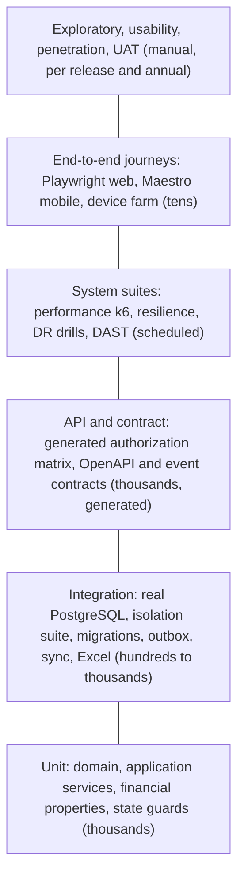
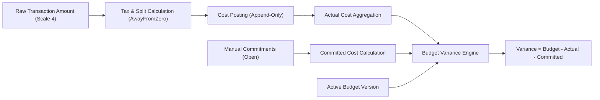
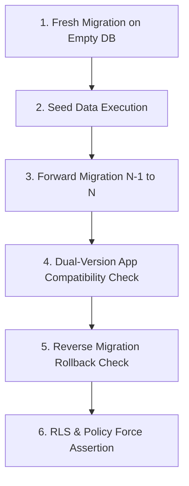
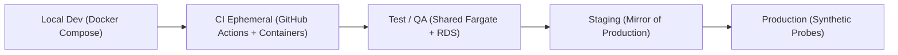
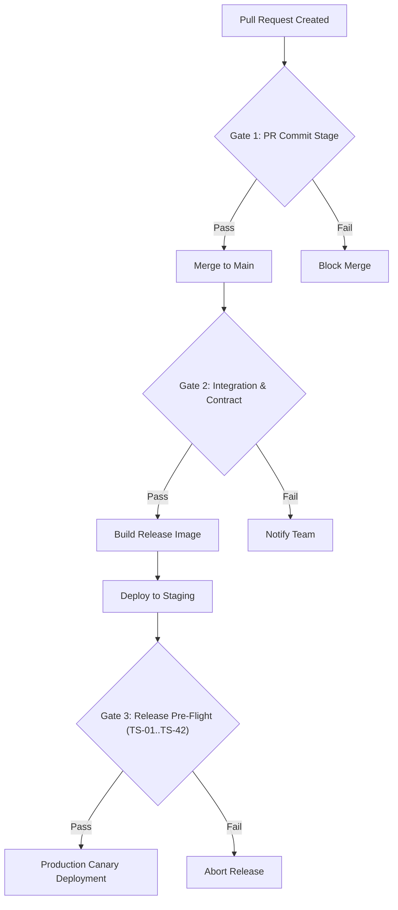
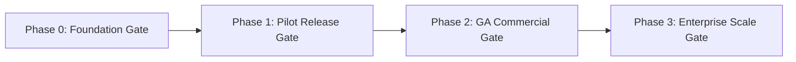

# Document 16: Testing Strategy

**Product:** SlateIQ — Production Cost Intelligence & Audit Monitoring Platform
**Document ID:** SLQ-ARCH-016
**Version:** 1.0.0
**Classification:** Internal — Architecture Foundation
**Status:** Draft — For Review
**Date:** 2026-11-06
**Authors:** Principal Quality Architect, Principal DevOps Architect, Security Engineering Lead
**Reviewers:** Principal Architect (TBD), Finance SME (TBD), Audit SME (TBD), Mobile Lead (TBD), Security Architect (TBD)

---

## Document Control

### Revision History

| Version | Date | Author | Change |
|---------|------|--------|--------|
| 1.0.0 | 2026-11-06 | Architecture Team | First issue. Test pyramid and ownership; every test type of the governing brief §22; test data management; environments; CI gates; critical release scenarios TS-01 to TS-42; exit criteria per release phase; defect severity policy; ADR-066 and ADR-067 |

### Related Documents

| Document | Relationship |
|----------|--------------|
| Document 1 — Product Vision & Business Requirements | Requirements under test (FR, NFR, BR), use cases UC-01 to UC-12, business acceptance criteria BAC-001 to BAC-015 and pilot gates G1 to G12 (§17) |
| Document 2 — Domain Model & Capability Map | Bounded contexts and capabilities CAP-001 to CAP-026 (§3, §4) |
| Document 3 — Actor, Permission, Tenancy & Identity | Test principles, levels, isolation suite (§16.5), authorization matrix (§16.6), grant, session and contract tests (§16.7 to §16.9), load scenarios LT-4-01 to LT-4-12 (§14.8), test tenants (§16.13) |
| Document 4 — Core Business Workflows & State Machines | SM-01 to SM-19 and WF-01 to WF-20, the authority for every transition tested in §4.8 |
| Document 5 — Business Rules & Invariants Catalogue | INV and POL identifiers asserted by domain tests |
| Document 6 — High-Level Solution Architecture | Performance plan (§11.7), chaos programme (§12.8), sync test strategy (§9.8), security assurance (§13.11), pipeline stages (§15.4) |
| Document 9 — API Architecture | Error codes asserted by denial and forbidden-transition tests |
| Document 10 — Security Architecture | Security controls SC-nn verified by §4.14 |
| Document 11 — Mobile & Offline Architecture | Device data model and sync behaviour verified by §4.11 |
| Document 12 — Excel Integration Architecture | Template and validation behaviour verified by §4.12 |
| Document 13 — Analytics & Cost Calculation Architecture | Measure definitions and golden datasets used by §4.13 |
| Document 15 — Infrastructure & Deployment Architecture | Environments, pipelines and gates that run these tests; DR drills (§15.7) |

### Conventions

| Convention | Meaning |
|------------|---------|
| `TS-nn` | Critical release scenario; all must pass before a production release (§8) |
| `S1` to `S4` | Defect severity (§10); distinct from incident severity `SEV-1` to `SEV-4` (Document 6 §14.8) |
| "Real database" | PostgreSQL 17 with the production migration set, RLS enabled and forced, connected as `slateiq_test_app` through PgBouncer in transaction mode |
| `A16-nn`, `OQ-16-nn`, `R16-nn`, `RC-16-nn` | Assumptions, open questions, risks and reconciliation notes raised here |

---

## 1. Purpose and Scope

This document defines how SlateIQ proves, before every production release, that it computes money correctly, isolates tenants, enforces authority, survives offline work and failures, and meets its performance targets. It is the contract between the engineering teams, the release managers and the business acceptance owners: a release that has not produced the evidence described here does not ship.

It consolidates Document 3 §16 (identity, tenancy and authorization testing) and Document 6 §9.8, §11.7, §12.8 and §13.11, and extends them to every module and to the business domain. It does not repeat those sections; it references them and adds what they lack: domain, financial, workflow, Excel, offline, migration and recovery testing, test data, release scenarios, exit criteria and defect policy.

Out of scope: user-acceptance script content (Document 1 §17.5 and the delivery backlog), penetration-test methodology (Document 10), and production monitoring (Document 14).

---

## 2. Principles

Document 3 §16.1 principles apply to every module. This document adds the following.

1. **Money is tested with properties, not examples alone.** An example proves one sum; a property proves the rule for every generated input. Financial code is tested both ways, plus against the golden datasets of Document 13.
2. **Every catalogue generates its tests.** Routes, permissions, tables, state machines, commands that must audit, error codes and Excel template columns are catalogued; the corresponding suites are generated from the catalogue, so a new route, table or transition without a test fails the build (ADR-066).
3. **The illegal path is the important path.** For every allowed transition, permission or input there is a test for its forbidden neighbours.
4. **Synthetic data only.** No production data, copy or anonymized snapshot enters any test environment (ADR-067).
5. **Production-shaped, not production-copied.** Volume, distribution and skew are generated to match the workload model of Document 6 §11.1.
6. **Real infrastructure at the integration boundary.** PostgreSQL, PgBouncer, Redis, object storage and the malware scanner run as containers in tests; only third-party internet services (email provider, FX source, app stores) are simulated.
7. **Deterministic and reproducible.** Seeds, clocks and identifiers are injectable; a failing test reproduces from its seed.
8. **Evidence by control.** Results are retained and indexed by control area for SOC 2 sampling (Document 3 §16.15).

---

## 3. Test Pyramid and Ownership

### 3.1 Pyramid

| Layer | Approximate share of tests | Typical runtime | Runs |
|-------|---------------------------:|-----------------|------|
| Unit (domain, application, financial properties) | 55% | < 5 minutes for the solution | Every commit and pull request |
| Integration (database, isolation, migrations, outbox, sync, Excel) | 25% | 10–20 minutes, parallel by module | Every pull request |
| API and contract (authorization matrix, contracts) | 15% (generated) | 10–15 minutes | Every pull request |
| End-to-end (web, mobile emulators) | 4% | 15–30 minutes | Critical tags on merge; full set nightly |
| System (performance, resilience, DR, DAST) | 1% | Hours | Nightly, weekly, before release, quarterly |
| Manual (exploratory, usability, accessibility audit, penetration, UAT) | — | Days | Per release and per phase |

**Why the generated layer is wide.** The authorization matrix (route × actor × tenant × object × state) and the isolation suite (table × assertion) are large because the security surface is large. They are generated and run in parallel, so their size costs CI minutes, not engineering time.

### 3.2 Ownership

| Test type | Owner | Reviewer of the suite |
|-----------|-------|-----------------------|
| Domain unit, application service | Module team | Module tech lead |
| Database integration | Module team | Data Architect for constraints, partitions and policies |
| Isolation suite, authorization matrix | Security engineering | Security Architect |
| API and contract | Platform team | API owner (Document 9) |
| Authentication and sessions | Identity module team | Security engineering |
| State machine and workflow | Module team owning the machine | Domain Architect (Document 4) |
| Concurrency and idempotency | Platform team with module teams | Principal Architect |
| Offline sync | Mobile team and Sync module team | Mobile Lead |
| Excel | Excel module team | Finance SME for golden files |
| Financial calculation | Intelligence and Expense teams | Finance SME for golden datasets and properties |
| Security testing | Security engineering | Security Architect |
| Performance | Performance engineering | SRE Lead |
| Migration | Module team plus Data Architect | Data Architect |
| Backup, restore, failure and recovery | SRE | SRE Lead, Compliance for evidence |
| End-to-end and UAT | QA and Product | Product Owner |

**Definition of done for a story** includes: unit and integration tests for the change, generated suites green (new routes, tables or transitions covered by declaration), and for financial or security changes a second reviewer (Document 6 §15.4).

---

## 4. Test Types

Each subsection states purpose, technique, environment, cadence, and pass criteria. Tooling follows Document 6 §6.2 (xUnit, Testcontainers, Verify, Playwright, k6) plus the additions noted.

### 4.1 Domain Unit Tests

| Aspect | Design |
|--------|--------|
| Scope | Aggregates, value objects, domain services and invariants of every module; `Money` operations; rounding helpers; state guards; approval resolution; scope algebra (Document 3 §16.3) |
| Technique | Pure in-process tests with no I/O; injected clock; invariant identifiers from Document 5 named in test names (`INV-nnn`) so a failing test reports the broken invariant |
| Coverage | ≥80% line coverage on critical-path assemblies (NFR-MNT-003); 100% branch on state guards, approval resolution, SoD evaluator, scope algebra (Document 3 §16.3) |
| Mutation | PDP, scope algebra, `Money`, rounding, cost posting and variance calculators: mutation score ≥85%; a surviving mutant in a denial or rounding path is a release blocker |
| Examples | Expense header equals sum of lines; split allocations sum to 100% (BR-EXP-012); negative amounts only for credit, reversal or correction with a reference (BR-FIN-008); approved records immutable (BR-FIN-009); delegation ≤90 days; self-approval rejected (BR-EXP-005) |

### 4.2 Application Service Tests

| Aspect | Design |
|--------|--------|
| Scope | Command and query handlers with their pipeline: validation, authorization decision, idempotency, transaction, audit write, outbox write |
| Technique | Handlers run in process against a real PostgreSQL container (not mocks for persistence); external ports (email, FX, scanner, object store) replaced by in-memory fakes with recorded calls |
| Assertions per command | Correct state change; exactly one business audit event with actor, organization, action, entity, previous and new state, correlation ID and source (governing brief §20, NFR-AUD-001, NFR-AUD-004); expected outbox events with matching correlation ID; no audit or outbox row on failure (single transaction, Document 6 §12.9) |
| Audit completeness | A command inventory marks each command `material` or `non-material`; a generated test executes every material command and fails if no audit event is written (ADR-066) |

### 4.3 Database Integration Tests

| Aspect | Design |
|--------|--------|
| Engine | PostgreSQL 17 Testcontainers image matching the managed engine minor version; extensions as in production |
| Role | Tests connect as `slateiq_test_app`, which mirrors `slateiq_app`: no superuser, no `BYPASSRLS`, no ownership (Document 3 §7.3). A guard test fails the run if the connected role has any of those attributes |
| Pooling | Through PgBouncer in transaction mode, so `SET LOCAL` scoping and the ban on session state are exercised |
| Schema | Production migration set applied by `slateiq_migrator`; never `EnsureCreated` |
| Coverage | Composite foreign keys within a schema `(org_id, parent_id)`; no cross-schema foreign keys (RC-02 of the authoring brief) with the nightly orphan reconciliation tested by seeding an orphan; unique business keys; check constraints on `numeric(19,4)` and `numeric(19,6)`; append-only triggers on `expense.cost_posting`, `compliance.audit_event`, `docs.document_access_log`; partition routing and pruning for partitioned tables (Document 6 §6.6) |
| Query budgets | Query count per handler asserted (N+1 prevention, Document 6 §11.4); `EXPLAIN` of the top 20 queries asserts index use on `org_id`-leading indexes |
| Isolation | Each test runs in a transaction rolled back at the end, or in a fresh database for state-machine and partition suites |

### 4.4 API and Contract Tests

| Aspect | Design |
|--------|--------|
| API tests | In-process host with the full middleware pipeline against real dependencies; every route exercised for success, validation failure (`422` with field errors), authorization failure, not found, and conflict |
| Contract tests | Document 3 §16.9: OpenAPI diff, error-code coverage, event schema validation and backward compatibility, ProblemDetails (RFC 9457), cursor pagination, Idempotency-Key and ETag semantics |
| Client contracts | Web and mobile compile against the regenerated `@slateiq/api-client`; a breaking change to a field they use fails their pipelines (Document 15 §7.5) |
| Money on the wire | Every money field is a decimal string with a currency code; a schema test rejects any number-typed money field |
| Error registry | Every code in `contracts/errors/registry.yaml` is emitted by at least one test; an unused code or an undocumented emitted code fails the build |
| Fuzzing | Weekly schema-driven API fuzzing against `test`: no `5xx`, no stack trace or SQL in responses, no foreign identifiers in errors (Document 6 §13.11) |

### 4.5 Authentication Tests

Document 3 §16.8 is the catalogue (refresh rotation and reuse detection, idle and absolute timeouts, logout-all, device binding, lockout, password reset, TOTP replay, step-up, break-glass). This document adds:

| Test | Assertion |
|------|-----------|
| MFA coverage | Every privileged role and every external auditor grant profile requires MFA; generated from the role catalogue (NFR-SEC-003) |
| Token signing | Tokens signed by the regional KMS key verify with the published key set; tokens from another region or environment are rejected |
| Cookie properties | `__Host-slateiq_rt` is `Secure`, `HttpOnly`, `SameSite=Lax`, no `Domain` (Document 3 §4) |
| Suspended tenant | Any request for a member of a suspended tenant returns `403 TENANT_SUSPENDED` within 60 seconds of suspension (Document 3 §2.9.2) |
| Offline authentication bound | The mobile app refuses offline unlock after 7 days and requires biometric or passcode (NFR-MOB-004) |

### 4.6 Authorization Matrix

The matrix of Document 3 §16.6 is generated from the OpenAPI route inventory and the permission catalogue (Document 3 Appendix A). Dimensions: route; actor (each of the 18 roles, a custom role, each grantee profile `AUDIT_READ`, `AUDIT_EVIDENCE`, `AUDIT_FINANCE`, platform operator, service account, anonymous); tenant (own, foreign, suspended, archived); object (in scope, out of scope same tenant, foreign tenant, non-existent); state (active, suspended, expired, revoked, draft).

| Rule | Detail |
|------|--------|
| Pruning | Full Cartesian product is pruned by equivalence classes defined in the generator (for example, every role lacking the route's permission is one class with one representative per scope type), and every class has at least one executed case |
| Expected results | `200` or `201`, `403` with a named code, `404` for foreign-tenant objects (never `403`), `409`, `410` (Document 3 §16.6) |
| SoD and limits | Approval routes add dimensions: amount below, at and above the approver's limit; delegated authority; submitter equals approver (BR-EXP-005) |
| Step-up | Keys marked step-up in Appendix A are tested with a fresh and an expired assertion |
| Grant revocation | Mid-session revocation denies within 5 minutes; 99% within 60 seconds (Document 3 §16.7) |
| Gate | 100% pass on every pull request (Document 3 §16.14) |

### 4.7 Tenant Isolation Suite

Document 3 §16.5 defines the database-level suite generated from the schema (twelve assertions per tenant table, policy inventory, policy canary, restore isolation). This document extends isolation testing to every path a tenant's data can travel.

| Path | Test |
|------|------|
| Every tenant table (Document 3 Appendix D) | Generated suite of Document 3 §16.5, run as `slateiq_test_app` |
| API | Authorization matrix foreign-tenant object class returns `404` on every route |
| Search | Full-text and trigram search under tenant A never returns tenant B rows even with identical terms |
| Read models | `intel` facts and dashboards under tenant A context contain no B contribution; portfolio aggregates for a commissioner include only its own and explicitly granted shows (Document 2 §2.3) |
| Object storage | Presigned URL for a B object cannot be produced under A context; a forged key path with A's session tag is refused by storage (Document 15 §6.3) |
| Cache | Keys are prefixed `{env}:org:{org_id}`; a test that writes under A and reads under B returns a miss |
| Exports and reports | Manifest `org_id` equals the context; a mixed-tenant result aborts (Document 3 §7.6) |
| Notifications and digests | Rendered payloads for an A recipient contain only A data |
| Telemetry | Log, trace and metric samples from the suite contain no amounts, names, emails or document titles; `org_id` only where allowed (NFR-OBS-004) |
| Sync | A device of tenant A pulling with a cursor forged from B receives nothing from B |
| Jobs | A job claimed for tenant A sets A's context; a job without context fails (Document 3 §10.11) |
| Dedicated cells | The full suite runs against each cell, with a second synthetic tenant inserted for the run (Document 15 §14.2) |

**Gate.** Merge-blocking (Document 3 §16.14) and run again after every deployment against `test`, `staging` and production synthetic tenants (post-deploy probe).

### 4.8 Workflow and State-Machine Tests

**Generation.** Each state machine in Document 4 is declared in code as a transition table (from state, event, guard, to state, required permission, audit action, outbox events). The generator builds the full matrix of states × events. Every allowed cell produces tests for the guard satisfied and each guard condition violated; every other cell produces a forbidden-transition test. A transition table that diverges from Document 4 is a defect in the code or the document and is resolved through Document 4's change control.

| Cell type | Assertions |
|-----------|------------|
| Allowed, guard satisfied | New state persisted; ETag changed; exactly one audit event with previous and new state; declared outbox events written; side effects (cost postings, notifications) as specified |
| Allowed, guard violated | Rejected with the guard's specific error code (Document 9); state, ETag, audit and outbox unchanged |
| Forbidden | Rejected with `409` and the machine's invalid-transition code; no state change, no business audit event, no outbox event; an attempted forbidden transition on a financial record writes a security event when it originates from an API call |
| Terminal states | Every event from a terminal state is forbidden |
| Concurrent transitions | See §4.9 |

| Machine | States | Cells (states × events, from Document 4) | Transitions of special interest (illustrative; Document 4 is authoritative) |
|---------|-------:|-------------------------------------------|---------------------------------------------------------------------------|
| SM-01 Organization | 8 | Generated | `PURGED` terminal; `PURGING` reachable only from `PENDING_DELETION`; activation only after the isolation probe |
| SM-02 Show | 7 | Generated | Closure path through SM-14; `CANCELLED` and `ARCHIVED` reject financial events |
| SM-03 Budget container | 4 | Generated | `FROZEN` rejects new versions |
| SM-04 BudgetVersion | 7 | Generated | Only one `ACTIVE` version per budget; `SUPERSEDED` terminal |
| SM-05 FinancialPeriod | 4 | Generated | `LOCKED` to `OPEN` forbidden; reopening goes to `REOPENED`; locked periods reject create, amend, approve and import (BR-BUD-009) |
| SM-06 Vendor | 6 | Generated | `BLOCKED` vendor not selectable (BR-EXP-013); `MERGED` is Phase 1 |
| SM-07 ManualCommitment | 6 | Generated | Consumption by expense lines; `CLOSED`, `CANCELLED`, `EXPIRED` stop counting as committed (BR-FIN-006) |
| SM-08 AuditAssignment | 6 | Generated | `REVOKED` ends scope; only the appointing party revokes platform appointments (BR-AUD-006) |
| SM-09 Expense revision | 7 | Generated | Amendment creates a new revision; prior approved revision becomes `SUPERSEDED` only when the new one is approved; cancellation of an approved revision posts reversals in the event period (BR-EXP-010) |
| SM-10 AuditReport | 5 | Generated | `ACCEPTED` immutable; correction by superseding report |
| SM-11 AuditFinding | 6 | Generated | `CLOSED` requires a response or a recorded reason |
| SM-12 Document and evidence | 7 + 3 | Generated | `PENDING_SCAN` to `AVAILABLE` only on a clean scan; `QUARANTINED` never served; `DISPUTED` evidence blocks final approval (UC-07) |
| SM-13 ApprovalInstance and step | 6 + 5 | Generated | Chain fixed at submission (BR-EXP-007); no step skipped except by configured rule |
| SM-14 ShowClosure | 6 | Generated | `BLOCKED` while blocking conditions exist |
| SM-15 Exception | 5 | Generated | Reopen returns to `OPEN`; `WAIVED` requires authority and reason |
| SM-16 AlertInstance | 5 | Generated | `ESCALATED` Phase 1 |
| SM-17 ImportBatch | 14 | Generated | `COMMITTED` cannot return to validation; reversal through `REVERSAL_PENDING` to `REVERSED` (BR-XLS-006) |
| SM-18 Notification | 9 | Generated | `SUPPRESSED` for suspended tenants' business notifications (Document 3 §2.9.2) |
| SM-19 Job and outbox event | 6 | Generated | `DEAD` after the maximum attempts; replay only by `ops.job.update` |
| Grant (Document 3 §8.2) | 8 | Document 3 §16.7 | By reference |
| User identity (Document 3 §3.4) | By reference | Document 3 §16.8 | By reference |
| ExportJob | 5 | Generated | `EXPIRED` outputs no longer downloadable |

**Workflow tests.** Each workflow WF-01 to WF-20 of Document 4 has an end-to-end integration test that drives the participating machines through the main path and every documented alternative and exception path, asserting the cross-machine effects (for example, expense approval moves SM-13 and SM-09 together and writes cost postings). UC-01 to UC-12 of Document 1 are covered at the end-to-end layer (§4.19).

### 4.9 Concurrency Tests

Concurrency tests use real PostgreSQL and deterministic interleaving: each competing operation pauses at a named barrier inside its transaction, and the test releases barriers in every relevant order.

| Race | Expected outcome |
|------|------------------|
| Two approvers act on the same approval step | Exactly one decision recorded; the other receives `409 CONCURRENCY_STALE` or the step's terminal-state error |
| Approval while the submitter amends | Either the approval applies to the revision it saw, or it fails with a stale ETag; never an approval of an unseen revision |
| Approval committed while the period is being locked | The period lock either precedes (approval rejected, BR-BUD-009) or follows (approval and its postings fall in the period before lock); no posting into a `LOCKED` period |
| Two budget revisions activated concurrently | One `ACTIVE` version; the other rejected |
| Two devices edit the same draft expense | Conflict per the matrix of Document 6 §9.4 |
| Duplicate detection under concurrent submission of identical expenses | Both flagged per BR-EXP-006; neither silently merged |
| Commitment consumed by two expense lines beyond its remaining amount | Consumption is serialized per commitment; over-consumption is flagged per Document 5 policy, never lost |
| Outbox dispatch by many workers | Each event claimed once per attempt with `FOR UPDATE SKIP LOCKED`; per-aggregate order preserved (Document 6 §6.7) |
| Audit chain head contention | Chain remains linear and verifiable under 200 concurrent writers in one tenant |
| Grant revocation during a long export | Export aborts or excludes data after revocation, per Document 3 §8 |
| Import commit while a user edits a referenced vendor | Rows validate against a consistent snapshot; changes in between cause row-level revalidation, not partial corruption |

**Lost-update guard.** Every mutable financial resource requires `If-Match`; missing returns `428`, stale returns `409 CONCURRENCY_STALE` (Document 3 §16.9). A generated test checks every mutating route of a financial resource for both.

### 4.10 Idempotency Tests

| Mechanism | Test |
|-----------|------|
| `Idempotency-Key` on POST | Same key and body replays the original response; same key, different body returns `409`; key reuse across tenants is independent; keys expire per policy |
| Sync mutations | Every mutation replayed three times yields one record and an identical result (Document 6 §9.8) |
| Outbox consumers | Every consumer receives each event twice and out of order; `ops.inbox_dedup` prevents a second effect (NFR-INTG-001) |
| Notifications | `notification_id` as provider idempotency key; a retried send does not produce a second email within the suppression window |
| Excel | Re-upload of a committed file hash requires explicit confirmation (BR-XLS-003); a resumed commit does not duplicate chunks |
| Provisioning | Re-running a completed run returns the existing tenant; a partial run resumes without duplicating roles or reference data (Document 3 §2.9.1) |
| Evidence upload | Re-confirming an upload with the same SHA-256 links the existing document version |
| Cost postings | Re-processing an approval event never posts twice; a unique key on the posting source prevents it |

### 4.11 Offline Sync Tests

The mobile client offline engine (Document 11 §4, Document 6 §9) operates on an optimistic local SQLite store (`SQLCipher`) and synchronizes via a two-way mutation log. Testing must verify that on-ground expense entries, camera attachments, and assignment caching remain robust under unpredictable connectivity, app force-kills, and concurrent edits.

| Scenario | Injected Condition | Expected Behavior & Assertions |
|----------|-------------------|--------------------------------|
| Normal Bi-directional Sync | Online transition with pending local drafts and remote updates | Local dirty mutations pushed in transaction sequence; remote deltas pulled using `cursor`; local database updated without data loss (NFR-MOB-001) |
| Conflict on Approved Record | Client attempts mutation on an expense already approved on web | Server rejects with `409 EXPENSE_ALREADY_APPROVED`; client rolls back local modification, notifies user, and saves edit as a new draft clone (Document 6 §9.4) |
| Conflict on Concurrent Draft | Two devices edit same draft record | Last write wins based on `device_timestamp` if non-conflicting fields; field-level three-way merge executed; conflicting fields flagged for user resolution |
| 7-Day Offline Hard Limit | Device offline for 7 days + 1 hour (NFR-MOB-004, D-015) | Local UI enters locked mode; creation of new expenses blocked; cached biometric authentication invalidated; mandatory online re-authentication triggered |
| Storage & Queue Quotas | Local mutation queue reaches 500 items or 500 MB attachments (D-015) | Application displays graceful warning; blocks further receipt photo capture while allowing zero-attachment text notes; prioritizes queued text sync |
| Mid-Transfer Network Drop | Wi-Fi dropped while uploading a 15 MB receipt image chunk | Chunked resumable upload pauses; on network restore, upload resumes from last acknowledged byte offset; no duplicate object created in S3 |
| Mid-Sync App Termination | Process killed during mutation batch commit on server | Server-side transaction rollbacks cleanly; on app restart, sync protocol replays with same `batch_id`; server idempotency handles partial processing |
| Session Expiry During Sync | JWT access token expires during sync handshake | Sync engine catches `401`; pauses mutation queue; triggers silent refresh token rotation; resumes batch push without user disruption |
| Offline Photo Integrity | Camera image captured while device is offline | Image encrypted immediately via SQLCipher / local keystore; SHA-256 computed locally; checksum verified by backend before linking to expense |

### 4.12 Excel Integration Tests

The Excel ingestion and export engine (Document 12 §4, Document 6 §10) bridges traditional production accounting with the centralized platform. Excel testing validates both workbook import pipelines (chunking, validation, error mapping, reversals) and export report fidelity.

| Area | Test Execution | Pass Criteria |
|------|----------------|---------------|
| Header Normalization & Aliases | Ingest workbooks with varied column headers (e.g., `Amt`, `Total Amount`, `GROSS_AMOUNT`, `Line Amount`) | Document 12 §5.2 alias dictionary maps headers correctly to canonical domain schema; unrecognized mandatory columns fail batch with clear diagnostic message |
| Formula & Macro Sanitization | Ingest files containing `=cmd|' /C calc'!A0`, `@SUM(...)`, DDE links, and VBA macro payloads | Scanner strips macros, rejects active content, escapes leading formula characters (`=`, `+`, `-`, `@`); zero arbitrary code execution risk |
| Domain Rule Parity (ADR-011) | Submit invalid rows (missing vendor, negative amount without credit note, future dates beyond threshold) | Shared domain validation engine rejects invalid rows with identical error codes (`ERR-EXP-004`, `ERR-VEN-002`) as API and UI routes |
| Pre-Commit Preview & Staging | Upload 2,000-row production budget workbook | Batch moves to `PARSING` -> `VALIDATING` -> `AWAITING_COMMIT_APPROVAL`; preview report aggregates total lines, sum of debits/credits, and validation errors |
| Chunked Commit Atomicity | Process 10,000-line expense import divided into 500-line transactional chunks | Each chunk commits within its own database transaction; failure in chunk 8 pauses batch at `PARTIALLY_COMMITTED`; allows selective error correction or complete rollback |
| Batch Reversal (BR-XLS-006) | Execute batch reversal on a `COMMITTED` import batch | State moves through `REVERSAL_PENDING` to `REVERSED`; reverse cost postings generated in current financial period; original records marked superseded with audit trail |
| Export Visual & Data Parity | Generate Fortnightly Cost Summary and Show Variance Excel reports | Formulas evaluate accurately; freeze panes, styling, number formats match corporate templates; totals in Excel equal SQL aggregation queries to 4 decimal places |
| Golden File Suite | Run ingestion against 20 standardized industry historical workbooks (Movie Magic, SAP, Excel templates) | 100% parsing fidelity; deterministic mapping into `budget.budget_line` and `expense.expense_line` |

### 4.13 Financial Calculation & Golden Dataset Tests

Financial calculations form the core value of SlateIQ. Arithmetic must be exact, deterministic, and immutable once committed. Zero tolerance for floating-point inaccuracies or inconsistent rounding behavior across web, mobile, and backend.

#### Property-Based Financial Invariants

Using property-based testing (FsCheck / Bogus), financial engines are verified across 100,000 randomized permutations against the following invariants:

1. **Net Split Conservation:** For any expense with $N$ allocation splits, $\sum_{i=1}^{N} 	ext{split\_amount}_i = 	ext{expense.total\_net\_amount}$ exact to 4 decimal places (BR-EXP-012).
2. **Rounding Determinism (RC-01):** All rounding uses `MidpointRounding.AwayFromZero` on stored `numeric(19,4)` amounts and `numeric(19,6)` FX rates. No intermediate rounding before tax line sum.
3. **Posting Invariance:** Actual cost equals the exact scalar sum of all non-superseded `cost_posting` rows for an entity: $	ext{Actual}(S, D) = \sum 	ext{posting.amount}$ (BR-FIN-005).
4. **Variance Conservation:** $	ext{Variance} + 	ext{Actual} + 	ext{Committed} = 	ext{Current\_Active\_Budget}$ (Document 6 §8.10).
5. **Reversal Cancellation:** For any approved expense $E$, creating a reversal posting batch $R$ yields $	ext{NetImpact}(E + R) = 0.0000$.

#### Golden Datasets (GDS-01 to GDS-06)

| Dataset ID | Profile | Focus & Expected Output |
|------------|---------|-------------------------|
| **GDS-01** | Multi-Currency International Shoot | 500 expenses in GBP, USD, EUR, INR; fixed historical exchange rates locked on submission; converted INR total verified against manual audit ledger to 4 decimals |
| **GDS-02** | Complex Split & Partial GST Credit | 250 catering and logistics invoices split across 5 production departments with 18% GST (50% eligible for input tax credit); tax ledger matches expected totals |
| **GDS-03** | Deep Amendment & Supersession Chain | 50 expenses amended 4 times each; verifying prior revisions marked `SUPERSEDED`; cost reversals posted in amendment periods; ledger balance exact |
| **GDS-04** | Over-Commitment & Negative Variance | PO commitment of $100,000 consumed by $115,000 of approved bills; system asserts commitment reduced to $0.00, flags $15,000 overrun alert (BR-FIN-006) |
| **GDS-05** | Financial Period Close & Locked Cutoff | Period `2026-10` locked; expenses dated `2026-10-31` submitted post-lock must be rejected; expenses approved post-lock must post into `2026-11` (BR-BUD-009) |
| **GDS-06** | Co-Production Cost Allocation (Topology H2) | Shared show cost split 60/40 between Broadcaster and Production House; cross-tenant cost allocations sum to exactly 100% without leakage |

### 4.14 Security Assurance Tests

Security testing guarantees tenant isolation, boundary defense, cryptographic rigor, and adherence to the controls documented in Document 10 (Security Architecture).

| Test Stream | Methodology & Tooling | Scope & Pass Criteria |
|-------------|----------------------|-----------------------|
| Static Analysis (SAST) | Semgrep, Roslyn Analyzers, SonarQube in CI pipeline | 100% clean of OWASP Top 10 vulnerabilities; zero SQL injection, path traversal, or hardcoded secret flaws |
| Software Composition (SCA) | Trivy, GitHub Dependabot, Snyk | Zero High or Critical CVEs in NuGet packages, npm packages, or base container images |
| Secret Leakage Prevention | Gitleaks run pre-commit and on CI push | Merge blocked if any private key, API secret, password, or cloud credential token is detected |
| Dynamic App Security (DAST) | OWASP ZAP automated baseline and full scan against staging | No missing security headers (`CSP`, `HSTS`, `X-Frame-Options`, `X-Content-Type-Options`), zero reflected/stored XSS, no CORS wildcards |
| RLS Leakage Canary Probe | Scheduled probe script executing as `slateiq_app` | Script attempts cross-tenant query without `SET LOCAL app.current_org_id`; must throw `42501 permission_denied` or `tenant_context_not_set` |
| Presigned URL Tamper Test | Modifying S3 query parameters or headers on presigned URLs | Cloud object store rejects modified expiration, altered path, or cross-tenant key access with `403 Forbidden` |
| Brute Force & Rate Limiting | K6 firing 200 invalid login attempts/sec | Redis rate limiter triggers HTTP `429 Too Many Requests` after 5 attempts; IP lockout engaged for 15 minutes |
| Penetration Testing | Annual third-party grey-box penetration testing | All critical and high findings remediated before production release; report archived for SOC 2 Type II audit |

### 4.15 Performance, Load & Stress Tests

Performance testing enforces the latency and throughput SLAs defined in Document 6 §11 and Document 14 §4. Tests are executed against a dedicated staging environment configured with production-equivalent instance sizing.

| Scenario ID | Workload Profile | Target SLA / SLO |
|-------------|------------------|------------------|
| **LT-4-01** | 5,000 concurrent authenticated active users browsing show dashboards | p95 read latency < 200 ms; p99 < 500 ms; error rate < 0.01% |
| **LT-4-02** | Peak daily expense submission burst: 120 submissions/sec across 50 tenants | p95 write latency < 500 ms; zero lost submissions; 100% outbox event capture |
| **LT-4-03** | Keyset pagination traversal across 10,000,000 cost posting records | Execution time < 50 ms for any page fetch; query planner verifies index `ix_cost_posting_keyset` used |
| **LT-4-04** | 500 mobile field auditors synchronizing simultaneously post-connectivity restoration | Sync endpoint p95 response < 1,500 ms; no database lock timeouts or PgBouncer pool exhaustion |
| **LT-4-05** | Transactional outbox drain rate under 50,000 queued events | Outbox workers drain queue at > 1,000 events/sec; message latency from insert to dispatch < 2,000 ms |
| **LT-4-06** | Bulk Excel import: 15 simultaneous 5,000-row budget workbooks uploaded | Background worker processes, validates, and stages each batch within 45 seconds; CPU utilization < 75% |
| **LT-4-07** | 72-Hour Soak / Endurance Test under 1.5x nominal load | Memory footprint flat; zero DB connection leaks; Redis memory within maxmemory limits; disk I/O steady |

### 4.16 Database Migration & Rollback Tests

PostgreSQL 17 schema migrations are executed by `slateiq_migrator` (Document 15 §12). Every migration must support zero-downtime deployment (expand/contract pattern) and be fully reversible.

1. **Clean Installation Verification:** Migrations apply cleanly to an empty database, successfully creating all schemas (`tenancy`, `identity`, `prod`, `budget`, `vendor`, `auditops`, `expense`, `intel`, `docs`, `xls`, `notify`, `compliance`, `report`, `sync`, `ops`, `ref`).
2. **Upgrade Path Validation:** Migration suite applies upgrade from release `N-1` to `N` against a realistic snapshot; schema diff asserts zero unintended column alterations or dropped constraints.
3. **Rollback Safety:** Every forward migration file must have a verified down-migration; executing down-migration restores schema to `N-1` state without data corruption.
4. **Expand/Contract Isolation:** Release `N-1` code runs against the expanded schema `N` during deployment; regression suite verifies existing services operate with zero schema errors prior to container switch.
5. **RLS Policy Force Check:** Automated test queries `pg_tables` where `schemaname NOT IN ('pg_catalog', 'information_schema')`; asserts `rowsecurity = true` and `forcerowsecurity = true` for every tenant table (Document 3 Appendix D).

### 4.17 Backup, Restore & Disaster Recovery Drills

Data durability and rapid recovery under catastrophic infrastructure failure are validated through scheduled automated and manual drills (Document 15 §15.7, ADR-064).

| Drill Type | Frequency | Execution Protocol & Success Gate |
|------------|-----------|----------------------------------|
| Point-In-Time Recovery (PITR) | Weekly automated in CI/Recovery account | Automated job initiates restore of production RDS WAL logs to an isolated ephemeral instance at $T - 30\text{ min}$; runs database consistency checks; asserts RPO < 15 min; tear down instance |
| Daily Snapshot Restoration | Monthly | Snapshot restored in recovery account; synthetic audit validation script executes checksums across `compliance.audit_event` hash chains; verify 100% integrity |
| S3 Object Lock & Reversion | Quarterly | Test script attempts deletion of Object-Locked document in evidence bucket; AWS S3 API returns `AccessDenied`; cross-account replication sync verified |
| Full Cold-Site DR Simulation | Bi-annually | Simulate primary region loss (`ap-south-1`); activate Terraform in standby recovery account; restore database from cross-account vault; bring up ECS Fargate cluster; assert total RTO < 4 hours |

### 4.18 Chaos & Failure Recovery Tests

Resilience testing injects simulated infrastructure failures using Chaos Mesh / container disruption scripts to ensure graceful degradation and self-healing.

| Injected Failure | Target Component | Expected Self-Healing & Resilience |
|------------------|------------------|------------------------------------|
| Database Primary Failover | AWS RDS Multi-AZ failover | Application experiences momentary write pause (< 30 s); PgBouncer reconnects to new primary; read replicas handle read traffic; in-flight writes retry cleanly |
| Cache Outage | Kill Redis primary instance | API falls back to database for permissions/reference queries; session revocations check database token version; system operates in degraded mode without crashing |
| Worker Task Termination | `kill -9` on active Outbox Worker container | ECS Fargate launches replacement task; unfinished events locked with `SKIP LOCKED` release after timeout; sibling workers claim orphaned events with zero duplication |
| Network Latency Injection | 500 ms latency and 5% packet loss between App & S3 | Client upload switches to chunked retry with exponential backoff; circuit breaker trips before thread pool exhaustion |
| Poison Message Injection | Malformed JSON injected into transactional outbox | Consumer fails message; increments retry counter; after 5 attempts routes event to `ops.dead_letter`; pipeline continues processing subsequent events |

### 4.19 End-to-End & Acceptance Tests

End-to-end (E2E) automated journeys verify complete business workflows from user authentication through dashboard reconciliation across Web (Playwright) and Mobile (Maestro). All 12 business use cases (UC-01 to UC-12) and Business Acceptance Criteria (BAC-001 to BAC-015) from Document 1 §17 are fully covered.

| Test ID | Mapped Use Case | Journey Steps & Verification |
|---------|-----------------|-----------------------------|
| **E2E-01** | UC-01 Onboarding | Onboard new Production House tenant; create Show "Project Monsoon"; assign Org Admins; configure Indian Rupee (`INR`) base currency; verify tenant isolation |
| **E2E-02** | UC-02 Budget Baseline | Author draft budget across 4 departments; submit for approval; Finance Head reviews; approve budget; assert Budget container moves to `BASELINED` and version to `ACTIVE` |
| **E2E-03** | UC-03 Mobile Expense Capture | On-ground auditor opens mobile app; captures cash invoice photo; tags Art Department; enters amount; submits while simulated offline; verify sync on reconnection |
| **E2E-04** | UC-04 Expense Approval & Delegation | Accounts Executive approves initial tier; delegation active to Cost Controller; Cost Controller approves within limit; expense status moves to `APPROVED`; cost postings generated |
| **E2E-05** | UC-05 Overrun Detection | Submit invoice exceeding category budget threshold (115%); system accepts valid expense but triggers high-priority `CostOverrunAlert` to Production Admin and Finance Head |
| **E2E-06** | UC-06 Excel Fortnightly Reconciliation | Upload fortnightly cost accountant workbook; parse 800 rows; review error preview; resolve 2 unmatched vendors; commit batch; verify cost postings match Excel totals |
| **E2E-07** | UC-07 External Auditor Access | Grant `AUDIT_EVIDENCE` profile to third-party auditor firm; auditor logs in with MFA; inspects receipt photos; marks 1 receipt as `DISPUTED`; verify final approval blocked |
| **E2E-08** | UC-08 Audit Finding Resolution | Auditor raises audit finding `AF-042` on missing tax invoice; Production Coordinator responds with document upload; Auditor verifies and closes finding |
| **E2E-09** | UC-09 Financial Period Cutoff | Org Admin initiates closing of October period; period status moves to `LOCKED`; attempt to submit expense dated October 15 rejected with `ERR-BUD-009` |
| **E2E-10** | UC-10 Show Closure & Archival | Show shooting completes; initiate Show Closure workflow; verify all commitments closed and unapproved expenses resolved; Show status moves to `CLOSED` |
| **E2E-11** | UC-11 Executive Portfolio Dashboard | Management Viewer logs in; views cross-show portfolio summary; validates variance calculations across 6 shows; asserts no cross-tenant data leakage |
| **E2E-12** | UC-12 Cryptographic Audit Verification | Compliance Officer triggers full tenant audit export; cryptographic verifier validates SHA-256 hash chaining on all `compliance.audit_event` rows; 100% verified |

---

## 5. Test Data Management

### 5.1 Synthetic Production-Shaped Test Data Strategy (ADR-067)

To satisfy strict enterprise privacy regulations (DPDP Act, GDPR) and prevent leakage of proprietary entertainment budgets, **zero production data** is ever restored into, copied into, or processed within non-production environments.

1. **Domain Data Generators:** High-fidelity data generators built on top of Bogus and custom domain builders generate statistically representative data mirroring the volume, distribution, and skews defined in Document 6 §11.1.
2. **Realistic Entertainment Profiles:** Generators create realistic show types (OTT web series, feature films, episodic broadcast), standard department hierarchies (Direction, Art, Camera, Wardrobe, Catering, Post-Production), vendor pools with realistic GSTINs/VAT IDs, and multi-tier line item expenses.
3. **Deterministic Seeding:** All test generators accept an explicit integer seed. Test failures report the failure seed, allowing exact reproduction of data layouts in local developer environments.

### 5.2 Test Tenants and Lifecycles

Test databases maintain dedicated, isolated synthetic tenant environments:

| Tenant Code | Purpose | Configuration & Isolation |
|-------------|---------|---------------------------|
| `slq_test_t1` | Primary Feature Testing | Seeded with standard show, budget, active users, and baseline reference data |
| `slq_test_t2` | Cross-Tenant Isolation Target | Used as the foreign tenant target to prove isolation suites return `404` or `403` |
| `slq_test_canary` | Continuous Production Health | Synthetic tenant in production; runs read-only health checks and canary transactions |
| `slq_test_ephemeral` | CI Dynamic Integration Runs | Dynamically provisioned per pull request pipeline run; torn down after execution |

---

## 6. Test Environments & Infrastructure

| Environment | Purpose | Infrastructure Stack | Persistence & Data |
|-------------|---------|----------------------|--------------------|
| **Local Dev** | Fast feedback during developer authoring | Docker Compose: PostgreSQL 17, Redis 7.4, Azurite/LocalStack S3 | Ephemeral local volume; seeded on startup |
| **CI Ephemeral** | Automated merge-gate verification | GitHub Actions runners hosting Testcontainers | In-memory / temporary containers; destroyed on run completion |
| **Test / QA** | Continuous integration testing of merged features | AWS ECS Fargate, RDS PostgreSQL Multi-AZ (db.m6g.large), ElastiCache | Persistent synthetic dataset; reset weekly |
| **Preview** | Feature-branch web/API preview environments | Ephemeral ECS Fargate tasks with dedicated database schemas | Created on PR label; destroyed on PR merge |
| **Staging** | Production pre-flight, performance & UAT testing | 1:1 architectural replica of production AWS regional stack | Sanitized full-volume synthetic dataset (10M rows) |
| **Production** | Real-time production monitoring & sanity probes | AWS Production Cluster (`ap-south-1` / `eu-central-1`) | Dedicated synthetic canary tenant (`slq_test_canary`) |

---

## 7. CI/CD Quality Gates & Automated Pipelines

Quality gates are automated within GitHub Actions workflows (Document 15 §11) to prevent defective or unverified code from advancing through deployment stages.

### 7.1 Pipeline Stages & Execution Matrix

| Pipeline Stage | Triggers | Executed Test Suites | Blocking Criteria |
|----------------|----------|----------------------|-------------------|
| **Gate 1: Commit / PR** | Every commit pushed to pull request | L1 Unit tests, L2 DB Integration, Generated Auth Matrix, SAST, Gitleaks, Linting | Any test failure; coverage < 80%; any surviving mutant in financial/PDP logic |
| **Gate 2: Main Branch** | Merge to `main` branch | L3 API contract diff, Event schema compatibility, Container CVE scan, DB migration test | Any breaking API change without version bump; any Critical/High container vulnerability |
| **Gate 3: Nightly** | Scheduled 01:00 UTC daily | Full regression suite, Performance benchmark k6, API fuzzing, 72-hr soak check | Regression failure; p95 latency degradation > 10% against baseline |
| **Gate 4: Pre-Release** | Release tag creation | Critical Release Scenarios **TS-01 through TS-42**, Full E2E Playwright/Maestro, DR drill | 100% pass rate required on all 42 Critical Release Scenarios; zero open S1/S2 defects |

---

## 8. Critical Release Scenarios (TS-01 to TS-42)

Every production release candidate must achieve a **100% pass rate** on the following 42 Critical Release Scenarios before deployment authorization. Zero waivers are permitted for scenarios TS-01 through TS-42.

| Scenario ID | Category | Scenario Name | Test Assertion & Success Condition | Requirements & Invariants |
|-------------|----------|---------------|-----------------------------------|---------------------------|
| **TS-01** | Isolation | Cross-Tenant Direct Query Block | Authenticated query under Tenant A attempting explicit read on Tenant B ID returns `404 Not Found` | FR-TNT-015, INV-004 |
| **TS-02** | Isolation | Unset Session Context Rejection | Database query executing without `app.current_org_id` configured throws immediate exception and terminates | ADR-002, Document 3 §7 |
| **TS-03** | Isolation | Storage Presigned URL Cross-Access | S3 presigned URL generated for Tenant A document requested by Tenant B session is rejected | SC-08, Document 15 §6 |
| **TS-04** | Isolation | Cache Namespace Leak Prevention | Cache write under Tenant A never accessible or readable under Tenant B prefix | NFR-SEC-004, INV-005 |
| **TS-05** | Isolation | Cross-Tenant Export Containment | Bulk export job verifies all included entities strictly match executing `org_id` | Document 3 §7.6 |
| **TS-06** | Isolation | Dedicated Cell Routing Integrity | Request intended for Dedicated Cell routing table correctly dispatches with zero shared-tier bleed | ADR-065, Document 15 §14 |
| **TS-07** | Auth & SoD | Privileged Role MFA Enforcement | Privileged roles (`ORG_ADMIN`, `FINANCE_HEAD`) attempting login without MFA step-up are denied | NFR-SEC-003, POL-002 |
| **TS-08** | Auth & SoD | Refresh Token Reuse Detection | Replaying an already-used refresh token immediately revokes the entire token family and invalidates session | SC-03, Document 3 §4 |
| **TS-09** | Auth & SoD | Submitter Self-Approval Prohibition | User submitting an expense cannot approve it at any stage in the approval workflow | BR-EXP-005, SOD-01 |
| **TS-10** | Auth & SoD | Approver Amount Limit Ceiling | Approver attempting approval of an expense exceeding their assigned financial threshold is rejected | BR-EXP-008, FR-TNT-020 |
| **TS-11** | Auth & SoD | Expired Delegation Revocation | Approval attempted under delegation whose valid window has expired is denied with `403` | BR-ACC-004, SM-13 |
| **TS-12** | Auth & SoD | Auditor Scope Boundary Violation | Auditor assigned to Show A attempting access to Show B expenses is denied with `403 Forbidden` | FR-TNT-014, CAP-003 |
| **TS-13** | Financial | Half-Up Rounding Fidelity | Line item tax, split distribution, and currency conversions round half-up (`AwayFromZero`) | RC-01, BR-FIN-002 |
| **TS-14** | Financial | Zero Floating-Point Precision Loss | Decimal arithmetic asserts storage scale 4 and rate scale 6 with zero binary float drift | INV-001, ADR-037 |
| **TS-15** | Financial | Cost Posting Append-Only Invariant | Direct update or delete attempted on `expense.cost_posting` table fails with database trigger exception | BR-FIN-005, INV-003 |
| **TS-16** | Financial | Committed Cost Reduction on Expense | Expense approval correctly reduces associated open manual commitment balance | BR-FIN-006, WF-08 |
| **TS-17** | Financial | Locked Period Mutation Rejection | Expense submission, edit, or approval dated in a `LOCKED` period is rejected with `ERR-BUD-009` | BR-BUD-009, SM-05 |
| **TS-18** | Financial | Exact Net-Split Conservation | Sum of department splits equals total expense net amount to exactly 4 decimal places | BR-EXP-012, INV-002 |
| **TS-19** | State Machine | Active Budget Version Exclusivity | Activating a new budget version automatically and atomically transitions prior active version to `SUPERSEDED` | SM-04, WF-04 |
| **TS-20** | State Machine | Blocked Vendor Selection Denial | Attempt to submit expense against a vendor in `BLOCKED` status is rejected | BR-EXP-013, SM-06 |
| **TS-21** | State Machine | Disputed Evidence Approval Block | Final expense approval blocked while any attached evidence link remains in `DISPUTED` state | UC-07, SM-12 |
| **TS-22** | State Machine | Expense Revision Immutability | Approved expense revision cannot be edited; amendments create a new revision while preserving prior state | BR-EXP-010, SM-09 |
| **TS-23** | State Machine | Show Closure Outstanding Cost Block | Show closure fails if open commitments or unapproved expenses remain pending | SM-14, WF-14 |
| **TS-24** | State Machine | Terminal State Mutation Immunity | Records in terminal states (`PURGED`, `REVERSED`, `SUPERSEDED`) reject all subsequent event triggers | Document 4 §3 |
| **TS-25** | Concurrency | Concurrent Approval Race Condition | Two concurrent approval requests on the same step resolve with exactly one success and one `409 Conflict` | §4.9, NFR-DAT-003 |
| **TS-26** | Concurrency | Lost Update Prevention via If-Match | Mutation submitted with stale or missing ETag returns `412 Precondition Failed` or `409` | ADR-007, Document 9 |
| **TS-27** | Concurrency | Concurrent Period Lock & Approval | Approval transaction racing against period lock cleanly posts before lock or fails if lock commits first | §4.9, BR-BUD-009 |
| **TS-28** | Concurrency | Simultaneous Commitment Exhaustion | Concurrent expense lines consuming remaining commitment amount serialize; over-consumption prevented | §4.9, BR-FIN-006 |
| **TS-29** | Offline Sync | Offline Queue 7-Day Cutoff | Mobile client locks mutation queue when disconnected from server for > 7 consecutive days | NFR-MOB-004, D-015 |
| **TS-30** | Offline Sync | Local Queue 500-Item Cap | Mobile app blocks new offline entry creation upon reaching 500 queued mutations | D-015, Document 11 §4 |
| **TS-31** | Offline Sync | Resumable Chunked Attachment Upload | Mobile upload interrupted mid-flight resumes cleanly from last acknowledged byte offset | Document 11 §6 |
| **TS-32** | Offline Sync | Conflict Resolution on Approved Record | Local offline modification of an expense approved remotely is converted to a new draft clone | Document 6 §9.4 |
| **TS-33** | Excel | Macro & Malicious Content Rejection | Excel workbook with embedded VBA macros or DDE formula injection is rejected at validation stage | SC-14, Document 12 §5 |
| **TS-34** | Excel | Domain Validation Parity in Import | Excel import applies exact same domain business rules and error codes as interactive web/mobile entry | ADR-011, Document 12 |
| **TS-35** | Excel | Chunked Transactional Commit Safety | 5,000-row Excel import commits in 500-row chunks; failed chunk halts batch without data corruption | Document 12 §6 |
| **TS-36** | Excel | Full Batch Reversal Execution | Reversing a committed import batch generates compensating reversals and updates batch status to `REVERSED` | BR-XLS-006, SM-17 |
| **TS-37** | Audit | In-Transaction Audit Event Guarantee | Business entity mutation without accompanying `compliance.audit_event` write causes entire transaction rollback | ADR-012, NFR-AUD-001 |
| **TS-38** | Audit | Cryptographic Hash Chain Verification | Tampering with any historical audit log payload breaks hash chain verification during audit sweep | NFR-AUD-002, Document 14 |
| **TS-39** | Audit | Redaction of Secrets & PII in Logs | Application and audit logs verified to contain zero passwords, credit card numbers, or auth tokens | NFR-OBS-004, SC-17 |
| **TS-40** | DR & Resilience | Outbox At-Least-Once Delivery | Worker crash during outbox dispatch results in event redelivery and deduplication without event loss | ADR-003, NFR-INTG-001 |
| **TS-41** | DR & Resilience | Redis Crash Graceful Degradation | System continues authenticating and serving database queries during primary Redis instance failure | Document 6 §12 |
| **TS-42** | DR & Resilience | Cold-Site PITR Database Recovery | Point-In-Time database restoration completes with RPO ≤ 15 min and RTO ≤ 4 hours | NFR-AVL-006, ADR-064 |

---

## 9. Exit Criteria per Release Phase

### 9.1 Phase 0: Foundation Gate Exit Criteria
- Complete domain models, schemas, and migrations validated across all 15 schemas.
- 100% pass on generated database isolation suites and RLS policy verification probes.
- Core architecture foundation documents (00 through 18) signed off by Lead Architects.
- CI pipeline operational with automated static analysis, linting, and Testcontainers test execution.

### 9.2 Phase 1: MVP Pilot Release Gate (G1 to G12 Gates)
- All 12 Pilot Gates (G1 to G12) from Document 1 §17.3 verified and passed.
- 100% pass rate achieved on Critical Release Scenarios TS-01 through TS-42.
- Core use cases UC-01 through UC-08 fully automated in end-to-end integration tests.
- Zero open Severity 1 (S1) or Severity 2 (S2) defects.
- Performance SLA verified under 1,000 concurrent pilot users (p95 read < 200 ms).
- Third-party penetration testing completed with all High/Critical vulnerabilities remediated.

### 9.3 Phase 2: General Availability (GA) Commercial Gate
- All 12 use cases (UC-01 to UC-12) and Business Acceptance Criteria (BAC-001 to BAC-015) satisfied.
- Performance verified under full scale load (5,000 concurrent users, 120 submissions/sec).
- Multi-region deployment active (`ap-south-1` and `eu-central-1`) with independent residency enforcement.
- Automated DR backup and restore drills verified in recovery accounts.
- SOC 2 Type II readiness audit trail evidence export operational and verified.

### 9.4 Phase 3: Enterprise Dedicated & Federated Scale Gate
- Dedicated cell deployment pipeline (ADR-065) operational and automated via Terraform.
- Federated OIDC authentication with corporate enterprise identity providers active (ADR-008).
- Predictive analytics and machine-learning overrun forecast models validated against historical test sets.

---

## 10. Defect Severity & Classification Policy

Defects identified during test execution are categorized according to business impact, data risk, and security boundaries.

| Severity | Category | Definition & Business Impact | SLA / Resolution Window | Release Gate Impact |
|----------|----------|------------------------------|-------------------------|---------------------|
| **S1** | Blocker / Critical | Security breach, cross-tenant data leak, calculation error affecting money, data corruption, system-wide outage | Fix within 4 hours; round-the-clock engineering mobilization | Absolute blocker for all environments; halts deployment immediately |
| **S2** | Major | Major business workflow failure without workaround, state machine deadlock, performance degradation > 50% | Fix within 24 hours | Blocker for staging and production releases; requires Lead Architect waiver |
| **S3** | Minor | Functional bug with viable operational workaround, localized UI rendering issue, non-critical validation error | Fix within current sprint / next minor release | Non-blocking for release if workaround is documented and approved |
| **S4** | Trivial | Cosmetic issue, minor typo, documentation discrepancy, non-impacting telemetry inconsistency | Backlog prioritization | Non-blocking |

---

## 11. Traceability Matrix

The testing strategy traces comprehensively to functional requirements (FR), non-functional requirements (NFR), business rules (BR), capabilities (CAP), and use cases (UC).

| Requirement ID | Requirement Description | Verification Method | Mapped Test Type | Critical Scenario |
|----------------|-------------------------|--------------------|------------------|-------------------|
| **FR-TNT-001..003** | Tenant creation, lifecycle, isolation | Integration, DB Assertions | §4.3, §4.7 Tenant Isolation | TS-01, TS-02 |
| **FR-TNT-010..014** | Role-based & resource-based access | Generated Matrix | §4.6 Authorization Matrix | TS-07, TS-12 |
| **FR-TNT-015..018** | RLS enforcement & cross-tenant grants | Automated Canary, API | §4.7 Tenant Isolation | TS-01, TS-03 |
| **FR-EXP-001..005** | Expense capture, validation & submission | Unit, E2E Journey | §4.1 Domain Unit, §4.19 E2E | TS-09, E2E-03 |
| **FR-EXP-006..010** | Approval workflow & cost postings | Property, State Machine | §4.8 Workflows, §4.13 Financial | TS-15, TS-22 |
| **FR-BUD-001..005** | Budget creation, versioning & freeze | State Machine, Concurrency | §4.8 State Machine, §4.9 Concurrency | TS-19, E2E-02 |
| **FR-XLS-001..006** | Excel import, validation & reversal | File Ingestion Suite | §4.12 Excel Integration | TS-33..TS-36 |
| **NFR-SEC-001..004** | Auth, MFA, token rotation, RBAC | Security Test Suite | §4.5 Auth, §4.14 Security | TS-07, TS-08 |
| **NFR-PERF-001..005** | Response latency, throughput, scale | k6 Load Testing | §4.15 Performance & Load | LT-4-01..LT-4-06 |
| **NFR-AVL-006..007** | RTO ≤ 4 h, RPO ≤ 15 min | DR Restoration Drill | §4.17 Backup & DR | TS-42 |
| **NFR-AUD-001..004** | Tamper-proof audit logging & chain | Cryptographic Verification | §4.2 App Service, §4.19 E2E | TS-37, TS-38 |
| **BR-FIN-001..009** | Financial invariants, currency & rounding | Property-Based Tests | §4.13 Financial Calculations | TS-13..TS-18 |
| **BR-EXP-005** | Submitter cannot approve own expense | Domain Unit & API | §4.1 Domain Unit, §4.6 Auth Matrix | TS-09 |
| **BR-BUD-009** | Locked financial period rejection | API & Integration | §4.8 State Machine | TS-17, E2E-09 |
| **UC-01..12** | Core enterprise business use cases | Web & Mobile E2E | §4.19 End-to-End Journeys | E2E-01..E2E-12 |

---

## 12. Assumptions, Open Questions, Risks & Reconciliations

### 12.1 Assumptions

| ID | Statement | Rationale & Impact |
|----|-----------|--------------------|
| **A16-01** | AWS Fargate and RDS Testcontainers provide sufficient fidelity for local CI | Local Dockerized PostgreSQL 17 mirrors Amazon RDS engine behavior for RLS and concurrency |
| **A16-02** | Synthetic data generation satisfies all SOC 2 compliance testing requirements | Eliminates need for production data sanitization and complies with data residency (ADR-009) |
| **A16-03** | Network latency in staging environment approximates production cross-zone conditions | Staging cluster spans multiple availability zones in `ap-south-1` |

### 12.2 Open Questions

| ID | Question | Owner | Status | Target Resolution |
|----|----------|-------|--------|-------------------|
| **OQ-16-01** | Should performance soak tests run 72 hours continuously in weekly CI or monthly? | SRE Lead | Open | Pilot phase velocity review |
| **OQ-16-02** | Will device farm testing for mobile include on-device biometric hardware simulation? | Mobile Lead | Open | Phase 1 mobile testing baseline |

### 12.3 Risks Raised

| ID | Risk Description | Likelihood | Impact | Mitigation Strategy |
|----|------------------|------------|--------|---------------------|
| **R16-01** | Test execution time explosion from combinatorial authorization matrix | Medium | Medium | Equivalence class pruning and parallel worker distribution in CI (Document 3 §16.6) |
| **R16-02** | Subtle rounding divergences between frontend JavaScript and backend .NET | Low | High | Frontend performs zero monetary math; all display values formatted from server decimal strings |
| **R16-03** | Flaky mobile end-to-end tests due to emulator timing inconsistencies | Medium | Medium | Isolate network via local mock server; inject deterministic step synchronization in Maestro |

---

## 13. Architecture Decision Records

### ADR-066 — Catalogue-Generated Test Suites for Routes, Policies, and State Machines

- **Status:** Approved
- **Context:** SlateIQ possesses an expansive security and domain surface: 18 roles, 7 scopes, 15 permission domains, 19 state machines, and over 100 API endpoints. Manually authoring and maintaining individual integration tests for every permutation of actor, route, tenant boundary, and state transition is labor-intensive, error-prone, and inevitably results in untested dark corners.
- **Decision:** Mandate that test suites for authorization, tenant isolation, and state machine transitions be automatically generated directly from the authoritative machine-readable catalogues (OpenAPI contracts, permission catalogues in Document 3 Appendix A, and state transition tables in Document 4). Any newly added endpoint, role, or transition that lacks declarative coverage in the catalogue causes an immediate CI compilation failure.
- **Alternatives rejected:**
  1. *Manual Test Authoring:* Developers write custom tests per feature. Rejected due to high omission rates on negative security and cross-tenant boundaries.
  2. *Runtime Reflection Probes:* Dynamically discovering routes at test runtime. Rejected because compile-time generation provides explicit IDE navigation and deterministic failure logs.
- **Consequences:** Eliminates untested API endpoints and unauthorized role permutations. Guarantees 100% boundary verification across all security and domain transitions. Requires maintaining generator tooling within the engineering build pipeline.

### ADR-067 — Strict Synthetic Production-Shaped Test Data Only (Zero Production Data in Non-Prod)

- **Status:** Approved
- **Context:** Production entertainment budgets, vendor rates, and actor compensation data are highly confidential and subject to non-disclosure agreements, data residency laws (ADR-009), and data privacy mandates (DPDP Act, GDPR). Copying or masking production databases for use in development, QA, or staging environments introduces severe regulatory liability, potential leak vectors, and audit compliance failures.
- **Decision:** Strictly forbid the ingestion, replication, restoration, or sanitization of production database backups into any development, test, CI, or staging environment. All testing at every level must exclusively utilize mathematically generated, statistically production-shaped synthetic data produced by domain fixtures and seeded generators (Bogus).
- **Alternatives rejected:**
  1. *Database Anonymization / Masking:* Scrubbing production dumps before loading to staging. Rejected because residual metadata (unusual expense amounts, vendor locations, show dates) can re-identify high-profile entertainment productions and violates strict enterprise tenancy agreements.
  2. *Developer-Created Ad-Hoc Fixtures:* Hand-crafted seed scripts. Rejected because small, clean fixtures fail to trigger the query-planner regressions, index bloat, and concurrency race conditions that occur under realistic scale.
- **Consequences:** Eliminates data leakage risk and simplifies SOC 2 / ISO 27001 data compliance. Requires upfront investment in sophisticated domain-specific synthetic data generators that accurately model production data distribution, volume, and skew.

---

## 14. Document Approval

| Role | Name | Decision | Date |
|------|------|----------|------|
| Principal Quality Architect | Architecture Team | Approved | 2026-11-06 |
| Principal Solution Architect | Architecture Team | Approved | 2026-11-06 |
| Security Engineering Lead | Architecture Team | Approved | 2026-11-06 |
| Finance SME | TBD | Pending | — |
| Mobile Lead | TBD | Pending | — |
| SRE Lead | TBD | Pending | — |

*End of Document 16*
