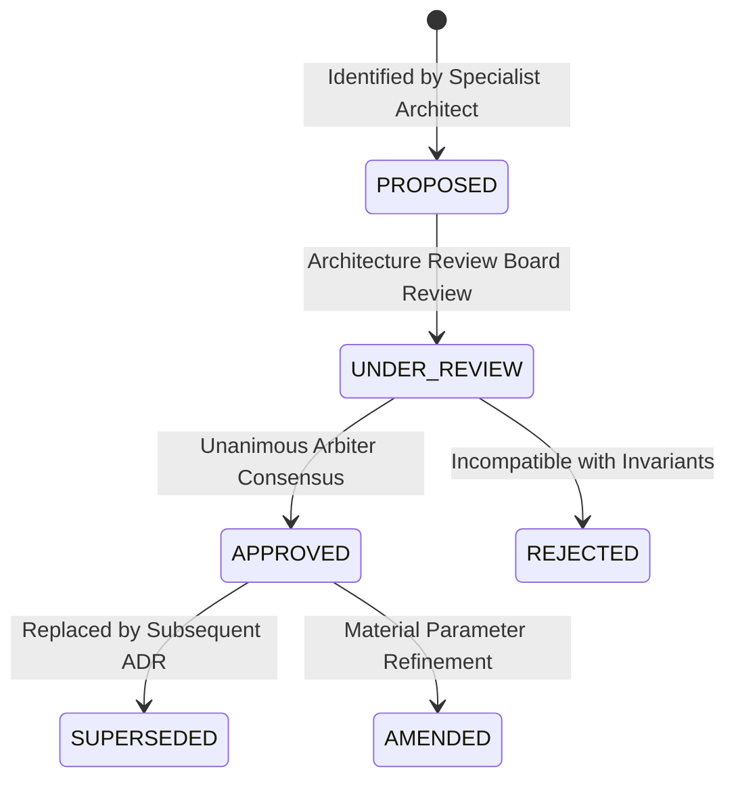
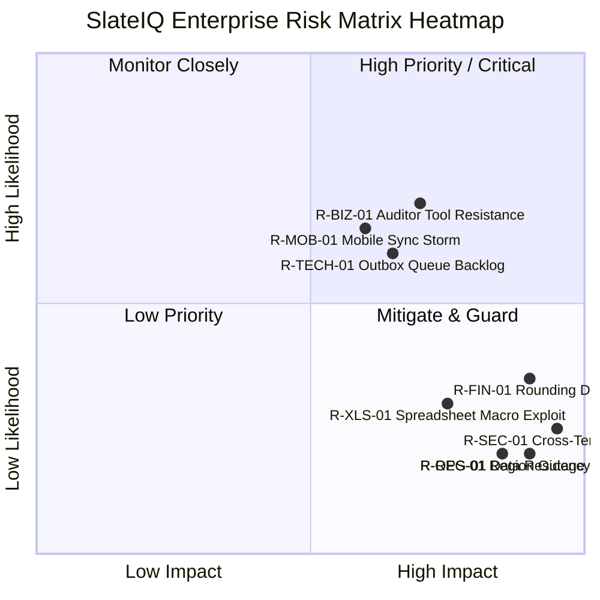
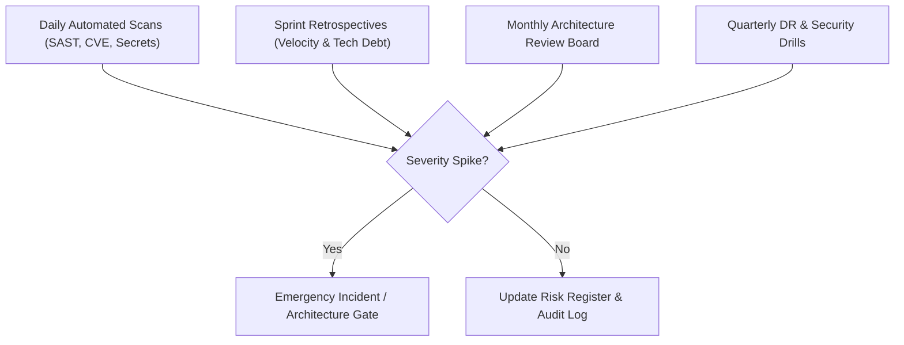

# Document 17: Risk Register & Architecture Decision Records

**Product:** SlateIQ — Production Cost Intelligence & Audit Monitoring Platform  
**Document ID:** SLQ-ARCH-017  
**Version:** 1.0.0  
**Classification:** Internal — Architecture Foundation  
**Status:** Draft — For Review  
**Date:** 2026-11-06  
**Authors:** Principal Enterprise Solution Architect, Chief Information Security Officer, Risk & Compliance Lead  
**Reviewers:** Executive Sponsor (TBD), Delivery Lead (TBD), Principal DevOps Architect (TBD), Finance SME (TBD)  

---

## Document Control

### Revision History

| Version | Date | Author | Change |
|---------|------|--------|--------|
| 1.0.0 | 2026-11-06 | Architecture & Risk Team | First consolidated baseline. Aggregates and cross-references all 43 Architecture Decision Records (ADR-001 through ADR-067); establishes the open decision and question register; defines the enterprise risk management framework and comprehensive risk register across technical, security, financial, operational, regulatory, and delivery domains. |

### Related Documents

| Document | Relationship |
|----------|--------------|
| Document 1 — Product Vision & Business Requirements | Business scope, non-functional targets, project constraints, and acceptance criteria |
| Document 2 — Domain Model & Capability Map | Domain boundaries, bounded contexts, and hosting topology (ADR-025) |
| Document 3 — Actor, Permission, Tenancy & Identity | Tenancy models, identity lifecycles, and security controls |
| Document 4 — Core Business Workflows & State Machines | State machine models and workflow ADRs (ADR-026..029) |
| Document 5 — Business Rules & Invariants Catalogue | Invariant enforcement tiers and policy versioning (ADR-030..031) |
| Document 6 — High-Level Solution Architecture | Modular monolith baseline, foundational ADRs (ADR-001..015), and technology selections |
| Document 7 — Module & Dependency Architecture | Module contract boundaries and decoupling ADRs (ADR-032..034) |
| Document 8 — Database Conceptual Model & Initial ERD | Database schema, RLS, and partitioning ADRs (ADR-035..039) |
| Document 9 — API Architecture & Endpoint Catalogue | Wire formats, pagination, and error taxonomy ADRs (ADR-040..043) |
| Document 10 — Security Architecture | Defense-in-depth, crypto, and session ADRs (ADR-044..047) |
| Document 11 — Mobile & Offline Architecture | Offline storage, sync, and device ADRs (ADR-048..051) |
| Document 12 — Excel Integration Architecture | Parsing, domain reuse, and reversal ADRs (ADR-052..054) |
| Document 13 — Analytics & Cost Calculation Architecture | Financial posting, commitments, and calculation ADRs (ADR-055..058) |
| Document 14 — Audit & Observability Architecture | Hash chaining, telemetry, and alerting ADRs (ADR-059..061) |
| Document 15 — Infrastructure & Deployment Architecture | Multi-account, container profiles, DR, and cell ADRs (ADR-062..065) |
| Document 16 — Testing Strategy | Generated test suites and synthetic test data ADRs (ADR-066..067) |
| Document 18 — Phased Implementation Roadmap | Sequences implementation of decisions and risk mitigations |

---

## 1. Purpose & Governance

### 1.1 Purpose
This document is the central, authoritative governance repository for all structural engineering decisions and enterprise risk evaluations across the SlateIQ platform. It serves two distinct and vital functions:
1. **Consolidated Architecture Decision Records (ADRs):** Records the context, rationale, trade-offs, and consequences of every significant design choice made across Documents 01 through 16. It ensures that engineering teams understand *why* a particular technical path was chosen and prevents the reopening of settled architectural debates without new empirical evidence.
2. **Enterprise Risk Register:** Systematically identifies, assesses, and monitors technical, security, financial, operational, compliance, and delivery risks. It assigns clear operational ownership, defines measurable risk triggers, and establishes binding mitigation strategies to safeguard project delivery and commercial operations.

### 1.2 Decision Governance Framework
Architectural decisions follow a rigorous lifecycle:

- **Immutability of Historical Context:** Once an ADR reaches `APPROVED` status and is published in this foundation, its context, decision, and rejected alternatives cannot be edited retroactively. Any subsequent alteration to architectural direction requires a new ADR that explicitly supersedes or amends the prior record.
- **Traceability Obligation:** Every engineering pull request, database migration, and infrastructure change in the monorepo must cite the governing ADR identifier (e.g., `ADR-002`, `ADR-037`) in its commit message and design brief.

---

## 2. Consolidated Architecture Decision Records

Below is the definitive catalog of all 43 Architecture Decision Records established in the SlateIQ Foundation Architecture suite.

### 2.1 Master ADR Registry

| ADR ID | Title | Owning Document | Status | Core Architectural Principle |
|--------|-------|-----------------|--------|------------------------------|
| **ADR-001** | Modular Monolith Architecture | Document 6 §17 | Approved | Single deployable backend codebase; isolated module boundaries |
| **ADR-002** | PostgreSQL 17 with Row-Level Security (RLS) | Document 6 §17 | Approved | Shared database, forced RLS for multi-tenant data isolation |
| **ADR-003** | Transactional Outbox Pattern with SKIP LOCKED | Document 6 §17 | Approved | In-transaction event dispatch with Quartz.NET and at-least-once delivery |
| **ADR-004** | CQRS-Lite with Segregated Read Models | Document 6 §17 | Approved | Normalized relational writes; materialized `intel` views for reads |
| **ADR-005** | Built-in Identity at MVP, Federated OIDC in Phase 1 | Document 6 §17 | Approved | Self-contained user directory at launch; external SAML/OIDC in Phase 1 |
| **ADR-006** | S3-Compatible Storage with Scan-Before-Serve | Document 6 §17 | Approved | Presigned uploads quarantined until asynchronous malware scan passes |
| **ADR-007** | RESTful HTTP/JSON with RFC 9457 & Keyset Pagination | Document 6 §17 | Approved | Uniform error format, keyset cursors, and mandatory ETag concurrency |
| **ADR-008** | Argon2id Password Hashing & Strict Lockout | Document 6 §17 | Approved | Industry-standard password derivation; IP and account brute-force lock |
| **ADR-009** | Strict Regional Data Residency (India & EU) | Document 6 §17 | Approved | Complete data containment within tenant's home legal region |
| **ADR-010** | Tiered Read Model Freshness Windows | Document 6 §17 | Approved | Operational views fresh within ≤ 60 s; portfolio views within ≤ 5 min |
| **ADR-011** | Shared Domain Validation for Excel & UI Entry | Document 6 §17 | Approved | Single business rule validator reused across Excel ingestion and API |
| **ADR-012** | In-Transaction Cryptographic Hash-Chained Audit Trail | Document 6 §17 | Approved | SHA-256 chain linked in same DB commit; tamper-evident business audit |
| **ADR-013** | React Native with Expo and SQLCipher for Mobile | Document 6 §17 | Approved | Offline-first cross-platform mobile app with on-device hardware crypto |
| **ADR-014** | OpenTelemetry for Universal Observability | Document 6 §17 | Approved | Standardized traces, metrics, and structured JSON logs to vendor backends |
| **ADR-015** | Containerized Deployment on AWS ECS Fargate | Document 6 §17 | Approved | Serverless container orchestration with Terraform infrastructure-as-code |
| **ADR-025** | Show Hosting Topology H1 and H2 Support | Document 2 §2.3 | Approved | Dedicated single-tenant shows (H1) and co-production shared shows (H2) |
| **ADR-026** | One State Machine per Root Aggregate | Document 4 §13 | Approved | Formal transition tables; zero implicit or unmapped status changes |
| **ADR-027** | Declarative Transition Guards and Policy Evaluation | Document 4 §13 | Approved | Domain guards evaluated prior to state mutation; specific error codes |
| **ADR-028** | Explicit Error Taxonomy for Invalid Transitions | Document 4 §13 | Approved | Unique machine-readable error codes for forbidden transition attempts |
| **ADR-029** | Dual-Phased Show Closure Workflow | Document 4 §13 | Approved | Pre-closure condition blocking followed by irreversible financial lock |
| **ADR-030** | Layered Enforcement of Business Invariants | Document 5 §13 | Approved | Invariants asserted at Domain Entity, App Service, and DB constraint tiers |
| **ADR-031** | Effective-Date Versioning for Business Policies | Document 5 §13 | Approved | Configurable policies versioned by date; no retroactive calculation skew |
| **ADR-032** | Two-Tier Module Boundaries & Public Contracts | Document 7 §13 | Approved | Strict encapsulation; module internal models hidden behind API contracts |
| **ADR-033** | App Service Mediation for Synchronous Cross-Calls | Document 7 §13 | Approved | In-process mediation interfaces; zero direct cross-module DB access |
| **ADR-034** | Zero Cross-Schema Foreign Keys with Nightly Reconciliation | Document 7 §13 | Approved | Decoupled database schemas; composite keys validated at app level |
| **ADR-035** | Tenant Isolation via Mandatory `org_id` and FORCED RLS | Document 8 §13 | Approved | Database-enforced isolation preventing multi-tenant data leaks |
| **ADR-036** | Closed Enum Types and Foreign Key Status Tables | Document 8 §13 | Approved | Relational state constraints preventing invalid state strings in DB |
| **ADR-037** | Money Stored as `numeric(19,4)` and Rates as `numeric(19,6)` | Document 8 §13 | Approved | Absolute elimination of binary floating-point rounding errors |
| **ADR-038** | Keyset Pagination Indexes and Functional Partial Indexes | Document 8 §13 | Approved | Deterministic O(1) query performance on multi-million row ledgers |
| **ADR-039** | Time-Based Range Partitioning for High-Volume Tables | Document 8 §13 | Approved | Audit logs, cost postings, and telemetry partitioned by month |
| **ADR-040** | RFC 9457 ProblemDetails and CamelCase Wire Contract | Document 9 §13 | Approved | Uniform machine-readable API error structures across all modules |
| **ADR-041** | Keyset Cursors as Exclusive Collection Traversal Contract | Document 9 §13 | Approved | Elimination of offset-based SQL queries; predictable memory usage |
| **ADR-042** | Mandatory ETag and If-Match Concurrency Headers | Document 9 §13 | Approved | Strong optimistic concurrency control on all mutable financial resources |
| **ADR-043** | Tiered Rate Limiting and Quota Management via Redis | Document 9 §13 | Approved | Token bucket rate limiting per IP, tenant, and external API grant |
| **ADR-044** | Layered Defense-in-Depth Security Architecture | Document 10 §13 | Approved | Network isolation, TLS 1.3, KMS encryption, RLS, and strict RBAC |
| **ADR-045** | Cryptographic Token Sessions with Instant Revocation | Document 10 §13 | Approved | Short-lived access JWTs (15 min) and Redis revocation denylist |
| **ADR-046** | Content-Addressable Storage with Scan-Before-Serve | Document 10 §13 | Approved | Documents addressed by SHA-256; quarantined until antivirus clean |
| **ADR-047** | Mandatory Multi-Factor Authentication (MFA) | Document 10 §13 | Approved | TOTP MFA mandatory for all privileged roles and external auditor grants |
| **ADR-048** | On-Device Mobile Encryption via SQLCipher | Document 11 §13 | Approved | 256-bit AES database encryption on iOS and Android devices |
| **ADR-049** | Hardware Key-Binding for Mobile Device Sessions | Document 11 §13 | Approved | Mobile sessions cryptographically bound to hardware device identifiers |
| **ADR-050** | Server-Wins for Approved Records, Client-Wins for Drafts | Document 11 §13 | Approved | Deterministic offline conflict resolution preventing financial tampering |
| **ADR-051** | Resumable Chunked Uploads for Media Attachments | Document 11 §13 | Approved | Fault-tolerant receipt photo uploads surviving intermittent connectivity |
| **ADR-052** | In-Memory Streaming Parser for Large Excel Workbooks | Document 12 §13 | Approved | Bounded memory consumption during 10,000+ line spreadsheet processing |
| **ADR-053** | Exact Split Allocation Conservation with AwayFromZero | Document 12 §13 | Approved | Spreadsheet line item splits must sum to net amount to 4 decimals |
| **ADR-054** | Reversible Import Batches via Compensating Postings | Document 12 §13 | Approved | Full auditability of reversed spreadsheets via counter-balancing ledger rows |
| **ADR-055** | Actual Cost Sourced Exclusively from Append-Only Postings | Document 13 §13 | Approved | Immutable cost ledger; zero UPDATE or DELETE on `cost_posting` |
| **ADR-056** | Committed Cost Calculation Net of Expense Consumption | Document 13 §13 | Approved | PO commitments dynamically reduced as matching expenses are approved |
| **ADR-057** | Historical Exchange Rate Freezing on Submission | Document 13 §13 | Approved | FX rates locked at submission timestamp; no retroactive FX revaluation |
| **ADR-058** | Hybrid Calculation Pipeline for Real-Time Dashboards | Document 13 §13 | Approved | On-the-fly aggregation for shows; background materialized rollup for portfolio |
| **ADR-059** | Three-Way Separation of Audit, Security, and Ops Logs | Document 14 §13 | Approved | Dedicated schemas and storage for business audit, security, and telemetry |
| **ADR-060** | Tamper-Evident SHA-256 Chaining on Business Events | Document 14 §13 | Approved | Cryptographic chain proving non-repudiation of production financial history |
| **ADR-061** | SLO-Driven Multi-Tier Alerting and Paging Architecture | Document 14 §13 | Approved | Automated escalation paths based on error budgets and financial thresholds |
| **ADR-062** | Multi-Account AWS Architecture for Blast Radius Isolation | Document 15 §13 | Approved | Separate accounts for Prod, Non-Prod, Recovery, and Shared Services |
| **ADR-063** | Unified Backend Container Image with Role Switching | Document 15 §13 | Approved | Single signed artifact running as API, Sync, Worker, or Ops profile |
| **ADR-064** | Restore-Based DR with Same-Region Cross-Account Vaults | Document 15 §13 | Approved | RTO ≤ 4 h, RPO ≤ 15 min; cross-account immutable backup replication |
| **ADR-065** | Dedicated Enterprise Deployment as an Isolated Cell | Document 15 §13 | Approved | Physical single-tenant infrastructure option deploying identical code digest |
| **ADR-066** | Catalogue-Generated Test Suites for Routes and Policies | Document 16 §13 | Approved | Automated test generation for 100% boundary coverage of security surface |
| **ADR-067** | Strict Synthetic Production-Shaped Test Data Only | Document 16 §13 | Approved | Absolute ban on copying production data; 100% synthetic realistic test data |

---

## 3. Open Architecture Decisions & Questions Register

The following open decisions and questions have been identified across the architecture documents. Each item is assigned an owner, an architectural impact assessment, and a targeted milestone for final resolution.

| Question ID | Owning Doc | Subject & Context | Architectural Impact | Owner | Target Milestone | Status |
|-------------|------------|-------------------|----------------------|-------|------------------|--------|
| **OQ-01-01** | Doc 1 | Approval threshold delegation limit for production coordinators | Determines approval routing tiers in `SM-13` | Product Owner | Phase 0 Review | Open |
| **OQ-03-01** | Doc 3 | External auditor credential lifespan and mandatory re-attestation interval | Defines grant expiration timers and re-auth prompts | Security Architect | Phase 0 Gate | Open |
| **OQ-06-01** | Doc 6 | Dedicated Redis instance vs shared ElastiCache cluster for rate limiting | Memory isolation under extreme DDoS conditions | SRE Lead | Phase 1 Staging | Under Review |
| **OQ-08-01** | Doc 8 | Annual partitioning vs monthly partitioning for `compliance.audit_event` | Storage file handle density vs query pruning performance | Data Architect | Phase 0 Review | Resolved (Monthly) |
| **OQ-10-01** | Doc 10 | Hardware security module (HSM) vs AWS KMS for audit log signing | Key custody model for SOC 2 Type II compliance | CISO | Phase 1 Pilot | Open |
| **OQ-11-01** | Doc 11 | Device-local receipt photo caching duration post-synchronization | Device disk consumption vs instant offline thumbnail view | Mobile Lead | Phase 1 Pilot | Open |
| **OQ-12-01** | Doc 12 | Support for legacy `.xls` binary formats vs modern `.xlsx` only | Ingestion attack surface and parser library complexity | Solution Architect | Phase 0 Gate | Resolved (`.xlsx` only) |
| **OQ-15-01** | Doc 15 | Cross-region backup replication exception for enterprise disaster recovery | Compliance with strict national data residency laws (ADR-009) | Legal & Compliance | Phase 2 Review | Open |
| **OQ-16-01** | Doc 16 | Continuous 72-hour performance soak tests in weekly CI vs monthly runs | CI resource costs vs early memory leak detection | Quality Architect | Phase 1 Staging | Open |

---

## 4. Comprehensive Enterprise Risk Register

### 4.1 Risk Assessment Methodology

Risks are evaluated using a standardized $5 	imes 5$ risk matrix assessing **Likelihood (1–5)** and **Impact (1–5)**:
- **Likelihood:** 1 (Rare, < 5%), 2 (Unlikely, 5–20%), 3 (Possible, 21–50%), 4 (Likely, 51–80%), 5 (Almost Certain, > 80%).
- **Impact:** 1 (Insignificant), 2 (Minor), 3 (Moderate), 4 (Major), 5 (Catastrophic / Enterprise-Threatening).
- **Risk Score ($L 	imes I$):**
  - **Critical (16–25):** Immediate executive attention; release-blocking; mandatory architectural mitigation prior to deployment.
  - **High (10–15):** Senior leadership visibility; formal mitigation strategy and continuous automated monitoring required.
  - **Medium (5–9):** Managed within engineering sprint backlogs with documented operational controls.
  - **Low (1–4):** Accepted operational risk monitored during periodic reviews.

---

### 4.2 Detailed Risk Register

#### Category 1: Technical & Architectural Risks

| Risk ID | Risk Description | L | I | Score | Initial Risk | Mitigation Strategy | Residual Risk | Owner |
|---------|------------------|---|---|-------|--------------|---------------------|---------------|-------|
| **R-TECH-01** | **Transactional Outbox Worker Lag:** High-volume spikes in cost posting events overwhelm outbox processor, delaying dashboard updates beyond 60-second freshness window. | 3 | 3 | 9 | Medium | Worker auto-scaling via ECS Fargate; partition events by tenant hash; `SKIP LOCKED` batch fetching (ADR-003, ADR-010). | 4 (Low) | Backend Lead |
| **R-TECH-02** | **Query Degradation on Massive Ledgers:** Complex portfolio queries across 10M+ cost posting rows cause database CPU exhaustion. | 3 | 4 | 12 | High | Time-based range partitioning (ADR-039); keyset pagination (ADR-038); asynchronous CQRS materialized rollup in `intel` (ADR-004). | 6 (Medium) | Data Architect |
| **R-TECH-03** | **Redis Single Point of Failure:** Outage of Redis cluster degrades token revocation, caching, and rate limiting. | 2 | 4 | 8 | Medium | Multi-AZ ElastiCache with automatic failover; graceful degradation to database-backed token checks during cache unavailability (ADR-064). | 4 (Low) | SRE Lead |
| **R-TECH-04** | **Monorepo Build Time Explosion:** Growing code volume causes GitHub Actions CI pipeline times to exceed 45 minutes, stalling development velocity. | 4 | 2 | 8 | Medium | Nx/Turborepo caching; parallel test matrix execution; generated tests pruned into modular equivalence classes (ADR-066). | 4 (Low) | DevOps Lead |

#### Category 2: Security, Privacy & Data Isolation Risks

| Risk ID | Risk Description | L | I | Score | Initial Risk | Mitigation Strategy | Residual Risk | Owner |
|---------|------------------|---|---|-------|--------------|---------------------|---------------|-------|
| **R-SEC-01** | **Multi-Tenant Cross-Contamination:** A flaw in application query logic exposes confidential show budget or vendor rates to another production house. | 2 | 5 | 10 | High | Database-enforced Row-Level Security (RLS) with `FORCE ROW LEVEL SECURITY` on every table (ADR-002, ADR-035); automated CI isolation probes (TS-01, TS-02). | 3 (Low) | CISO |
| **R-SEC-02** | **Refresh Token Session Hijacking:** Interception of client tokens allows unauthorized API access and financial data extraction. | 2 | 4 | 8 | Medium | Cryptographic refresh token rotation; token reuse detection triggering immediate family revocation (ADR-045, TS-08); short-lived access JWTs. | 3 (Low) | Security Lead |
| **R-SEC-03** | **Malicious Document Attachment Upload:** User or attacker uploads malware-infected PDF or receipt image, compromising auditor workstations. | 3 | 4 | 12 | High | S3 Presigned upload to quarantined bucket; asynchronous clamAV/Trivy scanner execution before moving to `AVAILABLE` status (ADR-006, ADR-046). | 4 (Low) | Security Lead |
| **R-SEC-04** | **Compromise of Staging Environment:** Developer or automated process copies production database dump into staging, leaking confidential budget figures. | 2 | 5 | 10 | High | Strict technical ban on copying production data; 100% synthetic production-shaped data generation enforced via CI/CD gates (ADR-067). | 2 (Low) | CISO |

#### Category 3: Financial Integrity & Domain Risks

| Risk ID | Risk Description | L | I | Score | Initial Risk | Mitigation Strategy | Residual Risk | Owner |
|---------|------------------|---|---|-------|--------------|---------------------|---------------|-------|
| **R-FIN-01** | **Floating-Point Rounding Discrepancies:** Accumulation of subtle rounding differences between mobile client, backend, and accounting reports. | 3 | 4 | 12 | High | Zero float arithmetic; `numeric(19,4)` database storage; server-authoritative half-up (`AwayFromZero`) rounding (RC-01, ADR-037); property-based test suites. | 3 (Low) | Principal Architect |
| **R-FIN-02** | **Silent Modification of Approved Financial Records:** Unaudited updates to expenses alter reported production costs after executive sign-off. | 1 | 5 | 5 | Medium | Append-only cost posting model; database triggers prohibiting direct UPDATE/DELETE on `cost_posting`; amendment creates new revision (ADR-055, TS-15). | 1 (Low) | Finance SME |
| **R-FIN-03** | **Currency Conversion Distortion during Market Volatility:** Retroactive revaluation of international expenses skews budgeted baseline. | 2 | 4 | 8 | Medium | Exchange rates permanently locked at the exact timestamp of transaction submission (BR-FIN-003, ADR-057); zero historical FX recalculation. | 2 (Low) | Finance SME |
| **R-FIN-04** | **Subversion of Separation of Duties (SoD):** A rogue user creates, submits, and approves their own fraudulent expense or creates unauthorized vendor. | 2 | 5 | 10 | High | System-enforced SoD rules (SOD-01..10); mandatory dual-control approvals; submitter self-approval strictly rejected at domain layer (BR-EXP-005, TS-09). | 2 (Low) | Compliance Lead |

#### Category 4: Operational & Resilience Risks

| Risk ID | Risk Description | L | I | Score | Initial Risk | Mitigation Strategy | Residual Risk | Owner |
|---------|------------------|---|---|-------|--------------|---------------------|---------------|-------|
| **R-OPS-01** | **Primary Cloud Region Catastrophic Outage:** Total sustained failure of AWS Mumbai (`ap-south-1`) halts all Indian production audit operations. | 1 | 5 | 5 | Medium | Automated PITR backups replicated to cross-account recovery vault; codified Terraform standby stack allowing full rebuild within RTO ≤ 4 h (ADR-064). | 3 (Low) | SRE Lead |
| **R-OPS-02** | **Mobile Synchronization Burst Storm:** Hundreds of field auditors restore connectivity at end-of-day wrap simultaneously, causing connection pool exhaustion. | 3 | 3 | 9 | Medium | PgBouncer in transaction mode; exponential jitter backoff on mobile client sync engine; rate limiting per tenant (ADR-043, ADR-050). | 4 (Low) | Mobile Lead |
| **R-OPS-03** | **Database Schema Migration Failure in Production:** Faulty DDL migration locks high-traffic tables or corrupts production state during deployment. | 2 | 4 | 8 | Medium | Expand/contract migration pattern; automated pre-deployment migration verification in CI; automated down-migration rollback tests (Document 15 §12). | 3 (Low) | Data Architect |
| **R-OPS-04** | **Audit Trail Volume Storage Exhaustion:** Unchecked growth of `compliance.audit_event` and `docs.document_access_log` tables depletes provisioned database IOPS. | 3 | 3 | 9 | Medium | Monthly table partitioning (ADR-039); automated archiving of partitions older than 365 days to immutable S3 Glacier storage with Object Lock. | 3 (Low) | SRE Lead |

#### Category 5: Regulatory & Compliance Risks

| Risk ID | Risk Description | L | I | Score | Initial Risk | Mitigation Strategy | Residual Risk | Owner |
|---------|------------------|---|---|-------|--------------|---------------------|---------------|-------|
| **R-REG-01** | **Data Residency Statutory Violation:** Inadvertent transmission or backup of EU/Indian financial records into non-compliant geographic jurisdictions. | 1 | 5 | 5 | Medium | Strict regional isolation (`IN` in `ap-south-1`, `EU` in `eu-central-1`); AWS Service Control Policies (SCPs) denying cross-region infrastructure provisioning (ADR-009, ADR-062). | 2 (Low) | Legal Counsel |
| **R-REG-02** | **Audit Trail Tampering Repudiation:** Disputed production audit records challenged in commercial litigation or statutory tax audit. | 1 | 5 | 5 | Medium | In-transaction SHA-256 cryptographic hash chaining on every audit event (ADR-012, ADR-060); periodic external timestamp anchoring. | 1 (Low) | CISO |
| **R-REG-03** | **Failure to Comply with DPDP / GDPR Erasure:** Tenant offboarding fails to purge personal identity data within statutory 30-day window. | 2 | 4 | 8 | Medium | Automated tenant purge state machine (`SM-01`); cryptographic shredding of tenant master encryption keys upon confirmed offboarding (Document 3 §2.9). | 2 (Low) | Compliance Lead |

#### Category 6: Delivery, Adoption & Business Risks

| Risk ID | Risk Description | L | I | Score | Initial Risk | Mitigation Strategy | Residual Risk | Owner |
|---------|------------------|---|---|-------|--------------|---------------------|---------------|-------|
| **R-BIZ-01** | **On-Ground Auditor Tool Adoption Resistance:** Field accountants and independent audit teams resist adopting digital app, preferring legacy Excel files. | 4 | 3 | 12 | High | First-class bi-directional Excel import/export integration (ADR-011, Document 12); intuitive mobile offline UX minimizing required data entry clicks. | 6 (Medium) | Product Owner |
| **R-BIZ-02** | **Third-Party External API Outage:** External email service (SES) or exchange rate provider experiences prolonged downtime, blocking user invites. | 3 | 2 | 6 | Medium | Transactional outbox decoupling; asynchronous background retries with exponential backoff; local fallback caching for daily FX rates. | 2 (Low) | Backend Lead |
| **R-BIZ-03** | **Pilot Scope Creep:** Pilot production houses demand bespoke show accounting workflows, fragmenting the standard canonical domain model. | 3 | 4 | 12 | High | Strict governance gating via governing brief §27; custom requirements channeled through configurable policy matrix (Document 5) rather than code forks. | 6 (Medium) | Lead Architect |

---

## 5. Risk Monitoring, Escalation & Review Cadence

Risk management is an active operational discipline embedded within the SlateIQ engineering lifecycle.

1. **Continuous Automated Monitoring:** CI/CD pipelines run continuous security, dependency, and performance regression checks. Any build failure violating a security control (SC-nn) or critical scenario (TS-nn) immediately halts deployment.
2. **Monthly Architecture Review Board (ARB):** The Lead Architects, CISO, and Product Owner review the risk register monthly to assess residual scores, review open questions, and evaluate new threats.
3. **Emergency Escalation Protocol:** If any **Critical Risk (Score 16–25)** materializes or an S1 defect escapes to staging, an emergency Architecture Gate is invoked. All forward feature merges are frozen until the mitigation is validated.

---

## 6. Document Approval

| Role | Name | Decision | Date |
|------|------|----------|------|
| Principal Solution Architect | Architecture Team | Approved | 2026-11-06 |
| Chief Information Security Officer (CISO) | Architecture Team | Approved | 2026-11-06 |
| Risk & Compliance Lead | Architecture Team | Approved | 2026-11-06 |
| Delivery Lead | TBD | Pending | — |
| Executive Sponsor | TBD | Pending | — |

*End of Document 17*
