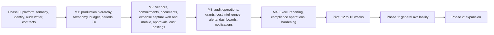

# Document 18: Phased Implementation Roadmap

**Product:** SlateIQ — Production Cost Intelligence & Audit Monitoring Platform
**Document ID:** SLQ-ARCH-018
**Version:** 1.0.0 (Roadmap Baseline)
**Classification:** Internal — Architecture Foundation
**Status:** Draft — For Review
**Date:** 2026-11-06
**Authors:** Principal Enterprise Solution Architect, Delivery Lead
**Reviewers:** Product Owner (TBD), Executive Sponsor (TBD), Engineering Managers (TBD)

---

## Document Control

### Revision History

| Version | Date | Author | Change |
|---------|------|--------|--------|
| 1.0.0 | 2026-11-06 | Architecture Team | First roadmap baseline derived from Document 1 §13 scope, the module dependency graph and the foundation quality gate |

### Related Documents

| Document | Relationship |
|----------|--------------|
| Document 1 §13, §17 | Release scope, pilot profile, acceptance and pilot gates |
| Document 6 §4.5, §4.6, §15, §19.5 | Extraction triggers, evolution path, environments, decisions required before build (G-01 to G-06) |
| Document 7 | Module dependency order |
| Document 16 | Test gates and critical release scenarios (TS-xx) |
| Document 17 | Risks, ADRs and the open-decision register |

---

## 1. Purpose

This roadmap sequences the build of SlateIQ from the approved foundation to general availability. It is dependency-driven: no increment starts work that depends on an unfinished foundation, and every increment ends with a releasable, tested slice. Durations are indicative estimates for the planning team in section 3; they become commitments only after the Phase 0 velocity baseline.

---

## 2. Principles

| # | Principle | Consequence |
|---|-----------|-------------|
| 1 | Isolation and audit first | Tenancy, identity, RLS, the isolation test suite and the audit writer exist before any business table holds data |
| 2 | Thin vertical slices | Each increment delivers capture-to-dashboard value for a narrow scope rather than a complete horizontal layer |
| 3 | Contracts before code | OpenAPI contracts and event schemas for an increment are reviewed before implementation starts (Document 9) |
| 4 | Mobile from the start | The offline capture path is built in Increment M2 with the web path, not retrofitted |
| 5 | Excel as a first-class path | Import reuses the domain validators built for UI entry (ADR-011); it is scheduled after those validators exist |
| 6 | No scope without a requirement | Every backlog item traces to an FR, NFR or BR in Document 1 (Document 1 Appendix D rule 1) |
| 7 | Change through impact analysis | A new requirement enters through the change process in section 10, never directly into a sprint |

---

## 3. Planning Assumptions

| ID | Assumption | Impact if wrong |
|----|------------|-----------------|
| A18-01 | One cross-functional delivery team: 1 principal architect or tech lead, 5 backend engineers (.NET), 2 web engineers (React), 2 mobile engineers (React Native), 2 QA automation engineers, 1 DevOps engineer, 1 product owner, 1 UX designer, a part-time finance SME and audit SME | Durations scale roughly with backend capacity; mobile is the second constraint |
| A18-02 | Two-week sprints; an increment is three to four sprints | Increment exit dates move in two-week steps |
| A18-03 | Gates G-01 (cloud and region) and G-02 (mobile framework) are closed before Phase 0 ends | Infrastructure or mobile work stalls |
| A18-04 | OD-01 (show hosting topology) is decided before Increment M1 completes | Role seeding and onboarding flows are reworked |
| A18-05 | The pilot customer supplies a budget and vendor extract within 10 business days of onboarding (Document 1 A-01) | Pilot start slips |
| A18-06 | Pilot scale per Document 1 §13.8: 1 to 3 organizations, 2 to 4 shows each, 25 to 75 users each | Capacity plan in Document 15 changes |

---

## 4. Build Order

The order follows module dependencies (Document 7) and the rule that nothing reads data that has no owner yet.

| Order | Module | Reason |
|-------|--------|--------|
| 1 | MOD-15 Platform Operations | Outbox, jobs, idempotency and flags are used by every module |
| 2 | MOD-12 Compliance (audit writer only) | Every state change must write audit in-transaction from the first business table |
| 3 | MOD-02 Identity, MOD-01 Tenancy & Access | Every request needs a principal, a tenant context and a policy decision |
| 4 | MOD-03 Production | Shows, departments and categories are dimensions for everything financial |
| 5 | MOD-04 Budget | Approval chains, periods and FX are needed before expenses |
| 6 | MOD-05 Vendor & Commitments, MOD-09 Documents | Expenses reference vendors and evidence |
| 7 | MOD-07 Expense, MOD-14 Sync | The core capture and approval loop |
| 8 | MOD-06 Audit Operations | Assignment scope and grants for auditors; reports and findings |
| 9 | MOD-08 Cost Intelligence, MOD-11 Notifications | Projections, variance, alerts and delivery |
| 10 | MOD-10 Excel, MOD-13 Reporting | Reuse validators and read models |
| 11 | MOD-12 Compliance (DSR, legal hold, retention operations) | Needs real data to operate on |

---

## 5. Phases and Increments

### 5.1 Phase 0 — Foundation and Walking Skeleton (6 weeks)

| Item | Detail |
|------|--------|
| Goal | Prove the architecture end to end with the thinnest possible slice |
| Scope | Monorepo, CI/CD, Terraform for the dev and test environments, container images, OpenTelemetry pipeline; MOD-15 outbox, job runner, idempotency store; MOD-12 audit writer and hash chain; MOD-02 login, TOTP MFA, sessions; MOD-01 organization provisioning, membership, role seeding, policy decision point; RLS on every table with the CI inventory test; contract-first OpenAPI pipeline and generated web and mobile clients; mobile shell with SQLCipher and the device grant; web shell with the design system |
| Exit criteria | A provisioned organization passes the isolation probe; a user logs in with MFA; a show and one draft expense are created on mobile while offline and synchronise after reconnect; the audit chain verifies; the authorization negative test runs for every endpoint; Document 16 suites TS-01 (isolation) and TS-02 (authorization matrix) are green |
| Decisions needed | G-01 cloud and regions, G-02 mobile framework, OD-01 hosting topology (by end of M1) |

### 5.2 Phase 1 — MVP Build (four increments, about 20 weeks)

| Increment | Duration | Scope (Document 1 requirements) | Exit criteria |
|-----------|----------|----------------------------------|---------------|
| **M1 Plan** | 4 weeks | Shows, seasons, episodes, departments, categories and mapping, parties and links (FR-PRD-001 to 010, 013, 015 to 017); budgets, versions, lines, contingency, variations, episode allocation, approval workflows, financial periods and close (FR-BUD-001 to 020); FX rate table and feed (D-007) | A budget is drafted, submitted, approved by an independent approver within limits, revised and superseded with full history; a period is closed and reopened with Finance Head approval; all SM-03, SM-04 and SM-05 transitions tested |
| **M2 Capture** | 6 weeks | Vendors and candidates, manual commitments, payment references (FR-VND-001 to 010, 016 to 018); documents, upload tickets, scanning, evidence links (FR-DOC-001 to 017); expense capture on web and mobile with offline sync, lines, splits, tax, FX snapshot, duplicates, approvals, amendment, cancellation, exceptions and cost postings (FR-EXP-001 to 024, 026 to 030) | An auditor captures 50 expenses offline over 3 simulated days with photos, synchronises without loss or duplication, and the approval chain posts actual cost to the correct periods; TS scenarios for sync, idempotency and SoD green |
| **M3 Assure and Know** | 5 weeks | Audit teams, assignments, scope, handover, external grants and acceptance, audit reports and findings (FR-AUD-001 to 015, CAP-026); projections, variance, alert rules and instances, dashboards DSH-01 to DSH-07, drill-down (FR-CIN-001, 002, 004 to 009, 011 to 015, 018 to 021, 023); notifications in-app and email, daily digest (FR-NTF-001 to 006, 011, 012, 015) | Dashboards meet the freshness tiers (≤60 s show, ≤5 min portfolio); an over-budget expense raises an alert within 5 minutes for critical severity; an external auditor is onboarded through the grant gates and cannot see out-of-scope data |
| **M4 Exchange and Harden** | 5 weeks | Excel templates, import with preview, approval before commit, reversal, exports (FR-XLS-001 to 013, 015, 016); reports RPT-01 to RPT-15; compliance operations: audit search and export, DSR, legal hold, manual retention review, access review evidence (FR-CMP-001 to 015); performance and resilience hardening; penetration test; DR exercise | All Document 16 pre-production scenarios green; NFR-PERF targets met at pilot load with 3× headroom on critical paths; penetration test findings at High or Critical closed (G-04); restore drill within RTO |

### 5.3 Pilot (12 to 16 weeks)

| Item | Detail |
|------|--------|
| Entry | M4 exit criteria; pilot entry gate in Document 1 §17; customer contracts and data processing agreements; G-03 retention policy signed off; G-06 support access model approved |
| Operation | Weekly pilot review against Document 1 KPIs; fortnightly releases behind feature flags; hypercare rota; parallel running of the customer's Excel process for the first two periods |
| Exit | Pilot exit gates of Document 1 §17.3; decision to proceed to GA recorded |
| Rollback | Full Excel export of all customer data and a read-only archive (Document 1 §13.8) |

### 5.4 Phase 1 — General Availability

| Theme | Scope | Key requirements |
|-------|-------|------------------|
| Identity | SAML and OIDC single sign-on, SCIM, bulk invite, multi-organization membership (OQ-4-01) | FR-TNT-009, 019, 023, 024 |
| Procurement | Purchase orders, receipts, closure, vendor merge, contract attachments | FR-VND-011 to 015, 019, 020 |
| Intelligence | Estimated final cost, escalation, benchmarking with consent, scheduled reports | FR-CIN-003, 010, 016, 017, 022 |
| Channels | Push, signed webhooks, announcements, quiet hours | FR-NTF-007, 008, 010, 013, 014 |
| Integration | ERP posting, BI extract, SIEM export, entitlement enforcement | Document 6 §10 |
| Operations | Second region (EU), automated retention execution, SOC 2 Type II evidence automation, regional DR exercise | NFR-PRV-004, ADR-009 |

### 5.5 Phase 2 — Expansion

Predictive forecasting and anomaly detection after at least 12 months of clean history; vendor self-service portal; rate cards and contract management; federated commissioner portfolio across producer-hosted shows (OD-01, ADR-025); tax automation; SMS; additional locales including right-to-left; audit-firm delegated administration (Document 1 §13.4).

---

## 6. Workstreams

| Workstream | Phase 0 | M1 | M2 | M3 | M4 |
|------------|---------|----|----|----|----|
| Platform and DevOps | Pipelines, IaC, telemetry | Environments, feature flags | Scan service, object storage policies | Projection lag monitoring | DR drill, load environment |
| Backend | MOD-15, MOD-12, MOD-01, MOD-02 | MOD-03, MOD-04 | MOD-05, MOD-09, MOD-07, MOD-14 | MOD-06, MOD-08, MOD-11 | MOD-10, MOD-13, MOD-12 operations |
| Web | Shell, design system, auth | Show and budget screens | Expense review, approvals queue | Dashboards, audit workspace | Excel wizards, reports, admin |
| Mobile | Shell, SQLCipher, device grant | Reference data sync | Capture, evidence, outbox, conflicts | Assignment views, audit reports | Hardening, accessibility |
| QA | Isolation and authorization suites | State machine suites | Sync, idempotency, financial goldens | Freshness and alert latency | Performance, security, pre-production scenarios |

---

## 7. Milestones and Gates

| Milestone | Target (weeks from start) | Gate evidence |
|-----------|---------------------------|---------------|
| Foundation approved | 0 | Quality gate in `00-foundation-index.md` §5 passed with recorded conditions |
| Walking skeleton | 6 | Phase 0 exit criteria |
| M1 Plan complete | 10 | M1 exit criteria; OD-01 decided |
| M2 Capture complete | 16 | M2 exit criteria |
| M3 Assure and Know complete | 21 | M3 exit criteria |
| M4 Exchange and Harden complete | 26 | M4 exit criteria; G-04 penetration test closed |
| Pilot go-live | 27 | Pilot entry gate |
| Pilot exit and GA decision | 39 to 43 | Pilot exit gates |

---

## 8. Decisions Required Before or During Build

| ID | Decision | Needed by | Owner | Source |
|----|----------|-----------|-------|--------|
| G-01 | Cloud provider and launch regions | Phase 0 week 2 | Executive sponsor, Platform Architect | Document 6 §19.5 |
| G-02 | Mobile framework confirmed | Phase 0 week 2 | Principal Architect, Mobile Lead | ADR-013 |
| OD-01 | Show hosting topology for pilot customers | End of M1 | Business owner | ADR-025 |
| G-03 | Retention and legal-hold policy | Before pilot | Compliance, Legal | Document 6 §19.5 |
| G-04 | Penetration-test scope and vendor | Start of M4 | Security & Compliance | Document 6 §19.5 |
| G-05 | DR exercise scheduled | M4 | SRE Lead | Document 6 §19.5 |
| G-06 | Support impersonation model | Before pilot | Security & Compliance | Document 6 §19.5 |
| C-01 | Zero-cost build and evaluation profile (ADR-068) — closed 2026-11-12: production stays on the managed profile; iOS and Android store distribution are paid | Closed | Business owner | Document 0 §8 |
| — | Business-owner validations of assumptions marked blocking in Documents 2, 5 and 13 (tax treatment, cash limit, cost types, audit report cadence) | Before the increment that implements them | Finance SME, Audit SME | Document 17 §5 |

---

## 9. Schedule Risks

| ID | Risk | Mitigation |
|----|------|------------|
| R18-01 | Offline sync complexity exceeds the M2 estimate | Sync prototype in Phase 0; conflict matrix fixed by ADR-004; dedicated QA network-shaping rig from M2 week 1 |
| R18-02 | Hosting topology decision (OD-01) arrives late | Architecture supports both patterns; only seeding and onboarding UX depend on it |
| R18-03 | Pilot customer data arrives late or dirty (Document 1 A-01) | Excel import templates delivered in M4 but a customer data rehearsal runs in M3 using the standard template |
| R18-04 | Penetration-test findings delay the pilot | Test booked at M4 start; security suites run continuously from Phase 0 |
| R18-05 | Approval chain configuration differs per customer more than expected | Approval workflows are data, not code (Document 4); configuration workshops in M1 |

All schedule risks are consolidated in Document 17 §3.

---

## 10. Change Control After Foundation Approval

The governing brief requires that future requirements are treated as changes to the established architecture with impact analysis. Every change follows this path.

| Step | Activity | Output |
|------|----------|--------|
| 1 | Raise a change request against the owning document with the requirement source | Change request ID in that document |
| 2 | Impact analysis: affected entities (Document 2), state machines (Document 4), invariants (Document 5), permissions (Document 3), tables (Document 8), endpoints and events (Documents 9 and 7), tests (Document 16), ADRs (Document 17) | Impact table |
| 3 | Decide: accept, defer or reject; record an ADR when a binding decision changes | ADR or decision record |
| 4 | Update every affected document in one revision set; re-run the quality gate checks for the touched areas | New document versions |
| 5 | Plan the work into an increment with its tests | Backlog items traced to the change |

---

## 11. Traceability

| Requirement area | Increment |
|------------------|-----------|
| FR-TNT, CAP-001 to CAP-003 | Phase 0, Phase 1 GA (SSO, SCIM, multi-membership) |
| FR-PRD, FR-BUD, CAP-004 to CAP-007 | M1 |
| FR-VND, FR-DOC, FR-EXP, CAP-008, CAP-010, CAP-012 to CAP-014 | M2 |
| FR-AUD, FR-CIN, FR-NTF, CAP-011, CAP-015, CAP-016, CAP-019, CAP-025, CAP-026 | M3 |
| FR-XLS, FR-CMP, RPT-01 to RPT-15, CAP-020 to CAP-024 | M4 |
| CAP-009, CAP-017, CAP-018 | Phase 1 GA |

---

## Document Approval

| Role | Name | Signature | Date |
|------|------|-----------|------|
| Executive Sponsor | | | |
| Product Owner | | | |
| Principal Architect | | | |
| Delivery Lead | | | |

*End of Document 18*
