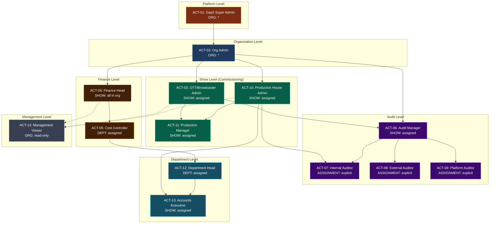

# Document 3: Actor & Permission Architecture

**Product:** SlateIQ — Production Cost Intelligence & Audit Monitoring Platform  
**Version:** 1.0.0 (Architecture Foundation)  
**Classification:** Internal — Architecture Foundation  
**Status:** Draft — For Review  
**Date:** 2026-11-05  
**Authors:** Principal Enterprise Solution Architect, Security Architect, Domain Architect

---

## 3.1 Actor Catalog (Per Specification Section 7)

| Actor ID | Actor Name | Description | Primary Context |
|----------|------------|-------------|-----------------|
| **ACT-01** | SaaS Super Administrator | Platform-level admin; manages organizations, global settings, system health | Tenant & Identity |
| **ACT-02** | Organization Administrator | Org-level admin; manages users, roles, org settings, all shows in org | Tenant & Identity |
| **ACT-03** | OTT/Broadcaster Administrator | Commissions shows, owns budgets, appoints auditors, receives reports | Production Management |
| **ACT-04** | Finance Head | Approves budgets, authorizes expenses, monitors variances, signs off reports | Budget Management / Cost Intelligence |
| **ACT-05** | Cost Controller | Day-to-day budget control, expense approval, variance analysis, forecasting | Budget Management / Cost Intelligence |
| **ACT-06** | Audit Manager | Creates/manages audit assignments, reviews submissions, manages auditor teams | Audit Management |
| **ACT-07** | Internal Auditor | On-ground expense capture, evidence collection, daily reporting (mobile) | Expense & Cost Capture |
| **ACT-08** | External Auditor | Independent audit engagement; assigned shows only; evidence review | Audit Management / Expense & Cost Capture |
| **ACT-09** | Platform-Appointed Auditor | OTT/Broadcaster representative auditor; specific show scope | Audit Management / Expense & Cost Capture |
| **ACT-10** | Production House Administrator | Manages production finances, vendor payments, internal audit team | Production Management / Vendor & Procurement |
| **ACT-11** | Production Manager | Operational show management, department coordination, schedule | Production Management |
| **ACT-12** | Department Head | Submits/approves department expenses, manages category budgets | Expense & Cost Capture / Budget Management |
| **ACT-13** | Accounts Executive | Processes vendor payments, reconciles POs, manages expense records | Vendor & Procurement / Expense & Cost Capture |
| **ACT-14** | Management Viewer (CXO/VP) | Portfolio dashboards, cross-show benchmarking, cost-overrun alerts (read-only) | Cost Intelligence |

---

## 3.2 Permission Model

### 3.2.1 Permission Structure
Each permission is an atomic action with explicit scope:

```
Permission Code Format: {resource}:{action}:{scope}
```

| Resource | Actions | Scopes |
|----------|---------|--------|
| `organization` | `create`, `read`, `update`, `delete`, `suspend`, `archive` | `ORG` |
| `user` | `create`, `read`, `update`, `delete`, `assign_role`, `revoke_role` | `ORG` |
| `role` | `create`, `read`, `update`, `delete`, `assign_permission` | `ORG` |
| `show` | `create`, `read`, `update`, `delete`, `archive`, `assign_auditor` | `ORG`, `SHOW` |
| `season` | `create`, `read`, `update`, `delete` | `ORG`, `SHOW` |
| `episode` | `create`, `read`, `update`, `delete` | `ORG`, `SHOW` |
| `department` | `create`, `read`, `update`, `delete`, `manage_hierarchy` | `ORG`, `SHOW`, `DEPT` |
| `expense_category` | `create`, `read`, `update`, `delete` | `ORG`, `SHOW`, `DEPT` |
| `budget` | `create`, `read`, `update`, `submit`, `approve`, `revise`, `supersede`, `lock` | `ORG`, `SHOW` |
| `budget_line` | `create`, `read`, `update`, `delete` | `ORG`, `SHOW`, `DEPT` |
| `vendor` | `create`, `read`, `update`, `delete`, `block`, `risk_rate` | `ORG` |
| `purchase_order` | `create`, `read`, `update`, `send`, `acknowledge`, `close`, `cancel` | `ORG`, `SHOW` |
| `commitment` | `read`, `create_manual`, `update` | `ORG`, `SHOW`, `DEPT` |
| `audit_assignment` | `create`, `read`, `update`, `delete`, `assign_scope` | `ORG`, `SHOW`, `ASSIGNMENT` |
| `audit_scope` | `create`, `read`, `update`, `delete` | `ORG`, `SHOW`, `ASSIGNMENT` |
| `expense` | `create`, `read`, `update`, `submit`, `approve`, `reject`, `request_info`, `delete_draft` | `ORG`, `SHOW`, `DEPT`, `ASSIGNMENT` |
| `expense_line` | `create`, `read`, `update`, `delete` | `ORG`, `SHOW`, `DEPT`, `ASSIGNMENT` |
| `evidence` | `upload`, `read`, `verify`, `dispute`, `delete` | `ORG`, `SHOW`, `DEPT`, `ASSIGNMENT` |
| `exception` | `read`, `acknowledge`, `resolve`, `assign` | `ORG`, `SHOW`, `DEPT` |
| `variance` | `read`, `recalculate` | `ORG`, `SHOW`, `DEPT` |
| `forecast` | `create`, `read`, `update`, `generate` | `ORG`, `SHOW`, `DEPT` |
| `alert_rule` | `create`, `read`, `update`, `delete`, `test` | `ORG`, `SHOW`, `DEPT` |
| `alert` | `read`, `acknowledge`, `resolve` | `ORG`, `SHOW`, `DEPT` |
| `dashboard` | `read`, `export` | `ORG`, `SHOW` |
| `excel_template` | `create`, `read`, `update`, `delete`, `set_default` | `ORG` |
| `excel_import` | `upload`, `validate`, `preview`, `commit`, `reject` | `ORG`, `SHOW` |
| `excel_export` | `generate`, `schedule`, `download` | `ORG`, `SHOW` |
| `document` | `upload`, `read`, `download`, `version`, `delete`, `set_retention` | `ORG`, `SHOW` |
| `notification` | `send`, `read`, `configure_channel` | `ORG` |
| `audit_trail` | `read`, `search`, `export` | `ORG`, `SHOW` |

**Total Permissions: ~85 atomic permissions**

### 3.2.2 Scope Definitions
| Scope | Description | Resolution |
|-------|-------------|------------|
| `ORG` | Organization-wide; all resources in tenant | `org_id` from token |
| `SHOW` | Specific show; user must have explicit assignment | `show_id` in request + `UserRole.scope_id` |
| `DEPT` | Specific department within show | `dept_id` in request + `UserRole.scope_id` |
| `ASSIGNMENT` | Specific audit assignment | `assignment_id` in request + `UserRole.scope_id` |

> ⚠️ **CRITICAL**: Frontend-supplied `org_id`, `show_id`, `dept_id`, `assignment_id` are **NEVER trusted**. All authorization decisions use values from the authenticated `TenantContext` (derived from JWT claims + database lookup).

---

## 3.3 Role Definitions (System Roles + Custom)

### 3.3.1 System Roles (Pre-seeded per Organization)
| Role Code | Name | Description | Base Permissions (Scope) |
|-----------|------|-------------|--------------------------|
| `SYS_ORG_ADMIN` | Organization Administrator | Full org management | All `ORG` scoped permissions |
| `SYS_OTT_ADMIN` | OTT/Broadcaster Admin | Show commissioning, budget ownership | `show:*` (SHOW), `budget:approve` (SHOW), `audit_assignment:*` (SHOW), `vendor:*` (ORG), `dashboard:read` (ORG) |
| `SYS_FINANCE_HEAD` | Finance Head | Budget approval, final expense authority | `budget:approve` (SHOW), `expense:approve` (SHOW), `expense:reject` (SHOW), `variance:read` (ORG), `forecast:generate` (SHOW) |
| `SYS_COST_CONTROLLER` | Cost Controller | Day-to-day budget control | `budget:read` (SHOW), `budget_line:*` (DEPT), `expense:approve` (DEPT), `expense:reject` (DEPT), `commitment:read` (SHOW) |
| `SYS_AUDIT_MANAGER` | Audit Manager | Auditor assignments, scope management | `audit_assignment:*` (SHOW), `audit_scope:*` (ASSIGNMENT), `expense:read` (ASSIGNMENT), `evidence:read` (ASSIGNMENT) |
| `SYS_INTERNAL_AUDITOR` | Internal Auditor | Expense capture, evidence, daily reports | `expense:create` (ASSIGNMENT), `expense:submit` (ASSIGNMENT), `expense:read` (ASSIGNMENT), `evidence:upload` (ASSIGNMENT), `evidence:read` (ASSIGNMENT) |
| `SYS_EXTERNAL_AUDITOR` | External Auditor | Assigned shows only, evidence review | `expense:read` (ASSIGNMENT), `evidence:read` (ASSIGNMENT), `evidence:verify` (ASSIGNMENT), `exception:read` (ASSIGNMENT) |
| `SYS_PLATFORM_AUDITOR` | Platform-Appointed Auditor | OTT/Broadcaster rep, specific scope | `expense:read` (ASSIGNMENT), `expense:create` (ASSIGNMENT), `evidence:upload` (ASSIGNMENT), `evidence:read` (ASSIGNMENT) |
| `SYS_PROD_HOUSE_ADMIN` | Production House Admin | Production finances, vendors, internal team | `show:read` (SHOW), `vendor:*` (ORG), `purchase_order:*` (SHOW), `expense:read` (SHOW), `department:*` (SHOW) |
| `SYS_PROD_MANAGER` | Production Manager | Operational show management | `show:read` (SHOW), `season:*` (SHOW), `episode:*` (SHOW), `department:read` (SHOW) |
| `SYS_DEPT_HEAD` | Department Head | Dept expenses, category budgets | `expense:create` (DEPT), `expense:submit` (DEPT), `expense:approve` (DEPT), `budget_line:read` (DEPT), `commitment:read` (DEPT) |
| `SYS_ACCOUNTS_EXEC` | Accounts Executive | Vendor payments, PO reconciliation | `vendor:read` (ORG), `purchase_order:read` (SHOW), `purchase_order:acknowledge` (SHOW), `expense:read` (SHOW), `commitment:read` (SHOW) |
| `SYS_MGMT_VIEWER` | Management Viewer | Read-only portfolio dashboards | `dashboard:read` (ORG), `variance:read` (ORG), `forecast:read` (ORG), `alert:read` (ORG), `excel_export:generate` (ORG) |

### 3.3.2 Custom Roles
Organizations can create custom roles by combining atomic permissions. Custom roles:
- Are organization-scoped (`org_id` on Role)
- Cannot grant `organization:delete`, `organization:suspend`, `role:assign_permission` (platform reserved)
- Support scope restriction via `UserRole.scope_type` + `scope_id`

---

## 3.4 Role-to-Permission Matrix (Summary)

| Permission \ Role | ORG_ADMIN | OTT_ADMIN | FIN_HEAD | COST_CTRL | AUDIT_MGR | INT_AUDITOR | EXT_AUDITOR | PLAT_AUDITOR | PROD_HOUSE | PROD_MGR | DEPT_HEAD | ACCT_EXEC | MGMT_VIEWER |
|-------------------|-----------|-----------|----------|-----------|-----------|-------------|-------------|--------------|------------|----------|-----------|-----------|-------------|
| `organization:*` | ✅ | ❌ | ❌ | ❌ | ❌ | ❌ | ❌ | ❌ | ❌ | ❌ | ❌ | ❌ | ❌ |
| `user:*` | ✅ | ❌ | ❌ | ❌ | ❌ | ❌ | ❌ | ❌ | ❌ | ❌ | ❌ | ❌ | ❌ |
| `role:*` | ✅ | ❌ | ❌ | ❌ | ❌ | ❌ | ❌ | ❌ | ❌ | ❌ | ❌ | ❌ | ❌ |
| `show:*` | ✅ | SHOW | ❌ | ❌ | ❌ | ❌ | ❌ | ❌ | SHOW | SHOW | ❌ | ❌ | ❌ |
| `budget:approve` | ✅ | SHOW | ✅ | ❌ | ❌ | ❌ | ❌ | ❌ | ❌ | ❌ | ❌ | ❌ | ❌ |
| `budget:*` (other) | ✅ | SHOW | SHOW | DEPT | ❌ | ❌ | ❌ | ❌ | ❌ | ❌ | DEPT | ❌ | ❌ |
| `vendor:*` | ✅ | ORG | ❌ | ❌ | ❌ | ❌ | ❌ | ❌ | ORG | ❌ | ❌ | READ | ❌ |
| `purchase_order:*` | ✅ | SHOW | ❌ | ❌ | ❌ | ❌ | ❌ | ❌ | SHOW | ❌ | ❌ | READ/ACK | ❌ |
| `audit_assignment:*` | ✅ | SHOW | ❌ | ❌ | SHOW | ❌ | ❌ | ❌ | ❌ | ❌ | ❌ | ❌ | ❌ |
| `expense:create/submit` | ✅ | ❌ | ❌ | ❌ | ❌ | ASSIGN | ASSIGN | ASSIGN | ❌ | ❌ | DEPT | ❌ | ❌ |
| `expense:approve/reject` | ✅ | ❌ | SHOW | DEPT | ❌ | ❌ | ❌ | ❌ | ❌ | ❌ | DEPT | ❌ | ❌ |
| `evidence:upload` | ✅ | ❌ | ❌ | ❌ | ❌ | ASSIGN | ❌ | ASSIGN | ❌ | ❌ | ❌ | ❌ | ❌ |
| `evidence:verify` | ✅ | ❌ | ❌ | ❌ | ❌ | ❌ | ASSIGN | ❌ | ❌ | ❌ | ❌ | ❌ | ❌ |
| `exception:*` | ✅ | ❌ | SHOW | SHOW | SHOW | ❌ | READ | ❌ | ❌ | ❌ | ❌ | ❌ | ❌ |
| `variance:read` | ✅ | SHOW | ORG | SHOW | SHOW | ❌ | ❌ | ❌ | SHOW | ❌ | DEPT | SHOW | ORG |
| `forecast:*` | ✅ | ❌ | SHOW | ❌ | ❌ | ❌ | ❌ | ❌ | ❌ | ❌ | ❌ | ❌ | READ |
| `alert_rule:*` | ✅ | ❌ | SHOW | SHOW | ❌ | ❌ | ❌ | ❌ | ❌ | ❌ | ❌ | ❌ | ❌ |
| `dashboard:read/export` | ✅ | ORG | ORG | SHOW | SHOW | ❌ | ❌ | ❌ | SHOW | ❌ | DEPT | SHOW | ORG |
| `excel_import:*` | ✅ | ❌ | ❌ | ❌ | ❌ | ❌ | ❌ | ❌ | ❌ | ❌ | ❌ | SHOW | ❌ |
| `excel_export:*` | ✅ | ❌ | ORG | SHOW | SHOW | ❌ | ❌ | ❌ | ❌ | ❌ | ❌ | ❌ | ORG |
| `audit_trail:read` | ✅ | SHOW | SHOW | SHOW | SHOW | ❌ | ❌ | ❌ | SHOW | ❌ | DEPT | SHOW | ORG |

---

## 3.5 Access Control Enforcement Architecture

### 3.5.1 Defense in Depth

```
┌─────────────────────────────────────────────────────────────────┐
│                      REQUEST FLOW                                │
├─────────────────────────────────────────────────────────────────┤
│                                                                 │
│  1. HTTPS Request                                               │
│     │                                                            │
│     ▼                                                            │
│  2. API Gateway / Load Balancer                                 │
│     │  - TLS termination                                        │
│     │  - Rate limiting (per org, per user)                      │
│     │  - Request ID injection (correlation_id)                  │
│     ▼                                                            │
│  3. Authentication Middleware                                   │
│     │  - JWT validation (signature, expiry, issuer)             │
│     │  - Token blacklist check (revoked sessions)               │
│     │  - Extract: user_id, org_id, roles[], permissions[]       │
│     │  - Build TenantContext (cached for request)               │
│     ▼                                                            │
│  4. Global Authorization Guard (Framework Level)                │
│     │  - Verify org_id in URL/header matches token org_id       │
│     │  - Verify user status = ACTIVE                            │
│     │  - Verify org status = ACTIVE                             │
│     ▼                                                            │
│  5. Resource-Level Authorization (Module Level)                 │
│     │  - Resolve target resource (show, dept, assignment)       │
│     │  - Check UserRole scope matches resource                  │
│     │  - Evaluate permission: resource:action:scope             │
│     │  - Database RLS policies as final enforcement             │
│     ▼                                                            │
│  6. Business Logic Execution                                    │
│     │  - Domain service validates business rules                │
│     │  - Emits domain events for audit trail                    │
│     ▼                                                            │
│  7. Response                                                    │
│                                                                 │
└─────────────────────────────────────────────────────────────────┘
```

### 3.5.2 Tenant Context Propagation
```typescript
interface TenantContext {
  orgId: UUID;                    // From JWT (validated)
  userId: UUID;                   // From JWT
  roles: Role[];                  // From JWT + DB (cached)
  permissions: Permission[];      // Computed: roles → permissions
  showScopes: UUID[];             // UserRole where scope_type=SHOW
  deptScopes: UUID[];             // UserRole where scope_type=DEPT
  assignmentScopes: UUID[];       // UserRole where scope_type=ASSIGNMENT
  correlationId: string;          // Request ID for tracing
  ipAddress: string;              // For audit trail
  userAgent: string;              // For audit trail
}
```

### 3.5.3 Database-Level Enforcement (PostgreSQL RLS)

```sql
-- Example: Expense table RLS policy
CREATE POLICY expense_org_isolation ON expense
  USING (org_id = current_setting('app.current_org_id')::uuid);

CREATE POLICY expense_show_scope ON expense
  USING (
    org_id = current_setting('app.current_org_id')::uuid
    AND (
      -- Org admin sees all
      current_setting('app.current_user_roles')::text[] @> ARRAY['SYS_ORG_ADMIN']
      -- Show-scoped roles
      OR show_id = ANY(current_setting('app.current_show_scopes')::uuid[])
      -- Dept-scoped roles
      OR dept_id = ANY(current_setting('app.current_dept_scopes')::uuid[])
      -- Assignment-scoped roles
      OR EXISTS (
        SELECT 1 FROM audit_assignment aa
        WHERE aa.assignment_id = ANY(current_setting('app.current_assignment_scopes')::uuid[])
        AND aa.show_id = expense.show_id
        AND (aa.department_id IS NULL OR aa.department_id = expense.dept_id)
      )
    )
  );
```

> **RLS is the ultimate backstop** — even if application logic has a bug, data cannot leak across tenants or scopes.

---

## 3.6 Special Access Rules (Per Specification)

| Rule | Enforcement |
|------|-------------|
| **Auditor assigned to Show A ≠ access to Show B** | `AuditAssignment` links user to specific `show_id`; `UserRole.scope_type=ASSIGNMENT` + `scope_id=assignment_id`; RLS enforces |
| **External auditor only accesses explicitly assigned orgs/shows/assignments** | External auditor users created with `UserRole` scoped to `ASSIGNMENT` only; no `ORG` or `SHOW` scopes granted |
| **Never trust frontend-supplied IDs** | All authorization uses `TenantContext` derived from validated JWT + DB lookup |
| **Authorization enforced by backend** | Every mutating endpoint has `@RequirePermission` decorator + RLS |
| **Read-only access for Management Viewer** | `SYS_MGMT_VIEWER` role only has `read`/`export` permissions; no `create`/`update`/`delete` |
| **Export permissions separate from read** | `excel_export:generate`, `dashboard:export` are distinct permissions |

---

## 3.7 Actor Map Diagram



---

## 3.8 Token Design (JWT)

### 3.8.1 Access Token Claims
```json
{
  "sub": "user_id (UUID)",
  "org_id": "org_id (UUID)",
  "email": "user@org.com",
  "roles": ["SYS_COST_CONTROLLER", "SYS_DEPT_HEAD"],
  "permissions": ["expense:approve:DEPT", "budget_line:read:DEPT", ...],
  "show_scopes": ["show-uuid-1", "show-uuid-2"],
  "dept_scopes": ["dept-uuid-1"],
  "assignment_scopes": ["assignment-uuid-1"],
  "iat": 1700000000,
  "exp": 1700003600,
  "jti": "token-id (ULID)",
  "iss": "slateiq-auth",
  "aud": "slateiq-api"
}
```

### 3.8.2 Token Lifecycle
| Token Type | TTL | Rotation | Storage |
|------------|-----|----------|---------|
| Access Token | 15 minutes | N/A | Memory (SPA), Secure HTTPOnly Cookie (Mobile) |
| Refresh Token | 30 days | Rotated on each use (old revoked) | Secure HTTPOnly Cookie / Encrypted Mobile Keystore |
| MFA Challenge | 5 minutes | Single use | Memory |

### 3.8.3 Revocation
- **Immediate**: Logout, password change, role removal, org suspension → add `jti` to Redis blacklist (TTL = remaining access token TTL)
- **Cascading**: Organization suspension → revoke all user sessions in org

---

## 3.9 Assumptions Requiring Validation

| # | Assumption | Validation From |
|---|------------|-----------------|
| A1 | **Role granularity**: System roles sufficient or need more? | Org Admin / Audit Manager |
| A2 | **Scope inheritance**: DEPT scope implies child depts? | Production Manager |
| A3 | **External auditor auth**: Magic link, SSO, or password? | External Auditor Partner |
| A4 | **Session concurrency**: Max concurrent sessions per user? | Security/Compliance |
| A5 | **Permission review cycle**: How often org admins audit permissions? | Org Admin |
| A6 | **Emergency access**: Break-glass procedure for critical approvals? | Finance Head / Security |

---
*End of Document 3*